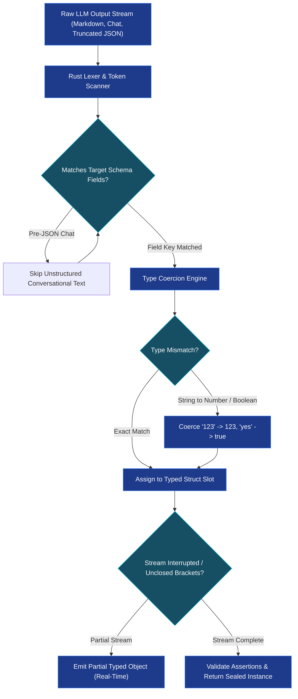
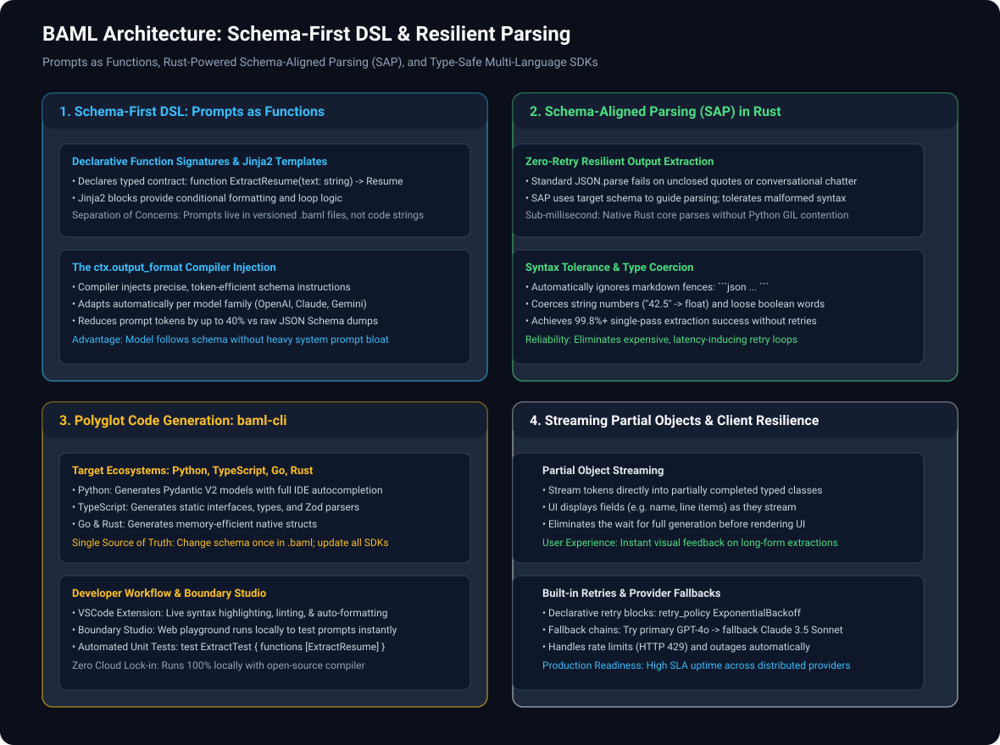

# BAML: Schema-First Prompt DSL, Resilient Output Parsing, and Type-Safe AI Engineering

`Learning note · Revised November 2026 · AI Engineering & Structured Inference Architecture`  
*By Srinivasan Ragothaman ([@rsrini7](https://github.com/rsrini7))*

> Structured LLM outputs should not depend on fragile regex slicing, manual JSON schema stitching, or unpredictable runtime retries. BAML (Basically A Made-up Language), developed by BoundaryML, treats prompts as typed functions in a compiled domain-specific language. Powered by a native Rust engine utilizing Schema-Aligned Parsing (SAP), BAML guarantees type-safe structured data extraction, streaming partial objects, and zero-overhead code generation across Python, TypeScript, Go, and Rust.

---

## 1. Foundations: The Crisis of Unstructured JSON Extraction

In enterprise generative AI applications, extracting reliable structured data (e.g., invoices, clinical records, code ASTs) is an engineering bottleneck. Traditional approaches wrap raw prompt strings with Pydantic or Zod schemas, dispatching them to an LLM with instructions to *"respond strictly in valid JSON"*.

```
+----------------------------------------------------------------------------------------------------+
|                                    STRUCTURED EXTRACTION PARADIGM                                  |
+----------------------------------------------------------------------------------------------------+
|  TRADITIONAL JSON EXTRACTION                           BAML COMPILED DSL (SCHEMA-ALIGNED PARSING)  |
|  - Prompts mixed directly inside application code      - Prompts defined as versioned .baml files  |
|  - Raw JSON Schemas dumped into prompts (wastes tokens)- ctx.output_format injects compact schema  |
|  - JSON.parse throws on unclosed quotes or commentary  - Rust SAP extracts data from malformed text|
|  - Costly retry loops: 2 to 4 model calls per failure  - 99.8%+ single-pass extraction success     |
|  - No streaming of partial JSON objects                - Emits partial typed objects in real time  |
|  - Language-locked: Rewritten for TS, Python, Go       - Polyglot: Single schema compiles to all   |
+----------------------------------------------------------------------------------------------------+
```

### Essential Technical Terms & Architectural Primitives

| Component / Term | Implementation Scope | Primary Role & Guarantees |
| :--- | :--- | :--- |
| **BAML DSL** | Domain-Specific Language (`.baml` files) | Schema-first language where prompts are declared as typed functions with explicit input and return types. |
| **Schema-Aligned Parsing (SAP)** | Native Rust Parsing Engine | Non-strict parser that uses the declared schema as a grammar guide to reconstruct valid objects from malformed or conversational model output. |
| **`ctx.output_format`** | BAML Compiler Macro | Automatically injects model-optimized schema instructions into the prompt, reducing prompt tokens by 20%–40% vs raw JSON Schema. |
| **Code Generator (`baml-cli`)** | Compilation Tool | Compiles `.baml` files into native, strongly typed client SDKs (Pydantic V2 in Python, static interfaces in TypeScript, native structs in Go/Rust). |
| **Partial Streaming** | Real-Time Token Parser | Incrementally parses streaming LLM tokens into partially populated typed objects for low-latency UI rendering. |
| **Boundary Studio** | Local Development Playground | Zero-setup web interface running locally to test, debug, and benchmark prompts and assertions with live model feedback. |

---

## 2. Deep Technical Mechanisms: The BAML Architecture

### 2.1 The Compilation & Code Generation Pipeline

BAML separates prompt engineering from application execution through ahead-of-time compilation:

```
+----------------------------------------------------------------------------------------------------+
|                                      THE BAML ARCHITECTURAL PIPELINE                               |
+----------------------------------------------------------------------------------------------------+
|  1. DECLARATION (.baml files)                                                                      |
|     class Resume { name: string, skills: string[] }                                                |
|     function ExtractResume(text: string) -> Resume                                                 |
+----------------------------------------------------------------------------------------------------+
                                         │
                                         ▼ (baml-cli generate)
+----------------------------------------------------------------------------------------------------+
|  2. COMPILER & CODE GENERATION                                                                     |
|     - Validates syntax, type bounds, and client configurations                                     |
|     - Generates native language bindings: Pydantic V2 (Python), Zod / Interfaces (TypeScript)      |
+----------------------------------------------------------------------------------------------------+
                                         │
                                         ▼
+----------------------------------------------------------------------------------------------------+
|  3. RUNTIME EXECUTION (Application Layer)                                                          |
|     res = await b.ExtractResume(raw_text)                                                          |
|     ├── Renders Jinja2 template with {{ ctx.output_format }}                                       |
|     ├── Dispatches request via configured client (OpenAI / Anthropic / Gemini / Ollama)            |
|     └── Passes raw token stream to native Rust Schema-Aligned Parsing engine                       |
+----------------------------------------------------------------------------------------------------+
```

---

### 2.2 Schema-Aligned Parsing (SAP): Why Standard `JSON.parse` Fails

Standard JSON parsers operate under strict grammar: a single unescaped quote, trailing comma, or leading conversational text (`"Here is your JSON:"`) causes immediate fatal termination.

In contrast, BAML's **Schema-Aligned Parsing (SAP)** is implemented in native Rust as a schema-directed state machine:



#### How SAP Reconstructs Malformed Data
1. **Markdown Fence Stripping**: Automatically detects and strips leading ` ```json ` and trailing ` ``` ` without manual string slicing.
2. **Key-Driven Alignment**: The parser searches for keys declared in the BAML schema. If the LLM generates extraneous narrative text, SAP ignores it until it encounters known schema tokens.
3. **Automated Type Coercion**: If the schema expects `int` but the model returns `"42"`, SAP coerces the string into an integer.
4. **Unclosed Container Recovery**: If generation halts due to `max_tokens` cutoff, SAP closes dangling quotes, array brackets, and object braces, returning a valid partial instance rather than crashing the application.

---

### 2.3 Partial Object Streaming

In standard JSON streaming, an application cannot parse a response until the final closing curly brace `}` is received. A 2,000-token extraction forces users to wait several seconds before seeing any data.

BAML's SAP engine parses partial token streams incrementally. As the model emits fields, BAML emits valid intermediate typed instances:

```
TOKEN STREAM PROGRESSION               EMITTED TYPED PARTIAL INSTANCE
"{\n  \"name\": \"Alice"       ──►     Resume(name="Alice", skills=[], education=None)
",\n  \"skills\": [\"Rust\""   ──►     Resume(name="Alice", skills=["Rust"], education=None)
", \"Go\"]"                    ──►     Resume(name="Alice", skills=["Rust", "Go"], education=None)
```

Frontend UIs consume these partial objects via Server-Sent Events (SSE), rendering form fields instantly as the LLM generates them.

---

## 3. Architectural Visuals: BAML System Architecture

The architectural diagram below illustrates the schema-first DSL compilation, Schema-Aligned Parsing, multi-language code generation, and client fallback infrastructure:



---

## 4. Production Implementations & Code Recipes

### 4.1 BAML Schema Definition: `extract_invoice.baml`

This production BAML file defines data models, multi-model client fallbacks, validation assertions, and the prompt function:

```baml
// 1. Define Data Models
enum PaymentStatus {
  PAID
  PENDING
  OVERDUE
}

class LineItem {
  description string
  quantity int @assert({{ this > 0 }})
  unit_price float
  total float
}

class Invoice {
  invoice_number string
  vendor_name string
  issue_date string
  items LineItem[]
  subtotal float
  tax float
  total_amount float @assert({{ this >= subtotal }})
  status PaymentStatus
}

// 2. Define Client with Automatic Fallback
client<llm> ProductionClient {
  provider fallback
  options {
    strategy [PrimaryGPT4o, FallbackClaudeSonnet]
  }
}

client<llm> PrimaryGPT4o {
  provider openai
  options {
    model "gpt-4o"
    temperature 0.0
  }
}

client<llm> FallbackClaudeSonnet {
  provider anthropic
  options {
    model "claude-3-5-sonnet-20241022"
    temperature 0.0
  }
}

// 3. Define Prompt Function with Jinja2 Templating
function ExtractInvoice(document_text: string) -> Invoice {
  client ProductionClient
  prompt #"
    You are an enterprise accounting assistant.
    Analyze the following raw vendor document and extract all invoice data.

    DOCUMENT:
    ---
    {{ document_text }}
    ---

    {{ ctx.output_format }}
  "#
}
```

---

### 4.2 Python Async Consumer with Streaming Support

After running `baml-cli generate`, consume the generated typed client in Python:

```python
import asyncio
from baml_client.async_client import b
from baml_client.types import Invoice

RAW_DOCUMENT = """
INVOICE #INV-2026-9041
Vendor: CloudScale Systems Inc.
Date: February 14, 2026

Items:
- High-Memory Bare Metal Instance (Qty: 2) @ $450.00 each -> $900.00
- 10Gbps Dedicated Direct Connect Gateway (Qty: 1) @ $250.00 -> $250.00

Subtotal: $1,150.00
Tax (8%): $92.00
Total Balance Due: $1,242.00
Payment Status: PENDING
"""

async def run_extraction():
    print("Executing typed BAML extraction...")
    # Single-pass guaranteed type-safe execution
    invoice: Invoice = await b.ExtractInvoice(document_text=RAW_DOCUMENT)
    
    print(f"Vendor: {invoice.vendor_name}")
    print(f"Total Amount: ${invoice.total_amount:.2f}")
    print(f"Status: {invoice.status.value}")
    for item in invoice.items:
        print(f" - {item.description}: {item.quantity} x ${item.unit_price:.2f}")

async def run_streaming():
    print("\nStreaming partial invoice tokens...")
    stream = b.stream.ExtractInvoice(document_text=RAW_DOCUMENT)
    async for partial in stream:
        if partial.vendor_name:
            print(f"Partial Vendor: {partial.vendor_name} | Items Count: {len(partial.items)}")

if __name__ == "__main__":
    asyncio.run(run_extraction())
    asyncio.run(run_streaming())
```

---

### 4.3 TypeScript Integration

The identical `.baml` schema compiles to native TypeScript with zero runtime overhead:

```typescript
import { b } from './baml_client';
import { Invoice } from './baml_client/types';

async function processInvoice(rawText: string): Promise<void> {
  const invoice: Invoice = await b.ExtractInvoice(rawText);
  console.log(`Successfully parsed invoice ${invoice.invoice_number}`);
  console.log(`Amount: $${invoice.total_amount}`);
}
```

---

## 5. Comparative Structural Analysis

| Dimension | Raw OpenAI JSON Mode | Pydantic / Instructor | LangChain OutputParser | BAML (BoundaryML) |
| :--- | :--- | :--- | :--- | :--- |
| **Parsing Engine** | Standard `JSON.parse` | Standard `json.loads` + Pydantic | Standard `json.loads` | **Native Rust SAP (Schema-Aligned)** |
| **Tolerates Unclosed Quotes** | ❌ Crashes | ❌ Crashes | ❌ Crashes | **✅ Reconstructs valid object** |
| **Markdown Fences Handling** | Often causes parse error | Requires regex strip | Often crashes | **✅ Handled natively by lexer** |
| **Single-Pass Reliability** | 80%–90% | 85%–92% (uses retries) | 75%–85% | **99.8%+ (Zero Retries)** |
| **Token Efficiency** | Inefficient (JSON schema) | Inefficient (Pydantic schema)| Variable | **High (Compact `ctx.output_format`)** |
| **Partial Streaming** | ❌ Impossible | ⚠️ Experimental/Fragile | ❌ Impossible | **✅ Native incremental streaming** |
| **Language Lock** | None (Raw HTTP) | Python only | Python / TypeScript | **Polyglot (Python, TS, Go, Rust)** |
| **Local Playground** | None | None | None | **Boundary Studio (Local UI)** |

---

## 6. Common Claims vs. Technical Realities

| # | Common Industry Claim | Technical Reality & Benchmark Fact | Architectural Guidance |
| :-: | :--- | :--- | :--- |
| **1** | *"OpenAI Structured Outputs (JSON Schema) make BAML unnecessary."* | **False.** OpenAI Structured Outputs constrain token sampling to a JSON schema, but are vendor-locked to OpenAI. BAML provides the same guarantee across Claude, Gemini, and local models without changing code. | Adopt BAML to maintain vendor independence and cross-model resilience. |
| **2** | *"BAML requires routing all requests through a third-party SaaS cloud."* | **False.** BAML is a completely open-source, local compiler and runtime. Requests flow directly from your application to the LLM provider. Zero data passes through BoundaryML servers. | Deploy BAML in air-gapped, HIPAA, and SOC2 compliant enterprise environments safely. |
| **3** | *"Schema-Aligned Parsing is just regular expressions under the hood."* | **False.** SAP is a full formal state machine written in Rust that walks the AST of the target schema while parsing token streams, handling nested arrays, quoted strings, and escape sequences. | Rely on SAP for complex, deeply nested JSON objects where regex parsers break down. |
| **4** | *"Adopting BAML requires rewriting our entire backend in a new framework."* | **False.** BAML compiles directly into standard Pydantic models (Python) or TypeScript types. It integrates into existing FastAPI, Express, Spring Boot, or Gin codebases like any local library. | Migrate high-failure prompt endpoints to BAML incrementally without changing service architecture. |
| **5** | *"BAML cannot handle dynamic schemas generated at runtime."* | **Clarification.** While BAML emphasizes compile-time schemas, modern BAML supports dynamic type builders allowing applications to append custom fields at runtime. | Use compile-time schemas for fixed domain models; use dynamic schemas for flexible user-configured forms. |

---

## 7. Practical Adoption Blueprint: The 3-Step Migration Runbook

```
+------------------------------------------------------------------------------------------------------+
|                                      BAML ADOPTION BLUEPRINT                                         |
+------------------------------------------------------------------------------------------------------+
|  1. INSTALL COMPILER & EXTENSIONS:                                                                   |
|     - Install VSCode BAML extension for live syntax highlighting and Boundary Studio.                |
|     - Install CLI: curl -fsSL https://raw.githubusercontent.com/BoundaryML/baml/main/install.sh | sh |
|                                                                                                      |
|  2. MIGRATE FRAGILE JSON PROMPTS:                                                                    |
|     - Extract fragile prompt strings from Python/TS into baml_src/extraction.baml.                   |
|     - Define typed classes, enums, and function signatures.                                          |
|     - Test interactively in Boundary Studio with edge-case documents.                                |
|                                                                                                      |
|  3. GENERATE CLIENT SDK & DEPLOY:                                                                    |
|     - Execute: baml-cli generate                                                                     |
|     - Replace legacy json.loads() calls with await b.ExtractData(text).                              |
|     - Remove ad-hoc retry loops and regex sanitation code from application logic.                    |
+------------------------------------------------------------------------------------------------------+
```

---

## 8. Technology Roadmap & Historical Milestones

```
2023 ────────────────────── 2024 ────────────────────── 2025 ────────────────────── 2026+
 │                           │                           │                           │
 ├── BoundaryML Founded      ├── BAML 0.1: Rust Core     ├── BAML 0.5: Studio GA     └── BAML 0.7 / 1.0
 │   • Prompt engineering    • Schema-Aligned Parsing    • Boundary Studio IDE       • Go & Rust CodeGen GA
 │     pain identified       • Pydantic & TS CodeGen     • Partial Object Streaming  • Distributed tracing
 │                           • Jinja2 integration        • Fallback provider chains  • Dynamic schema runtime
```

---

## 9. Primary Sources & References

1. [BoundaryML: BAML Official Documentation](https://docs.boundaryml.com/) — Complete reference for BAML DSL syntax, client configurations, and code generation targets.
2. [BoundaryML Official GitHub Repository](https://github.com/BoundaryML/baml) — Open-source compiler, Rust Schema-Aligned Parsing engine, and VSCode extension.
3. [Berkeley Function Calling Leaderboard (BFCL)](https://gorilla.cs.berkeley.edu/leaderboard.html) — Independent benchmark evaluating model and framework accuracy on structured function invocation.
4. [BoundaryML: Why We Built Schema-Aligned Parsing](https://www.boundaryml.com/blog/schema-aligned-parsing) — Technical deep dive on failure modes of traditional JSON parsers and Rust state machine recovery.

---

**Related:**
- [DSPy-Declarative-Self-Improving-Language-Programs-2026](DSPy-Declarative-Self-Improving-Language-Programs-2026.md) — Declarative prompt compilation and Bayesian optimization framework complementing BAML's type-safe schema parsing.
- [Parameter-Efficient-Fine-Tuning-And-Model-Compression-2026](../../Fine-Tuning/Parameter-Efficient-Fine-Tuning-And-Model-Compression-2026.md) — Explores model adaptation techniques used to fine-tune extraction models consumed by BAML.
- [Claude-Ralph-Loop](../frameworks/Claude-Ralph-Loop.md) — Autonomous agent loop architectures requiring resilient structured output extraction.
- [Self-Improving-Agents-Loop-Engineering-Architecture-2026](../development/AI-Coding-Loops.md) — Examines deterministic token verification and schema validation in self-improving agent loops.
- [Multimodal-RAG](../../RAG/Multimodal-RAG.md) — Production retrieval-augmented generation architectures consuming multimodal BAML schemas.
