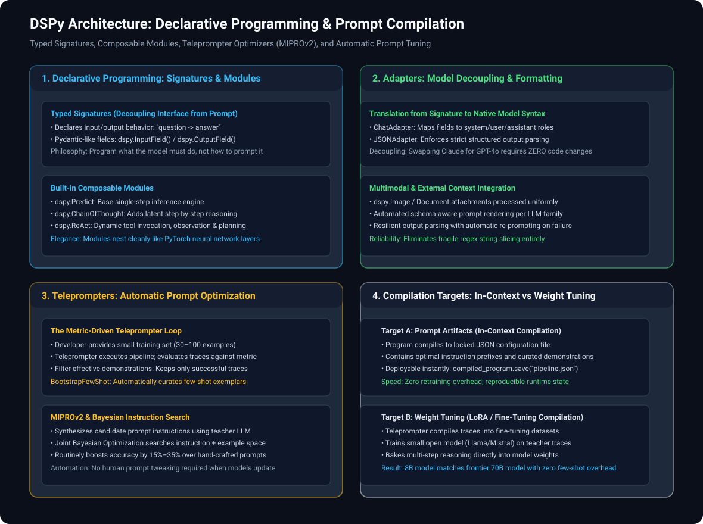
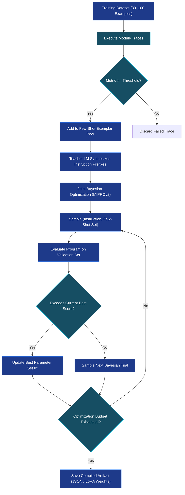

# DSPy: Declarative Programming, Automatic Prompt Optimization, and Self-Improving Language Pipelines

`Learning note · Revised November 2026 · Agentic Frameworks & Prompt Compilers`  
*By Srinivasan Ragothaman ([@rsrini7](https://github.com/rsrini7))*

> Prompt engineering is the assembly language of the generative AI era. DSPy (Declarative Self-improving Python), created by Stanford NLP, abstracts fragile hand-crafted prompt strings into typed Signatures, modular pipelines, and metric-driven teleprompter optimizers. By decoupling application intent from model-specific syntax, DSPy compiles high-level programs, synthesizes optimal instruction prefixes, curates few-shot demonstrations, and fine-tunes model weights automatically across changing foundation models.

---

## 1. Foundations: From Prompt Hacking to Declarative Programming

Traditional LLM application development relies on string concatenation, manual few-shot examples, and heuristic "jailbreaks" to force models into structured behaviors. When underlying models are upgraded (e.g., GPT-4 to GPT-4o, or Claude 3.5 Sonnet to Opus), these hand-tuned prompt strings degrade unpredictably.

```
+-----------------------------------------------------------------------------------------------------+
|                                    LLM PROGRAMMING PARADIGM SHIFT                                   |
+-----------------------------------------------------------------------------------------------------+
|  TRADITIONAL PROMPT ENGINEERING                        DSPY DECLARATIVE PROGRAMMING                 |
|  - Fragile raw strings with manual few-shot examples   - Strongly typed Signatures (Input -> Output)|
|  - Hardcoded instructions tied to a single model       - Composable Modules (Predict, CoT, ReAct)   |
|  - Manual regex string parsing and slicing             - Native Adapters (Chat, JSON, Tool schemas) |
|  - Manual prompt tweaking when model updates           - Teleprompters compile & optimize prompts   |
|  - Zero quantitative optimization loop                 - Programmatic metric-driven optimization    |
|  - Ad-hoc prompt evaluation                            - Mathematical validation across train/val   |
+-----------------------------------------------------------------------------------------------------+
```

### Essential Technical Terms & Architectural Primitives

| Component / Term | Functional Role in DSPy | Architectural Significance |
| :--- | :--- | :--- |
| **Signature** | Declarative specification of input and output fields | Abstract contract defining *what* the transformation does, independent of prompt phrasing. |
| **Module** | Composable unit of processing (`Predict`, `ChainOfThought`, `ReAct`) | Implements prompting strategies as reusable layers, identical to `torch.nn.Module` in deep learning. |
| **Adapter** | Bridge between abstract signatures and native LLM APIs | Formats signatures into chat messages, JSON schemas, or tool calls without modifying business logic. |
| **Teleprompter / Optimizer** | Parameter-tuning algorithm (`BootstrapFewShot`, `MIPROv2`, `COPRO`) | Explores prompt space to synthesize effective instruction prefixes and select optimal few-shot exemplars. |
| **Metric Function** | Programmatic evaluation function: `metric(gold, pred, trace) -> float` | Guides the teleprompter by quantifying correctness, schema adherence, or reasoning depth. |
| **Compilation** | Execution pass over a training set to produce an optimized artifact | Compiles an unoptimized program into locked prompt configurations or fine-tuned LoRA weights. |

---

## 2. Deep Technical Mechanisms: The DSPy Execution & Compilation Pipeline

### 2.1 The 4-Stage Execution Pipeline

When a DSPy module is executed, it passes through four distinct transformation boundaries:

```
INPUT QUERY ──► [ 1. Signature Mapping ] ──► [ 2. Adapter Formatting ] ──► [ 3. LM Invocation ]
                     │                             │                            │
                     ▼                             ▼                            ▼
               Typed Input Fields            Chat / JSON Schema           Model Generates Tokens
                     │                             │                            │
                     └─────────────────────────────┴────────────────────────────┘
                                                   │
                                                   ▼
OUTPUT OBJECT ◄── [ 4. Output Parsing & Self-Healing ]
```

1. **Signature Mapping**: The application passes input keyword arguments to the module. DSPy validates them against the declared signature schema (e.g., `question: str -> answer: str`).
2. **Adapter Formatting**: The active adapter (`ChatAdapter` or `JSONAdapter`) compiles the signature and any attached few-shot demonstrations into the model's native wire format (OpenAI Chat format, Anthropic XML blocks, or local GGUF prompt templates).
3. **LM Invocation**: The configured language model (`dspy.LM`) executes the query.
4. **Output Parsing & Self-Healing**: The adapter parses output tokens back into typed fields. If the output fails validation (e.g., invalid JSON or missing field), DSPy initiates an automated re-prompting loop (`dspy.Suggest` or `dspy.Assert`) with targeted error feedback.

---

### 2.2 Teleprompter & Optimizer Mechanics: MIPROv2 and BootstrapFewShot

DSPy treats prompt tuning as a formal optimization problem over discrete prompt components:

$$\theta^* = \arg\max_{\theta \in \Theta} \sum_{i=1}^N \mathcal{M}(y_i, f_\theta(x_i))$$

Where $\theta$ represents the prompt parameters (instruction prefixes and few-shot demonstrations), $f_\theta$ is the compiled program, and $\mathcal{M}$ is the developer-defined evaluation metric.

```
THE TELEPROMPTER COMPILATION LOOP (MIPROv2)
+-----------------------------------------------------------------------------------+
| 1. TRACE GENERATION (Bootstrap Phase)                                             |
|    Execute program over training set; record execution graph traces               |
|    Retain traces where metric(gold, pred) == True                                 |
+-----------------------------------------------------------------------------------+
                                         │
                                         ▼ (High-Quality Candidate Exemplars)
+-----------------------------------------------------------------------------------+
| 2. INSTRUCTION SYNTHESIS (Teacher Model)                                          |
|    Teacher LLM inspects signatures, candidate traces, and failure modes           |
|    Synthesizes diverse candidate instruction prefixes                             |
+-----------------------------------------------------------------------------------+
                                         │
                                         ▼ (Instruction Candidates + Few-Shot Pools)
+-----------------------------------------------------------------------------------+
| 3. JOINT BAYESIAN OPTIMIZATION                                                    |
|    Sample combination of instruction + few-shot traces                            |
|    Evaluate across validation dataset; model score via Tree-structured Parzen     |
|    Estimators (TPE) to converge on optimal prompt configuration                   |
+-----------------------------------------------------------------------------------+
                                         │
                                         ▼
+-----------------------------------------------------------------------------------+
| COMPILED ARTIFACT: program.save("compiled_reasoner.json")                         |
+-----------------------------------------------------------------------------------+
```

---

### 2.3 Compilation Targets: Prompt Artifacts vs. Weight Tuning

DSPy supports two compilation modalities:
1. **In-Context Compilation**: Optimizes prompt instructions and exemplars. The output is a lightweight JSON state file containing prefix strings and demonstration histories. It deploys immediately without modifying model weights.
2. **Weight Tuning Compilation**: For high-volume production deployments where few-shot prompts consume too many input tokens, DSPy compiles successful execution traces directly into a fine-tuning dataset. It trains a small open-weight model (e.g., Llama-3-8B or Mistral-7B) using LoRA, baking the multi-step reasoning behavior directly into model weights and reducing inference latency by **60%–80%**.

---

## 3. Architectural Visuals: The DSPy Pipeline

The architectural diagram below illustrates the end-to-end progression from typed signatures and modular composition to adapter translation, teleprompter optimization, and artifact compilation:



---

### MIPROv2 Optimization Flowchart



---

## 4. Production Implementations & Code Recipes

### 4.1 Production Multi-Step Reasoning Pipeline with Optimization

This standalone Python recipe implements a multi-step financial extraction pipeline, custom evaluation metric, and automated optimization using `BootstrapFewShotWithRandomSearch`:

```python
import dspy
from typing import List

# Step 1: Configure Language Model
lm = dspy.LM("openai/gpt-4o-mini", api_key="sk-...", temperature=0.0)
dspy.configure(lm=lm)

# Step 2: Define Strongly Typed Signatures
class FinancialDocumentExtraction(dspy.Signature):
    """Analyze SEC financial disclosure text and extract material metrics."""
    filing_text: str = dspy.InputField(desc="Raw text snippet from SEC 10-K or 10-Q filing")
    target_metric: str = dspy.InputField(desc="The financial metric to extract (e.g., Net Income, EBITDA)")
    rationale: str = dspy.OutputField(desc="Step-by-step reasoning identifying the metric and accounting period")
    extracted_value: float = dspy.OutputField(desc="Normalized numerical value in USD millions")

# Step 3: Define Composable Module
class FinancialAnalysisPipeline(dspy.Module):
    def __init__(self):
        super().__init__()
        # ChainOfThought generates latent step-by-step reasoning before output fields
        self.extractor = dspy.ChainOfThought(FinancialDocumentExtraction)

    def forward(self, filing_text: str, target_metric: str):
        return self.extractor(filing_text=filing_text, target_metric=target_metric)

# Step 4: Define Evaluation Metric
def financial_metric_eval(gold, pred, trace=None) -> float:
    # Strict matching: Normalized numerical value must match ground truth within 1% tolerance
    value_match = abs(gold.extracted_value - pred.extracted_value) <= (0.01 * gold.extracted_value)
    has_rationale = len(pred.rationale.strip()) > 30
    
    if value_match and has_rationale:
        return 1.0
    elif value_match:
        return 0.5
    return 0.0

# Step 5: Optimization & Compilation Harness
def compile_pipeline(trainset: List[dspy.Example], valset: List[dspy.Example]):
    pipeline = FinancialAnalysisPipeline()

    print("Compiling program with BootstrapFewShotWithRandomSearch...")
    teleprompter = dspy.teleprompt.BootstrapFewShotWithRandomSearch(
        metric=financial_metric_eval,
        max_bootstrapped_demos=4,
        max_labeled_demos=4,
        num_candidate_programs=8,
        num_threads=4
    )

    compiled_program = teleprompter.compile(pipeline, trainset=trainset, valset=valset)
    
    # Save optimized program to locked artifact
    compiled_program.save("compiled_financial_pipeline.json")
    print("Optimization complete. Artifact persisted.")
    return compiled_program

if __name__ == "__main__":
    # Sample synthetic train data
    trainset = [
        dspy.Example(
            filing_text="The company reported consolidated net income of $427.5 million for the fiscal year ended December 31, 2025.",
            target_metric="Net Income",
            extracted_value=427.5
        ).with_inputs("filing_text", "target_metric")
    ]
    
    # Run test inference with uncompiled module
    test_pipeline = FinancialAnalysisPipeline()
    result = test_pipeline(
        filing_text="Operating income stood at $850M while Net Income reached $427.5 million for Q4.",
        target_metric="Net Income"
    )
    print(f"Extracted Value: {result.extracted_value}")
    print(f"Rationale: {result.rationale}")
```

---

## 5. Comparative Framework Taxonomy

| Dimension | Raw Prompt Engineering | LangChain / LlamaIndex | DSPy (Stanford NLP) | BAML (Boundary) |
| :--- | :--- | :--- | :--- | :--- |
| **Abstraction Level** | String concatenation | Wrapper templates & chains | Typed compiler modules | Schema-first DSL |
| **Prompt Maintenance** | 100% manual | 100% manual | **Automated via teleprompters** | Manual Jinja2 with type checks |
| **Model Portability** | Low (prompts break across LLMs) | Low (prompts require retuning) | **High (recompiles for any LLM)** | High (decoupled DSL) |
| **Optimization Loop** | None | Ad-hoc evaluation | **Formal Bayesian & Few-Shot search** | Unit test assertions |
| **Few-Shot Selection** | Hardcoded by engineer | Vector similarity retrieval | **Bootstrapped on metric success** | Hardcoded in template |
| **Compilation to Weights** | Manual fine-tuning | N/A | **Direct compilation to LoRA/SFT** | N/A |
| **Language Ecosystem** | Any | Python, TypeScript | Python | Polyglot (Rust, TS, Python, Go) |

---

## 6. Common Claims vs. Technical Realities

| # | Common Industry Claim | Technical Reality & Benchmark Fact | Architectural Guidance |
| :-: | :--- | :--- | :--- |
| **1** | *"DSPy replaces the need for fine-tuning."* | **False.** DSPy complements fine-tuning. DSPy can optimize prompts in-context or compile successful traces into fine-tuning datasets to train local open models (LoRA). | Use DSPy in-context optimization for initial development; compile to fine-tuned weights for high-volume production. |
| **2** | *"You need thousands of labeled examples to use DSPy optimizers."* | **False.** Teleprompters like `BootstrapFewShot` and `MIPROv2` operate effectively on as few as **30 to 100 labeled examples** by leveraging teacher models to generate synthetic reasoning paths. | Curate 50 high-quality examples with deterministic metrics to unlock prompt compilation. |
| **3** | *"DSPy introduces significant runtime latency overhead."* | **False.** At runtime, a compiled DSPy program executes standard API calls using optimized instructions and exemplars. Optimization occurs offline during compilation. | Compile and test pipelines offline; deploy locked JSON configuration artifacts in production. |
| **4** | *"DSPy is only useful for academic benchmarks like GSM8K."* | **Disproven.** Enterprise teams deploy DSPy for complex multi-source RAG, document routing, legal contract extraction, and multi-turn agent planning. | Apply DSPy wherever brittle prompt strings cause production regression across model updates. |
| **5** | *"Hand-crafted prompts written by senior engineers always beat compiled prompts."* | **Empirically False.** Systematic prompt optimization routinely outperforms human intuition by discovering non-obvious phrasing, formatting cues, and negative constraints. | Use hand-crafted prompts as the baseline; allow DSPy optimizers to explore permutations systematically. |

---

## 7. Practical Adoption Blueprint: The 4-Week Migration Runbook

```
+----------------------------------------------------------------------------------------------------+
|                                    DSPY MIGRATION BLUEPRINT                                        |
+----------------------------------------------------------------------------------------------------+
|  WEEK 1: SIGNATURE DEFINITION & BASELINE                                                           |
|  - Convert legacy string prompts into strongly typed dspy.Signature classes.                       |
|  - Wrap business logic in dspy.Predict or dspy.ChainOfThought modules.                             |
|  - Establish baseline accuracy score on an evaluation split using uncompiled modules.              |
|                                                                                                    |
|  WEEK 2: METRIC FORMULATION & VALIDATION SET                                                       |
|  - Write programmatic validation functions checking exact match, schema bounds, or reasoning.      |
|  - Curate 50–100 representative examples covering edge cases, empty values, and adversarial inputs.|
|                                                                                                    |
|  WEEK 3: COMPILATION & OPTIMIZATION                                                                |
|  - Run BootstrapFewShotWithRandomSearch or MIPROv2 across candidate models.                        |
|  - Compare compiled program metrics against the human baseline; evaluate token cost trade-offs.    |
|                                                                                                    |
|  WEEK 4: PRODUCTION DEPLOYMENT & OBSERVABILITY                                                     |
|  - Serialize compiled program state: program.save("prod_v1.json").                                 |
|  - Instrument latency, token counts, and assertion failures in production microservices.           |
+----------------------------------------------------------------------------------------------------+
```

---

## 8. Technology Roadmap & Historical Evolution

```
2023 ────────────────────── 2024 ────────────────────── 2025 ────────────────────── 2026+
 │                           │                           │                           │
 ├── Oct 2023: DSPy Released ├── DSPy 2.4: MIPROv2       ├── DSPy 2.5: Adapters GA   └── DSPy 2.6 / 3.0
 │   • Stanford NLP debut    • Bayesian instruction opt  • Native Chat/JSON adapters • Unified weight & prompt opt
 │   • Signatures & Modules  • Multi-stage bootstrapping • Multimodal attachments    • Distributed agent teleprompters
 │   • BootstrapFewShot      • Open-model compilation    • Self-healing assertions   • Streaming async pipelines
```

---

## 9. Primary Sources & References

1. [Khattab et al. (2023): DSPy: Compiling Declarative Language Model Calls into Self-Improving Pipelines (arXiv:2310.03714)](https://arxiv.org/abs/2310.03714) — Foundational academic paper formalizing signatures, teleprompters, and declarative LLM programming.
2. [Stanford NLP: DSPy Official GitHub Repository](https://github.com/stanfordnlp/dspy) — Official source code, documentation, and architectural tutorials.
3. [Opsahl-Ong et al. (2024): Optimizing Instructions and Demonstrations for Multi-Stage Language Model Programs (MIPRO)](https://arxiv.org/abs/2406.11695) — Technical whitepaper introducing joint Bayesian prompt optimization.
4. [Omar Khattab: The Systems Mindset in AI Engineering](https://dspy.ai/) — Architectural philosophy on treating language models as modular computational units rather than monoliths.

---

**Related:**
- [BAML-Structured-LLM-Interaction-Framework-2026](BAML-Structured-LLM-Interaction-Framework-2026.md) — Complementary schema-first DSL providing type-safe, resilient structured output extraction across multiple programming languages.
- [Parameter-Efficient-Fine-Tuning-And-Model-Compression-2026](../../Fine-Tuning/Parameter-Efficient-Fine-Tuning-And-Model-Compression-2026.md) — Explores LoRA, QLoRA, and weight adaptation techniques targeted by DSPy compilation pipelines.
- [Claude-Ralph-Loop](../frameworks/Claude-Ralph-Loop.md) — Autonomous agent harness and loop engineering patterns that interface with declarative prompt modules.
- [Self-Improving-Agents-Loop-Engineering-Architecture-2026](../development/AI-Coding-Loops.md) — Evaluates reflective learning loops and self-improving execution environments.
- [Multimodal-RAG](../../RAG/Multimodal-RAG.md) — Production retrieval-augmented generation architectures optimized via DSPy pipeline teleprompters.
