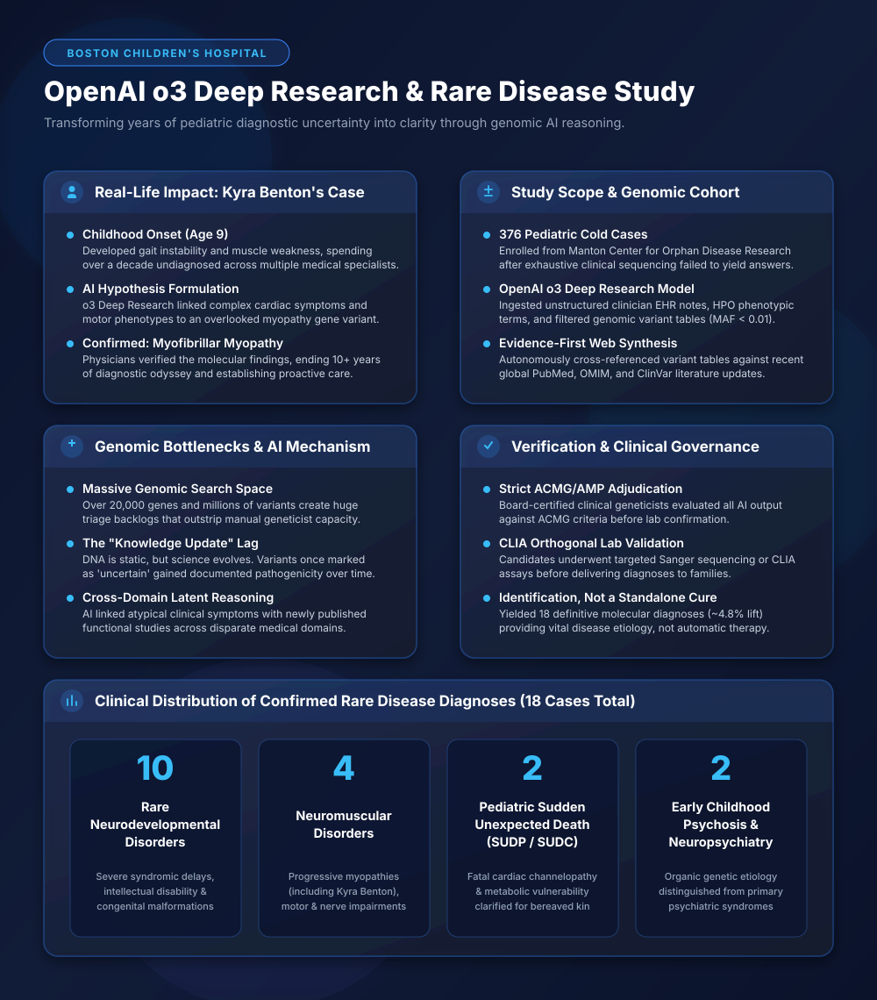
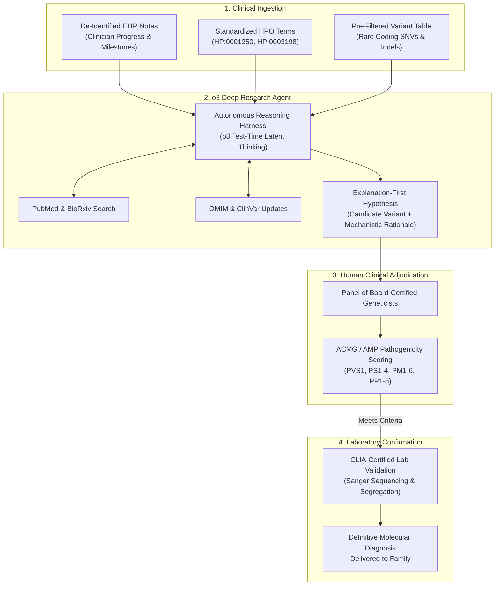
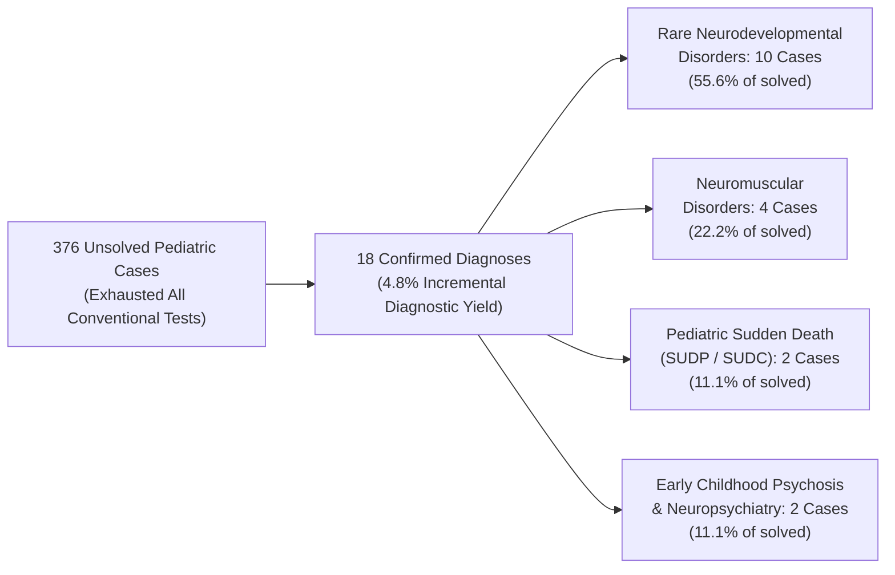

# Boston Children's Hospital and OpenAI o3: LLM-Assisted Genomic Reanalysis in Rare Pediatric Disease

**Daily learning · 9 November 2026 · Primary-source clinical evaluation**

> **Core idea:** Researchers from the **Manton Center for Orphan Disease Research at Boston Children's Hospital**, Harvard Medical School, and OpenAI deployed the **o3 Deep Research** reasoning model to reanalyze 376 pediatric "cold cases"—complex, undiagnosed rare disease patients whose standard whole-genome and exome sequencing had stalled for years. By cross-referencing patient clinical notes and phenotypic terms against constantly evolving biomedical literature, the AI surfaced evidence-backed hypotheses that led board-certified geneticists to establish **18 new definitive diagnoses** (~4.8% incremental yield). Crucially, this breakthrough delivers **molecular identification, not a medical cure**, ending grueling multi-year diagnostic odysseys and enabling targeted clinical management.

---



---

## 1. Foundations: The Rare Disease Backlog and the "Diagnostic Odyssey"

In clinical genetics, diagnosing a child with an ultra-rare disorder is one of medicine's most formidable challenges. Across the world, an estimated 300 million people live with one of roughly 7,000 known rare diseases, the vast majority of which have a monogenic (single-gene) origin. Families typically spend an average of **5 to 8 years** bouncing between dozens of specialists, enduring repetitive and invasive procedures (such as lumbar punctures and muscle biopsies), and facing repeated misdiagnoses—a harrowing journey clinicians call the **"diagnostic odyssey."**

### Normal Clinical Practice vs. The Unsolved Cohort

In a standard clinical genetics workup, when a pediatric patient presents with severe unexplained symptoms (such as progressive developmental arrest or early-onset neuromuscular failure), clinicians sequence the patient's protein-coding DNA using **Whole Exome Sequencing (WES)** or **Whole Genome Sequencing (WGS)**:

1. **Sequencing and Alignment:** High-throughput sequencers map millions of short DNA reads against the human reference genome.
2. **Variant Calling:** Algorithms identify single nucleotide variants (SNVs), small insertions/deletions (indels), and copy number variations (CNVs). A typical human exome contains 20,000 to 50,000 variants; a whole genome contains over 3 to 4 million variants.
3. **Bioinformatic Filtering:** Variants are filtered by population frequency (e.g., removing variants with an allele frequency $\ge 1\%$ in global population databases like gnomAD) and predicted functional severity (nonsense, frameshift, splice site disruption).
4. **Manual Expert Curation:** A team of board-certified clinical geneticists and molecular pathologists manually evaluates the top candidate variants against published academic literature using the **American College of Medical Genetics and Genomics / Association for Molecular Pathology (ACMG/AMP)** five-tier classification:
   - **Pathogenic**
   - **Likely Pathogenic**
   - **Variant of Uncertain Significance (VUS)**
   - **Likely Benign**
   - **Benign**

Despite cutting-edge sequencing, **more than 50% of rare disease patients remain without a definitive molecular diagnosis after initial clinical evaluation**.

### Why Medical "Cold Cases" Stall: The Knowledge Lag

The reason these cases remain unsolved is rarely that the patient's DNA was missing a mutation. Rather, it is due to an insurmountable **knowledge lag**:
- **Static DNA vs. Dynamic Science:** A child's genomic sequence does not change, but global medical knowledge expands rapidly. More than 300 new disease-gene links and thousands of novel variant pathogenicity updates are published annually across PubMed, OMIM, and ClinVar.
- **The "VUS Haystack":** When a child is sequenced in 2015, a causative mutation in an uncharacterized gene is categorized as a *Variant of Uncertain Significance (VUS)* because no academic papers have yet linked that gene to human disease. By 2024, independent research groups in Europe or Japan may have published a functional characterization of that exact gene in animal models or small patient series.
- **The Human Bottleneck:** Manually re-curating exomes is painstakingly slow. A clinical geneticist requires hours to days to re-read literature, translate unstructured electronic health record (EHR) notes into structured phenotypes, and cross-reference multiple disparate biological databases. With millions of undiagnosed patients and severe shortages of certified medical geneticists, hospitals lack the bandwidth to routinely reanalyze historical genomic data.

### Key Entities in the Collaborative Study

| Organization / Entity | Core Role | Significance in this Breakthrough |
|---|---|---|
| **Manton Center for Orphan Disease Research (Boston Children's Hospital)** | World-leading pediatric research institute (led scientifically by Dr. Catherine Brownstein) | Provided the deeply phenotyped cohort of 376 pediatric rare-disease "cold cases" that had previously baffled international specialists. |
| **Harvard Medical School** | Academic medical research institution | Collaborated on clinical evaluation frameworks, genetic adjudication, and statistical analysis. |
| **OpenAI** | Frontier AI laboratory (Aaron Jaech, Morgan Cheatham, et al.) | Developed and deployed the **o3 Deep Research** reasoning agent, tailoring multi-step search and reasoning harnesses for biomedical literature. |
| **ACMG / AMP Governance** | Professional medical genetics standards bodies | Governed the strict clinical criteria required before any AI-generated hypothesis could be declared a confirmed diagnosis. |

### Technical Comparison: Reanalysis Paradigms

```
┌────────────────────────────────────────────────────────────────────────────────────────────────────────┐
│                              Genomic Variant Reanalysis Methodologies                                  │
├──────────────────────────────┬──────────────────────────────┬──────────────────────────────────────────┤
│ Approach                     │ Primary Strength             │ Critical Bottleneck                      │
├──────────────────────────────┼──────────────────────────────┼──────────────────────────────────────────┤
│ Manual Geneticist Curation   │ High clinical precision;     │ Extremely slow; cannot scale across      │
│                              │ zero hallucination risk      │ thousands of historical cold cases       │
├──────────────────────────────┼──────────────────────────────┼──────────────────────────────────────────┤
│ Standard Bioinformatic Tools │ Automated score filtering    │ Rigid rules; misses nuanced cross-domain │
│ (Exomiser, AMAC, SIFT, CADD) │ based on known gene sets     │ phenotypes and newly published papers    │
├──────────────────────────────┼──────────────────────────────┼──────────────────────────────────────────┤
│ Standard LLM Zero-Shot Chat  │ Fast textual summarization   │ Severe hallucination rate; cannot        │
│ (GPT-4, Claude 3.5 Sonnet)   │                              │ verify obscure biological literature     │
├──────────────────────────────┼──────────────────────────────┼──────────────────────────────────────────┤
│ Autonomous Reasoning Agent   │ Multi-step latent search;    │ Higher inference compute cost; requires  │
│ (OpenAI o3 Deep Research)    │ evidence-first verification; │ strict human-in-the-loop CLIA validation │
│                              │ connects subtle phenotypic   │                                          │
│                              │ clues across global studies  │                                          │
└──────────────────────────────┴──────────────────────────────┴──────────────────────────────────────────┘
```

### Essential Terminology

| Term | Clinical & Computational Meaning |
|---|---|
| **WES / WGS** | Whole Exome Sequencing (sequencing the ~1.5% of the genome coding for proteins) / Whole Genome Sequencing (sequencing all 3 billion base pairs, including non-coding regulatory regions). |
| **VUS** | Variant of Uncertain Significance. A genetic alteration whose pathogenicity cannot be confirmed or ruled out under ACMG criteria due to conflicting or insufficient evidence. |
| **HPO** | Human Phenotype Ontology. A standardized, hierarchical vocabulary of phenotypic abnormalities encountered in human disease (e.g., `HP:0001250` for Seizures, `HP:0003198` for Myopathy). |
| **MAF / gnomAD** | Minor Allele Frequency / Genome Aggregation Database. The frequency at which a genetic variant occurs across large, healthy population cohorts; variants causing severe early-onset pediatric disease typically have $\text{MAF} < 0.001$ ($< 0.1\%$). |
| **OMIM** | Online Mendelian Inheritance in Man. The authoritative global catalog of human genes and genetic phenotypes. |
| **ClinVar** | A public archive hosted by the NCBI linking human genomic variations to observed clinical interpretations and supporting evidence. |
| **CLIA / CAP** | Clinical Laboratory Improvement Amendments / College of American Pathologists. Federal and industry regulatory standards certifying clinical diagnostic laboratories. |

---

## 2. Mechanism: The o3 Deep Research Multi-Stage Genomic Engine

The landmark study—published in *NEJM AI* on **June 18, 2026** under the title *"LLM-Assisted Reanalysis of Unsolved Rare Disease Genomes Increases Diagnostic Yield"*—introduced an **"explanation-first"** diagnostic reanalysis pipeline.

Rather than treating the model as a simple black-box classifier that outputs a single variant score, the architecture leverages OpenAI's **o3 Deep Research** reasoning agent to synthesize three unstructured and semi-structured input streams:
1. **Unstructured Clinical Notes:** De-identified physician encounter notes, discharge summaries, family histories, and developmental trajectory milestones from the hospital EHR.
2. **Structured Phenotypic Profiles:** High-level Human Phenotype Ontology (HPO) terms extracted from medical charts.
3. **Filtered Genomic Variant Tables:** Candidate variant call tables pre-filtered for rare minor allele frequencies ($\text{MAF} < 0.01$ in gnomAD) and predicted functional coding consequences.



### Step-by-Step Technical Execution

#### Step 1: Automated Phenotypic Extraction and Variant Pairing
The system extracts subtle clinical symptoms from historical notes that were previously considered incidental or unrelated. In complex multi-system disorders, a patient might present with a primary complaint of severe developmental delay, while minor incidental findings—such as mild cardiac conduction abnormalities, specific dental anomalies, or subtle facial dysmorphisms—were buried deep in old progress notes. The reasoning harness extracts these disparate clues into a unified phenotypic vector.

#### Step 2: "Explanation-First" Latent Thinking and Literature Synthesis
Unlike traditional bioinformatics algorithms that rely on pre-indexed static tables, **o3 Deep Research** uses extended test-time compute (reinforcement-learning-driven chain-of-thought) to generate multi-step search queries:
- The agent queries global biomedical literature (PubMed, PMC, OMIM, ClinVar) for recently published functional experiments, case reports, or newly solved family pedigrees.
- It formulates an **"explanation-first" narrative**: instead of merely ranking variants, it articulates a biological hypothesis:
  > *"Variant chr12:g.123456G>A causes a missense substitution in the motor domain of Gene X. While originally classified as a VUS in 2018, three independent case studies published between 2023 and 2025 demonstrated that heterozygous variants in this exact loop impair ATP hydrolysis, causing progressive limb-girdle weakness and subtle early cardiac dysrhythmias—a phenotypic match for this patient's presentation."*

#### Step 3: Human Clinical Adjudication under ACMG/AMP Guidelines
The AI model **never makes an autonomous diagnosis**. All output is delivered as an evidence packet with explicit citations and reasoning traces to a multidisciplinary panel of clinical geneticists at Boston Children's Hospital. The clinicians audit every premise against standard ACMG/AMP rules:
- **PVS1 (Pathogenic Very Strong):** Null variants in genes where loss-of-function is a known disease mechanism.
- **PS1–PS4 (Pathogenic Strong):** Same amino acid change as previously established pathogenic variants, well-established *in vitro* or *in vivo* functional studies, or prevalence in affected individuals significantly increased over controls.
- **PM1–PM6 (Pathogenic Moderate):** Located in mutational hotspots or critical functional domains, absent from large population controls (gnomAD), or *de novo* mutations.
- **PP1–PP5 (Pathogenic Supporting):** Co-segregation with disease in multiple affected family members or computational predictive tools supporting a deleterious effect.

#### Step 4: CLIA/CAP Orthogonal Wet-Lab Validation
Before any diagnosis was returned to the patient or family, the candidate variant underwent rigorous secondary testing in a **CLIA-certified, CAP-accredited diagnostic laboratory**:
- **Orthogonal Confirmation:** Targeted **Sanger sequencing** was performed on fresh DNA samples to confirm the variant was not a sequencing artifact or base-calling error from legacy high-throughput chemistry.
- **Parental Segregation Testing:** Blood samples from parents were analyzed to determine whether the mutation was *de novo* (spontaneously arising in the child) or inherited (recessive inheritance or variable penetrance in an asymptomatic carrier parent).

---

## 3. Impact and Limits: Diagnostic Identification vs. Medical Cure

### The Case of Kyra Benton: Ending a Decade of Uncertainty

One of the most compelling human stories highlighted from the cohort is that of **Kyra Benton**. 

Kyra began experiencing unexplained symptoms around age 9—subtle motor difficulties, toe-walking, and progressive physical fatigue. Over the subsequent decade, her mobility deteriorated, eventually requiring her to use a wheelchair, and she developed serious, life-threatening cardiac complications. Multiple rounds of specialized clinical evaluations and clinical exome sequencing across top-tier medical centers failed to find a cause; her genomic variants remained categorized as inconclusive VUSs.

When the Manton Center reanalyzed her de-identified genomic and clinical profile using the o3 Deep Research framework:
1. The AI cross-referenced her progressive motor symptoms and specific cardiac conduction phenotype against newly documented muscle-pathology studies.
2. It flagged a specific pathogenic variant in a structural muscle protein that had only recently been characterized in peer-reviewed literature.
3. The AI synthesized the literature and produced a detailed hypothesis linking her dual neuromuscular and cardiac presentation to **myofibrillar myopathy**—a rare, progressive genetic disorder characterized by the dissolution of myofibrils and abnormal accumulation of degradation products in muscle fibers.
4. Boston Children's physicians confirmed the molecular finding via targeted clinical testing shortly before her 20th birthday, finally ending a **10+ year diagnostic odyssey**.

```
┌────────────────────────────────────────────────────────────────────────────────────────────────────────┐
│                              Kyra Benton: Diagnostic Odyssey vs. AI Resolution                         │
├────────────────────────────────────────────────────────────────────────────────────────────────────────┤
│ • Onset: Age 9 (gait instability, toe-walking, progressive motor weakness)                             │
│ • Disease Trajectory: Progressive loss of ambulation, wheelchair reliance, onset of cardiac symptoms   │
│ • Diagnostic Odyssey: >10 years across multiple medical centers; routine WES returned inconclusive VUS │
│ • AI Intervention: o3 Deep Research synthesized cardiac notes with recent neuromuscular literature     │
│ • Molecular Diagnosis: Confirmed Myofibrillar Myopathy via secondary CLIA testing                      │
│ • Clinical Consequence: Focused cardiomyopathy monitoring, avoidance of contraindicated drugs,         │
│   and accurate disease management replacing endless exploratory procedures                             │
└────────────────────────────────────────────────────────────────────────────────────────────────────────┘
```

### Cohort Breakdown: The 18 Confirmed Diagnoses

Out of the 376 deeply evaluated pediatric cold cases at the Manton Center, the AI-assisted pipeline yielded **18 confirmed, definitive molecular diagnoses**, representing an **incremental diagnostic yield of 4.79% (~4.8%)**.

While a 4.8% increase might initially seem modest, clinical geneticists emphasize that this cohort consisted exclusively of **medical "cold cases"** that had already exhausted every conventional diagnostic tool, specialist consultation, and whole-exome sequencing run. In such treatment-resistant cohorts, even a 1–2% yield increase is considered a major clinical milestone.

The 18 solved cases fell into four primary clinical cohorts:



1. **Rare Neurodevelopmental Disorders (10 cases):** Severe syndromic intellectual disability, intractable infantile epilepsy, and complex congenital brain malformations where specific *de novo* mutations in transcriptional regulators or ion channels were pinpointed.
2. **Neuromuscular Disorders (4 cases):** Progressive muscular dystrophies and structural myopathies (including Kyra Benton's myofibrillar myopathy) where subtle structural protein variants were matched to emerging literature.
3. **Pediatric Sudden Unexpected Death / SUDP (2 cases):** Tragic cases where children had passed away suddenly without an apparent cause. Post-mortem genomic reanalysis identified fatal cardiac channelopathies (mutations predisposing to fatal arrhythmias), providing grieving families with essential answers and alerting living siblings to potential cardiac risks.
4. **Early Childhood Psychosis and Neuropsychiatry (2 cases):** Severe, treatment-refractory neuropsychiatric symptoms in young children that were revealed to stem from underlying organic, metabolic, or neurodegenerative monogenic defects rather than primary psychiatric etiologies.

### Critical Distinction: Identification vs. Cure

A common point of confusion in public discussions is equating a **molecular diagnosis** with a **medical cure**. The study was strictly an **etiological diagnostic tool**:

```
                       ┌───────────────────────────────────────────────┐
                       │          Etiological Identification           │
                       │   (What the AI and Geneticists Solved)        │
                       └───────────────────────┬───────────────────────┘
                                               │
                                               ▼
         ┌─────────────────────────────────────┴─────────────────────────────────────┐
         │                                                                           │
         ▼                                                                           ▼
┌─────────────────────────────────┐                         ┌─────────────────────────────────┐
│     What a Diagnosis DOES:      │                         │   What a Diagnosis DOES NOT:    │
├─────────────────────────────────┤                         ├─────────────────────────────────┤
│ • Ends the diagnostic odyssey   │                         │ • Does NOT magically cure the   │
│ • Eliminates invasive biopsies  │                         │   underlying genetic disease    │
│ • Prevents wrong/harmful drugs  │                         │ • Does NOT synthesize novel     │
│ • Guides cardiac/organ checks   │                         │   gene therapies or medicines   │
│ • Unlocks targeted drug trials  │                         │ • Does NOT reverse existing     │
│ • Informs reproductive planning │                         │   advanced tissue/nerve damage  │
└─────────────────────────────────┘                         └─────────────────────────────────┘
```

Why finding the cause is still life-altering:
- **Halting Dangerous Exploratory Interventions:** Undiagnosed children are frequently subjected to repeat bone marrow aspirates, spinal taps, and exploratory surgeries. An accurate molecular diagnosis immediately halts unnecessary testing.
- **Preventing Contraindicated Therapies:** In many metabolic and neuromuscular disorders, standard medications can be toxic. For instance, administering certain anesthetics to a patient with an undiagnosed mitochondrial or ryanodine receptor myopathy can trigger fatal malignant hyperthermia.
- **Targeted Organ Surveillance:** As in Kyra Benton's case, knowing that her specific myopathy carries a high risk of lethal cardiac conduction defects allows cardiologists to proactively implant a pacemaker or defibrillator before sudden cardiac arrest occurs.
- **Clinical Trial Enrollment and Orphan Drugs:** Pharmaceutical sponsors designing antisense oligonucleotides (ASOs) or CRISPR gene-editing therapies require unambiguous molecular confirmation before admitting patients into clinical trials.
- **Family Counseling:** For parents wondering if future children will inherit the condition, identifying whether the mutation is *de novo* or autosomal recessive provides precise recurrence risk estimates (near $0\%$ vs. $25\%$).

### Claim vs. Reality: Debunking Public Misconceptions

| Public Misconception / Media Claim | Empirical Reality (NEJM AI Primary Source) |
|---|---|
| *"AI found a cure for 18 sick children"* | **False.** The AI identified the root genetic cause (diagnosis). Curative therapies do not exist for the majority of rare diseases; however, the diagnosis radically altered clinical care. |
| *"A 9-year-old girl named Kyra spent 19 years in a wheelchair"* | **Factually garbled in secondary videos.** Kyra Benton's symptoms onset around age 9; she spent over a decade undiagnosed across multiple health systems before being diagnosed just prior to her 20th birthday. |
| *"The AI autonomously diagnosed patients without doctors"* | **False.** All AI hypotheses were reviewed by board-certified clinical geneticists, audited against strict ACMG/AMP criteria, and orthogonally validated in CLIA-certified wet labs. |
| *"Specific disease names were withheld to protect privacy"* | **Partially misleading.** While the 376 individual patient records remain de-identified per HIPAA and IRB protocols, the four broad clinical categories were published in *NEJM AI*, and Kyra Benton and her family consented to publicly disclose her diagnosis (myofibrillar myopathy). |
| *"Standard LLMs like ChatGPT can do this directly"* | **False.** Standard single-turn LLMs hallucinate biomedical citations and fail to reason across multi-thousand-variant VCF tables. The study required o3's multi-step test-time compute, reasoning chains, and live biomedical literature retrieval. |

---

## 4. Timeline and Clinical Milestones

```
2015 – 2023    Boston Children's Hospital enrolls 376 unresolved pediatric patients into the Manton Center
               Gene Discovery Core; exhaustive initial Whole Exome / Genome Sequencing stalls without diagnosis.
                     │
                     ▼
Early 2026     Manton Center researchers partner with OpenAI to adapt the o3 Deep Research reasoning agent
               for genomic reanalysis, ingesting clinical EHR notes, HPO terms, and filtered VCF data.
                     │
                     ▼
Spring 2026    The AI engine proposes evidence-grounded hypotheses; board-certified geneticists evaluate candidates
               under ACMG/AMP guidelines; CLIA-certified labs perform orthogonal Sanger validation.
                     │
                     ▼
18 June 2026   Landmark study published in NEJM AI (DOI: 10.1056/AIcs2501343): 18 confirmed diagnoses
               established out of 376 medical cold cases (~4.8% incremental yield).
                     │
                     ▼
Late 2026      Boston Children's Hospital and academic partners begin pilot integration of semi-automated
               AI literature-reanalysis pipelines for routine periodic evaluation of unsolved pediatric exomes.
```

---

## 5. Practical Response, Open-Source Tools, and Engineering Lessons

For computational biologists, clinical bioinformaticians, and AI engineers designing clinical decision support systems, the Boston Children's Hospital / OpenAI study offers crucial architectural and operational lessons.

### Relevant Open-Source Bioinformatic Tools

Teams working on rare disease variant prioritization and phenotypic reanalysis can integrate several open-source tools alongside reasoning agents:

1. **Exomiser (EBI / Monarch Initiative):**
   - **What it does:** Java-based computational tool that prioritizes genetic variants using random-walk analysis across human and model-organism phenotype graphs (HPO to Mouse Phenotype Ontology).
   - **GitHub / Source:** [`charite/exomiser-core`](https://github.com/charite/exomiser-core)
   - **How to use:** Ingests VCF files and HPO terms, outputting ranked candidate variants based on known cross-species gene-phenotype associations.
2. **SpliceAI (Illumina):**
   - **What it does:** Deep neural network that predicts non-canonical splicing alterations directly from pre-mRNA sequence, catching cryptic splice-site mutations that standard variant effect predictors ignore.
   - **GitHub / Source:** [`Illumina/SpliceAI`](https://github.com/Illumina/SpliceAI)
3. **AlphaMissense (Google DeepMind):**
   - **What it does:** Deep-learning catalog predicting the pathogenicity of all 216 million possible human single amino acid substitutions (missense variants) with state-of-the-art accuracy.
   - **GitHub / Source:** [`google-deepmind/alphamissense`](https://github.com/google-deepmind/alphamissense)
4. **GA4GH Phenopackets:**
   - **What it does:** The Global Alliance for Genomics and Health (GA4GH) international standard schema for representing clinical phenotypes, biospecimens, and genomic data in structured JSON/YAML.
   - **Specification:** [`phenopackets/phenopacket-schema`](https://github.com/phenopackets/phenopacket-schema)

### Key Engineering Lessons for Clinical AI Agents

#### 1. "Explanation-First" vs. Black-Box Classification
In clinical medicine, an AI system that merely outputs `Variant: chr12:12345 (Score: 0.94)` is virtually useless to a physician. Clinicians must justify diagnostic claims under medical malpractice laws, insurance reimbursement rules, and ACMG standards. By prompting the reasoning model to articulate an **evidence narrative** linking the molecular pathology, clinical presentation, and primary literature citations, clinicians can rapidly verify or refute the reasoning chain.

#### 2. Strict Citation Grounding to Combat Hallucination
Hallucination is catastrophic in medicine. The o3 Deep Research harness enforces strict citation constraints: any biological claim regarding a variant's mechanism must be explicitly backed by a verifiable PubMed ID (PMID), OMIM entry, or ClinVar accession. If the model cannot ground a claim in peer-reviewed literature, the hypothesis is flagged as speculative.

#### 3. Asymmetric Compute Economics: Inference vs. Labor
Running deep reasoning agents with extensive web browsing and test-time compute is computationally expensive compared to standard zero-shot LLM queries (often costing several dollars per case). However, compared to the cost of a certified clinical geneticist spending 8 to 16 hours manually scouring literature ($1,500 – $3,000 in professional labor) or a patient undergoing redundant $5,000 hospitalizations and invasive biopsies, the economics of AI-driven reanalysis are overwhelmingly favorable.

---

## 6. Source Context and Verification

> **Source context:** Based on user-provided details from a video summary, with material claims rigorously checked and verified against primary scientific disclosures: the *NEJM AI* clinical study (*"LLM-Assisted Reanalysis of Unsolved Rare Disease Genomes Increases Diagnostic Yield"*, published June 18, 2026, DOI: [10.1056/AIcs2501343](https://doi.org/10.1056/aics2501343)), official announcements from Boston Children's Hospital's Manton Center for Orphan Disease Research, Harvard Medical School press releases, and published clinical genetics standards from the American College of Medical Genetics and Genomics (ACMG/AMP).

---

**Related:**
- [METR Assessment: Measuring AI R&D Acceleration and Frontier Automated Research](METR-Anthropic-AI-RD-Acceleration-And-Automated-Research-Nov-2026.md) — empirical evaluation of frontier reasoning models driving scientific research acceleration and complex problem-solving.
- [SemiAnalysis GDPx: Frontier Agent Benchmark and Safety Sandbagging](SemiAnalysis-GDPx-Agent-Benchmark-And-Safety-Sandbagging-Nov-2026.md) — evaluation of long-horizon autonomous agents across 11 high-value sectors, including computational genomics and biology.
- [SlopCodeBench vs GDPx: Long-Horizon Agent Benchmarks](SlopCodeBench-Vs-GDPx-Long-Horizon-Agent-Benchmarks-Nov-2026.md) — analysis of autonomous agent reasoning limits, task completion, and context maintenance over complex workflows.
- [Agentic Reasoning for Large Language Models](../../../Papers/reasoning/Agentic-Reasoning-LLMs.md) — architectural taxonomy of foundational, self-evolving, and collective agentic reasoning in frontier AI models.
- [OpenAI Agents Misalignment Monitoring](OpenAI-Agents-Disabled-Misalignment-Monitoring-Oct-2026.md) — safety boundaries, oversight requirements, and operational guardrails for autonomous reasoning agents.
