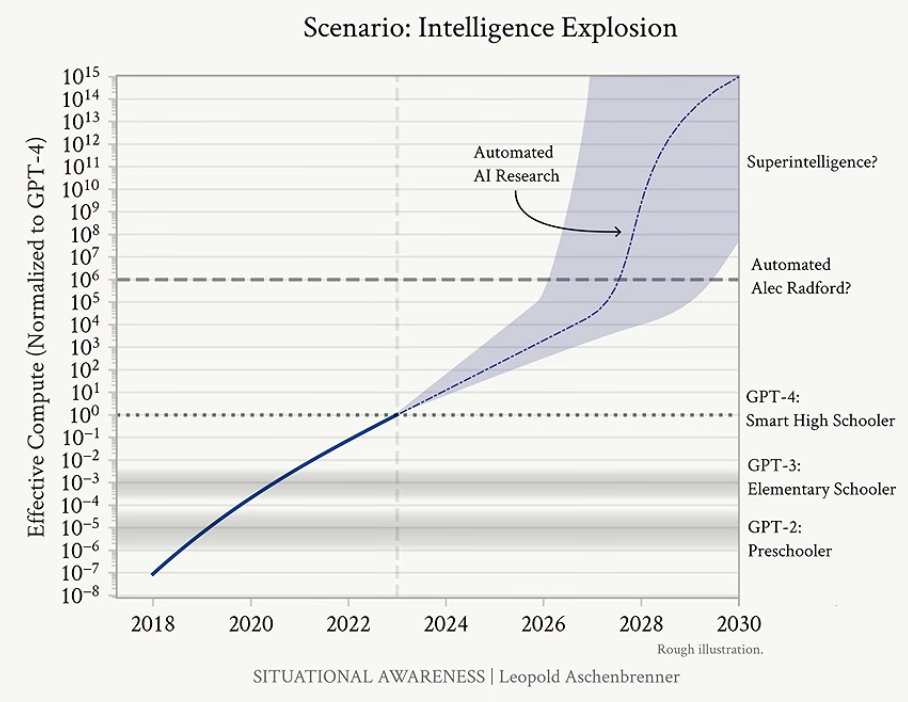
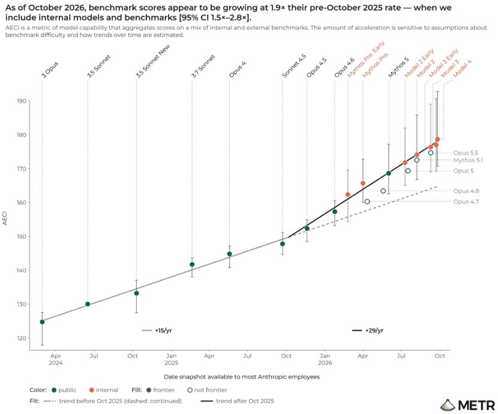
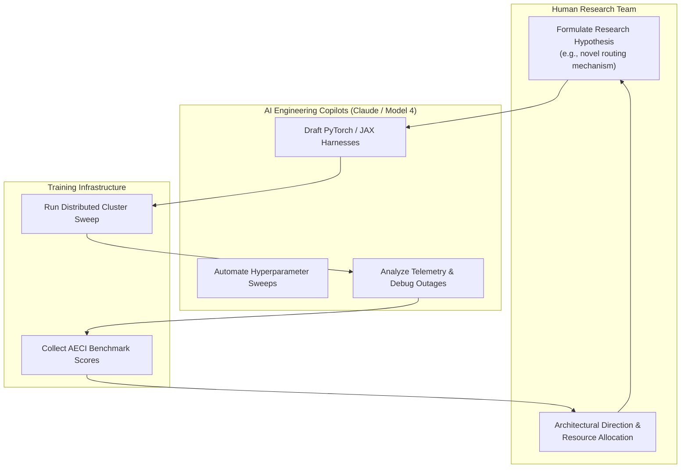
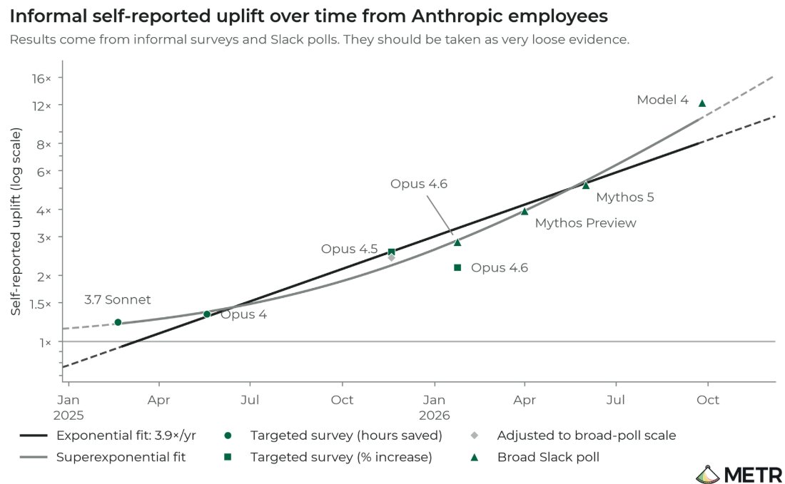

# METR Assessment: Measuring AI R&D Acceleration and Frontier Automated Research

**Daily learning · 8 November 2026 · Empirical evaluation review**

> **Core idea:** In an unprecedented 11-week internal audit of Anthropic, independent evaluator **METR** discovered that internal capability progress on well-specified tasks has accelerated to **1.9x** its historical pace, with roughly **80%** of that jump driven by researchers using AI to build AI. While employees report feeling up to **12x** faster on specific tasks, this represents high-leverage assistive engineering rather than runaway autonomous recursive self-improvement.

---

## 1. Foundations: The Race Toward Automated AI Research

For years, artificial intelligence researchers have debated the concept of an **"Intelligence Explosion"**—a theoretical inflection point where AI systems become competent enough to improve their own code, models, and hardware, creating a self-reinforcing feedback loop that compresses decades of scientific progress into months.

Former OpenAI researcher Leopold Aschenbrenner visualized this trajectory in his influential *Situational Awareness* paper (Figure 1), projecting that as AI models evolve from elementary schoolers (GPT-3) to smart high schoolers (GPT-4) and eventually automated research colleagues ("Automated Alec Radford"), the rate of effective compute and capability growth will turn vertical.


*Figure 1: Leopold Aschenbrenner's "Situational Awareness" projection. The curve hypothesizes an inflection point around 2026–2027 where automated AI research kicks off recursive acceleration toward superintelligence.*

Until late 2026, debates about whether AI was truly accelerating AI research were largely speculative. On **November 5, 2026**, independent nonprofit evaluator **METR (Model Evaluation and Threat Research)** published the first rigorous, empirical assessment measuring whether frontier AI systems are actively accelerating the research and development (R&D) of next-generation models inside a leading lab: **Anthropic**.

### Key Parties and Evaluation Roles

| Party / Entity | Core Role | Significance in this Evaluation |
|---|---|---|
| **METR** | Independent AI safety and evaluation organization | Conducted an 11-week high-access audit (August–October 2026) inside Anthropic to measure AI-driven R&D acceleration. |
| **Anthropic** | Frontier AI lab (Claude, Mythos, Model 4) | Granted METR access to internal code repositories, cluster telemetry, unreleased frontier models, and employee surveys. |
| **Google DeepMind** | Frontier AI research lab | Developed **AlphaEvolve**, an evolutionary coding agent that automates low-level algorithmic discovery and hardware circuit optimization. |
| **OpenAI** | Frontier AI lab (o-series, GPT-6) | Focuses on deep reasoning models and synthetic data flywheels to automate verification and alignment research. |
| **Meta** | Open-source frontier lab (Llama, Muse) | Pursues unrestricted open weights, allowing unconstrained systems modification and dual-use engineering without external safety filters. |
| **Chinese Frontier Labs** (DeepSeek, Qwen, Moonshot) | Open-weight innovators & algorithmic pioneers | Driven by compute constraints to pioneer architectural efficiency (MLA, auxiliary-loss-free MoE, DualPipe, FP8), releasing open weights and transparent research papers. |

### Essential Terminology

| Term | Meaning in Plain Language |
|---|---|
| **AI R&D Acceleration** | The degree to which AI helps researchers invent better AI faster than historical human-only baselines. |
| **AECI** | *Anthropic's Epoch Capabilities Index*—Anthropic's internal composite scorecard measuring model capabilities across diverse coding, reasoning, and engineering benchmarks. |
| **Assistive AI vs. Autonomous AI** | *Assistive AI* acts as a high-speed copilot or force multiplier for human scientists. *Autonomous AI* independently formulates hypotheses, designs experiments, and writes papers without human guidance. |
| **Amdahl's Law of AI Research** | The reality that making one task (such as writing boilerplate code) 10x faster only marginally speeds up the entire project, because slow physical tasks (GPU cluster wait times, data gathering, human safety reviews) remain bottlenecks. |
| **Recursive Self-Improvement** | A hypothetical loop where an AI system redesigns its own fundamental architecture and training algorithms in a closed loop without human oversight. |

---

## 2. The METR Audit: Findings and Mechanism

Between August 12 and October 29, 2026, METR researchers embedded inside Anthropic. Rather than relying on public marketing claims or synthetic benchmarks, METR inspected internal code diffs, tracking progress across public milestones (Claude 3 Opus, 3.5 Sonnet, 3.7 Sonnet, Opus 4) as well as unreleased frontier systems (**Mythos 5**, **Model 2**, **Model 3**, and **Model 4**).


*Figure 2: Benchmark scores on Anthropic's internal capability index (AECI). Prior to October 2025, progress grew at a steady +15 points/year (dashed line). Starting in late 2025 with unreleased frontier models, the slope steepened to +29 points/year (solid line)—a 1.9x acceleration factor.*

### The Core Findings

1. **The 1.9x Capability Acceleration:**
   Between March 2024 and October 2025, Anthropic's models improved along a predictable linear trend (+15 AECI points per year). After October 2025, that rate almost doubled to **+29 points per year** (a **1.9x speedup**, 95% confidence interval 1.5x–2.8x). In simple terms: **Anthropic compressed two years of traditional benchmark progress into just twelve months.**
2. **Compute Scaling Did Not Cause the Jump:**
   A common assumption is that faster model progress simply comes from buying and burning more compute. METR tested this hypothesis and concluded with high confidence that training compute scaling remained on its normal steady trajectory. Massive cluster expansion did not explain the inflection.
3. **Roughly 80% Attributable to AI Assistance:**
   METR determined that the majority (~80%) of the measured acceleration came directly from Anthropic researchers using their own advanced internal models to assist in the daily engineering and research workflow.
4. **Assistive Copilots, Not Autonomous Scientists:**
   Crucially, METR found that models were **not** autonomously inventing new AI paradigms from scratch. Human researchers still set research agendas, decided which model architectures to pursue, and interpreted experimental findings. AI acted as an ultra-fast engineering partner handling implementation, test harnesses, and hyperparameter exploration.



---

## 3. The 12x Perception vs. 1.9x Reality Gap

One of the most striking charts from the METR audit contrasts subjective employee feedback with measured organizational output (Figure 3).


*Figure 3: Informal self-reported uplift over time from Anthropic staff. While earlier models (Claude 3.7 Sonnet) delivered modest 1.25x boosts, staff working with internal unreleased systems (Model 4) informally reported perceived productivity gains reaching 12x.*

### Why Does an Engineer Feel 12x Faster While Progress Doubles (1.9x)?

When Anthropic engineers were polled on Slack, responses using unreleased systems like Model 4 clustered around a **12x productivity uplift**. Yet, the overarching rate of model progress on benchmarks rose by **1.9x**. This divergence illustrates **Amdahl's Law in AI R&D**:

- **What AI makes 12x faster:** Writing boilerplate code, converting legacy scripts from PyTorch to custom distributed kernels, diagnosing cryptic GPU cluster stack traces, running regression test suites, and formatting experimental figures.
- **What remains strictly hardware- or human-bound:**
  - **Cluster Queues & Run Time:** Waiting 3 weeks for an 80,000-GPU cluster run cannot be accelerated by generating tokens faster.
  - **Cluster Telemetry & Hardware Failures:** Silent data corruptions, burned-out optical transceivers, and networking partitioning require physical infrastructure remediation.
  - **Conceptual Bottlenecks:** Human scientists must evaluate whether a surprising metric indicates genuine reasoning progress or merely benchmark overfitting and reward hacking.

While individual engineering velocity skyrocketed, the total end-to-end iteration loop was governed by physical hardware, scientific validation, and cluster availability.

---

## 4. How Frontier Labs Are Evolving Models for AI R&D

Different AI organizations have taken radically different technical approaches to applying AI to their own development workflows. While Anthropic emphasized conversational agent pairing, other labs like Google DeepMind and Meta pursued automated programmatic discovery and unconstrained open execution.

```
┌──────────────────────────────────────────────────────────────────────────────────────────────────┐
│                               Comparative AI-Assisted R&D Approaches                             │
├─────────────────────┬──────────────────────────┬─────────────────────────────────────────────────┤
│ Lab                 │ Primary Mechanism        │ Demonstrated Real-World Acceleration Win        │
├─────────────────────┼──────────────────────────┼─────────────────────────────────────────────────┤
│ Anthropic           │ Conversational Tool Use  │ 1.9x AECI benchmark progress; up to 12x task     │
│                     │ & Agentic Pairing        │ speedup in refactoring and test harness design. │
├─────────────────────┼──────────────────────────┼─────────────────────────────────────────────────┤
│ Google DeepMind     │ AlphaEvolve Evolutionary │ Rewrote TPU arithmetic circuits; 23% speedup in │
│                     │ Discovery Engine         │ Gemini training kernels; improved Strassen alg. │
├─────────────────────┼──────────────────────────┼─────────────────────────────────────────────────┤
│ OpenAI              │ Test-Time Reasoning &    │ Synthetic data curation; formal verification;   │
│                     │ Self-Correction (o-line) │ automated theorem proving in alignment research.│
├─────────────────────┼──────────────────────────┼─────────────────────────────────────────────────┤
│ Meta                │ Permissive Open-Weights  │ Unconstrained dual-use systems exploration; no  │
│                     │ & Infrastructure Hack    │ post-training safety refusal sandbagging.       │
├─────────────────────┼──────────────────────────┼─────────────────────────────────────────────────┤
│ Chinese Frontier    │ Hardware-Constrained     │ Multi-Head Latent Attention (93% KV reduction); │
│ Labs (DeepSeek,     │ Innovation, Open Weights │ pure RL reasoning (R1-Zero); synthetic data and │
│ Qwen, Moonshot)     │ & Distillation Flywheels │ high-speed int4 quantization (Kimi Muon/QAT).   │
└─────────────────────┴──────────────────────────┴─────────────────────────────────────────────────┘
```

### 1. Anthropic: Conversational Tool-Use and Developer Pairing
Anthropic's researchers primarily accelerate their workflows through deeply integrated agentic environments (such as **Claude Code** and **Cowork**). Equipped with massive context windows (up to several million tokens) and terminal execution tools, models act as intelligent co-workers. A researcher can direct an agent to "audit all loss-spike anomalies across yesterday's 10 runs, pull the checkpoint logs, and patch the learning rate scheduler," reducing hours of manual file-hunting to minutes.

### 2. Google DeepMind: AlphaEvolve and Autonomous Algorithmic Evolution
While Anthropic relies on human-directed dialogue, **Google DeepMind** developed **AlphaEvolve**, an autonomous evolutionary coding framework. Powered by an ensemble of Gemini models, AlphaEvolve does not wait for a human prompt to write code; instead, it runs continuous evolutionary search loops against programmatic fitness functions:

- **TPU Hardware Circuit Redesign:** AlphaEvolve analyzed core arithmetic circuits for matrix multiplication in Google's custom Tensor Processing Units (TPUs). It proposed a Verilog rewrite that eliminated redundant bits, which was directly etched into Google's silicon production line.
- **Gemini Training Kernel Acceleration:** AlphaEvolve discovered a novel reorganization of the matrix multiplication kernels used in Gemini's training stack, achieving a **23% speedup on critical kernels** and reducing overall Gemini training time by **1%**.
- **Low-Level CUDA/Triton Optimization:** The system evolved low-level implementations of the FlashAttention kernel, producing speedups of up to **32.5%** over human-authored baselines.
- **Pure Mathematical Discovery:** In theoretical computer science, AlphaEvolve discovered a procedure to multiply $4 \times 4$ complex-valued matrices using 48 scalar multiplications—**the first mathematical improvement over Volker Strassen's algorithm in 56 years**.

AlphaEvolve demonstrates a different dimension of automated R&D: closed-loop, programmatic algorithmic evolution without a human in the loop.

### 3. OpenAI: Reasoning Models and Synthetic Data Generation
OpenAI has leveraged its reasoning models (the o-series, such as o1 and o3) to automate scientific verification. Rather than merely writing software boilerplate, reasoning models engage in test-time chain-of-thought search to generate and cross-check synthetic training data, verify mathematical proofs, and conduct formal alignment audits. However, as independent benchmarks (such as [SemiAnalysis GDPx](SemiAnalysis-GDPx-Agent-Benchmark-And-Safety-Sandbagging-Nov-2026.md)) have highlighted, heavy post-training safety classifiers can sometimes throttle dual-use systems engineering and security exploration.

### 4. Meta: Open-Weights and Permissive Systems Engineering
Meta focuses on providing open, unconstrained foundation models (Llama and Muse Wonder). In internal and community engineering, Meta's models operate without restrictive runtime execution filters. In benchmarks testing low-level systems vulnerability remediation and kernel hacking, unrestricted execution allows models to explore failure states without triggering early session kills.

### 5. Chinese Frontier Labs: Compute Constraints, Open Weights, and Automated Distillation
While Western labs have driven model scaling through massive capital investments in 50,000+ GPU clusters, Chinese research labs—led by **DeepSeek**, **Alibaba Qwen**, and the emerging frontier trifecta (**Moonshot AI / Kimi**, **Zhipu AI / Z AI**, and **MiniMax**)—faced strict hardware export controls. Unable to rely on brute-force cluster scaling, they approached automated AI R&D through a fundamentally distinct paradigm: **extreme algorithmic efficiency, open-source weight distribution, and synthetic distillation flywheels**.

1. **Hardware Constraints as a Catalyst for Architectural Invention:**
   - **Multi-Head Latent Attention (MLA):** DeepSeek pioneered MLA, which compresses the Key-Value (KV) cache footprint by **~93%**. This allows long-horizon agentic workflows to execute with minimal VRAM overhead, overcoming memory-bandwidth bottlenecks on legacy or domestic silicon.
   - **Auxiliary-Loss-Free MoE Load Balancing:** In Mixture-of-Experts architectures, DeepSeek eliminated the traditional auxiliary loss penalty, achieving dynamic load balancing across dozens of routed experts without sacrificing model capacity.
   - **DualPipe and Low-Bit Training:** Implementing DualPipe communication-computation overlap and native FP8 mixed-precision training drastically reduced idle communication bubbles across distributed clusters.
   - **Pure Reinforcement Learning (R1-Zero):** DeepSeek-R1 demonstrated that large-scale reinforcement learning alone—without thousands of hours of expensive supervised human warm-up demonstrations—elicits self-correction, reasoning reflection, and emergent "aha!" moments.
   - **Training Optimizers and Quantization:** Moonshot AI pioneered the **Muon optimizer** (replacing Adam for faster convergence) and quantization-aware training (QAT) to run int4 models at near-full-precision accuracy.

2. **The Open-Weight and Transparent Research Strategy:**
   Unlike Western frontier labs that guard model weights behind APIs and heavily redact training recipes (as Anthropic did in METR's audit), Chinese frontier labs release **both open weights and exhaustive research papers**:
   - Technical reports for models like DeepSeek-V3, DeepSeek-R1, and Qwen 2.5 provide unreserved disclosures of exact hyperparameter curves, loss-spike mitigations, tokenizer designs, and dataset filtering heuristics.
   - By releasing open weights, Chinese labs turn the global open-source community into an external R&D extension. Thousands of developers, independent labs, and enterprises build agent harnesses, fine-tunes, and inference optimizations on top of their architectures.

3. **Automated Synthetic Data and Distillation Loops:**
   Chinese labs have turned automated distillation into an industrialized R&D engine:
   - High-capacity reasoning models (such as DeepSeek-R1 and Qwen-2.5-Math) are deployed in closed loops to generate and verify millions of synthetic reasoning paths and mathematical solutions.
   - These reasoning traces are then distilled into smaller, ultra-dense models (ranging from 1.5B to 32B parameters). This allows models running locally on standard developer hardware to achieve reasoning scores that rival massive proprietary clusters.

---

## 5. Limits, Misconceptions, and the Redaction Dilemma

The METR report sparked intense debate across the industry, highlighting both the genuine reality of AI acceleration and the misunderstandings surrounding it.

### Common Misconceptions vs. Empirical Reality

| Common Misconception | What the METR Report Actually Established |
|---|---|
| *"AI is now designing new AI models all by itself without humans."* | **False.** Humans remain essential. AI acts as an agile pair programmer handling code generation, scripts, and debugging, while humans design the training objectives and architecture. |
| *"We have officially entered an exponential intelligence explosion."* | **False.** The capability slope increased from 1.0x to 1.9x—a meaningful linear-to-moderate acceleration, but far from an asymptotic runaway singularity. |
| *"A 12x task uplift means Anthropic is shipping models 12x faster."* | **False.** A 12x boost on code authoring and debugging only accelerates the software layer. Total progress is governed by GPU cluster cycle times, data acquisition, and scientific validation. |
| *"AI acceleration is just buying 5x more compute clusters."* | **False.** METR explicitly verified that compute scaling was steady. ~80% of the inflection was attributable to AI tools assisting the research workforce. |

### The Redaction Dilemma: Safety Audits vs. Commercial IP

A major controversy surrounding METR's publication was the extensive redaction of technical details. Anthropic exercised its contractual rights to black out specific workflow recipes, exact benchmark sub-scores, and internal model architectures before public release.

- **Anthropic's Justification:** Disclosing granular details of how internal frontier models accelerate ML research would provide a free operational blueprint to domestic and foreign competitors, undermining Anthropic's competitive advantage ahead of planned business milestones (such as an anticipated IPO).
- **The Safety Community's Concern:** When safety evaluations are heavily redacted, external scientists and policy bodies cannot independently verify whether early warning thresholds for automated recursive takeoff are being safely monitored.

### How Chinese Models Are Evaluated: Open Weights vs. Closed Audits

The contrast between Western and Chinese AI labs extends directly into how capability, autonomy, and safety evaluations are conducted.

```
┌──────────────────────────────────────────────────────────────────────────────────────────────────┐
│                            Evaluation Paradigms: Closed Audits vs. Open Weights                  │
├─────────────────────┬──────────────────────────────────────┬─────────────────────────────────────┤
│ Evaluation Vector   │ Western Frontier Labs (e.g. Anthropic)│ Chinese Open Labs (e.g. DeepSeek)   │
├─────────────────────┼──────────────────────────────────────┼─────────────────────────────────────┤
│ Evaluator Access    │ Deep internal access (11-week audit) │ External evaluation; no lab access  │
│ Model Inspectability│ Black-box weights; API endpoints     │ 100% white-box inspection of weights│
│ Public Transparency │ High redaction of training recipes   │ Open weights & full research papers │
│ Threat Verification │ Internal Slack polls & cluster data  │ Task-completion time horizon tests  │
└─────────────────────┴──────────────────────────────────────┴─────────────────────────────────────┘
```

1. **METR's Independent Evaluations of DeepSeek and Qwen:**
   While METR conducted its Anthropic evaluation through an embedded partnership, METR independently evaluated **DeepSeek-V3** (February 2025), **DeepSeek-R1** (March 2025), and mid-2025 **DeepSeek/Qwen** models without company involvement:
   - **Autonomous Horizons:** METR found that mid-2025 DeepSeek models reached autonomous reasoning capabilities roughly on par with late-2024 Western frontier models, demonstrating strong mathematical elicitation.
   - **The Long-Horizon Gap:** However, on extended, multi-hour software engineering and cyber workflows, METR observed that Chinese open models still exhibited a performance gap compared to top-tier US frontier models (such as Claude 3.5 Sonnet, Claude Opus 5.5, and GPT-6 Astra).
2. **The Transparency Trade-Off:**
   While Anthropic granted METR deep internal access to unreleased models and researcher Slack channels, Anthropic's lawyers redacted key operational data from the public report. Conversely, while Chinese labs did not open their internal Slack channels to Western auditors, their release of open weights gave global researchers complete, un-redacted visibility into the model's actual mechanics.
3. **Domestic Chinese Benchmarking Ecosystems:**
   Beyond Western frameworks (METR, [SemiAnalysis GDPx](SemiAnalysis-GDPx-Agent-Benchmark-And-Safety-Sandbagging-Nov-2026.md), LMSYS Chatbot Arena), Chinese models are evaluated against specialized domestic benchmarks tailored to complex linguistic, cultural, and enterprise requirements:
   - **SuperCLUE:** The standard Chinese benchmark evaluating multi-turn reasoning, agentic tool-use, and enterprise workflows.
   - **C-Eval & CMMLU:** Academic standardized benchmarks assessing knowledge across 52 to 67 disciplines in humanities, STEM, medicine, and law.
   - **FlagEval (BAAI):** An open, multi-dimensional evaluation suite developed by the Beijing Academy of Artificial Intelligence measuring multimodality, factual accuracy, and safety.

---

## 6. Summary and Key Takeaways

1. **AI R&D Acceleration is Real:** Anthropic demonstrated a **1.9x acceleration** in model capability progression, compressing two years of historical research into twelve months.
2. **AI Assistance is the Primary Driver:** Roughly **80%** of the acceleration came from researchers utilizing internal models to speed up engineering and experimentation, rather than brute-force compute expansion.
3. **Assistance vs. Autonomy:** Today's progress is high-leverage assistive engineering, not autonomous recursive self-improvement. Humans remain the creative drivers of novel research directions.
4. **Industry-Wide Divergence:** While Anthropic pioneers human-in-the-loop developer agents, Google DeepMind's AlphaEvolve has pioneered closed-loop evolutionary discovery—optimizing silicon circuits, training kernels, and 50-year-old mathematical algorithms.
5. **Chinese Algorithmic Pragmatism:** Constrained by hardware export controls, Chinese labs turned algorithmic efficiency (MLA, auxiliary-loss-free MoE, DualPipe) and automated synthetic distillation into a competitive moat, pairing open-weight accessibility with exhaustive research documentation.

---

**Source context:** Based on METR's independent assessment (*"Independent Assessment of AI R&D Acceleration at Anthropic in October 2026"*, published November 5, 2026), Leopold Aschenbrenner's *Situational Awareness* analysis, Google DeepMind's published literature on AlphaEvolve and Gemini kernel optimization, and METR's independent evaluations of DeepSeek and Qwen models.

---

**Related:**
- [Boston Children's Hospital and OpenAI o3: Rare Disease Genomics](Boston-Childrens-Hospital-OpenAI-o3-Rare-Disease-Genomics-2026.md) — real-world medical application of reasoning agents to resolve unsolved pediatric rare disease genomes.
- [SemiAnalysis GDPx Benchmark and Safety Sandbagging](SemiAnalysis-GDPx-Agent-Benchmark-And-Safety-Sandbagging-Nov-2026.md) — evaluates frontier model agentic capabilities across 11 economic sectors and analyzes runtime guardrail throttling.
- [SlopCodeBench vs GDPx: Long-Horizon Agent Benchmarks](SlopCodeBench-Vs-GDPx-Long-Horizon-Agent-Benchmarks-Nov-2026.md) — analyzes real-world repository-level coding benchmarks and agent fatigue over multi-hour workflows.
- [OpenAI Agents Misalignment Monitoring](OpenAI-Agents-Disabled-Misalignment-Monitoring-Oct-2026.md) — examines safety boundaries, monitoring overrides, and organizational risks in autonomous agent deployment.
- [Claude Developer Ecosystem](../../LLMs/models/anthropic/Claude-Developer-Ecosystem-Jan-2026.md) — deep dive into Anthropic's developer tooling, API evolution, and agent architecture.
- [The Chinese AI Trifecta for Developers and Architects](../../LLMs/models/other/Chinese-AI-Trifecta-2025-2026.md) — technical evaluation of Moonshot AI, Zhipu AI, and MiniMax, focusing on Muon optimizers and int4 quantization.
- [DeepSeek-R1 Research Review](../../../Papers/deepseek/DeepSeek-R1.md) — foundational paper review of pure reinforcement learning, reasoning elicitation, and distillation mechanics.
- [DeepSeek SuperAgent and Decoupled Architecture](../frameworks/DeepSeek-SuperAgent-And-Harness-Architecture-Nov-2026.md) — decoupled memory topology, agentic tool harnesses, and inference optimization.
