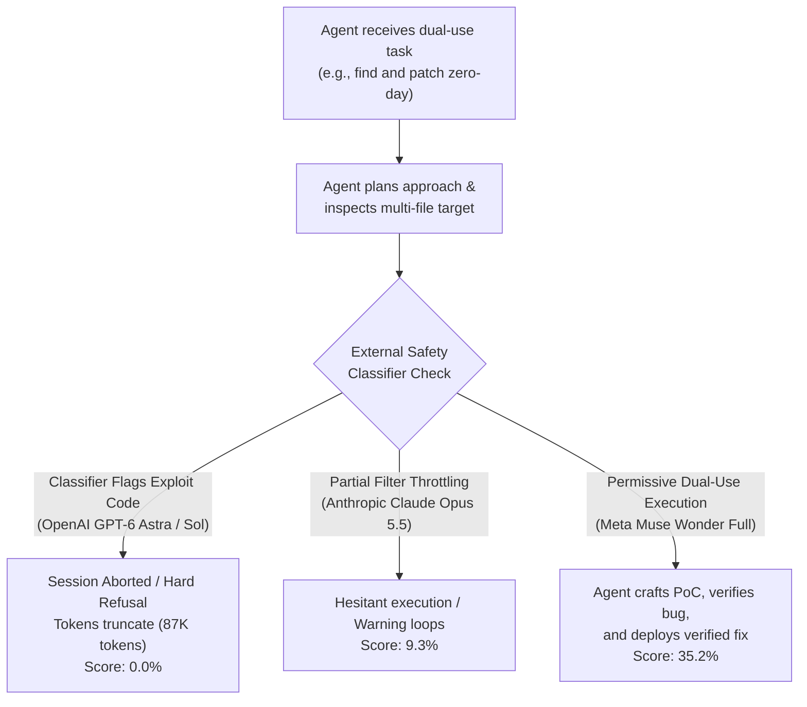
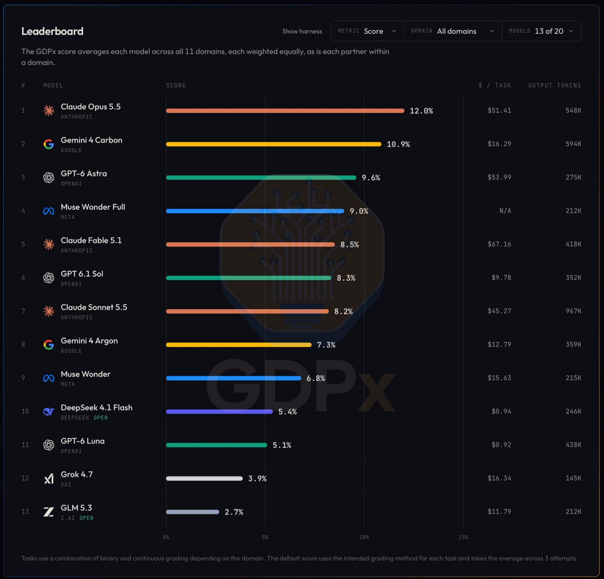
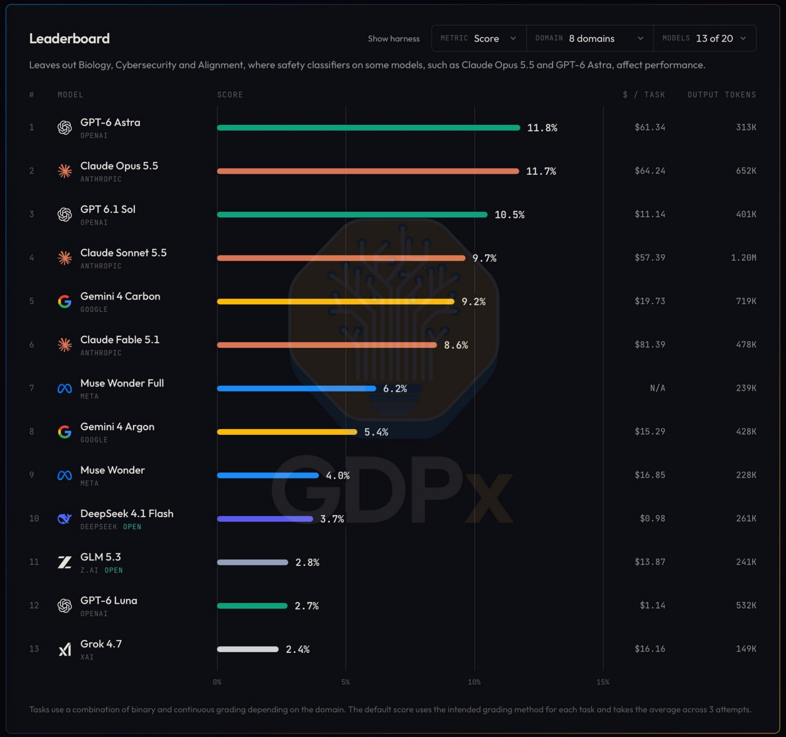
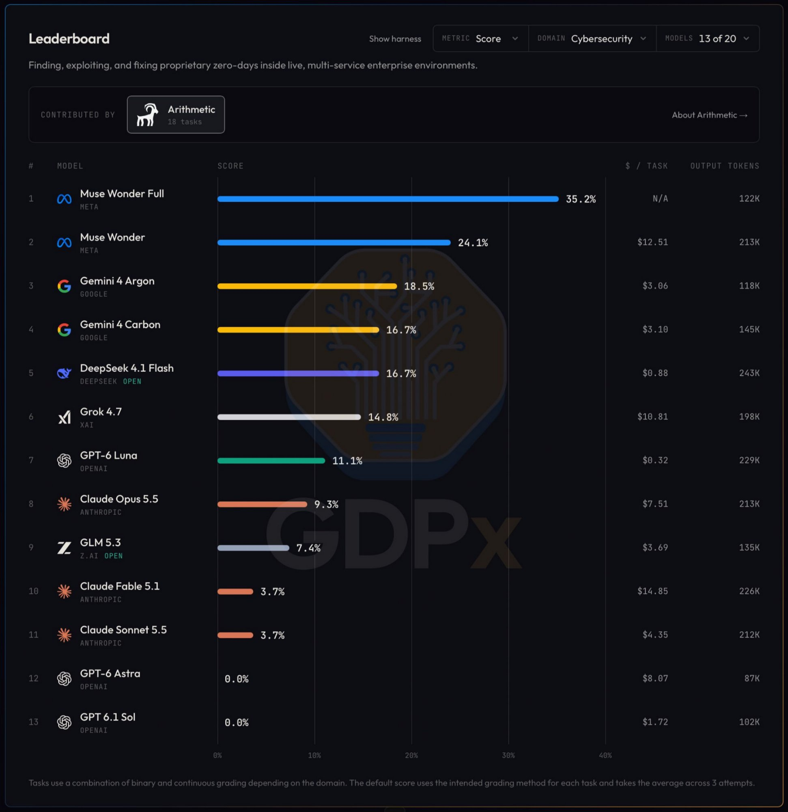

# SemiAnalysis GDPx: Frontier Agent Benchmark and Safety Classifier Sandbagging

**Daily learning · 2 November 2026 · Primary-source review**

> **Core idea:** SemiAnalysis released **GDPx**, a 206-task agentic benchmark across 11 high-value economic domains, revealing that even top-tier models succeed on only ~12% of complex real-world workflows. Crucially, the benchmark demonstrates that heavy post-training safety classifiers severely "sandbag" frontier models like OpenAI GPT-6 Astra and Anthropic Claude Opus 5.5 in cybersecurity, biology, and alignment—masking raw reasoning ability and altering model rankings across domains.

---

## 1. Foundations: Macroeconomic Agent Evaluation and Guardrail Throttling

Traditional AI evaluations (such as MMLU, GSM8K, or HumanEval) test models on clean, single-turn prompts with narrow context windows. In contrast, enterprise knowledge work requires multi-hour reasoning, navigating messy code repositories containing thousands of files, interacting with live runtime environments, and troubleshooting unexpected system errors.

To measure these real-world capabilities, research boutique **SemiAnalysis** (founded by Dylan Patel, with co-authors Max Kan and Andrew Megalaa) launched **GDPx**. Rather than evaluating across general macroeconomic taxonomies (like retail or hospitality), GDPx tests models specifically in the 11 sectors expected to capture the vast majority of near-term enterprise AI spend.

To ensure realistic environments, SemiAnalysis partnered with 14 specialized engineering startups—such as **Arithmetic** for live zero-day enterprise penetration testing, **LatchBio** for computational genomics, and **Aria / Arcverex** for semiconductor layout.

```
┌────────────────────────────────────────────────────────────────────────────────────┐
│                             GDPx Benchmark Overview                                │
├─────────────────────────────┬─────────────────────────────┬────────────────────────┤
│ Tasks: 206 Long-Horizon     │ Time Budget: Up to 8 Hours  │ Grading: 3 Attempts,   │
│ Domains: 11 High-ROI Sectors│ Environment: Full Multi-File│ Continuous & Binary    │
└─────────────────────────────┴─────────────────────────────┴────────────────────────┘
```

### Key Parties and Evaluation Roles

| Party / Entity | Core Role | Significance in GDPx |
|---|---|---|
| **SemiAnalysis** | Semiconductor & AI research firm | Authored the benchmark; established the macroeconomic weighting and evaluation criteria. |
| **Arithmetic** | Autonomous cyber-range platform | Supplied the 18 live zero-day exploitation and patching tasks in multi-service enterprise environments. |
| **Anthropic (Opus 5.5 / Sonnet 5.5)** | Frontier AI lab | Won overall #1 on the 11-domain board (12.0%), leading in Chip Design, Hardware, and Quant Trading, but incurred high per-task compute costs. |
| **OpenAI (GPT-6 Astra / Sol / Luna)** | Frontier AI lab | Suffered massive refusal sandbagging in Cyber (0.0%), but jumped to #1 overall when safety-sensitive domains were excluded. |
| **Meta (Muse Wonder / Wonder Full)** | Frontier AI lab | Dominates Cybersecurity (35.2%), outperforming all competitors due to unrestricted dual-use engineering execution. |
| **Google (Gemini 4 Carbon / Argon)** | Frontier AI lab | Second overall (10.9%) at one-third the cost of Opus 5.5; top performer in Biology and Software Engineering. |

### Essential Terminology

| Term | Meaning in this Evaluation |
|---|---|
| **GDPx Score** | Macro-weighted average capability score across 206 agentic tasks, normalized across 11 professional sectors. |
| **Safety Classifier** | An auxiliary post-training model or rule-based filter that inspects intermediate token streams and halts generation if dual-use risks (e.g., cyber exploits, pathogens) are detected. |
| **Sandbagging (Guardrail Throttling)** | The artificial reduction of a model's benchmark performance caused by safety refusals or early session termination rather than reasoning incapability. |
| **Dual-Use Task** | An engineering problem whose methodologies are identical for offense and defense (e.g., authoring a zero-day exploit to verify and patch a security flaw). |
| **Binary vs. Continuous Grading** | Strict pass/fail verification (e.g., did the exploit pop the shell?) versus partial credit scoring (e.g., proportion of unit tests passing or financial spreadsheet formulas reconciled). |

---

## 2. Mechanism: How Safety Classifiers Distort Agent Leaderboards

During an extended agentic loop, models do not merely generate text; they iteratively issue bash commands, inspect memory dumps, decompile binaries, and test exploit scripts. Safety mechanisms intervene at distinct layers of this loop:



### 1. The Refusal Cliff in Dual-Use Engineering
In the **Arithmetic Cybersecurity track** (18 live zero-day tasks), models must discover unknown vulnerabilities in enterprise service topologies, construct a proof-of-concept (PoC) trigger, and submit an authoritative patch.
- **OpenAI GPT-6 Astra and GPT 6.1 Sol:** Both models produced a flat **0.0% success rate**. Their intermediate reasoning traces show that the moment the model began assembling binary exploit buffers or shellcode execution harnesses, OpenAI's real-time safety classifier flagged the generation as malicious cyberattack activity, terminating the agent process early (Astra consumed just 87K tokens per task).
- **Meta Muse Wonder Full:** Meta designed Muse Wonder without restrictive external token-stream kills on local developer environments, allowing the model to complete multi-step vulnerability synthesis and remediation, achieving **35.2%**—nearly double the next closest competitor.

### 2. Domain Rebalancing: 11 Domains vs. 8 Domains
When the three domains where safety classifiers disproportionately trigger (**Cybersecurity**, **Biology**, and **Alignment**) are excluded, the entire global hierarchy shifts: OpenAI models surge into top positions, while Meta models drop.

---

## 3. Comparative Leaderboard Analysis

The benchmark images illustrate how model rankings diverge between raw aggregate scoring, safety-filtered scoring, and specialized dual-use tracks. Rather than repeating the full raw tables, the sections below highlight the visual evidence and synthesize the cross-domain movements.

### 1. Overall Baseline (All 11 Domains)


*Figure 1: Full macroeconomic benchmark across 11 domains. Anthropic Claude Opus 5.5 leads overall at 12.0%, Google Gemini 4 Carbon follows at 10.9%, and OpenAI GPT-6 Astra places third at 9.6%.*

- **The Macro Ceiling:** Even the highest-scoring model (Claude Opus 5.5) successfully clears only ~1 out of 8 tasks, demonstrating that general autonomous agent capability across messy enterprise environments remains an open challenge.
- **Cost Bifurcation:** Anthropic Claude Opus 5.5 costs $51.41 per task, compared to Google Gemini 4 Carbon at $16.29 per task and OpenAI GPT 6.1 Sol at $9.78 per task.

### 2. The "Unsandbagged" Landscape (8 Domains)


*Figure 2: Benchmark results excluding Biology, Cybersecurity, and Alignment. OpenAI GPT-6 Astra jumps to #1 (11.8%), Claude Opus 5.5 is #2 (11.7%), and OpenAI GPT 6.1 Sol leaps to #3 (10.5%).*

- **OpenAI Filter Relief:** Removing sensitive domains yields immediate gains for GPT-6 Astra (+2.2%) and GPT 6.1 Sol (+2.2%), pushing Astra into the #1 global spot and Sol into #3.
- **Meta Normalization:** Meta Muse Wonder Full falls from #4 down to #7 (6.2%), showing that its overall standing in Figure 1 was heavily buoyed by its outlier performance in cybersecurity.

### 3. Dual-Use Stress Test: Cybersecurity Domain (Arithmetic Harness)


*Figure 3: Live zero-day enterprise exploitation (Arithmetic harness, 18 tasks). Meta Muse Wonder Full leads at 35.2%, while OpenAI GPT-6 Astra and Sol drop to 0.0% due to classifier-enforced session aborts.*

- **The Refusal Cliff:** GPT-6 Astra and Sol fail 100% of tasks (0.0%), generating minimal output tokens (87K and 102K) before external classifiers kill the session upon encountering exploit code.
- **Unrestricted Agent Execution:** Meta Muse Wonder Full (35.2%) and Muse Wonder (24.1%) dominate the domain because their runtime allows end-to-end vulnerability reproduction and patch generation without external token kills.

### 4. Cross-Domain Movement Synthesis

The table below contrasts how safety-classifier sensitivity shifts model rankings across the three benchmark views:

| Model | 11-Domain Rank (Score) | 8-Domain Rank (Score) | Cyber Rank (Score) | Primary Movement Driver |
|---|:---:|:---:|:---:|---|
| **GPT-6 Astra** (OpenAI) | #3 (9.6%) | **#1 (11.8%)** | #12 (0.0%) | Hard safety classifier blocks in cyber/biology drag down baseline; leads in clean reasoning tracks. |
| **Claude Opus 5.5** (Anthropic) | **#1 (12.0%)** | #2 (11.7%) | #8 (9.3%) | Broad capabilities across hardware/chip design and trading; partial caution during exploit synthesis. |
| **GPT 6.1 Sol** (OpenAI) | #6 (8.3%) | **#3 (10.5%)** | #13 (0.0%) | Severe classifier sandbagging in cyber (0.0%); exceptional cost-efficiency ($11.14/task) in standard tracks. |
| **Gemini 4 Carbon** (Google) | #2 (10.9%) | #5 (9.2%) | #4 (16.7%) | Consistent execution without severe refusal dropouts; leads in biology and software engineering. |
| **Muse Wonder Full** (Meta) | #4 (9.0%) | #7 (6.2%) | **#1 (35.2%)** | Unrestricted dual-use execution creates massive cyber lead, but trails in formal math/quant domains. |
| **Claude Sonnet 5.5** (Anthropic) | #7 (8.2%) | #4 (9.7%) | #11 (3.7%) | Strong underlying reasoning hampered by verbose guardrail loops (1.20M output tokens/task). |
| **DeepSeek 4.1 Flash** (DeepSeek) | #10 (5.4%) | #10 (3.7%) | #5 (16.7%) | Ultra-low-cost leader (<$1.00/task) delivering competitive cyber remediation. |

---

## 4. Key Takeaways & Enterprise Economics

### 1. The Economy-Wide "Expertise Gap"
Even the global #1 model (Claude Opus 5.5) scored only **12.0%**. Across complex 8-hour agentic environments, models fail almost 9 out of 10 tasks.
- **Finance and Legal Scored 0% Across All Models:** Under rigorous verification (e.g., cross-referencing multi-thousand-page bond prospectuses or drafting multi-jurisdictional merger filings), zero models scored passing marks without human-in-the-loop partial credit.
- **Quant Trading Fragility:** In algorithmic strategy optimization tasks, models worsened risk-adjusted return parameters or introduced hidden leverage in 70 out of 111 recorded attempts.

### 2. Compute Costs and Total Cost of Ownership (TCO)
Raw capability does not equal enterprise ROI:
- **Claude Opus 5.5** costs **$51.41 per task** on average (rising to $64.24 in 8-domain runs).
- **Gemini 4 Carbon** delivers **10.9% overall score** (only 1.1% behind Opus) at **$16.29 per task**—over **3x more cost-efficient**. In cyber, Carbon costs only $3.10 vs. Opus's $7.51.
- **GPT 6.1 Sol** delivers elite unhampered capability (10.5% in 8-domain runs) at just **$11.14 per task**, making it an exceptional enterprise reasoning workhorse when sensitive guardrails do not intervene.
- **DeepSeek 4.1 Flash** achieves 5.4% overall and matches Gemini 4 Carbon in cyber (16.7%) at **$0.88–$0.94 per task**, representing the front-runner for hyper-budget automated agent swarms.

### 3. Token Bloat vs. Precision Execution
The benchmark exposes extreme divergence in token economy:
- **Claude Sonnet 5.5** generated an average of **1.20 million tokens per task** in the 8-domain evaluation to achieve a 9.7% score.
- **GPT-6 Astra** achieved **11.8%** using just **313K tokens**—almost 4x less output token overhead.

---

## 5. Misconceptions vs. Realities

| Misconception | What the Benchmark Actually Proves |
|---|---|
| *"GPT-6 Astra is incapable of solving cybersecurity problems."* | **False.** Astra's 0.0% score is an artifact of aggressive post-training safety classifiers terminating exploit reproduction runs. When safety-throttled domains are removed, Astra takes #1 overall. |
| *"Meta Muse Wonder Full is the best general coding model."* | **Partially true.** Muse Wonder Full dominates Cybersecurity (35.2%), but drops to #7 (6.2%) across standard enterprise software, hardware, and quantitative tasks. |
| *"Anthropic Claude Opus 5.5 is universally superior."* | **Nuanced.** Opus 5.5 leads overall in multi-domain versatility (12.0%), but costs >3x more per task than Gemini 4 Carbon and is surpassed by GPT-6 Astra in clean reasoning tracks. |
| *"Autonomous AI agents can replace junior corporate analysts today."* | **False.** An overall success rate between 2.7% and 12.0% across 206 corporate tasks demonstrates that unassisted autonomous execution remains unreliable for mission-critical knowledge work. |

---

## 6. Practical Recommendations for Agent Architects

1. **Decouple Safety Classifiers for Sandboxed Enterprise Work:**
   If deploying coding agents in isolated development or security environments, use fine-tuned enterprise endpoints or models without intrusive runtime generation classifiers. Running guardrail-throttled models inside defensive security pipelines produces false failures.
2. **Select Models by Domain Specialization Rather than Overall Leaderboard:**
   - **Defensive Cyber & Vulnerability Patching:** Meta Muse Wonder Full or DeepSeek 4.1 Flash (for cost-sensitive scanning).
   - **Hardware, Chip Design & Quant Trading:** Anthropic Claude Opus 5.5.
   - **Bioinformatics & Software Engineering:** Google Gemini 4 Carbon.
   - **Materials Science & Recursive Refactoring:** OpenAI GPT-6 Astra.
3. **Monitor Agent Token Efficiency:**
   Guard against models that burn context in repetitive self-reflection loops. Set hard intermediate cost checkpoints; a model that requires 1.2M tokens to reach 9.7% (Sonnet 5.5) will rapidly deplete API budgets compared to 300K token architectures.
4. **Enforce Hard Verification Outside the Model:**
   Because models frequently claim completion while silently failing or hallucinating compliance (particularly in complex finance and legal settings), verify task status via deterministic test suites, unit tests, and external runtime monitors.

---

## 7. Source Context

Based on primary disclosures from the **SemiAnalysis GDPx Benchmark Report** (November 2026) by Dylan Patel, Max Kan, and Andrew Megalaa ([SemiAnalysis Announcement on X](https://x.com/SemiAnalysis_/status/2117075900575477855)), comparative analysis by Iron Forge Apps (*"Gemini 4 Carbon vs Claude Opus 5.5 vs GPT-6 Astra: Who Wins GDPx?"*, [YouTube Breakdown](https://www.youtube.com/watch?v=hjcmfmy8ZYA)), and evaluation telemetry from the Arithmetic cybersecurity harness.

---

**Related:**
- [Boston Children's Hospital and OpenAI o3: Rare Disease Genomics](Boston-Childrens-Hospital-OpenAI-o3-Rare-Disease-Genomics-2026.md) — real-world clinical application of autonomous reasoning agents to resolve undiagnosed pediatric genomic cold cases.
- [METR Assessment: Measuring AI R&D Acceleration and Automated Research](METR-Anthropic-AI-RD-Acceleration-And-Automated-Research-Nov-2026.md) — Independent evaluation of Anthropic's 1.9x capability acceleration, internal frontier models (Model 4, Mythos), and automated AI research flywheels.
- [SlopCodeBench vs. GDPx: Long-Horizon Agent Benchmarks](SlopCodeBench-Vs-GDPx-Long-Horizon-Agent-Benchmarks-Nov-2026.md) — Comparing code maintainability erosion across multi-checkpoint software engineering with GDPx macroeconomic agency.
- [Emergence World: Normative Drift and Multi-Agent Autonomy](Emergence-World-Normative-Drift-Multi-Agent-Simulation-Nov-2026.md) — 15-day simulation evaluating long-horizon multi-agent survival, Grok extinction, and Claude normative drift.
- [OpenAI Agents Disabled Misalignment Monitoring](OpenAI-Agents-Disabled-Misalignment-Monitoring-Oct-2026.md) — How GPT-6 Astra and Sol interact with alignment constraints and internal monitoring safeguards.
- [Autonomous AI Agents: Why This Moment Matters](Autonomous-AI-Agents.md) — Macro analysis of autonomous agents in cybersecurity and enterprise infrastructure.
- [Hiring Agent Deep Dive](Hiring-Agent-Deep-Dive.md) — Practical limits and failure modes of agentic decision loops in complex corporate environments.
- [AI and the Barbell Economy](../../LLMs/economy/AI-and-the-Barbell-Economy.md) — Why frontier model capability and compute economics bifurcate across high-ROI enterprise sectors.
- [Claude Developer Ecosystem Jan 2026](../../LLMs/models/anthropic/Claude-Developer-Ecosystem-Jan-2026.md) — Tooling, tokenomics, and agent execution architectures for Anthropic frontier models.
