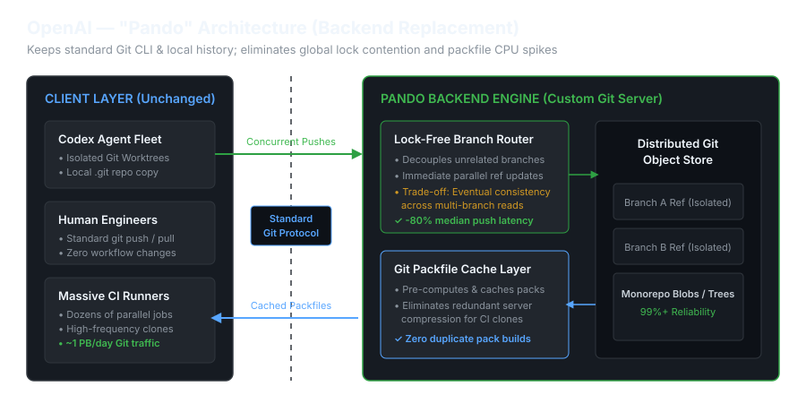
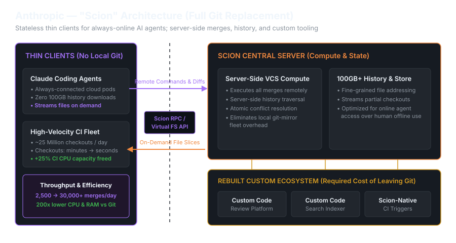
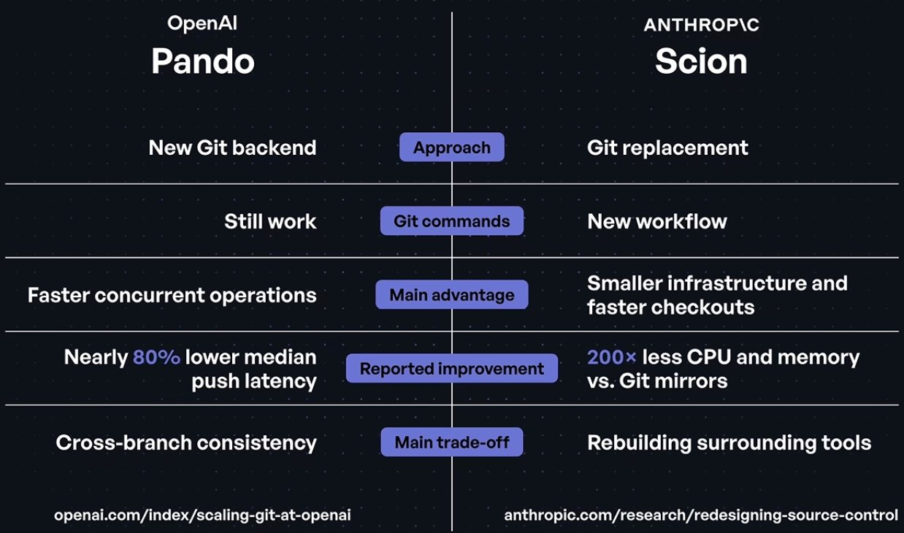
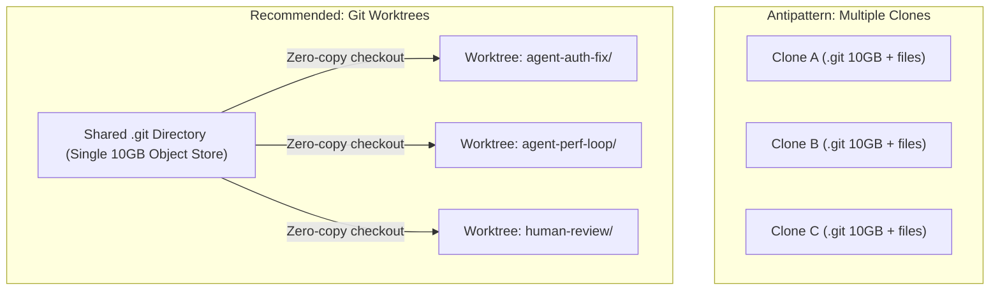
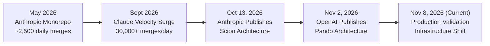

# Scaling Source Control for AI Agents: OpenAI Pando vs. Anthropic Scion

**Daily learning · 8 November 2026 · Architectural deep review**

> **Core idea:** As autonomous AI coding agents (Codex, Claude) take over software development, the primary engineering bottleneck has shifted from code generation to developer infrastructure. OpenAI resolved massive monorepo lock contention by building **Pando**—an evolutionary, Git-compatible backend introducing causal consistency and cached packfile streaming. Anthropic took a revolutionary route with **Scion**—abandoning Git entirely for a clean-slate, server-centric version control system with lock-free changesets and virtualized checkouts.

---

## 1. Foundations: Why Human-Scale Version Control Fails Agent Fleets

For two decades, Git has served as the undisputed standard for version control. Designed by Linus Torvalds in 2005 for the distributed development of the Linux kernel, Git was built around four foundational assumptions:

1. **Human development cadence:** Engineers write code over hours or days, commit locally, open a pull request, and wait for peer review and CI runs.
2. **Disconnected, offline-first clients:** Developers frequently work on laptops without stable network access, requiring a complete, self-contained copy of the repository's history, commit trees, and refs locally on disk.
3. **Global repository consistency:** Every write, push, or ref update coordinates across a single authoritative namespace, ensuring strict linear or atomic views of the entire repository.
4. **Dynamic, on-the-fly packfile generation:** When a client fetches or clones, the server compares client "haves" against server "wants," walks the commit graph, computes delta compression on the fly (`git pack-objects`), and streams a bespoke packfile.

```mermaid
flowchart TD
    subgraph HumanEra["Human-Scale Workflow (2005-2025)"]
        H1["Developer (Hours/Days)"] -->|"git commit"| H2["Local Git Repo"]
        H2 -->|"git push (Occasional)"| H3["Git Server"]
        H3 -->|"Full packfile clone"| H4["CI Pipeline (Batch)"]
    end

    subgraph AgentEra["Agent-Scale Workflow (2026+)"]
        A1["Agent Fleet (Seconds)"] -->|"High-frequency parallel edits"| A2["Parallel Sandboxes"]
        A2 -->|"Hundreds of concurrent pushes"| A3["Monorepo Bottleneck"]
        A3 -->|"Ref contention & CPU thrash"| A4["Millions of CI Checkouts"]
    end
```



### The 2026 Paradigm Shift: Coding is No Longer the Bottleneck

By late 2026, autonomous coding agents reached production maturity across frontier AI labs:
- At **OpenAI**, Codex changed the scale and pace of development. Engineers orchestrate multi-agent loops running in parallel, with one engineer having several changes ready for CI at once.
- At **Anthropic**, Claude transformed internal engineering velocity. Monorepo activity exploded from roughly **2,500 daily code merges in May 2026 to over 30,000 merges per day by September 2026**—a 12-fold surge within four months.

This velocity collapsed traditional Git infrastructure. When hundreds of autonomous agents push code every minute, the central Git server suffers catastrophic lock contention on references (`packed-refs`), and server CPU thrashes calculating dynamic packfile deltas. At Anthropic, serving full Git clones for 25 million daily CI checkouts across a 100 GB history would have required transferring **over 600 petabytes of Git data every day**. At OpenAI, internal repository reliability dropped below 90% during peak agent activity.

| Dimension | Human-Centric Git (2005) | Agent-Centric Infrastructure (2026) |
|---|---|---|
| **Author Cadence** | Minutes to hours per commit | Seconds per iteration cycle |
| **Concurrency** | 1–5 active branches per engineer | 10–50 parallel worker agents per engineer |
| **Network Context** | Offline-first, intermittent connectivity | Always-online, high-bandwidth cloud sandboxes (10+ Gbps) |
| **Working Copy** | Full repository clone materialized on disk | Sparse or virtualized file tree on demand |
| **Read/Write Ratio** | High read, moderate write | Massive read-amplification (CI/evals) + bursty parallel writes |
| **Coordination** | Global branch serialization | Branch-isolated causal consistency or lock-free append logs |

---

## 2. OpenAI Pando: Scale the Git Backend (Evolutionary)

In OpenAI's setup, engineers and Codex agents continue using standard `git push` and `git pull` commands. Pando sits behind the standard Git protocol, removing the global repository lock by isolating branch updates and serving pre-cached Git packfiles to handle almost 1 PB of daily CI traffic.



### Core Mechanisms

1. **Lock-Free Branch Routing (Causal Consistency):** Standard Git locks references globally during updates. Pando drops global repository-wide snapshots in favor of **branch-level causal consistency**. Pushes to unrelated branches proceed independently in parallel without contention. Each branch update commits an isolated ref version in distributed metadata, tracking the new commit tip, incoming packfile, and causal dependencies.
2. **Immutable Packfile Storage:** Incoming packfiles pushed by clients are stored directly as immutable, content-addressed blobs in scalable object storage. Pando never rewrites existing packfiles on the critical path.
3. **Packfile Reuse via `packfile-uri`:** Rather than spending CPU cycles dynamically generating custom packfiles for every fetch, Pando leverages the Git Protocol v2 `packfile-uri` feature. The server returns empty inline packs paired with HTTP download links to pre-built packfiles, served from a regional edge cache (*Express*) via consistent hashing.
4. **LSM-Tree Geometric Compaction:** Background workers compact small Level 0 (L0) push packs into geometrically larger covers (analogous to LSM-tree SSTables), bounding fetch resolution to logarithmic complexity:

$$\mathcal{O}(\log \Delta)$$

### Production Results
- **~80% lower median push latency** (~5x speedup).
- Serves **close to 1 PB/day of Git data**, peaking over 57 TB/hour with **>99% of bytes served directly from local disk caches**.
- **Zero client workflow changes:** Standard Git commands (`git clone`, `git fetch`, `git worktree`) remain 100% compatible.

---

## 3. Anthropic Scion: Replace Git Entirely (Revolutionary)

Anthropic's main branch history was approaching 100 GB with 25 million daily checkouts across always-connected agents and CI workers. Instead of optimizing Git, they replaced it with **Scion**: clients no longer store local repository history. Agents stream only the specific files they need, while all commits, merges, and history queries execute directly on the server—requiring a custom-built ecosystem for CI, code search, and code review.



### Core Mechanisms

1. **Always-Online Thin Clients:** Scion discards the offline-first assumption. Agents run inside high-speed cloud sandboxes. The client (`scion-daemon`) computes no graph traversals; it merely tracks local file edits and caches accessed blobs.
2. **Server-Side VCS Compute:** All heavy operations—diffs, three-way merges, rebases, and history walks—are computed centrally by authoritative Rust servers.
3. **Changesets as a Write-Ahead Log:** Instead of Git DAG trees, Scion uses **changesets** storing only the modified file list and SHA-256 pointers to compressed blobs. Commits are lock-free append-only writes, while branch ref updates execute via atomic Compare-And-Swap (CAS) on **Google Spanner**.
4. **Asynchronous Derived Data:** Server-side background workers precalculate and index blame and file provenance graphs, returning history queries in milliseconds without blocking write ingestion.
5. **Virtualized & Sparse Checkouts:** Files materialize lazily on demand. Agents never pay the network or disk cost of downloading the 100 GB history or 25 GB working tree. Automated pipelines can query and mutate repository state via clean APIs without checking out files.

### Production Results
- **200x lower CPU and memory usage** compared to previous Git mirroring fleets.
- Scaled from **2,500 to over 30,000 daily merges** smoothly.
- **+25% CI compute capacity freed** by replacing multi-minute clones with second-level checkouts.
- **The Trade-off:** Rebuilt surrounding tooling from scratch, including **Antique** (code review platform in Go/React), custom code search indexers, and Scion-native CI hooks.

---

## 4. Side-by-Side Architectural Breakdown

The comparison below highlights the contrasting philosophies of OpenAI's backend rewrite versus Anthropic's clean-slate replacement.



### Quick Architectural Takeaway

* **Where OpenAI paid the complexity:** Inside the **storage and synchronization engine**—accepting eventual consistency across multi-branch reads so single-branch pushes don't block each other, while maintaining 100% compatibility with standard Git tooling.
* **Where Anthropic paid the complexity:** Across the **entire developer platform**—rewriting code review (*Antique*), code search, and CI integrations from scratch because standard Git-based tools could not interface with Scion's thin-client, server-side model.

### System Comparison Matrix

| Architectural Vector | OpenAI Pando | Anthropic Scion |
|---|---|---|
| **Core Philosophy** | Evolutionary: Keep Git interface, replace the backend | Revolutionary: Discard Git, build agent-native VCS |
| **Client Interface** | Unmodified Git CLI (`git clone`, `git push`, `git fetch`) | Proprietary CLI (`scion`) and RPC APIs |
| **Client Model** | Fat client (local `.git` history, worktrees) | Stateless thin client (`scion-daemon`, virtual FS) |
| **Concurrency Model** | Branch-isolated Causal Consistency (CC) | Lock-free append-only WAL + Spanner CAS |
| **Commit Structure** | Git commit objects and immutable packfile blobs | Changeset deltas pointing to compressed object storage |
| **History & Blame** | Commit graph traversed via cached pack covers | Precomputed, asynchronously indexed derived data |
| **Read Acceleration** | Git v2 `packfile-uri` streaming via Express cache | Virtualized / sparse checkouts on demand |
| **Metadata Store** | Distributed metadata store for ref versions | Google Spanner for transactional global metadata |
| **Blob Storage** | Object storage (immutable packfile blobs) | Scalable cloud blob storage (individual file blobs) |
| **Performance Wins** | ~80% lower median push latency; ~1 PB/day served | 200x lower CPU & memory vs. Git mirrors; 30,000+ merges/day |
| **Primary Trade-off** | Cross-branch consistency is relaxed | Rebuilding entire tooling stack (Antique review, CI, search) |
| **Public Availability** | Not released (exploring ways to share underlying tech) | Not released (diverges too significantly from Git) |

---

## 5. The Developer Tier: Solving Local Agent Concurrency with Git Worktrees

While OpenAI and Anthropic tackled repository scaling at hyperscale infrastructure levels, individual software engineers and teams face an identical concurrency wall locally: multiple agents running simultaneously collide on checked-out files and branch locks.



### Why `git worktree` is the Practical Developer Pattern

A Git worktree allows multiple independent working directories to be linked to a single `.git` repository:
- **Shared Object Database:** All worktrees share the same history, commit DAG, and packfile objects. A commit or fetch in one worktree is instantly available to all other worktrees with zero disk or network duplication.
- **Isolated Working Directories:** Each worktree maintains its own working files, staging area (`index`), and `HEAD` pointer on an independent branch, preventing agent collisions.

```bash
# 1. Create isolated worktrees for parallel agents from repository root
git worktree add ../agent-feature-auth -b feature/auth-redesign
git worktree add ../agent-bugfix-cache -b bugfix/redis-timeout
git worktree add ../agent-eval-harness -b eval/long-horizon-run

# 2. Inspect active worktrees
git worktree list

# 3. Teardown completed worktrees
git worktree remove ../agent-bugfix-cache
git worktree prune
```

| Criterion | Separate `git clone` | Native `git worktree` |
|---|---|---|
| **Disk Storage** | $N \times$ full repo size (history duplicated) | $1 \times$ git history + lightweight work trees |
| **Fetch Overhead** | Every clone must run `git fetch` individually | One `git fetch` updates refs across all worktrees |
| **Branch Switching** | Independent | Cannot check out the same branch in two worktrees simultaneously |
| **Agent Isolation** | Complete file & process isolation | Complete file & process isolation |
| **Setup Time** | Minutes (dependent on repository clone size) | Under 1 second (local directory creation) |

---

## 6. Impact, Limits, and Common Misconceptions

| Common Misconception | Architectural Reality |
|---|---|
| *“Git is obsolete and will be replaced everywhere.”* | Git remains ideal for human-scale collaboration. Pando demonstrates that Git's client interfaces and wire protocols can scale to massive agent loads when backed by causal consistency and pack caching. |
| *“Anthropic wasted time rebuilding review tools when they could have used Pando's approach.”* | OpenAI's monorepo prioritized client compatibility for human engineers. Anthropic's monorepo prioritized eliminating client checkouts for cloud-native automated loops. Both aligned with their respective constraints. |
| *“Developers can download Scion or Pando today.”* | Neither system is open-source. Anthropic noted that Scion diverges too significantly from Git to be broadly usable externally without migrating the entire lifecycle. OpenAI is exploring how to share Pando's underlying technology. |
| *“Using `git worktree` solves backend CI/CD scaling.”* | Worktrees solve **local client file contention** across multiple agents on a workstation. They do not alleviate server-side lock contention on the remote Git host or CI fetch amplification. |

---

## 7. Timeline and Current State



- **May 2026:** Anthropic's engineering monorepo operates on traditional Git infrastructure, averaging ~2,500 daily pull request merges.
- **Summer 2026:** Autonomous Claude agent loops proliferate across Anthropic's teams. Monorepo activity surges 12x, exceeding 30,000 daily merges.
- **October 13, 2026:** Anthropic publishes *Redesigning source control at Anthropic*, documenting **Scion** and **Antique**.
- **November 2, 2026:** OpenAI publishes *Scaling Git at OpenAI*, unveiling **Pando**.
- **November 8, 2026 (Current State):** Both systems are running in active production. The broader software industry is adjusting CI/CD, build caching, and local worktree setups for agent-scale workloads.

---

## 8. Practical Response: Preparing Infrastructure for Agent Workloads

1. **Adopt Git Worktrees for Multi-Agent Tooling:** Configure local agent orchestrators to run subagents in dedicated `git worktree` instances rather than full clones or shared directories.
2. **Enable Git Protocol v2 & Sparse Checkouts:** Set `protocol.version = 2` across CI and agent runners, using `git sparse-checkout set` and `--depth=1` to minimize unnecessary object transfers.
3. **Shift from Dynamic Packs to Static Pack Caching:** On self-managed Git servers, enable `uploadpack.blobPackfileUri` to offload packfile delivery to static HTTP edge caches.
4. **Open-Source Prior Art:** Explore Meta's **Sapling** (`edenscm/sapling`) for virtualized monorepo checkouts and **Jujutsu** (`martinvonz/jj`) for Git-compatible, lock-free concurrent version control.

---

### Source Context

Based on primary disclosures from OpenAI and Anthropic, synthesized with architectural analysis from the BetterStack engineering review:
- OpenAI Engineering: *Scaling Git at OpenAI* (Aaron Friel, Taylor Blau, Ted Nyman, November 2, 2026).
- Anthropic Engineering: *Redesigning source control at Anthropic* (October 13, 2026).
- BetterStack Engineering: *Anthropic Replaced Git. OpenAI Did the Opposite* (November 2026).

---

**Related:**
- [AI-Coding-Loops](AI-Coding-Loops.md) — foundational analysis of inner vs. outer coding agent loops and autonomous execution boundaries.
- [Self-Improving-Agents-Loop-Engineering-And-Software-Factories-2026](Self-Improving-Agents-Loop-Engineering-And-Software-Factories-2026.md) — the 6-tier self-improvement ladder, loop engineering, and deterministic verification hierarchies.
- [AI-Native-Development-2026-Specs-Context-Harnesses](AI-Native-Development-2026-Specs-Context-Harnesses.md) — deep dive into specification engineering, coding harnesses, and agent experience (AX).
- [AI-Coding-Methodologies-and-Tooling-2026](AI-Coding-Methodologies-and-Tooling-2026.md) — systematic taxonomy of coding-agent methodologies, frameworks, and harnesses.
