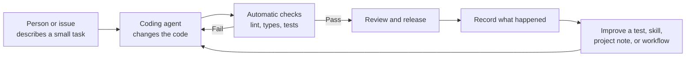
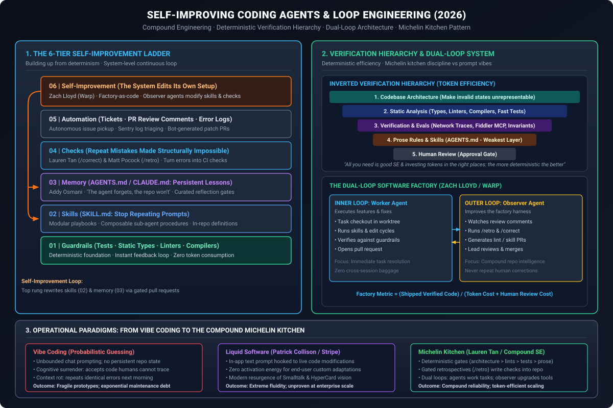
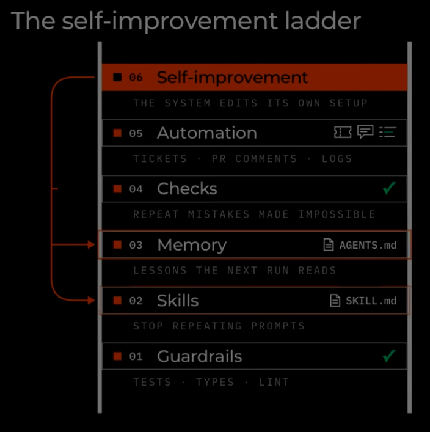
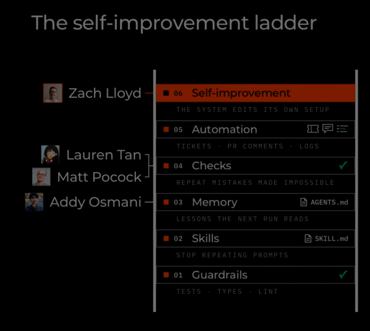
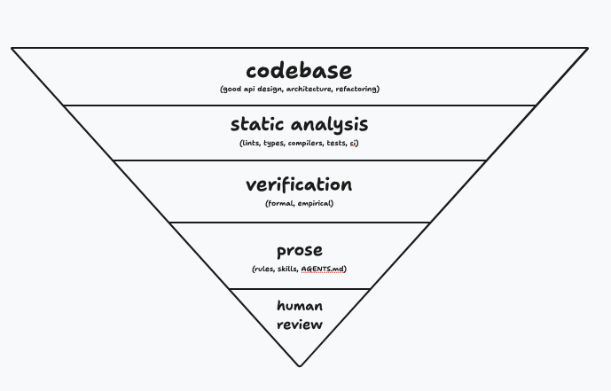
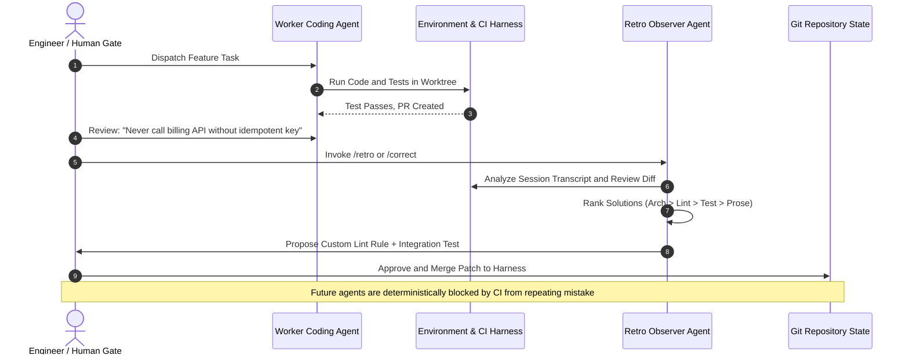

# Self-Improving Coding Agents, Loop Engineering, and the Deterministic Software Factory

## From Probabilistic Vibe Coding to Compound Michelin Kitchens: The 6-Tier Self-Improvement Ladder and the Hierarchy of Verification

> "Software is starting to improve itself, just not in the sci-fi way. Rather than runaway intelligence explosions or autonomous model weight rewrites, self-improvement is arriving as compound loop engineering: closing the feedback loop so that every bug, human correction, and session retrospective is structurally converted into deterministic architecture, static checks, and repo-level memory—ensuring coding agents never make the same mistake twice."

**Daily learning · 6 November 2026**  
**Audience:** Software engineers, platform architects, agent harness designers, engineering leaders  
**Status:** Synthesis of late-2026 industry frameworks, independent empirical audits, and practitioner tooling  

---

## 1. Core Idea & Plain-English Overview

The frameworks described here address a universal challenge: **how to make a coding agent more useful over time**. The agent writes code, the engineering system checks its work, and each useful lesson improves the next run.



Addy Osmani describes this core loop: pick a small task, implement it, validate it, record the result, and repeat. The record matters because a fresh agent run does not automatically remember an earlier one. ([Self-Improving Coding Agents](https://addyosmani.com/blog/self-improving-agents/), [Loop Engineering](https://addyosmani.com/blog/loop-engineering/)).

### The Six Steps on the Ladder at a Glance

| Step | Simple Meaning | Example |
|---|---|---|
| **1. Guardrails** | Set clear rules the code must obey. | A type checker rejects the wrong kind of value. |
| **2. Skills** | Save a repeatable *way of working*. | “For a bug: reproduce it, fix it, then verify it.” |
| **3. Memory** | Save useful *project facts and lessons*. | “This service retries requests, so changes must handle duplicates.” |
| **4. Checks** | Run the guardrails on every change. | Tests and lint run before a change is accepted. |
| **5. Automation** | Make the steps start and connect on their own. | A failed build creates a task for an agent to investigate. |
| **6. Self-improvement** | Use results to improve the system itself. | After repeated failures, add a test or revise a skill, then check whether it helps. |

That last step means improving the **agent’s setup and workflow**. It does not mean the coding agent is training its own AI model. Matt Pocock’s `/retro` skill, for example, looks back at a session and suggests better checks, instructions, or tools. Zach Lloyd describes measuring past runs and testing changes to the agent workflow before adopting them. ([Retro skill](https://github.com/mattpocock/skills/blob/main/skills/engineering/retro/SKILL.md), [Don’t vibe code your software factory](https://www.warp.dev/blog/build-production-software-factory)).

### What the Upside-Down Triangle Means

Use the most **predictable, repeatable** way to solve each problem:

1. **Codebase:** Make the code easy to understand and change (make bugs impossible by design).
2. **Static analysis:** Let tools catch clear errors: lint, types, compilers, and fast tests.
3. **Verification:** Test whether the software actually behaves correctly (formal and empirical evals).
4. **Prose:** Write instructions for decisions tools cannot express (`AGENTS.md`, rules, skills).
5. **Human review:** Ask a person to judge important or uncertain outcomes.

“Deterministic” means the same check gives the same answer each time. A test can check “Does login reject an expired code?” faster and more consistently than asking an AI to reread the code on every run. Spend AI tokens on work that needs judgment—understanding a new bug or designing a change—then turn repeated mistakes into automatic checks where possible.

> **In one sentence:** Build good software, check it automatically, let agents handle well-defined work, and feed verified lessons back into the system.

$$\text{Engineering Velocity} = \frac{\text{Shipped \& Verified Features}}{\text{Token Expenditure} + \text{Human Verification Overhead}}$$

Rather than letting models repeatedly guess in expensive probabilistic chat sessions, production teams build an outer harness that enforces an **inverted verification hierarchy**:

> "All you need is good software engineering and investing your tokens in the right places: the more deterministic the better (and token efficient)." — Lauren Tan (`@poteto`)

By anchoring agent execution on deterministic codebase architecture, static typing, and automated checks, developers reserve probabilistic LLM tokens strictly for implementation where formal guarantees cannot reach. A top-tier observer loop watches agent mistakes and automatically generates PRs against the harness itself—editing skills, memory, and lints under human gating.

---

## 2. Foundations: Core Concepts and Key Contributors

To understand self-improving coding systems, we must first map the ecosystem of practitioners who transformed this conceptual space throughout 2026.

```
                              ┌──────────────────────────────────────────────┐
                              │      06. SELF-IMPROVEMENT (Warp / Oz)        │
                              │  System edits its own harness, skills & lint │
                              └──────────────────────┬───────────────────────┘
                                                     │ Mutates
                     ┌───────────────────────────────┴───────────────────────────────┐
                     ▼                                                               ▼
        ┌─────────────────────────┐                                     ┌─────────────────────────┐
        │   03. REPO MEMORY       │                                     │   02. MODULAR SKILLS    │
        │   AGENTS.md / CLAUDE.md │                                     │   SKILL.md playbooks    │
        │   (Addy Osmani)         │                                     │   (Addy Osmani)         │
        └─────────────────────────┘                                     └─────────────────────────┘
                     ▲                                                               ▲
                     └───────────────────────────────┬───────────────────────────────┘
                                                     │ Enforces
                              ┌──────────────────────┴───────────────────────┐
                              │    04. AUTOMATED CHECKS (/correct, /retro)   │
                              │  Repeat mistakes made impossible via tests   │
                              │  (Lauren Tan, Matt Pocock)                   │
                              └──────────────────────┬───────────────────────┘
                                                     │ Anchors on
                              ┌──────────────────────┴───────────────────────┐
                              │   01. DETERMINISTIC GUARDRAILS (Linter/Type) │
                              │  Hermetic compiler & test verification gates │
                              └──────────────────────────────────────────────┘
```

### The Key Contributors and Perspectives

| Contributor / Organization | Primary Artifact or Post | Core Thesis & Architectural Contribution |
|---|---|---|
| **Addy Osmani** (Anthropic) | *Self-Improving Coding Agents* & *Loop Engineering* | **Loop Engineering & Repo Memory:** "The agent forgets, the repo won't." Introduced the task-test-commit loop, reflection gates, and curated `AGENTS.md` memory to prevent context rot. |
| **Lauren Tan** (`@poteto`, Cursor / GrokBot) | `pstack` (`/correct` playbook) | **The Michelin Kitchen & Verification Ranking:** Rejects casual "vibe coding factories." Argues that written prose rules are the *weakest* possible fix. Demands making bugs impossible by codebase architecture, then static checks, then tests, and prose only as a last resort. |
| **Matt Pocock** | `/retro` skill (`mattpocock/skills`) | **Session Retrospectives as Environment Patches:** Analyzes agent transcripts and git diffs after a run. Proposes deterministic CI/lint checks instead of admonishing the model with more prompt text. |
| **Zach Lloyd** (Founder & CEO, Warp) | *Don't Vibe Code Your Software Factory* & Warp Factories | **Dual-Loop Architecture & Factory-as-Code:** Distinguishes the *Inner Loop* (worker agent doing tasks) from the *Outer Loop* (observer agent watching corrections and updating the factory harness in code). |
| **Patrick Collison** (CEO, Stripe) | *Liquid Software* (Dispatch, Oct 2026) | **In-App End-User Modification:** Places a freeform "improvements" text box directly inside production apps, wiring user requests directly to an agent that immediately edits and redeploys running software. |
| **METR** (Model Evaluation & Threat Research) | *Independent Assessment of AI R&D Acceleration at Anthropic* (Nov 5, 2026) | **Empirical Acceleration Measurement:** Verified a ~1.9x doubling rate in capability improvements at Anthropic, with ~80% driven by internal AI-assisted R&D loops—confirming practical compound engineering without runaway AGI. |
| **Rob Shocks** (*Switch Dimension*) | *Claude Is Starting to Improve Itself* (Nov 2026) | **The 6-Tier Self-Improvement Ladder:** Synthesized practitioner frameworks into a concrete, 6-rung implementation ladder showing how closed loops build up from deterministic guardrails to self-improvement. |

### Essential Terminology

| Term | Technical Meaning in Agent Harnesses |
|---|---|
| **Inner Loop** | The short-horizon execution cycle where a worker agent receives a task, inspects code, modifies files within an isolated git worktree, and runs local tests until passing. |
| **Outer Loop** | The meta-system loop that observes inner loop executions, evaluates review comments, error telemetry (e.g. Sentry), and transcript failures, and automatically updates the agent harness, skills, or lint rules. |
| **Compound Engineering** | The organizational practice where every resolved bug or PR correction permanently increases the intelligence and determinism of the repository harness. |
| **Cognitive Surrender** | The dangerous antipattern where developers blindly accept complex, unvetted agent code without understanding its failure modes or verifying its internal invariants. |
| **Factory-as-Code** | Defining the entire agent orchestration harness—sub-agents, skills, verification hooks, and tool connections—as versioned code within the git repository. |
| **Reflection Gate** | A mandatory human- or lead-agent review step that validates session reflections before committing new rules into `AGENTS.md` or `SKILL.md`, preventing memory pollution. |

---

## 3. Mechanism: The Architecture of Self-Improvement

Self-improvement in software development does not happen by modifying LLM model weights during inference. It occurs by engineering a closed feedback system around a stateless model core.



---

### The 6-Tier Self-Improvement Ladder

The self-improvement ladder structures how an engineering organization builds autonomous coding capability without collapsing into chaotic prompt chasing.




#### Rung 01: Guardrails (Deterministic Baseline)
* **Mechanics:** Hermetic unit tests, strict static types (`tsc --strict`, `mypy --strict`, Rust compiler), AST linters (`eslint`, `ruff`, `golangci-lint`), and formatters.
* **Why it matters:** Guardrails run locally in milliseconds, cost zero tokens, and provide unambiguous binary feedback (`pass`/`fail`). When an agent hallucinate an invalid function parameter, a strict type-checker immediately halts the loop before code is ever staged.

#### Rung 02: Skills (`SKILL.md`: Stop Repeating Prompts)
* **Mechanics:** Reusable, composable markdown instruction packages stored in-repo (e.g., `.gemini/skills/`, `.claude/skills/`). Each skill specifies its triggering conditions, execution playbook, required MCP tools, and acceptance criteria.
* **Why it matters:** Rather than typing 200 words of procedural instructions into chat ("run red-green-refactor, verify test coverage, then update docs"), the developer triggers `/tdd` or `/code-review`. Skills standardize execution across sessions.

#### Rung 03: Memory (`AGENTS.md` / `CLAUDE.md`: Lessons the Next Run Reads)
* **Mechanics:** Persistent, repository-level Markdown files that agents automatically read at session initialization.
* **Why it matters:** As Addy Osmani demonstrated, agents operate statelessly: "The agent forgets, the repo won't." When an agent discovers a repo quirk (e.g., "Always use `api/v2` endpoints; `api/v1` returns stale cache"), this insight is documented in `AGENTS.md` so future agent instances inherit the lesson.

#### Rung 04: Checks (Repeat Mistakes Made Structurally Impossible)
* **Mechanics:** Automated retrospective workflows (such as Lauren Tan's `/correct` and Matt Pocock's `/retro`) that translate recurring mistakes into permanent environment assertions.
* **Why it matters:** If an agent forgets to mock network calls in an integration test, adding another line of prose to a prompt will eventually fail when context expands. Rung 04 enforces a custom ESLint rule or pre-commit hook that rejects unmocked fetch calls before the agent can submit a PR.

#### Rung 05: Automation (Tickets, PR Comments, and Logs)
* **Mechanics:** Event-driven orchestration harnesses (such as GitHub Actions, Warp Oz, or cloud runners) that connect agents to webhooks.
* **Why it matters:** Agents run autonomously in response to issue creation, PR review comments, and production crash logs (e.g., Sentry alerts). The agent checks out a branch in an isolated git worktree, reproduces the bug, writes a regression test, implements the fix, and opens a pull request.

#### Rung 06: Self-Improvement (The System Edits Its Own Setup)
* **Mechanics:** The pinnacle of the ladder. An observer agent monitors the performance of worker agents, analyzes review comments left by senior engineers, and authors PRs that edit the repository's skills, memory files, and automated checks.
* **Why it matters:** The feedback loop closes. As illustrated in the ladder diagram, Rung 06 loops back down to mutate Rung 03 (`AGENTS.md`) and Rung 02 (`SKILL.md`). The system becomes a learning harness.

---

### The Inverted Verification Hierarchy

A central breakthrough highlighted by Lauren Tan is that not all verification mechanisms are created equal. In fact, reliance on prompt rules represents an architectural failure.



```
▲  [1. CODEBASE ARCHITECTURE]        ──> Make invalid states unrepresentable
│  [2. STATIC ANALYSIS & CHECKS]     ──> Types, linters, compilers (0 tokens)
│  [3. RUNTIME VERIFICATION & EVALS] ──> Network traces, integration assertions
│  [4. PROSE INSTRUCTIONS & RULES]   ──> AGENTS.md, skills (Weakest layer)
▼  [5. HUMAN REVIEW GATE]            ──> Final authority & reflection sign-off
```

#### Ranking Fixes by Deterministic Strength

$$\begin{aligned}
\text{Resilience}(\text{Architecture}) &> \text{Resilience}(\text{Static Analysis}) \\
&> \text{Resilience}(\text{Runtime Evals}) \\
&> \text{Resilience}(\text{Prose Instructions})
\end{aligned}$$

1. **Codebase Architecture & Invariant Modeling (Strongest):** Refactor the domain model using algebraic data types, smart constructors, or private state machines so that invalid operations cannot even be expressed. If a bug is impossible by construction, no prompt or test is required.
2. **Static Analysis & Compilers:** Use strict typing, schema validations (Zod, Pydantic, Protobuf), and custom AST lint rules. These run instantly, consume zero LLM tokens, and eliminate entire classes of regressions deterministically.
3. **Runtime Verification & Empirical Traces:** Capture live application behavior using observability proxies (e.g., Fiddler Everywhere MCP or Playwright trace recordings). If an agent claims a backend feature works, the harness inspects the actual HTTP requests, status codes, and payloads rather than trusting agent output.
4. **Prose Instructions & System Rules (Weakest):** Writing "Please ensure you handle null pointers" in an `AGENTS.md` file is the flimsiest possible guardrail. LLMs suffer from attention dilution, prompt drift, and reasoning shortcuts. Prose is advisory; computers demand enforcement.
5. **Human Review Gate:** Human judgment validates intent and authorizes system changes. In self-improving loops, humans act as the filter ensuring that only high-signal lessons are committed to memory.

---

### Retrospective Loop: Turning Failures into Checks

The following sequence illustrates how modern agent harnesses (such as Matt Pocock's `/retro` and Lauren Tan's `/correct`) close the loop deterministically:



---

### Liquid Software: In-App User Modifiability

In late October 2026, Patrick Collison (CEO of Stripe) articulated an alternative frontier of self-improvement: **Liquid Software**.

```
Traditional Loop:     User Bug Report ──> Issue Tracker ──> Engineer ──> Agent ──> CI ──> Deploy
Liquid Software Loop: User Types in App ───────────────> Live Agent ───────────────> App Mutates
```

Collison introduced an "improvements" affordance directly into personal apps: a simple text input where users type how they want the software to change. An embedded coding agent immediately implements the feature, verifies it against local tests, and updates the running code on the fly.

While Collison noted that every app lacking this capability suddenly feels "rigid and anachronistic," he identified severe scaling challenges:
* **Maintainability & Architectural Entropy:** Rapidly bolting on dozens of live changes without refactoring leads to severe technical debt.
* **Security & Isolation:** Running live code-generation agents within user interfaces exposes systems to prompt injection and credential leakage.
* **Collaborative Divergence:** In multi-tenant enterprise software, different users have conflicting requirements. Liquid software works brilliantly for personal utility tools, but requires strict versioning and isolation for enterprise deployment.

---

## 4. Impact and Limits: Empirical Realities vs Runaway Hype

A critical duty in AI engineering is separating demonstrated system acceleration from sensationalized claims of runaway Recursive Self-Improvement (RSI).

### The METR Assessment of Anthropic (November 5, 2026)

On November 5, 2026, independent safety organization **METR (Model Evaluation & Threat Research)** released its comprehensive assessment of AI research and development acceleration inside **Anthropic**.

```
                       METR ANTHROPIC ACCELERATION AUDIT
                       
Historical Baseline:   [==== 1.0x Progress Rate ====]
October 2026 Audit:    [=================== 1.9x Progress Rate ===================]
                       (95% CI: 1.5x to 2.8x Acceleration)
                       
Attribution:           ~80% Driven by Internal AI-Assisted Loops
                       ~20% Methodological & Compute Scaling
```

Key empirical findings from the METR audit:
1. **Measured 1.9x Pace:** Anthropic improved frontier model capabilities on well-specified capability benchmarks at approximately twice the historical rate (1.9x, with a 95% confidence interval of 1.5x–2.8x).
2. **AI-Assisted Driving Force:** Approximately **80%** of this acceleration was directly attributed to internal AI-assisted workflows—specifically agents generating training configurations, running evaluation loops, analyzing failure modes, and refactoring experimental pipelines.
3. **Bounded Engineering, Not Runaway Singularity:** METR explicitly observed that this acceleration operates within tightly bounded developer harnesses. The models are not rewriting their own core neural architectures arbitrarily; human research scientists use agent swarms to eliminate routine engineering bottlenecks.

### Common Misconceptions and Realities

| Misconception / Claim | Technical Reality |
|---|---|
| *"AI agents are rewriting their own weights and becoming exponentially self-aware."* | **False.** Model weights remain completely frozen during deployment. Self-improvement is an external harness property: updating git-tracked tools, test suites, prompts, and memory files. |
| *"You can build an autonomous software factory purely using vibe coding prompts."* | **False.** Zach Lloyd and Warp proved that prompt-only pipelines collapse under latency, API cost, and hallucination drift. Scalable factories require deterministic infrastructure-as-code. |
| *"Adding more rules to `AGENTS.md` guarantees the agent won't repeat mistakes."* | **False.** As Lauren Tan notes, prose rules are the weakest fix. Overloaded memory files cause instruction neglect and context bloat. True fixes must be encoded in compiler types or CI checks. |
| *"Unattended autonomous agent loops are ready for unrestricted production deployment."* | **False.** Addy Osmani emphasizes: "A loop running unattended is also a loop making lots of mistakes unattended." Human gating remains essential for reflection merging and deployment. |

---

## 5. Timeline and Ecosystem Evolution

The transition from single-prompt chat interactions to self-improving software harnesses unfolded rapidly between 2023 and late 2026.

| Date / Period | Milestone | Primary Focus & Significance |
|---|---|---|
| **2023 – Early 2024** | *Prompt Engineering Era* | Interactive chat UIs, manual copy-pasting of code, prompt templates, few-shot examples. |
| **Late 2024 – 2025** | *Spec-Driven Development (SDD)* | Markdown specifications, task dependency graphs, early coding harnesses, MCP protocol inception. |
| **January 2026** | *Self-Improving Coding Agents* | Addy Osmani publishes architectural guidance on task-test-commit loops, reflection gates, and `AGENTS.md`. |
| **June 2026** | *Loop Engineering Emergence* | Osmani details outer vs inner loops, worktree isolation, sub-agent delegation, and repo memory persistence. |
| **Late Summer 2026** | *pstack & Retrospective Skills* | Lauren Tan releases `pstack` with `/correct`; Matt Pocock introduces `/retro` to convert agent mistakes into CI checks. |
| **October 2026** | *Liquid Software & Factory-as-Code* | Patrick Collison demonstrates in-app user modification loops; Zach Lloyd outlines Warp's dual-loop factory architecture. |
| **November 5, 2026** | *METR Anthropic Audit* | METR publishes first formal empirical evidence showing a ~1.9x AI-driven acceleration in frontier AI research loops. |

---

## 6. Practical Response and Implementation Playbook

For engineering teams looking to close the loop on their coding agents today, follow this 5-step implementation roadmap:

```
[Step 1: Harden Guardrails] ──> [Step 2: Define Skills] ──> [Step 3: Session Retros] ──> [Step 4: Reflection Gate] ──> [Step 5: Runtime Traces]
```

### Step 1: Harden Deterministic Guardrails First
Never deploy an agent to a repository that lacks fast, hermetic linting and type-checking. Ensure your project has:
* Pre-commit hooks (`husky`, `pre-commit`, or `lint-staged`).
* Zero-token AST validation (e.g., `biome`, `ruff`, or `tsc --noEmit`).

### Step 2: Extract Repetitive Prompts into `SKILL.md`
Identify the 3 prompts your team types most frequently into agent chats (e.g., creating a component, writing a database migration, refactoring an endpoint). Encode them into versioned markdown files under `.gemini/skills/<skill-name>/SKILL.md` or `.claude/skills/<skill-name>/SKILL.md`.

### Step 3: Implement an End-of-Session Retrospective
Do not close a session when an agent struggles. Run a retrospective command to inspect the transcript diffs. Below is a production-ready `/retro` skill definition:

```markdown
---
name: retro
description: Run an end-of-session retrospective to convert agent mistakes into deterministic checks.
---

# Session Retrospective Playbook

1. **Analyze Transcript:** Inspect the conversation history and git diff for points where the human corrected the agent or tests failed.
2. **Identify Root Failure:** Categorize the failure:
   - Navigation: Was context missing or hard to discover?
   - Architectural: Was an invariant violated?
   - Procedural: Did the agent skip an essential verification step?
3. **Rank Remediation Options (Strict Determinism Hierarchy):**
   - Rank 1: Can we make this impossible by modifying the domain types/architecture?
   - Rank 2: Can we add a static lint rule, type assertion, or compiler check?
   - Rank 3: Can we add a deterministic unit or integration test?
   - Rank 4: (Only if Ranks 1-3 are impossible) Propose an addition to AGENTS.md.
4. **Output Recommendations:** Present the proposed fix to the developer for explicit approval. Do NOT commit automatically.
```

### Step 4: Establish an Automated Reflection Gate Script
Prevent repository memory files (`AGENTS.md`) from decaying into unstructured junk drawers. Use a gating script that validates new reflections before merging:

```bash
#!/usr/bin/env bash
# scripts/verify-reflection-gate.sh
# Validates proposed memory additions against quality constraints

set -euo pipefail

PROPOSED_FILE="agent-reflections-pending.md"

if [ ! -f "$PROPOSED_FILE" ]; then
    echo "No pending reflections to verify."
    exit 0
fi

echo "🔍 Auditing proposed agent reflections..."

# 1. Reject vague advice (must be specific and actionable)
if grep -iE "(be careful|try harder|pay attention|remember to)" "$PROPOSED_FILE"; then
    echo "❌ Error: Proposed reflection contains vague advisory text. Convert to a concrete check."
    exit 1
fi

# 2. Check line count (prevent uncurated memory bloat)
LINE_COUNT=$(wc -l < "$PROPOSED_FILE")
if [ "$LINE_COUNT" -gt 30 ]; then
    echo "❌ Error: Reflection exceeds 30 lines. Distill learning into essential facts."
    exit 1
fi

echo "✅ Reflection passed basic gating checks. Awaiting human lead sign-off."
```

### Step 5: Integrate Runtime Network & Telemetry Verification
When testing full-stack or API integrations, give your agent visibility into real network traffic using the **Fiddler Everywhere MCP Server**. This enables the agent to inspect status codes, detect unhandled 401/500 errors, trace slow database queries, and verify that secret tokens do not leak into URLs or headers.

---

## 7. Primary Source Context

This analysis synthesizes primary industry literature, repository implementations, and empirical audits released through November 2026:

1. **Addy Osmani:**
   - *Self-Improving Coding Agents* (31 January 2026): [addyosmani.com/blog/self-improving-agents/](https://addyosmani.com/blog/self-improving-agents/)
   - *Loop Engineering* (7 June 2026): [addyosmani.com/blog/loop-engineering/](https://addyosmani.com/blog/loop-engineering/)
2. **Lauren Tan (`@poteto`):**
   - `pstack` Agent Workflow Plugin: [github.com/cursor/plugins/tree/main/pstack](https://github.com/cursor/plugins/tree/main/pstack)
3. **Matt Pocock:**
   - Retrospective Skill: [github.com/mattpocock/skills/blob/main/skills/engineering/retro/SKILL.md](https://github.com/mattpocock/skills/blob/main/skills/engineering/retro/SKILL.md)
4. **Zach Lloyd (Warp):**
   - *Don't Vibe Code Your Software Factory* (Late 2026): [warp.dev/blog/build-production-software-factory](https://www.warp.dev/blog/build-production-software-factory)
5. **Patrick Collison:**
   - *Liquid Software* Dispatch (31 October 2026): [patrickcollison.com/dispatches/liquid-software](https://patrickcollison.com/dispatches/liquid-software)
6. **METR (Model Evaluation and Threat Research):**
   - *Independent Assessment of AI R&D Acceleration at Anthropic in October 2026* (Published 5 November 2026): [metr.org/blog/2026-11-05-anthropic-acceleration/](https://metr.org/blog/2026-11-05-anthropic-acceleration/)
7. **Rob Shocks (*Switch Dimension*):**
   - *Claude Is Starting to Improve Itself (Not How You Think)* (November 2026): [youtube.com/watch?v=SM0F74IzAUA](https://www.youtube.com/watch?v=SM0F74IzAUA)

---

**Related:**
- [OpenAI-Pando-Vs-Anthropic-Scion-Source-Control-Nov-2026](OpenAI-Pando-Vs-Anthropic-Scion-Source-Control-Nov-2026.md) — how high-velocity software factories break traditional Git and how OpenAI (Pando) and Anthropic (Scion) re-engineered source control.
- [AI-Coding-Loops](AI-Coding-Loops.md) — foundational examination of outer vs inner coding loops, worktree sandboxing, and autonomous Ralph loops.
- [AI-Native-Development-2026-Specs-Context-Harnesses](AI-Native-Development-2026-Specs-Context-Harnesses.md) — deep dive into specification engineering, coding harnesses, and agent experience (AX).
- [Agent-Skills-Ecosystem-2026](../skills/Agent-Skills-Ecosystem-2026.md) — comprehensive survey of modular SKILL.md playbooks, portability across tools, and community registries.
- [Agent-Memory-Architectures-5-Layer-Harness-And-Judgment-Memory-Nov-2026](../frameworks/Agent-Memory-Architectures-5-Layer-Harness-And-Judgment-Memory-Nov-2026.md) — technical mechanics of 5-layer concentric agent memory, KV-cache prefix optimization, and parametric judgment gates.
