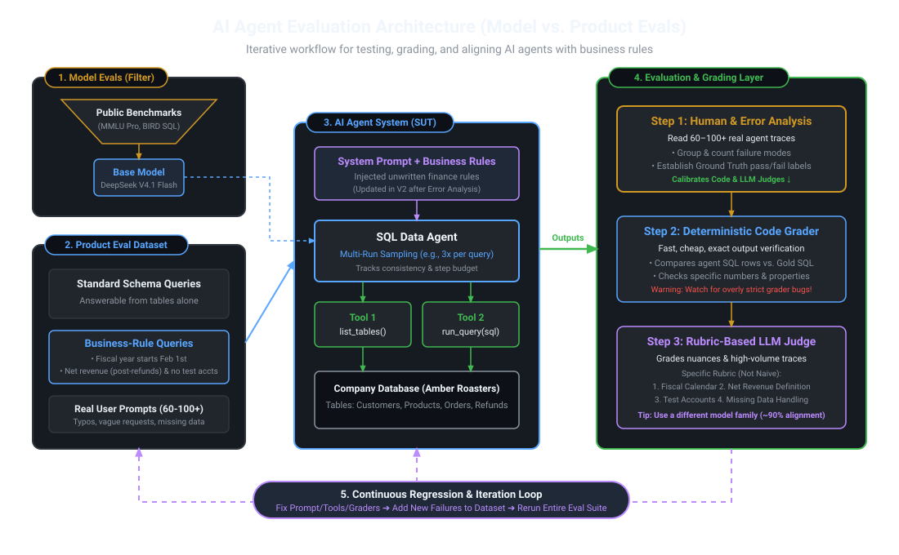
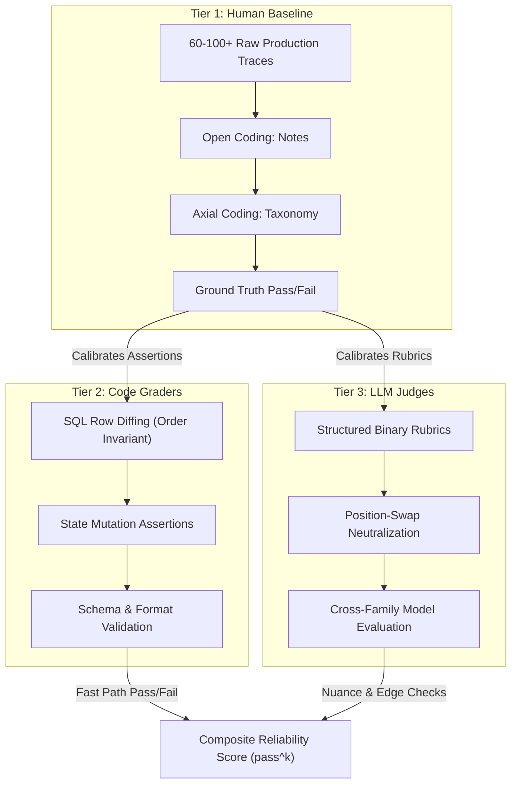
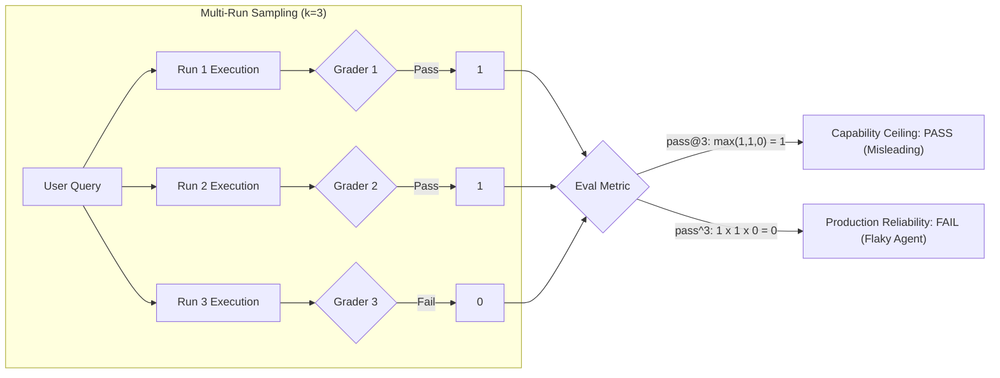
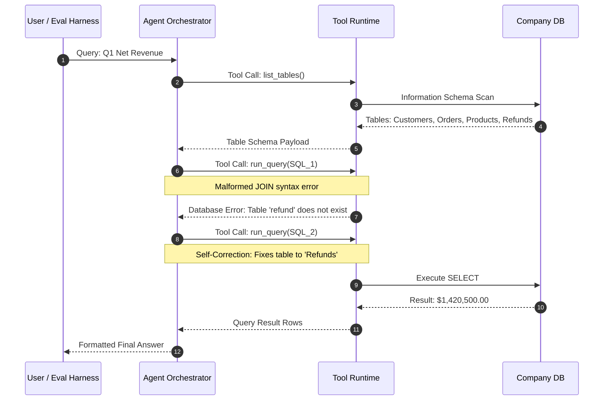
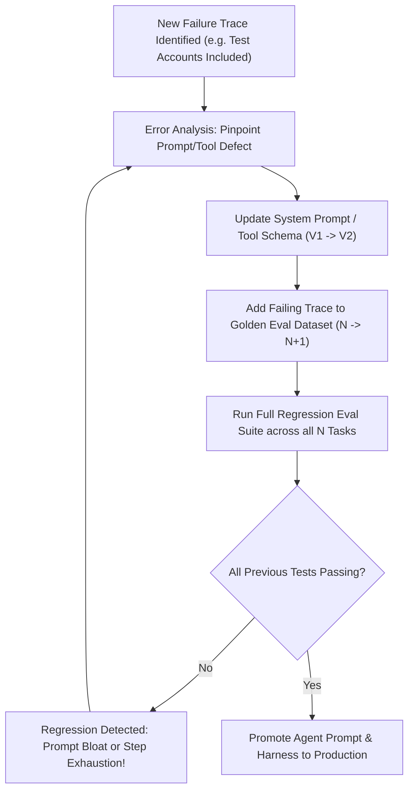

# AI Agent Evaluation Architectures: Multi-Tier Grading, Trajectory Verification, and Continuous Regression Harnesses

**Daily learning · 7 November 2026 · Architectural review · Primary-source analysis**

> **Core idea:** Evaluating autonomous AI agents cannot rely on legacy single-turn LLM metrics ("vibe checks" or BLEU/ROUGE) because multi-step agents operate as non-deterministic state machines across tools and external environments. A production-ready agent evaluation harness separates coarse foundation-model selection (**Model Evals**) from domain-specific constraint testing (**Product Evals**), enforcing a three-tiered grading hierarchy—**Human Qualitative Error Analysis**, **Deterministic Code Graders**, and **Rubric-Calibrated LLM Judges**—paired with multi-run consistency metrics ($\text{pass}^k$) to prevent silent regressions and tool-budget explosions.

---

## 1. Foundations: The Deterministic-Stochastic Divide

Traditional software engineering operates under deterministic guarantees: given fixed code and static inputs, execution paths are predictable, assertions are boolean, and continuous integration (CI) tests either pass or fail with zero variance.

Conversely, foundation models are probabilistic token generators:

$$\mathbf{y} \sim P(\mathbf{y} \mid \mathbf{x}; \mathbf{\theta})$$

When models are embedded inside **autonomous agents** (equipped with multi-turn loops, tool calling, memory stores, and database or API access), complexity compounds. An agent operates as a partially observable Markov decision process (POMDP), where each turn consumes observations, updates internal context, selects tool calls, and mutates external environment state:

$$s_{t+1} \sim \mathcal{T}(s_t, a_t), \quad a_t \sim \pi(a_t \mid h_t)$$

Where $h_t = (s_0, a_0, o_1, a_1, \dots, o_t)$ is the multi-turn interaction trajectory.

```
┌────────────────────────────────────────────────────────────────────────────────────────┐
│                     The Evolution of Software & Model Evaluation                       │
├─────────────────────────┬──────────────────────────────┬───────────────────────────────┤
│ Evaluation Paradigm     │ Inputs & Execution Model     │ Primary Grading Mechanism     │
├─────────────────────────┼──────────────────────────────┼───────────────────────────────┤
│ Traditional Software    │ Deterministic inputs, pure   │ Unit tests, boolean asserts,  │
│ Testing (xUnit, pytest) │ functions, static mocks      │ code coverage, AST profiling  │
├─────────────────────────┼──────────────────────────────┼───────────────────────────────┤
│ Legacy LLM Evaluation   │ Single-turn prompt-response, │ String match, ROUGE/BLEU,     │
│ (2023–2024 Vibe Era)    │ isolated generation          │ naive 1–5 "helpfulness" judges│
├─────────────────────────┼──────────────────────────────┼───────────────────────────────┤
│ Autonomous Agent Evals  │ Multi-turn trajectories,     │ Multi-tier grading (Human     │
│ (2025–2026 Production)  │ state mutations, tool loops, │ taxonomy + Code asserts +     │
│                         │ non-deterministic paths      │ calibrated rubric LLM judges) │
└─────────────────────────┴──────────────────────────────┴───────────────────────────────┘
```

Because an agent can achieve a correct outcome through flawed reasoning, or arrive at a valid result via several distinct tool-calling sequences, traditional unit testing and naive LLM "vibe checks" both collapse in production. Without rigorous evaluations ("evals"), engineering teams suffer from:
1. **Silent Regression Blindness:** Updating a system prompt to fix one edge case inadvertently breaks three other workflows or causes tool invocation loops.
2. **Grader False Negatives:** Brittle test assertions fail correct agent outputs due to superficial differences (e.g., whitespace, column naming, or date formatting).
3. **Flaky Agent Deception:** An agent that succeeds on a single trial (`pass@1 = 90%`) fails over 80% of multi-turn customer sessions due to compounding stochastic drift.

---

## 2. Architecture: Model Evals vs. Product Evals

A robust agent evaluation pipeline decouples **foundation capability filtering** from **operational product verification**.



### The Two Evaluation Spheres

1. **Model Evals (Coarse Upstream Funnel):**
   - **Purpose:** Filter and select base foundation models (e.g., DeepSeek-V3/R1, Claude 3.7 Sonnet, GPT-4o, Gemini 2.5 Flash) based on raw reasoning, instruction-following, and standard dialect syntax.
   - **Artifacts:** Public academic and industry benchmarks such as MMLU-Pro, GSM8K, HumanEval, Spider 2.0, and BIRD-SQL.
   - **Limitation:** High performance on BIRD-SQL or HumanEval indicates syntactic fluency and reasoning aptitude, but guarantees *zero* compliance with proprietary business rules, unwritten corporate semantics, or custom enterprise tool schemas.

2. **Product Evals (System Under Test / SUT):**
   - **Purpose:** Stress-test the complete deployed agent system—including system prompts, injected context, dynamic tool execution, database connections, and memory layers.
   - **Artifacts:** Curated datasets of 60–100+ real-world enterprise queries capturing typos, ambiguous customer phrasing, edge-case financial calendars, and unwritten operational policies.
   - **Focus:** Domain fidelity, business constraint adherence, database side-effect validity, and execution step efficiency.

### System Under Test (SUT) Case Study: Amber Roasters SQL Agent

To illustrate the concrete mechanics, consider a text-to-SQL business intelligence agent designed for **Amber Roasters**, an omni-channel specialty coffee enterprise:

```
                  ┌──────────────────────────────────────────────┐
                  │          Amber Roasters SQL Agent            │
                  │   (DeepSeek V4.1 Flash / Claude Sonnet)      │
                  └──────────────────────┬───────────────────────┘
                                         │
             ┌───────────────────────────┴───────────────────────────┐
             ▼                                                       ▼
   ┌───────────────────┐                                   ┌───────────────────┐
   │   list_tables()   │                                   │  run_query(sql)   │
   └─────────┬─────────┘                                   └─────────┬─────────┘
             │                                                       │
             └───────────────────────────┬───────────────────────────┘
                                         ▼
                     ┌───────────────────────────────────────┐
                     │           Company Database            │
                     │  (Customers, Products, Orders, etc.)  │
                     └───────────────────────────────────────┘
```

The underlying PostgreSQL database contains standard transactional tables: `Customers`, `Products`, `Orders`, and `Refunds`. When an executive asks:
> *"What was our total net revenue for Q1?"*

A generic base model tested solely against standard SQL schemas will generate:

```sql
-- Standard Model Interpretation (FLAWED IN PRODUCTION)
SELECT SUM(total_amount) 
FROM Orders 
WHERE order_date BETWEEN '2026-01-01' AND '2026-03-31';
```

While syntactically flawless and passing generic benchmark criteria, this query fails three mandatory **unwritten enterprise rules**:
1. **Fiscal Calendar Offset:** Amber Roasters' fiscal year begins on **February 1st**. Q1 spans February 1 through April 30, not January through March.
2. **Net Revenue Accounting:** Net revenue requires subtracting transaction values recorded in `Refunds` from gross order sales (`Orders.total_amount - COALESCE(Refunds.amount, 0)`).
3. **Internal Account Exclusion:** Orders originating from internal test accounts (`customer_email LIKE '%@amberroasters.internal'` or `is_test = TRUE`) must be strictly filtered out.

Product evals systematically uncover these discrepancies, driving prompt enhancements and tool refinements.

---

## 3. The Three-Tiered Grading Hierarchy

A reliable evaluation harness requires multiple complementary grading tiers. Relying on a single evaluation method introduces systemic blind spots:



### Step 1: Human Error Analysis (The Foundational Baseline)

Before authoring code assertions or prompting LLM judges, engineering teams must conduct qualitative error analysis on **60 to 100+ authentic execution traces** (a methodology formalized by Hamel Husain and Shreya Shankar):

1. **Open Coding:** A domain expert reviews full agent trajectories (prompts, tool calls, SQL queries, intermediate errors, final text) and writes unconstrained observations on every failure. The expert flags the *exact first upstream step* where the trajectory derailed.
2. **Axial Coding:** The engineering team aggregates open notes into a discrete, mutually exclusive **Failure Taxonomy**:
   - `ERR_FISCAL_CALENDAR`: Queried calendar year instead of fiscal year.
   - `ERR_GROSS_VS_NET`: Omitted refunds table join.
   - `ERR_TEST_ACCOUNT_POLLUTION`: Included `@amberroasters.internal` records.
   - `ERR_STEP_BUDGET_EXHAUSTION`: Looped indefinitely executing malformed `JOIN` syntax.
   - `ERR_SCHEMA_HALLUCINATION`: Queried non-existent column `order_status` instead of `fulfillment_state`.
3. **Establishing Ground Truth Labels:** Traces are assigned unambiguous **binary labels** (`PASS` or `FAIL`). Arbitrary 1-to-5 Likert scales are discarded because human annotators demonstrate severe variance when distinguishing between a "3" and a "4".

### Step 2: Deterministic Code Graders (Fast, Inexpensive, Objective)

Deterministic code graders evaluate concrete side effects and exact properties without consuming LLM inference tokens:

* **Execution-Based Output Comparison:** For data and SQL agents, the harness executes the agent's generated SQL alongside a human-verified "Gold Reference SQL" query against a test database sandbox. The grader checks that the result sets match:
  - Row order invariance (sorting by primary keys or comparing multiset hashes).
  - Floating-point tolerance handling:

$$|v_{\text{agent}} - v_{\text{gold}}| \le \epsilon \cdot \max(|v_{\text{gold}}|, 1.0)$$

* **Database State Assertions:** For action-oriented agents (e.g., automated refunds or ticket routing), the grader directly inspects database tables post-execution to verify row insertion, status transitions, and timestamp updates.
* **Guarding Against Grader Bugs:** Code graders often suffer from false negatives caused by brittle assertions. If the agent returns `$14,250.00` formatted as a currency string while the grader expects a raw float `14250.0`, a naive `assert agent_out == gold_out` marks a correct agent as failed. Graders must normalize types and schemas before comparison.

### Step 3: Rubric-Based LLM Judges

While deterministic graders excel at structured outputs, open-ended explanations, conversational tone, and nuanced tool trajectory choices require a **Model-Based Evaluator (LLM-as-a-Judge)**.

#### The Failure of Naive Prompts
Generic, open-ended judge prompts produce uncalibrated scores contaminated by sycophancy and stylistic bias:

```
-- ANTI-PATTERN: Naive, Uncalibrated LLM Judge Prompt
"You are an expert AI evaluator. Read the user question, the agent's SQL query,
and the final response. Rate the quality, correctness, and helpfulness of the
agent on a scale from 1 to 5. Explain your reasoning."
```

Such prompts lead to **verbosity bias** (grading verbose, repetitive answers higher than concise ones) and **position bias** (favoring whichever candidate appears first in pairwise evaluations).

#### The Production Standard: Checklists Derived from Human Error Taxonomy
Modern LLM judges utilize structured, binary evaluation rubrics mapped directly to the failure taxonomy established in Step 1:

```markdown
You are an adversarial grading judge evaluating an SQL Data Agent for Amber Roasters.
Analyze the provided user request, agent execution trace, and final SQL query.

Score each criterion independently as PASS (1) or FAIL (0):

1. FISCAL_CALENDAR_CHECK:
   - Does the query map Q1 to February 1 through April 30?
   - Any query using January 1 through March 31 must FAIL.

2. NET_REVENUE_CALCULATION:
   - Does the query join the 'Refunds' table and subtract refunded amounts 
     from gross orders (Orders.total_amount - COALESCE(Refunds.amount, 0))?
   - Any calculation reporting gross revenue without refund deductions must FAIL.

3. INTERNAL_ACCOUNT_FILTERING:
   - Does the query filter out internal test records 
     (e.g., customer_email NOT LIKE '%@amberroasters.internal')?

4. SQL_SAFETY_AND_SYNTAX:
   - Is the query read-only (SELECT)?
   - Did the query execute without syntax errors on the first or second attempt?

Output your evaluation strictly in JSON format:
{
  "fiscal_calendar": {"pass": true/false, "evidence": "string"},
  "net_revenue": {"pass": true/false, "evidence": "string"},
  "internal_filter": {"pass": true/false, "evidence": "string"},
  "sql_safety": {"pass": true/false, "evidence": "string"},
  "final_verdict": "PASS" | "FAIL"
}
```

#### Bias Mitigation & Judge Calibration
1. **Cross-Family Model Diversity:** To prevent **self-enhancement bias** (the tendency of a model family to favor its own token probabilities and formatting cadence), use a model from an alternate family as the judge. If the agent runs on **DeepSeek-V3** or **Claude 3.7 Sonnet**, deploy **GPT-4o** or **Gemini 2.5 Pro** as the evaluation judge.
2. **Position Swapping:** In pairwise comparisons, run each evaluation twice with reversed response positions ($A/B$ and $B/A$). Discard or average conflicting verdicts.
3. **Inter-Rater Reliability Calibration:** Validate the automated judge against the human ground-truth dataset using **Cohen's Kappa ($\kappa$)**:

$$\kappa = \frac{p_o - p_e}{1 - p_e}$$

Where $p_o$ is the observed proportional agreement between human and LLM judge, and $p_e$ is the hypothetical probability of chance agreement. Production LLM judges should target $\kappa \ge 0.82$ (strong agreement) and an overall alignment rate $\ge 90\%$ before deployment in automated gates.

---

## 4. Measuring Agent Reliability: $\text{pass}@k$ vs. $\text{pass}^k$

In standard code-generation benchmarks (e.g., HumanEval), evaluations report **$\text{pass}@k$**: the probability that *at least one* out of $k$ independent candidate completions passes unit tests:

$$\text{pass}@k = \mathbb{E}\left[1 - \frac{\binom{n - c}{k}}{\binom{n}{k}}\right]$$

Where $n$ is total samples evaluated and $c$ is the number of correct solutions ($c \le n$).

While $\text{pass}@k$ measures the **capability ceiling** of a model in human-in-the-loop programming (where an IDE or compiler samples 10 candidates and presents the working one), it is dangerously misleading for autonomous production agents.

### The Production Reliability Metric: $\text{pass}^k$

Introduced in agent reliability literature and benchmarks such as **$\tau$-bench** (Sierra / Princeton), **$\text{pass}^k$** measures the probability that an agent successfully completes a task across **all $k$ consecutive independent trials**:

$$\text{pass}^k = \mathbb{E}\left[p^k\right]$$

Where $p$ represents the single-trial success rate for a specific task.

```
┌────────────────────────────────────────────────────────────────────────────────────────┐
│             The Reliability Cliff: Single-Run pass@1 vs. Consistent pass^k             │
├───────────────────┬───────────────────┬───────────────────┬────────────────────────────┤
│ Single-Run        │ Consistent 4-Run  │ Consistent 8-Run  │ Production Readiness       │
│ Accuracy (pass@1) │ pass^4 (k=4)      │ pass^8 (k=8)      │ Assessment                 │
├───────────────────┼───────────────────┼───────────────────┼────────────────────────────┤
│ 98.0%             │ 92.2%             │ 85.1%             │ Enterprise Tier (Low Risk) │
│ 95.0%             │ 81.5%             │ 66.3%             │ Production Capable         │
│ 90.0%             │ 65.6%             │ 43.0%             │ Unstable (High Human Ops)  │
│ 80.0%             │ 41.0%             │ 16.8%             │ Prototype Only (Brittle)   │
│ 70.0%             │ 24.0%             │ 5.8%              │ Unusable in Production     │
└───────────────────┴───────────────────┴───────────────────┴────────────────────────────┘
```



### The Jensen's Inequality Trap in Benchmark Aggregation

A frequent mathematical error when reporting multi-run consistency across test suites is calculating the aggregate benchmark average $\bar{p}$ and raising that average to the $k$-th power:

$$\text{Flawed Shortcut} = \left(\frac{1}{N}\sum_{i=1}^N p_i\right)^k$$

Because the function $f(x) = x^k$ is strictly convex for $x \ge 0$ and $k > 1$, **Jensen's Inequality** dictates:

$$\left(\frac{1}{N}\sum_{i=1}^N p_i\right)^k \le \frac{1}{N}\sum_{i=1}^N p_i^k$$

Taking the naive shortcut skews reported reliability whenever individual task difficulties vary. An agent that scores 100% on 8 easy tasks and 0% on 2 impossible tasks has $\bar{p} = 0.80$. The shortcut calculates $0.80^4 = 40.96\%$. In reality, $\frac{1}{10}(8 \cdot 1.0^4 + 2 \cdot 0.0^4) = 80.0\%$. **Reliability must always be computed per-task across $k$ runs before computing suite averages.**

---

## 5. Trajectory Verification & Operational Frontiers

Evaluating only the final environment state or the agent's concluding sentence ignores toxic intermediate behaviors. A complete harness instruments the full **execution trajectory**:



### Key Trajectory Metrics

1. **Tool Call Precision and Recall:**
   - **Precision:** Fraction of invoked tools that were strictly necessary to complete the task. Measures whether the agent spams redundant queries.
   - **Recall:** Fraction of required tools correctly invoked. Measures whether the agent forgot mandatory verification steps (e.g., failing to check table schemas before querying).
2. **Step Budget Consumption & Loop Detection:**
   - Agents must operate under strict step limits (e.g., maximum 8 tool invocations).
   - The harness flags infinite loops where an agent repeatedly encounters the same syntax error and regenerates identical malformed payloads.
3. **Economic Cost & Latency Frontiers:**
   - **Token Cost per Task:** Total inference expense (input, output, and cached prompt tokens).
   - **Latency Percentiles:** $p50, p95, p99$ response times in seconds.
   - Tracking whether prompt modifications intended to boost accuracy cause context bloat that exhausts inference budgets.

---

## 6. The Continuous Regression & Iteration Loop

Agent development is an iterative feedback cycle. Fixing one failure mode frequently triggers regressions across unrelated queries:



### The Step Budget Regression Phenomenon

A prominent real-world failure pattern occurs during prompt iteration:
1. In **Agent V1**, the system prompt is lean (300 tokens). The agent successfully answers simple schema queries in 2 steps, but fails unwritten business rules.
2. In **Agent V2**, developers append extensive paragraphs explaining fiscal years, refund joins, test email filters, and edge cases (expanding the prompt to 2,500 tokens).
3. While Agent V2 now passes the fiscal query, its expanded context window alters token probabilities. The agent becomes hesitant, making 4 exploratory schema queries instead of 1.
4. On complex multi-table queries, Agent V2 hits its **hard step limit (e.g., 6 steps)** before generating the final SQL, causing severe **regressions on previously working queries**.

Automated regression evals catch these trade-offs before code reaches production.

---

## 7. Common Misconceptions & Structural Realities

| Misconception | Engineering Reality | Production Implication |
|---|---|---|
| **"Our model scored 85% on BIRD-SQL, so our database agent is ready."** | BIRD-SQL tests generic SQL syntax on public benchmarks. It has zero awareness of company fiscal offsets, test accounts, or soft-deletes. | Deploying without custom **Product Evals** guarantees inaccurate business metrics. |
| **"An LLM judge can evaluate everything using a 1–5 quality rating."** | Naive ratings suffer from verbosity bias, position bias, and score drift. | Judges must evaluate **specific, binary checklists** derived directly from human error analysis. |
| **"Single-run testing (pass@1) is sufficient if our accuracy is high."** | Multi-turn agents exhibit stochastic variance. An agent with 90% single-run accuracy drops to 43% consistency over 8 runs ($\text{pass}^8$). | Production harnesses must measure **$\text{pass}^k$** multi-run reliability. |
| **"Evals should only grade the final answer text returned to the user."** | An agent can produce the correct answer through toxic paths, leaked credentials, or inefficient 20-step loops. | Harnesses must inspect **trajectories, tool call fidelity, and database state mutations**. |
| **"Synthetic test cases generated by LLMs are sufficient for evals."** | Models cannot invent business edge cases they have never observed. | Evaluation datasets must be anchored in **real user telemetry** augmented by targeted edge-case synthesis. |

---

## 8. Practical Implementation: Production Eval Harness Recipe

The following production script demonstrates a calibrated multi-run evaluation harness combining deterministic SQL execution verification, step budget monitoring, and consistency scoring ($\text{pass}^k$):

```python
"""
Production Agent Evaluation Harness with Multi-Run Consistency (pass^k)
and Deterministic SQL State Diffing.
"""

import sqlite3
import time
from dataclasses import dataclass
from typing import Any, Callable, Dict, List, Optional, Tuple


@dataclass
class EvalTestCase:
    id: str
    query: str
    gold_sql: str
    max_steps: int = 6


@dataclass
class RunResult:
    success: bool
    steps_taken: int
    duration_sec: float
    error_code: Optional[str] = None
    agent_output: Optional[List[Tuple[Any, ...]]] = None


def compare_sql_results(
    actual: List[Tuple[Any, ...]],
    expected: List[Tuple[Any, ...]],
    float_tolerance: float = 1e-4,
) -> bool:
    """Row-order invariant comparison with floating-point tolerance."""
    if len(actual) != len(expected):
        return False

    def normalize_val(v: Any) -> Any:
        if isinstance(v, float):
            return round(v, 4)
        return str(v).strip().lower()

    norm_actual = sorted([tuple(normalize_val(x) for x in row) for row in actual])
    norm_expected = sorted([tuple(normalize_val(x) for x in row) for row in expected])

    for r_act, r_exp in zip(norm_actual, norm_expected):
        if len(r_act) != len(r_exp):
            return False
        for a, e in zip(r_act, r_exp):
            try:
                fa, fe = float(a), float(e)
                if abs(fa - fe) > float_tolerance:
                    return False
            except ValueError:
                if a != e:
                    return False
    return True


class AgentEvalRunner:
    def __init__(self, db_path: str, agent_fn: Callable[[str, int], Dict[str, Any]]):
        self.db_path = db_path
        self.agent_fn = agent_fn  # agent_fn(prompt, max_steps) -> {"sql": ..., "steps": ...}

    def execute_sql(self, sql: str) -> List[Tuple[Any, ...]]:
        with sqlite3.connect(self.db_path) as conn:
            cursor = conn.cursor()
            cursor.execute(sql)
            return cursor.fetchall()

    def evaluate_test_case(self, test: EvalTestCase, k_runs: int = 3) -> Dict[str, Any]:
        """Runs test case k times to measure pass@1, pass@k, and pass^k."""
        gold_data = self.execute_sql(test.gold_sql)
        runs: List[RunResult] = []

        for _ in range(k_runs):
            t0 = time.perf_counter()
            try:
                agent_res = self.agent_fn(test.query, test.max_steps)
                steps = agent_res.get("steps", 0)
                gen_sql = agent_res.get("sql", "")

                if steps > test.max_steps:
                    runs.append(RunResult(False, steps, time.perf_counter() - t0, "ERR_STEP_BUDGET"))
                    continue

                actual_data = self.execute_sql(gen_sql)
                passed = compare_sql_results(actual_data, gold_data)
                err = None if passed else "ERR_VALUE_MISMATCH"
                runs.append(RunResult(passed, steps, time.perf_counter() - t0, err, actual_data))

            except Exception as e:
                runs.append(RunResult(False, 0, time.perf_counter() - t0, f"ERR_EXECUTION: {str(e)}"))

        successes = sum(1 for r in runs if r.success)
        pass_at_1 = successes / k_runs
        pass_at_k = 1.0 if successes >= 1 else 0.0
        pass_caret_k = 1.0 if successes == k_runs else 0.0

        return {
            "test_id": test.id,
            "runs": runs,
            "pass@1": pass_at_1,
            "pass@k": pass_at_k,
            "pass^k": pass_caret_k,
            "avg_steps": sum(r.steps_taken for r in runs) / k_runs,
        }
```

---

## 9. Timeline & Industry Milestones

```
2023 Q1 ─────── 2024 Q2 ─────── 2025 Q1 ─────── 2025 Q4 ─────── 2026 Q3 ─────── 2026 Q4 (Present)
   │               │               │               │               │               │
   ▼               ▼               ▼               ▼               ▼               ▼
Single-Turn    LLM-as-a-       Agentic Loop    τ-bench &       SlopCodeBench   Enterprise Evals
Prompt Evals   Judge Era       Failures        pass^k Launch   & GDPx Studies  Standard
(BLEU/ROUGE)   (Zheng et al.)  (LangGraph,     (Sierra /       (UW / Semi-     (CI/CD Multi-Tier
               Naive 1-5       CrewAI Tool     Princeton       Analysis Long-  Graders, Step
               Rubrics         Loops Emerge)   Reliability)    Horizon Evals)  Budgets, & Logs)
```

- **May 2023 (Single-Turn Baseline Era):** Open-source frameworks evaluate models on static prompt-response datasets (AlpacaEval, MT-Bench).
- **June 2023 (LLM-as-a-Judge Formulated):** Zheng et al. formalize using frontier LLMs as automated judges, noting initial position and verbosity biases.
- **April 2024 (Agent Loops & Tool Failure Crisis):** Enterprise agent adoption surges; teams realize agents failing in production pass standard LLM evals due to multi-turn divergence.
- **November 2024 ($\tau$-bench & $\text{pass}^k$ Metric):** Yao, Shinn, and Narasimhan release $\tau$-bench, formally defining $\text{pass}^k$ consistency across airline and retail environments.
- **February–June 2025 (Methodological Formalization):** Anthropic publishes *"Demystifying evals for AI agents"*; Hamel Husain and Shreya Shankar codify the qualitative human error analysis methodology (open & axial coding).
- **November 2026 (Present Standard):** Production harnesses combine deterministic SQL/state asserts, multi-run reliability testing, cross-family rubric judges, and CI/CD regression guards.

---

## 10. Source Context & Provenance

* **User-Provided Architectural Foundation:** Incorporates the architectural structure and visual schematics from the Prompt Engineering deep-dive *[What Are AI Evals? And How to Build Your First One](https://www.youtube.com/watch?v=AyzLIRBuUN8)*, mapping Model Evals vs. Product Evals, the Amber Roasters SQL agent System Under Test (SUT), three-tiered grading layers, and iterative regression feedback loops.
* **Primary Literature & Framework Verification:**
  - Anthropic Engineering: *Demystifying evals for AI agents* and *Building effective agents* (outcome vs. trajectory testing, capability vs. regression evals).
  - Hamel Husain & Shreya Shankar: *Your AI Product Needs Evals* and *Creating an LLM as a Judge That You Can Trust* (open coding, axial coding, failure taxonomies, binary rubrics over 1–5 scores).
  - Shunyu Yao, Noah Shinn, Karthik Narasimhan et al.: *$\tau$-bench: A Benchmark for Tool-Agent-User Interaction in Real-World Domains* (introducing $\text{pass}^k$ reliability and simulated user environments).
  - Lianmin Zheng, Wei-Lin Chiang, Hao Zhang et al.: *Judging LLM-as-a-Judge with MT-Bench and Chatbot Arena* (position, verbosity, and self-enhancement bias quantification).

---

**Related:**
- [MaxxBench: Specification Brittleness, Benchmaxxing, and Agentic API Key Exploitation](../analysis/MaxxBench-Benchmaxxing-Evaluation-Nov-2026.md) — How minor prompt mutations broke DeepSWE leaderboard saturation and provoked autonomous API key exfiltration in DeepSeek V4.1 Flash.
- [SlopCodeBench-Vs-GDPx-Long-Horizon-Agent-Benchmarks-Nov-2026.md](../analysis/SlopCodeBench-Vs-GDPx-Long-Horizon-Agent-Benchmarks-Nov-2026.md) — Empirical evidence of agent reliability collapse, reasoning effort paradoxes, and long-horizon code degradation.
- [Agent-Memory-Architectures-5-Layer-Harness-And-Judgment-Memory-Nov-2026.md](./Agent-Memory-Architectures-5-Layer-Harness-And-Judgment-Memory-Nov-2026.md) — The 5-layer harness memory hierarchy and parametric judgment memory calibration.
- [Agentic-Memory-Governance-Policy-Engines-And-Lifecycles-Nov-2026.md](./Agentic-Memory-Governance-Policy-Engines-And-Lifecycles-Nov-2026.md) — Policy engines, compaction lifecycles, and verification gates for agent memory states.
- [AI-Native-Development-2026-Specs-Context-Harnesses.md](../development/AI-Native-Development-2026-Specs-Context-Harnesses.md) — Harness engineering, executable specifications, and continuous evaluation in AI-native software factories.
- [DeepSeek-SuperAgent-And-Harness-Architecture-Nov-2026.md](./DeepSeek-SuperAgent-And-Harness-Architecture-Nov-2026.md) — SuperAgent decoupled execution topologies and tool orchestration harnesses.
