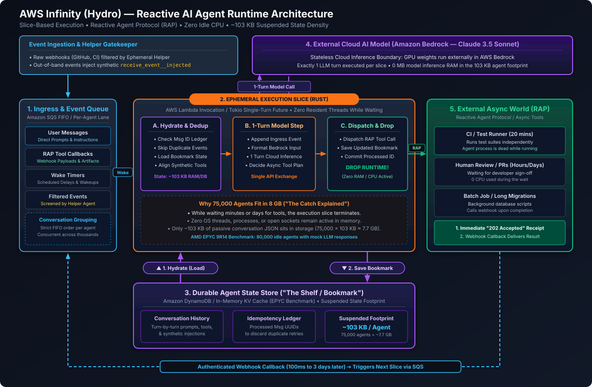
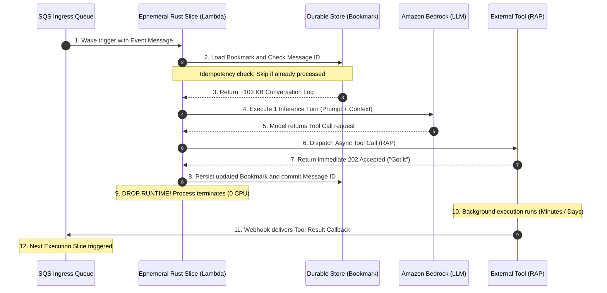

# AWS Infinity (Hydro) Architecture: Rust Serverless Agent Runtime, Execution Slices, Reactive Agent Protocol (RAP), and Suspended State Density

**Daily learning · 6 November 2026 · Architectural review · Primary-source analysis**

> **Core idea:** AWS Infinity—an open-source Rust agent runtime originating from the AWS and UC Berkeley Hydro research collaboration—replaces the traditional long-lived, blocking agent process with an ephemeral, slice-based execution model. By treating the conversation history as a durable state "bookmark" (~103 KB per agent), offloading LLM inference to cloud APIs (Amazon Bedrock), and decoupling external tool waits via the Reactive Agent Protocol (RAP) with synthetic tool injection (`receive_event__injected`), Infinity eliminates idle compute completely—enabling 75,000 suspended AI agents to comfortably reside in under 8 GB of RAM.

---

## 1. Foundations: Deconstructing the "Raspberry Pi" Myth

Headlines announcing *"75,000 AI Agents running in 8 GB of RAM"* or *"75,000 agents on a Raspberry Pi"* have generated intense industry curiosity. However, running tens of thousands of active artificial intelligence entities on low-power edge hardware sounds physically impossible given modern GPU and VRAM demands. 

To understand AWS Infinity, engineers must separate sensationalized marketing headlines from genuine architectural innovation.

```
Traditional Agent Runtime ("Please Hold"):
User Event ──> Persistent Agent Process (Python/Node) ──> LLM Call ──> Tool Call (e.g. CI build, 20 mins)
               ▲                                                       │
               └────────── Pins OS Thread, 150MB+ RSS, Sockets Open ───┘ (Idle Waste)

AWS Infinity Runtime ("We'll Call You Back"):
User Event ──> SQS Ingress ──> Ephemeral Rust Slice ──> 1 LLM Turn ──> RAP Tool Dispatch ("Got it")
                               (Wakes via Lambda)                      │
                                        │ (Saves ~103KB Bookmark)      ▼
                                        ▼                         Tool runs independently (CI, PR)
                               RUNTIME TERMINATES (0% CPU, 0 MB)       │
                                                                       ▼ (Hours / Days Later)
                                                             Webhook Callback to SQS ──> Next Slice
```

### 1.1 The "Raspberry Pi" Catch: What Was Actually Benchmarked?

The viral claim that 75,000 AI agents run on a single 8 GB machine (such as a Raspberry Pi 5) rests on three critical distinctions:

1. **The Test Hardware:** AWS never ran this benchmark on a Raspberry Pi. The reference experiment was executed on an enterprise-grade cloud server powered by dual **AMD EPYC 9R14** processors.
2. **The Intelligence Location:** The AI models (such as Anthropic Claude 3.5 Sonnet on Amazon Bedrock) do **not** run inside the agent's memory footprint. Inference occurs entirely on external cloud GPU clusters. The agent runtime is strictly a lightweight state machine, orchestrator, and event coordinator.
3. **Passive Suspended State vs. Active Compute:** The benchmark measured **idle agents** suspended between turns across a simulated 20-turn conversation. Each idle agent held approximately **103 KB of RAM** (representing compressed conversation JSON, tool metadata, and message tracking). 

Mathematically:

$$
\text{Total Memory}_{\text{idle}} = 75{,}000 \times 103\,\text{KB} \approx 7{,}725{,}000\,\text{KB} \approx 7.725\,\text{GB}
$$

Because 7.725 GB fits inside an 8 GB boundary, commentators equated the density to a Raspberry Pi 5. However, this measures **passive state storage density**, not 75,000 concurrent LLM generation streams.

### 1.2 "Please Hold" vs. "We'll Call You Back"

In conventional Python-based agent runtimes (such as standard LangChain, CrewAI, or AutoGen scripts), an agent executes as a long-lived OS process. When an agent invokes an external tool—such as triggering a 15-minute integration test suite, waiting for a remote database migration, or pausing for human pull-request review—the execution loop blocks:

```python
# The Traditional "Please Hold" Anti-Pattern
response = await llm.generate(prompt)
if response.has_tool_call:
    # Process blocks here for 20 minutes: OS thread pinned, 200MB RAM locked
    result = await execute_slow_ci_suite(response.tool_call)
    next_step = await llm.generate(result)
```

During this wait:
- The OS process remains resident in memory (typically 150 MB to 500 MB RSS for Python runtimes).
- Network sockets, file descriptors, and worker threads remain allocated.
- Any server reboot, pod eviction, or network partition crashes the in-flight agent state unless complex checkpointing is manually engineered.

Infinity changes this paradigm from **"Please hold on the line"** to **"We will call you back when ready"**:
1. The agent executes a brief burst of computation called an **Execution Slice**.
2. It sends the tool invocation request asynchronously to an external service.
3. It writes the updated conversation log and message markers to persistent storage.
4. **The agent process completely shuts down.**
5. While waiting seconds, minutes, or days, the agent consumes **zero CPU cycles, zero open threads, and zero active compute RAM**.
6. When the external tool completes, it delivers an authenticated webhook callback into the agent's ingress queue, waking a brand-new execution slice to process the result.

### 1.3 Essential Terminology

| Term | Operational Definition & Architectural Role |
|---|---|
| **AWS Infinity** | An open-source, high-density Rust agent runtime developed through the AWS and UC Berkeley Hydro research collaboration. |
| **Execution Slice** | A single ephemeral turn of execution (typically inside an AWS Lambda function or a short-lived Tokio async task) that processes one event and shuts down. |
| **The Bookmark** | The complete, ordered conversation history and tool execution log acting as the durable state record required to resurrect the agent. |
| **Reactive Agent Protocol (RAP)** | An asynchronous communication contract where tools return an immediate `202 Accepted` ("Got it") receipt and deliver output via a webhook callback. |
| **`receive_event__injected`** | A synthetic tool call injected into the conversation history to allow unsolicited outside events (PRs, alerts) to conform to strict LLM chat schema rules. |
| **Ephemeral Helper Agent** | A lightweight secondary agent spawned to filter noisy event subscriptions before they pollute the main agent's context window. |
| **Idempotency Ledger** | A deduplication registry of processed event and message IDs ensuring network retries and duplicate webhooks never trigger redundant LLM turns. |

---

## 2. Mechanism: Architecture and Execution Dynamics

AWS Infinity decomposes agent systems into four decoupled planes: **Event Ingestion**, **Ephemeral Compute Slices**, **Durable State Storage**, and **Asynchronous Tool Execution**.


*Figure 1: Complete AWS Infinity (Hydro) architecture showing SQS ingress queues, ephemeral Rust execution slices on AWS Lambda, durable state bookmarks (~103 KB footprint), external Bedrock LLM inference, the Reactive Agent Protocol (RAP) loopback, and helper-agent event filtering.*

### 2.1 The End-to-End Lifecycle of an Execution Slice

When an event arrives, Infinity executes a tightly bounded lifecycle:



#### Step 1: Ingress and Per-Agent FIFO Grouping
Events enter through an event queue (such as Amazon SQS FIFO). To prevent race conditions while preserving high system throughput:
- Messages destined for a single agent share a **Message Group ID** (the agent's unique conversation ID). SQS FIFO guarantees strict serial delivery for that agent.
- Messages across different agents possess different group IDs and are dispatched concurrently across thousands of parallel workers.

#### Step 2: Hydration and Deduplication
The runtime wakes an execution slice (e.g., an AWS Lambda worker running a compiled Rust binary). Before invoking expensive model APIs:
- The slice inspects the event's unique message UUID against an **Idempotency Ledger**. If a network glitch caused SQS to redeliver a message that was already committed, the slice discards it immediately without charging tokens.
- If valid, the slice fetches the agent's **Bookmark** from storage (DynamoDB or an in-memory key-value cache), reconstructing the turn history.

#### Step 3: Single-Turn Model Invocation
The slice appends the new event to the conversation history and formats the payload for the cloud model API (e.g., Claude 3.5 Sonnet on Amazon Bedrock). It executes **exactly one generation turn**. 

The LLM evaluates the input, updates its reasoning, and decides the next step—typically emitting an intent to invoke a tool (such as running a build or querying an issue tracker).

#### Step 4: Dispatch, State Commitment, and Runtime Eviction
Upon receiving the model's tool intent:
1. The slice issues an asynchronous HTTP request to the target tool adhering to the Reactive Agent Protocol (RAP).
2. The tool immediately returns an HTTP `202 Accepted` acknowledgement containing an operation handle.
3. The slice appends the pending tool record to the conversation log, updates the idempotency ledger, and commits the state back to durable storage.
4. **The execution slice exits immediately.** Memory is freed, the runtime container becomes idle or tears down, and compute billing drops to zero.

---

## 3. Asynchronous Innovations: Solving Agent Realities

Building completely stateless, slice-based agents requires solving two structural problems that break traditional LLM assumptions: **strict schema alternation** and **unsolicited event noise**.

### 3.1 The LLM Schema Problem and `receive_event__injected`

Modern frontier models (including Anthropic Claude and OpenAI GPT-4o) enforce strict conversation structure contracts. Standard chat schemas mandate an alternating sequence:

```
User Message ──> Assistant Message (with tool_calls) ──> Tool Result Message ──> Assistant Message
```

If an autonomous agent is waiting for a 20-minute CI build to complete, what happens if an unrelated external event occurs—such as a developer commenting on the pull request, or a security alert triggering?

If the runtime directly injects `User: Developer commented on PR #42` while the model is expecting a `Tool Result` for the pending build, frontier API validators reject the prompt with a schema violation error:

```json
{"error": "Invalid conversation turn: expected tool_result for call_id 'tool_ci_build_991'"}
```

#### The Synthetic Tool Injection Solution

Infinity resolves this impedance mismatch by synthesizing a dummy tool call into the conversation stream:

```
┌────────────────────────────────────────────────────────────────────────────────────────┐
│                        Synthetic Tool Injection Architecture                           │
├────────────────────────────────────────────────────────────────────────────────────────┤
│ 1. Unsolicited event arrives (e.g. GitHub PR webhook or cron timer).                   │
│ 2. Runtime synthesizes an artificial assistant tool call in the historical transcript: │
│    role: "assistant"                                                                   │
│    tool_calls: [{                                                                      │
│      id: "call_inject_8819",                                                           │
│      name: "receive_event__injected",                                                  │
│      arguments: { "event_type": "github_pr_comment" }                                  │
│    }]                                                                                  │
│ 3. Runtime immediately pairs it with the synthetic tool response:                      │
│    role: "tool"                                                                        │
│    tool_call_id: "call_inject_8819"                                                    │
│    content: "User @octocat commented: 'Please revert the database migration commit.'"  │
│ 4. Prompt validation succeeds seamlessly without modifying the model's base schema.    │
└────────────────────────────────────────────────────────────────────────────────────────┘
```

By utilizing `receive_event__injected`, the agent model perceives asynchronous outside notifications as standard, expected tool returns, allowing it to seamlessly adapt its reasoning plan mid-flight.

### 3.2 Noise Gatekeeping via Ephemeral Helper Agents

Autonomous agents monitoring real-world systems must subscribe to real-time event buses (e.g., GitHub webhooks, Kafka telemetry, Slack channels). However, piping every raw notification directly into the agent's main input queue triggers catastrophic failure modes:

1. **Context Window Exhaustion:** Unrelated commits, bot notifications, and automated CI pass logs flood the conversation log, pushing critical instructions out of the context window.
2. **Token Cost Explosion:** Each wake slice requires re-sending the accumulated conversation history. Passing trivial chatter costs thousands of dollars in unnecessary prefill tokens.
3. **Reasoning Distraction:** High event velocity causes models to lose track of long-horizon goals.

Infinity implements an **Ephemeral Helper Agent** pattern:

```
External Event Stream (GitHub, Jira, SQS)
                 │
                 ▼
┌─────────────────────────────────────────────────────────┐
│               Ephemeral Helper Agent                    │
│  • Reads read-only snapshot of current agent goal       │
│  • Fast, small reasoning model (e.g., Claude Haiku)     │
│  • Prompts: "Is this event relevant to current task?"   │
└───────────────┬─────────────────────────────────────────┘
                │
        Relevant?
       ┌────────┴────────┐
       ▼                 ▼
     [YES]             [NO]
  Synthesize          Silently
 Curated Summary       Drop
       │              (0 Cost)
       ▼
Main Agent SQS Queue
```

The Helper Agent operates as a high-speed filter. It receives the incoming raw event and a brief summary of the primary agent's active objective. If the event is irrelevant (e.g., a documentation typo fix on an unrelated branch), it is dropped silently. If relevant, the helper extracts the essential payload and forwards a compact message to the primary queue.

---

## 4. Architectural Comparison: Runtimes and Harnesses

To understand where AWS Infinity fits in modern agent engineering, examine how it compares to both traditional session runtimes and contemporary decoupled harnesses (such as DeepSeek Harness):

| Architectural Dimension | Traditional Frameworks (LangChain / CrewAI / AutoGen) | DeepSeek SuperAgent Harness (DSH / Cordis) | AWS Infinity (Hydro Project) |
|---|---|---|---|
| **Execution Model** | Long-running stateful OS process / thread | Continuous event-driven router + worker sessions | Stateless, ephemeral execution slices |
| **Idle Resource Usage** | High (150–500 MB RAM per agent, pinned threads) | Moderate (Cloud container pool, elastic worker pods) | **Zero (0 CPU, 0 MB active RAM while waiting)** |
| **Idle State Footprint** | Full process memory resident in RAM | Spilled knowledge graph + decoupled state DB | **~103 KB conversation bookmark in KV store** |
| **Tool Execution** | Synchronous blocking ReAct loop (`await tool()`) | Full-Duplex asynchronous shell (`timeoutMs: 5000`) | **Reactive Agent Protocol (RAP) with Webhook Callbacks** |
| **Out-of-Band Events** | Breaks loop or requires external socket poller | Direct subscription bypass & router re-dispatch | **Synthetic tool injection (`receive_event__injected`)** |
| **Event Noise Gate** | None (developer must manually write logic) | Two-stage filter (Deterministic gate + semantic classifier) | **Ephemeral Helper Agent filter** |
| **Deployment Target** | VM instances, persistent Docker containers | Kubernetes clusters + Cloud DB + local edge | **Serverless (AWS Lambda + SQS + DynamoDB via CDK)** |
| **Primary Language** | Python / TypeScript | TypeScript / Node.js (Cordis framework) | **Rust (Tokio / Musl / `cargo-lambda`)** |

---

## 5. Serverless CDK Deployment Topology

The production architecture for AWS Infinity is deployed entirely via the **AWS Cloud Development Kit (CDK)** using serverless building blocks:

```
          ┌──────────────────────────────────────────────────────────────────┐
          │                     AWS Serverless Topology                      │
          └──────────────────────────────────────────────────────────────────┘

   Ingress Webhooks            Scheduled Alarms                 User Terminal
   (GitHub, Slack, CI)          (CloudWatch Events)             (API Gateway / AppSync)
          │                             │                                 │
          └─────────────────────────────┼─────────────────────────────────┘
                                        │
                                        ▼
                       ┌───────────────────────────────────┐
                       │       Amazon SQS FIFO Queue       │
                       │ • MessageGroupId = AgentSessionID │
                       │ • Exactly-once delivery deduplication
                       └─────────────────┬─────────────────┘
                                         │ Event Trigger (Batch Size = 1)
                                         ▼
                       ┌───────────────────────────────────┐
                       │     AWS Lambda (Rust Runtime)     │
                       │ • Compiled via cargo-lambda       │
                       │ • Ephemeral execution slice       │
                       │ • Single-turn LLM generation      │
                       └───────────┬─────────────┬─────────┘
                   Hydrate / Commit│             │ 1-Turn API
                                   ▼             ▼
               ┌──────────────────────┐       ┌────────────────────────┐
               │   Amazon DynamoDB    │       │     Amazon Bedrock     │
               │ • Agent Bookmarks    │       │ • Claude 3.5 Sonnet    │
               │ • Idempotency Ledger │       │ • Serverless Inference │
               └──────────────────────┘       └────────────────────────┘
```

### 5.1 CDK Infrastructure Definition (TypeScript)

The following simplified AWS CDK construct illustrates how Infinity wires serverless primitives into a self-healing, high-density agent fabric:

```typescript
import * as cdk from 'aws-cdk-lib';
import * as sqs from 'aws-cdk-lib/aws-sqs';
import * as lambda from 'aws-cdk-lib/aws-lambda';
import * as dynamodb from 'aws-cdk-lib/aws-dynamodb';
import * as lambdaEventSources from 'aws-cdk-lib/aws-lambda-event-sources';
import { Construct } from 'constructs';

export class InfinityAgentStack extends cdk.Stack {
  constructor(scope: Construct, id: string, props?: cdk.StackProps) {
    super(scope, id, props);

    // 1. Durable State Store for Agent Bookmarks (~103 KB per record)
    const stateTable = new dynamodb.Table(this, 'AgentBookmarks', {
      partitionKey: { name: 'agent_id', type: dynamodb.AttributeType.STRING },
      billingMode: dynamodb.BillingMode.PAY_PER_REQUEST,
      timeToLiveAttribute: 'ttl',
      removalPolicy: cdk.RemovalPolicy.DESTROY,
    });

    // 2. FIFO Event Queue ensuring ordered turn execution per agent
    const agentQueue = new sqs.Queue(this, 'AgentEventQueue.fifo', {
      fifo: true,
      contentBasedDeduplication: true,
      visibilityTimeout: cdk.Duration.seconds(120),
    });

    // 3. Ephemeral Rust Execution Slice packaged as an AWS Lambda Function
    const rustSliceHandler = new lambda.Function(this, 'RustExecutionSlice', {
      runtime: lambda.Runtime.PROVIDED_AL2023,
      handler: 'bootstrap',
      code: lambda.Code.fromAsset('target/lambda/infinity-agent'),
      architecture: lambda.Architecture.ARM_64,
      memorySize: 256, // Minimal memory required for slice execution
      timeout: cdk.Duration.seconds(60),
      environment: {
        STATE_TABLE_NAME: stateTable.tableName,
        MODEL_ID: 'anthropic.claude-3-5-sonnet-20241022-v2:0',
      },
    });

    // Wire permissions and SQS event trigger
    stateTable.grantReadWriteData(rustSliceHandler);
    rustSliceHandler.addEventSource(
      new lambdaEventSources.SqsEventSource(agentQueue, {
        batchSize: 1, // Strict single-turn processing per invocation
      })
    );
  }
}
```

---

## 6. Implementation Blueprint: Rust Execution Slice

The following reference implementation illustrates the core logic of an Infinity execution slice in Rust, demonstrating state hydration, deduplication, synthetic event injection, and runtime eviction:

```rust
use aws_lambda_events::event::sqs::SqsEvent;
use lambda_runtime::{run, service_fn, Error, LambdaEvent};
use serde::{Deserialize, Serialize};

#[derive(Serialize, Deserialize, Clone, Debug)]
pub struct AgentBookmark {
    pub agent_id: String,
    pub conversation_history: Vec<ChatMessage>,
    pub processed_message_ids: Vec<String>,
}

#[derive(Serialize, Deserialize, Clone, Debug)]
pub struct ChatMessage {
    pub role: String,
    pub content: String,
    #[serde(skip_serializing_if = "Option::is_none")]
    pub tool_calls: Option<Vec<ToolCall>>,
}

#[derive(Serialize, Deserialize, Clone, Debug)]
pub struct ToolCall {
    pub id: String,
    pub name: String,
    pub arguments: String,
}

/// The core execution slice handler: processes exactly one turn and exits
async fn function_handler(event: LambdaEvent<SqsEvent>) -> Result<(), Error> {
    for record in event.payload.records {
        let msg_id = record.message_id.unwrap_or_default();
        let payload = record.body.unwrap_or_default();
        let agent_id = record.attributes.get("MessageGroupId")
            .cloned()
            .unwrap_or_else(|| "default_agent".to_string());

        // 1. Hydrate state bookmark from DynamoDB / KV store
        let mut bookmark = load_bookmark(&agent_id).await?;

        // 2. Message Deduplication: skip if already processed in prior slice
        if bookmark.processed_message_ids.contains(&msg_id) {
            println!("Skipping duplicate message ID: {}", msg_id);
            continue;
        }

        // 3. Handle unsolicited event schema alignment
        if is_unsolicited_event(&payload) {
            let inject_id = format!("call_inject_{}", uuid::Uuid::new_v4());
            
            // Synthesize assistant call
            bookmark.conversation_history.push(ChatMessage {
                role: "assistant".to_string(),
                content: String::new(),
                tool_calls: Some(vec![ToolCall {
                    id: inject_id.clone(),
                    name: "receive_event__injected".to_string(),
                    arguments: serde_json::json!({ "raw_event": payload }).to_string(),
                }]),
            });

            // Synthesize tool result response
            bookmark.conversation_history.push(ChatMessage {
                role: "tool".to_string(),
                content: payload.clone(),
                tool_calls: None,
            });
        } else {
            // Standard incoming user message or RAP tool response
            bookmark.conversation_history.push(ChatMessage {
                role: "user".to_string(),
                content: payload,
                tool_calls: None,
            });
        }

        // 4. Execute single-turn LLM generation via Amazon Bedrock
        let model_response = invoke_bedrock_model(&bookmark.conversation_history).await?;

        // 5. Append assistant output and fire external async tools (RAP)
        if let Some(tool_calls) = &model_response.tool_calls {
            for tool in tool_calls {
                dispatch_rap_async_tool(tool).await?;
            }
        }
        bookmark.conversation_history.push(model_response);

        // 6. Record message ID in deduplication ledger and commit bookmark
        bookmark.processed_message_ids.push(msg_id);
        save_bookmark(&bookmark).await?;

        // 7. Execution slice finishes; runtime drops from memory
        println!("Slice complete for agent {}. Terminating runtime.", agent_id);
    }

    Ok(())
}

#[tokio::main]
async fn main() -> Result<(), Error> {
    run(service_fn(function_handler)).await
}

// Stub helpers for DynamoDB, Bedrock, and RAP dispatch
async fn load_bookmark(id: &str) -> Result<AgentBookmark, Error> { todo!() }
async fn save_bookmark(b: &AgentBookmark) -> Result<(), Error> { todo!() }
async fn invoke_bedrock_model(history: &[ChatMessage]) -> Result<ChatMessage, Error> { todo!() }
async fn dispatch_rap_async_tool(tool: &ToolCall) -> Result<(), Error> { todo!() }
fn is_unsolicited_event(body: &str) -> bool { true }
```

---

## 7. Impact, Misconceptions, and Practical Limitations

### 7.1 Common Misconceptions vs. Architectural Reality

| Common Misconception | Architectural Reality |
|---|---|
| *"AWS compressed an LLM so that 75,000 models run locally on a Raspberry Pi."* | **False.** Model weights run on cloud GPU endpoints (Amazon Bedrock). The 8 GB memory footprint only stores the text conversation bookmarks (~103 KB each) of sleeping agents on an AMD EPYC server. |
| *"The agent is constantly thinking in the background."* | **False.** When waiting for tools or user inputs, the agent has zero active compute. It is resurrected only when an event arrives in its SQS queue. |
| *"Async execution is slow and high-latency."* | **Nuanced.** For fast turn-by-turn chat (sub-500ms conversational UIs), slice startup introduces overhead. Infinity is optimized for **long-horizon software tasks** (CI builds, PR reviews, multi-hour migrations). |
| *"Futures in Rust Tokio preserve state across reboots."* | **False.** A standard in-memory Rust future is lost on process crashes. Infinity relies entirely on the conversation history stored in a database as the durable resurrection bookmark. |

### 7.2 When to Use (and When to Avoid) Slice-Based Runtimes

#### High-Fit Scenarios
- **Long-Horizon Software Engineering:** Tasks that trigger integration tests, compilation checks, container builds, or security scans requiring 5 to 60 minutes of execution.
- **Human-in-the-Loop Workflows:** Agents that submit PRs or cost-approval tickets and wait hours or days for developer sign-off.
- **Enterprise Massive-Scale Multi-Agent Fleets:** Fleet management where tens of thousands of dormant agents monitor customer repositories or IoT event buses and activate only upon rare anomalies.

#### Poor-Fit Scenarios
- **Real-Time Voice or Ultra-Low Latency Chat:** Real-time conversational agents requiring `<200ms` streaming responses suffer from Lambda cold-start and state hydration latency.
- **Ephemeral Sandbox Scripts:** Tasks requiring continuous local Python memory (e.g., maintaining an active in-memory Pandas dataframe or PyTorch tensor across seconds).

---

## 8. Source Context and Verification

Based on primary video breakdowns, AWS disclosures, and research publications from UC Berkeley:
- **Primary Technical Breakdowns:**
  - *"75,000 AI Agents in 8GB? The Catch Behind AWS's Rust Runtime"* ([YouTube: _z02uJJMKMg](https://www.youtube.com/watch?v=_z02uJJMKMg)), covering execution slices, Tokio future compilation limitations, the conversation history bookmark model, per-conversation SQS grouping, deduplication ledgers, the AMD EPYC 9R14 benchmark, and TypeScript CDK deployment.
  - *"75,000 AI Agents in a Raspberry Pi? (Not Quite)"* ([YouTube: -QVcd5xQqcI](https://www.youtube.com/watch?v=-QVcd5xQqcI)), covering the debunking of the edge-hardware myth, the ~103 KB idle RAM measurement across 20 turns, external model compute on Bedrock Claude, the "Please Hold" vs. "We'll Call You Back" paradigm, the Reactive Agent Protocol (RAP), synthetic tool injections (`receive_event__injected`), and ephemeral helper agent filtering.
- **Research Project:** UC Berkeley RISELab / Hydro Project (Prof. Joe Hellerstein et al.), investigating declarative distributed computing, reactive event loops, and serverless state coordination.
- **Cloud Architecture Disclosures:** AWS Bedrock, AWS Lambda Rust Runtime (`cargo-lambda`), Amazon SQS FIFO specifications, and DynamoDB single-digit millisecond latency benchmarks.

---

**Related:**
- [DeepSeek SuperAgents and Harness Architecture](DeepSeek-SuperAgent-And-Harness-Architecture-Nov-2026.md) — Event-driven autonomous pipelines, Cordis framework, progressive inlining, and Chain of Recall decoupled memory.
- [Agent Memory Architectures: 5-Layer Harness and Judgment Memory](Agent-Memory-Architectures-5-Layer-Harness-And-Judgment-Memory-Nov-2026.md) — Concentric 5-layer memory topology, rolling compaction, KV-cache prefix economics, and online parametric judgment calibration.
- [AmshaAgent Architecture: Enterprise 5-Tier Memory, Governed Execution, and Hexagonal Autonomy](AmshaAgent-Architecture-Memory-Layering-And-Governance-Nov-2026.md) — Enterprise Java 25 / Quarkus agent harness featuring 5-tier memory, CAS write governance, rootless Podman sandboxing, and hexagonal persistence.
- [Autonomous AI Agents](../analysis/Autonomous-AI-Agents.md) — Fundamental architectures of autonomous AI agents, tool use, feedback loops, and memory hierarchies.
- [AI-Native Development in 2026: Specs, Context, and Harnesses](../development/AI-Native-Development-2026-Specs-Context-Harnesses.md) — Analysis of modern coding harnesses, background agent execution, context budgeting, and verification loops.
