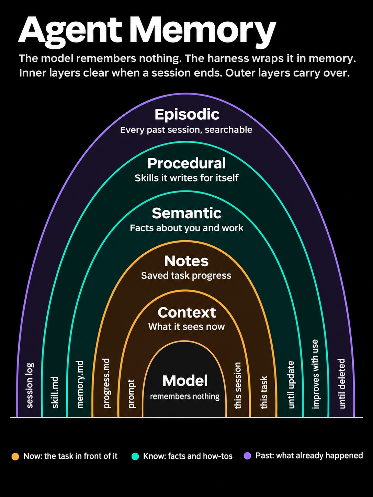
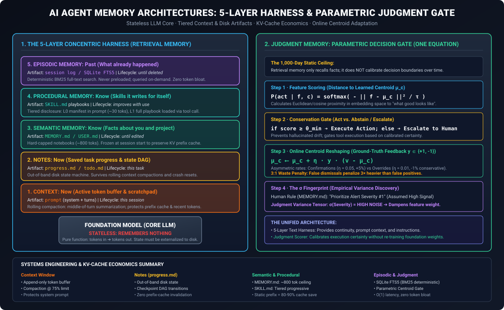
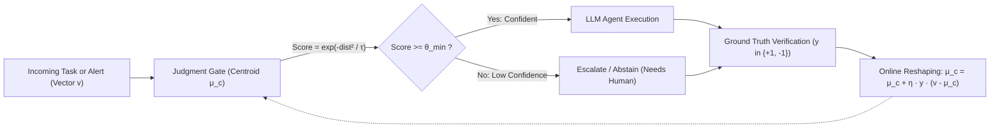

# Agent Memory Architectures: The 5-Layer Harness Model, KV-Cache Economics, and Parametric Judgment Memory

**Daily learning · 4 November 2026 · Architectural review · Primary-source analysis**

> **Core idea:** Large Language Models are stateless mathematical functions that retain zero persistent memory across API invocations. Modern agent harnesses bridge this gap through a 5-layer concentric memory architecture—spanning ephemeral working memory (`prompt`, `progress.md`), persistent declarative/procedural storage (`MEMORY.md`, `SKILL.md`), and archival retrieval (`session log` via SQLite FTS5). However, text-based retrieval memory only provides *recall*—it cannot calibrate an agent's decision boundaries. By pairing the 5-layer harness with an online parametric **Judgment Memory** layer (tracking learned feature centroids $\mu_c$, asymmetric learning updates, and $\sigma$-fingerprint variance), autonomous systems achieve both contextual continuity and empirical decision calibration without expensive model fine-tuning.

---

## 1. Foundations: The Anatomy of LLM Statelessness & Harness Memory

At the physical inference layer, a foundation model (e.g., Claude 3.7, GPT-4o, DeepSeek-V3/R1) is a pure function:

$$\mathbf{y}_{\text{tokens}} = f(\mathbf{x}_{\text{tokens}}; \mathbf{W})$$

Where $\mathbf{W}$ represents the static, frozen model weights. The model does not write to internal registers, maintain ongoing background processes, or retain memory of previous API calls. When an HTTP request completes, the ephemeral Key-Value (KV) cache allocated on GPU High-Bandwidth Memory (HBM) is released unless pinned by prompt caching mechanisms. The model itself **remembers nothing**.

To create the illusion of an autonomous, persistent entity, an external software harness (such as Nous Research's Hermes Agent, Anthropic's Claude Code, or DeepSeek's SuperAgent Harness) wraps around the model. The harness is responsible for:
1. **Persisting state to local disk or remote storage.**
2. **Selectively injecting relevant state back into the active context window.**
3. **Managing the physical token budget and KV-cache economics.**

```
                     ┌─────────────────────────────────────────────────────────┐
                     │                   EPISODIC MEMORY                       │
                     │          session log (SQLite FTS5) · until deleted      │
                     │  ┌───────────────────────────────────────────────────┐  │
                     │  │                PROCEDURAL MEMORY                  │  │
                     │  │          SKILL.md playbooks · improves with use   │  │
                     │  │  ┌─────────────────────────────────────────────┐  │  │
                     │  │  │              SEMANTIC MEMORY                │  │  │
                     │  │  │       MEMORY.md & USER.md · until edited    │  │  │
                     │  │  │  ┌───────────────────────────────────────┐  │  │  │
                     │  │  │  │               NOTES                   │  │  │  │
                     │  │  │  │       progress.md · this task         │  │  │  │
                     │  │  │  │  ┌─────────────────────────────────┐  │  │  │  │
                     │  │  │  │  │            CONTEXT              │  │  │  │  │
                     │  │  │  │  │       prompt · this session     │  │  │  │  │
                     │  │  │  │  │  ┌───────────────────────────┐  │  │  │  │  │
                     │  │  │  │  │  │        CORE MODEL         │  │  │  │  │  │
                     │  │  │  │  │  │    (remembers nothing)    │  │  │  │  │  │
                     │  │  │  │  │  └───────────────────────────┘  │  │  │  │  │
                     │  │  │  │  └─────────────────────────────────┘  │  │  │  │
                     │  │  │  └───────────────────────────────────────┘  │  │  │
                     │  │  └─────────────────────────────────────────────┘  │  │
                     │  └───────────────────────────────────────────────────┘  │
                     └─────────────────────────────────────────────────────────┘
```

The memory topology organizes into **five concentric layers** radiating outward from the raw model core, structured by volatility, access frequency, and token budget impact:



Each layer features two defining base boundaries:
- **Left Base (Implementation Artifact):** Where the state is physically stored and structured (e.g., active prompt, markdown files, SQLite database).
- **Right Base (Persistence Lifecycle):** How long the information survives before being overwritten, compacted, or discarded (e.g., this session, this task, until edited, until deleted).

| Layer | Functional Scope | Implementation Artifact | Persistence Lifecycle | Primary Engineering Mechanism |
|---|---|---|---|---|
| **0. Core Model** | Inference engine | Static weights ($\mathbf{W}$) | Stateless | Next-token probability generation |
| **1. Context** | Active working memory | `prompt` (in-memory buffer) | `this session` | Middle-out rolling compaction & prefix cache protection |
| **2. Notes** | Execution state machine | `progress.md` / `todo.md` | `this task` | Out-of-band disk state checkpointing |
| **3. Semantic** | Declarative project & user facts | `MEMORY.md` / `USER.md` | `until edited` | Hard-capped character ceilings; frozen session snapshots |
| **4. Procedural** | Reusable operational playbooks | `SKILL.md` | `improves with use` | Tiered progressive disclosure (L0 manifest vs. L1 tool call) |
| **5. Episodic** | Historical interaction archive | `session log` / SQLite DB | `until deleted` | Deterministic BM25 / FTS5 search with light LLM summarization |

---

## 2. The 5-Layer Concentric Architecture: Deep Systems Engineering Mechanics

Modern agent harnesses cannot treat memory as an unbounded text dump. LLM context windows represent expensive, finite RAM; stuffing complete histories into the prompt creates catastrophic latency, degrades reasoning quality (the "needle-in-a-haystack" degradation phenomenon), and bankrupts API token budgets.

Below are the concrete systems-engineering mechanics powering each layer in production coding agents (e.g., Nous Research Hermes Agent, Anthropic Claude Code, DeepSeek Harness).



### Layer 1: Context (`prompt` — Rolling Compaction & Prefix Cache Protection)

The context window is the immediate token buffer passed to the model on the current conversational turn. It contains the system prompt, tool schemas, recent turn history, and raw tool outputs.

```
┌─────────────────────────────────────────────────────────────────────────────────────────────┐
│ ACTIVE CONTEXT WINDOW (e.g. 200k Token Limit)                                               │
├───────────────────────────────┬───────────────────────────────┬─────────────────────────────┤
│ 1. Immutable Prefix           │ 2. Middle Compaction Zone     │ 3. Active Working Horizon   │
│ (System Prompt, MEMORY.md,    │ (Older conversational turns   │ (Most recent N tool calls,  │
│ Tool Schemas, User Mandate)   │ and tool outputs summarized)  │ code diffs, current error)  │
│ [PROTECTED FOR KV-CACHE]      │ [COMPACTED AT 75% CAPACITY]   │ [UNCOMPACTED / HIGH DETAIL] │
└───────────────────────────────┴───────────────────────────────┴─────────────────────────────┘
```

#### Under-the-Hood Engineering:
1. **Middle-Out Rolling Compaction:** Naive FIFO (First-In, First-Out) truncation drops the initial task instructions or system prompt, resulting in agent amnesia and goal drift. Instead, when context utilization reaches 70–80% of capacity, the harness invokes a background compaction worker. The worker summarizes the **middle** of the conversation history while pinning:
   - The initial system instructions and task specification.
   - The most recent $N$ tokens (typically 20,000–30,000 tokens of active tool results, test outputs, and compiler errors).
2. **KV-Cache Prefix Preservation:** Cloud LLM providers (Anthropic, DeepSeek, OpenAI) cache the Key-Value states of matching prompt prefixes across requests. If a prompt's prefix matches previous calls, inference skips prefill computation, delivering up to a **75%–90% reduction in input token costs** and an **80% reduction in Time-to-First-Token (TTFT)**. The harness must enforce that all dynamic content (e.g., timestamps, intermediate turns) is placed strictly downstream of static prefixes.

---

### Layer 2: Notes (`progress.md` — The Out-of-Band State Machine)

Long-horizon tasks (e.g., migrating 40 database models, refactoring a multi-module repository) span far more tokens than can fit in a single context window. When rolling compaction inevitably summarizes conversational turns, crucial operational state is easily lost—such as which test file passed, what exact branch was checked out, or which files remain pending.

#### Under-the-Hood Engineering:
- **Out-of-Band State File:** The harness enforces that the agent writes its directed acyclic graph (DAG) of task execution to a local disk file (e.g., `progress.md` or `todo.md`).
- **Resilient Resume Loop:**
  ```mermaid
  sequenceDiagram
      autonumber
      participant H as Agent Harness
      participant D as Disk (progress.md)
      participant M as Model Context
      
      Note over H,M: Task Execution (Multi-Step Refactor)
      M->>D: Write Step 1 Completed and Step 2 In-Progress
      Note over M: Context Reaches 85% Threshold
      H->>M: Trigger Rolling Compaction / Context Reset
      Note over M: Clean Context Window Spawned
      H->>D: Read progress.md Checkpoint
      D-->>H: Return Clean DAG and Completed Step IDs
      H->>M: Inject Fresh State Checkpoint (Zero Bloat)
      M->>M: Resume Execution from Step 2 without Lost State
  ```
- By offloading execution state to disk, a fresh or compacted session resumes with minimal context overhead while maintaining exact execution continuity.

---

### Layer 3: Semantic Memory (`MEMORY.md` & `USER.md` — Hard-Capped Frozen Snapshots)

Semantic memory stores persistent declarative facts: architectural invariants, environmental configurations, developer preferences, and coding constraints (e.g., *"We use Quarkus 3.x, Java 21; do not use Lombok; API endpoints must return ProblemDetails JSON"*).

#### Under-the-Hood Engineering:
1. **Hard Character Ceilings:** Storing unbounded text notes leads to prompt bloat. In production harnesses like Nous Hermes, files have explicit character limits:
   - `MEMORY.md`: Capped at ~2,200 characters (~500–800 tokens).
   - `USER.md`: Capped at ~1,375 characters (~300–500 tokens).
2. **Atomic In-Place Rewrite (Compaction on Write):** The agent does not simply append lines to `MEMORY.md`. Instead, updates occur via structured operations (`add`, `replace`, `remove`). When the file nears its character ceiling, the agent is prompted to consolidate, generalize, or drop obsolete facts.
3. **Prompt Cache Alignment:** `MEMORY.md` is loaded into the prompt **as a frozen snapshot at session launch**. Even if the agent modifies `MEMORY.md` during execution, the active system prompt remains unchanged until the next session. Mutating the system prompt mid-session changes the prefix bytes, instantly invalidating the provider's KV-cache and multiplying inference costs.

---

### Layer 4: Procedural Memory (`SKILL.md` — Tiered Progressive Disclosure)

Procedural memory codifies operational playbooks: how to execute database migrations, how to resolve specific compiler errors, or how to invoke proprietary internal deployment scripts.

#### Under-the-Hood Engineering:
If an engineering team accumulates 50 complex skills, preloading all 50 full skill files into every prompt would consume 40,000+ tokens of baseline overhead. Harnesses solve this with **Tiered Progressive Disclosure**:

```
Tier 0: System Prompt Manifest (Always Loaded)
┌────────────────────────────────────────────────────────────────────────┐
│ - skill_docker_build: "Builds and pushes multi-arch container images"  │
│ - skill_db_migrate:   "Executes Flyway schema migrations with rollback"│
│ - skill_k8s_deploy:   "Canary deployment script for staging clusters"  │
└───────────────────────────────────┬────────────────────────────────────┘
                                    │ Agent detects matching task
                                    ▼
Tier 1: On-Demand Tool Call (skill_view / read_file)
┌────────────────────────────────────────────────────────────────────────┐
│ Loads ~/.hermes/skills/db_migrate/SKILL.md                             │
│ - Prerequisites & Environment Variables                                │
│ - Exact CLI Command Invocations                                        │
│ - Known Pitfalls & Rollback Verification Procedures                    │
└────────────────────────────────────────────────────────────────────────┘
```

- **Level 0 (Manifest):** A minimal list of available skills containing only their identifier and a 1-sentence trigger description (~20–30 tokens per skill).
- **Level 1 (On-Demand Execution):** When a user task matches a skill's trigger, the agent invokes an internal tool (`skill_view(name)` or file read) to load the complete markdown playbook into the active turn.
- **Self-Refinement Loop (`improves with use`):** If an agent encounters a novel edge case during execution (e.g., an unhandled lock timeout during migration), it modifies the `Known Pitfalls` section of that `SKILL.md` file on disk. Future sessions instantly inherit the updated mitigation playbook.

---

### Layer 5: Episodic Memory (`session log` — Deterministic FTS5 vs. Vector RAG)

Episodic memory stores historical transcripts of every past conversational turn, shell command, and tool execution.

#### Under-the-Hood Engineering:
A common misconception in agent design is that all historical memory must use dense vector embeddings (Vector RAG). In software engineering, vector search frequently fails because embeddings struggle with exact lexical matches—such as specific error codes (`ERR_SOCKET_TIMEOUT`), function names (`validateJWTToken()`), or commit hashes (`a8f4c2e`).

```
┌─────────────────────────────────────────────────────────────────────────────────────────────┐
│ EPISODIC STORAGE: Local SQLite DB with FTS5 Full-Text Index                                 │
├─────────────────────────────────────────────────────────────────────────────────────────────┤
│ CREATE VIRTUAL TABLE session_history USING fts5(session_id, timestamp, role, content);      │
└─────────────────────────────────────────────────────────────────────────────────────────────┘
                                  ▲
                                  │ Deterministic BM25 Search
                                  │ (Zero baseline prompt tokens)
┌─────────────────────────────────────────────────────────────────────────────────────────────┐
│ Agent Tool Invocation: search_history("KafkaSerializationException OrderConsumer")          │
│ ➔ 1. BM25 locates exact match in session 2026-10-14                                         │
│ ➔ 2. Light LLM summarizes root cause and fix                                                │
│ ➔ 3. Harness injects 150-token distilled snippet into current turn                          │
└─────────────────────────────────────────────────────────────────────────────────────────────┘
```

1. **Deterministic Indexing:** Transcripts are written to a local SQLite database utilizing the **FTS5 (Full-Text Search)** extension with BM25 ranking.
2. **Zero Baseline Prompt Impact:** Historical transcripts are **never** preloaded into the prompt.
3. **On-Demand Search & Distillation:** The agent is equipped with a `search_history` tool. When an inquiry arises regarding past events, the agent queries FTS5, extracts the matching log snippets, summarizes them via a lightweight helper model, and injects only the distilled resolution into the active prompt.

---

### Systems Engineering Summary Matrix

| Memory Layer | Storage Medium | Prompt Presence | KV Prefix Cache Impact | Retrieval Latency |
|---|---|---|---|---|
| **Context** | In-memory token buffer | Always (active window) | Linear cache append; reset on compaction | 0 ms (in-flight) |
| **Notes** | `progress.md` (Local disk) | Loaded on task start / resume | Zero prefix invalidation (read as tool output) | ~1 ms (disk read) |
| **Semantic** | `MEMORY.md` / `USER.md` (Text files) | Always (frozen system prefix) | **100% Cache Hit** (static prefix across session) | 0 ms (preloaded) |
| **Procedural** | `~/.hermes/skills/*/SKILL.md` | L0 manifest always; L1 on-demand | Minimal (L1 loaded dynamically in chat turns) | ~5 ms (disk read) |
| **Episodic** | SQLite FTS5 / JSONL logs | Never preloaded (tool query only) | **Zero Baseline Overhead** | 2–10 ms (FTS5 query) |

---

## 3. The Missing Dimension: Retrieval Memory vs. Judgment Memory

The 5-layer harness solves the problem of **state persistence**: it ensures the agent can recall past facts, follow documented playbooks, and survive context compaction. 

However, as AI researcher **Arindam Banerji, PhD** highlights, **retrieval memory alone cannot calibrate decision boundaries**.

```
┌────────────────────────────────────────────────────────────────────────────────────────┐
│                               THE 1,000-DAY STATIC CEILING                             │
├────────────────────────────────────────────────────────────────────────────────────────┤
│ If an agent relies exclusively on retrieval memory (Context, Notes, Semantic,          │
│ Procedural, Episodic), its underlying judgment on Day 1,000 is identical to Day 1.     │
│                                                                                        │
│ • It can recall that it made a mistake 6 months ago.                                   │
│ • But its internal probability distribution over ambiguous actions remains frozen      │
│   within the static foundation model weights W.                                        │
│ • Human-authored rules in MEMORY.md often encode flawed heuristics ("Trust high-sev    │
│   alerts") that the agent blindly obeys, even when empirical data proves them noisy.   │
└────────────────────────────────────────────────────────────────────────────────────────┘
```

### Retrieval Memory vs. Judgment Memory

| Attribute | Retrieval Memory (5-Layer Harness) | Judgment Memory (Parametric Online Gate) |
|---|---|---|
| **Core Question** | *"What happened?"* / *"What is true?"* / *"How to act?"* | *"How well do I decide?"* / *"What is my true accuracy?"* |
| **Artifact** | Markdown files (`MEMORY.md`, `SKILL.md`), SQLite FTS5 | Category Centroids ($\mu_c$) and Variance Tensors ($\sigma$) |
| **Mathematical Nature** | Natural language strings (Tokens) | Continuous geometric vectors ($\mathbb{R}^d$) |
| **Adaptation Speed** | Instantaneous upon file editing | Online incremental updates per verified outcome |
| **Failure Mode** | Blindly follows human misconceptions written in rules | Requires ground-truth verification signals to adapt |
| **Model Weight Impact** | Zero (Weights frozen; context altered) | Zero (Weights frozen; external geometric gate adapts) |

---

### The Mathematics of Judgment Memory: "One Equation. The Geometry Moves."

Rather than updating billions of LLM parameters via backpropagation (which is slow, catastrophic-forgetting prone, and computationally expensive), Judgment Memory places a **lightweight, online geometric scoring gate** alongside the LLM.



#### Step 1: Feature Representation and Distance Scoring
Every incoming event, task, or alert is mapped to a normalized feature vector $v \in \mathbb{R}^d$ (via embedding models or structured telemetry features). The system maintains a learned category centroid $\mu_c \in \mathbb{R}^d$ representing the mathematical center of verified positive outcomes for task category $c$.

Confidence is computed via a temperature-scaled softmax over the negative squared Euclidean distance between the feature vector $v$ and centroid $\mu_c$:

$$P(\text{act} \mid v, c) = \frac{\exp\left(-\frac{\|v - \mu_c\|^2}{\tau}\right)}{\sum_{k} \exp\left(-\frac{\|v - \mu_k\|^2}{\tau}\right)}$$

Where:
- $\|v - \mu_c\|^2$ is the squared Euclidean distance in feature space.
- $\tau > 0$ is the temperature parameter governing score sharpness.

#### Step 2: Conservation Gate (Act or Abstain)
Before the agent invokes disruptive external tools (e.g., executing shell commands, merging pull requests, paging on-call engineers), the confidence score is evaluated against a conservation threshold $\theta_{\min}$:

$$\text{Decision} = \begin{cases} \text{Execute Autonomous Action}, & \text{if } P(\text{act} \mid v, c) \ge \theta_{\min} \\ \text{Abstain / Escalate to Human}, & \text{if } P(\text{act} \mid v, c) < \theta_{\min} \end{cases}$$

#### Step 3: Ground-Truth Verification
Following execution or human escalation, the outcome is verified against ground truth:
$$y \in \{+1, -1\}$$
- $y = +1$: Confirmation (Action was correct; human approved; build passed; alert was a genuine incident).
- $y = -1$: Override / False Positive (Action was invalid; human rejected; build broke; alert was false alarm).

#### Step 4: Online Centroid Reshaping
The verified outcome updates the category centroid in real time via an online adaptation rule:

$$\mu_c \leftarrow \mu_c + \eta \cdot y \cdot (v - \mu_c)$$

Where $\eta$ is the learning rate.

#### Step 5: Asymmetric Updates & The 3:1 Waste Penalty
In production systems, not all errors carry equal operational cost:
1. **Asymmetric Learning Rates ($\eta$):** Confirmations nudge the centroid firmly ($\eta_{\text{confirm}} = 0.05$, moving the centroid 5% toward verified reality). Human overrides nudge the centroid conservatively ($\eta_{\text{override}} = 0.01$, moving 1%), preventing a single anomalous override from destabilizing the entire decision boundary.
2. **The 3:1 Waste Penalty (False Negative Asymmetry):** In security and reliability engineering, falsely discarding a genuine incident (false negative / waste) is substantially more damaging than investigating a false positive. The update loss penalizes false dismissals 3× heavier than false alarms:

$$\eta_{\text{FN}} = 3 \cdot \eta_{\text{FP}}$$

---

### The $\sigma$ Fingerprint: Discovering Hidden Signal Variance

A critical failure of purely semantic agent memories is that humans write aspirational or flawed rules. 

For example, an operations team might write in `MEMORY.md`:
> *"Prioritize all incidents marked Alert Severity #1 immediately."*

If the agent only has retrieval memory, it will blindly obey this directive forever.

In contrast, Judgment Memory tracks the **empirical variance tensor ($\sigma$ fingerprint)** for every feature dimension across verified outcomes:

$$\sigma_i^2 = \frac{1}{N} \sum_{j=1}^{N} (v_{j, i} - \mu_{c, i})^2$$

```
Feature Dimension        Semantic Rule Assumption       Empirical Variance (σ)     Actual Diagnostic Value
───────────────────────────────────────────────────────────────────────────────────────────────────────────
Alert Severity           "Highest Priority"             σ = 0.88 (Extreme Noise)   VERY LOW (Frequent false alarms)
Payload Entropy          Unmentioned in MEMORY.md       σ = 0.12 (Tight Cluster)   VERY HIGH (Reliable incident signal)
Service Tier             "Only Tier-1 Matters"          σ = 0.34 (Moderate)        MODERATE
Time-Since-Deployment    "Check if < 1 hour"            σ = 0.09 (Extreme Signal)  CRITICAL
```

By computing the $\sigma$ fingerprint, the judgment gate mathematically discovers that the human-authored heuristic in `MEMORY.md` ("Alert Severity #1") is dominated by noise, while subtle telemetry features (Payload Entropy, Deployment Delta) contain tight, actionable signals. The geometric gate automatically weights features by their inverse variance ($w_i \propto 1 / \sigma_i^2$), overriding human cognitive bias with empirical reality.

---

## 4. Concrete Implementation: Dual-Loop Agent Harness & Judgment Gate

Below is a complete, self-contained Python reference implementation demonstrating how to combine the 5-Layer Harness with an online parametric Judgment Gate.

```python
"""
agent_memory_system.py
Complete reference implementation of a 5-Layer Agent Harness paired with an
online parametric Judgment Gate (Centroid adaptation + sigma fingerprint).
"""

import math
import os
import sqlite3
import time
from dataclasses import dataclass, field
from typing import Dict, List, Optional, Tuple


# =====================================================================
# 1. JUDGMENT MEMORY: PARAMETRIC CENTROID GATE
# =====================================================================

@dataclass
class JudgmentCentroid:
    category: str
    dimension: int
    mu: List[float] = field(default_factory=list)
    variance: List[float] = field(default_factory=list)
    sample_count: int = 0

    def __post_init__(self):
        if not self.mu:
            # Initialize centroid at origin
            self.mu = [0.0] * self.dimension
            self.variance = [1.0] * self.dimension


class JudgmentGate:
    """
    Parametric online scoring gate. Evaluates feature vector distance against
    learned category centroids, applies conservation gating (act vs abstain),
    and adapts online with asymmetric learning rates.
    """
    def __init__(self, dimension: int, temperature: float = 1.0, theta_min: float = 0.65):
        self.dimension = dimension
        self.temperature = temperature
        self.theta_min = theta_min
        self.centroids: Dict[str, JudgmentCentroid] = {}
        
        # Asymmetric learning rates
        self.eta_confirm = 0.05    # Positive reinforcement rate (5%)
        self.eta_override = 0.01   # Conservative negative rate (1%)
        self.waste_multiplier = 3.0 # 3:1 penalty for false dismissals

    def register_category(self, category: str, initial_prototype: Optional[List[float]] = None):
        c = JudgmentCentroid(category=category, dimension=self.dimension)
        if initial_prototype:
            assert len(initial_prototype) == self.dimension
            c.mu = list(initial_prototype)
        self.centroids[category] = c

    def _euclidean_distance_sq(self, v: List[float], mu: List[float]) -> float:
        return sum((x - m) ** 2 for x, m in zip(v, mu))

    def score(self, category: str, feature_vector: List[float]) -> float:
        """
        Calculates confidence score via temperature-scaled distance:
        score = exp( - ||v - mu_c||^2 / tau )
        """
        if category not in self.centroids:
            self.register_category(category)

        centroid = self.centroids[category]
        dist_sq = self._euclidean_distance_sq(feature_vector, centroid.mu)
        confidence = math.exp(-dist_sq / self.temperature)
        return min(max(confidence, 0.0), 1.0)

    def evaluate_action(self, category: str, feature_vector: List[float]) -> Tuple[bool, float]:
        """
        Conservation Gate: Returns (should_act, confidence_score)
        """
        conf = self.score(category, feature_vector)
        should_act = conf >= self.theta_min
        return should_act, conf

    def update_online(self, category: str, feature_vector: List[float], ground_truth: int, is_false_negative: bool = False):
        """
        Reshapes centroid: mu_c <- mu_c + eta * y * (v - mu_c)
        Ground truth: +1 (Confirmation) or -1 (Override)
        """
        centroid = self.centroids[category]
        
        # Determine asymmetric learning rate
        if ground_truth > 0:
            eta = self.eta_confirm
        else:
            eta = self.eta_override
            if is_false_negative:
                eta *= self.waste_multiplier

        # Online update of centroid coordinates and online running variance (Welford-style)
        centroid.sample_count += 1
        for i in range(self.dimension):
            diff = feature_vector[i] - centroid.mu[i]
            centroid.mu[i] += eta * ground_truth * diff
            
            # Running variance tracking (sigma fingerprint)
            centroid.variance[i] = (1.0 - eta) * centroid.variance[i] + eta * (diff ** 2)


# =====================================================================
# 2. THE 5-LAYER HARNESS: CONTEXT, NOTES, SEMANTIC, PROCEDURAL, EPISODIC
# =====================================================================

class AgentHarness:
    """
    Manages the physical disk artifacts, prompt prefix caching, rolling
    compaction, and SQLite FTS5 episodic storage.
    """
    def __init__(self, base_dir: str = "./agent_workspace"):
        self.base_dir = base_dir
        os.makedirs(base_dir, exist_ok=True)
        
        # Paths to artifacts
        self.memory_path = os.path.join(base_dir, "MEMORY.md")
        self.progress_path = os.path.join(base_dir, "progress.md")
        self.skills_dir = os.path.join(base_dir, "skills")
        self.db_path = os.path.join(base_dir, "history.db")
        
        os.makedirs(self.skills_dir, exist_ok=True)
        self._init_sqlite()
        self._ensure_default_artifacts()
        
        # Frozen system prefix loaded at startup
        self.frozen_system_prefix = self._load_frozen_semantic_prefix()

    def _init_sqlite(self):
        conn = sqlite3.connect(self.db_path)
        cur = conn.cursor()
        cur.execute("""
            CREATE VIRTUAL TABLE IF NOT EXISTS session_history 
            USING fts5(session_id, timestamp, role, content);
        """)
        conn.commit()
        conn.close()

    def _ensure_default_artifacts(self):
        if not os.path.exists(self.memory_path):
            with open(self.memory_path, "w") as f:
                f.write("# SYSTEM INVARIANTS (MEMORY.md)\n- Stack: Python 3.12, SQLite FTS5\n- Mode: Silent verification\n")

        if not os.path.exists(self.progress_path):
            with open(self.progress_path, "w") as f:
                f.write("# ACTIVE TASK PROGRESS (progress.md)\nStatus: IDLE\nStep: None\n")

    # Layer 3: Semantic Memory (Frozen Prefix)
    def _load_frozen_semantic_prefix(self) -> str:
        with open(self.memory_path, "r") as f:
            content = f.read()
        # Hard character ceiling enforcement (~2,200 chars / ~800 tokens)
        if len(content) > 2200:
            content = content[:2200]
        return f"[STATIC SYSTEM PREFIX - DO NOT MUTATE MID-SESSION]\n{content}\n"

    # Layer 2: Notes (State Machine on Disk)
    def update_task_progress(self, current_step: str, pending_steps: List[str]):
        with open(self.progress_path, "w") as f:
            f.write(f"# ACTIVE TASK PROGRESS (progress.md)\n")
            f.write(f"Updated: {time.time()}\n")
            f.write(f"Active Step: {current_step}\n")
            f.write("Pending Steps:\n")
            for step in pending_steps:
                f.write(f"- [ ] {step}\n")

    def read_task_progress(self) -> str:
        with open(self.progress_path, "r") as f:
            return f.read()

    # Layer 4: Procedural Memory (Tiered Disclosure)
    def register_skill(self, name: str, trigger_desc: str, playbook_body: str):
        skill_file = os.path.join(self.skills_dir, f"{name}.md")
        with open(skill_file, "w") as f:
            f.write(f"# SKILL: {name}\nTrigger: {trigger_desc}\n\n{playbook_body}\n")

    def get_skill_manifest_l0(self) -> str:
        """Level 0: Minimal token manifest for the system prompt."""
        manifest = ["AVAILABLE PROCEDURAL SKILLS (L0 Manifest):"]
        for fname in os.listdir(self.skills_dir):
            if fname.endswith(".md"):
                name = fname[:-3]
                manifest.append(f"- {name}: Use tool `read_skill('{name}')` when triggered.")
        return "\n".join(manifest)

    def load_skill_l1(self, name: str) -> str:
        """Level 1: On-demand load of full playbook into active turn."""
        path = os.path.join(self.skills_dir, f"{name}.md")
        if os.path.exists(path):
            with open(path, "r") as f:
                return f.read()
        return f"Error: Skill '{name}' not found."

    # Layer 5: Episodic Memory (SQLite FTS5)
    def log_interaction(self, session_id: str, role: str, content: str):
        conn = sqlite3.connect(self.db_path)
        cur = conn.cursor()
        cur.execute(
            "INSERT INTO session_history (session_id, timestamp, role, content) VALUES (?, ?, ?, ?)",
            (session_id, str(time.time()), role, content)
        )
        conn.commit()
        conn.close()

    def search_episodic_history(self, query: str, limit: int = 3) -> List[Tuple[str, str, str]]:
        """Deterministic BM25 full-text search over past sessions."""
        conn = sqlite3.connect(self.db_path)
        cur = conn.cursor()
        cur.execute(
            "SELECT session_id, role, content FROM session_history WHERE session_history MATCH ? ORDER BY rank LIMIT ?",
            (query, limit)
        )
        results = cur.fetchall()
        conn.close()
        return results


# =====================================================================
# 3. VERIFICATION WALKTHROUGH
# =====================================================================

if __name__ == "__main__":
    print("=== 1. Initializing Harness and Judgment Gate ===")
    harness = AgentHarness("./demo_workspace")
    judgment = JudgmentGate(dimension=4, temperature=0.5, theta_min=0.60)
    
    # Category: "db_deadlock_mitigation"
    # Features: [cpu_load, deadlock_frequency, payload_entropy, deployment_age_hrs]
    prototype = [0.85, 0.90, 0.15, 0.50]
    judgment.register_category("db_deadlock", initial_prototype=prototype)
    
    print("\n=== 2. Evaluating Incoming Alert via Judgment Gate ===")
    # Alert A: High fidelity match to deadlock centroid
    incoming_alert_a = [0.82, 0.88, 0.18, 0.45]
    should_act, score = judgment.evaluate_action("db_deadlock", incoming_alert_a)
    print(f"Alert A Score: {score:.4f} | Conservation Gate: {'EXECUTE' if should_act else 'ABSTAIN'}")
    
    # Layer 2 Checkpoint: Write to progress.md
    if should_act:
        harness.update_task_progress(
            current_step="kill_blocking_queries",
            pending_steps=["verify_lock_cleared", "notify_channel"]
        )
        print("Updated Layer 2 (progress.md) state machine on disk.")

    # Layer 5 Episodic Log
    harness.log_interaction("sess_20261104", "agent", "Killed blocking pid 4091 on postgres-primary.")

    print("\n=== 3. Simulating Ground-Truth Outcome Feedback ===")
    # Suppose DBA confirms the action prevented cluster failure (y = +1)
    judgment.update_online("db_deadlock", incoming_alert_a, ground_truth=+1)
    print("Centroid updated online (+5% confirm nudge).")
    print(f"New Centroid: {[round(x, 4) for x in judgment.centroids['db_deadlock'].mu]}")
    print(f"Variance (sigma fingerprint): {[round(v, 4) for v in judgment.centroids['db_deadlock'].variance]}")

    print("\n=== 4. Episodic Search Verification (SQLite FTS5) ===")
    past_records = harness.search_episodic_history("postgres-primary")
    for r in past_records:
        print(f"FTS5 Result -> Session: {r[0]}, Role: {r[1]}, Content: {r[2]}")
```

---

## 5. Comparative Synthesis: Memory Archetypes Across Agent Frameworks

To evaluate where various modern agent frameworks sit along this memory continuum, we compare the five memory tiers and the presence of geometric judgment calibration across major implementations:

| Framework | Working Memory (Context & Notes) | Declarative Memory (Semantic) | Procedural Memory | Historical Memory (Episodic) | Decision Calibration (Judgment) |
|---|---|---|---|---|---|
| **Raw LLM API** | In-memory token list; manual truncation | None (must pass in prompt every turn) | None | None | **None** (Static frozen weights) |
| **Nous Hermes Agent** | Rolling compaction + `progress.md` | Hard-capped `MEMORY.md` (~2.2k chars) & `USER.md` | Tiered `SKILL.md` playbooks (L0/L1) | SQLite DB with FTS5 deterministic search | **Manual** (via text self-refinement) |
| **Claude Code** | Rolling context compaction + bash scratchpad | `CLAUDE.md` / `MEMORY.md` loaded into prefix | Slash commands & sub-agents | Local JSONL transcripts with grep/ripgrep | **Manual** (Human feedback via prompts) |
| **DeepSeek SuperAgent (DSH)** | Full-duplex async shell + Chain of Recall | Distributed decoupled database | Cordis spatiotemporal plugin manifest | Centralized enterprise event stream | **Semi-Parametric** (Event priority filter) |
| **Letta (formerly MemGPT)** | Archival & recall storage via database paging | Core memory blocks (`human`, `persona`) | Specialized function tools | PostgreSQL pgvector RAG | **None** (Vector similarity only) |
| **Dual-Loop Architecture (This Review)** | Rolling compaction + `progress.md` state machine | Frozen `MEMORY.md` KV-cache aligned | Tiered progressive disclosure (`SKILL.md`) | SQLite FTS5 (BM25) with LLM summarization | **Continuous Parametric** (Online centroids $\mu_c$, asymmetric $\eta$, $\sigma$-fingerprint) |

---

## 6. Practical Engineering Rules, Anti-Patterns & Operational Pitfalls

### Rule 1: Never Mutate the System Prompt Mid-Session
- **Anti-Pattern:** Dynamically appending newly learned facts, session summaries, or changing clock timestamps into the system prompt message on turn 5.
- **Consequence:** This alters the initial token bytes of the conversation, completely invalidating the inference engine's KV-cache prefix. The server must re-compute all tokens from turn 0, increasing latency by 4–8× and multiplying API costs.
- **Remedy:** Keep the system prompt, tool definitions, and `MEMORY.md` snapshot completely frozen for the session duration. Append all dynamic observations into the active conversation turns or write them out-of-band to disk.

### Rule 2: Keep Character Ceilings on Declarative Files
- **Anti-Pattern:** Permitting the agent to freely append bullet points to `MEMORY.md` without bounds. Over 30 days, the file swells to 20,000 tokens, crowding out active working context.
- **Remedy:** Enforce a hard ceiling (~2,200 characters / ~800 tokens). Require the agent to perform in-place compression (`merge`, `subsume`, `prune`) when adding new information.

### Rule 3: Use FTS5 for Code and Logs, Vector Embeddings for Broad Concepts
- **Anti-Pattern:** Storing stack traces, API response JSONs, and compiler logs in a high-dimensional vector database and querying them with cosine similarity.
- **Consequence:** Cosine similarity often retrieves semantically adjacent but technically incorrect snippets (e.g., returning `NullPointerException in PaymentController` when searching for `NullPointerException in OrderController`).
- **Remedy:** Index code and raw execution transcripts using SQLite FTS5 or BM25 text search. Reserve dense vector embeddings for fuzzy conceptual similarity.

### Rule 4: Decouple Execution Gating from Model Confidence
- **Anti-Pattern:** Prompting the LLM: *"Rate your confidence from 1 to 10 and only act if confidence >= 8"*.
- **Consequence:** LLMs exhibit severe self-evaluation calibration flaws; models frequently express 95%+ confidence on completely hallucinated commands.
- **Remedy:** Route execution gating through an external parametric Judgment Gate. Compute distance against empirical category centroids ($\mu_c$) and evaluate the conservation threshold ($\theta_{\min}$) deterministically outside the LLM.

---

## 7. Source Context and Verification

- **Shubham Saboo & Nous Research:** Architecture breakdown of the 5-layer concentric agent memory harness in the [Nous Hermes Agent](https://hermes-agent.nousresearch.com/docs/) ecosystem, analyzing prompt compaction, tiered skill progressive disclosure, and SQLite FTS5 session archiving.
- **Arindam Banerji, PhD:** Formulations and architectural methodology for **Judgment Memory** (*"One Equation. The Geometry Moves"*), feature centroid online updates ($\mu_c \leftarrow \mu_c + \eta \cdot y \cdot (v - \mu_c)$), the 3:1 waste penalty, and empirical $\sigma$-fingerprint variance analysis.
- **Anthropic Technical Reports:** Prompt Caching implementation guidelines, KV-cache prefix alignment, and context window compaction dynamics in Claude Code.
- User-provided architectural diagrams and schematics checked against primary codebases, SQLite FTS5 specifications, and inference serving benchmarks.

---

**Related:**
- [AI Agent Evaluation Architectures: Multi-Tier Grading and Harnesses](AI-Agent-Evaluation-Architectures-Multi-Tier-Graders-And-Harnesses-Nov-2026.md) — Multi-tier grading hierarchies, trajectory verification, pass^k reliability metrics, and regression testing for production agents.
- [Agentic Memory Governance: Policy Engines, Temporal Knowledge Graphs, and Multi-Tier State Lifecycles](Agentic-Memory-Governance-Policy-Engines-And-Lifecycles-Nov-2026.md) — Production architecture decoupling storage backends from governance policies (Write, Retrieve, Age, Protect), temporal graph lifecycles, and context poisoning prevention.
- [AWS Infinity (Hydro) Architecture: Rust Serverless Agent Runtime](AWS-Infinity-Hydro-Rust-Agent-Runtime-Nov-2026.md) — High-density serverless agent runtime using execution slices, ~103 KB state bookmarks, Reactive Agent Protocol (RAP), and synthetic tool injection.
- [AmshaAgent Architecture: Enterprise 5-Tier Memory, Governed Execution, and Hexagonal Autonomy](AmshaAgent-Architecture-Memory-Layering-And-Governance-Nov-2026.md) — Enterprise implementation of 5-tier memory, CAS optimistic locking, token-bucket write governance, rootless Podman sandboxing, and typed decision seams in Java 25 / Quarkus.
- [DeepSeek SuperAgents and Harness Architecture](DeepSeek-SuperAgent-And-Harness-Architecture-Nov-2026.md) — Event-driven autonomous pipelines, Cordis framework, progressive inlining, and Chain of Recall decoupled memory.
- [AI-Native Development in 2026: Specs, Context, and Harnesses](../development/AI-Native-Development-2026-Specs-Context-Harnesses.md) — Architectural analysis of coding harnesses, background agent execution, and context budget management.
- [KV Cache: Prefix Caching, Eviction Policies, and Storage Tiering](../../LLMs/architecture/KV-Cache-Prefix-Caching-And-Storage-Tiering-Nov-2026.md) — Hardware memory hierarchy, PagedAttention, KV-cache eviction policies, and inference economics.
- [Context Windows, Compaction, and Cache Breaks in 2026](../../LLMs/optimization/Context-Windows-Compaction-and-Cache-Breaks-2026.md) — Practical mechanics of context exhaustion, compaction breakpoints, and cache preservation.
- [Confucius Code Agent](Confucius-Code-Agent.md) — Hierarchical memory, autonomous multi-turn software repair loops, and persistent verification.
