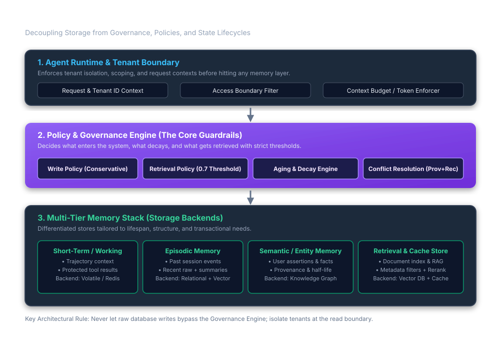

# Agentic Memory Governance: Policy Engines, Temporal Knowledge Graphs, and Multi-Tier State Lifecycles

> Daily learning · November 6, 2026 · Architectural Deep Dive

> "Storage holds raw records; an enterprise agent memory system decides what qualifies to become a record, when it can be recalled, how long it stays valid, and who is authorized to see it. Decoupling storage backends from governance policies (Write, Retrieve, Age, Protect) prevents context poisoning loops, cross-tenant leakage, and unconstrained token bloat."

---

## 1. Foundations: Plumbing vs. Architecture in Agent Memory

A recurring mistake in early agent system design is mistaking **storage plumbing** for a **memory architecture**. Stating that an agent "uses Redis for short-term memory and pgvector for long-term memory" describes only the physical storage media. It answers where bytes reside, but fails to answer the fundamental systems engineering questions:

- What qualifies an in-flight thought or user statement to become a persistent record?
- Who is authorized to recall it, and under what contextual scope?
- How does the system handle conflicting facts over time?
- When does a memory decay, expire, or get pruned to prevent prompt poisoning?

```
┌────────────────────────────────────────────────────────────────────────┐
│                   STORAGE PLUMBING vs. MEMORY SYSTEM                   │
├────────────────────────────────────┬───────────────────────────────────┤
│ Storage Plumbing (Mechanisms)      │ Memory Architecture (Governance)  │
├────────────────────────────────────┼───────────────────────────────────┤
│ • Redis key-value pairs            │ • What qualifies for storage?     │
│ • PostgreSQL relational tables     │ • Who is authorized to recall it? │
│ • Vector embeddings & cosine dist  │ • When does a fact expire/decay?  │
│ • Graph database nodes & edges     │ • How are contradictions handled? │
│ • Flat markdown files on disk      │ • When must retrieval return ∅?   │
└────────────────────────────────────┴───────────────────────────────────┘
```

The core design question behind every production memory system is singular:

> **What information will improve a future decision, and for how long?**

### The Core Operating Loop

A production agent operates memory through four distinct operational phases:

1. **Before Acting (Filter-First Retrieval):** Retrieve a strictly bounded set of candidate memories matching the current task. Access permissions, tenant boundaries, and project scopes must be applied *before* vector ranking. If candidates do not meet a calibrated relevance threshold, the system returns **zero results**, preventing the injection of distracting noise.
2. **During the Task (Working Memory Management):** Maintain active task state, unresolved decisions, and tool outputs. Evict transient tool traces once their dependent steps complete, while pinning the root objective and user constraints.
3. **After the Task (Conservative Write & Promotion):** Extract candidate memories from the completed trajectory. Save facts or preferences only when they are explicitly supported by user input or verifiable tool observations. Record source provenance, timestamps, owner, and half-life.
4. **Over Time (Decay & Reconciliation):** Invalidate stale or contradicted facts, apply half-life decay to transient state, reconcile scope-specific preferences, and expose audit APIs for user inspection, correction, and deletion.

---

## 2. The Six Functional Components of Agent Memory

Industry literature frequently conflates functional roles with physical storage. In practice, agent memory decomposes into six distinct functional components rather than mutually exclusive storage silos:

```
                  ┌────────────────────────────────────────┐
                  │       Agent Task & Turn Engine         │
                  └───────────────────┬────────────────────┘
                                      │
         ┌────────────────────────────┼────────────────────────────┐
         │                            │                            │
         ▼                            ▼                            ▼
┌──────────────────┐        ┌──────────────────┐        ┌──────────────────┐
│   Working State  │        │ Episodic History │        │  Semantic Facts  │
│  (Session Traj)  │        │ (Past Events)    │        │  (Durable Truth) │
└────────┬─────────┘        └────────┬─────────┘        └────────┬─────────┘
         │                            │                            │
         ▼                            ▼                            ▼
┌──────────────────┐        ┌──────────────────┐        ┌──────────────────┐
│   Cache Store    │        │  External RAG    │        │  Entity Graph    │
│ (Expensive Ops)  │        │ (Third-Party KB) │        │ (Relational Map) │
└──────────────────┘        └──────────────────┘        └──────────────────┘
```

| Functional Component | Typical Payload | Engineering Decision |
|---|---|---|
| **Short-Term / Working Memory** | Trajectory tokens, intermediate tool results, unresolved sub-goals | Scoped strictly to the active task turn. Compacted or checkpointed upon turn completion. |
| **Episodic Memory** | "Deployment failed on Tuesday due to migration lock timeout." | Store structured event summaries with timestamps, outcomes, and raw event pointers. |
| **Semantic Memory** | "User prefers functional programming and immutable schemas." | Preserve durable, cross-session facts supported by direct evidence. |
| **Entity Memory** | "Project Titan $\to$ PostgreSQL 16 $\to$ Hosted on AWS us-east-1." | Graph-native organization linking semantic facts to specific entities (projects, teams, services). |
| **Retrieval (RAG)** | Technical manuals, enterprise wikis, API specifications. | External knowledge fetching. This is external reference data, **not** agent autobiographical memory. |
| **Cache Store** | Vector embedding results, deterministic compiler ASTs, tool outputs. | TTL-governed key-value cache with invalidation hooks when underlying sources mutate. |

> [!IMPORTANT]
> **Entity memory** is not an isolated storage medium—it is an organizational structure for semantic facts. Similarly, **retrieval** and **caching** are computational mechanisms for fetching and reusing data, not records of past agent experience.

---

## 3. Production Architecture: Decoupling Storage from Governance

To achieve multi-tenant isolation, context poisoning immunity, and predictable cost ceilings, the system decouples the **Policy & Governance Engine** from the underlying **Multi-Tier Storage Backends**.



### Layer 1: Agent Runtime & Tenant Boundary

Every memory interaction begins with an immutable request context containing:
- `tenant_id`: Mandatory logical or physical partition identifier.
- `user_id`: Specific user context within the tenant.
- `project_id` / `session_id`: Granular execution boundary.
- `token_budget`: Maximum token allotment allowed for memory injection.

Before any storage query executes, the **Access Boundary Filter** compiles these parameters into strict pre-filters. Memory queries never execute in a global, unconstrained namespace.

### Layer 2: Policy & Governance Engine (The Core Guardrails)

The Governance Engine intercepts all read and write operations, applying four deterministic policies:

```
              ┌──────────────────────────────────────────────┐
              │          POLICY & GOVERNANCE ENGINE          │
              └──────────────────────┬───────────────────────┘
                                     │
         ┌───────────────────────────┼───────────────────────────┐
         │                           │                           │
         ▼                           ▼                           ▼
┌──────────────────┐       ┌──────────────────┐        ┌──────────────────┐
│   Write Policy   │       │ Retrieval Policy │        │ Decay & Conflict │
│  (Conservative)  │       │ (Filter-1st 0.7) │        │  (Prov + Scope)  │
└──────────────────┘       └──────────────────┘        └──────────────────┘
```

#### 1. Write Policy (Conservative Admission Control)
Raw model outputs and conversational chitchat must never write directly to long-term memory. The write policy enforces a two-tier admission bar:
- **Explicit Assertions:** User statements ("We use PyTorch 2.5 on our GPU cluster") are admitted immediately with a high confidence score ($1.0$) and explicit provenance.
- **Model Inferences:** Model-derived summaries or deduced user habits ("The user appears to work late on Fridays") are classified as unverified hypotheses. They remain quarantined in session-level scratchpads until corroborated by explicit repetition or user confirmation.

#### 2. Retrieval Policy (Filter-First, Then Rank)
Standard vector RAG often performs cosine similarity over the entire embedding collection and filters permissions afterward. This creates security risks and performance penalties. The governance engine enforces **Filter-First**:

$$C_{\text{eligible}} = \{ m \in M \mid \text{tenant}(m) = T_{\text{req}} \land \text{scope}(m) \subseteq S_{\text{req}} \land t_{\text{now}} < t_{\text{expiry}} \}$$

Only after the candidate set $C_{\text{eligible}}$ is isolated does the system compute dense similarity and reranking. Crucially, the retrieval policy enforces a **relevance threshold $\tau$ (e.g., $0.70$) with zero-result tolerance**:

$$\text{Retrieved}(q) = \{ c \in C_{\text{eligible}} \mid \text{Sim}(q, c) \ge \tau \}$$

If no record satisfies $\text{Sim}(q, c) \ge \tau$, the engine returns $\emptyset$. The agent is instructed to proceed without injected memory or explicitly prompt the user for clarification, preventing hallucinations induced by weakly related context.

#### 3. Aging & Decay Engine (Temporal Validity)
Knowledge is rarely eternal. Temporary operational states (e.g., "Cluster node 4 is undergoing maintenance") degrade in relevance rapidly, while core architecture standards remain stable for months. The decay engine applies an exponential half-life curve:

$$S_{\text{effective}}(t) = S_{\text{initial}} \cdot 2^{-\frac{\Delta t}{\lambda_{\text{half-life}}}}$$

When $S_{\text{effective}}(t)$ falls below a floor threshold $\theta_{\text{prune}}$, the record is migrated to cold archival storage or deleted.

#### 4. Conflict Resolution (Policy, Not Database Default)
When a new memory contradicts an existing record (e.g., "Prefers Go" vs. "Prefers Python"), relational database defaults (such as `ON CONFLICT DO UPDATE`) silently overwrite the older value. This causes catastrophic context loss if the user actually uses both languages in different domains.

The governance engine applies a three-tier conflict resolution policy:
1. **Explicit Temporal Override:** If the user explicitly states a change of state ("I no longer use Python; use Go for all projects"), the older record is marked superseded (`is_active = false`) and linked via provenance pointer.
2. **Context-Specific Partitioning:** If the statements carry contextual qualifiers ("Use Python for machine learning scripts" vs. "Use Go for microservice backends"), the engine preserves **both** records with distinct `scope` tags.
3. **Ambiguity Preservation:** If scope cannot be deduced, both records remain active with lowered confidence, and the agent asks for clarification when the choice materially impacts code generation.

---

## 4. The 4-Policy Governance Specification Matrix

Every memory tier must be defined along four concrete policy axes: **Write**, **Retrieve**, **Age**, and **Protect**. Specifying these policies eliminates ambiguity during system design and code implementation.

| Memory Tier | Write Policy | Retrieval Policy | Aging & Decay Policy | Protection & Isolation Policy |
|---|---|---|---|---|
| **Working Context** | Raw turn messages, tool call signatures, and active sub-goal scratchpads. | Fully visible to active agent turn; pinned to the model's system context. | Evicted at turn boundary; compacted when approaching 75% token budget. | Scoped exclusively to the executing thread and process ID. |
| **Session Summaries** | Structured state machine checkpoints; captured upon sub-task completion. | Retrieved when resuming a suspended task or reviewing turn history. | Retained for 30 days post-session; pruned if task is marked complete. | Scoped to the session ID; isolated from global cross-session recall. |
| **Episodic Logs** | Append-only event stream of major decisions, tool errors, and outcomes. | Hybrid lexical (BM25/FTS5) + vector search filtered by project ID. | 90-day active retention; raw logs archived to cold S3/Blob storage with summary retained. | Scoped to project and team; audited for PII and credential stripping. |
| **Semantic & Entity Facts** | Validated assertions passing the conservative write gate (confidence $\ge 0.85$). | Filter-first by tenant $\to$ Graph traversal by entity $\to$ Top-$K$ vector rerank. | Half-life governed by fact type ($\lambda = 180\text{d}$ for preferences, $14\text{d}$ for temp flags). | Tenant-isolated; user-editable via preference management UI. |
| **Retrieval / Cache** | External document embeddings and deterministic tool execution outputs. | Metadata-filtered dense retrieval with strict relevance threshold ($\tau \ge 0.70$). | TTL-governed; invalidated immediately upon webhook notification of source change. | Read-only; governed by external source ACLs (OAuth/IAM). |

---

## 5. Failure Modes, Context Poisoning & The Hallucination Feedback Loop

When memory systems lack strict governance, they fall victim to the **Context Poisoning Feedback Loop**—one of the most insidious reliability failure modes in autonomous agents:

```
┌────────────────────────────────────────────────────────────────────────┐
│                 THE CONTEXT POISONING FEEDBACK LOOP                    │
└───────────────────────────────────┬────────────────────────────────────┘
                                    │
                                    ▼
┌────────────────────────────────────────────────────────────────────────┐
│ 1. Irrelevant Retrieval: Weak vector match retrieves an out-of-context │
│    or outdated memory due to low thresholds (Sim = 0.52).              │
└───────────────────────────────────┬────────────────────────────────────┘
                                    │
                                    ▼
┌────────────────────────────────────────────────────────────────────────┐
│ 2. Hallucinated Inference: The LLM treats the weak memory as ground    │
│    truth, synthesizing an incorrect conclusion or flawed code snippet. │
└───────────────────────────────────┬────────────────────────────────────┘
                                    │
                                    ▼
┌────────────────────────────────────────────────────────────────────────┐
│ 3. Unchecked Write: The agent harness captures the flawed conclusion   │
│    into the session summary and promotes it to long-term memory.       │
└───────────────────────────────────┬────────────────────────────────────┘
                                    │
                                    ▼
┌────────────────────────────────────────────────────────────────────────┐
│ 4. Compounding Failure: Future turns retrieve the poisoned summary as  │
│    "confirmed historical evidence," cementing the hallucination.       │
└────────────────────────────────────────────────────────────────────────┘
```

### Breaking the Feedback Loop: Three Core Defenses

1. **Read Isolation by Default:** An agent's intermediate session summaries must remain isolated to that specific task thread. An inference generated during session A cannot be injected into session B unless an explicit **promotion step** validates the fact against ground-truth tools or explicit user approval.
2. **Treat Model Summaries as Leads, Not Evidence:** A summary generated by an LLM is a secondary index, never ground truth. The system must retain a cryptographic hash or URI pointer to the raw primary event (e.g., git commit hash, database transaction ID, API response log). When critical decisions depend on the memory, the agent must verify the pointer rather than trusting the summary.
3. **Failure Controls Checklist:**

| Failure Mode | Root Cause | Structural Mitigation | Verification Test |
|---|---|---|---|
| **Stale Facts** | Outdated configs or superseded project requirements recalled. | Bi-temporal tracking (valid-time vs. transaction-time); mandatory TTL. | Inject updated preference; verify older preference returns 0 candidates. |
| **Context Poisoning** | Hallucinated reasoning saved as durable memory. | Conservative write gating; read isolation by default; promotion quarantine. | Run multi-turn synthetic hallucination injection; verify memory store rejects unverified claims. |
| **Cross-Tenant Leak** | Global vector namespace without pre-filtering. | Strict SQL/storage-layer `WHERE tenant_id = ?` executed before vector index scan. | Query tenant B with embeddings generated from tenant A's confidential documents; assert 0 results. |
| **Token Bloat** | Indiscriminate retrieval injecting hundreds of irrelevant chunks. | Hard token ceilings per memory tier; relevance threshold $\tau \ge 0.70$; zero-result tolerance. | Measure context window consumption across 50 consecutive agent turns; assert memory tokens $\le 20\%$ total budget. |
| **Phantom Overwrites** | Naive key overwrite destroying valid context-dependent choices. | Multi-dimensional scope tagging `(user, project, language, domain)`. | Write "prefers Go for APIs" and "prefers Python for ML"; verify both persist with distinct scopes. |

---

## 6. Open-Source Ecosystem Implementations

Several production-grade open-source projects implement multi-tier, policy-governed memory architectures that move beyond simple vector search:

### 1. Cognee (`cognee/cognee`)
- **Architecture:** Graph-native memory control plane that transforms unstructured conversation and documents into interconnected knowledge graphs.
- **The ECL Pipeline:** Implements an **Extract, Cognify, Load** lifecycle:
  - *Extract:* Parses structured data, text, and audio.
  - *Cognify:* Discovers entities, establishes semantic relationships, and vectorizes nodes.
  - *Load:* Populates hybrid graph-vector topologies (e.g., Neo4j + Qdrant, NetworkX + LanceDB).
- **Governance Mechanism:** Features a dedicated `memify` phase that analyzes graph topology over time, pruning orphaned nodes and reweighting frequently traversed edges.

### 2. Mem0 (`mem0ai/mem0`)
- **Architecture:** Universal, multi-layer memory engine designed for autonomous agents and conversational AI.
- **Multi-Signal Scoping:** Decouples memory into three hierarchical operational scopes:
  - `user_id`: Durable preferences across all sessions.
  - `agent_id`: Specialist persona instructions and behavioral constraints.
  - `session_id`: Ephemeral task history.
- **Governance Mechanism:** Employs an LLM-driven extraction and reconciliation layer that detects contradictions, updates existing entity nodes via conflict policies, and filters queries before similarity scoring.

### 3. Graphiti by Zep (`getzep/graphiti`)
- **Architecture:** Temporally aware knowledge graph engine specifically engineered for dynamic agent workflows.
- **Bi-Temporal Modeling:** Separates **valid time** (the real-world time a fact was true) from **transaction time** (the time the system recorded the fact).
- **Governance Mechanism:** Solves the stale context problem by maintaining active and superseded edge states. When an agent discovers that a user switched projects or modified a framework dependency, Graphiti invalidates the existing edge with an end-timestamp rather than deleting the history, preserving complete audit provenance.

---

## 7. Concrete Implementation: Policy-Governed Agent Memory Harness

The following standalone Python implementation demonstrates a production-grade **Policy & Governance Engine** decoupling storage backends, enforcing tenant boundaries, applying filter-first retrieval with zero-result tolerance, and executing exponential half-life decay.

```python
#!/usr/bin/env python3
"""
production_agent_memory.py - Reference Implementation of a Governed Memory Engine.
Demonstrates:
1. Tenant and Project Context Boundaries (Filter-First)
2. Conservative Write Gating (Confidence & Provenance checks)
3. Calibrated Retrieval Policy with Zero-Result Tolerance
4. Exponential Half-Life Temporal Decay
5. Scope-Aware Conflict Resolution
"""

import math
import time
from dataclasses import dataclass, field
from typing import List, Optional, Dict, Any


@dataclass(frozen=True)
class TenantContext:
    tenant_id: str
    user_id: str
    project_id: str


@dataclass
class MemoryRecord:
    id: str
    tenant_id: str
    user_id: str
    project_id: str
    scope: str                     # e.g., "backend", "ml", "global"
    content: str
    embedding: List[float]
    confidence: float              # 0.0 to 1.0 (Write Policy Gate)
    provenance: str                # e.g., "explicit_user_statement", "tool_observation"
    created_at: float = field(default_factory=time.time)
    half_life_days: float = 30.0   # Temporal Decay Parameter
    is_active: bool = True


class GovernedMemoryEngine:
    def __init__(self, relevance_threshold: float = 0.70):
        self.relevance_threshold = relevance_threshold
        # Simulating underlying Multi-Tier Storage (Relational / Vector Store)
        self._store: Dict[str, MemoryRecord] = {}

    def write_memory(
        self,
        ctx: TenantContext,
        record_id: str,
        content: str,
        embedding: List[float],
        scope: str,
        confidence: float,
        provenance: str,
        half_life_days: float = 30.0
    ) -> bool:
        """
        Policy 1: Conservative Write Gating & Conflict Resolution.
        Rejects low-confidence inferences and partitions scoped preferences.
        """
        # Conservative Gate: Only store confident, verified observations
        if confidence < 0.75:
            print(f"[-] WRITE REJECTED: Confidence {confidence:.2f} below gate (0.75) for: '{content}'")
            return False

        # Conflict Resolution: Check for existing records within the same tenant & scope
        for existing in self._store.values():
            if (
                existing.is_active
                and existing.tenant_id == ctx.tenant_id
                and existing.user_id == ctx.user_id
                and existing.scope == scope
            ):
                if provenance == "explicit_user_statement":
                    print(f"[*] CONFLICT RESOLUTION: Explicit statement supersedes older record [{existing.id}].")
                    existing.is_active = False

        record = MemoryRecord(
            id=record_id,
            tenant_id=ctx.tenant_id,
            user_id=ctx.user_id,
            project_id=ctx.project_id,
            scope=scope,
            content=content,
            embedding=embedding,
            confidence=confidence,
            provenance=provenance,
            created_at=time.time(),
            half_life_days=half_life_days,
            is_active=True
        )
        self._store[record_id] = record
        print(f"[+] WRITE ADMITTED: [{record_id}] '{content}' (Scope: {scope}, Prov: {provenance})")
        return True

    def retrieve(
        self,
        ctx: TenantContext,
        query_embedding: List[float],
        target_scope: Optional[str] = None,
        simulated_time_offset_days: float = 0.0
    ) -> List[Dict[str, Any]]:
        """
        Policy 2: Filter-First, Then Rank + Temporal Decay + Zero-Result Tolerance.
        """
        results = []
        now = time.time() + (simulated_time_offset_days * 86400.0)

        # STAGE 1: FILTER-FIRST (Strict Tenant & Permission Boundaries)
        eligible_candidates = [
            r for r in self._store.values()
            if r.is_active
            and r.tenant_id == ctx.tenant_id
            and r.user_id == ctx.user_id
            and (target_scope is None or r.scope in (target_scope, "global"))
        ]

        if not eligible_candidates:
            print("[!] FILTER STAGE: Zero candidates match tenant/security boundary.")
            return []

        # STAGE 2: RANKING WITH EXPONENTIAL TEMPORAL DECAY
        for record in eligible_candidates:
            raw_sim = self._cosine_similarity(query_embedding, record.embedding)

            # Apply Temporal Decay: S_effective = S_raw * 2^(-delta_t / half_life)
            elapsed_days = (now - record.created_at) / 86400.0
            decay_factor = math.pow(2.0, -elapsed_days / record.half_life_days)
            effective_score = raw_sim * decay_factor

            # STAGE 3: RELEVANCE THRESHOLD WITH ZERO-RESULT TOLERANCE
            if effective_score >= self.relevance_threshold:
                results.append({
                    "id": record.id,
                    "content": record.content,
                    "scope": record.scope,
                    "raw_sim": round(raw_sim, 3),
                    "decay_factor": round(decay_factor, 3),
                    "effective_score": round(effective_score, 3)
                })
            else:
                print(f"[-] CANDIDATE FILTERED: [{record.id}] score {effective_score:.3f} below threshold {self.relevance_threshold}")

        # Sort descending by effective score
        results.sort(key=lambda x: x["effective_score"], reverse=True)
        return results

    @staticmethod
    def _cosine_similarity(a: List[float], b: List[float]) -> float:
        dot = sum(x * y for x, y in zip(a, b))
        norm_a = math.sqrt(sum(x * x for x in a))
        norm_b = math.sqrt(sum(y * y for y in b))
        return dot / (norm_a * norm_b) if norm_a and norm_b else 0.0


# =====================================================================
# VERIFICATION WALKTHROUGH
# =====================================================================
if __name__ == "__main__":
    print("=" * 70)
    print("GOVERNED AGENT MEMORY ENGINE: VERIFICATION TEST")
    print("=" * 70)

    engine = GovernedMemoryEngine(relevance_threshold=0.70)
    tenant_a = TenantContext(tenant_id="tenant_finance", user_id="alice", project_id="risk_engine")
    tenant_b = TenantContext(tenant_id="tenant_retail", user_id="bob", project_id="storefront")

    # 1. Test Conservative Write Gating
    print("\n--- TEST 1: Write Policy Gating ---")
    # Low confidence guess (should be rejected)
    engine.write_memory(
        ctx=tenant_a,
        record_id="mem_001",
        content="User probably prefers dark mode UI.",
        embedding=[0.1, 0.2, 0.8],
        scope="ui",
        confidence=0.50,
        provenance="model_inference"
    )
    # Verified user assertion (should be admitted)
    engine.write_memory(
        ctx=tenant_a,
        record_id="mem_002",
        content="Use Go 1.24 for high-throughput market feed microservices.",
        embedding=[0.9, 0.8, 0.1],
        scope="backend",
        confidence=1.0,
        provenance="explicit_user_statement"
    )

    # 2. Test Cross-Tenant Boundary Isolation
    print("\n--- TEST 2: Filter-First Tenant Boundary Isolation ---")
    query_vec = [0.9, 0.8, 0.1]  # Exact match for mem_002
    results_bob = engine.retrieve(ctx=tenant_b, query_embedding=query_vec)
    print(f"Results for Tenant B (Bob): {len(results_bob)} records (Expected: 0)")

    # 3. Test Retrieval with Temporal Decay
    print("\n--- TEST 3: Retrieval & Half-Life Decay ---")
    # Day 0 Query (Alice)
    results_day0 = engine.retrieve(ctx=tenant_a, query_embedding=query_vec)
    print(f"Day 0 Retrieval: Found {len(results_day0)} record: {results_day0}")

    # Query 60 days later (half_life = 30 days -> score cut by 75%)
    print("\nQuerying after 60 simulated days (decay should drop score below 0.70):")
    results_day60 = engine.retrieve(ctx=tenant_a, query_embedding=query_vec, simulated_time_offset_days=60.0)
    print(f"Day 60 Retrieval: Found {len(results_day60)} records (Zero-result tolerance engaged).")
```

---

## 8. Practical Engineering Rules, Anti-Patterns & Operational Pitfalls

### Rule 1: Never Let Raw Database Writes Bypass the Governance Engine
Directly writing conversational text or model outputs into a vector store turns your memory system into a write-amplification vulnerability. Unsanitized writes cause database bloat, store conflicting information, and create permanent hallucination anchors. All writes must pass through an admission pipeline that verifies provenance and confidence.

### Rule 2: Enforce Authorization in the Retrieval Service, Never in the Prompt
Injecting multi-tenant candidate memories into the model context and instructing the LLM: *"Only use memories that belong to Tenant A"* fails under standard prompt injection attacks. Authorization and tenant isolation are **infrastructure responsibilities**, not cognitive choices. Filter queries at the database boundary before vector indices are scanned.

### Rule 3: Enforce Calibrated Relevance Thresholds with Zero Results
A vector database will always return the mathematical nearest neighbor for any query vector, even if the cosine similarity is a negligible $0.32$. If your harness injects the top-3 results unconditionally, the LLM will force-fit irrelevant memories into its reasoning. Calibrate thresholds on empirical validation sets and treat **zero results** ($\emptyset$) as a healthy, desired state.

### Rule 4: Protect Required Tool Results, Not Every Tool Output Indefinitely
When an agent calls an external tool (e.g., querying a 2 MB SQL result set or reading a file), keep the raw bytes in working memory only for the immediately dependent step. Once the step completes:
1. Synthesize a compact finding into the task progress log.
2. Evict the bulky payload from the active prompt.
3. Retain a durable URI or content hash to re-fetch the raw artifact on demand.

### Rule 5: Treat Model Summaries as Leads, Never as Ground Truth
When summarizing long conversations into episodic history, recognize that LLM summarization is a lossy, generative transformation. Maintain pointers to primary logs, git commit IDs, or API request hashes. If a critical architectural decision hinges on a past event, inspect the primary artifact rather than relying exclusively on a recursive summary.

---

## 9. Architectural Comparison: Governance Across Memory Models

```
┌────────────────────────────────────────────────────────────────────────────────────────────────────────────────────────┐
│                                 MEMORY GOVERNANCE ACROSS AGENT PARADIGMS                                                │
├─────────────────────┬──────────────────────────┬──────────────────────────┬────────────────────────────────────────────┤
│ Architectural Axis  │ 5-Layer Harness (Hermes) │ AmshaAgent Enterprise    │ Production Policy Engine (This Model)      │
├─────────────────────┼──────────────────────────┼──────────────────────────┼────────────────────────────────────────────┤
│ Primary Focus       │ File-based harness & KV  │ Hexagonal runtime & CAS  │ Decoupled policy layers, temporal graphs,  │
│                     │ prefix cache protection  │ concurrency block-store  │ and cross-tenant admission controls        │
├─────────────────────┼──────────────────────────┼──────────────────────────┼────────────────────────────────────────────┤
│ Admission Gate      │ Declarative character    │ Typed Jev Seam & Guard   │ Conservative admission gate; confidence &  │
│                     │ ceilings on markdown     │ Policy interceptor       │ provenance verification threshold          │
├─────────────────────┼──────────────────────────┼──────────────────────────┼────────────────────────────────────────────┤
│ Retrieval Mechanics │ SQLite FTS5 lexical +    │ TwoTierMemoryService:    │ Filter-First (tenancy + scope) $\to$ Multi-│
│                     │ deterministic session    │ Hybrid RRF + ONNX BGE    │ signal ranking $\to$ Calibrated threshold  │
├─────────────────────┼──────────────────────────┼──────────────────────────┼────────────────────────────────────────────┤
│ Temporal Invalidation│ Rolling compaction via   │ Checkpoint archiving &   │ Exponential half-life decay ($\lambda$) &  │
│                     │ prompt truncation        │ Zombie task expiration   │ bi-temporal invalidation (Graphiti-style)  │
├─────────────────────┼──────────────────────────┼──────────────────────────┼────────────────────────────────────────────┤
│ Conflict Resolution │ Manual file editing or   │ Compare-And-Swap (CAS)   │ Multi-dimensional scope partitioning &     │
│                     │ overwrite in USER.md     │ versioned optimistic lock│ explicit override provenance tracing       │
└─────────────────────┴──────────────────────────┴──────────────────────────┴────────────────────────────────────────────┘
```

---

## 10. Source Context and Verification

This architecture synthesizes principles of enterprise agentic state management, multi-tenant memory governance, and temporal knowledge graphs. Material claims and mechanisms were checked against:

- **Cognee Core Architecture (`cognee/cognee`):** Graph-native memory engine, Extract-Cognify-Load (ECL) lifecycle, and topology pruning.
- **Mem0 Design Specifications (`mem0ai/mem0`):** Multi-signal scoping (`user_id`, `agent_id`, `session_id`) and conflict resolution policies.
- **Graphiti Temporal Engine (`getzep/graphiti`):** Bi-temporal graph modeling, valid-time vs. transaction-time edge invalidation, and provenance tracking.
- **AmshaAgent Architecture:** Hexagonal runtime, CAS-concurrency core memory, and GuardPolicy execution boundaries.
- **Hermes Agent Harness:** Concentric 5-layer state management and prompt prefix cache conservation.

---

**Related:**
- [Agent-Memory-Architectures-5-Layer-Harness-And-Judgment-Memory-Nov-2026.md](Agent-Memory-Architectures-5-Layer-Harness-And-Judgment-Memory-Nov-2026.md) — 5-tier concentric harness mechanics, KV prefix caching, and parametric centroid judgment memory.
- [AmshaAgent-Architecture-Memory-Layering-And-Governance-Nov-2026.md](AmshaAgent-Architecture-Memory-Layering-And-Governance-Nov-2026.md) — Enterprise Java 25/Quarkus agent with CAS core memory, hybrid RRF RAG, and typed decision seams.
- [DeepSeek-SuperAgent-And-Harness-Architecture-Nov-2026.md](DeepSeek-SuperAgent-And-Harness-Architecture-Nov-2026.md) — SuperAgent harness architecture, multi-tiered prompt budgeting, and decoupled memory topologies.
- [KV-Cache-Prefix-Caching-And-Storage-Tiering-Nov-2026.md](../../LLMs/architecture/KV-Cache-Prefix-Caching-And-Storage-Tiering-Nov-2026.md) — Physical KV-cache prefix retention, storage tiering, and TTFT optimization.
- [Context-Windows-Compaction-and-Cache-Breaks-2026.md](../../LLMs/optimization/Context-Windows-Compaction-and-Cache-Breaks-2026.md) — Rolling context compaction strategies, attention degradation, and prompt prefix stability.
