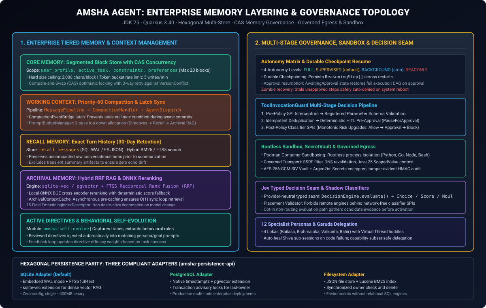
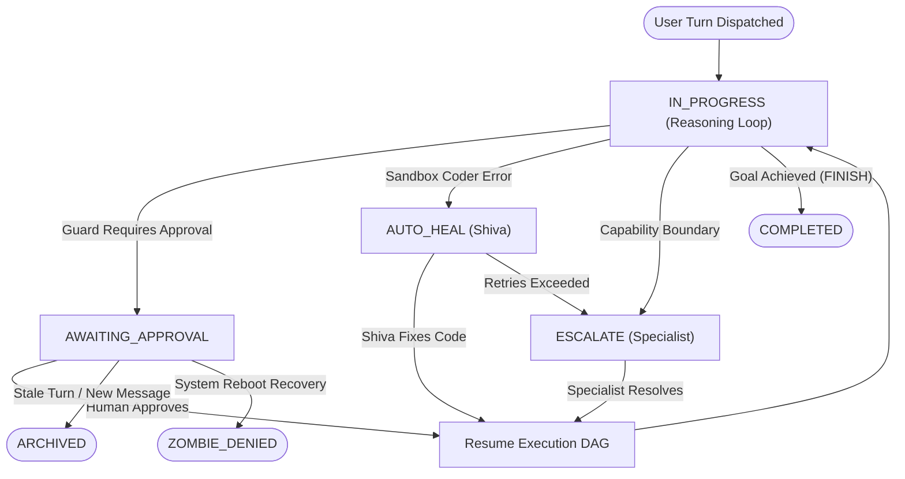

# AmshaAgent Architecture: Enterprise 5-Tier Memory, Governed Execution, and Hexagonal Autonomy

**Daily learning · 4 November 2026 · Architectural review · Codebase deep dive**

> **Core idea:** AmshaAgent is a self-hosted multi-agent platform implemented in Java 25 and Quarkus 3.40 that transforms theoretical agent memory models into a hardened, production-grade enterprise harness. Operating as a single self-contained binary, AmshaAgent structures memory across five explicit tiers—active working context with latch-synchronized compaction (`CompactionEventBridge`), durable execution checkpointing with `ReasoningStep[]` persistence, segmented Core Memory with Compare-and-Swap (CAS) optimistic locking and token-bucket write governance, extensible procedural skills with capability-subset delegation, and hybrid Archival RAG fusing SQLite FTS5 keyword matching, `sqlite-vec` dense embeddings, and local ONNX cross-encoder reranking. Surrounding this memory core is a comprehensive governance topology featuring 4 autonomy levels, multi-stage tool guards, rootless Podman container sandboxing, AES-256-GCM-SIV cryptographic secret vaulting, and a provider-neutral typed decision seam (`Choice`/`Score`/`Noul`).

---

## 1. Foundations: Hexagonal Decoupling & Enterprise Runtime

Where lightweight coding harnesses frequently rely on ad-hoc markdown files in user directories, AmshaAgent implements a strictly governed **Hexagonal Architecture (Ports and Adapters)**. Built on Java 25, Quarkus 3.40.1.1, and LangChain4j 1.19.3, the system enforces a strict zero-core contract boundary:

```
amsha-parent (Root Reactor)
│
├── *-api/ (Zero-Core Contract SPIs)
│   ├── amsha-tool-api             ← Tool contracts, ToolResponse, ExecutionContext
│   ├── amsha-security-api         ← RiskLevel, ToolOperation, SecretVaultPort
│   ├── amsha-classifier-api       ← Shadow classifiers & Jev typed decision seam
│   ├── amsha-llm-provider-api     ← Model creation ports, ChatModel provider SPI
│   ├── amsha-channel-api          ← Transport-neutral channel SPI
│   └── amsha-persistence-api      ← CheckpointStorePort, TieredMemoryStorePorts
│
├── core/                          ← AgentLoop, MessagePipeline, Governance, Reflexes
├── memory/                        ← Tiered memory services (Core, Recall, Archival)
├── security/                      ← SecretVault (AES-GCM-SIV + Argon2id), Governed HTTP
├── sandbox/                       ← Podman rootless container namespace isolation
├── skills/                        ← Dynamic skills loader (SkillsJars + FileWatcher)
├── local-ml-onnx/                 ← Local in-process ONNX embeddings & BGE reranker
├── self-evolve/                   ← Trace capture and behavioral directive evolution
│
└── persistence-*/                 ← Hexagonal Storage Adapters
    ├── persistence-sqlite         ← SQLite (WAL + FTS5 + sqlite-vec / vec0)
    ├── persistence-postgres       ← PostgreSQL (timestamptz + pgvector)
    └── persistence-fs             ← Filesystem (JSON blocks + Lucene BM25)
```



### Unified Message Pipeline (The Transport-Neutral Handler Chain)

Every inbound turn—whether originating from REST (`/api/v1/sessions/{id}/run`), CLI (`amsha chat`), WebSocket (`/ws/chat`), Telegram Bot, or the `@Scheduled` cron scheduler—converges on a single transport-neutral entry point: `TurnDispatchService.dispatch(TurnRequest)`. 

Execution flows through the prioritized `MessagePipeline` running on Java 25 Virtual Threads:
1. **Priority 10 (`AllowlistHandler`):** Validates channel allowlists and sender permissions.
2. **Priority 40 (`SessionResolutionHandler`):** Resolves session state and activates the custom `WorkspaceContext` CDI scope.
3. **Priority 45 (`CommandDispatchHandler`):** Intercepts slash commands (`/help`, `/mcp`, `/clear`).
4. **Priority 50 (`IntentClassificationHandler`):** Evaluates 20 zero-token deterministic reflexes (PII redaction, vault operations, injection defense).
5. **Priority 60 (`CompactionHandler`):** Monitors token/turn counts; triggers compaction via a lightweight secondary model.
6. **Priority 70 (`AgentDispatchHandler`):** Launches `AgentLoop.run()`, renders outputs, and streams responses to the client.

---

## 2. The Five Memory Tiers in AmshaAgent

AmshaAgent maps and expands the concentric 5-layer memory hierarchy into explicit, typed subsystems backed by transactional persistence.

```
┌─────────────────────────────────────────────────────────────────────────────────────────┐
│                                   AMSHA MEMORY TIERS                                    │
├────────────────────────────────┬───────────────────────────────┬────────────────────────┤
│ Memory Tier                    │ Physical Storage Backend      │ Concurrency & Lifespan │
├────────────────────────────────┼───────────────────────────────┼────────────────────────┤
│ 1. Working Context             │ In-memory Token Buffer + Qute │ Session-scoped (cdi)   │
│ 2. Task Checkpointing (Notes)  │ SQL CheckpointStore (JSON)    │ Task / Workflow scoped │
│ 3. Core Memory (Semantic)      │ Segmented CAS Store (20 blks) │ Indefinite (User-bound)│
│ 4. Procedural Skills           │ SkillsJars / DB / Classpath   │ Versioned / Hot-reload │
│ 5. Recall & Archival (Episodic)│ FTS5 + sqlite-vec / pgvector  │ 30 Days (Recall) / Perm│
└────────────────────────────────┴───────────────────────────────┴────────────────────────┘
```

### Tier 1: Working Context, Compaction & Token Budget Management

Working memory represents the active context window presented to the LLM during each turn. AmshaAgent incorporates several advanced controls to maintain token economy and cache performance:

1. **Latch-Synchronized Compaction (`CompactionEventBridge`):**
   When the token limit threshold is crossed, `CompactionHandler` invokes `CompactionService.compact()` using an independent compaction model. To prevent the notorious race condition where subsequent turns read a stale `null` cache while an asynchronous compaction transaction is still committing, AmshaAgent uses a per-session `CountDownLatch` in `CompactionEventBridge.awaitIfInFlight(sessionId)`. The live agent loop blocks cleanly on virtual threads until the new summary commits.
2. **Two-Pass Hierarchical Budget Manager (`PromptBudgetManager`):**
   Prompt assembly strictly limits token allocation through top-down budgeting:
   - **Pass 1 (High Priority - Fixed Allocation):** Active Directives and Core Memory blocks are guaranteed space.
   - **Pass 2 (Medium Priority):** Recall turns and the recent `CompactionSummaryDto`.
   - **Pass 3 (Dynamic Remainder):** Archival RAG context dynamically occupies the remaining token budget.
3. **KV-Cache Alignment:** System prompts are constructed using Qute templates managed by `PromptRegistry`. The system tracks template SHA-256 digests on startup, ensuring that system prompt prefixes remain completely static across session turns to maximize GPU KV-cache prefix hits.

---

### Tier 2: Task Checkpointing & Durable Execution State (Notes)

Rather than maintaining a loose markdown scratchpad, AmshaAgent manages task execution state through a typed, durable **State Machine** in `amsha-core`:



- **ReasoningStep Serialization:** After every turn, the agent serializes its complete `ReasoningStep[]` array into the `CheckpointStorePort`. If a tool invocation requires human approval, execution pauses and transitions to `AWAITING_APPROVAL`.
- **Durable Resume:** Upon receiving an approval signal, `CheckpointResumeHandler` deserializes the stored execution DAG and seamlessly resumes without repeating earlier steps.
- **Zombie Recovery:** If the host process restarts while checkpoints are in `AWAITING_APPROVAL`, AmshaAgent's startup recovery marks unapproved actions as `ZOMBIE_DENIED`, preventing orphaned execution loops from resuming without human context.
- **Auto-Heal & Persona Escalation:**
  - When the coder persona (**Brahma**) encounters a execution failure in the sandbox, `ExecutionFailureRecoveryService` intercepts the error and spawns an isolated debugger persona (**Shiva**) sub-session marked `:heal:` to diagnose and correct the code.
  - If a persona encounters an unknown API or architectural dilemma, `PersonaEscalationService` automatically routes the sub-task to the appropriate specialist (e.g., Brahma $\to$ Brihaspati for architecture, or Brahma $\to$ Saraswati for documentation research) within an isolated `:escalate:` sub-session.

---

### Tier 3: Core Memory (Segmented Block Store with CAS Concurrency)

AmshaAgent's semantic memory is implemented in `amsha-memory` via `CoreMemoryService`, providing structured declarative knowledge about the user, project, and environmental invariants.

```java
// CoreMemoryService: CAS Optimistic Concurrency Control
public void upsert(String userId, String blockKey, String content) {
    if (!ALLOWED_BLOCK_KEYS.contains(blockKey)) {
        throw new IllegalArgumentException("Unknown block key: " + blockKey);
    }
    String trimmed = truncate(content, config.coreMemory().maxCharsPerBlock());
    Optional<CoreMemoryBlockDto> existing = coreStore.get(userId, blockKey);
    int expectedVersion = existing.map(CoreMemoryBlockDto::version).orElse(0);

    for (int attempt = 0; attempt < 3; attempt++) {
        try {
            coreStore.upsert(userId, blockKey, trimmed, expectedVersion);
            return;
        } catch (VersionConflictException e) {
            log.debugf("CAS conflict on %s, retry attempt %d", blockKey, attempt + 1);
            expectedVersion = e.actualVersion();
        }
    }
    throw new IllegalStateException("Failed to upsert Core Memory block after 3 CAS retries");
}
```

1. **Segmented Block Keys:** Rather than an amorphous text notebook, memory is partitioned into strictly validated keys (`user_profile`, `active_task`, `constraints`, `project_context`, `preferences`), capped at 20 blocks per user.
2. **Hard Ceilings:** Each block enforces a strict character ceiling (default 2,000 characters).
3. **Optimistic Locking via Compare-and-Swap (CAS):** To guarantee consistency across concurrent requests or multi-agent delegation, `CoreMemoryStorePort` uses integer version tracking (`expectedVersion`). Write conflicts trigger up to 3 automatic CAS retries against `VersionConflictException`.
4. **Token-Bucket Write Governance (`MemoryWriteGovernance`):** To prevent runaway agent loops from repeatedly thrashing memory, all core write tools (`core_memory_append`, `core_memory_replace`) pass through a node-local token bucket rate limiter (default: **5 core writes per minute**, **10 archival writes per hour**).

---

### Tier 4: Procedural Memory (Dynamic Skills & 12 Specialist Personas)

Procedural memory codifies operational playbooks and multi-agent coordination:

1. **Extensible Skills Machinery (`amsha-skills`):**
   Skills are defined in Markdown/YAML playbooks and dynamically discovered from classpath, local filesystem directories, or hot-reloadable `SkillsJars`. File watchers detect modifications on disk and reload skill definitions at runtime.
2. **The 12 Specialist Personas & 4 Lokas:**
   Agents are organized into four distinct realms (Lokas) reflecting domain responsibilities:
   - **Brahmaloka (Creation & Architecture):** Brahma (Coder), Brihaspati (Architect), Saraswati (Researcher).
   - **Kailasa (Transformation & Healing):** Shiva (Debugger), Ganesha (Optimizer), Lakshmi (Healer).
   - **Vaikunta (Preservation & Governance):** Vishnu (Coordinator), Kartikeya (Sentinel), Dattatreya (Synthesizer).
   - **Loka-Bahir (Protection & Purification):** Durga (Protector), Kali (Purifier), Parvati (Nurturer).
3. **Garuda Delegation & Capability-Subset Enforcement:**
   Any persona can delegate tasks to another agent via the `garuda` delegation tool. To maintain strict governance, `GarudaDelegationGuard` enforces **capability-subset inheritance**: a delegated child sub-session can never possess tool permissions or autonomy levels exceeding those of the delegating parent.

---

### Tier 5: Recall Memory & Hybrid Archival RAG

AmshaAgent separates exact-turn historical logging from semantic knowledge retrieval:

```
┌────────────────────────────────────────────────────────────────────────────────────────┐
│                        TWO-TIER RETRIEVAL & RAG ARCHITECTURE                           │
├───────────────────────────────────────────┬────────────────────────────────────────────┤
│ Recall Memory (Exact History)             │ Archival Memory & Global RAG               │
├───────────────────────────────────────────┼────────────────────────────────────────────┤
│ • Table: recall_messages                  │ • Table: archival_chunks                   │
│ • Retention: 30-day bounded rolling store │ • Retention: Indefinite / Knowledge Store  │
│ • Engine: Exact turn match & SQL FTS5     │ • Engine: Hybrid sqlite-vec + FTS5 RRF     │
│ • Filter: Excludes compaction summaries   │ • Rerank: Local ONNX BGE Cross-Encoder     │
└───────────────────────────────────────────┴────────────────────────────────────────────┘
```

1. **Recall Memory:** Retains raw conversational interactions across sessions for up to 30 days. Allows agents to look up historical interactions without polluting active token budgets.
2. **Hybrid RAG with Reciprocal Rank Fusion (RRF):**
   `TwoTierMemoryService` executes parallel retrieval across:
   - Lexical search via SQLite FTS5 / PostgreSQL `tsvector` / Lucene BM25.
   - Dense vector embeddings via `sqlite-vec` / PostgreSQL `pgvector`.
   The candidate sets are merged deterministically using **Reciprocal Rank Fusion (RRF)**:
   
   $$\text{RRF\_Score}(d) = \sum_{m \in \{\text{lexical}, \text{dense}\}} \frac{1}{k + \text{rank}_m(d)}$$

3. **In-Process Local ONNX Cross-Encoder Reranking:**
   Via `amsha-local-ml-onnx`, AmshaAgent provides `LocalOnnxScoringAdapter`—an in-process cross-encoder (BGE Reranker) executing on ONNX Runtime Java (`1.27.0`) and DJL Tokenizers (`0.33.0`). It operates without Python sidecars or external microservices. If the reranker bundle is unavailable or hits a deadline, `RerankingService` deterministically falls back to original RRF ranks while preserving scores byte-for-byte.
4. **15-Field Embedding Index Fingerprinting:**
   To guarantee vector space integrity across model upgrades, `EmbeddingIndexDescriptor` computes a SHA-256 digest of 15 parameters (`vectorDimension`, `poolingStrategy`, `tokenizerRevision`, `chunkingStrategy`, etc.). If an index mismatch is detected, AmshaAgent **never auto-deletes vectors**; instead, it safely degrades vector search to BM25/FTS5 keyword search.
5. **O(1) Synchronous Retrieval (`ArchivalContextCache`):**
   To prevent asynchronous database queries or vector distance scans from introducing jitter into the reasoning loop, `ArchivalContextCache` pre-caches relevant chunks asynchronously, enabling $O(1)$ synchronous retrieval during prompt construction.

---

## 3. Governance, Security & Sandboxed Autonomy

A defining strength of AmshaAgent is that autonomy is bounded by continuous governance rather than open-ended prompt instructions.

```
Incoming Tool Request
       │
       ▼
┌────────────────────────────────────────────────────────────────────────┐
│ ToolInvocationGuard Multi-Stage Pipeline                               │
├────────────────────────────────────────────────────────────────────────┤
│ 1. Pre-Policy Guard Interceptors (SPI)                                 │
│ 2. Registered Tool Parameter Schema Validation                         │
│ 3. Idempotent Deduplication (Cached Observation Replay)                │
│ 4. Deterministic HITL Pre-Approval (Autonomy Policy Check)             │
│ 5. Shadow Observation Logging                                          │
│ 6. Post-Policy Classifier SPIs (Monotonic Risk Upgrades)               │
└────────────────────────────────────────────────────────────────────────┘
       │
       ├─────────────────────────────────┬───────────────────────────────┐
       ▼                                 ▼                               ▼
GuardDecision.Allow             PauseForApproval              GuardDecision.Blocked
       │                                 │                               │
       ▼                                 ▼                               ▼
Tool Invocation                Persist Checkpoint & Wait         Reject Execution
```

### The Four Autonomy Levels

The `AutonomyPolicy` defines strictly governed operational boundaries:

| Operation | `FULL` | `SUPERVISED` (Default) | `BACKGROUND` (Cron) | `READONLY` |
|---|---|---|---|---|
| `READ_FS` | Auto-allowed | Auto-allowed | Auto-allowed | Auto-allowed |
| `WRITE_FS` | Auto-allowed | Guard $\to$ HITL | **Blocked** | **Blocked** |
| `WRITE_MEMORY` | Auto-allowed | Guard $\to$ HITL | **Blocked** | **Blocked** |
| `NETWORK_OUTBOUND` | Auto-allowed | Guard $\to$ HITL | Auto-allowed | **Blocked** |
| `EXECUTE_SHELL` | Auto-allowed | Guard $\to$ HITL | **Blocked** | **Blocked** |
| `VAULT_ACCESS` | Auto-allowed | Guard $\to$ HITL | **Blocked** | **Blocked** |
| `SCHEDULE_AUTONOMOUS` | Auto-allowed | Auto-allowed | **Blocked** | **Blocked** |
| `DELEGATE_AUTONOMOUS` | Auto-allowed | Guard $\to$ HITL | Auto-allowed | **Blocked** |

- **Rootless Podman Sandboxing (`amsha-sandbox`):** Code execution tools (`sandbox_exec` in Python, Java, Go, Node, Bash) run inside unprivileged, rootless Podman containers with isolated network namespaces, cgroup CPU/memory caps, and read-only root filesystems.
- **Governed Egress Transport (`GovernedTransportService`):** All outbound HTTP traffic passes through a governed transport boundary that enforces Server-Side Request Forgery (SSRF) defense, strict IP blocklists, and DNS revalidation. Security actor identities are propagated through Java 25 `ScopedValue` context.
- **AES-256-GCM-SIV Cryptographic Vault:** API keys and sensitive tokens are encrypted using AES-256-GCM-SIV with Argon2id key derivation (`SecretVault`). Raw secrets are never stored in plaintext and never leaked into logs.
- **Tamper-Evident HMAC Audit Trail:** Every message turn, tool invocation, and governance approval is written to an append-only audit store linked with HMAC-SHA256 digests.

---

## 4. The Decision Seam & Parametric Adaptation

In addition to retrieval memory, AmshaAgent incorporates explicit mechanisms for **typed judgments** and **behavioral self-evolution**.

### The Jev Typed Decision Seam (`classifier-api`)

AmshaAgent establishes a provider-neutral typed decision boundary via `DecisionEngine`:

$$\text{DecisionEngine.evaluate}(\text{DecisionRequest}) \to \text{DecisionResult}$$

The engine yields a closed judgment vocabulary:
- **`Choice`:** Selection across discrete categorical candidates with normalized probabilities.
- **`Score`:** Continuous scalar evaluation bounded to $[0.0, 1.0]$.
- **`Noul`:** Closed-world probability of truth ($P(\text{proposition})$), strictly distinguished from degrees or severities.

```
┌────────────────────────────────────────────────────────────────────────────────────────┐
│                            TYPED DECISION SEAM INVARIANTS                              │
├────────────────────────────────────────────────────────────────────────────────────────┤
│ 1. Placement Validator: Remote or self-hosted engines are strictly forbidden behind    │
│    the network-free in-process classifier SPIs.                                        │
│ 2. Monotonic Risk Upgrades: Post-policy classifier hooks may upgrade risk              │
│    (Allow ➔ Approval ➔ Block), but can never downgrade a deterministic block.          │
│ 3. Fail-Closed Evaluation Path: Registered decision definitions run in an opt-in       │
│    evaluation mode to collect empirical accuracy evidence before production activation.│
└────────────────────────────────────────────────────────────────────────────────────────┘
```

### Behavioral Self-Evolution (`amsha-self-evolve`)

AmshaAgent complements its static code invariants with a self-evolution learning loop:
1. **Trace Capture:** Execution traces from completed turns are captured asynchronously without impacting latency.
2. **Pattern Extraction:** Background workers analyze tool invocation patterns, error recovery sequences, and user corrections.
3. **Reviewed Directive Synthesis:** Extracted rules are synthesized into structured directives stored in `synthesized_directives`. Once reviewed, these directives are injected into matching persona prompts, allowing the agent to continuously adapt operational behaviors based on real production outcomes.

---

## 5. Architectural Comparison Matrix

| Architectural Dimension | 5-Layer Concentric Theory | AmshaAgent Enterprise Implementation |
|---|---|---|
| **Core LLM** | Pure function; stateless $f(\mathbf{x}) \to \mathbf{y}$ | 22 LangChain4j providers; per-persona model routing; failover |
| **Layer 1: Working Context** | Middle-out rolling compaction | Priority-60 `CompactionHandler` + `CompactionEventBridge` latch + 2-pass `PromptBudgetManager` |
| **Layer 2: Notes & Execution State** | Disk markdown file (`progress.md`) | Typed `CheckpointStorePort` with serialized `ReasoningStep[]`, `AWAITING_APPROVAL`, zombie recovery, and virtual threads |
| **Layer 3: Semantic Memory** | Capped text file (`MEMORY.md`) | 20-block `CoreMemoryService` with CAS optimistic locking & token bucket rate limiting (5 writes/min) |
| **Layer 4: Procedural Memory** | Modular `SKILL.md` playbooks | Extensible `amsha-skills` engine; 12 specialist personas across 4 Lokas; `garuda` delegation |
| **Layer 5: Episodic Memory** | SQLite FTS5 / BM25 search | Recall (30-day exact turn store) + Archival Hybrid RAG (FTS5 + `sqlite-vec` / `pgvector` RRF) |
| **Reranking & Vector Safety** | Conceptual reranking | Local in-process ONNX BGE cross-encoder + 15-field `EmbeddingIndexDescriptor` fingerprinting |
| **Governance & Safety** | Not addressed in basic harness | 4 Autonomy Levels; `ToolInvocationGuard` multi-stage pipeline; Rootless Podman sandboxing |
| **Secret Management** | Local plaintext files | `SecretVault` (Argon2id + AES-256-GCM-SIV) + secret-safe log filters |
| **Judgment & Calibration** | Online centroid gate ($\mu_c, \eta, \sigma$) | Typed Jev Decision Seam (`Choice`/`Score`/`Noul`), shadow classifiers, and `amsha-self-evolve` |
| **Packaging & Deployment** | Python / Node script runner | Single ~400MB GraalVM native binary or packaged Java 25 JAR |

---

## 6. Primary Sources and Architectural Evidence

- **AmshaAgent Codebase:** `/Users/srinivasanragothaman/ws/AmshaAgentInternal`
  - Core agent state machine and message pipeline: `com.amsha.core.agent.AgentLoop`, `com.amsha.core.pipeline.MessagePipeline`
  - Tiered memory and write governance: `com.amsha.memory.tiered.CoreMemoryService`, `com.amsha.memory.tiered.MemoryWriteGovernance`, `com.amsha.memory.tiered.PromptBudgetManager`
  - Tool invocation guards and autonomy policies: `com.amsha.core.governance.ToolInvocationGuard`, `com.amsha.core.governance.AutonomyPolicy`
  - Hexagonal persistence ports and adapters: `com.amsha.persistence.api.*`, `persistence-sqlite`, `persistence-postgres`, `persistence-fs`
  - Typed decision seam: `com.amsha.classifier.api.decision.*`, `ADR-jev-decision-plane.md`, `ADR-jev-decision-plane-evaluation-path.md`
  - Local ONNX inference and reranking: `com.amsha.localml.onnx.*`
- **Internal Architectural Documentation:** `docs/ARCHITECTURE.md`, `docs/Architecture_Invariants.md`, `docs/SECURITY.md`, `docs/adr/*`

---

**Related:**
- [Agent Memory Architectures: The 5-Layer Harness Model, KV-Cache Economics, and Parametric Judgment Memory](Agent-Memory-Architectures-5-Layer-Harness-And-Judgment-Memory-Nov-2026.md) — Comprehensive analysis of the 5-layer memory hierarchy, rolling compaction, prefix caching, and online parametric judgment calibration.
- [DeepSeek SuperAgents and Harness Architecture](DeepSeek-SuperAgent-And-Harness-Architecture-Nov-2026.md) — Event-driven autonomous pipelines, Cordis framework, progressive inlining, and Chain of Recall decoupled memory.
- [Confucius Code Agent](Confucius-Code-Agent.md) — Hierarchical working memory, meta-agent build-test-improve loops, and industrial-scale coding harnesses.
- [AI-Native Development in 2026: Specs, Context, and Harnesses](../development/AI-Native-Development-2026-Specs-Context-Harnesses.md) — Coding harness architectures, context budget management, and multi-agent background execution.
- [KV Cache: Prefix Caching, Eviction Policies, and Storage Tiering](../../LLMs/architecture/KV-Cache-Prefix-Caching-And-Storage-Tiering-Nov-2026.md) — Hardware memory hierarchy, PagedAttention, and KV prefix cache economics.
