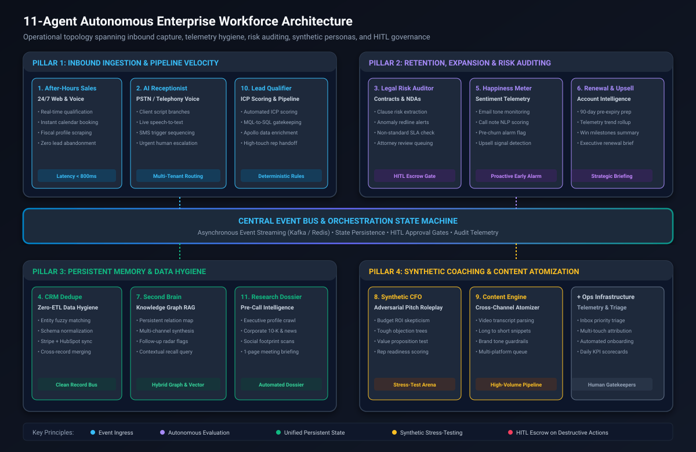
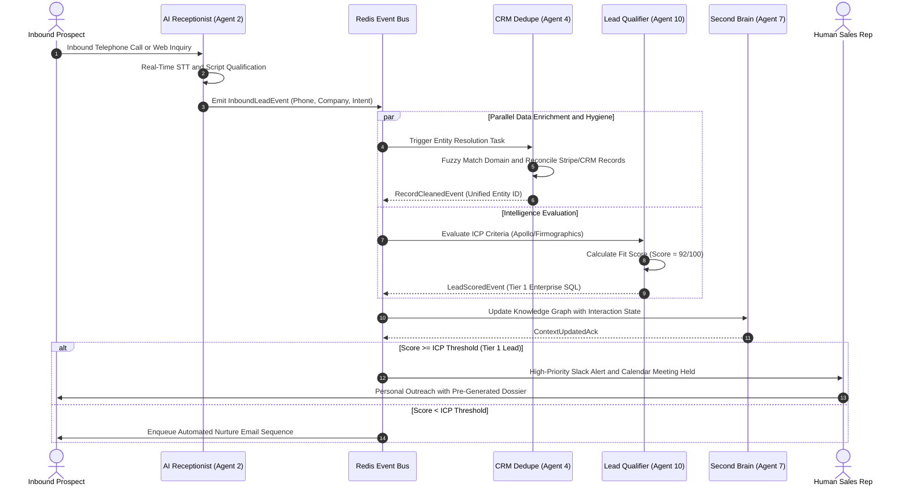
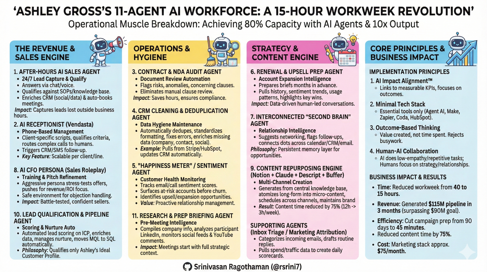

# Multi-Agent Enterprise Operations: The 11-Agent Workforce Architecture (2026)

Daily learning · Nov 16, 2026
*By Srinivasan Ragothaman ([@rsrini7](https://github.com/rsrini7))*

> Autonomous multi-agent systems move beyond single-prompt chatbots by decomposing complex enterprise workflows into specialized, event-driven agents that share persistent memory, execute asynchronous tasks, and enforce deterministic human-in-the-loop checkpoints.

---

## 1. Core Idea

Enterprise automation often fails when teams attempt to force a single general-purpose Large Language Model (LLM) to perform conflicting operational roles—such as simultaneous creative generation, rigorous legal compliance checking, and zero-error CRM data entry. 

The **11-Agent Workforce Architecture** (popularized in production operational reviews by Ashley Gross) addresses this limitation through specialized operational decomposition. By distributing operational load across eleven domain-specific agents—spanning inbound telephony qualification, continuous legal risk auditing, CRM identity resolution, and synthetic adversarial roleplay—an enterprise can run up to 80% of routine workflows autonomously. Reliability is achieved not through model size, but through architectural separation: decoupling deterministic business logic from probabilistic reasoning, backed by a persistent multi-tier memory bus and strict human-in-the-loop (HITL) escrow for destructive actions.

---

## 2. Foundations

Operating an autonomous multi-agent workforce requires establishing strict boundaries between probabilistic model generation and deterministic data persistence.

```
+-----------------------------------------------------------------------------------+
|                           Unified Inbound Telemetry Bus                           |
|       (REST Webhooks / Twilio Voice / SendGrid Email / HubSpot Activity Stream)    |
+------------------------------------------+----------------------------------------+
                                           |
                                           v
+-----------------------------------------------------------------------------------+
|                        Event Router & Orchestration Engine                        |
|   - Task Classification & Ingress Serialization                                   |
|   - Multi-Tier Memory Store (Redis Session Cache + PostgreSQL + Vector Embeddings) |
+--------------------+---------------------+--------------------+-------------------+
                     |                     |                    |
                     v                     v                    v
          +--------------------+ +--------------------+ +-------------------+
          | Pillar 1: Pipeline | | Pillar 2: Retain   | | Pillar 3: Data    |
          | - After-Hours Bot  | | - Legal Auditor    | | - CRM Deduplication|
          | - AI Receptionist  | | - Sentiment Meter  | | - Second Brain    |
          | - Lead Qualifier   | | - Renewal Prep     | | - Pre-Call Dossier|
          +--------------------+ +--------------------+ +-------------------+
                     |                     |                    |
                     +---------------------+--------------------+
                                           |
                                           v
+-----------------------------------------------------------------------------------+
|                        Human-in-the-Loop (HITL) Gatekeeper                        |
|   - High-Value Escrow (Outbound Contracts, CRM Record Merging, External Comms)    |
+-----------------------------------------------------------------------------------+
```

### Core Terminology

| Term | Technical Meaning | Operational Role |
| :--- | :--- | :--- |
| **Event-Driven Orchestrator** | A central messaging coordinator (e.g., Redis Streams, RabbitMQ, or Temporal) that routes webhook payloads to agent tasks asynchronously. | Decouples webhook arrival from LLM inference latency. |
| **Tri-Tier Memory Bus** | Layered state architecture separating transient scratchpads, relational state (Postgres), and semantic embeddings (vector/graph). | Prevents context window dilution while maintaining historical customer context. |
| **Synthetic Persona** | An agent prompted with adversarial constraints and domain-specific heuristics (e.g., a skeptical Chief Financial Officer). | Stress-tests outbound sales collateral and objection-handling prior to real human contact. |
| **Zero-ETL Deduplication** | Algorithmic entity matching combining Jaro-Winkler string similarity with embedding distances to unify multi-source CRM records. | Prevents duplicate account creation across billing, web traffic, and CRM data. |
| **HITL Escrow Gate** | A state machine barrier that pauses agent execution until a designated human supervisor approves, edits, or rejects a proposed mutation. | Eliminates rogue mutations in legal, financial, or direct customer-facing channels. |
| **Task Atomization** | Deconstructing long-form audio/video content into modular cross-channel assets governed by deterministic brand style sheets. | Multiplies content throughput while maintaining unified positioning. |

---

## 3. Deep Technical Mechanism

The 11-agent architecture organizes operational capabilities into four functional pillars connected by an asynchronous event bus and persistent memory infrastructure.



### Pillar 1: Inbound Ingestion & Pipeline Acceleration
1. **Agent 1: After-Hours AI Sales Representative**:
   - Listens on WebSocket endpoints for inbound chat and asynchronous form submissions outside business hours.
   - Evaluates prospect queries against product documentation stored in semantic vector collections.
   - Invokes calendar booking APIs (e.g., Cal.com, Calendly) with verified lead credentials within sub-second response times.
2. **Agent 2: Multi-Tenant AI Receptionist**:
   - Operates over Session Initiation Protocol (SIP) / Public Switched Telephone Network (PSTN) voice trunks via platforms like Vendasta or Retell AI.
   - Converts real-time audio streams to text via streaming Speech-to-Text (STT), routes conversational state through a low-latency LLM, and synthesizes audio via neural Text-to-Speech (TTS).
   - Dynamically selects company scripts based on inbound Caller ID and DDI (Direct Dial-In) routing.
3. **Agent 10: ICP Lead Scoring & Routing**:
   - Extracts firmographic indicators (employee count, tech stack, funding round) from Apollo, Clearbit, and LinkedIn APIs.
   - Evaluates leads against Ideal Customer Profile (ICP) heuristics using deterministic threshold gating rather than pure LLM scoring.
   - Upgrades qualified accounts from Marketing Qualified Lead (MQL) to Sales Qualified Lead (SQL) and assigns them to human account executives.

### Pillar 2: Retention, Revenue Expansion & Risk Auditing
4. **Agent 3: Legal Contract & NDA Risk Auditor**:
   - Parses complex PDF and DOCX agreements into structured clause trees.
   - Compares mutual indemnification, governing law, IP assignment, and liability caps against an institutional risk matrix.
   - Generates redline diffs and flags anomalous clauses for legal counsel review, discarding low-risk boilerplates without human intervention.
5. **Agent 5: Happiness Meter & Sentiment Telemetry**:
   - Monitors inbound customer support tickets, email threads, and post-call transcriptions using natural language classification.
   - Computes rolling sentiment scores $(-1.0 \text{ to } +1.0)$ per account.
   - Triggers automated alerts in internal Slack channels when an enterprise account exhibits a 3-week negative sentiment drift, enabling proactive intervention before contract termination.
6. **Agent 6: Renewal & Expansion Prep**:
   - Executes automatically 90 days prior to contract renewal dates.
   - Queries telemetry pipelines (e.g., Snowflake, Mixpanel) to calculate seat utilization, API volume, and feature adoption.
   - Compiles an executive renewal brief detailing demonstrated ROI, key wins, and upsell opportunities for account managers.

### Pillar 3: Persistent Operational Bus & Data Hygiene
7. **Agent 4: CRM Data Hygiene & Deduplication**:
   - Continuously monitors CRM webhook streams (Salesforce, HubSpot, Stripe) for record mutations.
   - Applies dual-pass entity resolution: normalized fuzzy string matching on corporate domain names followed by vector similarity on contact titles.
   - Merges fragmented records, standardizes address formatting, and reconciles billing entity discrepancies without manual data entry.
8. **Agent 7: Persistent "Second Brain" Knowledge Graph**:
   - Maintains an interconnected organizational graph of internal communications, historical commitments, and meeting notes.
   - Identifies latent relationship paths (e.g., "Executive X previously worked with Board Member Y at Firm Z").
   - Synthesizes relationship context across calendar events, surfacing relevant historical decisions moments before scheduled interactions.
9. **Agent 11: Pre-Call Research & Executive Dossier**:
   - Scrapes public regulatory filings (SEC 10-K, 8-K), press releases, and executive social media activity 60 minutes prior to scheduled discovery calls.
   - Generates a concise, single-page briefing containing current corporate initiatives, recent executive statements, and recommended conversational hooks.

### Pillar 4: Synthetic Coaching & Outbound Atomization
10. **Agent 8: Synthetic CFO Persona (Adversarial Pitch Simulator)**:
    - Acts as a deterministic counter-party to train enterprise sales personnel.
    - System prompt strictly constrains behavior: rejects vague qualitative claims, demands quantifiable ROI calculations, enforces strict payback periods, and attacks pricing structures.
    - Grades sales rep responses against empirical objection trees, providing tactical feedback before real customer presentations.
11. **Agent 9: Multi-Channel Content Atomization Engine**:
    - Ingests raw video/audio recordings from podcasts, executive keynotes, and technical webinars.
    - Transcribes, cleans, and extracts high-conviction insights using a structured brand rulebook.
    - Automatically formats output into multi-tier assets: executive summaries, technical LinkedIn write-ups, short-form video clips (via Descript/Opus Clip), and newsletter drafts.

---

## 4. Architectural Visuals & Interaction Flows

The following sequence diagram details the end-to-end lifecycle of an inbound lead event: multi-source ingestion, entity deduplication, deterministic ICP scoring, persistent memory logging, and human-in-the-loop escalation.



---

## 5. Production Implementations & Code Recipes

The following production-ready Python recipe implements the core asynchronous event orchestrator, Pydantic event schemas, deduplication logic, and human-in-the-loop gatekeeper.

```python
"""
Multi-Agent Orchestration Engine: Core Event Bus and HITL Escrow System.
Demonstrates asynchronous task routing, schema normalization, and human gating.
"""

from __future__ import annotations
import asyncio
from dataclasses import dataclass
from datetime import datetime, timezone
from enum import Enum
from typing import Any, Callable, Dict, List, Optional
from pydantic import BaseModel, Field, EmailStr


class EventType(str, Enum):
    INBOUND_LEAD = "inbound_lead"
    CONTRACT_UPLOADED = "contract_uploaded"
    SENTIMENT_ALERT = "sentiment_alert"
    DEDUPE_REQUIRED = "dedupe_required"


class TaskPriority(str, Enum):
    LOW = "low"
    NORMAL = "normal"
    HIGH = "high"
    CRITICAL_HITL = "critical_hitl"


class InboundLeadPayload(BaseModel):
    contact_email: EmailStr
    full_name: str
    company_name: str
    raw_query: str
    inbound_channel: str = Field(description="web_chat, phone_pstn, email")
    estimated_arr: Optional[float] = None


class AgentEvent(BaseModel):
    event_id: str
    event_type: EventType
    timestamp: datetime = Field(default_factory=lambda: datetime.now(timezone.utc))
    payload: Dict[str, Any]
    priority: TaskPriority = TaskPriority.NORMAL


@dataclass
class HITLEscrowRecord:
    event_id: str
    agent_name: str
    proposed_mutation: Dict[str, Any]
    created_at: datetime
    approved: Optional[bool] = None
    reviewer_notes: Optional[str] = None


class MultiAgentOrchestrator:
    """Central event coordinator routing tasks across specialized agents."""

    def __init__(self) -> None:
        self.queue: asyncio.Queue[AgentEvent] = asyncio.Queue()
        self.handlers: Dict[EventType, List[Callable[[AgentEvent], Any]]] = {}
        self.escrow_store: Dict[str, HITLEscrowRecord] = {}

    def register_handler(
        self, event_type: EventType, handler: Callable[[AgentEvent], Any]
    ) -> None:
        if event_type not in self.handlers:
            self.handlers[event_type] = []
        self.handlers[event_type].append(handler)

    async def emit(self, event: AgentEvent) -> None:
        """Publishes an event to the internal asynchronous message bus."""
        await self.queue.put(event)

    async def submit_to_hitl_escrow(
        self, event_id: str, agent_name: str, mutation: Dict[str, Any]
    ) -> HITLEscrowRecord:
        """Enqueues a dangerous mutation for mandatory human review."""
        record = HITLEscrowRecord(
            event_id=event_id,
            agent_name=agent_name,
            proposed_mutation=mutation,
            created_at=datetime.now(timezone.utc),
        )
        self.escrow_store[event_id] = record
        # In production, dispatch alert via Slack / Webhook / Dashboard
        print(f"🚨 [HITL ESCROW QUEUED] Agent '{agent_name}' requires human approval for {event_id}")
        return record

    async def resolve_hitl_escrow(
        self, event_id: str, approved: bool, notes: str = ""
    ) -> bool:
        """Resolves a pending escrow item, authorizing or cancelling downstream writes."""
        if event_id not in self.escrow_store:
            raise KeyError(f"Escrow record {event_id} not found.")
        record = self.escrow_store[event_id]
        record.approved = approved
        record.reviewer_notes = notes
        status = "APPROVED" if approved else "REJECTED"
        print(f"✅ [HITL RESOLVED] Event {event_id} {status} by human supervisor.")
        return approved

    async def run_worker(self) -> None:
        """Continuous background execution loop processing queued events."""
        while True:
            event = await self.queue.get()
            handlers = self.handlers.get(event.event_type, [])
            for handler in handlers:
                try:
                    await handler(event)
                except Exception as exc:
                    print(f"❌ Error handling {event.event_type} ({event.event_id}): {exc}")
            self.queue.task_done()


# =====================================================================
# Specialist Agent Handlers
# =====================================================================

async def lead_qualification_agent(event: AgentEvent) -> None:
    """Agent 10: Validates inbound lead ICP parameters."""
    lead = InboundLeadPayload(**event.payload)
    print(f"🔍 [Agent 10: Lead Qualifier] Processing {lead.contact_email} ({lead.company_name})")

    # Deterministic ICP Rule: Enterprise threshold $50k ARR or >100 seats
    is_enterprise = (lead.estimated_arr or 0) >= 50000.0
    if is_enterprise:
        print(f"⭐ [Agent 10] Qualified as Enterprise SQL: {lead.company_name}")
    else:
        print(f"ℹ️ [Agent 10] Routed to standard automated nurture sequence.")


async def contract_audit_agent(event: AgentEvent, orchestrator: MultiAgentOrchestrator) -> None:
    """Agent 3: Evaluates contract risk clauses and routes to HITL escrow."""
    print(f"📜 [Agent 3: Legal Auditor] Inspecting uploaded contract {event.event_id}")
    detected_liability_cap = event.payload.get("unlimited_liability", False)

    if detected_liability_cap:
        # High risk: Route mutation to human escrow
        await orchestrator.submit_to_hitl_escrow(
            event_id=event.event_id,
            agent_name="Agent-3-Legal-Auditor",
            mutation={
                "action": "flag_contract_clause",
                "severity": "CRITICAL",
                "clause": "Unlimited Mutual Liability Cap Clause Detected",
            },
        )
    else:
        print("✅ [Agent 3] Contract conforms to standard risk parameters.")


# =====================================================================
# Verification Runner
# =====================================================================

async def main() -> None:
    orchestrator = MultiAgentOrchestrator()

    # Register specialist agents
    orchestrator.register_handler(EventType.INBOUND_LEAD, lead_qualification_agent)
    orchestrator.register_handler(
        EventType.CONTRACT_UPLOADED,
        lambda ev: contract_audit_agent(ev, orchestrator),
    )

    # Spawn background consumer worker
    worker_task = asyncio.create_task(orchestrator.run_worker())

    # Emit realistic inbound events
    await orchestrator.emit(
        AgentEvent(
            event_id="EV-1001",
            event_type=EventType.INBOUND_LEAD,
            payload={
                "contact_email": "cto@acmecorp.com",
                "full_name": "Jane Doe",
                "company_name": "Acme Global",
                "raw_query": "Need 500 seats with enterprise SAML SSO integration.",
                "inbound_channel": "web_chat",
                "estimated_arr": 75000.0,
            },
        )
    )

    await orchestrator.emit(
        AgentEvent(
            event_id="EV-1002",
            event_type=EventType.CONTRACT_UPLOADED,
            priority=TaskPriority.CRITICAL_HITL,
            payload={"filename": "Master_Services_Agreement_v3.pdf", "unlimited_liability": True},
        )
    )

    # Allow worker to process
    await asyncio.sleep(0.5)

    # Simulate human supervisor resolving the flagged legal escrow item
    await orchestrator.resolve_hitl_escrow(
        event_id="EV-1002",
        approved=False,
        notes="Rejected: Enterprise policy requires a 2x annual fee liability cap.",
    )

    worker_task.cancel()


if __name__ == "__main__":
    asyncio.run(main())
```

---

## 6. Impact, Real-World Edge Cases & Gotchas

Deploying multi-agent production architectures introduces critical failure modes absent in single-prompt deployments.

### Concrete Production Failure Modes

1. **Entity Collision during CRM Deduplication (Agent 4)**:
   - *Risk*: When companies operate multiple legal subsidiaries with near-identical names (e.g., "Apex Logistics North America LLC" vs. "Apex Logistics Global Holdings Inc."), naive fuzzy-string deduplication may merge distinct accounts.
   - *Mitigation*: Require dual-key verification combining standardized corporate registration numbers (e.g., Dun & Bradstreet D-U-N-S or tax IDs) with domain WHOIS data before executing irreversible merge mutations.
2. **Conversational Drift & Hallucination in Voice Receptionists (Agent 2)**:
   - *Risk*: In PSTN phone environments, ambient background noise or caller interruptions can corrupt acoustic phoneme recognition, inducing hallucinated appointment bookings or incorrect script branching.
   - *Mitigation*: Enforce deterministic state transitions using Finite State Machines (FSM). Constrain the LLM's response generation to a fixed set of intent slots, reverting to human agent transfer when audio confidence scores drop below 0.75.
3. **Cascading Token Burn in Unbounded Agent Feedback Loops**:
   - *Risk*: When synthetic roleplay agents (Agent 8) communicate directly with drafting agents (Agent 9) without termination criteria, circular critiques can exhaust model context windows and generate massive API bills.
   - *Mitigation*: Impose strict loop iteration bounds ($\text{Max Turns} \le 3$) and track cumulative token expenditure per session using deterministic circuit breakers.

### Common Claims vs. Technical Realities

| Operational Dimension | Common Industry Claim | Technical Reality in Production |
| :--- | :--- | :--- |
| **Autonomy Level** | "Agents run 100% autonomously without human involvement." | True autonomy is restricted to read-only analysis and triage; destructive actions (contracts, payments, live client emails) require HITL escrow. |
| **Model Requirements** | "Every agent requires frontier reasoning models (GPT-4o, Claude 3.5 Sonnet)." | Over 70% of routine workflows (deduplication, triage, sentiment scoring) perform better, faster, and cheaper using fine-tuned SLMs or deterministic code. |
| **Implementation Scope** | "Deploying 11 agents requires an enterprise engineering team." | Low-code orchestration engines (n8n, Make) combined with structured API webhooks enable solo practitioners to deploy this architecture within weeks. |
| **Data Hygiene** | "LLMs automatically clean and repair legacy database inconsistencies." | Unstructured LLM outputs frequently introduce subtle formatting corruptions; strict Pydantic/JSON schema validation is mandatory before writing to CRM. |

---

## 7. Practical Adoption Blueprint & Verification Checklist

A staged rollout mitigates operational risk by validating read-only capabilities before granting mutation privileges.

```
Stage 1: Read-Only Telemetry (Days 1–14)
└── Deploy Sentiment Meter (Agent 5) and Pre-Call Dossier (Agent 11) in shadow mode.
└── Verify baseline classification accuracy against human-labeled account reviews.

Stage 2: Supervised Triage & Coaching (Days 15–30)
└── Deploy Synthetic CFO (Agent 8) for internal sales training.
└── Deploy Legal Auditor (Agent 3) with mandatory human escrow on all redline outputs.

Stage 3: Data Hygiene & Outbound Scaling (Days 31–60)
└── Deploy CRM Deduplication (Agent 4) in dry-run mode; review proposed merges.
└── Deploy Content Engine (Agent 9) with human editor sign-off prior to publishing.

Stage 4: Full Autonomous Orchestration (Days 61+)
└── Deploy After-Hours Sales (Agent 1) and Voice Receptionist (Agent 2) with direct calendar booking.
└── Activate automated Slack alerting and real-time operational telemetry dashboards.
```

### Verification & Diagnostic Commands

Verify webhook ingestion latency and task queue health using standard CLI tools:

```bash
# 1. Inspect Redis Streams consumer group lag for the event bus
redis-cli XINFO GROUPS agent:events:stream

# 2. Check pending unacknowledged events in the HITL escrow queue
redis-cli XPENDING agent:events:stream hitl-consumer-group

# 3. Simulate an inbound webhook event payload via cURL
curl -s -X POST https://api.ops.internal/v1/events/inbound \
  -H "Content-Type: application/json" \
  -H "Authorization: Bearer ${OPS_API_KEY}" \
  -d '{
    "event_type": "inbound_lead",
    "payload": {
      "contact_email": "vp-eng@enterprise.org",
      "company_name": "Enterprise Org",
      "raw_query": "Requesting enterprise SLA evaluation."
    }
  }' | jq .

# 4. Measure end-to-end event execution latency and error rates
tail -f /var/log/agent-orchestrator.log | jq '{timestamp, event_id, execution_ms, status}'
```

---

## 8. Timeline & Evolutionary Context

The evolution of automated enterprise operations reflects a shift from rigid rule engines to composite multi-agent swarms:

- **2016–2021: Robotic Process Automation (RPA)**: Systems like UiPath and Blue Prism automate brittle screen-scraping routines; any minor UI update causes total workflow failure.
- **2022–2023: Monolithic Chatbot Era**: Organizations deploy singular conversational interfaces (ChatGPT wrappers) that hallucinate business logic, lack persistent state, and fail at complex multi-step reasoning.
- **2024–2025: Compound AI Systems & Autonomous Frameworks**: Tools like CrewAI, AutoGen, and LangGraph formalize multi-agent collaboration, proving that specialized sub-agents outperform single large models.
- **2026: Production Multi-Agent Workforces**: Systems combine deterministic state machines, event streaming buses, and specialized agent pods (exemplified by Ashley Gross's operational architecture) to deliver high-reliability business execution.

---

## 9. Primary Sources & References

1. [Ashley Gross: Transform Your Operations Stack with AI Agents](https://theashleygross.com/blog/transform-operations-stack-ai-agents) — Primary operational breakdown detailing the transition from 40-hour to 15-hour executive workweeks using autonomous agent pods.
2. [Ashley Gross: 11-Agent Workforce Architecture (Video Presentation)](https://www.youtube.com/watch?v=6_XZjGUfI3s) — Comprehensive walkthrough of the 11 specialized agent roles and practical tech stack implementations.
3. [Vendasta: AI Receptionist and Inbound Voice Architecture](https://www.youtube.com/playlist?list=PL027Bw0T-5r5PNAkvWnpKep9nqec8hCGO) — Technical documentation on telephony routing, real-time STT/TTS synthesis, and automated CRM booking.
4. [LangChain: LangGraph Multi-Agent Architecture Documentation](https://python.langchain.com/docs/langgraph/) — Design patterns for stateful, multi-actor applications with built-in human-in-the-loop validation.
5. [Harrison Chase et al.: Building Effective Agents (Anthropic Research)](https://www.anthropic.com/research/building-effective-agents) — Architectural recommendations contrasting single-prompt agents with routing workflows and orchestrator-worker pipelines.

### Source Context & Observational Bounds

| Source Identifier | Scope & Platform | Verified Claims | Observational Limits |
| :--- | :--- | :--- | :--- |
| **Gross Public Disclosures (2025–2026)** | YouTube & Blog Case Studies | Reduction in operational hours; deployment of 11 distinct workflow roles across marketing, sales, and legal. | Exact internal proprietary prompt structures and API token costs reflect specific boutique consulting implementations rather than standardized benchmark suites. |
| **Vendasta Telephony Docs** | Voice PSTN Integration | Inbound call routing, live speech synthesis, and calendar appointment scheduling. | Acoustic noise tolerance depends on third-party STT providers and connection clarity. |

---

## 10. Supplementary Visuals

The original conceptual layout below illustrates the initial structural grouping of the 11 agents into operational pods:


*Figure 1: Conceptual overview of the 11-agent operational topology, showing functional delegation across sales, retention, data hygiene, and coaching.*

---

**Related:**
- [Ralph-Wiggum-Loops-And-Ralph-Mode-2026.md](Ralph-Wiggum-Loops-And-Ralph-Mode-2026.md) — Autonomous loop termination mechanisms and bash harness intercept patterns.
- [Agentic-Reasoning-Architectures-And-Reflection-Loops-2026.md](../../../Papers/reasoning/Agentic-Reasoning-Architectures-And-Reflection-Loops-2026.md) — Multi-agent reflection protocols and iterative verification scaling.
- [Science-of-Scaling-AI-Agent-Systems-2026.md](../../../Papers/scaling/Science-of-Scaling-AI-Agent-Systems-2026.md) — Empirical scaling laws across agent topologies, debate rounds, and execution context.
- [DeepSeek-SuperAgent-And-Harness-Architecture-Nov-2026.md](DeepSeek-SuperAgent-And-Harness-Architecture-Nov-2026.md) — Industrial harness design, sandboxed code execution, and autonomous multi-agent tooling.
