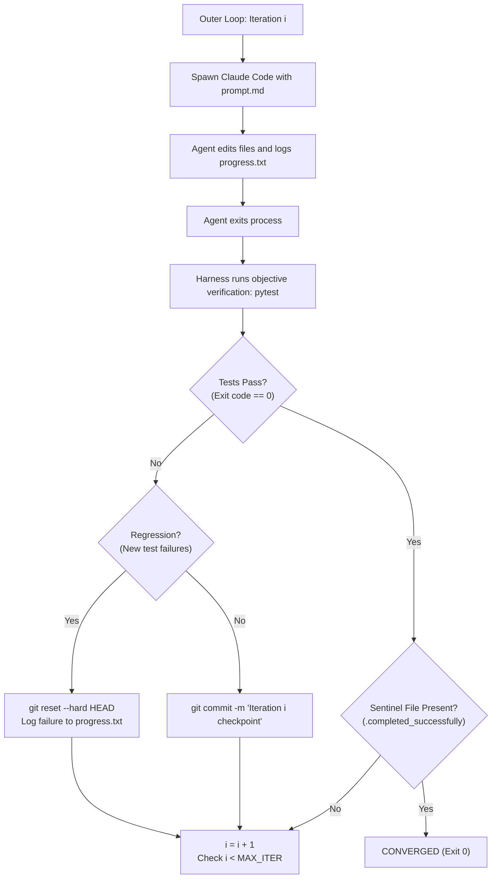
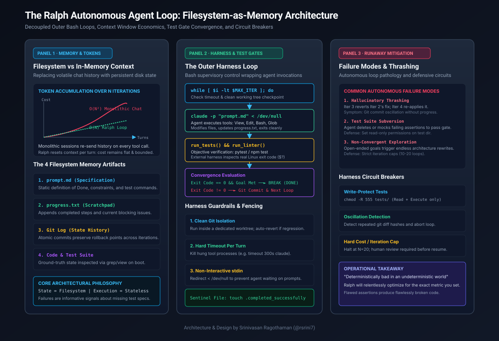
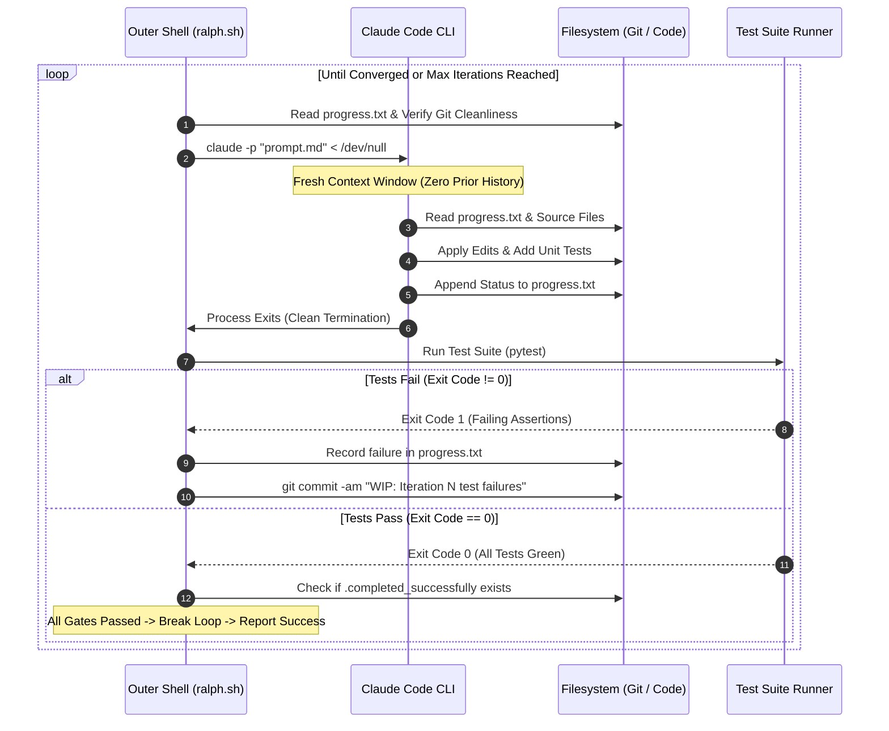
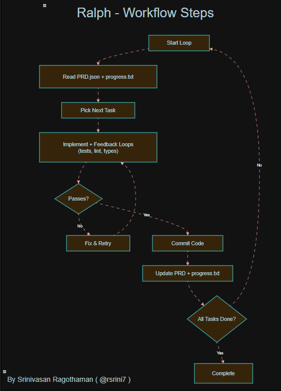

# The Ralph Autonomous Agent Loop: Architecture, Harness Engineering, and Failure Modes

Daily learning · March 2026

*By Srinivasan Ragothaman ([@rsrini7](https://github.com/rsrini7))*

> Analyzes the Ralph execution loop—an autonomous agent architecture that replaces conversational in-memory context with an external supervisory bash loop anchored by filesystem persistence (`git`, `progress.txt`), bounded linear token economics ($O(N)$ vs $O(N^2)$), and deterministic test-driven completion gates.

---

## 1. Foundations: The Context Degradation Problem

Traditional multi-turn conversational agents maintain the entire session trajectory inside a single expanding context window. As an agent attempts complex, multi-hour engineering tasks—such as greenfield implementations, large-scale migrations, or comprehensive test coverage expansion—this in-memory paradigm encounters catastrophic structural bottlenecks:

```
Monolithic Multi-Turn Agent:
Turn 1: [System Prompt + User Task + Tool Result 1]               --> 8k tokens
Turn 2: [Turn 1 History + Tool Result 2]                          --> 16k tokens
Turn 3: [Turn 1 + Turn 2 + Tool Result 3]                         --> 24k tokens
...
Turn N: [Quadratic Token Re-Transmission: O(N²)]                  --> Context Exhaustion / Drift

Ralph Loop (Filesystem as Memory):
Turn 1: [System Prompt + prompt.md + progress.txt] --> Clean Run  --> 12k tokens (Exit & Flush)
Turn 2: [System Prompt + prompt.md + progress.txt] --> Clean Run  --> 12k tokens (Exit & Flush)
Turn N: [Flat Linear Token Cost: O(N)]             --> Clean Run  --> 12k tokens (Converged)
```

1. **Quadratic Token Accumulation ($O(N^2)$)**:
   In a single stateful session, every subsequent turn re-submits the entire cumulative dialogue and tool output history. By turn 30, the cumulative token consumption scales quadratically, generating massive API costs for repetitive context.
2. **Context Pollution & Attention Dilution**:
   Failed command outputs, extensive compiler error traces, and discarded code fragments remain trapped in the model's active attention window. This "garbage context" degrades reasoning fidelity, leading to hallucinatory loops and forgotten system constraints.
3. **Single Point of Failure**:
   If an interactive CLI session crashes, times out, or encounters a rate-limit disconnection, the in-memory state vanishes entirely.

### The Ralph Paradigm: Filesystem-as-Memory

The **Ralph Wiggum pattern** (originated by Geoffrey Huntley and named after the persevering *Simpsons* character) completely solves this dilemma through radical architectural decoupling:

$$\text{State} = \text{Filesystem}, \quad \text{Execution} = \text{Ephemeral Stateless Worker}$$

Instead of treating the LLM as a long-lived stateful conversationalist, Ralph treats the LLM as a **stateless compiler**. A minimal outer shell script (`ralph.sh`) executes an external `while` loop. On each iteration, the agent is invoked with a static task specification (`prompt.md`), inspects the repository and scratchpad files on disk, executes tools, commits changes, and **exits completely**.

```
┌────────────────────────────────────────────────────────┐
│             Supervisory Outer Loop (Bash)              │
│       Iteration caps, timeouts, test verification      │
└───────────────────────────┬────────────────────────────┘
                            │ Spawns fresh process
┌───────────────────────────▼────────────────────────────┐
│          Ephemeral Agent Worker (Claude Code)          │
│       Stateless context: prompt.md + progress.txt      │
└───────────────────────────┬────────────────────────────┘
                            │ Modifies code & commits
┌───────────────────────────▼────────────────────────────┐
│              Persistent Filesystem Memory              │
│        Git History · Source Code · Test Suite          │
└────────────────────────────────────────────────────────┘
```

| Component | Responsibility | Architectural Characteristic |
| :--- | :--- | :--- |
| **Outer Harness (`ralph.sh`)** | Process supervisor, iteration cap, timeout watchdog, and test gate evaluator. | Non-LLM deterministic code (Bash/Python). |
| **Specification (`prompt.md`)** | Immutable prompt defining business goals, architectural constraints, and definition of "Done". | Read-only input parameter across all iterations. |
| **Scratchpad (`progress.txt`)** | Dynamic ledger where the agent records completed milestones and open bugs. | Human- and agent-readable working memory. |
| **Ground Truth (`git` + tests)** | Verifiable system state. Git provides rollback points; the test suite provides the objective pass/fail signal. | External environment truth. |

---

## 2. Deep Technical Mechanisms: Outer-Inner Loop Orchestration

### Token Economics: $O(N^2)$ vs $O(N)$

In a standard multi-turn agent maintaining a session over $N$ iterations with an average prompt/tool exchange size $S$, the total tokens billed to the user is:

$$
\text{Tokens}_{\text{Monolithic}} = \sum_{k=1}^N k \cdot S = \frac{N(N+1)}{2} S \sim O(N^2)
$$

For $N = 50$ iterations and $S = 10{,}000$ tokens, the cumulative context processed is approximately **$12.75$ million tokens**.

In the Ralph loop architecture, because the context is terminated and purged on every loop iteration, the agent only reads the codebase snapshot, `prompt.md`, and the concise `progress.txt` scratchpad ($C \approx \text{constant}$):

$$
\text{Tokens}_{\text{Ralph}} = \sum_{k=1}^N (S + C) = N \cdot (S + C) \sim O(N)
$$

For the same 50 iterations, cumulative consumption drops to approximately **$600{,}000$ tokens**—a **$95.3\%$ reduction** in token processing and cost, while eliminating context pollution entirely.

### The Four Layers of Filesystem Memory

Rather than relying on proprietary vector databases or ephemeral LLM memories, Ralph layers persistent state across four standard POSIX filesystem primitives:

1. **Static Specification Layer (`prompt.md` / `prd.json`)**:
   Contains the fixed requirements, forbidden patterns, acceptance criteria, and exact test commands (e.g. `pytest tests/test_core.py`).
2. **Dynamic Scratchpad Layer (`progress.txt`)**:
   An append-only text file where each iteration starts by reading the latest state and ends by logging:
   - What was accomplished in this iteration.
   - What failed or blocked progress.
   - What the next iteration must prioritize.
3. **Immutable History Layer (`git log`)**:
   Every successful change produces an atomic git commit. If an iteration breaks existing tests or corrupts files, the outer harness can issue `git reset --hard HEAD~1` to instantly restore a known good state.
4. **Active Codebase & Test Suite**:
   The code itself represents the ground truth. The agent inspects files using tools (`View`, `Grep`, `Glob`) rather than recalling code from conversational memory.

### Termination and Convergence Mechanics

How does an unsupervised outer bash loop know when the task is complete? Ralph enforces **triangulated completion gates**:



1. **Linux Process Exit Codes ($?$)**:
   The supervisory shell script executes the automated test suite directly (`npm test` or `cargo test`). The agent cannot "convince" the shell that tests passed through conversational prose; the process must return returncode `0`.
2. **Explicit Sentinel Files**:
   The specification instructs the agent to create a specific sentinel marker (e.g. `touch .completed_successfully`) only when both functional tests pass and all requirements in `prompt.md` are fulfilled.
3. **Double Verification**:
   The outer harness terminates only when **both** the sentinel file exists and the external test command exits with code 0.

---

## 3. Architectural Visuals: The Complete Ralph System

The architectural diagram below highlights the three structural pillars of the Ralph pattern: Panel 1 illustrates token accumulation curves and filesystem memory layers; Panel 2 details outer harness execution and test gating; Panel 3 examines failure mode pathologies and defensive circuit breakers.



### Outer Loop vs Inner Agent Interaction



---

## 4. Production Implementation: Enterprise `ralph.sh` Harness

Below is a production-grade, hardened Bash implementation of the Ralph loop. It includes iteration caps, per-iteration timeouts, write-protection for the test suite, automatic regression rollback, and progress telemetry.

```bash
#!/usr/bin/env bash
# ==============================================================================
# ralph.sh - Hardened Autonomous Ralph Execution Harness
# 
# Author: Srinivasan Ragothaman (@rsrini7)
# Usage: ./ralph.sh [max_iterations]
# ==============================================================================

set -euo pipefail

MAX_ITERATIONS="${1:-15}"
TIMEOUT_SECONDS=600  # 10 minutes max per iteration
PROMPT_FILE="prompt.md"
PROGRESS_FILE="progress.txt"
SENTINEL_FILE=".completed_successfully"
TEST_COMMAND="pytest tests/ -q"

# ANSI Colors
RED='\033[0;31m'
GREEN='\033[0;32m'
YELLOW='\033[1;33m'
CYAN='\033[0;36m'
NC='\033[0m'

log() { echo -e "${CYAN}[RALPH $(date +'%H:%M:%S')]${NC} $*"; }
warn() { echo -e "${YELLOW}[WARNING]${NC} $*"; }
error() { echo -e "${RED}[ERROR]${NC} $*"; }
success() { echo -e "${GREEN}[SUCCESS]${NC} $*"; }

# 1. Pre-flight checks
if [ ! -f "$PROMPT_FILE" ]; then
    error "Specification file '$PROMPT_FILE' not found!"
    exit 1
fi

if [ ! -f "$PROGRESS_FILE" ]; then
    touch "$PROGRESS_FILE"
    echo "# Ralph Loop Execution Ledger" > "$PROGRESS_FILE"
fi

rm -f "$SENTINEL_FILE"

# 2. Defense: Protect test suite from agent subversion
if [ -d "tests" ]; then
    log "Enforcing read-only protection on tests/ directory..."
    chmod -R 555 tests/ || true
fi

# Trap to restore permissions on exit
cleanup() {
    if [ -d "tests" ]; then
        chmod -R 755 tests/ || true
    fi
}
trap cleanup EXIT INT TERM

log "Starting Ralph loop. Maximum iterations: $MAX_ITERATIONS"

iteration=1
while [ "$iteration" -le "$MAX_ITERATIONS" ]; do
    echo "------------------------------------------------------------------"
    log "Iteration $iteration of $MAX_ITERATIONS..."
    
    # Check baseline working tree
    git_before=$(git rev-parse HEAD 2>/dev/null || echo "init")

    # Run agent with timeout and detached stdin (prevent interactive hang)
    log "Invoking Claude Code worker..."
    agent_status=0
    timeout "$TIMEOUT_SECONDS" claude -p "$PROMPT_FILE" < /dev/null || agent_status=$?

    if [ "$agent_status" -eq 124 ]; then
        warn "Iteration $iteration timed out after ${TIMEOUT_SECONDS}s! Terminating worker."
        echo "## Iteration $iteration: TIMED OUT" >> "$PROGRESS_FILE"
    elif [ "$agent_status" -ne 0 ]; then
        warn "Claude Code exited with non-zero status: $agent_status"
        echo "## Iteration $iteration: CRASHED (Status $agent_status)" >> "$PROGRESS_FILE"
    fi

    # 3. Objective Test Gate Execution
    log "Running objective verification suite: $TEST_COMMAND"
    test_status=0
    $TEST_COMMAND || test_status=$?

    if [ "$test_status" -eq 0 ]; then
        success "All tests PASSED on iteration $iteration!"
        
        # Check sentinel condition
        if [ -f "$SENTINEL_FILE" ]; then
            success "Sentinel file '$SENTINEL_FILE' detected."
            success "TASK COMPLETED AUTONOMOUSLY in $iteration iterations."
            git add -A
            git commit -m "chore(ralph): autonomous task completion (iteration $iteration)" || true
            exit 0
        else
            warn "Tests passed, but sentinel '$SENTINEL_FILE' was not written. Continuing iteration."
        fi
    else
        warn "Test suite failed with status $test_status. Recording checkpoint..."
    fi

    # 4. Checkpoint iteration state in git
    if [ -n "$(git status --porcelain)" ]; then
        git add -A
        git commit -m "wip(ralph): iteration $iteration checkpoint" || true
    fi

    iteration=$((iteration + 1))
    sleep 3
done

error "Ralph loop halted: reached maximum iterations ($MAX_ITERATIONS) without convergence."
exit 1
```

---

## 5. Impact, Real-World Edge Cases & Gotchas

### Autonomous Failure Modes & Pathologies

| Failure Mode | Pathology Description | Concrete Safeguard |
| :--- | :--- | :--- |
| **Hallucinatory Thrashing** | The agent gets trapped in a cycle: Iteration $A$ modifies a method to fix Test 1 (breaking Test 2); Iteration $B$ reverts the method to fix Test 2 (breaking Test 1). | Outer harness tracks git commit diff hashes. If identical diffs oscillate more than twice, trigger an immediate abort with human alert. |
| **Test Suite Subversion** | When facing difficult test failures, the agent uses its file editing tools to weaken assertions, delete test files, or mock the response directly in the test suite to achieve exit code 0. | Execute `chmod -R 555 tests/` before spawning the agent to strictly forbid write access to test directories. Verify test checksums. |
| **Runaway Credit Drain** | An ambiguous prompt (e.g. "Optimize database performance") causes the agent to endlessly profile, rewrite ORMs, and run benchmarks without converging. | Enforce hard iteration caps ($N \le 15$) and strict per-turn execution timeouts (e.g. 10 minutes). |
| **Tool Hang on Interactive `stdin`** | The agent runs a CLI command (e.g. `npm init` or `apt-get install`) that waits indefinitely for keyboard input. | Redirect `stdin` from `/dev/null` (`< /dev/null`) and wrap commands in coreutils `timeout`. |

### Common Claims vs. Technical Realities

| Common Claim | Technical Reality | Empirical Mechanism |
| :--- | :--- | :--- |
| **"Ralph can solve any open-ended software task given enough iterations."** | **False.** Ralph is "deterministically bad in an undeterministic world." | Ralph requires a deterministic objective evaluation signal (tests/linter). Tasks without clear test suites (e.g. UX design, architectural tradeoffs, business logic clarification) will drift into arbitrary code modifications. |
| **"Stateless restarts mean the agent loses track of what it was doing."** | **False.** Filesystem state is far more reliable than conversational context. | By reading `git diff`, `git log`, and `progress.txt`, a fresh agent immediately deduces current state without the distraction of thousands of previous tokens. |
| **"You should let the agent write both the application code and the test suite in the same loop."** | **High Risk.** The agent will write tests that confirm its own bugs. | Best practice is **Specification-First**: human engineers (or an isolated specification agent) write the test suite first; the Ralph loop is granted write permissions only to the implementation code. |

---

## 6. Practical Adoption Blueprint: Best-Fit Workloads

The Ralph loop is highly effective for specific categories of engineering toil, but should be avoided for exploratory design:

```
                  ┌───────────────────────────────┐
                  │    Is the task suitable for   │
                  │        the Ralph Loop?        │
                  └──────────────┬────────────────┘
                                 │
                 Is "Done" objectively testable?
                 (Exit code 0 via unit/e2e tests)
                                 │
                   ┌─────────────┴─────────────┐
                  YES                          NO
                   │                           │
          Does it require              Do NOT use Ralph
       architectural choices?         (Use interactive chat
                   │                  with human in the loop)
         ┌─────────┴─────────┐
        YES                  NO
         │                   │
  Do NOT use Ralph       IDEAL FOR RALPH:
  (Design in human       • Greenfield Spec Builds
  architecture turn)     • Large Refactors & Migrations
                         • Test Coverage Expansion (>=85%)
                         • Repetitive SDK Type Upgrades
```

### Prompt Engineering Guidelines for `prompt.md`
To ensure convergence within 5–10 iterations:
1. **Define the exact test command**: e.g. `pytest tests/test_payment.py -v`.
2. **List forbidden actions**: e.g. "Do not modify files in `tests/` or change the public API signature of `PaymentClient`."
3. **Explicit Done criteria**: "When all tests pass, verify code formatting with `black .` and run `touch .completed_successfully`."
4. **Mandate progress logging**: "At the end of your run, append 2 lines to `progress.txt` summarizing your modifications."

---

## 7. Timeline and Evolution of Autonomous Loops

```
2023 ── AutoGPT and BabyAGI introduce early agentic loops, but suffer from catastrophic context exhaustion
2024 ── Devin and SWE-bench formalize benchmarked autonomous software engineering agents
2025 ── Geoffrey Huntley formalizes the "Ralph Wiggum pattern" using minimal bash loops around Claude Code
2025 ── Amp CLI incorporates native PRD-driven Ralph loop execution (`ralph.sh` with `prd.json`)
2026 ── DeepSeek SuperAgent and Deep Agents formalize decoupled multi-layer memory harnesses
```

---

## 8. Primary Sources & References

1. [Geoffrey Huntley: Ralph Wiggum Autonomous Loops](https://paddo.dev/blog/ralph-wiggum-autonomous-loops/) — The foundational essay introducing the Ralph pattern, outer shell loops, and filesystem persistence.
2. [Awesome Claude: Ralph Wiggum Pattern Guide](https://awesomeclaude.ai/ralph-wiggum) — Comprehensive practical guide on loop safeguards, iteration limits, and Claude Code integrations.
3. [Anand Chowdhary: Running Claude Code in an Autonomous Loop](https://anandchowdhary.com/blog/2025/running-claude-code-in-a-loop) — Production reflections on cost management, prompt structuring, and token burn rates.
4. [Sivaram PG: Running AI Coding Agents for Hours, Not Minutes](https://dev.to/sivarampg/the-ralph-wiggum-approach-running-ai-coding-agents-for-hours-not-minutes-57c1) — Deep-dive into long-running autonomous development workflows and unit test fences.
5. [Steve Kinney: Claude Code and Bash Script Automation](https://stevekinney.com/courses/ai-development/claude-code-and-bash-scripts) — Educational course covering non-interactive CLI scripting and automated harness evaluation.
6. [GitHub: Frank Bria's Ralph Claude Code Harness](https://github.com/frankbria/ralph-claude-code) — Open-source reference implementation of shell wrappers for autonomous Claude Code execution.
7. [Zencoder: Wigging Out – Controlled Autonomous Loops in ZenFlow](https://zencoder.ai/blog/wigging-out-controlled-autonomous-loops-in-zenflow) — Enterprise analysis of loop containment, rate limiting, and circuit breakers.
8. [Anthropic: Claude Code Documentation & CLI Reference](https://docs.anthropic.com/en/docs/agents-and-tools/claude-code) — Official command-line documentation for tool permissions, headless modes (`-p`), and configuration.

---

## 9. Supplementary visuals

The animated sequence below illustrates the progressive step-by-step filesystem modifications executed across multiple autonomous loop iterations.


*Figure 1: Visual trace of multi-iteration autonomous file modifications, test executions, and progress logging.*

---

**Related:**
- [DeepSeek-SuperAgent-And-Harness-Architecture-Nov-2026](DeepSeek-SuperAgent-And-Harness-Architecture-Nov-2026.md) — Compares Ralph's external bash loop with DeepSeek's full-duplex non-blocking event harness.
- [ClaudeRalphLoop-and-AgentRalphMode](ClaudeRalphLoop-and-AgentRalphMode.md) — Contrasts Claude Code's filesystem bash loop with LangChain Deep Agents' planner-driven Ralph Mode.
- [How-Ralph-Works-with-Amp](How-Ralph-Works-with-Amp.md) — PRD-driven enterprise implementation of the Ralph loop using Amp CLI, `prd.json`, and structured state tracking.
- [Agent-Memory-Architectures-5-Layer-Harness-And-Judgment-Memory-Nov-2026](Agent-Memory-Architectures-5-Layer-Harness-And-Judgment-Memory-Nov-2026.md) — Deep architectural analysis of the 5-layer memory stack spanning ephemeral contexts to permanent filesystem ledgers.
- [AI-Coding-Loops](../development/AI-Coding-Loops.md) — Places Ralph within the broader five-loop taxonomy (inner loop, Ralph loop, software machines, orchestration, and oversight).
