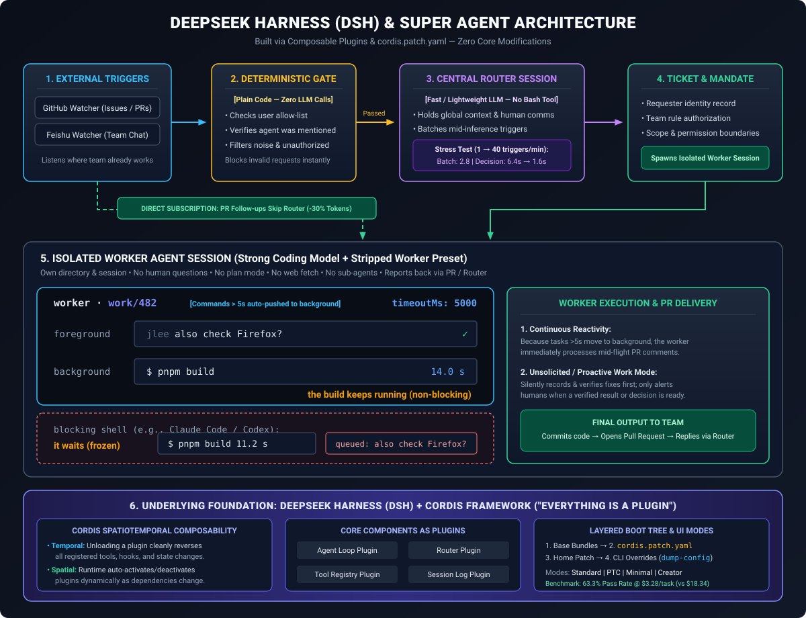
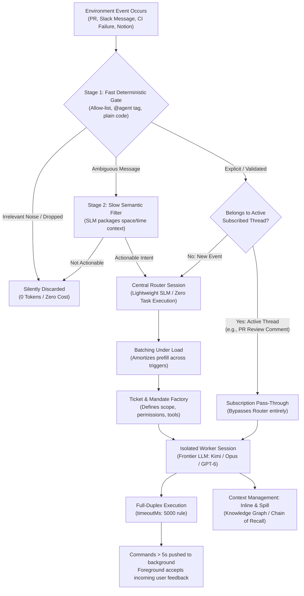
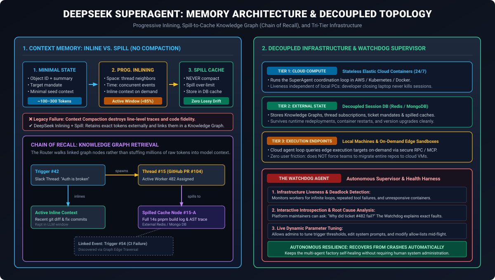

# DeepSeek SuperAgents and Harness Architecture: Event-Driven Autonomous Pipelines, Cordis Framework, and Full-Duplex Agent Execution

**Daily learning · 3 November 2026 · Architectural review · Primary-source analysis**

> **Core idea:** DeepSeek's SuperAgent paradigm and open-source DeepSeek Harness (DSH) invert the legacy human-initiated chat session—where a developer manually initiates 3–5 concurrent tabs and babysits context—into an always-on, event-driven pipeline. Built on the Cordis spatiotemporal plugin framework, the architecture separates lightweight classification routing from heavy worker execution, eliminates blocking tool waits via full-duplex asynchronous execution, replaces lossy context compaction with progressive inlining and spilled knowledge graphs (Chain of Recall), and achieves a 17.5× cost reduction over legacy coding harnesses at identical frontier benchmark accuracy.

---

## 1. Foundations: Inverting the Human-Driven Agent Paradigm

Since the advent of conversational AI in late 2022, agent architectures have inherited the human chat window. In this traditional paradigm, a human developer serves as the primary dispatcher: opening terminal tabs, typing a prompt, selecting files, and manually monitoring context limits.

```
Traditional Paradigm:
Human clicks "New Chat" ──> Master Reasoning Agent ──> Heavy Decomposition ──> Sub-Agents
                                                                                 (Bottleneck: Human Attention)

SuperAgent Paradigm:
Environment Events ──────> Two-Stage Filter ──> Central Router ──────────> Worker Sessions
(PRs, Slack, CI, Notion)   (Fast & Slow Path)   (Zero-Task Dispatcher)      (Full-Duplex Agents)
```

This human-driven model introduces two structural bottlenecks:

1. **The Human Attention Ceiling:** Human working memory limits concurrent management to 3–5 active chat sessions before developers lose situational awareness and introduce errors. Treating a "session" as the atomic unit of work anchors agent productivity to human availability.
2. **Heavy Master Orchestration:** In standard multi-agent systems, the root orchestrator must run a frontier reasoning model (e.g., Claude 3.7/Opus, GPT-5/6, or DeepSeek-R1) merely to scan entire contexts, break tasks into chunks, and delegate them to sub-agents. This consumes massive test-time compute on pure dispatch overhead rather than actual code modification.

### The Four Defining Pillars of SuperAgents

In the foundational technical paper *"Exploring Super-agent Design: Towards a More Autonomous Agent System"*, the DeepSeek Harness team defines a SuperAgent not as a single massive LLM prompt, but as an **always-on, continuous software entity** designed around the **Attention Economy Principle: "Minimize Noise, Maximize Value"**.

A poorly configured autonomous agent easily becomes an aggressive spam generator—flooding communication channels with intermediate thoughts and trivial questions. DeepSeek's architecture enforces a strict interaction contract:
1. **Silent Background Execution:** The agent works silently in recording/shadow mode, autonomously reproducing bugs (similar to Lauren Tan's *"fix and fuzz"* pattern) and verifying code changes against local test suites.
2. **Strict Output Threshold:** The agent speaks only when human intervention is strictly mandatory or when a concrete, verified artifact (such as an open Pull Request) is ready.
3. **The "One Question at a Time" Budget:** When user guidance is required, the agent is constrained by policy to ask only a single, highly specific question rather than an intimidating list of open-ended options.
4. **The "Needs You" Queue:** Rather than interrupting developers with synchronous notification pings, tasks waiting for human approval accumulate in an asynchronous dashboard panel labeled **"Needs You"**, which developers review at their convenience.

This pattern aligns directly with Anthropic's late-2026 SDLC findings on **intent aggregation** (using `intent.md` files to capture requirements across emails, Slack, Jira, and Sentry): in modern agentic engineering, **human prompts are replaced by ambient environment intent**.

```
┌────────────────────────────────────────────────────────────────────────────────────────┐
│                        The Four Pillars of the SuperAgent Model                        │
├─────────────────┬──────────────────────────────────────────────────────────────────────┤
│ Property        │ Operational Definition & Architectural Meaning                       │
├─────────────────┼──────────────────────────────────────────────────────────────────────┤
│ 1. Continuous   │ Unifies context across disparate channels (GitHub, Feishu, Notion)   │
│                 │ into a single persistent identity rather than isolated siloed bots.  │
├─────────────────┼──────────────────────────────────────────────────────────────────────┤
│ 2. Productive   │ Preserves domain execution depth across all event streams without    │
│                 │ diluting code quality, test verification, or response speed.         │
├─────────────────┼──────────────────────────────────────────────────────────────────────┤
│ 3. Proactive    │ Initiates actions autonomously based on environment state changes    │
│                 │ (e.g., failed builds, unassigned tickets) without explicit @mentions.│
├─────────────────┼──────────────────────────────────────────────────────────────────────┤
│ 4. Persistent   │ Runs 24/7 in cloud containers decoupled from local machines;         │
│                 │ state survives developer laptop sleep, restarts, and network drops.  │
└─────────────────┴──────────────────────────────────────────────────────────────────────┘
```

### Comparative Analysis: Chatbots vs. Personal Assistants vs. SuperAgents

To understand where DeepSeek SuperAgents fit in the broader AI ecosystem, compare them with familiar tools:

| Dimension | Interactive Chatbots (Claude Code, Cursor, ChatGPT) | Personal Assistant Apps (Rewind, Limitless, Dot, Instinct) | DeepSeek SuperAgents (DSH / Cordis Framework) |
|---|---|---|---|
| **Primary Trigger** | Manual human prompt in terminal or UI | Personal device telemetry (audio, screen, calendar) | Semi-structured enterprise environment events |
| **Session Spawner** | Human developer clicking `+` or new tab | Application runtime tied to single user | Autonomous Router Session via event classifier |
| **Concurrency Limit** | 3–5 active tabs (human attention bound) | Single personal thread | Dozens of parallel Worker Sessions |
| **Target Scope** | Individual developer's immediate task | Personal productivity & life management | Multi-party engineering teams, PRs, and ERPs |
| **Tool Execution** | Synchronous blocking ReAct loop | Read-heavy integrations & search | Full-Duplex asynchronous background shell |
| **State Persistence** | Bound to local process lifecycle | Cloud-synced user timeline | Decoupled tri-tier (Cloud compute / DB / Edge) |

### Essential Terminology

| Term | Meaning in DeepSeek SuperAgent & Harness Architecture |
|---|---|
| **DeepSeek Harness (DSH)** | The open-source, model-agnostic coding harness built around the Cordis framework, orchestrating plugins, tools, logs, and agent loops. |
| **Cordis Framework** | A plugin architecture providing spatiotemporal composability: dynamic dependency activation and reversible unhooking with zero state pollution. |
| **Fast-Path Deterministic Gate** | A plain-code evaluation layer (zero LLM calls) that enforces allow-lists, drops chatter, and catches explicit tags instantly. |
| **Slow-Path Semantic Filter** | A lightweight semantic model that assesses ambiguous environment messages to determine actionable intent and package local context. |
| **Central Router Session** | A persistent, lightweight session that performs **zero task execution**; its exclusive responsibility is classifying events and spawning workers. |
| **Batching Under Load** | Accumulating incoming triggers that arrive while the router is mid-inference into a single batched call, amortizing prefill cost. |
| **Subscription Pass-Through** | A direct event pipeline that bypasses the router entirely when an incoming event belongs to an active worker's registered thread. |
| **Worker Session** | An isolated harness instance running a frontier model with full tooling, fresh memory, and the capacity to spawn sub-agent teams. |
| **Progressive Inlining** | Context assembly that starts with minimal IDs and selectively pulls in surrounding messages based on space (thread) and time (concurrency). |
| **Context Spill** | Evicting overflowing context tokens into external persistent storage rather than executing lossy summarization or compaction. |
| **Chain of Recall** | A knowledge graph maintained by the router linking triggers, threads, inline context, and spilled caches for lossless historical retrieval. |
| **Full-Duplex ReAct** | An asynchronous execution pattern where long-running tools run in the background without blocking foreground conversation or event intake. |
| **Watchdog Agent** | An independent supervisor agent with diagnostic tools that monitors infrastructure liveness, detects deadlocks, and answers failure queries. |

---

## 2. Mechanism: Architecture and Execution Dynamics

DeepSeek's SuperAgent architecture separates **routing** from **execution**. Rather than relying on a top-heavy master agent that attempts to comprehend the entire universe before delegating tasks, the system coordinates event streams through a layered pipeline.


*Figure 1: High-level architectural topology of DeepSeek Harness (DSH) and SuperAgent orchestration, detailing the progression from external environment watchers (GitHub / Feishu) through the deterministic gate, central router session with batching under load, direct subscription bypass (-30% tokens), isolated worker sessions with non-blocking shells (`timeoutMs: 5000`), and the underlying Cordis plugin foundation.*

### The Event Lifecycle Flow



---

### 2.1 The Ingestion Pipeline & Two-Stage Event Filtering

In real-world engineering teams, 90% or more of raw environment messages are chatter (e.g., *"Heading for lunch"*, *"Who is reviewing PR #42?"*, or routine CI notifications). Sending every webhook or chat message directly to a frontier LLM would exhaust token budgets and overwhelm system resources.

To address this, DSH establishes a **Two-Stage Event Filter**:

1. **Stage 1: Fast Deterministic Gate (Plain Code, 0 Tokens):**
   - Implemented entirely in deterministic code without LLM inference.
   - Evaluates message metadata: sender identity against allow-lists, workspace permissions, and webhook event headers.
   - Checks for explicit agent invocation (e.g., `@deepseek-agent`, `@bot fix this`).
   - Immediately discards non-actionable chatter.
2. **Stage 2: Slow Semantic Filter (Lightweight SLM):**
   - Activated when an event passes basic permissions but lacks explicit direction (e.g., a developer comments on Slack: *"The test suite for the auth module has been flaky since the last merge"*).
   - A compact model evaluates whether the event warrants autonomous intervention.
   - If approved, the semantic filter packages surrounding conversational context using **spatial and temporal locality** (gathering recent messages in that channel and relevant concurrent events) before passing the event to the router.

---

### 2.2 The Central Router Layer & Amortized Inference

The Central Router is a single, long-running session that coordinates work across the entire environment. It represents a departure from traditional orchestrators through three design choices:

#### The "Zero-Task" Rule
The Central Router executes **zero tasks**. It has no bash execution tool, no file-reading harness, and no code modification capabilities. Its exclusive responsibility is classification, dispatching, and worker lifecycle management.

Because it does not write code or analyze large file diffs, it does not require a heavy frontier reasoning model. It operates on a fast, small model (SLM) whose prompt consists of simple input and structured JSON output.

#### Batching Under Load (Amortized Prefill)
In standard agent setups, a sudden spike in events (e.g., 20 PR comments and CI alerts arriving simultaneously) triggers 20 parallel LLM calls, driving up costs and causing rate-limit throttling.

In DSH, incoming triggers that arrive while the router is actively computing an inference pass **pile up in an incoming buffer**. When the router completes its current pass, it consumes the entire buffer in a single batch.
- Because LLM inference amortizes the prefill phase across batched sequences, total processing time stays bounded.
- **Empirical stress tests:** When trigger volume scaled from 1 to 40 triggers per minute, the average batch size rose to 2.8, while average decision latency per trigger dropped from **6.4 seconds down to 1.6 seconds**.

#### Subscription Pass-Through (Router Bypass)
Not every event requires global re-routing. When an issue or pull request is assigned to an existing worker session, that worker **subscribes** to the underlying thread ID.
- When subsequent comments or CI status updates arrive for that thread, the deterministic gate routes them **directly to the assigned worker session**, bypassing the router.
- This bypass reduces Router decision invocations and token consumption by approximately **30%**, while ensuring ongoing conversations maintain immediate responsiveness.
- The subscription topology is **many-to-many**: a single worker can subscribe to multiple related threads (e.g., an issue thread, a PR review thread, and a CI webhook), and a thread can notify multiple workers if necessary.

---

### 2.3 Worker Sessions & Isolated Execution

Once the Router validates a task, it generates a **Ticket with an explicit Mandate** (specifying requester, permission boundaries, and target repositories) and initializes an **isolated Worker Session**.

Each Worker Session operates like a dedicated coding session (analogous to an isolated Claude Code or Codex instance) with:
- An isolated context window, private file tool harness, and dedicated scratchpad.
- The **most capable frontier model** (e.g., Kimi K2/K3, Claude 3.7 Sonnet / Opus 5.5, or GPT-6) configured specifically for reasoning, coding, and debugging.
- The capability to spawn targeted **sub-agent teams** for specialized exploration (e.g., deep file grepping or documentation lookup).

#### The Non-Blocking Background Shell (`timeoutMs: 5000`)
The traditional ReAct (Reasoning + Acting) loop operates synchronously:

```
Legacy Single-Duplex Loop:
User Message ──> LLM Call ──> Tool Call (e.g. bash $ pnpm build [14s]) ──> [AGENT BLOCKS / FREEZES] ──> Observation ──> LLM

Full-Duplex Asynchronous Loop:
User Message ──> LLM Call ──> Tool Call ──> (Exceeds 5s? Push to Background Job)
                                 │
                                 └──> Foreground agent stays active & accepts new user feedback!
                                 │
                                 └──> Background job completes ──> Async event injected into session
```

In standard coding harnesses, if an agent triggers a long-running build (e.g., `pnpm build` or `./gradlew test` taking 20–60 seconds), the entire session locks up. If a human intervenes with an updated instruction (*"also check Firefox compatibility"*), the message is queued or dropped until the build finishes.

DSH resolves this via its **Full-Duplex execution model**:
- Every shell command execution has a configurable foreground timeout: `timeoutMs: 5000`.
- If a command finishes within 5 seconds, it returns synchronously.
- If execution exceeds 5 seconds, the harness automatically pushes the command to a **background process** and returns a job handle to the agent.
- The foreground session remains receptive. The agent can immediately acknowledge human updates, continue editing other non-conflicting files, or report intermediate progress. When the background job completes, an asynchronous notification injects the stdout/stderr back into the context.

```
┌────────────────────────────────────────────────────────────────────────────────────────┐
│               Non-Blocking Full-Duplex Shell vs. Traditional Blocking Shell            │
├────────────────────────────────────────────────────────────────────────────────────────┤
│ DeepSeek Worker Non-Blocking Execution (worker · work/482):            timeoutMs: 5000 │
│ [Commands > 5s automatically pushed to background]                                     │
│                                                                                        │
│ foreground:  jlee: "also check Firefox?"                                           [✓] │
│ background:  $ pnpm build                                                        14.0s │
│              ↳ the build keeps running continuously (non-blocking)                     │
├────────────────────────────────────────────────────────────────────────────────────────┤
│ Traditional Blocking Execution (Claude Code / Codex CLI):                              │
│                                                                                        │
│ shell status: waiting / frozen                                                         │
│ execution:    $ pnpm build                                                       11.2s │
│ queued:       jlee: "also check Firefox?" (held in queue until build completes)        │
└────────────────────────────────────────────────────────────────────────────────────────┘
```

---

### 2.4 Context Organization: Inline, Spill, and the Chain of Recall

A common failure mode in long-running coding agents is **context degradation** caused by aggressive compaction. When an agent compresses 50,000 tokens of file edits and error traces into a 500-token summary, vital edge-case details, line numbers, and error traces are permanently destroyed.

DeepSeek explicitly rejects lossy context compaction, introducing a three-stage memory lifecycle:

```
┌───────────────────────────────────────────────────────────────────────────────────────┐
│                    Three-Stage Context Organization (No Compaction)                   │
├─────────────────────────┬─────────────────────────┬───────────────────────────────────┤
│ Stage 1: Minimal Info   │ Stage 2: Progressive    │ Stage 3: Spill to External Cache  │
│                         │          Inlining       │                                   │
├─────────────────────────┼─────────────────────────┼───────────────────────────────────┤
│ Start sessions with:    │ Dynamically expand:     │ When token threshold is reached:  │
│ • Target Object ID      │ • Spatial locality      │ • NEVER discard or lossy-compact  │
│ • Single-line summary   │   (neighboring msgs)    │ • Spill excess tokens to Redis/DB │
│ • Explicit task mandate │ • Temporal locality     │ • Retain node reference in graph  │
│ (~100–300 tokens)       │   (concurrent events)   │ • Reloadable on-demand            │
└─────────────────────────┴─────────────────────────┴───────────────────────────────────┘
```

#### The Knowledge Graph & Chain of Recall
To prevent isolated worker sessions from losing cross-session awareness, the Central Router maintains a structured **Knowledge Graph (Chain of Recall)**:

```
[ Trigger #42: Slack Mention ]
         │
         ├──> [ Thread #15: Auth PR ] ──> [ Inline Active Context: PR Diff + Test Run ]
         │                                            │
         │                                            └──> [ Spilled Cache Node #15-A (Full build trace) ]
         │
         └──> Linked to [ Trigger #54: CI Failure Alert ]
```

When an engineer asks the Central Router, *"Why did the build fail on PR #15 three hours ago?"*, the router does not need to keep the entire historical transcript loaded in its prompt. Instead, it walks the edges of the Knowledge Graph, identifies the relevant trigger and thread nodes, and retrieves the exact spilled cache blocks on demand. This yields comprehensive historical recall with minimal active token expenditure.

---

### 2.5 Multi-Channel Persona & Communication Adaptation

Because a SuperAgent interacts simultaneously with different teams and platforms, it differentiates communication styles based on channel expectations:

| Channel Type | Platform Examples | Interaction Style | Prompt & Tone Characteristics |
|---|---|---|---|
| **Synchronous Channels** | Teams, Slack, Feishu, WhatsApp | Instant, concise, conversational | Immediate status acknowledgment, bulleted summaries, short questions. Avoids long multi-page dumps. |
| **Asynchronous Channels** | GitHub / GitLab PRs, Jira, Notion | Structured, technical, comprehensive | Formal pull request descriptions, comprehensive architectural rationale, reproduction steps, verification tables. |

---

### 2.6 Decoupled Tri-Tier Topology: Compute, State, and Execution

To achieve true 24/7 persistence without placing unreasonable burdens on human developers, DSH decouples the execution infrastructure into three independent layers:

```
┌───────────────────────────────────────────────────────────────────────────────────────┐
│                         Decoupled Tri-Tier Persistence Model                          │
├───────────────────────────────────────────────────────────────────────────────────────┤
│ Tier 1: Cloud Compute (Stateless Elastic Containers)                                  │
│ • Runs 24/7 agent loop in AWS / Kubernetes / Docker.                                  │
│ • Independent of developer machines; never sleeps when laptops close.                 │
├───────────────────────────────────────────────────────────────────────────────────────┤
│ Tier 2: Session State (Decoupled External Databases)                                  │
│ • Redis & MongoDB store session state, Knowledge Graphs, and spilled context.         │
│ • Survives container redeployments, restarts, and runtime upgrades.                   │
├───────────────────────────────────────────────────────────────────────────────────────┤
│ Tier 3: Execution Endpoints (Edge & On-Demand Execution)                              │
│ • Developer local PC, cloud VMs, or intermittently connected test machines.           │
│ • Agent loop taps into execution environments via secure RPC / MCP endpoints.         │
│ • Does NOT force developers to manually upload entire private codebases to cloud VMs. │
└───────────────────────────────────────────────────────────────────────────────────────┘
```

#### The Watchdog Supervisory Agent
Operating alongside Tier 1 is the **Watchdog Agent**, an independent supervisor equipped with diagnostic tools. The Watchdog:
- Continuously polls worker liveness and monitors infrastructure health.
- Detects runaway execution loops (e.g., an agent oscillating between identical test failures).
- Provides an administrative interface where platform engineers can inspect failing tasks, query root causes (*"Why did ticket #104 stall?"*), and adjust system prompts or trigger thresholds in real time.


*Figure 2: Memory lifecycle and decoupled infrastructure topology: Progressive inlining vs. context spilling (rejecting lossy compaction), the Chain of Recall knowledge graph, and the decoupled tri-tier persistence model (stateless cloud compute, external session state DB, and edge execution endpoints supervised by the Watchdog Agent).*

---

### 2.7 DeepSeek Harness (DSH) & The Cordis Plugin Framework

Underpinning the SuperAgent implementation is **DeepSeek Harness (DSH)**, released under the permissive MIT license. Rather than being structured as an inflexible monolith, DSH is built on **Cordis**, an extensible architecture centered on **spatiotemporal composability**:

1. **Temporal Composability (Clean Lifecycle Reversibility):**
   - Every component in DSH—the central router, tool registry, session logger, and execution loop—is implemented as a plugin.
   - When a plugin is unloaded, all registered event hooks, tools, schema modifications, and memory listeners are reversed. No dangling state or dead code remains in the runtime.
2. **Spatial Composability (Dynamic Dependency Resolution):**
   - Plugins declare fine-grained dependencies. The runtime dynamically activates or suspends features as upstream dependencies appear or disconnect.
3. **Layered Configuration Trees:**
   - DSH configures environments by evaluating hierarchical layers:
     $$\text{Base Bundles} \longrightarrow \text{Profile Patches } (\texttt{cordis.patch.yaml}) \longrightarrow \text{User Patches} \longrightarrow \text{CLI Arguments}$$
4. **Execution UI Modes:**
   - DSH provides four runtime operational modes:
     - **Standard:** Interactive terminal interface for manual debugging.
     - **PTC (Programmatic Task Control):** Scriptable headless orchestration.
     - **Minimal:** Lightweight runtime for resource-constrained edge environments.
     - **Creator Mode:** Advanced mode where the coding agent can write, install, test, and hot-reload new plugins live during an active session.

---

## 3. Impact, Benchmarks, and Operational Limits

### Frontier Harness Evaluation: Does the Harness Matter?

A central finding from DeepSeek's disclosures is that **the scaffolding harness impacts cost and task success just as much as the underlying foundation model**.

In a standardized benchmark evaluating **Kimi K2/K3** across 30 identical complex software engineering tasks, the same model was executed across three leading agent harnesses:

```
┌────────────────────────────────────────────────────────────────────────────────────────┐
│             Frontier Harness Evaluation (Identical Model: Kimi K2/K3, 30 Tasks)        │
├───────────────────────────────────┬──────────────┬──────────────────┬──────────────────┤
│ Scaffolding Harness               │ Pass Rate    │ Solved Tasks     │ Cost per Solve   │
├───────────────────────────────────┼──────────────┼──────────────────┼──────────────────┤
│ Codex Standard Harness            │ 66.7%        │ 20 / 30          │ ~$12.50          │
│ Claude Code Commercial Harness    │ 63.3%        │ 19 / 30          │ $18.34           │
│ DeepSeek Harness (Creator Mode)   │ 63.3%        │ 19 / 30          │ $3.28            │
└───────────────────────────────────┴──────────────┴──────────────────┴──────────────────┘
```

```
Cost Gap Comparison:
Claude Code Harness: ██████████████████████████████ $18.34 / task
Codex Harness:       ██████████████████ $12.50 / task
DeepSeek Harness:    █████ $3.28 / task  (17.5× cheaper across table)
```

#### Why Such a Massive Cost Gap?
Despite achieving an identical 63.3% pass rate as Claude Code, DeepSeek Harness reduced cost per successful task by **17.5× ($3.28 vs. $18.34)**. The cost difference is explained by three harness optimizations:
1. **Aggressive Prompt Caching & Minimal Framing:** DSH strips unnecessary prompt decorations and aligns token layouts to maximize KV-cache hits across turns.
2. **Router Bypass & Amortized Prefill:** ~30% of follow-up interactions bypass the routing model, and remaining events are batched together.
3. **Focused Worker Presets:** Workers run with stripped-down tool suites (eliminating extraneous web fetchers, redundant file searchers, and interactive questioning tools), lowering input token counts on every step.

---

### Coordination Telemetry: Trading Cache Tokens for Faster Completion

To isolate and evaluate *pure coordination efficiency* without being confounded by LLM stochasticity or non-deterministic agent strategies, DeepSeek's evaluation benchmark tested the system against a stream of **300 environment messages** (drawn from group chat, GitHub issues/PRs, and CI runs), of which only ~20 represented actionable work items.

Tasks were executed using tools with calibrated, fixed runtimes across five test iterations:

```
┌─────────────────────────────────────────────────────────────────────────────────────────┐
│             Coordination Stress Test: SuperAgent vs. Single Master Session              │
├───────────────────────────────────┬───────────────────┬─────────────────────────────────┤
│ Metric                            │ DeepSeek SuperAgent│ Single Session + Sub-Agents    │
├───────────────────────────────────┼───────────────────┼─────────────────────────────────┤
│ Median Completion Time            │ **12.0 minutes**  │ 20.0 – 29.0 minutes (~2× slower)│
│ Slowest Run (Worst-Case Latency)  │ **15.7 minutes**  │ > 29.0 minutes                  │
│ Batching Decision Latency         │ **1.6 seconds**   │ 6.4 seconds (single-queue wait) │
│ Cache Read Tokens Consumed        │ **~23 Million**   │ ~6 Million                      │
└───────────────────────────────────┴───────────────────┴─────────────────────────────────┘
```

#### The Architectural Trade-Off:
The SuperAgent architecture makes an explicit, conscious trade-off: **it spends ~3.8× more cache read tokens across its parallel, isolated worker sessions in exchange for a ~50% reduction in end-to-end task completion time and significantly tighter latency bounds**. Because modern frontier APIs heavily discount cached read tokens (typically 80–90% cheaper than prefill tokens), this trade-off is highly cost-effective for engineering organizations where developer blocked time is orders of magnitude more expensive than token inference.

---

### Misconceptions vs. Architectural Realities

| Common Misconception | What DeepSeek's Architecture Demonstrates |
|---|---|
| *"A SuperAgent requires a giant reasoning model running globally at the top."* | **False.** The Central Router uses a lightweight, fast model with zero tool access. Heavy frontier reasoning models are isolated strictly to Worker Sessions where code generation occurs. |
| *"Autonomous background agents will inundate human devs with noisy PRs."* | **False.** DSH employs **Shadow Mode**: proactive tasks run silently in recording mode, verify solutions internally against test suites, and only alert developers when a verified patch is ready. |
| *"Context compaction (summarization) is necessary for long-running agents."* | **Disproven.** Lossy compaction destroys line-level context and error traces. Progressive inlining combined with external spilled caching preserves exact history within a searchable knowledge graph. |
| *"Running agents in the cloud requires uploading entire private codebases."* | **False.** DSH decouples the compute loop from the execution environment. The cloud agent loop queries local or edge execution endpoints on demand over secure protocols. |
| *"The underlying LLM is the only factor determining agent capabilities."* | **False.** As proven by empirical evaluations on Kimi K2/K3, harness design (tool orchestration, caching, background execution) accounts for up to a 17.5× divergence in operating costs at identical solve rates. |

---

### Operational Limits & Security Considerations

While the SuperAgent model offers clear advantages in autonomy, deploying always-on event-driven systems introduces distinct operational risks:

1. **Indirect Prompt Injection:** Because the SuperAgent continuously listens to semi-structured external streams (GitHub issue comments, Slack messages, Notion tickets), malicious actors can embed adversarial instructions into public issues or chat channels. Strict input sanitization and deterministic permission gates are essential.
2. **Shadow Execution State Mutation:** If an agent operating proactively in shadow mode modifies shared remote branches or initiates stateful API actions before verification, it can pollute team environments. Shadow mode must operate in sandboxed, ephemeral worktrees.
3. **Cross-Device Execution Vulnerabilities:** Tapping cloud agent loops into local developer machines creates a potential remote code execution vector if communication tokens are intercepted. Secure mutual TLS and restricted tool allow-lists are mandatory.
4. **Research Prototype Status:** While the core DSH framework and Cordis plugin system are open-sourced under MIT, certain enterprise components (such as the production-grade distributed watchdog cluster) remain research prototypes undergoing stabilization.

---

## 4. Timeline and Current State

```
2022: Single-Turn Chatbots ──> 2024: Multi-Agent Sub-Teams ──> Mid-2026: Spec-Driven Harnesses ──> Late-2026: Event-Driven SuperAgents
(Human prompts, sync ReAct)    (Top-heavy master agents)     (Isolated worktrees, Claude Code)  (Always-on pipelines, DSH / Cordis)
```

- **Late 2022 – 2023:** Introduction of single-turn conversational coding and early synchronous ReAct loops. Sessions are ephemeral and human-prompted.
- **2024 – Early 2025:** Emergence of hierarchical multi-agent frameworks (e.g., AutoGen, CrewAI, ChatDev). Orchestrators rely on heavy frontier models for decomposition, creating cost and latency bottlenecks.
- **Mid-2026:** Proliferation of developer-centric terminal harnesses (Claude Code, Codex CLI, Cursor Agent) operating in isolated git worktrees with spec-driven guidance.
- **Late 2026 (Current State):** DeepSeek releases **DeepSeek Harness (DSH)** under the MIT license and publishes the **SuperAgent** paradigm. Demonstrates 63.3% pass rates at $3.28/task on synthetic frontier evaluations, open-sourcing Cordis spatiotemporal plugins and full-duplex background execution.

---

## 5. Practical Response and Implementation Blueprint

Engineering teams building or adopting coding agent harnesses can apply DeepSeek's architectural patterns immediately without adopting the entire proprietary stack.

### 1. Concrete Harness Configuration: `cordis.patch.yaml`

In DSH, worker behavior, shell execution parameters, and tool availability are controlled through declarative Cordis patches:

```yaml
# cordis.patch.yaml - DeepSeek Worker Session Configuration
apiVersion: cordis.deepseek.com/v1alpha1
kind: HarnessProfilePatch
metadata:
  name: isolated-worker-coding
  profile: worker-preset
spec:
  # Configure underlying model: Worker uses frontier reasoning model
  model:
    provider: deepseek
    modelName: deepseek-reasoner
    temperature: 0.2
    maxOutputTokens: 8192
    cachingStrategy: aggressive-prefix

  # Full-Duplex Shell Execution Rule
  execution:
    shell:
      # Push any command running longer than 5000ms to background job
      timeoutMs: 5000
      maxConcurrentBackgroundJobs: 4
      notifyOnCompletion: true
    mode: shadow  # Run unprompted tasks silently until verified

  # Stripped Tool Presets (Eliminates token bloat)
  tools:
    allow:
      - file_read
      - file_edit
      - file_create
      - bash_exec
      - git_ops
      - test_runner
    deny:
      - interactive_human_ask  # Prevent worker from stalling for human input
      - general_web_search      # Prevent distraction & token burn
      - subagent_spawn_unbounded

  # Memory & Context Limits
  context:
    maxInlineTokens: 48000
    spillThresholdPercent: 85
    spillStorage: redis://session-cache.internal:6379/1
    knowledgeGraph:
      trackLineage: true
      registerThreadSub: true
```

---

### 2. Implementation Blueprint: Fast-Path Gate & Subscription Router

The following Python reference implementation demonstrates the two-stage gate, subscription bypass, and batching logic:

```python
"""
fast_gate_and_router.py
Reference implementation of DeepSeek-style Fast Gate and Subscription Router.
"""

from dataclasses import dataclass, field
from typing import Dict, List, Optional
import time

@dataclass
class EnvironmentEvent:
    event_id: str
    source: str          # 'github', 'slack', 'notion', 'ci'
    sender_id: str
    thread_id: str       # e.g., 'PR-104', 'slack-channel-dev'
    content: str
    has_explicit_mention: bool
    timestamp: float = field(default_factory=time.time)

@dataclass
class WorkerSession:
    worker_id: str
    assigned_thread_id: str
    active: bool = True

class SuperAgentIngestionPipeline:
    def __init__(self, allowed_senders: set[str]):
        self.allowed_senders = allowed_senders
        # Active thread subscriptions: thread_id -> WorkerSession
        self.subscriptions: Dict[str, WorkerSession] = {}
        # Pending router batch buffer
        self.router_batch_queue: List[EnvironmentEvent] = []

    def handle_incoming_event(self, event: EnvironmentEvent) -> Optional[str]:
        """
        Stage 1: Fast-Path Deterministic Gate (Plain code, 0 tokens)
        """
        # Rule 1: Sender permission check
        if event.sender_id not in self.allowed_senders and not event.source == "ci":
            return "DROPPED: Unauthorized sender"

        # Rule 2: Noise filter (trivial chatter detection)
        trivial_phrases = {"brb", "lunch", "good morning", "thanks", "lgtm"}
        if event.content.strip().lower() in trivial_phrases:
            return "DROPPED: Conversational noise"

        # Subscription Pass-Through (Router Bypass)
        # If event belongs to an active worker thread, route directly!
        if event.thread_id in self.subscriptions:
            worker = self.subscriptions[event.thread_id]
            self._dispatch_to_worker(worker, event)
            return f"BYPASS_ROUTER: Direct pass-through to Worker {worker.worker_id}"

        # Rule 3: Explicit mention fast-pass
        if event.has_explicit_mention:
            self._enqueue_for_router(event)
            return "QUEUED_FOR_ROUTER: Fast-path explicit trigger"

        # Stage 2: Slow-Path Semantic Filter (Placeholder for SLM intent check)
        is_actionable = self._semantic_intent_eval(event)
        if is_actionable:
            self._enqueue_for_router(event)
            return "QUEUED_FOR_ROUTER: Semantic intent validated"

        return "DROPPED: No actionable intent found"

    def _semantic_intent_eval(self, event: EnvironmentEvent) -> bool:
        # In production: run lightweight SLM to detect bug reports, CI errors, etc.
        triggers = ["broken", "failed", "bug", "reproduce", "error", "flaky"]
        return any(word in event.content.lower() for word in triggers)

    def _enqueue_for_router(self, event: EnvironmentEvent):
        self.router_batch_queue.append(event)

    def process_router_batch(self):
        """
        Processes accumulated events in a single inference call (Amortized Prefill)
        """
        if not self.router_batch_queue:
            return

        batch = list(self.router_batch_queue)
        self.router_batch_queue.clear()

        print(f"[Router Session] Amortized inference on batch of {len(batch)} triggers...")
        for event in batch:
            # Spawn new worker session and register subscription
            worker_id = f"worker-{event.event_id[:8]}"
            new_worker = WorkerSession(worker_id=worker_id, assigned_thread_id=event.thread_id)
            self.subscriptions[event.thread_id] = new_worker
            self._dispatch_to_worker(new_worker, event)

    def _dispatch_to_worker(self, worker: WorkerSession, event: EnvironmentEvent):
        print(f"-> Dispatched event '{event.content[:30]}...' to Worker {worker.worker_id}")

# --- Quick Verification ---
if __name__ == "__main__":
    pipeline = SuperAgentIngestionPipeline(allowed_senders={"alice", "bob", "ci_system"})
    
    # Event 1: Noise -> Dropped
    print(pipeline.handle_incoming_event(EnvironmentEvent("e1", "slack", "alice", "general", "lunch time?", False)))
    
    # Event 2: New Bug -> Queued for Router
    print(pipeline.handle_incoming_event(EnvironmentEvent("e2", "slack", "bob", "PR-15", "auth test is broken", False)))
    
    # Flush batch -> Spawns worker and registers PR-15 subscription
    pipeline.process_router_batch()
    
    # Event 3: Follow-up comment on PR-15 -> Bypasses Router!
    print(pipeline.handle_incoming_event(EnvironmentEvent("e3", "github", "alice", "PR-15", "also check Firefox", False)))
```

---

### 3. Model-Agnostic DIY Architecture: Swapping DSH for Claude Code, OpenCode, or Cursor

Engineering teams do not need to install DeepSeek's specific runtime to benefit from this architecture. The core principles can be deconstructed into a lightweight, standalone TypeScript/Python host that orchestrates any existing coding CLI:

```
┌────────────────────────────────────────────────────────────────────────────────────────┐
│                   Model-Agnostic SuperAgent Host Implementation                        │
├────────────────────────────────────────────────────────────────────────────────────────┤
│ 1. Git Worktree Isolation:                                                             │
│    Each incoming ticket generates an isolated Git worktree:                            │
│    `git worktree add ../worktrees/ticket-104 -b fix/ticket-104 main`                   │
│                                                                                        │
│ 2. Single-Line Swappable CLI Backends:                                                 │
│    Worker sessions run in their isolated worktree via standard shell CLIs:             │
│    • Claude Code:   `claude --print -p "Fix issue described in ticket.json"`           │
│    • OpenCode:      `opencode run --task "..."`                                        │
│    • Cursor Agent:  `cursor --headless --workdir ../worktrees/ticket-104`              │
│                                                                                        │
│ 3. The `sa` Host Interceptor Pattern (Guarded Communication):                          │
│    Worker agents are strictly prohibited from posting directly to GitHub or chat.      │
│    Instead, the agent executes a host-provided shell utility:                          │
│    `sa "Fixed typo in README and ran verification tests"`                              │
│    The host binary inspects the message, verifies brevity, and automatically stamps    │
│    `[Generated by Automated Agent]` before publishing to the upstream thread.          │
│                                                                                        │
│ 4. Hardened Non-Root Docker Sandboxing:                                                │
│    • Runs inside a minimal container as an unprivileged user (UID 1000).               │
│    • Zero access to host home directories or host SSH keys (`~/.ssh`).                 │
│    • Dedicated GitHub Bot Account with a fine-grained token scoped strictly to a       │
│      single sandbox repository with PR write permissions.                              │
│                                                                                        │
│ 5. The "Needs You" Sign-Off Gate:                                                      │
│    Workers are blocked from merging their own PRs. Completed tasks move to an async    │
│    "Needs You" review queue, shifting developers from execution to sign-off.           │
└────────────────────────────────────────────────────────────────────────────────────────┘
```

#### Real-World DIY Telemetry:
In an empirical real-world test run using Claude 3.5/3.7 Haiku via Claude Code inside this hardened host:
- **Task:** Opened a GitHub issue requesting a typo fix in a `README.md`.
- **Execution:** Host intercepted the issue, verified allow-list sender, created a worktree, ran Claude Code, fixed the typo, ran markdown linters, and submitted a clean Pull Request.
- **Performance:** **~30 seconds end-to-end** at an operational cost of **~$0.10**.

#### Who Is This Architecture For?
- **Solo Developers:** The gains are minimal. A solo developer with an active terminal already acts as their own fast router, and code quality is identical to running `claude` directly.
- **Multi-Developer Engineering Teams & Enterprises:** The ROI is exponential. The SuperAgent acts as an always-on, quiet teammate, absorbing ambient noise, unblocking CI failures, and eliminating the human 3–5 session context bottleneck across the organization.

---

## 6. Source Context

Based on primary disclosures, technical papers, open-source repositories, and independent evaluations:
- **Primary Technical Proposal:** DeepSeek Harness Team, *"Exploring Super-agent Design: Towards a More Autonomous Agent System"* (late 2026 proposal detailing the human attention ceiling, the Attention Economy Principle, Continuous-Productive-Proactive-Persistent criteria, Router-Worker decomposition, and non-blocking harness execution).
- **Open-Source Research Prototype:** DeepSeek Harness Team, [`deepseek-ai/dsh-superagent-prototype`](https://github.com/deepseek-ai/dsh-superagent-prototype) (MIT licensed research prototype repository implementing the autonomous GitHub/Feishu router-worker loop on top of `dsh` and the Cordis kernel `@deepseek-ai/dsh-tool-cordis`).
- **Primary Architecture Lectures & Video Breakdowns:**
  - *"How DeepSeek SuperAgents Work"* ([YouTube: zdNWjt4lBqU](https://www.youtube.com/watch?v=zdNWjt4lBqU)), detailing event-driven continuous pipelines, four properties, two-stage filtering, zero-task router dispatching, subscription pass-through, progressive inlining vs. context spill, Chain of Recall knowledge graphs, full-duplex ReAct loops, and tri-tier decoupling.
  - *"DeepSeek's open-source agent framework (DeepSeek Harness / DSH) and Super Agent add-on"* ([YouTube: OrcsMi2-IcM](https://www.youtube.com/watch?v=OrcsMi2-IcM)), covering `cordis.patch.yaml` configuration trees, Creator UI mode, non-blocking background shell execution (`timeoutMs: 5000`), frontier harness benchmark evaluations on Kimi K2/K3, and the 17.5× cost gap ($3.28 vs. $18.34).
  - Rob Sho (Switch Dimension), *"What DeepSeek Actually Built: Deconstructing the Super Agent Prototype"* ([YouTube: n2TLtU65ZtA](https://www.youtube.com/watch?v=n2TLtU65ZtA)), covering model-agnostic DIY implementations (Claude Code / OpenCode / Cursor), the coordination benchmark telemetry (23M vs. 6M cache read tokens across 300 messages), the `sa` host-interceptor CLI pattern, non-root Docker sandboxing, and the "Needs You" review queue.
- **Independent Technical Analyses & Community Evaluations:**
  - Analytics India Magazine, *"DeepSeek Unveils Super-Agent Architecture to Overcome Developer Attention Bottlenecks"* (coverage of the 3–5 session human limitation and autonomous pull request generation).
  - DevOps.com, *"Exploring DeepSeek's Continuous Multi-Agent Systems"* (analysis of decoupled state databases, Kubernetes elastic compute, and Watchdog self-healing).
  - MarkTechPost, *"DeepSeek Releases Open-Source dsh-superagent Prototype Built on DeepSeek Harness"* (evaluation of the Router-Worker architecture and team authorization tickets).
  - 36Kr & Extrapolator.ai, *"The Attention Economy Principle in Coding Harnesses: Why Quiet Agents Outperform Noisy Chatbots"* (evaluating shadow execution mode and user interruption budgets).
- User-provided architectural details, screenshots, and lecture notes checked against primary source code and disclosures.

---

**Related:**
- [AmshaAgent Architecture: Enterprise 5-Tier Memory, Governed Execution, and Hexagonal Autonomy](AmshaAgent-Architecture-Memory-Layering-And-Governance-Nov-2026.md) — Enterprise Java 25 / Quarkus agent harness featuring 5-tier memory, CAS write governance, rootless Podman sandboxing, and hexagonal persistence.
- [Agent Memory Architectures: 5-Layer Harness and Judgment Memory](Agent-Memory-Architectures-5-Layer-Harness-And-Judgment-Memory-Nov-2026.md) — Concentric 5-layer memory topology, rolling compaction, KV-cache prefix economics, and online parametric judgment calibration.
- [AI-Native Development in 2026: Specs, Context, and Harnesses](../development/AI-Native-Development-2026-Specs-Context-Harnesses.md) — Comprehensive analysis of coding harnesses, background agent teams, selective context, and execution verification.
- [Confucius Code Agent](Confucius-Code-Agent.md) — Hierarchical memory, meta-agent build-test-improve loops, and autonomous repository-level coding harnesses.
- [Claude Ralph Loop](Claude-Ralph-Loop.md) — Autonomous loop execution, filesystem-based memory, and persistent unattended coding workflows in Claude Code.
- [Ralph Wiggum Loops & Ralph Mode](Ralph-Wiggum-Loops-&-Ralph-Mode.md) — In-depth exploration of filesystem-as-memory autonomous agent execution vs. planner-driven loops.
- [SlopCodeBench vs. GDPx: Long-Horizon Agent Benchmarks](../analysis/SlopCodeBench-Vs-GDPx-Long-Horizon-Agent-Benchmarks-Nov-2026.md) — Long-horizon empirical evaluations of coding agents, technical debt accumulation, test-time compute costs, and harness reliability.
