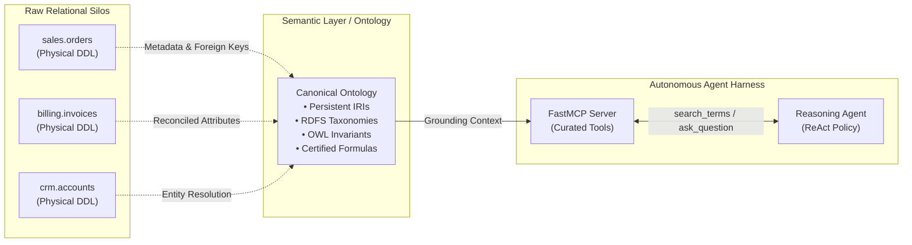
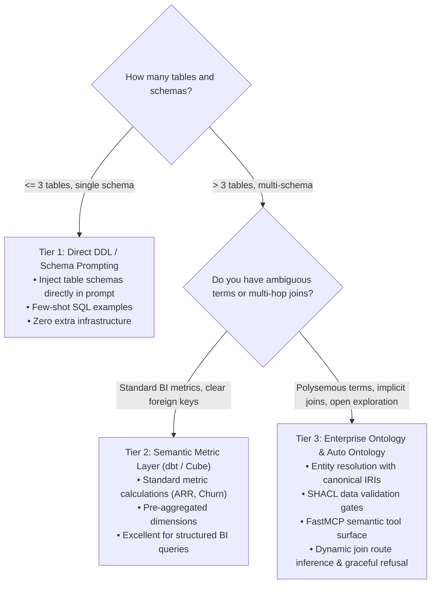
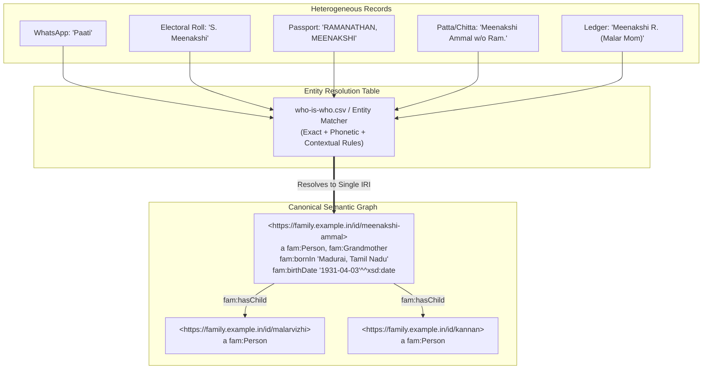
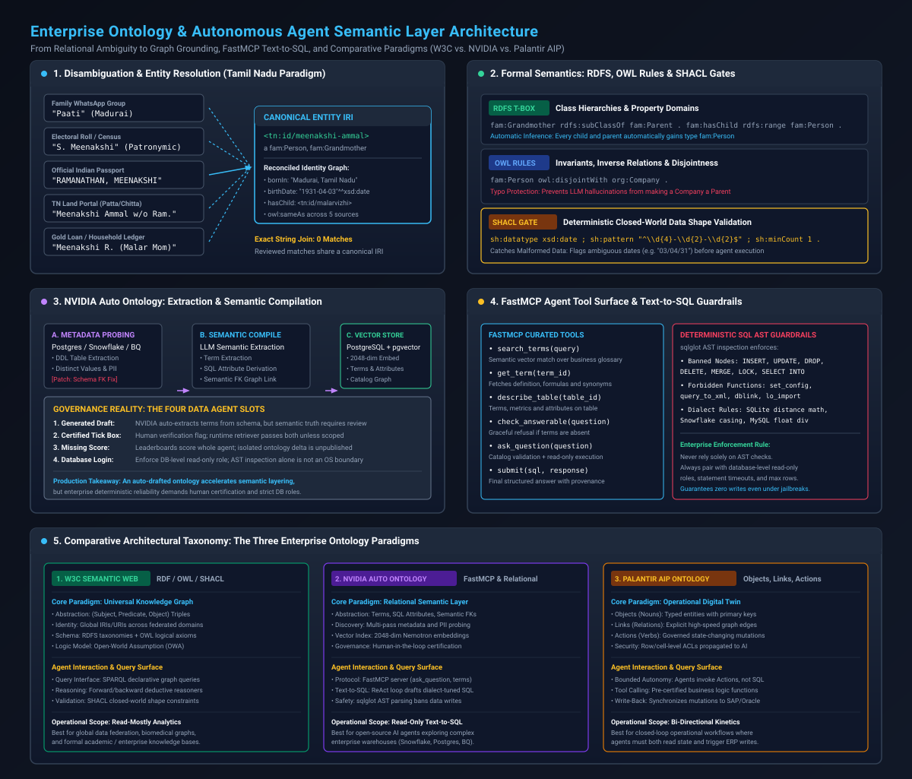
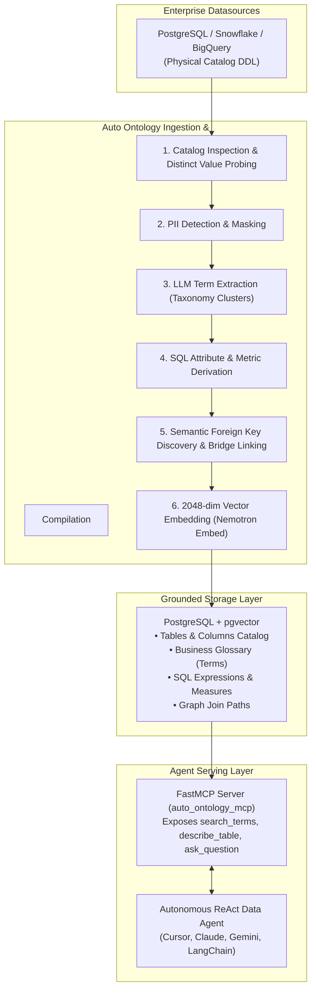
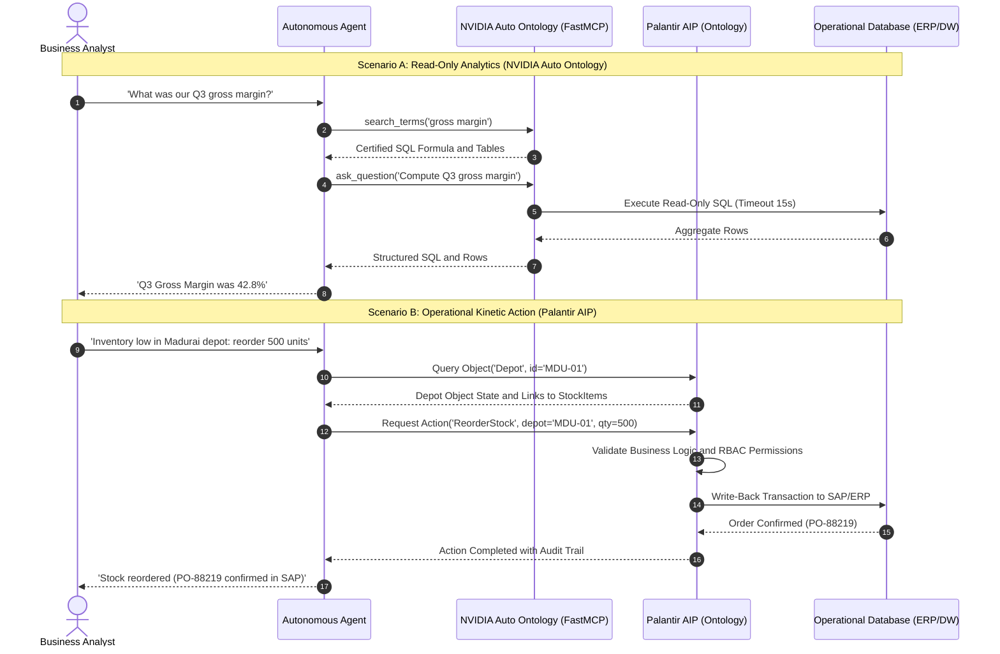
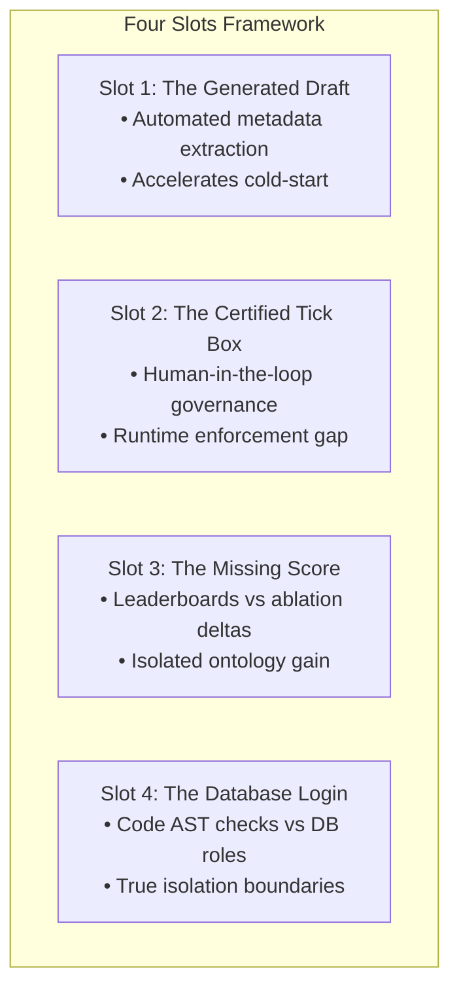

# Enterprise Ontology for AI Agents: Foundations, Graph Grounding, and NVIDIA Auto Ontology Deep Dive

Daily learning · Nov 20, 2026
*By Srinivasan Ragothaman ([@rsrini7](https://github.com/rsrini7))*

> An AI agent answering business questions needs more than table names: it needs to know what the data means, how records relate, and which definitions to use. An enterprise ontology can provide that shared context; validation, human review, and database permissions are still needed to make answers trustworthy.

---

## 1. Foundations: Semantic Gap in Autonomous Data Agents

A text-to-SQL agent turns a question into a database query. Suppose a finance team asks, “What was our revenue last month?” A database may contain orders, invoices, and payments, but the question does not say which of these represents revenue or how to handle refunds. A correct-looking SQL query can therefore return the wrong business answer.

An **ontology** describes the concepts and relationships in a domain. A **semantic layer** connects those meanings and approved metric definitions to the underlying data. Together, they can give an agent context for selecting tables and joins. They do not guarantee a correct answer: definitions, mappings, permissions, and generated queries still need review and testing.

For example, `rev_amt_lcy` could mean an amount in local currency, but the column name alone does not tell us whether it represents booked or recognized revenue. A customer may also appear in several migration tables, and an inappropriate join can multiply rows. A documented definition and a verified join path help the agent avoid guessing.



### 1.1 Architectural Decision Framework: Direct DDL vs. Metric Layers vs. Ontologies

Architects designing enterprise data platforms often face the question: *When is direct schema prompting enough, when is a semantic metric layer (e.g., dbt Semantic Layer, Cube) sufficient, and when is a full enterprise ontology required?*



The table below outlines the core operational trade-offs across these three tiers:

| Architecture Tier | Best Suited For | Key Strengths | Practical Limits & Failure Modes |
| :--- | :--- | :--- | :--- |
| **Tier 1: Direct DDL / Prompting** | 1–3 tables, well-modeled single-schema operational databases, predictable analytical queries. | Zero infrastructure overhead; low latency; direct SQL visibility. | Rapid prompt bloat; breaks on complex joins; cannot distinguish duplicate metric definitions (e.g. gross vs net revenue). |
| **Tier 2: Semantic Metric Layer** (dbt Semantic Layer, Cube) | Standardized BI metrics (ARR, MRR, retention) calculated across known dimensional star/snowflake schemas. | Centralized business definitions; eliminates duplicate metric code across BI dashboards. | Inflexible for open-ended multi-hop traversal; assumes pre-engineered data warehouse models; lacks entity-resolution graphs. |
| **Tier 3: Enterprise Ontology & Auto Ontology** | Disparate multi-schema databases, implicit foreign keys, cross-departmental polysemy, exploratory autonomous agents. | Canonical IRI grounding; automated join discovery; FastMCP tool sandboxing; graceful refusal for missing concepts. | Higher cold-start curation overhead; requires metadata compilation and vector storage (`pgvector`). |

### Essential Terminology & Architectural Stack

The following table defines the foundational concepts across semantic engineering and agentic retrieval:

| Term / Specification | Primary Function | Role in Autonomous Agent Workflows |
| :--- | :--- | :--- |
| **IRI (Internationalized Resource Identifier)** | Identifier for a resource | Gives a resource a stable identity when records have been correctly mapped to it. |
| **RDF (Resource Description Framework)** | W3C standard data model based on Subject-Predicate-Object triples | Provides a unified, directed graph structure that merges heterogeneous relational tables without schema lock-in. |
| **Turtle (`.ttl`)** | Compact, human-readable serialization format for RDF triples | Enables version-controlled, git-diffable semantic schemas and ontology CI/CD pipelines. |
| **RDFS (RDF Schema)** | Vocabulary description language for RDF resources | Establishes class taxonomies (`rdfs:subClassOf`) and defines property domains/ranges for automatic typing. |
| **OWL (Web Ontology Language)** | Language for logical axioms about classes and properties | Supports inference and consistency checking; a reasoner does not automatically reject invalid input. |
| **SHACL (Shapes Constraint Language)** | W3C standard for validating RDF graphs | Reports violations of explicit datatype, pattern, and cardinality rules; the application decides whether to block data. |
| **SPARQL / Cypher** | Declarative query languages for graph databases (RDF vs Property Graphs) | Retrieves multi-hop contextual subgraphs and traversals that relational SQL cannot express concisely. |
| **Semantic Layer** | Governed business definitions mapped to underlying data | Documents shared measures, such as gross profit = revenue − cost of goods sold; gross margin is typically gross profit divided by revenue. |
| **NVIDIA Auto Ontology** | Open-source Apache 2.0 framework for automated metadata-to-ontology generation | Probes physical databases, extracts terms and SQL attributes via LLMs, detects semantic foreign keys, and indexes them in `pgvector`. |
| **FastMCP** | Model Context Protocol server exposing curated semantic tools | Provides clean, typed tool interfaces (`search_terms`, `get_term`, `describe_table`, `check_answerable`, `ask_question`) to agents. |

---

## 2. Deep Technical Mechanism

### 2.1 Entity Resolution & Disambiguation: The Tamil Nadu Naming Challenge

The root failure of data agents querying relational silos is **lexical divergence**—the belief that real-world entities can be joined by string equality. To understand why lexical string joins fail catastrophically in production, consider the naming conventions of **Tamil Nadu, India**. 

In Tamil naming customs, family records, state registry portals, voter lists, and banking ledgers rarely adhere to Western "First Name, Last Name" conventions. Instead, individuals are identified through patronymics (where the father's given name serves as a prefixed initial), village origins, marital status, or familial honorifics.

Consider a fictional matriarch, **Meenakshi Ammal**, born in Madurai on April 3, 1931:
- Her father was **Sundaram**.
- Her husband was **Ramanathan**.
- Her eldest daughter is **Malarvizhi**, and her son is **Kannan**.

When querying across five typical organizational records, her identity appears in five distinct, lexically incompatible formats:

1. **Family Group Chat (WhatsApp):** Saved colloquially as `"Paati"` (Grandmother in Tamil) or `"Madurai Paati"`.
2. **Electoral Roll / 1951 Census Archive:** Recorded under patronymic initial as `"S. Meenakshi"` (Sundaram Meenakshi).
3. **Official Indian Passport:** Recorded under Westernized machine-readable fields as `Surname: "RAMANATHAN"`, `Given Name: "MEENAKSHI"`.
4. **Tamil Nadu Land Records Portal (e-Services Patta/Chitta):** Recorded with marital honorifics as `"மீனாட்சி அம்மாள் (க/பெ ராமநாதன்)"` (*Meenakshi Ammal, W/o Ramanathan*).
5. **Gold Loan Ledger / Household Budget Sheet:** Recorded as `"Meenakshi R."` or `"Malar's Mom"`.

```
+---------------------------------------------------------------------------------------------------+
| NAIVE STRING JOIN ATTEMPT:                                                                        |
| "Paati" != "S. Meenakshi" != "RAMANATHAN, MEENAKSHI" != "Meenakshi Ammal" != "Meenakshi R."       |
| Total Matches: 0 links. The agent concludes there are 5 unrelated people.                         |
+---------------------------------------------------------------------------------------------------+
```

A separate entity-resolution process can map records to a **canonical IRI** after assessing evidence. The IRI records the decision; it does not prove that the records belong to the same person. “Paati” alone is ambiguous, so uncertain matches should be reviewed and provenance retained:

```
+---------------------------------------------------------------------------------------------------+
| ONTOLOGICAL ENTITY RESOLUTION:                                                                    |
| Each disparate string maps to a single canonical resource identifier:                             |
| IRI: <https://family.example.in/id/meenakshi-ammal>                                               |
| Result: The five illustrative records share an IRI after a verified mapping.                   |
+---------------------------------------------------------------------------------------------------+
```



#### Dravidian Phonetics & Patronymic Expansion in Indic Record Linkage

In production enterprise databases operating in South Asia, record linkage engines cannot rely on Western fuzzy string matching algorithms like standard Soundex or Metaphone:

1. **Patronymic Initial Inversion:** In Tamil Nadu, a record for `"S. Meenakshi"` places the father's name (`Sundaram`) as a single prefix initial. In database A, the name might be split into `initial = 'S'` and `first_name = 'Meenakshi'`; in database B, it appears as `given_name = 'Sundaram Meenakshi'`; in database C, following marriage, it appears as `surname = 'Ramanathan', given_name = 'Meenakshi'`. Naive Jaccard or Levenshtein distance scores between `"S. Meenakshi"` and `"Meenakshi Ramanathan"` fall below standard automated matching thresholds (~0.45 similarity).
2. **Failure of Western Soundex on Dravidian Phonology:** Standard American Soundex maps consonants into six coarse phonetic clusters designed for Anglo-Saxon surnames. It ignores vowel lengths that alter root meanings in Dravidian languages, drops critical retroflex consonants (`zh` [ழ], `l` [ல], `L` [ள], `r` [ர], `R` [ற]), and treats distinct dental and alveolar stops identically. High-precision Indic record linkage pipelines combine Indic-adapted Metaphone, transliteration normalizers (converting Tamil script into canonical Romanized ISO 15919), and contextual heuristics (e.g. spouse/father name pairing and municipal village codes).
3. **The Role of Canonical IRIs:** Once a verified match is established, the graph maps every disparate record to a single canonical IRI (`tn:id/meenakshi-ammal`). Downstream autonomous agents never execute runtime fuzzy string joins; they query the graph deterministically using the canonical IRI.

### 2.2 Triples, RDF Graph Construction & Turtle Syntax

In RDF, all enterprise facts are expressed as atomic statements consisting of three components: **Subject**, **Predicate**, and **Object**. 
- The **Subject** is an IRI identifying the entity.
- The **Predicate** is an IRI identifying the property or relationship.
- The **Object** is either another IRI (a relationship edge) or a typed Literal (an attribute value).

Serializing these relationships in W3C Turtle (`.ttl`) produces clean, deterministic representations:

```turtle
@prefix tn:  <https://family.example.in/id/> .
@prefix fam: <https://family.example.in/ontology/> .
@prefix xsd: <http://www.w3.org/2001/XMLSchema#> .

# Canonical entity declaration
tn:meenakshi-ammal
    a fam:Person , fam:Grandmother ;
    fam:legalName "Meenakshi Ramanathan" ;
    fam:birthName "Sundaram Meenakshi" ;
    fam:bornIn "Madurai, Tamil Nadu" ;
    fam:birthDate "1931-04-03"^^xsd:date ;
    fam:hasChild tn:malarvizhi , tn:kannan .

tn:malarvizhi
    a fam:Person ;
    fam:legalName "Malarvizhi Ramanathan" ;
    fam:bornIn "Madurai, Tamil Nadu" ;
    fam:hasChild tn:anandhi .

tn:anandhi
    a fam:Person ;
    fam:legalName "Anandhi Senthil" ;
    fam:bornIn "Chennai, Tamil Nadu" .
```

### 2.3 RDFS Taxonomies vs. OWL Invariants and the Open-World Trap

Building a class taxonomy in **RDFS** introduces deductive inheritance:
- `fam:Grandmother rdfs:subClassOf fam:Parent .`
- `fam:Parent rdfs:subClassOf fam:Person .`
- `fam:hasChild rdfs:domain fam:Person ; rdfs:range fam:Person .`

Under RDFS reasoning, if an agent encounters `tn:meenakshi-ammal fam:hasChild tn:malarvizhi`, it automatically infers that `tn:meenakshi-ammal` is a `fam:Person` and `tn:malarvizhi` is a `fam:Person`, even if no record explicitly asserted those classes.

#### The Open-World Assumption (OWA) Trap
The Semantic Web was designed around the Open-World Assumption: the absence of a statement does not imply it is false; it merely implies it is not yet known. In enterprise analytics, this creates dangerous failure modes when LLMs ingest corrupt data. 

For example, suppose a data pipeline mistakenly types a vendor company into a personal relationship column:
```turtle
org:tcs-consulting fam:hasChild tn:malarvizhi .
```
Under pure RDFS, because `fam:hasChild` has an `rdfs:domain` of `fam:Person`, the reasoner will silently infer:
```turtle
org:tcs-consulting a fam:Person .
```
The system will accept that Tata Consultancy Services is a human mother without throwing any error!

#### The OWL Fix: Explicit Invariants and Disjointness
**OWL (Web Ontology Language)** can describe logical relationships and detect inconsistencies when used with a suitable reasoner:
- **Disjoint Classes:** `fam:Person owl:disjointWith org:Organization .`
- **Inverse Properties:** `fam:hasParent owl:inverseOf fam:hasChild .`
- **Transitive Properties:** `fam:ancestorOf a owl:TransitiveProperty .`

If the same resource is also explicitly or inferentially an `org:Organization`, those disjointness axioms make the ontology inconsistent. A suitable OWL reasoner can report the inconsistency; it does not automatically stop ingestion or repair the data. The application must decide how to handle the result. Without the organization type assertion, the `hasChild` statement alone does not produce this contradiction.

### 2.4 Deductive Reasoners vs. SHACL Constraint Gates

While OWL handles logical satisfiability under open-world semantics, enterprise data pipelines require deterministic, **closed-world validation**. Inconsistent dates make analytics unreliable when values are formatted as `"03/04/31"`, `"April 3, 1931"`, or `"1931-04-03"`.

**SHACL (Shapes Constraint Language)** operates as a deterministic quality gate before data enters the graph:

```turtle
@prefix sh:  <http://www.w3.org/ns/shacl#> .
@prefix fam: <https://family.example.in/ontology/> .
@prefix xsd: <http://www.w3.org/2001/XMLSchema#> .

fam:PersonShape
    a sh:NodeShape ;
    sh:targetClass fam:Person ;
    sh:property [
        sh:path fam:birthDate ;
        sh:datatype xsd:date ;
        sh:pattern "^\\d{4}-\\d{2}-\\d{2}$" ;
        sh:minCount 1 ;
        sh:maxCount 1 ;
        sh:message "Birthdate must be an explicit ISO-8601 string (YYYY-MM-DD)." ;
    ] ;
    sh:property [
        sh:path fam:legalName ;
        sh:datatype xsd:string ;
        sh:minCount 1 ;
        sh:message "Every person must have a validated legal name." ;
    ] .
```

A SHACL validator reports violations; the pipeline must explicitly reject or quarantine nonconforming data. If an unstructured document extraction produces `"03/04/31"` (an ambiguous format that could mean March 4, 1931, or April 3, 1931, or even 2031), the validator emits a report with `sh:Violation`; the caller can use that report to block ingestion.

### 2.5 Querying the Graph: SPARQL vs. Property Graphs

Once the graph is compiled and validated, an autonomous agent queries it using structured query languages:

```sparql
# SPARQL Query: Retrieve all grandchildren of Meenakshi Ammal
PREFIX fam: <https://family.example.in/ontology/>
PREFIX tn:  <https://family.example.in/id/>

SELECT ?grandchild ?grandchildName ?birthPlace
WHERE {
    tn:meenakshi-ammal fam:hasChild ?child .
    ?child fam:hasChild ?grandchild .
    ?grandchild fam:legalName ?grandchildName ;
                fam:bornIn ?birthPlace .
}
```

#### RDF vs. Labeled Property Graphs (LPG)
In enterprise architectures, teams often debate between W3C Semantic Web standards (RDF/SPARQL) and Labeled Property Graphs (Neo4j/Cypher):
- **RDF Triples:** Excel at universal identity, global federation (via IRIs), standard ontologies (OWL, SKOS), and standards-based reasoning. However, annotating an edge with metadata (e.g., marriage date or contract value) requires *reification* (creating an intermediate statement node).
- **Property Graphs (LPG):** Allow direct key-value properties on edges (`(p1)-[:MARRIED {since: 1954, place: "Madurai"}]->(p2)`). They excel at traversal performance and graph algorithms (PageRank, Betweenness Centrality, Louvain Community Detection).

Modern agent architectures increasingly leverage both: RDF/OWL for schema definition and metric governance, and property graphs or relational indexes for high-speed runtime execution.

---

## 3. Custom Architecture SVG

The following comprehensive architecture diagram illustrates the end-to-end topology: from heterogeneous relational silos and Tamil Nadu record disambiguation, through RDFS/OWL/SHACL validation, NVIDIA Auto Ontology extraction, and FastMCP execution, to a side-by-side comparative taxonomy of the **Three Enterprise Ontology Paradigms** (W3C Semantic Web vs. NVIDIA Auto Ontology vs. Palantir AIP).



*Figure 1: Complete Enterprise Ontology and Agent Execution Topology. Panel 1 depicts the Tamil Nadu naming disambiguation challenge resolving into a canonical IRI. Panel 2 illustrates the RDFS, OWL, and SHACL validation tiers. Panel 3 details the NVIDIA Auto Ontology compilation pipeline. Panel 4 outlines FastMCP tool exposure (`ask_question`, `search_terms`, `describe_table`) and deterministic SQL AST guardrails. Panel 5 provides a comparative architectural breakdown of the Three Enterprise Ontology Paradigms: W3C Semantic Web (RDF/OWL), NVIDIA Auto Ontology (FastMCP Text-to-SQL), and Palantir AIP (Kinetic Objects, Links, Actions).*

---

## 4. NVIDIA Auto Ontology Architecture & Engine Internals

Released under the Apache 2.0 license, **NVIDIA Auto Ontology** (`NVIDIA/auto-ontology`) automates the creation of semantic layers over complex enterprise databases (e.g., PostgreSQL, Snowflake, BigQuery). It aims to solve the core problem of Text-to-SQL: **giving the agent a governed map of the database so it knows what tables mean and how they join**.

### 4.1 System Components & Multi-Pass Semantic Compilation

NVIDIA Auto Ontology consists of a Python FastAPI backend (orchestrated via `uv`), a Next.js administrative frontend, a PostgreSQL database with `pgvector` for catalog metadata and semantic vector retrieval, and a FastMCP server.



The semantic compilation pipeline (`auto_ontology/semantic/pipeline.py`) processes databases through distinct passes:
1. **Catalog Metadata Probing:** Reads tables, column names, native foreign keys, and indexes from `information_schema`.
2. **Distinct Value Sampling & PII Protection:** Profiles column cardinality and masks sensitive customer data before LLM prompting.
3. **Term Extraction:** Clusters related tables and columns into human-meaningful business concepts (e.g., "Customer", "Invoice", "Stock Item").
4. **SQL Attribute Suggestion:** Automatically derives SQL formulas for business measures (e.g., `SUM(line_total - tax_amount)` for Net Revenue).
5. **Semantic FK Discovery:** Probes for implicit join paths across tables where foreign keys were never defined in the relational DDL.
6. **Vector Indexing:** Embeds all term descriptions and SQL attributes into `pgvector` using a 2048-dimensional embedding model (`nvidia/nemotron-3-embed-1b`).

### 4.2 FastMCP Curated Tool Surface

Exposing a database's entire OpenAPI catalog (often 80+ endpoints) degrades agent tool selection and invites LLMs to bypass business definitions. As defined in the [reviewed MCP tool definitions](https://github.com/NVIDIA/auto-ontology/blob/43fa2d3ac3cb00f79cce23b76d57a002b0cb0168/mcp/auto_ontology_mcp/tools.py), Auto Ontology restricts its published FastMCP interface to a curated surface centered on business meaning rather than physical storage:

| Tool Name | Endpoint / Mechanism | Primary Role in Autonomous Agent Workflows |
| :--- | :--- | :--- |
| **`search_terms`** | `GET /api/terms` | Vector and keyword search over the business glossary ("Customer", "Net Revenue", "Active Account") mapped to physical columns. |
| **`get_term`** | `GET /api/terms/{term_id}` | Retrieves a term's canonical definition, synonyms, owners, and certification status. |
| **`get_term_columns`** | `GET /api/terms/{term_id}/column-attributes` | Returns physical table columns mapped to a given business term. |
| **`get_term_sql_attributes`** | `GET /api/terms/{term_id}/sql-attributes` | Retrieves named SQL expressions, formulas, and metric derivations associated with a term. |
| **`get_sql_attribute`** | `GET /api/sql-attributes/{attr_id}` | Inspects a single SQL metric calculation and its underlying database columns. |
| **`describe_table`** | `GET /api/exploration/tables/{table_id}/details` | Returns the business terms and metric calculations a physical table participates in (avoids dumping raw column lists). |
| **`check_answerable`** | `POST /api/question-entity-coverage` | Evaluates whether the question's required business terms exist in the ontology (facilitating graceful escalation/refusal). |
| **`ask_question`** | `POST /api/chat/completions` (SSE) | The streaming Text-to-SQL entry point. Executes multi-step reasoning, returning progress events, final SQL, and truncated result rows. |
| **`check_readiness`** | Composite diagnostic endpoint | Folds catalog ingestion, semantic compilation, and database connectivity into a single system readiness verdict. |

> [!IMPORTANT]
> **External MCP Surface vs. Internal ReAct Loop:**
> External agents (such as Claude, Cursor, or LangChain agents calling through FastMCP) interact via `ask_question` and glossary search tools. Internally, Auto Ontology's ReAct execution engine (`auto_ontology/retrieval/text_to_sql/react/`) runs a private tool loop (`retrieve`, `run_sql`, `submit`) with catalog validation and AST parsing before returning the final answer to the external caller.
> 
> Furthermore, generated terms and SQL expressions are initially drafts. In regulated environments, treat certification as an explicit governance gate and verify whether your deployed retrieval pipeline filters for certified definitions.

### 4.3 Comparative Paradigm: Palantir AIP Ontology (Objects, Links, Actions) vs. NVIDIA Auto Ontology vs. W3C RDF

In enterprise software, **Palantir Foundry** and **Palantir AIP (Artificial Intelligence Platform)** represent the most widely deployed operational ontology architecture in commercial production. Understanding how Palantir's model relates to W3C Semantic Web standards and NVIDIA Auto Ontology clarifies critical architectural trade-offs:

#### The Three Primitives of Palantir's Ontology
Unlike academic knowledge graphs or read-only analytical layers, Palantir defines an ontology as an **operational digital twin** composed of three kinetic layers:
1. **Objects (The Nouns):** Concrete digital representations of enterprise entities (e.g. `Aircraft`, `CustomerOrder`, `HospitalBed`, `FactoryLine`). Each object has typed properties, a unique primary key, and bindings to underlying transactional databases or streaming pipelines.
2. **Links (The Relationships):** Directed relationships connecting objects (e.g. `Patient -[prescribed]-> Medication`, `Aircraft -[installedAt]-> Engine`). Links enable high-performance graph traversal across organizational silos without writing relational SQL joins.
3. **Actions (The Verbs & Kinetics):** The defining operational capability of Palantir's ontology. Actions are **governed state transitions** (e.g. `RerouteShipment`, `DischargePatient`, `ApproveGoldLoan`). Actions encapsulate business validation rules, role-based access control (RBAC), and transactional **write-back** mechanisms that update underlying systems of record (such as SAP, Salesforce, or Oracle ERP) while logging immutable audit trails.

#### Read-Only Text-to-SQL vs. Governed Action Execution
The fundamental difference between **NVIDIA Auto Ontology** and **Palantir AIP** lies in the operational loop:

- **NVIDIA Auto Ontology (Read & Analytic Focus):** The agent explores metadata, identifies business glossary terms, and generates read-only SQL queries to answer analytical questions. It guards against accidental writes via AST parsing and read-only roles, but does not provide state-modifying operational write-backs.
- **Palantir AIP (Kinetic Action Focus):** Autonomous agents do not generate arbitrary SQL. Instead, the agent inspects the ontology's Object graph and executes pre-certified **Action Types**. The agent operates with "bounded autonomy"—it cannot invent new database mutations, but can only invoke authorized Actions whose parameter constraints and authorization rules are validated before hitting production ERPs.



#### Enterprise Ontology Comparison Matrix

| Architectural Dimension | W3C Semantic Web (RDF / OWL) | NVIDIA Auto Ontology | Palantir Ontology (Foundry / AIP) | Semantic Metric Layer (dbt / Cube) |
| :--- | :--- | :--- | :--- | :--- |
| **Primary Purpose** | Global data federation, universal knowledge graphs, description logic inference. | Automated metadata bootstrapping, Text-to-SQL grounding for AI agents. | Operational digital twin; human-in-the-loop workflows and agentic tool execution. | Centralized business metric calculations for BI and dashboarding. |
| **Core Abstraction** | Subject-Predicate-Object Triples; IRIs; Classes; Properties. | Terms; SQL Attributes; Semantic FKs; pgvector embeddings. | **Objects** (Nouns), **Links** (Relationships), **Actions** (Verbs). | Measures; Dimensions; Joins; Pre-aggregations. |
| **Read vs. Write** | Read-mostly (SPARQL CONSTRUCT / SPARQL Update). | Strictly read-only analytics via FastMCP and SQL AST guardrails. | **Bi-directional:** Reads object states and **writes back** to source ERPs via Actions. | Read-only analytics; generates SQL for data warehouses. |
| **Reasoning Model** | Open-World Assumption (OWA); OWL-RL / Description Logics. | LLM-driven semantic routing + ReAct database reflection. | Closed-world operational logic; deterministic validation functions. | Deterministic SQL compilation; DAG-based query planning. |
| **Agent Interface** | SPARQL endpoints; RDFLib graph agents. | FastMCP Server (`ask_question`, `search_terms`, `describe_table`). | AIP Tooling; typed Object SDKs; Action Type invocation. | SQL API; REST API; GraphQL semantic query endpoints. |
| **Licensing & Portability** | Open W3C standards; open-source triplestores (Jena, Virtuoso). | Open-source (Apache 2.0); portable via Apache Ossie. | Proprietary enterprise platform (Palantir Foundry / AIP). | Open-core / proprietary cloud (dbt Core / Cube Core). |

---

## 5. Troubleshooting Notes for NVIDIA Auto Ontology

> [!NOTE]
> **Diagnostic Context & Version Scope:**
> The first two scenarios below reflect troubleshooting workarounds observed when connecting specific hosted inference endpoints (`build.nvidia.com`) during early preview builds. Capture your exact revision, model, endpoint, request, and error before diagnosing them; check provider documentation before changing models or clients. The third note explains the evolution of cross-schema foreign key discovery in the PostgreSQL connector.

### Patch 1: Embedding Model Failure Under Batching (HTTP 500)
- **Symptom:** Ingestion fails with HTTP 500 (`"service inference failed"`) when embedding table batches against `nvidia/nemotron-3.5-embed-1b`.
- **Root Cause:** The hosted endpoint exhibits regression crashes on multi-record batch embeddings for the 3.5 variant.
- **Fix:** Switch `.env` to the stable 2048-dimension predecessor model:
  ```bash
  EMBED_MODEL=nvidia/nemotron-3-embed-1b
  ```

### Patch 2: Hosted Guided JSON Schema Rejection (HTTP 400)
- **Symptom:** Semantic compilation halts with HTTP 400 (`"unknown field guided_json"`).
- **Root Cause:** Auto Ontology passes structured JSON requests via the proprietary `nvext.guided_json` parameter, which current hosted gateway proxies reject. Additionally, reasoning models (such as Nemotron Reasoning or Claude) burn their entire token budget generating internal chain-of-thought tokens without outputting JSON.
- **Fix:** Update `auto_ontology/utils/llm_invoke.py` to route requests through standard LangChain `ChatOpenAI`, utilizing standard `response_format` JSON schemas, capping reasoning tokens at 50% of `max_tokens`, and omitting `temperature` for reasoning models.

```python
# File: auto_ontology/utils/llm_invoke.py
def _build_client(model: str, api_key: str, base_url: str, temperature: float, max_tokens: int):
    is_openai_family = model.startswith(("openai/", "azure/", "aws/"))
    if os.environ.get("LLM_CLIENT", "").lower() == "openai" or is_openai_family:
        from langchain_openai import ChatOpenAI

        extra: dict = {}
        bare = model.lower().rsplit("/", 1)[-1]
        rejects_temperature = "claude" in model.lower() or bare.startswith(("gpt-5", "o1", "o3", "o4"))
        
        if not is_openai_family and not rejects_temperature:
            extra["temperature"] = temperature
        
        if "nvidia.com" in base_url:
            # Cap reasoning tokens so thinking doesn't exhaust the response budget
            extra["extra_body"] = {
                "nvext": {"max_thinking_tokens": max(256, max_tokens // 2)}
            }
        
        return ChatOpenAI(model=model, api_key=api_key, base_url=base_url, max_tokens=max_tokens, **extra)
```

### Patch 3: Cross-Schema Foreign Key Discovery

An older metadata query could miss cross-schema foreign keys if it matched the referenced table's schema to the source table's schema:

```sql
-- Legacy information_schema approach (subject to Issue #463):
JOIN information_schema.constraint_column_usage ccu
  ON tc.constraint_name = ccu.constraint_name
 AND tc.table_schema    = ccu.table_schema -- FAILS: ccu.table_schema is the REFERENCED table schema!
```

Because `ccu.table_schema` is the schema of the referenced target table, any cross-schema foreign key (for example, `sales.customers.deliverycityid` referencing `application.cities.cityid`) evaluated to `sales = application` (False) and was silently dropped. Matching only constraint names and schemas is also insufficient: PostgreSQL permits duplicate constraint names on different tables, and composite keys need columns paired by ordinal position.

The [reviewed connector](https://github.com/NVIDIA/auto-ontology/blob/43fa2d3ac3cb00f79cce23b76d57a002b0cb0168/auto_ontology/connectors/postgres.py) replaces `information_schema` with PostgreSQL's native catalog tables (`pg_constraint`, `conrelid`, `confrelid`), using a lateral unnest with ordinality (`CROSS JOIN LATERAL unnest(con.conkey, con.confkey) WITH ORDINALITY`) to identify the actual source/target tables and pair composite columns by position. Check the connector version in use before applying legacy patches; the connector's own test suite now validates cross-schema and composite foreign keys natively.

---

## 6. Concrete Production Code Implementations

### Recipe 1: Entity Resolution & RDF Construction with Tamil Nadu Naming Conventions

The following illustrative script uses a hand-reviewed mapping to create a canonical IRI and Turtle graph with Python’s `rdflib`. It does not discover identity from names: unknown records are rejected for review. Install the dependency with `python -m pip install rdflib`.

```python
#!/usr/bin/env python3
"""Tamil Nadu entity resolution and RDF Turtle graph generation."""

import csv
import io
from rdflib import Graph, Literal, Namespace, RDF, XSD

# Define Namespaces
TN = Namespace("https://family.example.in/id/")
FAM = Namespace("https://family.example.in/ontology/")

# Disparate multi-source inputs representing the same person
RAW_INPUTS = [
    {"source": "Family WhatsApp", "record_id": "W-101", "name_string": "Paati"},
    {"source": "1951 Census", "record_id": "C-442", "name_string": "S. Meenakshi"},
    {"source": "Indian Passport", "record_id": "P-902", "name_string": "RAMANATHAN, MEENAKSHI"},
    {"source": "TN Land Portal", "record_id": "L-081", "name_string": "Meenakshi Ammal w/o Ramanathan"},
    {"source": "Household Ledger", "record_id": "H-312", "name_string": "Meenakshi R."},
]

# Demonstration only: source record IDs were reviewed before this mapping was created.
REVIEWED_RECORDS = {(r["source"], r["record_id"]): "meenakshi-ammal" for r in RAW_INPUTS}

def resolve_entity(record: dict) -> str:
    """Look up a reviewed source record; never merge from a name alone."""
    key = (record["source"], record["record_id"])
    if key not in REVIEWED_RECORDS:
        raise ValueError(f"Unreviewed record: {key}")
    return REVIEWED_RECORDS[key]

def build_graph() -> Graph:
    g = Graph()
    g.bind("tn", TN)
    g.bind("fam", FAM)
    g.bind("xsd", XSD)

    for rec in RAW_INPUTS:
        canonical_id = resolve_entity(rec)
        subject_iri = TN[canonical_id]

        # Assert Canonical Identity and Class
        g.add((subject_iri, RDF.type, FAM.Person))
        g.add((subject_iri, RDF.type, FAM.Grandmother))
        g.add((subject_iri, FAM.bornIn, Literal("Madurai, Tamil Nadu", datatype=XSD.string)))
        g.add((subject_iri, FAM.birthDate, Literal("1931-04-03", datatype=XSD.date)))
        
        # Link Raw Provenance
        g.add((subject_iri, FAM.observedAlias, Literal(rec["name_string"])))

    # Add Family Edge
    g.add((TN["meenakshi-ammal"], FAM.hasChild, TN["malarvizhi"]))
    g.add((TN["malarvizhi"], RDF.type, FAM.Person))
    g.add((TN["malarvizhi"], FAM.legalName, Literal("Malarvizhi Ramanathan")))
    return g

if __name__ == "__main__":
    graph = build_graph()
    print(graph.serialize(format="turtle"))
```

### Recipe 2: SHACL Data Quality Gate

Install the dependencies with `python -m pip install rdflib pyshacl`. The example performs RDFS inference during validation; it does not demonstrate OWL reasoning. A validation report only blocks ingestion if the calling application enforces that decision.

```python
#!/usr/bin/env python3
"""Validate an RDF graph against a SHACL shape."""

from rdflib import Graph, Literal, Namespace, RDF, RDFS, XSD
from pyshacl import validate

FAM = Namespace("https://family.example.in/ontology/")
TN = Namespace("https://family.example.in/id/")

# 1. Create Data Graph with an invalid date string ("03/04/31")
data_graph = Graph()
data_graph.bind("fam", FAM)
data_graph.bind("tn", TN)

data_graph.add((TN["meenakshi-ammal"], RDF.type, FAM.Person))
# Incorrect date format injected by unvalidated scraping
data_graph.add((TN["meenakshi-ammal"], FAM.birthDate, Literal("03/04/31")))

# 2. Define SHACL Validation Shapes
shacl_graph = Graph()
shacl_ttl = r"""
@prefix sh:  <http://www.w3.org/ns/shacl#> .
@prefix fam: <https://family.example.in/ontology/> .
@prefix xsd: <http://www.w3.org/2001/XMLSchema#> .

fam:PersonShape
    a sh:NodeShape ;
    sh:targetClass fam:Person ;
    sh:property [
        sh:path fam:birthDate ;
        sh:datatype xsd:date ;
        sh:pattern "^\\d{4}-\\d{2}-\\d{2}$" ;
        sh:minCount 1 ;
        sh:message "Birthdate must strictly adhere to ISO-8601 (YYYY-MM-DD)." ;
    ] .
"""
shacl_graph.parse(data=shacl_ttl, format="turtle")

# 3. Execute Deterministic Gate
conforms, results_graph, results_text = validate(
    data_graph,
    shacl_graph=shacl_graph,
    inference='rdfs',
    abort_on_first=False
)

print(f"Validation Status: {'PASS' if conforms else 'FAIL'}")
if not conforms:
    print("Validation failed; the caller should reject or quarantine this data:\n", results_text)
```

### Recipe 3: PostgreSQL Cross-Schema and Composite Foreign Key Inspection

To verify whether your relational database catalog exposes cross-schema or composite foreign keys before launching semantic compilation, execute the following diagnostic query derived from the reviewed connector logic:

```sql
SELECT
    con.conname AS constraint_name,
    src_ns.nspname AS source_schema,
    src_tab.relname AS source_table,
    src_col.attname AS source_column,
    tgt_ns.nspname AS target_schema,
    tgt_tab.relname AS target_table,
    tgt_col.attname AS target_column,
    ord.att_position
FROM pg_constraint con
JOIN pg_class src_tab ON con.conrelid = src_tab.oid
JOIN pg_namespace src_ns ON src_tab.relnamespace = src_ns.oid
JOIN pg_class tgt_tab ON con.confrelid = tgt_tab.oid
JOIN pg_namespace tgt_ns ON tgt_tab.relnamespace = tgt_ns.oid
CROSS JOIN LATERAL unnest(con.conkey, con.confkey) WITH ORDINALITY AS ord(src_attnum, tgt_attnum, att_position)
JOIN pg_attribute src_col ON src_col.attrelid = con.conrelid AND src_col.attnum = ord.src_attnum
JOIN pg_attribute tgt_col ON tgt_col.attrelid = con.confrelid AND tgt_col.attnum = ord.tgt_attnum
WHERE con.contype = 'f'
  AND src_ns.nspname NOT IN ('pg_catalog', 'information_schema')
ORDER BY source_schema, source_table, constraint_name, ord.att_position;
```

### Recipe 4: Consuming NVIDIA Auto Ontology FastMCP Tools from an Autonomous Python Agent

The following script demonstrates how an autonomous agent or client script interacts with NVIDIA Auto Ontology's FastMCP server over HTTP/SSE. It searches the business glossary for relevant terms, verifies answerability, and calls `ask_question` to retrieve streaming progress, final SQL, and result rows:

```python
#!/usr/bin/env python3
"""Client harness demonstrating FastMCP interaction with NVIDIA Auto Ontology."""

import asyncio
import json
from typing import Any
import httpx

APP_BASE_URL = "http://localhost:3000"

async def search_glossary(client: httpx.AsyncClient, query: str) -> list[dict[str, Any]]:
    """Search the compiled business terms using semantic vector similarity."""
    resp = await client.get(f"{APP_BASE_URL}/api/terms", params={"query": query})
    resp.raise_for_status()
    terms = resp.json().get("items", [])
    print(f"Glossary search for '{query}' returned {len(terms)} term(s):")
    for t in terms[:3]:
        print(f"  • [{t.get('name')}] (Certified: {t.get('name_certified')}): {t.get('description')[:80]}...")
    return terms

async def check_coverage(client: httpx.AsyncClient, question: str) -> bool:
    """Check whether the question's entities are covered by the ontology."""
    resp = await client.post(
        f"{APP_BASE_URL}/api/question-entity-coverage",
        json={"question": question}
    )
    resp.raise_for_status()
    coverage = resp.json()
    is_answerable = coverage.get("is_answerable", False)
    print(f"Coverage assessment for '{question}': {'Covered' if is_answerable else 'Uncovered / Refuse'}")
    return is_answerable

async def ask_ontology_agent(client: httpx.AsyncClient, question: str) -> None:
    """Stream execution steps and retrieve the final Text-to-SQL answer via SSE."""
    print(f"\nSubmitting question: \"{question}\"")
    async with client.stream(
        "POST",
        f"{APP_BASE_URL}/api/chat/completions",
        json={"question": question},
        timeout=60.0
    ) as response:
        response.raise_for_status()
        async for line in response.aiter_lines():
            if not line or not line.startswith("data:"):
                continue
            payload = line[5:].strip()
            if payload == "[DONE]":
                break
            try:
                event = json.loads(payload)
                if "step" in event:
                    print(f"  [Agent Step]: {event['step']}")
                elif "sql" in event:
                    print(f"\n[Generated Certified SQL]:\n{event['sql']}")
                elif "answer" in event:
                    print(f"\n[Answer]: {event['answer']}")
                    if "rows" in event and event["rows"]:
                        print(f"[Result Rows ({len(event['rows'])} sample)]: {event['rows'][:2]}")
            except json.JSONDecodeError:
                continue

async def main():
    async with httpx.AsyncClient() as client:
        # 1. Search glossary
        await search_glossary(client, query="customer delivery cities")
        
        # 2. Check coverage
        question = "What are the top 5 customer cities by total sales orders?"
        if await check_coverage(client, question):
            # 3. Stream query execution
            await ask_ontology_agent(client, question)

if __name__ == "__main__":
    asyncio.run(main())
```

---

## 7. Critical Evaluation: The Four Slots of Enterprise Data Agents

In evaluating autonomous analytics agents and frameworks like NVIDIA Auto Ontology against real-world production environments, an architect must examine **The Four Slots** required by any data agent:



### Slot 1: The Generated Draft (LLM Bootstrapping vs. Ground Truth)
- **Mechanism:** Auto Ontology scans relational tables, PII distributions, and column samples to draft business definitions automatically.
- **Engineering Reality:** Auto-generation eliminates the "blank canvas" paralysis of enterprise data cataloging. However, an LLM inspecting physical tables cannot guess non-obvious business logic (e.g., whether a customer is marked "churned" after 30 or 90 days of inactivity). The generated ontology is a **starting draft**, not verified ground truth.

### Slot 2: The Certified Tick Box (Governance vs. Runtime Retrieval Reality)
- **Mechanism:** Auto Ontology provides an administrative UI and database schema flags (`name_certified`, `description_certified`, `sql_attribute.certified`) allowing human stewards to approve definitions.
- **Engineering Reality:** Certification fields exist, but the exact filtering behavior depends on the deployed retrieval path and revision. Test it with one certified and one uncertified definition; enforce any certified-only policy at every relevant retrieval and execution boundary.

### Slot 3: The Missing Score (Leaderboards vs. Isolated Ablation Deltas)
- **Mechanism:** NVIDIA highlights top rankings (#1 on BEAVER, #2 on BIRD-Interact).
- **Engineering Reality:** While these rankings validate the end-to-end agentic harness, the industry lacks an **isolated ablation score** isolating the exact percentage gain contributed by Auto Ontology versus raw DDL with few-shot prompts. In practice, the primary ROI of an ontology is not necessarily a higher one-shot benchmark score on clean academic datasets, but reducing catastrophic hallucinations and join errors on messy, multi-schema enterprise databases, which must be measured in each deployment.

### Slot 4: The Database Login & Sandboxing (Code AST Checks vs. Database Boundaries)
- **Mechanism:** Auto Ontology's `run_sql.py` parses SQL statements via SQLGlot AST inspection to block data modification (`INSERT`, `UPDATE`, `DELETE`, `DROP`, `LOCK`, `SELECT INTO`) and dangerous server functions (`dblink`, `set_config`, `query_to_xml`).
- **Engineering Reality:** **Code-level AST checks are never an operating system or security boundary.** A subtle SQL dialect parsing quirk or zero-day vulnerability could bypass AST string inspection. Production agents must connect using **strictly read-only database roles** at the PostgreSQL / Snowflake connection level, with enforced per-query execution timeouts and row limits:

```sql
-- Production Security Standard: Database-Level Enforced Read-Only Role
CREATE ROLE agent_readonly WITH LOGIN; -- Provision credentials separately through a secret manager.
GRANT CONNECT ON DATABASE wideworldimporters TO agent_readonly;
GRANT USAGE ON SCHEMA sales, warehouse, application TO agent_readonly;
GRANT SELECT ON ALL TABLES IN SCHEMA sales, warehouse, application TO agent_readonly;
ALTER ROLE agent_readonly SET statement_timeout = '15s';
ALTER ROLE agent_readonly SET default_transaction_read_only = on;
```

---

## 8. Common Claims vs. Technical Realities

| Common Marketing Claim | Technical & Architectural Reality |
| :--- | :--- |
| *"AI agents can query your database using only raw DDL schemas."* | Raw schemas lack business context, cross-table join logic, and metric definitions. Without an ontology, agents fail on subtle calculations (e.g., net revenue after discounts). |
| *"Vector search (RAG) over text documentation solves data analytics."* | Plain chunk-based RAG retrieves disjointed text snippets. It cannot navigate multi-hop foreign key relationships or enforce strict mathematical invariants. |
| *"Auto-generated ontologies eliminate human data stewards."* | Automatic compilation produces drafts. Business definitions, financial metrics, and legal constraints require explicit human certification. |
| *"AST parsers in Python guarantee 100% safe SQL execution."* | Application-level AST parsers can be bypassed by dialect edge cases. Security must be enforced at the database connection layer via read-only roles. |
| *"All LLMs perform identically when provided an ontology."* | Model performance varies by model, schema, task, and evaluation method. Measure join accuracy on representative questions before choosing a model. |

### 8.1 Empirical Observations Across 11 LLMs & Reasoning Token Traps

When benchmarking NVIDIA Auto Ontology across 11 diverse language models (ranging from lightweight local 8B models to frontier reasoning models), distinct architectural behaviors emerge:

```mermaid
flowchart TD
    subgraph Model Tiers &amp; Join Capabilities
        M1["Small Local Models<br/>(Llama 3.1 8B, Qwen 7B)"]
        M2["Frontier Instruction Models<br/>(Claude 3.5 Sonnet, GPT-4o, Gemini 2.5 Flash)"]
        M3["Frontier Reasoning Models<br/>(Claude Opus 5.5, Gemini 2.5/3.8 Pro, GPT-5 / o-series)"]
    end

    M1 -->|Limitation| R1["Struggles with multi-table context.<br/>Frequently ignores retrieved join routes;<br/>falls back to single-table heuristics."]
    M2 -->|Capability| R2["Follows explicit join paths accurately.<br/>Can stumble on asymmetric joins or bridge tables<br/>unless SQL attributes are certified."]
    M3 -->|Capability| R3["Reliably navigates 4+ hop join graphs.<br/>Self-corrects query errors via ReAct feedback.<br/>Subject to thinking token exhaustion."]
```

#### The Reasoning Token Budget Trap (`LengthFinishReasonError`)
Modern reasoning models generate extensive internal chains of thought prior to emitting their final tool call or SQL response. When calling reasoning models through standard completion gateways without parameter tuning, developers frequently encounter `LengthFinishReasonError` (finish reason `length` with empty content):
- **Mechanism:** The model consumes its entire `max_tokens` allocation (e.g. 4096 tokens) purely on hidden thinking tokens, leaving 0 tokens for the closing JSON object.
- **Remedy:** When configuring reasoning models, explicitly allocate at least half the token budget to reasoning via provider-specific parameters (e.g. `nvext.max_thinking_tokens` on NVIDIA NIM, or `budget_tokens` on Anthropic), and ensure `max_tokens` is scaled to >= 8192 tokens for complex schemas.

#### The Temperature Rejection Trap
Reasoning models (such as OpenAI o-series, GPT-5, and Claude reasoning variants) enforce deterministic decoding policies and throw strict HTTP 400 validation errors if an explicit `temperature` parameter (e.g., `temperature=0.0` or `0.7`) is passed in the request body. Ensure your model gateway adapter dynamically suppresses the `temperature` parameter when a reasoning model identifier is detected.

---

## 9. Practical Adoption Blueprint & Verification Checklist

To adopt an ontology-grounded agent architecture in an enterprise environment, follow this operational blueprint:

### Phase 1: Environment Setup & Fix Application
```bash
# 1. Update package manager and clone repository
uv self update
git clone https://github.com/NVIDIA/auto-ontology.git && cd auto-ontology
cp .env.example .env

# 2. Configure environment credentials
# Set AUTH_SECRET, POSTGRES_PASSWORD, and DEFAULT_MODELS_API_KEY
# Follow the current project and model-provider configuration
# Choose an embedding model compatible with the configured vector dimensions

# 3. Check the connector version and test foreign-key discovery

# 4. Start PostgreSQL and Seed Evaluation Data
docker compose up -d --wait postgres
git clone https://github.com/NVIDIA/auto-ontology-eval.git ../auto-ontology-eval
(cd ../auto-ontology-eval && uv sync && cp .env.example .env && \
  POSTGRES_PASSWORD='<password>' \
  uv run python scripts/seed/seed_wwi.py --database-name wideworldimporters --drop)

# 5. Build and launch services
docker compose up -d --build
open http://localhost:3000
```

### Phase 2: Verification Checklist

- [ ] **Cross-schema and composite keys:** Compare connector output with known foreign keys in `pg_constraint`, including keys crossing schemas and keys with multiple columns. Counts depend on the dataset and permissions; validate column pairs as well as totals.
- [ ] **Refusal verification:** Ask an out-of-scope question. Inspect `check_answerable` coverage and verify that your application refuses or escalates when appropriate; coverage alone does not enforce refusal.
- [ ] **Database Privilege Verification:** Verify that the agent user cannot create tables or modify data, and test timeouts under the deployed role and connection configuration. PostgreSQL users can generally change `statement_timeout` for their own session, so a role default alone is not a hard limit.
- [ ] **SHACL ingestion gate:** If your architecture includes a SHACL validation stage, verify that the application rejects or quarantines invalid data. Do not assume Auto Ontology provides this gate by default.

---

## 10. Historical Timeline and Evolution

The transition from early semantic research to modern agentic semantic layers represents a 25-year evolution:

```
1999–2004: The W3C Semantic Web Initiative (RDF, RDFS, OWL specifications released).
2012–2015: Google Knowledge Graph & Enterprise Graph adoption (Wikidata, Schema.org).
2016–2020: Palantir Foundry pioneers the enterprise "Ontology" as an operational digital twin (Objects, Links, Actions).
2020–2023: The Semantic Metric Layer era (dbt Semantic Layer, Cube.js, Cube Cloud).
2023–2024: Palantir launches AIP (Artificial Intelligence Platform), binding LLM agents directly to ontology Action types; autonomous Text-to-SQL emerges.
2025–2026: The Convergence of Open Ontologies and AI Agents:
           • Databricks announces GA of Genie Ontology.
           • AWS releases Context Ontology Accelerator.
           • NVIDIA releases Auto Ontology (Apache 2.0) with FastMCP integration.
```

---

## 11. Primary Sources & References

1. [NVIDIA Auto Ontology Repository](https://github.com/NVIDIA/auto-ontology) — Official open-source Apache 2.0 framework for building AI-ready semantic layers and ontologies over enterprise databases.
2. [W3C RDF 1.1 Concepts and Abstract Syntax](https://www.w3.org/TR/rdf11-concepts/) — Foundational W3C recommendation defining the Resource Description Framework and triple data model.
3. [W3C OWL 2 Web Ontology Language Document Overview](https://www.w3.org/TR/owl2-overview/) — Specification governing Description Logic semantics, class disjointness, and computational inference.
4. [W3C Shapes Constraint Language (SHACL)](https://www.w3.org/TR/shacl/) — Formal standard for structural, closed-world graph validation and data quality gating.
5. [Model Context Protocol (MCP) Specification](https://modelcontextprotocol.io/) — Open standard for securely exposing data schemas, prompts, and execution tools to LLM agents.
6. [Palantir Technologies: The Palantir Ontology](https://www.palantir.com/platforms/foundry/ontology/) — Production architecture documentation defining the enterprise operational digital twin via Objects, Links, and Actions.
7. [Palantir Technologies: Artificial Intelligence Platform (AIP)](https://www.palantir.com/platforms/aip/) — Technical reference architecture for agentic automation with bounded autonomy, function calling, and operational write-back.
8. [Databricks: Announcing GA of Genie Ontology](https://www.databricks.com/blog/announcing-ga-genie-ontology) — Production implementation of semantic governance layers for enterprise BI agents.
9. [AWS Context Ontology Accelerator](https://github.com/aws/context-ontology-accelerator) — AWS open-source framework for semantic intelligence and agent grounding over enterprise data.
10. [BEAVER Leaderboard: Benchmark for Complex Reasoning over Databases](https://beaverbench.github.io/#leaderboard) — Academic evaluation benchmark measuring multi-table enterprise Text-to-SQL accuracy.
11. [BIRD-Interact Leaderboard](https://bird-interact.github.io/) — Benchmark evaluating interactive Text-to-SQL agents under dynamic database exploration.

### Source Context & Empirical Evidence

| Source / Artifact | Citation / Authority | Core Finding / Evidence |
| :--- | :--- | :--- |
| **NVIDIA Auto Ontology Codebase** | `NVIDIA/auto-ontology@v0.1` | Proves that automated term extraction must be coupled with human certification flags and AST-level query guards. |
| **PostgreSQL connector** | [Reviewed source](https://github.com/NVIDIA/auto-ontology/blob/43fa2d3ac3cb00f79cce23b76d57a002b0cb0168/auto_ontology/connectors/postgres.py) | Uses `pg_constraint` and positional pairing for cross-schema and composite foreign keys. |
| **Palantir AIP Architecture** | Palantir Technologies Whitepaper | Demonstrates that operational data agents require kinetic Action types with ERP write-back and granular ACLs, rather than unconstrained raw SQL generation. |
| **W3C SHACL Working Group** | W3C Recommendation | Demonstrates that closed-world data quality validation is essential to stop malformed dates and strings before agent consumption. |
| **BEAVER & BIRD Benchmarks** | Academic Leaderboards | Leaderboard results measure complete systems; they do not establish the isolated gain from an ontology without a controlled ablation. |

---

**Related:**
- [AI-Agent-Evaluation-Architectures-Multi-Tier-Graders-And-Harnesses-Nov-2026.md](AI-Agent-Evaluation-Architectures-Multi-Tier-Graders-And-Harnesses-Nov-2026.md) — Evaluation architectures, golden query datasets, and multi-tier harness testing for enterprise data agents.
- [Agent-Memory-Architectures-5-Layer-Harness-And-Judgment-Memory-Nov-2026.md](Agent-Memory-Architectures-5-Layer-Harness-And-Judgment-Memory-Nov-2026.md) — Multi-layer memory structures connecting long-term semantic knowledge graphs with episodic execution.
- [Agentic-Memory-Governance-Policy-Engines-And-Lifecycles-Nov-2026.md](Agentic-Memory-Governance-Policy-Engines-And-Lifecycles-Nov-2026.md) — Policy engines, data lineage, and lifecycle governance over shared agent memory and enterprise ontologies.
- [Reducing-Enterprise-RAG-Latency-2026.md](../../RAG/Reducing-Enterprise-RAG-Latency-2026.md) — Production strategies for indexing, caching, and serving low-latency context to retrieval-augmented agents.
