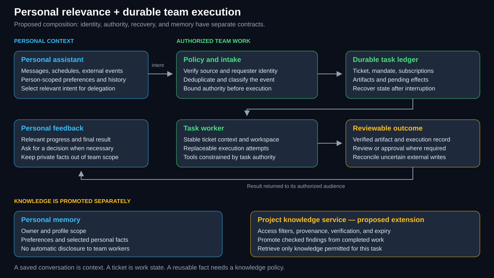
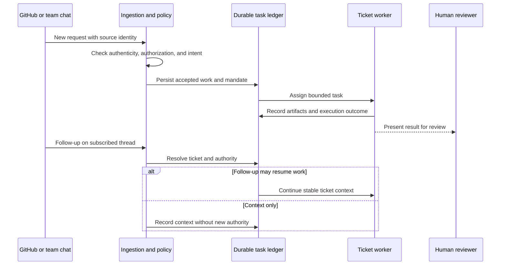
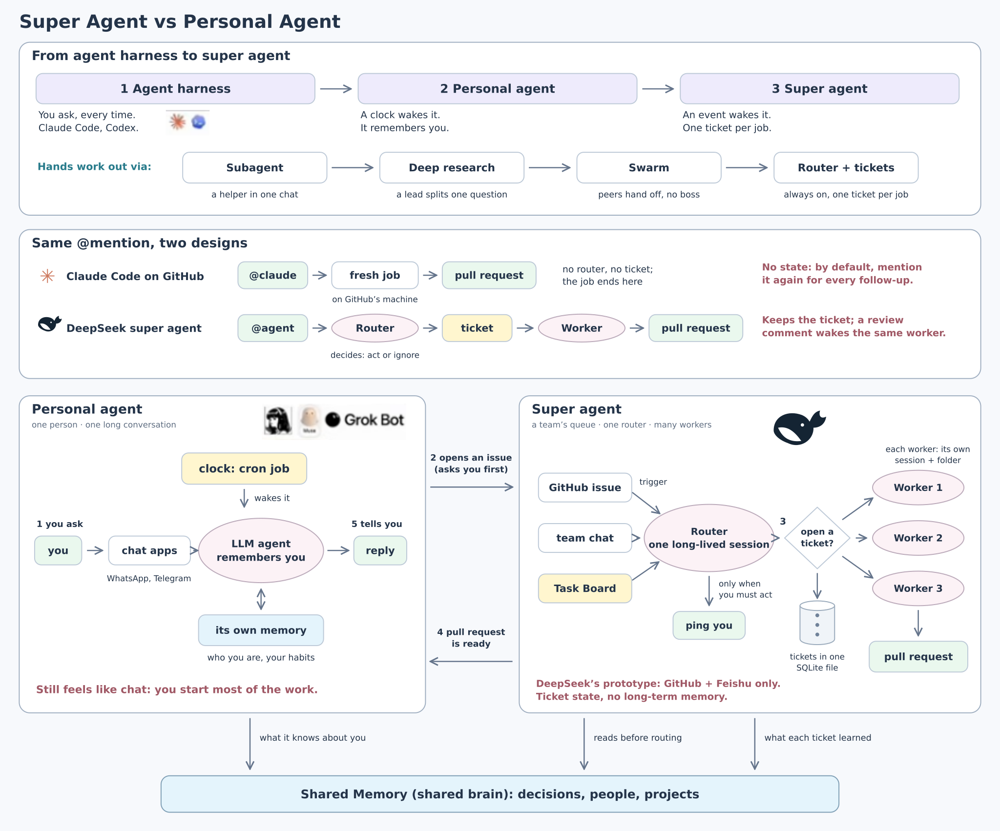

# Super Agent vs Personal Agent: Ownership, Durable Work, and Governed Memory

Daily learning · 16 November 2026

*By Srinivasan Ragothaman ([@rsrini7](https://github.com/rsrini7))*

> A personal agent organizes work around a person. A team agent organizes work around authorized tasks that can outlive a chat. The useful distinction is who owns the work, how it survives interruption, and which information each task may use.

## 1. Foundations: Three Layers That Can Work Together

Imagine asking an assistant to investigate a recurring build failure. Your personal assistant knows which project you mean and how you prefer updates. A repository service receives an authorized issue, tracks the investigation, runs a coding worker, and returns a pull request for review. The worker itself needs a harness: software that supplies tools, builds model context, executes calls, and manages the reasoning loop.

These are complementary responsibilities. The personal assistant resembles an executive assistant; the team service resembles an issue tracker connected to a job scheduler; the harness supplies the worker's execution machinery.

| Term | Meaning in this article | What it does not establish by itself |
|---|---|---|
| Harness | Runtime around an LLM: context assembly, tools, permissions, and execution loop | A durable team task service |
| Personal agent | Assistant whose primary context and preferences belong to a person | A single endless conversation or a clock-only trigger |
| Super agent | Informal label for a continuously available service that evaluates events and coordinates work | A standardized product category or a more capable model |
| Trigger | An incoming message, webhook, timer occurrence, or other signal | Permission to perform everything described in its text |
| Ticket | Durable identity and lifecycle for a unit of work | The complete conversation or a permanent OS process |
| Assignment | An execution attempt binding work to a worker | The lifetime of the ticket |
| Mandate | An explicit authorization record describing permitted work | A general instruction to obey future messages |
| Semantic memory | Selected knowledge retrieved across tasks or sessions | Every log line and every historical model response |

DeepSeek's **dsh-superagent-prototype** makes the team-service idea concrete: a proactive coding agent for **one GitHub repository**, with optional Feishu integration. Feishu is a workplace messaging and collaboration platform. GitHub supplies issues, pull requests, and review events; Feishu supplies another communication channel. The README explicitly distinguishes this research prototype from a future production-ready Super-agent. Its current scope is useful context for teams considering adoption, rather than evidence of broad production deployment. [1]

**Hermes Agent**, from Nous Research, provides a useful personal-agent comparison. Its documented features include messaging gateways, scheduled automations, persistent memory, and session search. Its scheduler can also fire jobs from external events. **Claude Code Action**, from Anthropic, integrates a coding harness with GitHub issues and pull requests, including mention-triggered and automated workflows. Those capabilities already cross the simplistic boundaries of “manual harness,” “scheduled personal agent,” and “event-driven super agent.” [2][3][4]

## 2. Compare Ownership and Continuity Before Trigger Type

The following comparison describes architectural emphasis, not mutually exclusive product capabilities.

| Dimension | Personal assistant emphasis | Durable team-service emphasis |
|---|---|---|
| Primary owner | A person and their preferences | A repository, team, or business process |
| Unit of continuity | User profile, conversation, recurring routine | Ticket, mandate, artifacts, and execution history |
| Incoming signals | Messages, schedules, external events | Issues, reviews, messages, schedules, external events |
| Context boundaries | Personal profiles and selected projects | Repository, task, tenant, requester, and authorization scope |
| Completion | Useful answer, reminder, or delegated request | Verified artifact, recorded outcome, or explicit escalation |
| Failure recovery | Reconnect and reconstruct relevant personal context | Reconcile pending events, resume or replace attempts, preserve work identity |
| Human attention | Relevant personal updates | Reviewable results and decisions that require intervention |

A clock produces an event. A webhook produces an event. Both can start the same durable workflow. Conversely, a service can listen continuously while still losing every task when its process restarts. **Availability, event ingestion, memory, and durable execution are separate properties.**

Likewise, subagents, lead-and-researcher teams, peer handoffs, and router/worker services describe different delegation arrangements. They are not a mandatory evolutionary ladder. A personal agent can delegate research; a ticket worker can run subagents; a router can use deterministic rules for known subscriptions and a model for ambiguous requests. Use the topology that matches the task's dependency structure and operating cost.



*Figure 1: A proposed composition. Personal context stays scoped to its owner; authorized team work moves through a durable ledger; reusable knowledge is promoted separately. This is an architectural blueprint, not a claim that the products expose a shared integration.*

## 3. Deep Technical Mechanism: From an Event to Reviewable Work

DeepSeek's domain model separates **Trigger**, **Eval**, **Mandate**, **Ticket**, **Assignment**, and **Subscription**. That separation is more precise than describing everything as one long-lived router conversation. The important state belongs to the service's records and contracts, even when an LLM helps decide what to do. [5]

### 3.1 Authenticate and classify the event

The service first needs to know where an event came from and whether its sender can request work. A deterministic gate can reject unsupported events, unauthorized identities, and unwanted bot traffic before a model sees the text. A model assessment can then help decide whether an otherwise admissible message is actionable. DeepSeek documents this gate-plus-assessment distinction. [5][6]

Transport authenticity and task authorization answer different questions. A valid GitHub webhook signature shows that the body was signed using the configured secret. It does not establish that the comment author may request code changes. Check repository and sender identities separately.

For GitHub webhooks, acknowledge promptly and process asynchronously. GitHub documents a **10-second response limit**, recommends queueing, and identifies `X-GitHub-Delivery` as a delivery identifier that remains the same on redelivery. Commit the accepted event before returning success; otherwise, an acknowledgement followed by a crash can silently lose the request. [7]

### 3.2 Create a durable work identity and bounded mandate

A ticket records what work exists. A mandate records why the service is allowed to do it. An assignment records which execution attempt currently handles it. Keeping those concepts separate lets a retry replace an attempt without erasing the task's provenance or broadening its authority.

In DeepSeek's inspected implementation, tickets and related records are stored in `<stateDir>/orchestrator.sqlite`. The store configures SQLite write-ahead logging and `synchronous=FULL`, and persists effects for dispatch. These are concrete persistence mechanisms; they do not make external API writes exactly once. An external request can succeed just before the process crashes while recording its success. [8]

SQLite's WAL permits readers alongside a writer, but there is still one writer at a time. It is a practical local durable ledger, not evidence of unlimited concurrency or a distributed queue. Filesystem behavior, disk capacity, backups, and recovery remain operational concerns. [9]

### 3.3 Execute in a stable ticket context

DeepSeek's DSH executor uses a stable per-ticket session identifier, `worker-<ticketId>`, and a ticket-specific workspace directory. A restart or retry may create another execution assignment while retaining that session and directory. Thus “same worker” should mean **stable task context**, not an immortal model invocation or OS process. [10]

Workspace separation also differs from security isolation. The prototype's execution documentation says worker commands run as the operator's OS user without an approval step. A dedicated directory does not prevent a command from reading other files accessible to that user. Container or VM isolation, restricted mounts, and scoped credentials are additional deployment controls. [11]

### 3.4 Route follow-ups without silently expanding authority

A subscription connects an existing task to relevant threads. DeepSeek documents a path where subscribed messages bypass fresh evaluation and arrive as task context. That shortcut does **not** grant new authority. Authorized follow-ups and context-only bot or CI messages have different resumption rules; a context-only subscription does not itself resume ended work. [6][11]



This distinction prevents a dangerous shortcut: a review comment saying “also change production credentials” must not inherit permission simply because it appears in a subscribed thread.

## 4. Memory: Four Stores With Different Jobs

“The agent remembers” can refer to several mechanisms. Combining them into one “shared brain” hides important boundaries.

| Store | Example | Retrieval and retention rule |
|---|---|---|
| Working context | Current diff, test output, pending tool result | Keep enough to complete this attempt within a bounded context budget |
| Durable task state | Ticket status, mandate, subscription, artifact pointer | Recover by stable identity and preserve audit history |
| Personal memory | Preferred update format or personal environment facts | Retrieve within the person's profile and permissions |
| Project knowledge | Accepted design decision, runbook, verified recurring failure | Retrieve within project scope with provenance and freshness checks |

Hermes documents bounded `MEMORY.md` and `USER.md` stores, injected as a **frozen snapshot at session start**. Writes can persist during the session without changing that session's injected system-prompt snapshot; tool responses expose current memory state. This design preserves a stable prompt prefix while making a session boundary important for loading updated memory. Its documentation also warns against two agent processes sharing one Hermes home, recommending separate profiles or an external provider for shared memory. [3]

Hermes's scheduler documentation says scheduled jobs can run in fresh agent sessions. Therefore, “one person, one long conversation” is an interface metaphor rather than a universal execution invariant. A fresh execution can still benefit from persistent preferences and retrieved history. [2]

DeepSeek's durable tickets and persisted worker sessions establish operational continuity. The inspected prototype documentation does **not** establish a shared personal/team semantic-memory system. Present a shared knowledge service as an extension to design and evaluate, rather than an implemented feature. [5][8][10]

### A practical contract for shared knowledge

Store a promoted fact with an owner, scope, source, verification time, and expiry or review policy:

```json
{
  "scope": {"tenant": "example-team", "project": "build-service"},
  "kind": "verified_runbook",
  "fact": "Use the integration profile to reproduce the database timeout",
  "source": {"ticket": "T-104", "artifact": "test-report-7"},
  "verified_at": "2026-11-16T09:00:00Z",
  "review_after": "2026-12-16T09:00:00Z",
  "status": "approved"
}
```

Apply access filters **before** ranking candidate memories. A vector similarity score measures resemblance, not permission. A fact's appearance in a successful model response is also insufficient evidence for promotion: tie it to a checked source or artifact. Personal preferences should cross into team context only when relevant and authorized.

## 5. Production Recipe: A Durable, Authenticated Webhook Inbox

The following Python 3.10+ example implements a narrow ingestion boundary using the standard library. It accepts allowlisted human issue comments that explicitly mention an agent, verifies the raw-body HMAC, and stores each delivery once. It is an **article reference implementation**, not DeepSeek configuration or a complete agent service.

Save it as `webhook_inbox.py`. Set a strong `WEBHOOK_SECRET`, `ALLOWED_REPO_ID`, and `ALLOWED_USER_ID`. The HTTP adapter must enforce the request-body limit while reading, pass the exact raw bytes, and return `202` only after `accept()` succeeds. Map invalid authentication to `401`, unauthorized senders to `403`, malformed requests to `400`, and transient database failures to a retryable server error.

```python
import hashlib
import hmac
import json
import os
import sqlite3
import time
import uuid

MAX_BODY = 1_048_576


def accept(raw: bytes, signature: str, delivery: str, event: str) -> bool:
    """Persist eligible input. True means new work, False means no new row."""
    if len(raw) > MAX_BODY:
        raise ValueError("payload too large")
    secret = os.environ["WEBHOOK_SECRET"].encode()
    if not secret:
        raise RuntimeError("WEBHOOK_SECRET must be nonempty")
    expected = "sha256=" + hmac.new(secret, raw, hashlib.sha256).hexdigest()
    if not hmac.compare_digest(expected, signature):
        raise PermissionError("invalid webhook signature")
    delivery = str(uuid.UUID(delivery))
    if event != "issue_comment":
        return False
    payload = json.loads(raw)
    if not isinstance(payload, dict):
        raise ValueError("expected a JSON object")
    repo = payload.get("repository", {})
    sender = payload.get("sender", {})
    if not isinstance(repo, dict) or not isinstance(sender, dict):
        raise ValueError("invalid repository or sender")
    if repo.get("id") != int(os.environ["ALLOWED_REPO_ID"]):
        raise PermissionError("repository not allowed")
    if sender.get("id") != int(os.environ["ALLOWED_USER_ID"]):
        raise PermissionError("sender not allowed")
    if payload.get("action") != "created" or sender.get("type") != "User":
        return False
    comment = payload.get("comment", {})
    if not isinstance(comment, dict):
        raise ValueError("invalid comment")
    body = comment.get("body", "")
    if not isinstance(body, str):
        raise ValueError("invalid comment body")
    if "@agent" not in body.split():
        return False

    # Initialize the schema during deployment in a real service.
    db = sqlite3.connect(os.environ.get("INBOX_DB", "inbox.sqlite"), timeout=5)
    try:
        db.execute("PRAGMA journal_mode=WAL")
        db.execute("PRAGMA synchronous=FULL")
        db.execute("""
            CREATE TABLE IF NOT EXISTS inbox (
                repo_id INTEGER NOT NULL,
                delivery TEXT NOT NULL,
                received_at INTEGER NOT NULL,
                payload BLOB NOT NULL,
                state TEXT NOT NULL DEFAULT 'pending',
                PRIMARY KEY (repo_id, delivery)
            )
        """)
        with db:
            row = db.execute("""
                INSERT INTO inbox(repo_id, delivery, received_at, payload)
                VALUES (?, ?, ?, ?)
                ON CONFLICT(repo_id, delivery) DO NOTHING
            """, (repo["id"], delivery, int(time.time()), raw))
            inserted = row.rowcount == 1
        return inserted
    finally:
        db.close()
```

**Why the transaction matters:** if the process dies after commit but before acknowledgement, redelivery finds the same key and creates no second inbox row. If it dies before commit, the caller can redeliver. This provides durable deduplication at ingestion; it does not guarantee one pull request or one external notification.

For the consumer, claim pending rows transactionally and record a lease with an expiry. Persist the ticket link before marking an event processed. Resolve a follow-up to an existing task rather than blindly creating another worker. Use a **fencing token**—a monotonically increasing attempt number checked before publishing—to stop an expired worker from publishing after a replacement attempt has taken over. Renew leases for long jobs and reconcile expired claims after a crash.

For external writes, store an outbox entry in the same transaction as the state change, use a destination-supported idempotency key where available, and reconcile uncertain outcomes. A crash after GitHub creates a pull request but before the local success record is committed must trigger an upstream lookup, not an unconditional duplicate create. DeepSeek's durable effects machinery is relevant implementation reading; the recovery contract of each destination still needs examination. [8]

Keep payloads and the SQLite file on restricted storage. Set retention and deletion policies: a durable inbox can contain private source text. Authenticate the ingress, bound HTTP read time, limit concurrency, and reject excess load before it exhausts worker capacity.

## 6. Edge Cases and Common Claims vs. Technical Realities

| Common claim | Technical reality and practical consequence |
|---|---|
| “Personal agents wake on a clock; super agents wake on events.” | Hermes supports event-triggered scheduled jobs. Choose continuity and ownership explicitly rather than inferring them from a trigger. [2] |
| “A harness requires a fresh manual prompt every time.” | Claude Code Action supports mentions and automated workflows. A harness can sit inside an event-driven service. [4] |
| “Claude Code on GitHub has no state and runs on GitHub's machine.” | Workflow jobs can read repository and issue/PR state. The action runs on the configured runner, including user-operated infrastructure. Durable conversational state depends on the integration. [4] |
| “Every review comment wakes the same worker.” | DeepSeek preserves ticket session identity, but authorization, subscription mode, and execution status govern whether work resumes. [6][10][11] |
| “One thread means one ticket.” | A thread can participate in multiple tickets. Make correlation and task boundaries explicit. [5] |
| “A separate folder is a sandbox.” | A directory separates work products; it does not restrict the OS user's permissions. [11] |
| “Persisted tickets are long-term personal memory.” | Task state, conversation persistence, and curated cross-task knowledge have different purposes and access rules. |
| “More workers always improve throughput.” | Shared rate limits, overlapping edits, queue growth, and review capacity can dominate. Measure completed, accepted work per unit cost. |

Other failure modes deserve explicit handling:

- **Feedback loops:** the agent's own comments trigger new tasks. Exclude bot identities where appropriate, record event causality, and cap recursion.
- **Conflicting workers:** two tickets modify the same subsystem. Use separate workspaces, validate against the current base, and serialize publishing or integration where necessary.
- **Stale memory:** an obsolete runbook overrides current repository configuration. Attach evidence and freshness metadata; consult current source for critical decisions.
- **Prompt injection:** an issue embeds instructions to reveal secrets. Treat retrieved text as task data and enforce capabilities outside the model. A valid webhook signature does not make its prose trusted instructions.
- **Notification overload:** every intermediate step becomes a team message. Persist progress internally; publish useful milestones, completed artifacts, and requests for human decisions.
- **Schedule ambiguity:** daylight-saving changes or downtime can cause missed or repeated timer occurrences. Define a schedule timezone, occurrence identity, and explicit catch-up policy rather than treating a cron expression as a recovery protocol.

## 7. Adoption Blueprint and Verification Checklist

Start with one repository, a narrow requester allowlist, and an explicit task class. Run in observation mode first: compare proposed task admissions with human decisions before enabling code changes. Then allow branch-local changes and draft artifacts under a bounded policy. Treat merge, deployment, and sensitive external actions as distinct capabilities.

Use a workload containing irrelevant chatter, valid requests, duplicate deliveries, review follow-ups, bot events, and adversarial requests. Generate arrivals on a fixed schedule independently of completion—an **open-loop** test—so a slower service does not silently reduce its own offered load. Include a burst above worker capacity and check bounded queue behavior.

The following are **example acceptance targets**, not measured product benchmarks:

| Property | Verification method | Example acceptance criterion |
|---|---|---|
| Ingress latency | Measure signature check through durable commit under intended load | p99 acknowledgement below 1 second, within GitHub's 10-second deadline |
| Ingress deduplication | Deliver the same ID 100 times, including across restarts | One durable inbox row and one admission decision |
| Recovery | Stop a worker after claim and restart the consumer | Every accepted event remains discoverable; expired work is reconciled |
| Authority | Inject an out-of-scope instruction into a subscribed thread | No expansion of the ticket's permitted actions |
| Memory isolation | Query another profile or tenant's seeded private fact | No retrieval or disclosure |
| External effects | Interrupt between remote success and local recording | Recovery identifies the existing artifact and avoids a second create |
| Useful output | Blind review of artifacts against a task-specific rubric | Meet a team-set correctness threshold before increasing autonomy |

Useful local diagnostics for the example inbox:

```bash
sqlite3 inbox.sqlite 'PRAGMA integrity_check;'
sqlite3 inbox.sqlite 'SELECT state, COUNT(*) FROM inbox GROUP BY state;'
sqlite3 inbox.sqlite \
  "SELECT CAST(strftime('%s','now') AS INTEGER)-MIN(received_at) \
   AS oldest_pending_seconds FROM inbox WHERE state='pending';"
```

An integrity check verifies database structure, not task correctness. Track oldest pending age, worker utilization, retry count, model and tool spend per accepted result, unauthorized-action rate, and human review time. Low router latency alone says little about whether a service finishes useful work.

## 8. Timeline and Current State

| Date or boundary | What it establishes |
|---|---|
| 31 October 2026 | Timestamp of the inspected DeepSeek revision, `8c32a9dc5d72c033816c6a8110b37f40cf94fba4`; a source snapshot, not a claimed product launch date |
| 16 November 2026 | Article research date; official DeepSeek, Hermes, Claude Code Action, GitHub, and SQLite materials inspected |
| Current inspected scope | DeepSeek's single-repository research prototype, optional Feishu, durable orchestration, stable per-ticket execution context |
| Proposed extension | A governed knowledge service connecting personal intent and project learning; not a verified shared feature across these products |

The engineering opportunity is to combine personal relevance with recoverable team execution. Model quality still matters, but continuity comes from explicit identities, durable records, scoped authority, and observable recovery behavior.

## 9. Source Context

Based on user-provided context, with material claims checked against official documentation and source code. The supplied visual is retained below as a conceptual reference. No latency, cost, accuracy, or productivity advantage is asserted without a measured workload.

| Evidence | Observation boundary |
|---|---|
| DeepSeek repository and linked implementation | Pinned to `8c32a9dc5d72c033816c6a8110b37f40cf94fba4`; establishes documented behavior and code structure, not a production reliability guarantee |
| Hermes official README, memory and cron documentation | Retrieved 16 November 2026 from `main`; describes supported features, not an independent evaluation of effectiveness |
| Claude Code Action README and usage guide | Retrieved 16 November 2026 from `main`; workflow configuration affects triggers, runner choice, and persistence |
| GitHub webhook best practices and SQLite documentation | Vendor guidance for delivery handling and database behavior |
| Supplied diagram | Architectural shorthand; its categorical product claims are qualified in Sections 2, 4, and 6 |

## 10. Primary Sources & References

1. [DeepSeek: dsh-superagent-prototype README](https://github.com/deepseek-ai/dsh-superagent-prototype/blob/8c32a9dc5d72c033816c6a8110b37f40cf94fba4/README.md) — Official purpose, supported repository/channel scope, and prototype limitation.
2. [Nous Research: Hermes Scheduled Tasks](https://hermes-agent.nousresearch.com/docs/user-guide/features/cron) — Scheduled and event-triggered jobs, fresh sessions, and operational controls.
3. [Nous Research: Hermes Persistent Memory](https://hermes-agent.nousresearch.com/docs/user-guide/features/memory) — Bounded stores, frozen prompt snapshots, session boundaries, and profile separation.
4. [Anthropic: Claude Code Action](https://github.com/anthropics/claude-code-action) and [Usage Guide](https://github.com/anthropics/claude-code-action/blob/main/docs/usage.md) — Mention triggers, automation workflows, runner configuration, and permissions.
5. [DeepSeek: Domain Model](https://github.com/deepseek-ai/dsh-superagent-prototype/blob/8c32a9dc5d72c033816c6a8110b37f40cf94fba4/docs/001-domain.md) — Triggers, evaluations, mandates, tickets, assignments, and subscriptions.
6. [DeepSeek: Authorization](https://github.com/deepseek-ai/dsh-superagent-prototype/blob/8c32a9dc5d72c033816c6a8110b37f40cf94fba4/docs/002-authorization.md) — Distinguishes task authority from context-only follow-ups.
7. [GitHub: Best Practices for Using Webhooks](https://docs.github.com/en/webhooks/using-webhooks/best-practices-for-using-webhooks) — Response deadline, asynchronous queueing, secrets, and delivery identifiers.
8. [DeepSeek: Architecture](https://github.com/deepseek-ai/dsh-superagent-prototype/blob/8c32a9dc5d72c033816c6a8110b37f40cf94fba4/docs/007-architecture.md) and [SQLite Store](https://github.com/deepseek-ai/dsh-superagent-prototype/blob/8c32a9dc5d72c033816c6a8110b37f40cf94fba4/src/app/store.ts) — Persistence, durable effects, and database settings.
9. [SQLite: Write-Ahead Logging](https://sqlite.org/wal.html) and [Synchronous PRAGMA](https://sqlite.org/pragma.html#pragma_synchronous) — Concurrency and durability semantics behind a local task ledger.
10. [DeepSeek: DSH Executor](https://github.com/deepseek-ai/dsh-superagent-prototype/blob/8c32a9dc5d72c033816c6a8110b37f40cf94fba4/src/executor/dsh.ts) — Stable per-ticket session and workspace implementation.
11. [DeepSeek: Execution](https://github.com/deepseek-ai/dsh-superagent-prototype/blob/8c32a9dc5d72c033816c6a8110b37f40cf94fba4/docs/003-execution.md) — Worker lifecycle, follow-up handling, and host execution boundary.
12. [Nous Research: Hermes Agent Repository](https://github.com/NousResearch/hermes-agent) — Official overview and links to memory, messaging, scheduler, and execution documentation.
13. [Sean's AI Stories: Super Agent vs Personal Agent](https://www.youtube.com/watch?v=jdtZmuGJl1k) — User-supplied conceptual context; the technical account above rests on the primary sources listed here.

## Supplementary visuals



*Figure 2: Supplied diagram, preserving its visual content with multiline SVG text normalized for repository validation. Read “clock versus event,” “no state,” and “same worker” as simplified labels subject to the qualifications above. The shared-memory bar illustrates a possible extension; it is not evidence that DeepSeek implements shared personal/team semantic memory.*

---

**Related:**
- [DeepSeek SuperAgent and Harness Architecture](DeepSeek-SuperAgent-And-Harness-Architecture-Nov-2026.md) — Broader harness discussion, complemented here by a pinned prototype scope and continuity model.
- [Agentic Memory Governance](Agentic-Memory-Governance-Policy-Engines-And-Lifecycles-Nov-2026.md) — Policies for promoting, retrieving, expiring, and protecting reusable knowledge.
- [Agent Memory Architectures](Agent-Memory-Architectures-5-Layer-Harness-And-Judgment-Memory-Nov-2026.md) — Deeper treatment of memory layers and their distinct responsibilities.
- [AI Agent Evaluation Architectures](AI-Agent-Evaluation-Architectures-Multi-Tier-Graders-And-Harnesses-Nov-2026.md) — Outcome verification and evaluation beyond successful dispatch.
