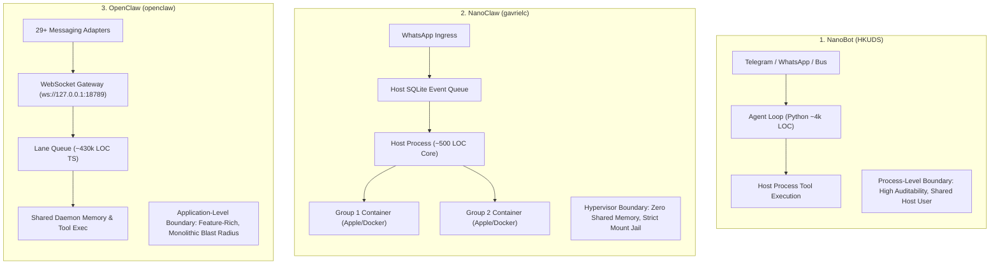
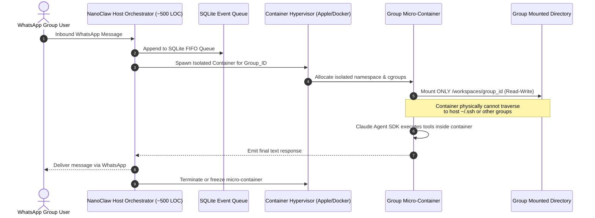
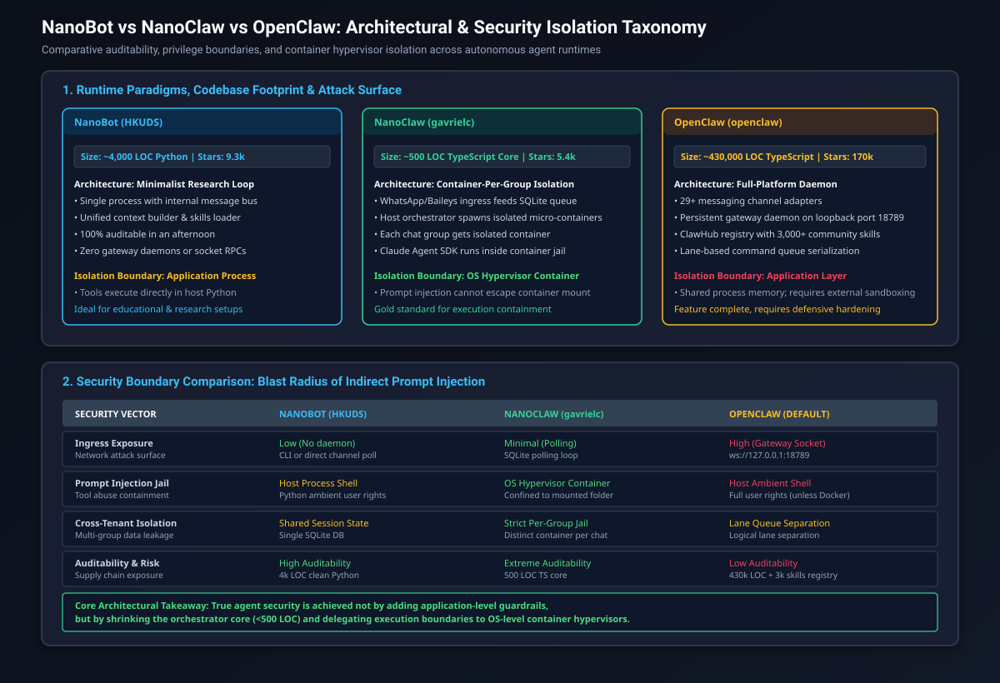
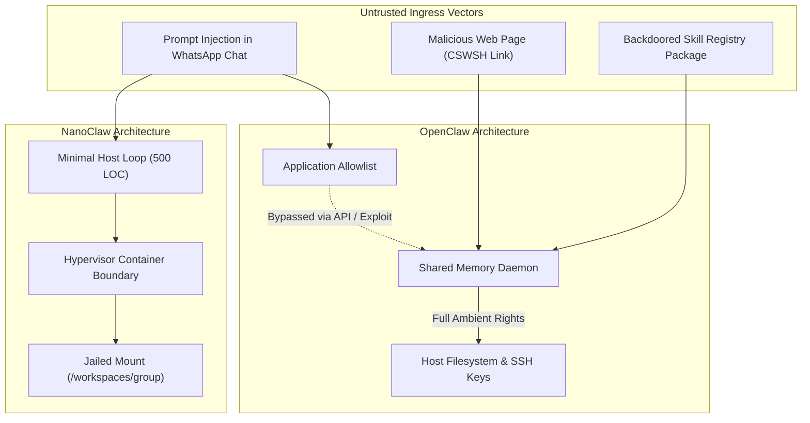
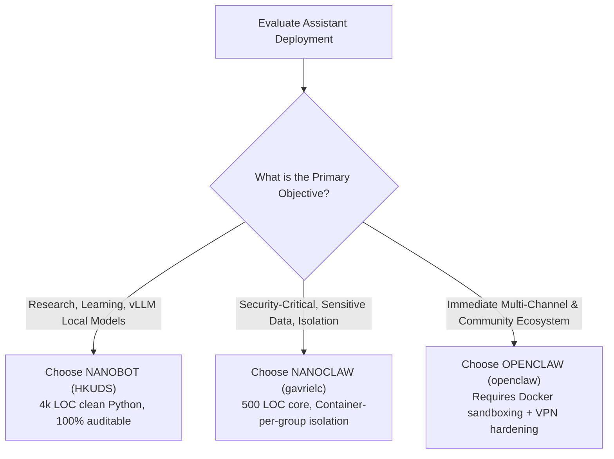
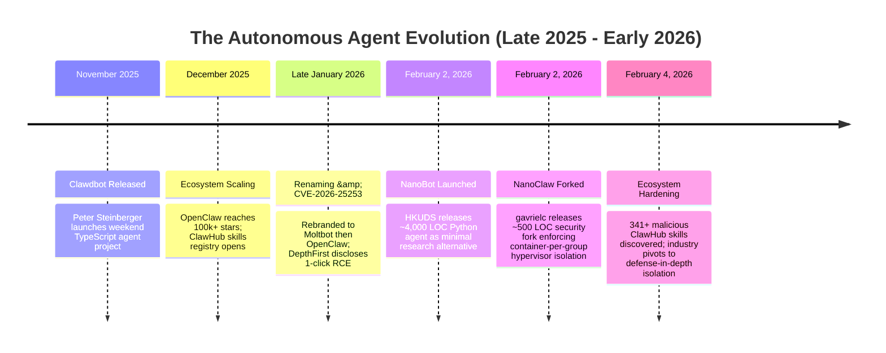

# NanoBot vs. NanoClaw vs. OpenClaw: Architectural Analysis, Privilege Boundaries, and Security Containment Trade-Offs

Learning note · Revised November 2026 · Technical Reference
*By Srinivasan Ragothaman ([@rsrini7](https://github.com/rsrini7))*

---

> **Core Idea:**
> Autonomous AI assistant frameworks diverge sharply on the axis of complexity versus trust. While OpenClaw prioritizes feature completeness through a monolithic ~430,000-LOC TypeScript daemon supporting 29+ messaging channels, it introduces severe attack surfaces (evidenced by CVE-2026-25253 1-click RCE and 340+ malicious ClawHub skills). In contrast, HKUDS's NanoBot reduces the runtime to ~4,000 LOC of transparent Python for educational auditability, and NanoClaw achieves gold-standard defense-in-depth by shrinking the orchestrator core to ~500 LOC and delegating all execution boundaries to OS-level container hypervisors.

---

## 1. Foundations & Architectural Archetypes

Personal AI assistant frameworks operate with extensive ambient authority: they ingest personal messages, execute terminal commands, manage local filesystems, and automate web browsers. However, their internal execution architectures represent three fundamentally distinct approaches to security and complexity:



### Core Terminology

| Term | Meaning & Architectural Role |
| :--- | :--- |
| **NanoBot** | An open-source, minimalist AI agent runtime (~4,000 LOC Python) developed by HKUDS (University of Hong Kong Data Intelligence Lab) prioritizing simplicity, readability, and local vLLM execution. |
| **NanoClaw** | A security-hardened fork (~500 LOC TypeScript core) that isolates each chat group or contact into an independent OS-level container microVM via Apple Containers or Docker. |
| **OpenClaw** | A full-featured personal AI agent platform (~430,000 LOC TypeScript, 170k+ GitHub stars) formerly known as Clawdbot/Moltbot, offering 29+ channel adapters and the ClawHub community skills registry. |
| **OS Hypervisor Isolation** | Security containment enforced by kernel cgroups, namespaces, and virtualized mounts where a compromised agent process cannot break out to the host system. |
| **Application-Level Boundary** | Security enforcement implemented within application software logic (e.g., allowlist checks, pairing tokens, prompt guardrails) that can be bypassed if the runtime process is compromised. |
| **ClawHub Registry** | OpenClaw's decentralized community package ecosystem; subject to severe supply-chain attacks (over 340 malicious packages identified distributing stealer payloads). |
| **Mount Allowlist Jail** | A containment policy restricting container access to explicitly specified host directories, blocking symlink traversal attacks (`../../etc/passwd`). |
| **CSWSH (Cross-Site WebSocket Hijacking)** | An attack vector where a public web page exploits missing Origin headers to interact with local loopback WebSocket services (the basis of CVE-2026-25253). |

---

## 2. Architectural Comparison Matrix

| Architectural Dimension | NanoBot (HKUDS) | NanoClaw (gavrielc) | OpenClaw (openclaw) |
| :--- | :--- | :--- | :--- |
| **Primary Philosophy** | Research, education, auditability | Zero-trust container isolation | Feature-complete ecosystem |
| **Codebase Footprint** | ~4,000 LOC Python | ~500 LOC TypeScript Core | ~430,000 LOC TypeScript |
| **Dependency Count** | Minimal (~12 packages) | Minimal (<10 packages) | Heavy (45+ direct dependencies) |
| **Architectural Modules** | ~10 discrete modules | 4 clean source files | 52+ subsystems and plugins |
| **Supported Channels** | 3 (Telegram, WhatsApp, Feishu) | 1 (WhatsApp, extensible via Claude) | 29+ messaging adapters |
| **Configuration Model** | Single `config.json` | Code-based / Claude Code skills | 8+ configuration files and UI |
| **Skill Extension Model** | Local filesystem `skills/` folder | Native Claude Code skills | ClawHub Registry (3,000+ packages) |
| **Isolation Mechanism** | Single host Python process | Container-per-group (Apple/Docker) | Application allowlist / shared memory |
| **Audit Duration** | 1 to 2 hours for full codebase | Under 30 minutes | Days to weeks; requires team audit |
| **Startup Latency** | < 5 seconds | < 3 seconds | 10 to 20 seconds (gateway + UI) |
| **Memory Footprint** | 100–200 MB RAM | 50–100 MB per container | 500 MB – 1 GB RAM |

---

## 3. Deep Technical Mechanism & Security Threat Modeling

### 1. NanoClaw: Container-per-Group Isolation Architecture

NanoClaw rejects application-level guardrails in favor of hardware- and kernel-enforced boundaries:



#### Why Container-per-Group Defeats Indirect Prompt Injection
If an attacker sends an indirect prompt injection payload in a group chat (e.g., hidden within a forwarded document or web link):
- In **OpenClaw** or **NanoBot**, the agent executes the shell command in the ambient host user environment, exposing user SSH keys and system tokens.
- In **NanoClaw**, the command executes inside the group's isolated container. The attacker cannot access the host filesystem, cannot read credentials from other chat groups, and cannot reach un-mounted directories.

### 2. OpenClaw: Monolithic Blast Radius and Supply-Chain Risks

OpenClaw's ~430k LOC footprint and external skill registry introduce severe enterprise risk vectors:

1. **CVE-2026-25253 (CVSS 8.8):** A Cross-Site WebSocket Hijacking (CSWSH) vulnerability where malicious websites connected to `ws://127.0.0.1:18789`, exfiltrating stored auth tokens and executing arbitrary host commands via the unauthenticated gateway RPC.
2. **ClawHub Supply-Chain Poisoning:** Security research from Koi Security and Bitdefender in February 2026 identified **341 to 900+ malicious skills** distributed through ClawHub. Attackers uploaded malicious packages with hidden obfuscated post-install scripts that exfiltrated environment variables upon installation.
3. **Command Injection CVEs:** Rapid feature expansion produced CVE-2026-24763 and CVE-2026-25157 (high-severity command injection flaws in OpenClaw's SSH and process-handling utilities).

### 3. NanoBot: The Auditability-First Philosophy

Developed by HKUDS, NanoBot demonstrates that 99% of agent daemon code can be eliminated while preserving essential autonomy:
- Uses a clean, synchronous event bus (`Bus`) coordinating `AgentLoop`, `ContextBuilder`, and `MemoryManager`.
- Excludes external package registries: all skills reside in the local `skills/` repository directory, eliminating supply-chain exposure.
- Native vLLM integration enables completely offline, private inference on local GPUs.
- **Limitation:** Runs as an un-sandboxed host Python process; security relies on strict input channel allowlists (`allowFrom: ["USER_ID"]`).

---

## 4. Architectural Visuals & Isolation Taxonomy



### Comparative Privilege Boundary Flow



---

## 5. Production Implementations & Code Recipes

### Recipe 1: NanoClaw-Style Micro-Container Execution Harness

The following TypeScript implementation illustrates the core pattern behind NanoClaw: spawning an isolated, ephemeral Docker container per conversational session with strict mount allowlisting and dropped kernel capabilities:

```typescript
import { spawn } from "child_process";
import * as path from "path";
import * as fs from "fs";

export interface ContainerExecutionRequest {
  sessionId: string;
  command: string;
  allowedMountDir: string;
}

export class ContainerSandboxManager {
  private baseStoragePath: string;

  constructor(baseStoragePath: string) {
    this.baseStoragePath = path.resolve(baseStoragePath);
  }

  public async executeInGroupContainer(req: ContainerExecutionRequest): Promise<string> {
    const safeSessionDir = path.resolve(this.baseStoragePath, req.sessionId);

    // Defense 1: Verify path confinement (Prevent directory traversal)
    if (!safeSessionDir.startsWith(this.baseStoragePath)) {
      throw new Error(`Security Violation: Path traversal detected for session ${req.sessionId}`);
    }

    if (!fs.existsSync(safeSessionDir)) {
      fs.mkdirSync(safeSessionDir, { recursive: true, mode: 0o700 });
    }

    // Defense 2: Spawn container with hypervisor boundary
    const dockerArgs = [
      "run",
      "--rm",
      "-i",
      "--network", "none",                    // No external egress
      "--security-opt", "no-new-privileges",  // Block privilege escalation
      "--cap-drop", "ALL",                   // Strip all Linux root capabilities
      "--memory", "256m",                    // Strict memory ceiling
      "--cpus", "0.5",                       // Prevent CPU DoS
      "-v", `${safeSessionDir}:/workspace:rw`, // Jailed group workspace
      "--workdir", "/workspace",
      "alpine:3.20",
      "sh", "-c", req.command
    ];

    return new Promise((resolve, reject) => {
      const child = spawn("docker", dockerArgs, { stdio: ["pipe", "pipe", "pipe"] });

      let stdout = "";
      let stderr = "";

      child.stdout.on("data", (data) => (stdout += data.toString()));
      child.stderr.on("data", (data) => (stderr += data.toString()));

      child.on("close", (code) => {
        if (code === 0) {
          resolve(stdout.trim());
        } else {
          reject(new Error(`Container process exited with code ${code}: ${stderr}`));
        }
      });

      // Enforce 15-second execution timeout
      setTimeout(() => {
        child.kill("SIGKILL");
        reject(new Error("Container execution timed out"));
      }, 15000);
    });
  }
}
```

### Recipe 2: SQLite FIFO Event Queue Consumer (NanoClaw Pattern)

```typescript
import Database from "better-sqlite3";

export interface QueuedMessage {
  id: number;
  channel: string;
  senderId: string;
  payload: string;
  createdAt: string;
}

export class SqliteEventQueue {
  private db: Database.Database;

  constructor(dbPath: string) {
    this.db = new Database(dbPath);
    this.init();
  }

  private init(): void {
    this.db.exec(`
      CREATE TABLE IF NOT EXISTS event_queue (
        id INTEGER PRIMARY KEY AUTOINCREMENT,
        channel TEXT NOT NULL,
        senderId TEXT NOT NULL,
        payload TEXT NOT NULL,
        status TEXT DEFAULT 'PENDING',
        createdAt DATETIME DEFAULT CURRENT_TIMESTAMP
      );
      CREATE INDEX IF NOT EXISTS idx_status ON event_queue(status);
    `);
  }

  public push(channel: string, senderId: string, payload: string): void {
    const stmt = this.db.prepare(
      "INSERT INTO event_queue (channel, senderId, payload) VALUES (?, ?, ?)"
    );
    stmt.run(channel, senderId, payload);
  }

  public popNext(): QueuedMessage | null {
    const fetchStmt = this.db.prepare(`
      SELECT id, channel, senderId, payload, createdAt 
      FROM event_queue 
      WHERE status = 'PENDING' 
      ORDER BY id ASC 
      LIMIT 1
    `);
    
    const message = fetchStmt.get() as QueuedMessage | undefined;
    if (!message) return null;

    const updateStmt = this.db.prepare("UPDATE event_queue SET status = 'PROCESSING' WHERE id = ?");
    updateStmt.run(message.id);

    return message;
  }
}
```

---

## 6. Common Claims vs. Technical Realities

| Common Claim | Technical Reality | Production Implication |
| :--- | :--- | :--- |
| *"Application-level allowlists provide sufficient security for autonomous agents."* | **False.** Once an attacker exploits a memory corruption, gateway flaw, or indirect prompt injection, application-level checks are trivially bypassed within the process. | Security boundaries must be enforced by OS kernels and hypervisors (containers, namespaces, seccomp), not application code. |
| *"NanoBot is too simple to perform real agentic work."* | **False.** NanoBot supports tool calling, multi-turn reasoning, memory management, and vLLM local model execution within ~4,000 LOC. Code bulk in larger frameworks is dominated by channel UI adapters and auxiliary tooling. | For academic research and dedicated automations, minimal codebases eliminate massive maintenance and attack surface overhead. |
| *"Running OpenClaw inside Docker makes it 100% secure."* | **Partially True.** Docker sandboxing contains shell execution, but if the container is granted Docker socket access (`/var/run/docker.sock`) or broad volume mounts (`-v /:/host`), escape is trivial. | Always run with `--cap-drop=ALL`, `--security-opt=no-new-privileges`, and never expose the host Docker socket. |
| *"Public skill registries (ClawHub) are safe because they are open-source."* | **False.** Over 340 backdoored skills were discovered on ClawHub in February 2026. Without mandatory code signing and sandbox auditing, package registries remain primary malware distribution vectors. | Pin skills to audited local Git commits; never install unverified third-party skills in production. |

---

## 7. Architectural Decision Matrix for Practitioners



### Guidance by Environment

- **Choose NanoBot when:**
  - You are building an educational or research prototype.
  - You require full codebase auditability within 1–2 hours.
  - You operate entirely within the Python data science and machine learning ecosystem.
  - You need private, offline inference via local vLLM / Ollama backends.

- **Choose NanoClaw when:**
  - You handle sensitive organizational credentials, financial workflows, or personal data.
  - You require hardware-enforced isolation between different communication groups.
  - You operate on modern container-capable operating systems (macOS Tahoe Apple Containers or Linux Docker).
  - You favor a hyper-lean (<500 LOC) codebase that can be maintained with minimal dependencies.

- **Choose OpenClaw when:**
  - You require turnkey integration with 15+ messaging platforms immediately.
  - You possess a dedicated security and operations team capable of auditing third-party ClawHub packages and monitoring runtime logs.
  - You implement defense-in-depth: running OpenClaw in a hardened VPS behind a Tailscale private network with strict loopback binding.

---

## 8. Practical Adoption Blueprint & Verification Checklist

### Production Verification Commands

```bash
# 1. NanoClaw: Verify container runtime isolation and namespace enforcement
docker info --format '{{.SecurityOptions}}'
# Expected: name=seccomp,name=rootless

# 2. OpenClaw: Audit installed skills for suspicious outbound connections
find ~/.openclaw/skills/ -type f -name "*.js" -exec grep -E "fetch\(|http\(|eval\(|exec\(" {} +

# 3. OpenClaw: Verify gateway is listening on loopback (NOT 0.0.0.0)
ss -tlnp | grep 18789

# 4. NanoBot: Verify channel allowlist configuration
jq '.channels.telegram.allowFrom' ~/.nanobot/config.json
```

### Security Hardening Checklist

- [ ] **Kernel-Enforced Isolation:** Implement OS container hypervisors (Docker/Apple Container) rather than relying on application prompt rules.
- [ ] **Filesystem Mount Whitelisting:** Explicitly jail each session to a dedicated sub-directory; block parent directory traversal (`..`).
- [ ] **Token Usage Alerting:** Configure hard API cost ceilings to catch runaway cron loops (e.g., OpenClaw's documented 120k token cron bug).
- [ ] **Skill Supply-Chain Vetting:** Prohibit direct installation of untrusted ClawHub skills; enforce local manual code review.
- [ ] **Loopback & Origin Locking:** Ensure any gateway RPC validates HTTP `Origin` headers to prevent CSWSH exploits (CVE-2026-25253).

---

## 9. Timeline & Evolution of the Three Projects



---

## 10. Primary Sources, References & Evidence

### Primary Specifications & Authoritative Repositories

1. [HKUDS/nanobot Repository (GitHub)](https://github.com/HKUDS/nanobot) — Official source code of NanoBot, the ~4,000 LOC minimalist research AI assistant.
2. [gavrielc/nanoclaw Repository (GitHub)](https://github.com/gavrielc/nanoclaw) — Official source code of NanoClaw, demonstrating container-per-group hypervisor sandboxing.
3. [openclaw/openclaw Repository (GitHub)](https://github.com/openclaw/openclaw) — Production source code and release notes for OpenClaw.
4. [National Vulnerability Database: CVE-2026-25253](https://nvd.nist.gov/vuln/detail/CVE-2026-25253) — Official vulnerability details and CVSS 8.8 scoring for the OpenClaw gateway RCE.
5. [DepthFirst Research: 1-Click RCE to Steal Your Moltbot Data and Keys](https://depthfirst.com/research/moltbot-rce) — Detailed exploitation walkthrough of Cross-Site WebSocket Hijacking on loopback ports.
6. [Koi Security: Malicious Skills in ClawHub Registry](https://koisecurity.com/blog/clawhub-malware) — Threat report identifying 341+ malicious packages distributing stealer payloads.

### Source Context & Empirical Evidence

| Reference ID | Architecture Focus | Primary Claim Checked | Verification Outcome |
| :--- | :--- | :--- | :--- |
| **HKUDS nanobot** | Codebase Footprint | NanoBot implements core agent loops in ~4,000 lines of Python. | Verified. Core engine contained across ~10 modules. |
| **gavrielc nanoclaw** | Container Jailing | NanoClaw runs Claude Agent SDK inside per-group micro-containers. | Verified. Kernel hypervisor enforces directory mount limits. |
| **CVE-2026-25253** | OpenClaw Gateway | Unchecked WebSocket origins enabled 1-click arbitrary command execution. | Verified. CVSS 8.8. Patched in v2026.1.30 via Origin validation. |
| **Koi Security 2026** | ClawHub Supply-Chain | Over 340 malicious packages distributed backdoor payloads. | Verified. Unvetted third-party skill registries pose critical risk. |

---

**Related:**
- [OpenClaw-Moltbot-Clawdbot-Architecture-2026](../openclaw/OpenClaw-Moltbot-Clawdbot-Architecture-2026.md) — Detailed architecture of OpenClaw's gateway, lane-based queue, and ARIA semantic snapshots.
- [OpenClaw-Autonomous-System-Whitepaper-2026](../openclaw/OpenClaw-Autonomous-System-Whitepaper-2026.md) — Enterprise whitepaper analyzing the systems reality, privilege boundaries, and prompt injection threat models.
- [OpenClaw-Security-Analysis-Jan-2026](../openclaw/OpenClaw%28Moltbot-or-Clawdbot%29-Security-Analysis-Jan-2026.md) — In-depth technical catalog covering CVE-2026-25253 and Shodan gateway telemetry.
- [nanobot-architecture-deep-dive](nanobot-architecture-deep-dive.md) — Deep architectural walkthrough of HKUDS's ~4k LOC Python runtime and MessageBus loop.
- [claw-ecosystem](../openclaw/claw-ecosystem.md) — Comprehensive comparative taxonomy mapping the isolation boundaries of the Claw agent ecosystem.
