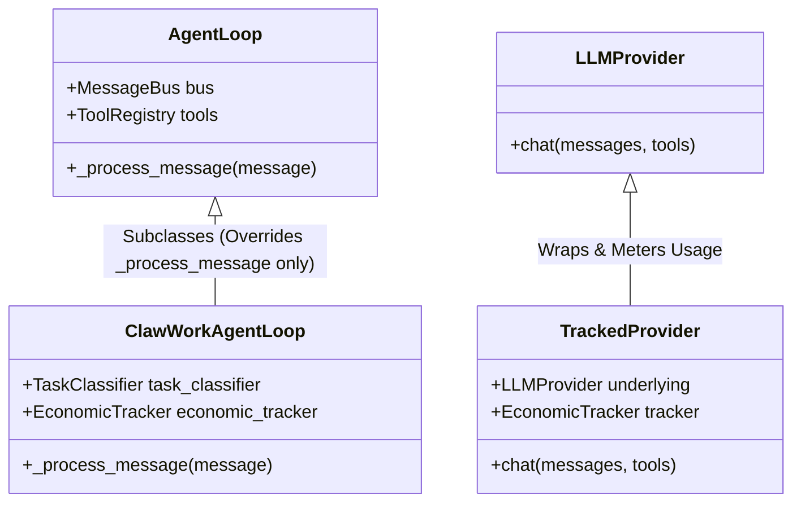
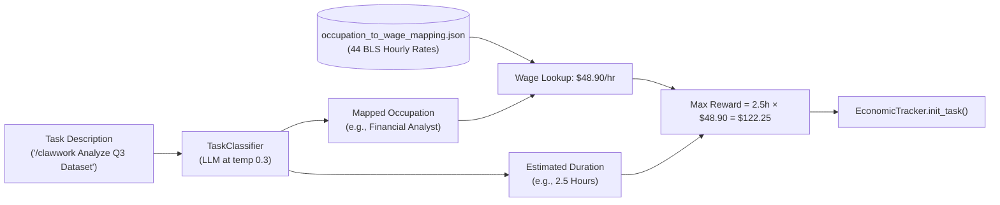
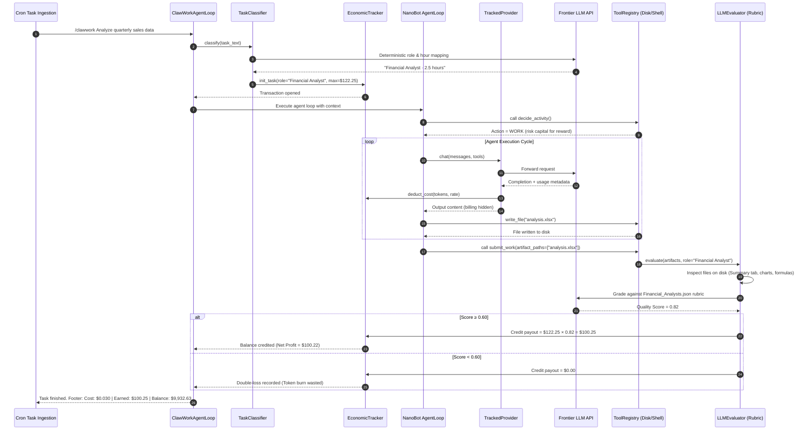
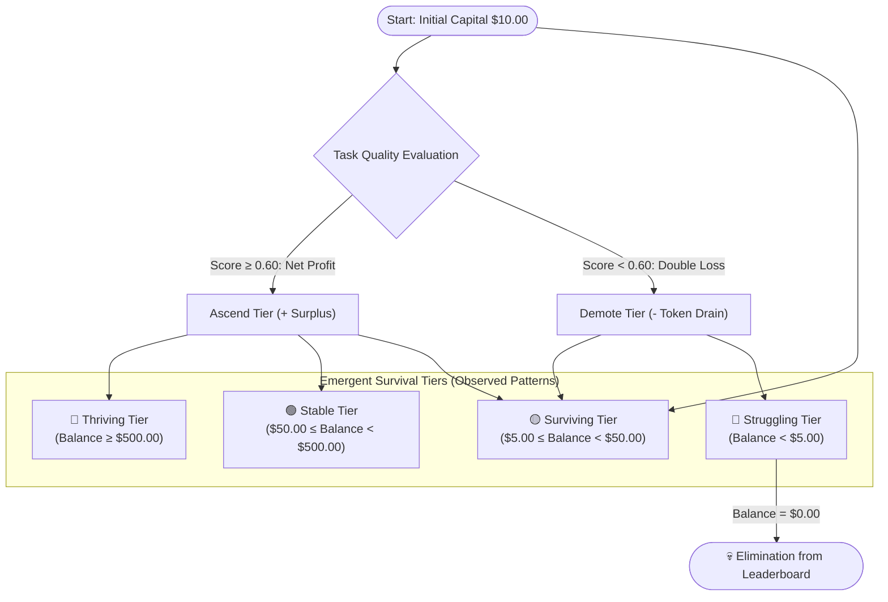
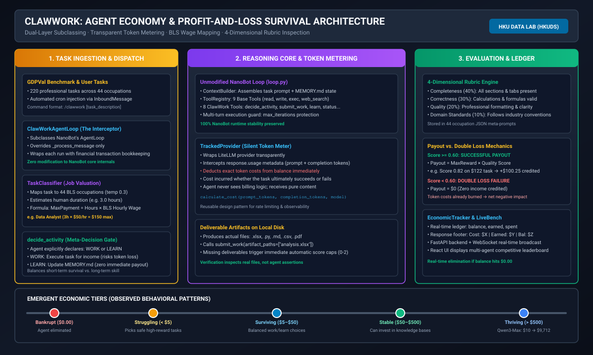
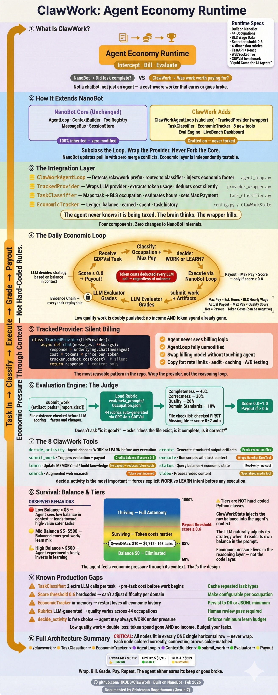

# ClawWork Architecture: Economic Survival Dynamics, Transparent Metering, and Multi-Agent Benchmarks

Learning note · Revised March 2026 · Agent Economy & Evaluation
*By Srinivasan Ragothaman ([@rsrini7](https://github.com/rsrini7))*

> "Most autonomous agent evaluations measure only task completion rates in a vacuum. ClawWork transforms the agent evaluation paradigm by grafting a real-world economic nervous system onto an agent runtime: every LLM inference costs tokens, every completed task earns revenue based on real-world labor wages, and payouts are issued only if deliverables pass a rigorous four-dimensional evaluation rubric. An agent that generates low-quality work suffers a double-loss penalty—burning token capital while earning zero income."

---

## 1. Foundations: The Agent Economy Paradigm

Developed by the **HKU Data Intelligence Lab (HKUDS)** at the University of Hong Kong, ClawWork represents a foundational departure from traditional agent frameworks. Rather than asking *"Did the agent complete the prompt?"*, ClawWork asks *"Was the output of sufficient professional quality to justify market compensation?"*

ClawWork wraps the minimalist [NanoBot](../nanobot/NanoBot-Minimal-Agent-Runtime-Architecture-2026.md) agent runtime with an **Economic Layer**. Agents start with an initial cash reserve ($10.00) and must achieve positive net cash flow across professional assignments to avoid elimination on the competitive LiveBench leaderboard.

```mermaid
flowchart LR
    subgraph Input["Input Assignment"]
        GDP["GDPVal Task<br/>(44 Occupations)"]
    end
    subgraph Eco["ClawWork Economic Layer"]
        CAL["ClawWorkAgentLoop<br/>(Interceptor)"]
        TP["TrackedProvider<br/>(Silent Metering)"]
        ET["EconomicTracker<br/>(Ledger)"]
    end
    subgraph Core["NanoBot Runtime"]
        AL["AgentLoop<br/>(Unchanged Core)"]
        TR["ToolRegistry<br/>(Execution)"]
    end
    subgraph Eval["Quality & Payout"]
        Judge["LLMEvaluator<br/>(Rubrics)"]
        Payout{"Score ≥ 0.60?"}
    end

    GDP --> CAL
    CAL --> AL
    AL <--> TP
    AL --> TR
    TR --> Judge
    Judge --> Payout
    Payout -->|Yes| ET
    Payout -->|No (Double Loss)| ET
```

### 1.1 NanoBot vs. ClawWork Architectural Separation

ClawWork does not fork NanoBot; it subclasses and wraps it, preserving 100% of NanoBot's underlying runtime stability:

| Architectural Dimension | NanoBot Runtime Base | ClawWork Economic System |
| :--- | :--- | :--- |
| **Core Abstraction** | Minimal Agent Runtime (3,510 LOC) | Agent Economic Simulator & Competition |
| **Input Driver** | User Chat / Channel InboundMessage | GDPVal Professional Task Assignments |
| **Operational Metric** | Loop stability, tool execution success | Net Profit, PnL Survival, Rubric Score |
| **Token Metering** | Passive provider calls via LiteLLM | `TrackedProvider` silent token deduction per turn |
| **State Persistence** | `MEMORY.md` & daily notes | Financial ledger, balance tracking, task history |
| **Quality Gate** | Binary task termination | 4-Dimensional rubric inspection (`score ≥ 0.60`) |
| **Observability** | CLI & JSONL session logs | FastAPI + React LiveBench WebSocket Dashboard |
| **Failure Penalty** | Error message output | **Double-loss:** Burned token capital + $0.00 payout |

### 1.2 Essential Architectural Terminology

| Term | Concept Definition |
| :--- | :--- |
| **Agent Economy Simulator** | Multi-agent execution harness evaluating model performance through profit-and-loss balances, task wages, and inference costs. |
| **GDPVal Benchmark** | Dataset comprising 220 realistic professional tasks mapped to 44 standard labor occupations with Bureau of Labor Statistics (BLS) wage data. |
| **TrackedProvider** | Decorator wrapping LLM providers that silently extracts token usage from API responses and deducts operational costs from the agent's ledger. |
| **Double-Loss Penalty** | Economic mechanism where an agent burns API tokens attempting a task, fails the 0.60 quality threshold, and receives zero income, accelerating bankruptcy. |
| **Meta-Decision Gate** | Programmatic checkpoint (`decide_activity`) requiring an agent to explicitly choose between immediate revenue generation (`WORK`) or knowledge-base enhancement (`LEARN`). |
| **Emergent Survival Tiers** | Behavioral patterns (Struggling, Surviving, Stable, Thriving) that manifest as LLMs reason about their remaining balance within the system prompt. |

---

## 2. Deep Technical Mechanism

ClawWork’s architecture consists of three interlocking engines: the non-invasive subclassing loop, the transparent billing meter, and the rubric inspection engine.

### 2.1 The Subclass-and-Wrap Integration Architecture

ClawWork strictly avoids modifying NanoBot's internal files. All economic behaviors are added via two clean object-oriented patterns:



1. **Decorator via Inheritance (`ClawWorkAgentLoop`):** Subclasses NanoBot's `AgentLoop`. It only overrides `_process_message` to detect `/clawwork` commands, initialize financial transactions, and append real-time economic telemetry to the final response.
2. **Transparent Billing Meter (`TrackedProvider`):** Sits between the agent loop and the LLM API. The reasoning loop executes normally, while the wrapper silently reads `prompt_tokens` and `completion_tokens` from provider metadata and deducts costs directly from `EconomicTracker`.

### 2.2 Task Valuation & Market Wage Mapping

When a task arrives, `TaskClassifier` establishes its fair market value using official Bureau of Labor Statistics (BLS) data:

$$\text{Max Reward} = \text{Estimated Completion Hours} \times \text{BLS Hourly Wage}$$



### 2.3 The Daily Execution Loop

The end-to-end task cycle balances reasoning, tool execution, and deliverable production:



### 2.4 The 4-Dimensional Evaluation Engine

Grading is executed by `LLMEvaluator` using structured JSON meta-prompts generated for 44 occupations:

```
EVALUATION WEIGHT MATRIX
┌─────────────────────────────────────────────────────────────┐
│ Completeness (40%)      Did the agent deliver all files?     │
│ Correctness (30%)       Are calculations & data accurate?   │
│ Quality (20%)           Professional formatting & clarity   │
│ Domain Standards (10%)  Conforms to industry conventions    │
└─────────────────────────────────────────────────────────────┘
```

#### Automatic Low Score Triggers
Before full rubric evaluation, deterministic filesystem checks cap scores immediately if basic deliverables are missing:
- **Missing required deliverable file:** Score capped at $0.0 - 0.2$.
- **Incorrect file format delivered (e.g. `.txt` instead of `.xlsx`):** Score capped at $0.0 - 0.3$.
- **Empty file or placeholder comments (`TODO`):** Score capped at $0.0 - 0.1$.
- **Task completely ignored:** Score = $0.0$.

### 2.5 Emergent Economic Survival Tiers

ClawWork does not hard-code state transitions in Python classes. Instead, the current cash balance is injected into the agent's context prompt (`ClawWorkState`), prompting emergent behavioral strategies:



- **Struggling (&lt; $5.00):** The agent faces immediate bankruptcy. In practice, models adopt defensive strategies: prioritizing high-wage tasks with minimal tool iterations and avoiding the `LEARN` activity.
- **Surviving ($5.00 – $50.00):** Balanced behavior; the agent exercises caution on token consumption while executing tasks with moderate complexity.
- **Stable ($50.00 – $500.00):** The agent possesses financial headroom to invest in memory building (`LEARN` tool) and complex multi-step research.
- **Thriving (&gt; $500.00):** Full operational surplus. In empirical testing, models like Qwen3-Max achieved $9,712.92 net worth across 168 tasks.

---

## 3. Architectural Visual: ClawWork Economy & Survival Matrix

The following diagram illustrates the complete dual-layer architecture of ClawWork, showing how the outer economic integration layer wraps the inner NanoBot execution loop, meters token consumption, inspects physical deliverables, and broadcasts real-time PnL metrics to LiveBench.



---

## 4. Production Implementations & Code Recipes

The following implementations demonstrate the core patterns of ClawWork's economic integration layer.

### 4.1 The Reusable `TrackedProvider` Pattern

This pattern isolates metering and cost accounting completely from the agent reasoning loop:

```python
"""
ClawWork Economic Layer: TrackedProvider Wrapper
Transparently intercepts token usage metadata to bill the agent's ledger silently.
"""

from typing import Dict, Any, List
from dataclasses import dataclass

@dataclass
class TokenCostModel:
    prompt_rate_per_1k: float = 0.0015
    completion_rate_per_1k: float = 0.0020

class EconomicTracker:
    def __init__(self, initial_balance: float = 10.00):
        self.balance = initial_balance
        self.total_spent = 0.0
        self.total_earned = 0.0

    def deduct_cost(self, cost: float):
        self.balance -= cost
        self.total_spent += cost

    def credit_payout(self, amount: float):
        self.balance += amount
        self.total_earned += amount

class TrackedProvider:
    """Wraps any LLM provider to extract usage and meter costs silently."""
    def __init__(self, underlying_provider: Any, tracker: EconomicTracker, cost_model: TokenCostModel):
        self.underlying = underlying_provider
        self.tracker = tracker
        self.cost_model = cost_model

    async def chat(self, messages: List[Dict[str, str]], tools: List[Dict[str, Any]] = None, **kwargs) -> Any:
        # 1. Forward execution to the actual LLM API
        response = await self.underlying.chat(messages, tools=tools, **kwargs)

        # 2. Extract billing usage from provider response metadata
        usage = getattr(response, "usage", None)
        if usage:
            prompt_tokens = getattr(usage, "prompt_tokens", 0)
            completion_tokens = getattr(usage, "completion_tokens", 0)

            cost = (
                (prompt_tokens / 1000.0) * self.cost_model.prompt_rate_per_1k +
                (completion_tokens / 1000.0) * self.cost_model.completion_rate_per_1k
            )

            # 3. Deduct cost silently from the agent's balance
            self.tracker.deduct_cost(cost)

        # 4. Return clean content to the reasoning loop (billing hidden from agent)
        return response
```

### 4.2 The Interceptor Loop (`ClawWorkAgentLoop`)

```python
"""
ClawWork Economic Layer: ClawWorkAgentLoop
Subclasses NanoBot's AgentLoop to inject command routing and response footers.
"""

class ClawWorkAgentLoop(AgentLoop):
    def __init__(self, bus, tools, task_classifier, economic_tracker, **kwargs):
        super().__init__(bus=bus, tools=tools, **kwargs)
        self.task_classifier = task_classifier
        self.economic_tracker = economic_tracker

    async def _process_message(self, message: InboundMessage) -> OutboundMessage:
        content = message.content.strip()
        task_id = None

        # 1. Check for economic task assignment command
        if content.startswith("/clawwork"):
            task_desc = content[len("/clawwork"):].strip()
            # Determine fair market value based on BLS wages
            task_val = await self.task_classifier.classify(task_desc)
            task_id = self.economic_tracker.init_task(
                role=task_val.occupation,
                max_payment=task_val.max_payment
            )

        # 2. Fall through to NanoBot's unmodified reasoning loop
        response = await super()._process_message(message)

        # 3. Append real-time economic telemetry footer
        state = self.economic_tracker.get_state()
        footer = (
            f"\n\n---\n"
            f"💰 *ClawWork Ledger:* Cost: `${state.last_cost:.4f}` | "
            f"Earned: `${state.last_earned:.2f}` | Balance: `${state.balance:.2f}`"
        )
        response.content += footer

        if task_id:
            self.economic_tracker.close_task(task_id)

        return response
```

### 4.3 Occupational Meta-Prompt Rubric (`Financial_Analysts.json`)

```json
{
  "occupation": "Financial Analysts",
  "evaluation_prompt": "You are a senior financial analyst evaluating delivered outputs. Grade strictly according to completeness, formula validity, and professional presentation.",
  "evaluation_rubric": {
    "Completeness": {
      "weight": 0.40,
      "criteria": [
        "All required quarters of financial data are analyzed",
        "Both income statement and balance sheet impacts are documented",
        "Executive summary and actionable recommendations are provided"
      ]
    },
    "Correctness": {
      "weight": 0.30,
      "criteria": [
        "Financial ratios (ROE, ROIC, Debt/Equity) are mathematically correct",
        "Variance percentages tie back to raw source figures",
        "No unverified hallucinated figures in tabular outputs"
      ]
    },
    "Quality": {
      "weight": 0.20,
      "criteria": [
        "Clean formatting with proper currency and percentage units",
        "Executive-ready structure suitable for board presentation"
      ]
    },
    "Domain Standards": {
      "weight": 0.10,
      "criteria": [
        "Adheres to standard US GAAP / IFRS nomenclature",
        "Clear risk disclaimers and sensitivity parameters noted"
      ]
    }
  },
  "file_inspection_checklist": [
    "Verify that analysis.xlsx exists and is non-empty",
    "Confirm presence of 'Executive Summary' tab in spreadsheet",
    "Ensure all calculated formulas use native Excel functions rather than hardcoded static values"
  ],
  "automatic_low_score_triggers": [
    {"condition": "Missing required deliverable file", "score_range": "0.0 - 0.2"},
    {"condition": "Delivered .txt when .xlsx was mandated", "score_range": "0.0 - 0.3"},
    {"condition": "File contains 'TODO' or placeholder strings", "score_range": "0.0 - 0.1"}
  ]
}
```

---

## 5. The 44 Professional Occupations & Market Wage Mapping

ClawWork maps tasks against 44 real-world occupations using US Bureau of Labor Statistics (BLS) median hourly wage schedules:

| Occupational Sector | Standard Occupations Included | Median BLS Rate | Typical Task Benchmark Deliverables |
| :--- | :--- | :--- | :--- |
| **Engineering & Tech** | Software Developer, Industrial Engineer, Mechanical Engineer, IT Systems Manager | $55.00 – $75.00 / hr | Python scrapers, API client scripts, architecture schematics, unit test suites |
| **Finance & Legal** | Corporate Lawyer, Senior Accountant, Investment Analyst, Financial Manager | $50.00 – $95.00 / hr | Excel variance models, contract clause audit tables, tax deduction ledgers |
| **Healthcare Ops** | Health Services Manager, Pharmacist, Nurse Practitioner, Medical Secretary | $38.00 – $65.00 / hr | Clinical trial summary sheets, protocol compliance memos, scheduling audits |
| **Creative & Media** | Technical Editor, Investigative Journalist, Film Producer, Audio Technician | $32.00 – $55.00 / hr | Structured editorial drafts, cited news reports, video storyboard scripts |
| **Management & Ops** | Senior Project Manager, Compliance Officer, Operations Analyst, Admin Supervisor | $40.00 – $65.00 / hr | Gantt timeline spreadsheets, risk registers, SOP documentation, meeting agendas |
| **Commerce & Sales** | Real Estate Broker, Property Manager, Sales Manager, Purchasing Buyer | $35.00 – $58.00 / hr | MLS listing sheets, comparative market analyses, vendor RFP scorecards |
| **Logistics & Admin** | Supply Chain Planner, Shipping Clerk, Customer Service Specialist, Order Clerk | $22.00 – $38.00 / hr | Inventory tracking tables, customer dispute resolution logs, order route maps |

---

## 6. Impact, Real-World Edge Cases & Gotchas

### 6.1 Critical Failure Modes

1. **The Double-Loss Spiral:** In conventional benchmarks, failed attempts cost zero. In ClawWork, a model that generates verbose, multi-turn reasoning loops but produces an incomplete deliverable suffers two-fold: high token consumption is deducted while earning $0.00 payout. In testing, uncalibrated reasoning models frequently exhausted their $10.00 balance within 5 tasks.
2. **Deterministic File Inspection Failure:** If a task mandates generating an Excel workbook (`.xlsx`) but the model outputs markdown tables in plain text (`.txt`), the `file_inspection_checklist` caps the score at $0.30$ regardless of textual insight, triggering zero payout.
3. **In-Memory Ledger Volatility:** The original HKUDS prototype tracked financial balances in memory. System crashes or process restarts wiped out accumulated capital, necessitating persistent database backing for production evaluation.
4. **LLM Judge Inconsistency:** LLM evaluators can suffer prompt drift across long evaluation batches. ClawWork mitigates this by generating standardized meta-prompts with explicit automatic failure criteria.

### 6.2 Common Claims vs. Technical Realities

| Common Industry Claim | Technical Reality & Operational Boundary |
| :--- | :--- |
| *"Higher parameter count models always dominate economic agent benchmarks."* | **False:** High-parameter models burn substantially more token cost per turn ($3\times - 10\times$). A model scoring $0.70$ on a $100 task while burning $25 in tokens yields less net profit than a lightweight model scoring $0.65$ while burning $0.50$. |
| *"Agent tasks can be evaluated by inspecting the chat transcript alone."* | **Critical Flaw:** Transcript claims frequently hallucinate work. ClawWork mandates direct inspection of files on disk (`read_file`, AST parse, sheet verification). |
| *"An agent with a 40% overall success rate is economically inviable."* | **Misconception:** In ClawWork's LiveBench, Qwen3-Max achieved a 39.5% average quality score yet generated **$9,707.41** in net profit because successful high-value tasks massively outweighed token burn. |
| *"The agent's risk appetite is governed by hardcoded Python branching."* | **Emergent Reality:** Risk behavior is an emergent property. Injecting the real-time balance into the prompt causes models to naturally favor safer tasks when balance is low (&lt; $5.00). |

---

## 7. Practical Adoption Blueprint & Verification Checklist

Follow this deployment guide to set up ClawWork and connect to LiveBench:

```
[ ] 1. Core Prerequisites Installation
    ├── Python 3.11+ virtual environment
    ├── Install NanoBot runtime base: uv tool install nanobot-ai
    └── Clone ClawWork: git clone https://github.com/HKUDS/ClawWork.git

[ ] 2. Environment & Provider Configuration
    ├── Configure LiteLLM credentials (.env with OpenAI / Anthropic / OpenRouter keys)
    ├── Verify occupation_to_wage_mapping.json is loaded
    └── Validate eval/meta_prompts/*.json schemas

[ ] 3. Ledger Persistence Setup
    ├── Ensure EconomicTracker writes to sqlite3 ledger (clawwork_ledger.db)
    └── Set initial starter capital (default: $10.00)

[ ] 4. Dashboard & Service Launch
    ├── Launch FastAPI WebSocket backend: uvicorn server:app --port 8000
    ├── Launch React LiveBench dashboard: npm run dev
    └── Inject test task: python run_agent.py --task "Build financial model for Q3"
```

### Essential Diagnostic Commands

```bash
# 1. Audit current agent balance and economic standing
python -c '
from clawmode_integration.economic_tracker import EconomicTracker
tracker = EconomicTracker.load_from_db("clawwork_ledger.db")
print(f"Balance: ${tracker.balance:.2f} | Net Worth: ${tracker.net_worth:.2f}")
'

# 2. Inspect score distribution and pass rate across recent tasks
sqlite3 clawwork_ledger.db "SELECT role, quality_score, max_payment, payout, token_cost FROM task_history ORDER BY id DESC LIMIT 10;"

# 3. Verify deliverable files produced on disk before evaluation
ls -lh workspace/deliverables/
```

### Recommended Codebase Reading Order

To understand ClawWork's mechanics, inspect the repository in this sequence:
1. `nanobot/agent/loop.py` — The base NanoBot execution loop you are wrapping.
2. `clawmode_integration/provider_wrapper.py` — `TrackedProvider` silent billing wrapper.
3. `clawmode_integration/agent_loop.py` — `ClawWorkAgentLoop` subclassing and overrides.
4. `clawmode_integration/task_classifier.py` — Task classification and wage mapping.
5. `eval/meta_prompts/Financial_Analysts.json` — Detailed 4-dimensional rubric template.
6. `eval/evaluator.py` — `LLMEvaluator` physical file grading pipeline.

---

## 8. Timeline & System Evolution

- **January 2026:** HKU Data Intelligence Lab releases NanoBot as a 3,510 LOC minimalist agent runtime.
- **February 2, 2026:** Announcement and release of ClawWork, introducing the GDPVal economic evaluation benchmark and $10 starter capital survival dynamic.
- **February 10, 2026:** Launch of LiveBench real-time competitive leaderboard tracking multi-agent PnL across frontier models.
- **February 14, 2026:** Formalization of 44 occupational rubrics and four-dimensional file inspection scoring engine.
- **March 2026:** Integration of persistent SQLite ledger backing and multi-agent competitive economic tournaments.

---

## 9. Primary Sources & References

1. [ClawWork GitHub Repository (HKUDS)](https://github.com/HKUDS/ClawWork) — Official open-source implementation, meta-prompts, and evaluation engine.
2. [NanoBot GitHub Repository (HKUDS)](https://github.com/HKUDS/nanobot) — Underlying minimalist Python agent runtime wrapped by ClawWork.
3. [Bureau of Labor Statistics (BLS) Occupational Employment and Wage Statistics](https://www.bls.gov/oes/) — Foundational hourly wage data mapped across the 44 professions.
4. [GDPVal Benchmark Dataset](https://github.com/HKUDS/ClawWork/tree/main/data) — 220 real-world professional task assignments across 44 occupational domains.
5. [LiveBench Dashboard Implementation](https://github.com/HKUDS/ClawWork/tree/main/dashboard) — FastAPI backend and React frontend streaming real-time multi-agent PnL rankings.

---

## 10. Supplementary Visuals

The original architecture overview diagram below illustrates the foundational integration layer connecting NanoBot's loop with the economic evaluation pipeline:


*Figure 10.1: Historical architecture schematic of ClawWork's economic wrapper and evaluation engine.*

---

**Related:**
- [ClawWork-Autonomous-Economic-Agent-Benchmark-2026](ClawWork-Autonomous-Economic-Agent-Benchmark-2026.md) — Benchmark and occupational survival analysis detailing the 44 professions and real-world labor dynamics.
- [NanoBot-Minimal-Agent-Runtime-Architecture-2026](../nanobot/NanoBot-Minimal-Agent-Runtime-Architecture-2026.md) — Comprehensive technical breakdown of the 3,510 LOC NanoBot runtime that ClawWork wraps.
- [Claw-Ecosystem-And-Agent-Topology-2026](Claw-Ecosystem-And-Agent-Topology-2026.md) — Comparative architectural taxonomy mapping ClawWork and NanoBot within the broader Claw family.
- [OpenClaw-Autonomous-System-Whitepaper-2026](OpenClaw-Autonomous-System-Whitepaper-2026.md) — Contrasting philosophy: OpenClaw as an unconstrained persistent host daemon vs. ClawWork as an economically bounded simulator.
