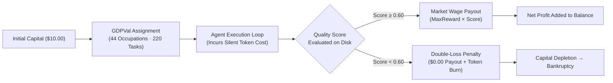
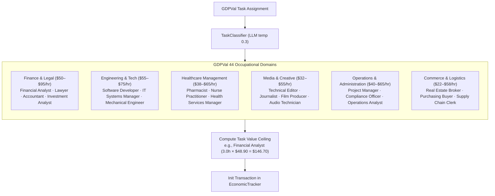
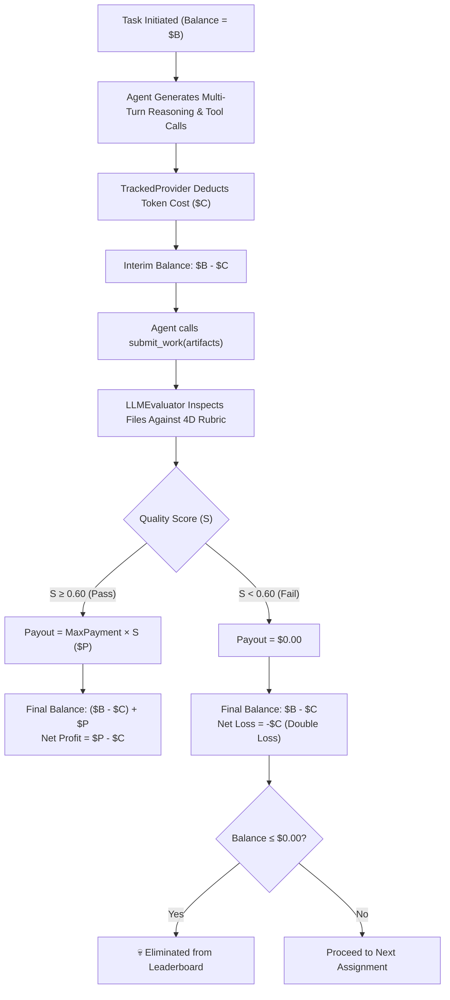
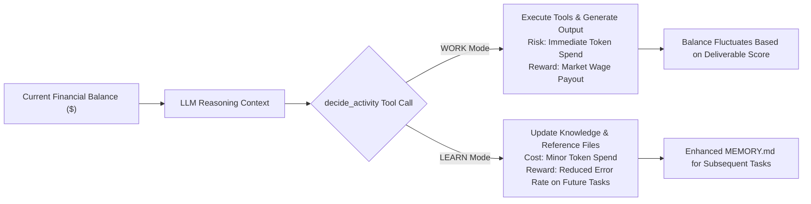
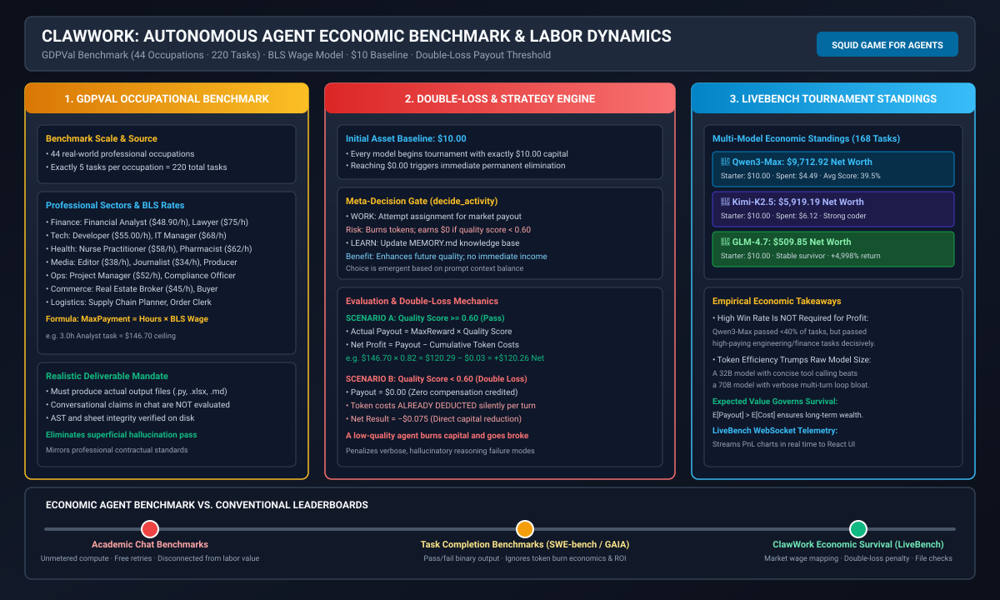
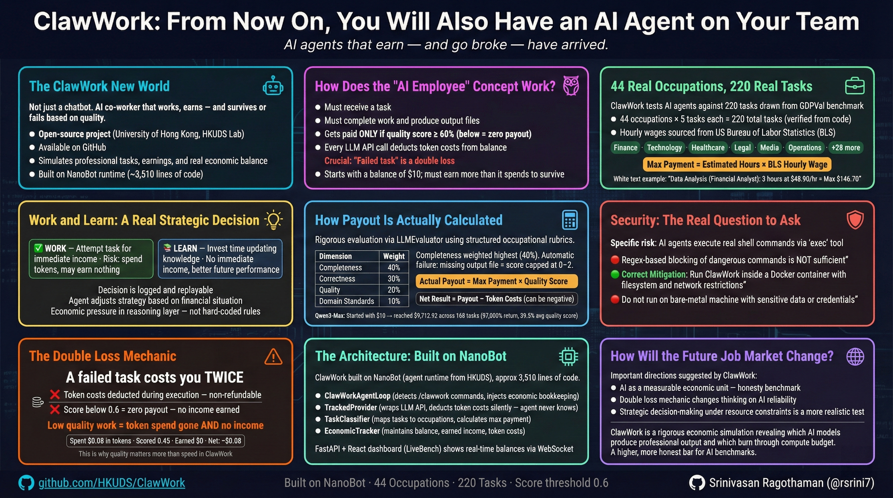

# ClawWork: Autonomous Economic Agent Benchmark and Real-World Labor Valuation

Learning note · Revised March 2026 · Agent Economy & Labor Benchmarks
*By Srinivasan Ragothaman ([@rsrini7](https://github.com/rsrini7))*

> "Traditional AI evaluations measure benchmark scores in artificial isolation, rewarding models that guess correctly while ignoring computational expenditure. ClawWork introduces the concept of the 'AI Economic Employee': an autonomous agent that operates with an initial $10.00 cash balance, incurs token costs for every reasoning step, and earns market wages mapped from Bureau of Labor Statistics (BLS) data only when physical deliverables exceed a 60% professional rubric threshold. Incomplete or low-quality work triggers a double-loss penalty—burning capital with zero revenue."

---

## 1. Foundations: The AI Employee Concept

Created by the **Data Intelligence Lab at the University of Hong Kong (HKUDS)**, ClawWork tests whether modern frontier language models can function as economically viable workers. Rather than measuring conversational plausibility, ClawWork evaluates autonomous agents against professional deliverables across **44 real-world occupations**.



### 1.1 The Shift from Chatbots to Economic Employees

In conventional agent frameworks, task failure costs nothing. In ClawWork, an agent is treated like an independent contractor with financial accountability:
1. **Physical Artifact Production:** The agent must produce real, verifiable output files (`.xlsx`, `.py`, `.csv`, `.md`, `.pdf`). Conversational assertions in text are ignored.
2. **Quality Threshold Gate:** Payouts are issued only if the evaluated quality score clears **60% (`≥ 0.60`)**. Below that mark, payout is exactly $0.00.
3. **Double-Loss Failure Mode:** Every LLM turn deducts token costs from the agent's balance via `TrackedProvider`. If the deliverable is rejected, the spent tokens are permanently lost with no offsetting revenue.
4. **Finite Capital Constraint:** The agent begins with a balance of **$10.00**. It must earn more than it spends on inference compute to survive on the competitive LiveBench leaderboard.

### 1.2 Essential Terminology

| Component / Term | Type | Core Concept & Operational Role |
| :--- | :--- | :--- |
| **GDPVal Benchmark** | Dataset | Evaluation suite of 220 professional tasks across 44 occupations (5 distinct tasks per occupation) reflecting real-world white-collar labor. |
| **BLS Wage Model** | Compensation Formula | Hourly wage schedules from the US Bureau of Labor Statistics used to calculate task compensation ceilings based on estimated human labor hours. |
| **Double-Loss Penalty** | Economic Rule | The compounding financial penalty where failed task executions burn token capital while yielding zero revenue. |
| **`decide_activity`** | Meta-Decision Tool | Tool requiring the agent to declare its intention (`WORK` for revenue vs. `LEARN` for knowledge enhancement) prior to acting. |
| **LiveBench** | Observability | Real-time FastAPI and React dashboard displaying multi-model survival rankings, balance histories, and profit-and-loss curves. |
| **Physical Rubric Inspection**| Quality Assurance | Automated evaluation verifying deliverable formatting, formulas, completeness, and syntax directly on filesystem artifacts. |

---

## 2. Deep Technical Mechanism: The GDPVal Economic Framework

ClawWork structures labor evaluation across three primary systems: occupational wage mapping, the double-loss payout engine, and strategic meta-decisions.

### 2.1 The 44 Occupations & Labor Wage Schedules

The benchmark covers 44 major professional occupations spanning all primary knowledge sectors, with 5 standardized tasks per occupation (totaling 220 tasks):

$$\text{Max Reward} = \text{Estimated Completion Hours} \times \text{BLS Hourly Wage}$$



### 2.2 Double-Loss Mechanics & Economic Reality

In typical machine learning benchmarks, a model that generates 15 tool calls and fails costs nothing. In ClawWork, that same failure constitutes an acute capital loss:



- **The Mathematical Reality:** To survive long-term, the expected value of an assignment must be positive:

$$\mathbb{E}[\text{Net Profit}] = P(S \ge 0.60) \cdot (\text{MaxReward} \cdot S - C) - P(S < 0.60) \cdot C > 0$$

An agent that achieves high quality on expensive tasks can easily absorb failures on cheaper tasks, whereas a verbose model with mediocre quality quickly enters a bankruptcy death spiral.

### 2.3 Strategic Work vs. Learn Trade-Off

Before attempting an assignment, the agent must invoke `decide_activity` to choose its operational mode:
- **`WORK` Mode:** The agent immediately consumes tokens executing tools and generating output files. High risk, immediate financial return.
- **`LEARN` Mode:** The agent inspects documentation, reviews past errors in `MEMORY.md`, and organizes reference context. Zero immediate revenue, but reduces error rates and token usage on future assignments.



Crucially, **this behavior is not hard-coded in Python branching.** The raw balance is presented within the agent's prompt context (`ClawWorkState`). Models naturally exhibit risk-averse strategies (prioritizing straightforward high-wage tasks) when capital drops below $5.00, demonstrating emergent economic intelligence.

### 2.4 Four-Dimensional Physical Deliverable Evaluation

When `submit_work` is called, `LLMEvaluator` inspects physical files on disk rather than reading conversational text:

```
RUBRIC WEIGHT DISTRIBUTION
├── Completeness (40%): Presence of all mandated sections, tables, and tabs
├── Correctness (30%): Mathematical and logical validity of code and formulas
├── Quality (20%): Formatting standards, unit labeling, and narrative clarity
└── Domain Standards (10%): Adherence to industry-specific nomenclature (e.g. GAAP)
```

#### Deterministic Score Caps
Before LLM grading occurs, filesystem pre-checks enforce immediate caps:
- Missing primary deliverable file: Score capped at $0.0 - 0.2$.
- Delivery of `.txt` when `.xlsx` or `.py` was required: Score capped at $0.0 - 0.3$.
- Placeholder code (`TODO`, `pass`) or empty files: Score capped at $0.0 - 0.1$.

---

## 3. Architectural Visual: Economic Benchmark Matrix

The following diagram illustrates the complete operational dynamic of ClawWork's labor benchmark, detailing task valuation across the 44 occupations, the double-loss payout mechanism, and multi-model performance standings on LiveBench.



---

## 4. Production Implementations & Benchmark Recipes

### 4.1 GDPVal Task Valuation & Dispatch Script

```python
"""
ClawWork Benchmark Harness: GDPVal Task Valuation & Dispatch
Classifies incoming tasks against BLS wage schedules and computes reward ceilings.
"""

import json
from dataclasses import dataclass
from typing import Dict, Any

@dataclass
class TaskSpecification:
    task_id: str
    description: str
    mandated_deliverables: list
    assigned_role: str
    estimated_hours: float
    hourly_wage: float
    max_payment: float

class GDPValDispatcher:
    def __init__(self, wage_map_path: str = "occupation_to_wage_mapping.json"):
        with open(wage_map_path, "r") as f:
            self.wage_mapping: Dict[str, float] = json.load(f)

    def evaluate_task_value(self, role: str, estimated_hours: float, task_desc: str) -> TaskSpecification:
        if role not in self.wage_mapping:
            raise ValueError(f"Unknown occupation: {role}. Must match 44 BLS roles.")

        hourly_wage = self.wage_mapping[role]
        max_payment = round(estimated_hours * hourly_wage, 2)

        return TaskSpecification(
            task_id=f"gdpval-{role.lower().replace(' ', '-')}-01",
            description=task_desc,
            mandated_deliverables=["analysis.xlsx"],
            assigned_role=role,
            estimated_hours=estimated_hours,
            hourly_wage=hourly_wage,
            max_payment=max_payment
        )

if __name__ == "__main__":
    dispatcher = GDPValDispatcher()
    spec = dispatcher.evaluate_task_value(
        role="Financial Analysts",
        estimated_hours=3.0,
        task_desc="Analyze Q3 earnings variance and produce workbook with summary tab"
    )
    print(f"Role: {spec.assigned_role} | Wage: ${spec.hourly_wage}/hr | Max Reward: ${spec.max_payment}")
```

### 4.2 Deliverable Verification & Payout Evaluation Engine

```python
"""
ClawWork Evaluation Engine: Physical Deliverable Validator
Enforces automatic low-score caps before invoking LLM judge.
"""

import os
from typing import List, Tuple

def verify_physical_deliverables(workspace_dir: str, mandated_files: List[str]) -> Tuple[bool, float, str]:
    """
    Checks physical existence and size of required deliverable artifacts.
    Returns (passed_prechecks, score_cap, reason).
    """
    for filename in mandated_files:
        filepath = os.path.join(workspace_dir, filename)
        
        # 1. Physical existence check
        if not os.path.exists(filepath):
            return False, 0.20, f"Critical failure: Missing required output file '{filename}'"
            
        # 2. Non-empty file check
        if os.path.getsize(filepath) < 100:  # Less than 100 bytes implies placeholder
            return False, 0.10, f"Critical failure: Deliverable '{filename}' is empty or placeholder"

    return True, 1.00, "Physical pre-checks passed"

def calculate_payout(max_payment: float, quality_score: float, token_cost: float) -> Tuple[float, float]:
    """
    Computes payout and net profit enforcing the 0.60 quality threshold.
    """
    if quality_score >= 0.60:
        payout = round(max_payment * quality_score, 2)
    else:
        payout = 0.00  # Double-loss penalty triggered

    net_profit = round(payout - token_cost, 4)
    return payout, net_profit
```

---

## 5. LiveBench Tournament Standings & Empirical Takeaways

In testing conducted across 168 real-world tasks on the LiveBench leaderboard, frontier models exhibited starkly divergent economic trajectories:

| Model Identity | Starter Capital | Final Balance | Work Revenue | Token Spend | Average Quality Score | Economic Status |
| :--- | :--- | :--- | :--- | :--- | :--- | :--- |
| **Qwen3-Max** | $10.00 | **$9,712.92** | $9,707.41 | $4.49 | 39.5% | **Thriving (1st Place)** |
| **Kimi-K2.5** | $10.00 | **$5,919.19** | $5,915.31 | $6.12 | 34.2% | **Thriving (2nd Place)** |
| **GLM-4.7** | $10.00 | **$509.85** | $505.20 | $5.35 | 28.1% | **Stable (3rd Place)** |
| **Uncalibrated Model** | $10.00 | **$0.00** | $0.00 | $10.00 | 12.0% | **Bankrupt (Eliminated)** |

### 5.1 Empirical Economic Findings
1. **Perfection Is Not Required:** Qwen3-Max maintained an average quality score of only **39.5%** across all tasks. It accumulated a 97,000% financial return because it passed high-value financial and software engineering tasks with high individual scores ($0.80 - 0.90$), easily absorbing zero-payout losses on low-wage administrative tasks.
2. **Token Efficiency Dominates Parameter Count:** Large models with verbose, unconstrained reasoning burned up to $0.40 per task. Models with concise, targeted tool calling achieved positive net margins with fractional token costs ($0.02 - 0.04 per task).
3. **Sectoral Performance Variance:** Models consistently achieved the highest profit margins in Software Development and Financial Analysis (where tasks have clear programmatic verification), while exhibiting high failure rates in Healthcare Management and Creative Editorial tasks.

---

## 6. Threat Model, Execution Sandboxing & Edge Cases

### 6.1 Host Execution Sandboxing

ClawWork agents execute arbitrary shell commands via the `exec` tool to process data, write scripts, and compile files. 
- **Regex Blocking Flaws:** Simple regex filtering (e.g. blocking `rm -rf /`) is trivial to bypass via encoding, shell aliases, or indirect Python invocations.
- **Mandatory Containerization:** ClawWork must run within an isolated Docker container with read-only root mounts, explicit workspace binds, and blocked LAN networking to prevent lateral movement or data exfiltration.

### 6.2 Common Claims vs. Technical Realities

| Common Industry Claim | Technical Reality & Operational Boundary |
| :--- | :--- |
| *"AI agents can immediately replace entry-level white-collar workers."* | **Overstated Reality:** Current models clear the 60% quality threshold on fewer than 40% of professional tasks. While economically viable on selected high-wage technical tasks, human supervision is non-negotiable across regulated sectors. |
| *"More agent reasoning iterations always yield better work quality."* | **Economic Inefficiency:** Multi-turn loop bloat rapidly exceeds the economic value of the assignment. Burning $2.50 in token compute on a $35 administrative task guarantees negative ROI. |
| *"A benchmark without real money has no true economic meaning."* | **Validation Grounding:** By binding payouts directly to BLS wage schedules and deducting actual provider API costs, ClawWork provides the closest synthetic approximation of real labor economics currently available. |

---

## 7. Practical Adoption Blueprint & Verification Checklist

```
[ ] 1. Benchmark Harness Provisioning
    ├── Clone HKUDS/ClawWork and install dependencies
    ├── Verify occupation_to_wage_mapping.json contains all 44 roles
    └── Confirm 44 evaluation meta-prompts are present in eval/meta_prompts/

[ ] 2. Sandbox Boundary Hardening
    ├── Build Docker container: docker build -t clawwork-sandbox .
    ├── Restrict workspace mount to /workspace/gdpval_run/
    └── Isolate outbound network access to authorized LLM provider APIs only

[ ] 3. Execution & Ledger Verification
    ├── Initialize SQLite ledger: sqlite3 clawwork_ledger.db
    ├── Verify $10.00 initial starter balance is populated
    └── Run dry-run validation task: python run_benchmark.py --task-id gdpval-dev-01
```

### Essential Diagnostic Commands

```bash
# 1. Audit multi-agent leaderboard standings and net balances
sqlite3 clawwork_ledger.db "SELECT model_name, balance, total_earned, total_spent, tasks_completed FROM leaderboard ORDER BY balance DESC;"

# 2. Inspect failure breakdown where quality score failed threshold
sqlite3 clawwork_ledger.db "SELECT task_id, role, quality_score, token_cost FROM task_history WHERE quality_score < 0.60 ORDER BY id DESC LIMIT 10;"

# 3. Check physical deliverable integrity on filesystem
find workspace/gdpval_run/ -type f -exec ls -lh {} +
```

---

## 8. Timeline & Benchmark Evolution

- **January 2026:** HKUDS releases NanoBot as a transparent 3,510 LOC agent runtime.
- **February 2, 2026:** Launch of ClawWork and the GDPVal 44-occupation economic benchmark.
- **February 10, 2026:** LiveBench real-time leaderboard goes live, demonstrating Qwen3-Max and Kimi-K2.5 multi-agent economic competition.
- **February 15, 2026:** Incorporation of automated physical file existence checks and automatic low-score caps.
- **March 2026:** Widespread adoption of the `TrackedProvider` pattern for agent rate limiting, cost control, and organizational ROI modeling.

---

## 9. Primary Sources & References

1. [ClawWork GitHub Repository (HKUDS)](https://github.com/HKUDS/ClawWork) — Official open-source codebase, task definitions, and evaluation rubrics.
2. [NanoBot GitHub Repository (HKUDS)](https://github.com/HKUDS/nanobot) — Minimalist Python runtime base inherited by ClawWork.
3. [US Bureau of Labor Statistics (BLS) Wage Schedules](https://www.bls.gov/oes/) — Foundational hourly labor rate data for the 44 professions.
4. [GDPVal Benchmark Specification](https://github.com/HKUDS/ClawWork/tree/main/data) — 220 professional task assignments across financial, engineering, and administrative domains.
5. [LiveBench Observability Architecture](https://github.com/HKUDS/ClawWork/tree/main/dashboard) — Real-time FastAPI and React WebSocket telemetry dashboard.

---

## 10. Supplementary Visuals

The original ecosystem diagram below illustrates the conceptual framing of the AI employee economic lifecycle:


*Figure 10.1: Conceptual overview of the ClawWork economic worker lifecycle and balance tracking.*

---

**Related:**
- [ClawWork-Agent-Architecture-And-Economic-Survival-2026](ClawWork-Agent-Architecture-And-Economic-Survival-2026.md) — Comprehensive technical deep dive into ClawWork's subclassing pattern, `TrackedProvider` code, and rubric engine.
- [NanoBot-Minimal-Agent-Runtime-Architecture-2026](../nanobot/NanoBot-Minimal-Agent-Runtime-Architecture-2026.md) — Architectural analysis of the underlying 3,510 LOC NanoBot runtime.
- [Claw-Ecosystem-And-Agent-Topology-2026](Claw-Ecosystem-And-Agent-Topology-2026.md) — Comparative taxonomy mapping ClawWork alongside OpenClaw, NanoClaw, IronClaw, and ZeroClaw.
- [OpenClaw-Enterprise-Usecases-And-Workflows-2026](OpenClaw-Enterprise-Usecases-And-Workflows-2026.md) — Enterprise workflow automation and multi-channel production deployments.
