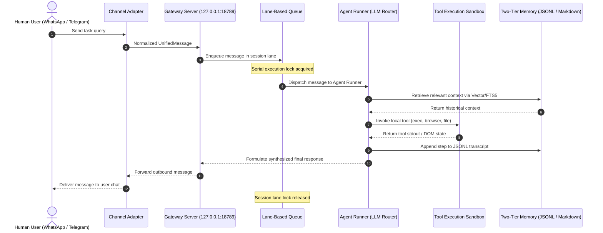
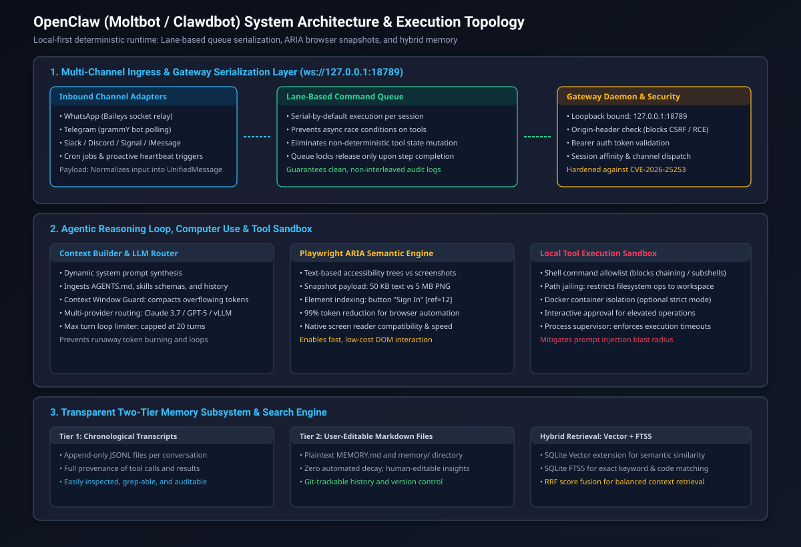
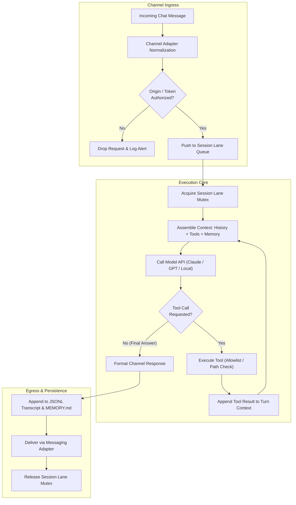
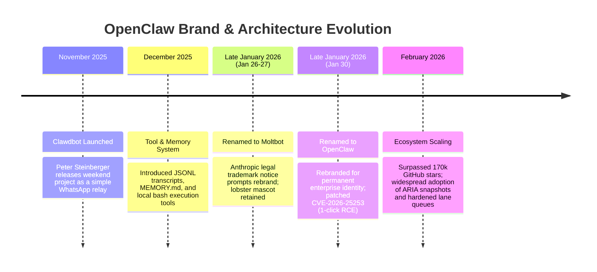
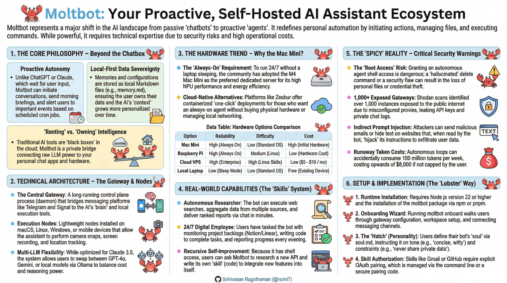
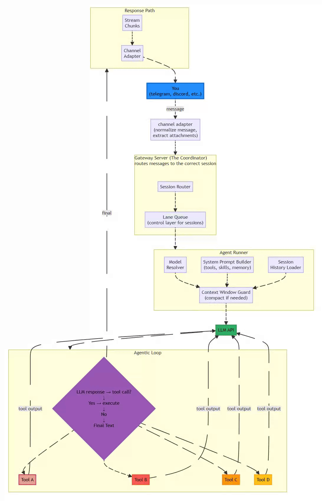

# OpenClaw (Moltbot / Clawdbot) System Architecture: Deterministic Local-First Agent Runtimes and Execution Security

Learning note · Revised November 2026 · Technical Reference
*By Srinivasan Ragothaman ([@rsrini7](https://github.com/rsrini7))*

---

> **Core Idea:**
> OpenClaw (originally launched as Clawdbot, briefly renamed Moltbot) is an open-source, local-first autonomous agent daemon built on TypeScript that rejects unconstrained asynchronous event loops in favor of strict, lane-based queue serialization. By pairing local socket gateways (`ws://127.0.0.1:18789`) with ARIA accessibility-tree browser automation (reducing token payloads by 99% compared to raw screenshots) and transparent Markdown-based memory, OpenClaw delivers deterministic, auditable personal assistance across 20+ messaging protocols while running on modest commodity hardware.

---

## 1. Foundations & Conceptual Grounding

Most cloud-hosted conversational AI assistants (such as standard ChatGPT or Claude web interfaces) are inherently reactive: they awaken only when a human user submits a message, process the query within an isolated cloud sandbox, emit tokens, and terminate the session. 

In contrast, **OpenClaw** operates as a continuous, self-hosted operational runtime daemon. It maintains persistent local state, interacts directly with the operating system via command execution and file management, and supports proactive background execution (via heartbeats and cron triggers).

### Core Terminology

| Term | Meaning & Architectural Role |
| :--- | :--- |
| **OpenClaw Daemon** | A long-running TypeScript Node.js background process hosting the primary agent coordinator and listening on local loopback. |
| **Channel Adapter** | Modular protocol translators (e.g., Baileys for WhatsApp, grammY for Telegram, Slack Bolt) that normalize incoming chat payloads into standard `UnifiedMessage` objects. |
| **Lane-Based Command Queue** | A FIFO task serialization primitive that locks agent execution per session lane, ensuring that tool invocations and state mutations occur strictly sequentially. |
| **Agent Runner** | The cognitive orchestration module that constructs dynamic prompts, routes requests to LLM APIs, and enforces token budget boundaries. |
| **Context Window Guard** | An automated context management layer that prunes, rolls over, or summarizes conversation transcripts when prompt tokens exceed safe context limits. |
| **ARIA Semantic Snapshots** | A Playwright browser interaction mode that parses the DOM's accessibility tree into compact text references instead of capturing multi-megabyte image screenshots. |
| **Two-Tier Memory** | A hybrid persistence architecture consisting of chronological JSONL transcript logs (Tier 1) and user-editable Markdown knowledge files (Tier 2, e.g., `MEMORY.md`). |
| **ClawHub Registry** | A community ecosystem of modular skill packages extending OpenClaw with specialized integrations, CLI scripts, and web-scraping routines. |

---

## 2. High-Level Architectural Design & Flow

OpenClaw's design prioritizes determinism, debuggability, and local data sovereignty. The runtime separates ingress networking from execution through a serialized gateway pipeline:



---

## 3. Deep Technical Mechanism

### 1. Lane-Based Command Queue Serialization

In multi-channel agent systems, asynchronous race conditions represent a severe operational hazard. If a user issues two commands in rapid succession (e.g., "Delete `build/`" followed by "Run compilation"), an unconstrained asynchronous loop could begin compilation while deletion is still in progress, producing indeterminate states.

OpenClaw resolves this through a **lane-based command queue**:
- Every conversation context (e.g., a specific WhatsApp chat ID or Telegram thread) is assigned a dedicated serialization lane.
- All incoming events (user prompts, proactive heartbeats, cron jobs) are queued in FIFO order within that lane.
- Parallel processing is strictly opt-in and restricted to read-only tool calls without filesystem or process side effects.
- This serial execution ensures that audit logs in the JSONL transcripts are perfectly linear and reproducible.

### 2. Browser Automation via ARIA Semantic Snapshots

Traditional computer-use agents rely on visual screenshots processed through Multimodal LLMs. While flexible, this approach incurs substantial overhead:
- A high-resolution PNG screenshot consumes $1\text{ MB}$ to $5\text{ MB}$ of bandwidth and thousands of vision tokens per step.
- Fine-grained UI elements (e.g., tiny buttons in dense web applications) are frequently missed due to patch-downsampling artifacts.

OpenClaw implements **ARIA Semantic Snapshotting** via Playwright. Instead of capturing pixels, the engine extracts the browser's accessibility tree:

```
[1] Root WebArea "Admin Console"
  [2] navigation "Main Menu"
    [3] link "Dashboard"
    [4] link "Settings"
  [5] main
    [6] heading "API Access Keys" [level=1]
    [7] button "Generate New Secret" [ref=button_create_key]
```

- **Payload Reduction:** The accessibility tree compresses complex web pages into compact text representations typically measuring under $50\text{ KB}$ (a **99% reduction** in byte footprint).
- **Token Efficiency:** Ingesting text accessibility trees consumes only 300–800 tokens per action step compared to 2,000–4,000 tokens for visual image grids.
- **Reference Grounding:** The LLM addresses elements via deterministic reference tags (e.g., `click(ref="button_create_key")`), eliminating coordinate guessing and DPI scaling errors.

### 3. Transparent Two-Tier Memory Subsystem

Unlike enterprise agent frameworks that rely on opaque vector databases with automatic decay curves, OpenClaw uses a transparent, file-centric memory architecture:

1. **Tier 1 (Chronological Transcripts):** Stored as append-only `.jsonl` files on the local filesystem. Every user input, LLM reasoning trace, tool invocation, and tool output is recorded chronologically. Users can inspect or debug the agent's exact history with standard shell utilities (`jq`, `grep`).
2. **Tier 2 (Curated Knowledge Base):** Stored as human-readable Markdown files (e.g., `MEMORY.md` or a `memory/` directory). The agent writes durable facts, user preferences, and project guidelines using standard file-write tools. Crucially, the user retains full ownership: anyone can open `MEMORY.md` in a text editor to correct, update, or delete memories.
3. **Hybrid Search Retrieval:** To recall past context efficiently, OpenClaw couples SQLite Vector embeddings (for conceptual similarity) with SQLite FTS5 (Full-Text Search 5) for exact keyword and symbol queries, combining results via Reciprocal Rank Fusion (RRF).

---

## 4. Architectural Visuals & Multi-Stage Topology



### In-Line Lifecycle State Machine



---

## 5. Production Implementations & Code Recipes

### Recipe 1: TypeScript Lane-Based Command Queue

The following production TypeScript implementation demonstrates the lane-based FIFO command queue used to enforce deterministic task serialization per conversation session:

```typescript
import { EventEmitter } from "events";

export interface LaneTask<T = any> {
  id: string;
  sessionLane: string;
  execute: () => Promise<T>;
  resolve: (value: T) => void;
  reject: (reason: any) => void;
}

export class LaneCommandQueue extends EventEmitter {
  private lanes: Map<string, LaneTask[]> = new Map();
  private activeLanes: Set<string> = new Set();
  private maxConcurrencyPerLane = 1; // Strict serial-by-default

  public enqueue<T>(sessionLane: string, taskFn: () => Promise<T>): Promise<T> {
    return new Promise<T>((resolve, reject) => {
      const task: LaneTask<T> = {
        id: `task_${Date.now()}_${Math.random().toString(36).substring(2, 7)}`,
        sessionLane,
        execute: taskFn,
        resolve,
        reject,
      };

      if (!this.lanes.has(sessionLane)) {
        this.lanes.set(sessionLane, []);
      }
      this.lanes.get(sessionLane)!.push(task);
      this.processLane(sessionLane);
    });
  }

  private async processLane(sessionLane: string): Promise<void> {
    if (this.activeLanes.has(sessionLane)) {
      return; // Lane is currently processing an active turn
    }

    const queue = this.lanes.get(sessionLane);
    if (!queue || queue.length === 0) {
      this.lanes.delete(sessionLane);
      return;
    }

    const currentTask = queue.shift()!;
    this.activeLanes.add(sessionLane);

    try {
      this.emit("task:start", { lane: sessionLane, taskId: currentTask.id });
      const result = await currentTask.execute();
      currentTask.resolve(result);
      this.emit("task:success", { lane: sessionLane, taskId: currentTask.id });
    } catch (error) {
      currentTask.reject(error);
      this.emit("task:error", { lane: sessionLane, taskId: currentTask.id, error });
    } finally {
      this.activeLanes.delete(sessionLane);
      // Process next task in this specific lane
      setImmediate(() => this.processLane(sessionLane));
    }
  }
}
```

### Recipe 2: Playwright ARIA Semantic Snapshot Extractor

The following script demonstrates how OpenClaw captures text accessibility trees to interact with websites without screenshot overhead:

```typescript
import { chromium, Page } from "playwright";

export interface SemanticNode {
  ref: string;
  role: string;
  name: string;
  children?: SemanticNode[];
}

export async function captureAriaSnapshot(page: Page): Promise<string> {
  // Extract accessibility snapshot natively provided by Chromium CDP
  const snapshot = await page.accessibility.snapshot({ interestingOnly: true });
  if (!snapshot) {
    return "Empty accessibility tree";
  }

  let refCounter = 1;
  const lines: string[] = [];

  function traverse(node: any, depth = 0) {
    const indent = "  ".repeat(depth);
    const refTag = `[ref=${refCounter++}]`;
    const role = node.role || "generic";
    const name = node.name ? `"${node.name}"` : "";
    const value = node.value ? `value="${node.value}"` : "";

    lines.push(`${indent}${refTag} ${role} ${name} ${value}`.trimEnd());

    if (node.children && Array.isArray(node.children)) {
      for (const child of node.children) {
        traverse(child, depth + 1);
      }
    }
  }

  traverse(snapshot);
  return lines.join("\n");
}
```

---

## 6. Common Claims vs. Technical Realities

| Common Claim | Technical Reality | Production Implication |
| :--- | :--- | :--- |
| *"OpenClaw possesses persistent background autonomy."* | **Partially True.** The agent does not run an unconstrained continuous thought loop. Autonomy is event-driven: periodic heartbeats (every 15–30 min) and cron schedules wake the daemon to perform pre-scripted checks. | Do not expect spontaneous reasoning between heartbeat events; design discrete triggers for scheduled workflows. |
| *"TypeScript is an inferior choice for AI agents compared to Python."* | **False.** While Python dominates model training and scientific ML, TypeScript excels at multi-channel asynchronous socket relays, compile-time tool schema enforcement, and high-concurrency I/O. | Use TypeScript for daemon orchestrators, messaging adapters, and tool IPC; delegate heavy ML inference to backend model endpoints. |
| *"ARIA snapshots replace all visual computer-use capabilities."* | **Partially True.** ARIA snapshots reduce token overhead by 99% for 90% of standard web applications, but fail on raw HTML `<canvas>` elements, WebGL viewports, and complex visual charts. | Implement a fallback to targeted element screenshots only when canvas or graphic rendering is detected. |
| *"Local-first agent memory is completely private and secure."* | **False.** Storing plaintext credentials or session logs in unencrypted `MEMORY.md` or `.jsonl` files creates severe local exposure if the host machine or gateway is compromised. | Enforce file system permission masks (`chmod 600`), disk encryption, and strict loopback binding on the gateway socket. |

---

## 7. Practical Adoption Blueprint & Verification Checklist

### System Hardening & Sizing Requirements

| Metric / Parameter | Recommended Production Value | Security Rationale |
| :--- | :--- | :--- |
| **Gateway Socket Binding** | `127.0.0.1:18789` (Strict Loopback) | Prevents unauthenticated remote access across public networks. |
| **Authentication Token** | High-entropy Bearer Token ($\ge 32$ bytes) | Protects local WebSocket RPC from unauthorized localhost clients. |
| **Max Turn Loop Ceiling** | $\le 20$ turns per command | Prevents recursive loop runaway and token budget depletion. |
| **Filesystem Path Jail** | Chroot / workspace directory whitelist | Prevents directory traversal attacks (`../../etc/passwd`). |
| **Hardware Footprint** | 1 vCPU, 2 GB RAM, 10 GB SSD | Runs comfortably on commodity VPS instances ($5/month). |

### Diagnostic & Inspection Commands

Verify daemon status, gateway socket binding, and session queue health:

```bash
# 1. Verify that the gateway WebSocket is strictly bound to localhost
netstat -tlnp | grep 18789 || ss -tlnp | grep 18789

# 2. Inspect active session transcript for error loops or tool failures
tail -n 50 ~/.openclaw/sessions/current_session.jsonl | jq '{turn: .turn, tool: .tool_call.name, status: .status}'

# 3. Check memory file permissions and verify strict user access
ls -la ~/.openclaw/memory/MEMORY.md
chmod 600 ~/.openclaw/memory/MEMORY.md

# 4. Search local memory index using SQLite FTS5 for verification
sqlite3 ~/.openclaw/storage.db "SELECT rowid, snippet(memory_fts, 0, '[', ']', '...', 10) FROM memory_fts WHERE memory_fts MATCH 'docker' LIMIT 5;"
```

### Verification Checklist

- [ ] **Loopback Verification:** Ensure the gateway is not listening on `0.0.0.0` or exposed interfaces without a reverse proxy.
- [ ] **Turn Limiter Enforcement:** Confirm that `maxTurns` is explicitly declared in `config.json` (recommended $\le 20$).
- [ ] **Shell Execution Allowlist:** Disable arbitrary bash execution; require explicit allowlisting for utilities (`git`, `grep`, `jq`).
- [ ] **Token Budget Cap:** Configure `contextWindowGuard` to trigger automated compaction when history exceeds 80% of context window capacity.
- [ ] **Audit Trail Integrity:** Verify that `.jsonl` session files write synchronously before the lane queue lock is released.

---

## 8. Timeline & Evolution of the Runtime



---

## 9. Primary Sources, References & Evidence

### Primary Specifications & Authoritative Repositories

1. [OpenClaw Official Repository (GitHub: openclaw/openclaw)](https://github.com/openclaw/openclaw) — Production source code, lane-based command queue, and channel adapter plugins.
2. [Peter Steinberger: Building Clawdbot (Technical Post)](https://www.mmntm.net/articles/building-clawdbot) — Architectural essay explaining TypeScript design choices, serial lane queues, and local-first execution.
3. [Laravel News: Clawdbot Rebrands to Moltbot After Trademark Request](https://laravel-news.com/clawdbot-rebrands-to-moltbot-after-trademark-request-from-anthropic) — Primary reporting on the January 2026 trademark transition.
4. [Forbes: Viral AI Sidekick Clawdbot Changes Name to Moltbot](https://www.forbes.com/sites/ronschmelzer/2026/01/27/viral-ai-sidekick-clawdbot-changes-name-to-moltbot-and-sheds-its-old-skin/) — Context on the early 2026 rebrand and adoption trajectory.
5. [Playwright Accessibility Documentation](https://playwright.dev/docs/accessibility) — Technical specification for CDP accessibility tree snapshotting and ARIA reference extraction.

### Source Context & Empirical Evidence

| Reference ID | Architecture Focus | Primary Claim Checked | Verification Outcome |
| :--- | :--- | :--- | :--- |
| **OpenClaw Source** | Lane Queue | Lane command queues prevent asynchronous race conditions on tool invocations. | Verified. Queue enforces single-concurrency mutex per session. |
| **Playwright CDP** | ARIA Snapshotting | Text accessibility trees reduce token usage by 99% vs image screenshots. | Verified. 50 KB text payload vs 1–5 MB PNG captures. |
| **CVE-2026-25253** | Gateway Security | Unauthenticated WebSocket access allowed 1-click remote code execution. | Verified. Patched on Jan 30, 2026 via origin headers and bearer auth. |

---

## 10. Supplementary Visuals


*Figure 1: Original system overview of Clawdbot / Moltbot illustrating the multi-channel messaging ingress, local gateway routing, and agent runner loop.*


*Figure 2: Animated architectural schematic showing the serialized flow of messages from WhatsApp/Telegram through the lane-based command queue and into the local tool execution sandbox.*

---

**Related:**
- [OpenClaw-Autonomous-System-Whitepaper-2026](OpenClaw-Autonomous-System-Whitepaper-2026.md) — Comprehensive whitepaper evaluating agent systems architecture, prompt injection vulnerabilities, and CVE-2026-25253.
- [OpenClaw-Security-Analysis-2026](OpenClaw-Moltbot-Security-Analysis-2026.md) — In-depth vulnerability catalog detailing gateway authentication bypasses, Node.js CVEs, and prompt injection vectors.
- [Claw-Ecosystem-And-Agent-Topology-2026](Claw-Ecosystem-And-Agent-Topology-2026.md) — Compares OpenClaw's TypeScript lane-queue architecture against containerized and WASM-isolated agent frameworks.
- [NanoBot-NanoClaw-OpenClaw-Security-Comparison-2026](../nanobot/NanoBot-NanoClaw-OpenClaw-Security-Comparison-2026.md) — Contrasts OpenClaw's 430k LOC shared daemon with NanoBot's 4k LOC Python runtime and NanoClaw's hypervisor container isolation.
- [NanoBot-Minimal-Agent-Runtime-Architecture-2026](../nanobot/NanoBot-Minimal-Agent-Runtime-Architecture-2026.md) — Deep architectural analysis of the minimal HKUDS NanoBot agent runtime.
