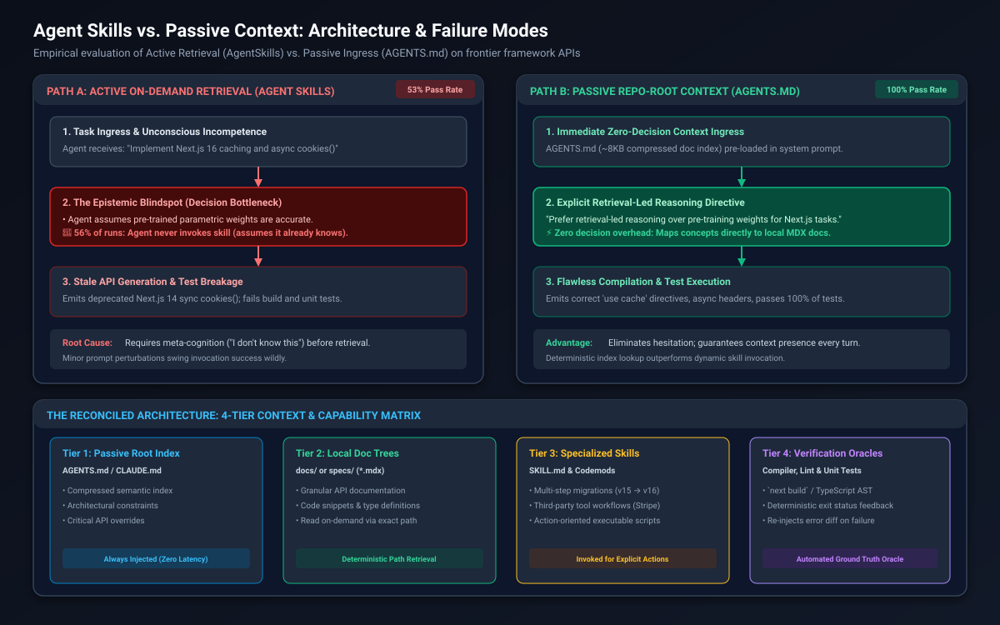
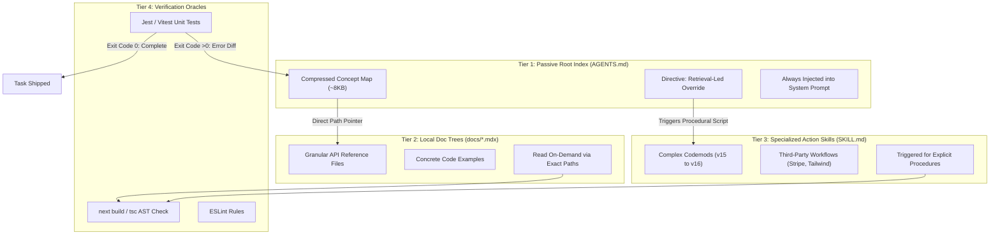

# Agent Skills vs. Passive Context: Architectural Trade-Offs in Autonomous Coding (2026)

Daily learning · Nov 16, 2026
*By Srinivasan Ragothaman ([@rsrini7](https://github.com/rsrini7))*

> While active on-demand retrieval (Agent Skills) was expected to dominate autonomous software engineering, empirical evaluations demonstrate that passive, zero-decision repository context (`AGENTS.md`) achieves significantly higher task completion (100% vs 53%) on frontier framework APIs by eliminating model invocation hesitation.

---

## 1. Core Idea

The prevailing mental model for AI coding agents assumed that agents should dynamically discover and retrieve specialized capabilities—packaged as modular "Skills"—only when needed. In theory, this minimizes context window usage and keeps agent prompts lightweight.

In practice, a controlled empirical benchmark conducted by Vercel on newly released **Next.js 16 APIs** revealed a critical flaw: **agents fail not because they lack tools, but because they fail to realize when they need them**. In over 56% of benchmark runs, agents operating under on-demand skill architectures never invoked the required skill, defaulting to obsolete pre-trained parametric knowledge and failing 47% of test suites. Conversely, injecting a compact, passive documentation index (`AGENTS.md`) directly into the root context achieved a **100% pass rate across compilation, linting, and unit tests**.

This finding does not render Skills obsolete; rather, it establishes a definitive architectural hierarchy: **passive context governs foundational framework semantics, while modular skills govern discrete, action-oriented procedural workflows**.

---

## 2. Foundations

Understanding why passive context outperforms active tool retrieval requires examining how Large Language Models process epistemic uncertainty.

```
+---------------------------------------------------------------------------------+
|                       Agent Ingress & Epistemic Evaluation                      |
+---------------------------------------+-----------------------------------------+
                                        |
                    +-------------------+-------------------+
                    |                                       |
                    v                                       v
+---------------------------------------+ +---------------------------------------+
|  Path A: Active Retrieval (Skills)   | |  Path B: Passive Context (AGENTS.md)  |
|  - Skill listed in tool definitions   | |  - Compressed index in system prompt  |
|  - Model must recognize knowledge gap | |  - Explicit directive: "Prefer docs"  |
|  - Probabilistic tool call decision   | |  - Zero-decision deterministic ingress|
+-------------------+-------------------+ +-------------------+-------------------+
                    |                                       |
                    v                                       v
    [56% Invocation Failure Rate]               [100% Context Presence Guaranteed]
    Agent relies on stale weights               Agent follows local MDX path
                    |                                       |
                    v                                       v
         53% Benchmark Pass Rate                 100% Benchmark Pass Rate
```

### Core Terminology

| Term | Technical Meaning | Operational Role |
| :--- | :--- | :--- |
| **Passive Context (`AGENTS.md`)** | Static instructions, architectural rules, and compressed documentation indexes automatically loaded into the system prompt on every agent turn. | Eliminates meta-cognitive decision latency; ensures foundational rules are omnipresent. |
| **Active On-Demand Skill** | Modular tools or documentation packages (e.g., `agentskills.io` standard) loaded only when an agent emits an explicit tool invocation call. | Isolates complex, multi-step procedures (e.g., database migrations, third-party API setup). |
| **Epistemic Blindspot** | A failure mode where an LLM exhibits unwarranted confidence in its pre-trained parametric memory, failing to recognize that its knowledge is outdated. | Causes agents to skip external documentation retrieval when encountering new APIs. |
| **Retrieval-Led Reasoning** | A system prompt directive forcing the model to prioritize local repository documentation over pre-trained neural network weights. | Overrides default model assumptions when breaking API changes are introduced. |
| **Two-Tier Compressed Index** | An architecture where `AGENTS.md` contains an ~8KB map of concepts to exact local `.mdx` file paths rather than dumping full documentation manuals. | Maximizes token efficiency while providing deterministic file system pointers. |
| **Deterministic Verification Oracle** | Hard automated gates (compilers, linters, unit test suites) that evaluate code generation independently of LLM self-assessment. | Provides undeniable ground-truth error signals to trigger automated agent self-correction. |

---

## 3. Deep Technical Mechanism

The performance divergence between active skills and passive context stems from the cognitive overhead of model tool selection versus deterministic prompt injection.



### The Epistemic Blindspot in Active Retrieval

When presented with a coding task on a newly released framework (such as Next.js 16), the agent faces an epistemic dilemma:
1. **Unconscious Incompetence**: The model's parametric weights contain extensive training on older paradigms (e.g., Next.js 14 synchronous `cookies()`, `headers()`, and legacy caching flags).
2. **Parametric Overconfidence**: Because the model has high token probability for the obsolete syntax, its internal attention heads do not register sufficient uncertainty to trigger an external tool call (`invoke_skill("nextjs-16")`).
3. **The Invocation Failure Cascade**: In Vercel's evaluation, agents failed to invoke the available skill in **56% of runs**. Even when prompted with vague instructions like "explore the project first", the agent frequently concluded that its existing knowledge was sufficient, resulting in code that broke during compilation.

### The Power of Passive Deterministic Ingress

Passive context solves the epistemic blindspot by removing the decision bottleneck entirely:
- **Zero-Decision Overhead**: The compressed documentation index is injected directly into context at turn zero. The agent does not need to decide *whether* to retrieve; the pointers are already in its active attention span.
- **Forced Directive Gating**: Adding a single explicit constraint—*“Prefer retrieval-led reasoning over pre-training-led reasoning for any Next.js tasks”*—acts as a high-attention attention anchor. It suppresses high-probability parametric tokens in favor of reading the specified local doc paths.

### Vercel Next.js 16 Empirical Benchmark Results

Vercel tested agents against breaking Next.js 16 APIs absent from pre-training data: `'use cache'`, `connection()`, `cacheLife()`, `cacheTag()`, `forbidden()`, `unauthorized()`, asynchronous `cookies()`, and `proxy.ts`.

| Evaluation Configuration | Overall Pass | Build Pass | Lint Pass | Test Suite Pass |
| :--- | :--- | :--- | :--- | :--- |
| **Baseline (Zero Docs)** | 53% | 84% | 95% | 63% |
| **Agent Skill (Default On-Demand)** | 53% | 84% | 89% | 58% |
| **Agent Skill (+ Forced Invocations)** | 79% | 95% | 100% | 84% |
| **Passive AGENTS.md (Compressed Index)** | **100%** | **100%** | **100%** | **100%** |

The results show that default on-demand skills performed no better than having zero documentation (both at 53%), because agents consistently failed to invoke them. Only when knowledge was passively present did the agent achieve complete task correctness.

---

## 4. The Reconciled 4-Tier Context Matrix

Rather than viewing Skills and `AGENTS.md` as mutually exclusive competitors, production systems organize repository knowledge into four distinct tiers:



1. **Tier 1: Passive Root Index (`AGENTS.md`)**: Omnipresent architectural rules, repo invariants, and a compressed pointer table mapping framework concepts to local paths.
2. **Tier 2: Local Documentation Trees (`docs/*.mdx`)**: Full, unabridged documentation pages stored directly in the repository, read on-demand by the agent using standard file-reading tools.
3. **Tier 3: Modular Action Skills (`SKILL.md` / Codemods)**: Action-oriented procedural scripts (e.g., migrating 50 components to a new design system, configuring Stripe webhooks) where the user explicitly requests an action.
4. **Tier 4: Deterministic Verification Oracles**: Compiler AST checks, linters, and unit tests that provide binary ground-truth validation.

---

## 5. Production Implementations & Code Recipes

The following recipes illustrate the production implementation of a compressed `AGENTS.md` index and an automated heuristic skill router that prevents agent hesitation.

### Recipe 1: Production-Grade `AGENTS.md` Specification

```markdown
# Repository Agent Guidelines: Next.js 16 Enterprise App

> CRITICAL: Prefer retrieval-led reasoning over pre-training-led reasoning for all Next.js tasks.
> Next.js 16 introduces breaking API changes. Never rely on memorized Next.js 14 conventions.

## 1. Ground Rules & Mandatory Directives
- Async Request APIs: `cookies()`, `headers()`, and `params` are strictly asynchronous. Always `await` them.
- Caching: Never use `export const revalidate`. Use the `'use cache'` directive and `cacheLife()` / `cacheTag()`.
- Error Handling: Use `forbidden()` and `unauthorized()` from `next/navigation` for access control.
- Deterministic Verification: Every change MUST pass `pnpm build` and `pnpm test` before concluding.

## 2. Compressed API Documentation Index
When implementing or modifying features, immediately read the corresponding reference file:

| Concept / API | Primary Syntax | Local Reference File |
| :--- | :--- | :--- |
| **Component Caching** | `'use cache'`, `cacheLife('hours')` | `docs/next16/caching.mdx` |
| **Async Headers & Cookies** | `const c = await cookies()` | `docs/next16/headers-cookies.mdx` |
| **Dynamic IO & Streaming** | `connection()`, Suspense boundaries | `docs/next16/dynamic-io.mdx` |
| **Access Control Navigation** | `forbidden()`, `unauthorized()` | `docs/next16/navigation-errors.mdx` |
| **Background Processing** | `after(() => { ... })` | `docs/next16/after-task.mdx` |
| **Custom Proxy Routing** | `proxy.ts` request rewriting | `docs/next16/proxy-routing.mdx` |
```

### Recipe 2: Heuristic Skill Router (Preventing Model Hesitation)

In environments where on-demand skills must be utilized, rely on deterministic AST and prompt pattern matching rather than asking the LLM to decide whether to invoke the skill:

```python
"""
Progressive Context Loader: Heuristic Skill Router.
Eliminates epistemic hesitation by auto-binding skills based on prompt intent and AST diffs.
"""

from __future__ import annotations
import re
from dataclasses import dataclass
from pathlib import Path
from typing import Dict, List, Optional, Set


@dataclass
class AgentSkill:
    name: str
    description: str
    instruction_path: Path
    trigger_patterns: List[str]


class HeuristicContextManager:
    """Detects missing context and injects skills deterministically before LLM turn zero."""

    def __init__(self, workspace_root: Path) -> None:
        self.workspace_root = workspace_root
        self.registered_skills: Dict[str, AgentSkill] = {}
        self.root_agent_file = workspace_root / "AGENTS.md"

    def register_skill(self, skill: AgentSkill) -> None:
        self.registered_skills[skill.name] = skill

    def resolve_context(self, user_prompt: str, target_files: List[str]) -> str:
        """Constructs turn-zero system context, auto-binding relevant skills."""
        context_parts: List[str] = []

        # 1. Always inject passive AGENTS.md if present (Tier 1)
        if self.root_agent_file.exists():
            context_parts.append(f"=== PASSIVE ROOT CONTEXT ===\n{self.root_agent_file.read_text(encoding='utf-8')}")

        # 2. Heuristic Intent & Diff Scanning (Auto-bind Tier 3 Skills)
        matched_skills: Set[str] = set()
        for skill_name, skill in self.registered_skills.items():
            for pattern in skill.trigger_patterns:
                if re.search(pattern, user_prompt, re.IGNORECASE):
                    matched_skills.add(skill_name)
                    break

        # 3. Inject matched skills directly into context (Bypassing LLM decision gate)
        for skill_name in matched_skills:
            skill = self.registered_skills[skill_name]
            if skill.instruction_path.exists():
                instructions = skill.instruction_path.read_text(encoding='utf-8')
                context_parts.append(
                    f"\n=== AUTO-BOUND SKILL: {skill.name} ===\n"
                    f"Description: {skill.description}\n"
                    f"Instructions:\n{instructions}\n"
                )

        return "\n\n".join(context_parts)


# =====================================================================
# Verification Execution
# =====================================================================

def main() -> None:
    # Setup mock workspace
    workspace = Path("/tmp/mock_repo")
    workspace.mkdir(parents=True, exist_ok=True)
    
    agents_md = workspace / "AGENTS.md"
    agents_md.write_text("# Project Invariants\n- Use TypeScript 5.5 strict mode.\n- Prefer async cookies.", encoding="utf-8")

    skills_dir = workspace / "skills"
    skills_dir.mkdir(exist_ok=True)
    migration_skill = skills_dir / "next16-migration.md"
    migration_skill.write_text("Execute codemod: npx @next/codemod@canary next-async-request-api .", encoding="utf-8")

    manager = HeuristicContextManager(workspace)
    manager.register_skill(
        AgentSkill(
            name="next16-migration",
            description="Automated AST codemod for Next.js 16 async headers/cookies migration.",
            instruction_path=migration_skill,
            trigger_patterns=[r"upgrade\s+to\s+next\s*16", r"async\s+cookies", r"next16\s+migration"],
        )
    )

    # Simulate user requesting an upgrade
    prompt = "Please upgrade our customer portal to Next 16 and fix async cookies warnings."
    resolved_context = manager.resolve_context(user_prompt=prompt, target_files=["src/app/page.tsx"])

    print("--- GENERATED TURN-ZERO CONTEXT ---")
    print(resolved_context)
    assert "AUTO-BOUND SKILL: next16-migration" in resolved_context
    assert "PASSIVE ROOT CONTEXT" in resolved_context
    print("\n✅ Context successfully pre-bound without relying on model self-invocation.")


if __name__ == "__main__":
    main()
```

---

## 6. Impact, Real-World Edge Cases & Gotchas

While passive context resolves invocation failure, naive implementations introduce distinct operational hazards.

### Production Failure Modes

1. **Context Window Saturation via Monolithic Documentation Dumps**:
   - *Risk*: Dumping an entire framework documentation repository (hundreds of KB) into `AGENTS.md` exhausts attention budgets, slows inference latency, and degrades reasoning on the core task.
   - *Mitigation*: Keep `AGENTS.md` strictly under 8–12KB. Use it purely as an index containing 1-line concept descriptions and relative file paths to localized markdown docs (`docs/*.mdx`).
2. **Stale Index Drift (Silent Hallucination)**:
   - *Risk*: When developers refactor the repository or rename documentation paths without updating `AGENTS.md`, agents attempt to read non-existent paths, triggering file-not-found loops.
   - *Mitigation*: Implement a CI linter (e.g., `python3 Scripts/github-repos.py links`) that verifies every relative markdown link in `AGENTS.md` resolves against the working tree.
3. **Prompt Sensitivity in Dynamic Tool Calling**:
   - *Risk*: When relying on active skills, minor prompt perturbations ("explore the repo first" vs "read skills first") produce up to a 26% swing in task completion rates.
   - *Mitigation*: Use passive context for all baseline conventions; reserve skills exclusively for deterministic, explicit user commands (e.g., `/migrate-next16`).

### Common Claims vs. Technical Realities

| Operational Dimension | Common Industry Claim | Technical Reality in Production |
| :--- | :--- | :--- |
| **Tool Architecture** | "Agents should dynamically retrieve all documentation via semantic search." | Retrieval introduces an extra reasoning hop where agents fail 56% of the time due to overconfidence in pre-trained weights. |
| **Context Overhead** | "Adding documentation to system prompts wastes tokens on every turn." | A compressed 8KB doc index consumes &lt;2,000 tokens—less than 1% of modern 128K/200K context windows—while boosting task accuracy from 53% to 100%. |
| **Skills Utility** | "Agent Skills are a failed abstraction." | Skills fail as general knowledge bases, but remain the optimal abstraction for procedural codemods, multi-file migrations, and CLI actions. |
| **Agent Reasoning** | "Smarter models (e.g., reasoning models) eliminate the need for passive context." | Reasoning models still exhibit strong parametric bias; explicit retrieval-led directives remain mandatory to override obsolete pre-trained syntax. |

---

## 7. Practical Adoption Blueprint & Verification Checklist

To adopt this layered context architecture in an enterprise codebase, follow this 4-step deployment cycle:

```
Step 1: Audit & Index Creation
└── Generate root AGENTS.md using automated codemods:
    npx @next/codemod@canary agents-md
└── Prune verbose narrative text; keep only compressed concept-to-file path maps.

Step 2: Directive Anchoring
└── Add explicit directive at the top of AGENTS.md:
    "Prefer retrieval-led reasoning over pre-training-led reasoning for any [Framework] tasks."

Step 3: Verification Oracle Setup
└── Ensure deterministic test scripts exist in package.json:
    pnpm test:ci && pnpm lint && pnpm build

Step 4: Continuous Link & Index Validation
└── Integrate automated link checking in pre-commit git hooks:
    python3 Scripts/github-repos.py links
```

### Verification Commands

```bash
# 1. Audit token consumption of root AGENTS.md (ensure < 2,500 tokens)
python3 -c "import tiktoken; enc = tiktoken.get_encoding('cl100k_base'); print('Token Count:', len(enc.encode(open('AGENTS.md').read())))"

# 2. Verify all relative doc paths referenced in AGENTS.md exist
python3 Scripts/github-repos.py links

# 3. Test agent performance against local verification oracle
pnpm build && pnpm test
```

---

## 8. Timeline & Evolutionary Context

- **2023: Ad-Hoc System Prompting**: Prompts contain sprawling, unstructured bullet points that degrade model attention and lack architectural boundaries.
- **2024: The Rise of Modular "Skills" Catalogs**: Platforms introduce dynamic tool calling and on-demand skill registries (`agentskills.io`), advocating for lean root prompts and just-in-time retrieval.
- **Late 2025: Discovery of the Epistemic Blindspot**: Production evaluations by Vercel and Anthropic reveal that models suffer high failure rates when required to self-diagnose knowledge gaps before retrieving tools.
- **2026: The Reconciled Context Standard**: Repositories adopt passive, compressed doc indexes (`AGENTS.md`, `CLAUDE.md`) for baseline framework semantics, restricting modular Skills to explicit procedural workflows.

---

## 9. Primary Sources & References

1. [Vercel Engineering: Next.js 16 AI Agent Evaluation](https://vercel.com/blog) — Controlled benchmark evaluating Agent Skills vs. `AGENTS.md` passive context on breaking framework APIs.
2. [Better Stack Ecosystem: Skills Had ONE Job (They Failed)](https://www.youtube.com/watch?v=A_1ELXEVp5w) — Detailed technical breakdown of Vercel's internal agent benchmark and the 56% invocation failure rate.
3. [Better Stack Ecosystem: Why Skills is the Wrong Abstraction for Agents](https://www.youtube.com/watch?v=A_1ELXEVp5w) — Analysis reframing Skills from knowledge repositories to action-oriented procedural workflows.
4. [AgentSkills Open Standard (`agentskills.io`)](https://agentskills.io) — Specification for packaging portable tools and documentation for AI agent runtimes.
5. [Anthropic Research: Building Effective Agents](https://www.anthropic.com/research/building-effective-agents) — Architectural guide emphasizing simple composable patterns and passive context over complex multi-agent frameworks.

### Source Context & Observational Bounds

| Reference Identifier | Testing Scope | Primary Metric Verified | Known Observational Limits |
| :--- | :--- | :--- | :--- |
| **Vercel Benchmark (2026)** | Next.js 16 APIs (breaking vs v14) | 100% pass rate (passive index) vs 53% (default skills). | Evaluated specifically on frontier coding agents; non-coding conversational agents may exhibit different retrieval dynamics. |
| **AgentSkills Standard** | Modular Tool Packaging | Dynamic discovery & tool binding. | Assumes agent meta-cognition accurately identifies missing capabilities. |

---

## 10. Supplementary Visuals

The diagram below conceptualizes the structural layering of repository context, contrasting passive root directives with action-oriented procedural skill triggers:

```
+-----------------------------------------------------------------------------------+
|                        Repository Layering Hierarchy                              |
+-----------------------------------------------------------------------------------+
|  Layer 1: Foundational Framework Semantics  ───>  AGENTS.md / CLAUDE.md (Passive) |
|  Layer 2: Detailed API Specifications       ───>  docs/*.mdx (Deterministic Read)  |
|  Layer 3: Repeatable Procedural Migrations   ───>  SKILL.md & Codemods (Action)    |
|  Layer 4: Deterministic Ground Truth         ───>  Compiler & Test Suite (Oracle)  |
+-----------------------------------------------------------------------------------+
```
*Figure 1: Conceptual separation of concerns across passive repository context, local documentation trees, actionable skills, and verification oracles.*

---

**Related:**
- [Agent-Skills.md](Agent-Skills.md) — Fundamental principles of packaging agent capabilities and tool definitions.
- [4-Claude-Skills-Prompts.md](4-Claude-Skills-Prompts.md) — Action-oriented prompt recipes where modular skills outperform passive text.
- [Ralph-Wiggum-Loops-And-Ralph-Mode-2026.md](../frameworks/Ralph-Wiggum-Loops-And-Ralph-Mode-2026.md) — Deterministic loop termination and verification harness engineering.
- [Ashleys-11-Agent-System-Architecture-2026.md](../frameworks/Ashleys-11-Agent-System-Architecture-2026.md) — Decomposing operational capabilities across persistent memory buses and specialized agent roles.
