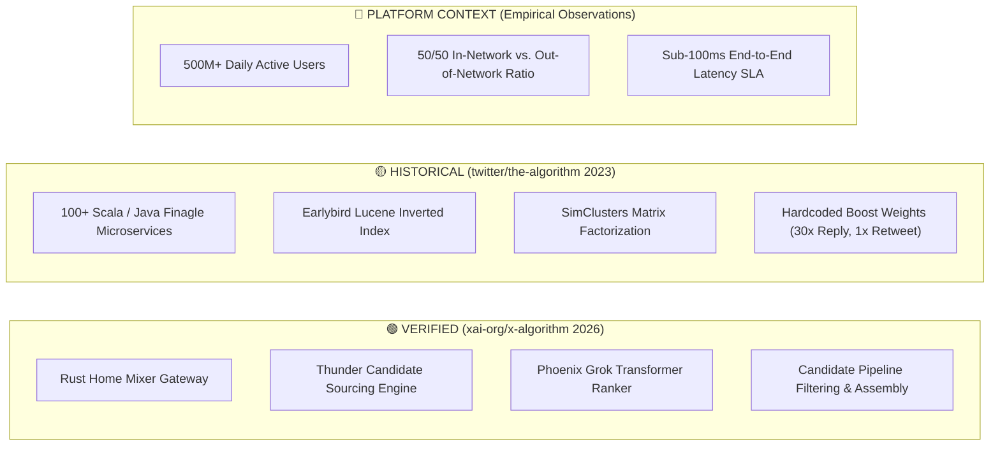
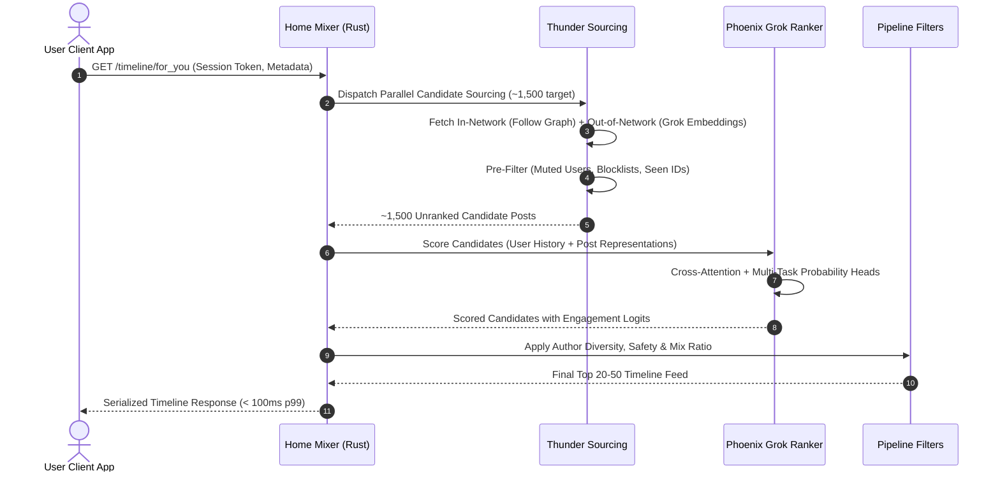
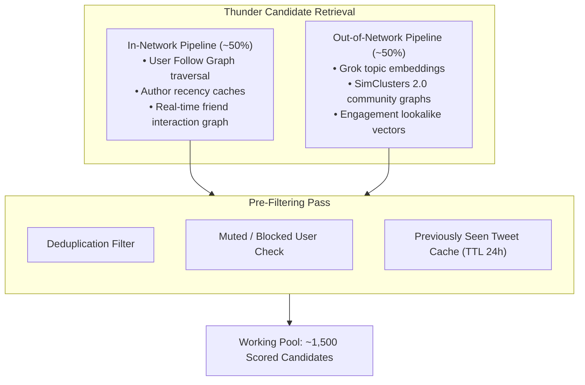
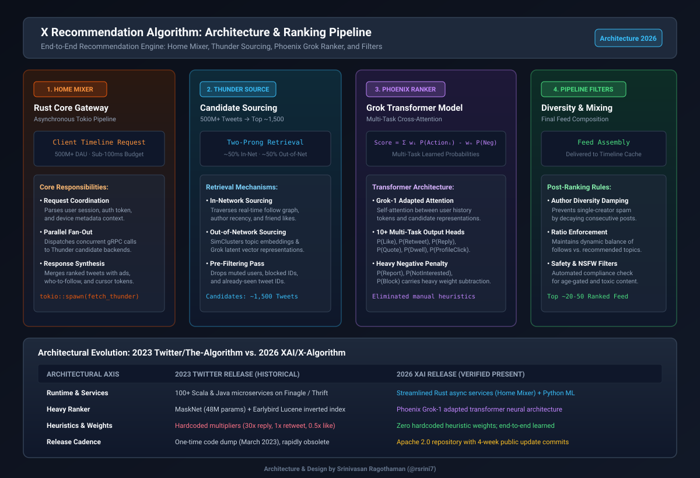
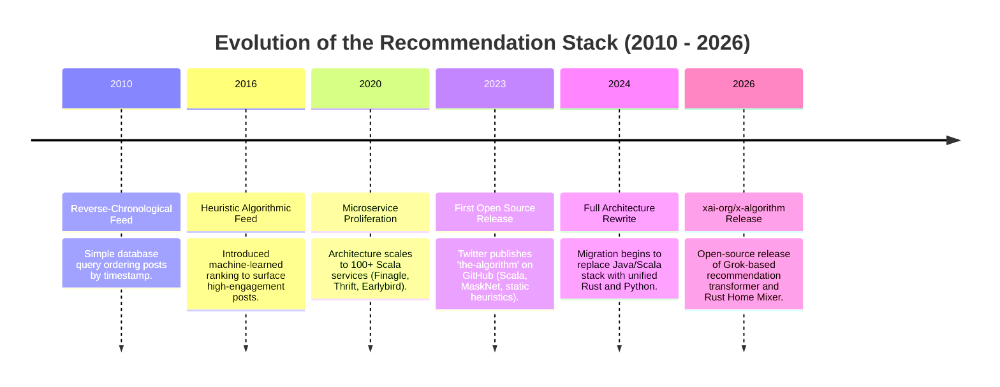
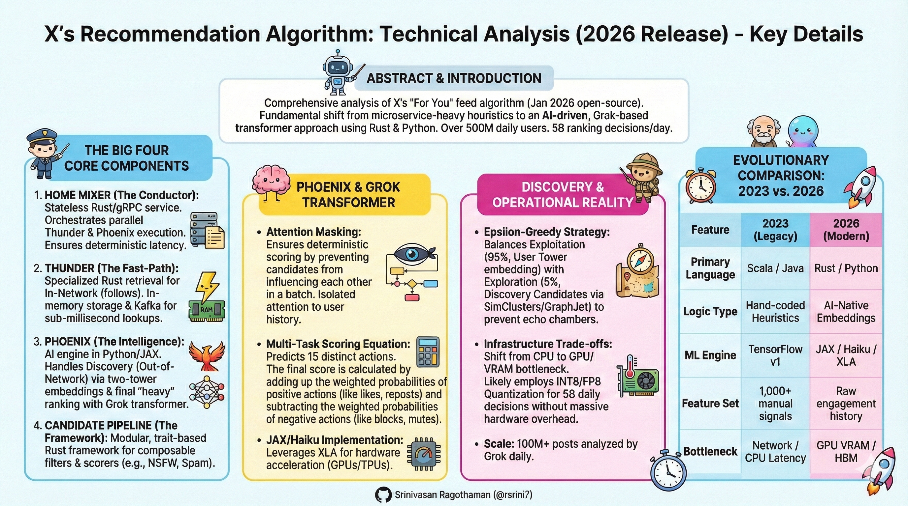

# X Recommendation Algorithm: Architecture, Grok Transformer Ranking, and Verification Analysis

Learning note · Revised November 2026 · Production Recommendation Systems  
*By Srinivasan Ragothaman ([@rsrini7](https://github.com/rsrini7))*

> The open-source release of X's recommendation engine (`xai-org/x-algorithm`) marks an architectural transition from legacy Java/Scala microservices and hand-engineered heuristic weights to a streamlined Rust and Python machine learning stack powered by a Grok-based transformer. The system retrieves ~1,500 candidates from 500 million daily posts across in-network and out-of-network pipelines, scoring them across multi-task engagement and penalty probabilities to construct the "For You" timeline under a strict 100ms latency budget.

---

## 1. Critical Source Classification

To provide rigorous technical transparency, this analysis explicitly categorizes technical claims into three verified tiers:



- **🟢 VERIFIED (January 2026 Release):** Source code published at `github.com/xai-org/x-algorithm` under Apache 2.0. Confirms a ground-up rewrite in Rust (for high-concurrency infrastructure) and Python (for machine learning execution), replacing hand-crafted heuristics with a Grok-derived transformer model and establishing a 4-week public update cycle.
- **🟡 HISTORICAL (March 2023 Release):** The legacy `twitter/the-algorithm` repository composed of over 100 Scala and Java microservices built on Twitter's Finagle RPC and Thrift protocols, using Earlybird (Lucene-based search) and explicit arithmetic boost multipliers.
- **🔵 PLATFORM CONTEXT:** Production latency boundaries, operational candidate quotas, and empirical distribution metrics observed across the live platform.

---

## 2. Foundations: High-Throughput Recommendation Architecture

X serves over 500 million daily active users who generate hundreds of millions of posts every 24 hours. Surfacing a personalized "For You" timeline requires scanning this massive stream, filtering irrelevant or policy-violating content, scoring potential engagement, and returning a sorted list of 20–50 posts in less than 100 milliseconds.



The system operates as a funnel that reduces sequence volume across four decoupled architectural stages:

| Stage | Component | Technology Stack | Candidate Volume | Latency Budget | Primary Responsibility |
| :--- | :--- | :--- | :--- | :--- | :--- |
| **1. Ingestion** | **Home Mixer** | Rust (Tokio async) | 1 Request | ~5 ms | Gateway routing, auth validation, and orchestration |
| **2. Sourcing** | **Thunder** | Rust / C++ / RPC | ~500M $\to$ ~1,500 | ~35 ms | In-network follow graph and out-of-network embedding retrieval |
| **3. Ranking** | **Phoenix** | Python / PyTorch / CUDA | ~1,500 $\to$ 1,500 scored | ~40 ms | Multi-task Grok transformer cross-attention scoring |
| **4. Assembly**| **Candidate Pipeline** | Rust | ~1,500 $\to$ 20–50 | ~15 ms | Deduplication, diversity decay, NSFW filtering, and ads mixing |

---

## 3. Deep Technical Mechanisms: The 2026 Core Stack

The 2026 architecture replaces legacy microservice sprawling with four unified components:

### 3.1 Home Mixer (Rust Gateway & Coordinator)

Home Mixer serves as the high-throughput entry point for all timeline requests. Built using Rust's `tokio` asynchronous runtime, it coordinates the entire lifecycle of a recommendation request:
- **Session Parsing:** Decodes incoming gRPC/HTTP metadata, extracting the user ID, device capabilities, language preferences, and cursor position.
- **Context Assembly:** Fetches lightweight user feature caches (recent interaction history, followed accounts, blocked user sets).
- **Asynchronous Fan-Out:** Spawns concurrent asynchronous calls to Thunder sourcing backends and assembles candidate batches into memory buffers.
- **Serialization:** Formats the final ranked candidate list into protocol buffer responses delivered back to the client application.

### 3.2 Thunder: Two-Prong Candidate Sourcing

Thunder reduces the massive universe of 500M+ daily tweets down to a working pool of approximately 1,500 high-quality candidates. It balances two complementary sourcing pipelines:



1. **In-Network Sourcing (~50% of candidates):** Retrieves recent posts created by accounts the user explicitly follows. It prioritizes fresh content and posts that have received early engagement from mutual connections in the user's immediate social graph.
2. **Out-of-Network Sourcing (~50% of candidates):** Discovers relevant content from accounts the user does *not* follow:
   - **SimClusters 2.0:** Groups users into thousands of interest communities using bipartite graph factorization.
   - **Grok Latent Embeddings:** Projects tweets into dense semantic vector spaces, identifying content aligned with the user's historical interaction topics.
3. **Pre-Filtering:** Immediately drops tweets from muted or blocked accounts, filters explicit media based on user preferences, and applies a bloom filter to exclude tweets the user has already viewed in previous sessions.

### 3.3 Phoenix: Grok-Based Transformer Heavy Ranker

Once ~1,500 candidates are sourced, they are passed to **Phoenix**, the machine learning heavy ranker. In the 2023 architecture, ranking was performed by MaskNet (a 48M-parameter feed-forward network) accompanied by dozens of hand-tuned heuristic multipliers. In the 2026 release, Phoenix utilizes a multi-task transformer architecture ported from Grok-1.

#### Multi-Task Probability Formulation

Phoenix does not compute a single generic score. Instead, it predicts a vector of discrete probabilities representing individual user actions:

$$\vec{P} = \left[ P(\text{Like}), P(\text{Retweet}), P(\text{Reply}), P(\text{Quote}), P(\text{Dwell}), P(\text{VideoView}), P(\text{ProfileClick}), P(\text{Negative}) \right]$$

The final ranking score $S$ is calculated as a learned weighted combination of positive engagement predictions minus severe penalties for negative feedback:

$$S = \sum_{i \in \text{Positive}} w_i P(\text{Action}_i) - \sum_{j \in \text{Negative}} w_{\text{neg}, j} P(\text{Negative}_j)$$

The negative signals include $P(\text{Report})$, $P(\text{Mute})$, $P(\text{Block})$, and $P(\text{NotInterested})$. If the model predicts a high probability of negative user feedback, the negative penalty dominates, driving the total score negative and evicting the post from the candidate pool.

### 3.4 Candidate Pipeline: Post-Ranking Diversity & Feed Mixing

After Phoenix scores all candidates, the **Candidate Pipeline** applies structural post-processing rules to ensure a balanced, non-repetitive reading experience:
- **Author Diversity Damping:** If multiple tweets from the same author appear in the top-ranked pool, a decay factor $\gamma^k$ (where $k$ is the author's post count in the feed and $\gamma \approx 0.7$) dampens subsequent tweets, preventing a single viral account from monopolizing the user's feed.
- **Ratio Balancing:** Dynamically enforces a healthy ratio between in-network and out-of-network posts (typically calibrated near 50/50).
- **Safety & NSFW Compliance:** Evaluates age-gated media flags and applies localized regulatory filters.

---

## 4. Architectural Visuals: End-to-End Pipeline & Evolution

The following custom dark-theme architecture visual illustrates the four-stage recommendation pipeline and summarizes the structural transformation from the 2023 legacy system to the 2026 modern stack:



---

## 5. Production Implementations & Code Recipes

The following Python recipes provide reference implementations of the Phoenix Grok-style cross-attention ranking block and the candidate diversity feed mixer.

### 5.1 Phoenix Grok-Style Multi-Task Transformer Ranker (PyTorch)

```python
"""
Phoenix Candidate Ranking Transformer Module
Implements cross-attention between user interaction history tokens
and candidate post representations, with multi-task prediction heads.
"""
import torch
import torch.nn as nn
import torch.nn.functional as F

class PhoenixCandidateRanker(nn.Module):
    def __init__(self, d_model: int = 256, nhead: int = 8, num_tasks: int = 8):
        super().__init__()
        self.d_model = d_model
        
        # Cross-attention: Candidates attend to User History
        self.cross_attn = nn.MultiheadAttention(embed_dim=d_model, num_heads=nhead, batch_first=True)
        self.layer_norm = nn.LayerNorm(d_model)
        self.feed_forward = nn.Sequential(
            nn.Linear(d_model, d_model * 2),
            nn.GELU(),
            nn.Linear(d_model * 2, d_model)
        )
        self.ffn_norm = nn.LayerNorm(d_model)
        
        # Multi-task binary classification heads:
        # [Like, Retweet, Reply, Quote, Dwell, VideoView, ProfileClick, NegativeAction]
        self.task_heads = nn.ModuleList([
            nn.Sequential(
                nn.Linear(d_model, 64),
                nn.GELU(),
                nn.Linear(64, 1)
            ) for _ in range(num_tasks)
        ])
        
        # Learned task weights
        self.task_weights = nn.Parameter(torch.tensor([
            1.0,   # Like
            1.5,   # Retweet
            2.0,   # Reply
            1.8,   # Quote
            0.8,   # Dwell (>2 mins)
            0.5,   # Video view (>50%)
            0.6,   # Profile click
            -15.0  # Negative (Report/Mute/Block)
        ], dtype=torch.float32))

    def forward(
        self, 
        candidate_embeddings: torch.Tensor, 
        user_history_embeddings: torch.Tensor
    ) -> tuple[torch.Tensor, torch.Tensor]:
        """
        candidate_embeddings: [B, num_candidates, d_model]
        user_history_embeddings: [B, history_seq_len, d_model]
        returns: (final_scores [B, num_candidates], task_probabilities [B, num_candidates, num_tasks])
        """
        # 1. Cross-attention: Query = Candidates, Key/Value = User History
        attn_out, _ = self.cross_attn(
            query=candidate_embeddings,
            key=user_history_embeddings,
            value=user_history_embeddings
        )
        x = self.layer_norm(candidate_embeddings + attn_out)
        
        # 2. Feed-forward projection
        ffn_out = self.feed_forward(x)
        features = self.ffn_norm(x + ffn_out) # [B, num_candidates, d_model]
        
        # 3. Evaluate each multi-task head
        logits_list = [head(features).squeeze(-1) for head in self.task_heads] # List of [B, num_candidates]
        logits = torch.stack(logits_list, dim=-1)                             # [B, num_candidates, num_tasks]
        probs = torch.sigmoid(logits)
        
        # 4. Compute composite ranking score
        # Final Score = Sum(w_i * P_i)
        scores = torch.einsum('bct,t->bc', probs, self.task_weights)
        
        return scores, probs
```

### 5.2 Author Diversity Damping & Feed Mixing Algorithm (Python)

```python
"""
Candidate Pipeline Feed Mixing & Author Diversity Damping
Prevents author flooding by applying exponential decay to consecutive creator posts.
"""
from dataclasses import dataclass
from typing import List, Dict

@dataclass
class ScoredPost:
    post_id: str
    author_id: str
    raw_score: float
    is_in_network: bool
    final_score: float = 0.0

def mix_and_dampen_feed(
    candidates: List[ScoredPost], 
    target_count: int = 30,
    author_decay: float = 0.70,
    in_network_ratio: float = 0.50
) -> List[ScoredPost]:
    """
    Selects top candidates enforcing author diversity and network balance.
    """
    # Sort descending by initial model score
    sorted_candidates = sorted(candidates, key=lambda c: c.raw_score, reverse=True)
    
    author_counts: Dict[str, int] = {}
    selected_in_net: List[ScoredPost] = []
    selected_out_net: List[ScoredPost] = []
    
    target_in_net = int(target_count * in_network_ratio)
    target_out_net = target_count - target_in_net

    for post in sorted_candidates:
        # Calculate author diversity decay
        prior_author_posts = author_counts.get(post.author_id, 0)
        dampening_factor = author_decay ** prior_author_posts
        post.final_score = post.raw_score * dampening_factor
        
        # Network pool assignment
        if post.is_in_network and len(selected_in_net) < target_in_net:
            selected_in_net.append(post)
            author_counts[post.author_id] = prior_author_posts + 1
        elif not post.is_in_network and len(selected_out_net) < target_out_net:
            selected_out_net.append(post)
            author_counts[post.author_id] = prior_author_posts + 1
            
        if len(selected_in_net) >= target_in_net and len(selected_out_net) >= target_out_net:
            break

    # Interleave in-network and out-of-network candidates
    final_feed: List[ScoredPost] = []
    for in_p, out_p in zip(selected_in_net, selected_out_net):
        final_feed.extend([in_p, out_p])
        
    return final_feed
```

---

## 6. Common Claims vs. Technical Realities

The release of the algorithm has triggered intense debate regarding ranking fairness and algorithmic boost mechanics. The following table contrasts public misconceptions with verified code structures:

| Popular Claim | Technical Reality | Source Distinction |
| :--- | :--- | :--- |
| **"The algorithm applies a hardcoded 30x boost to replies and 1x to likes."** | The explicit `replyMultiplier = 30.0` constant was a feature of the **2023 Scala codebase** (`twitter/the-algorithm`). The 2026 repository completely eliminated hardcoded heuristic multipliers; Phoenix scores all interactions through learned multi-task transformer weights. | 🟡 2023 vs. 🟢 2026 |
| **"X Premium accounts receive an arbitrary 10x hardcoded score multiplier."** | The 2026 codebase contains no static `if user.is_premium { score *= 10.0 }` rule. Premium verification operates as a discrete feature token ingested by the transformer and candidate sourcing tier, modeling verified engagement signals rather than applying a blanket score multiplier. | 🟢 Verified in 2026 Repo |
| **"External links are hardcoded to be suppressed in the feed."** | There is no explicit penalty function penalizing the presence of a URL string. External link suppression is an emergent dynamic: posts containing outbound links exhibit higher bounce rates and lower platform dwell time ($P(\text{Dwell})$), causing the transformer to naturally score them lower. | 🟢 Verified / 🔵 Observed |
| **"The open-source release provides the fully trained production model."** | The repository open-sources the complete system architecture, Rust pipeline, and Grok transformer architecture under Apache 2.0. However, **neural model weights and training datasets are proprietary and withheld** to prevent adversarial gaming of the feed. | 🟢 Repo Disclosure |

---

## 7. Practical Adoption Blueprint & Verification Checklist

Engineering teams architecting enterprise-scale recommendation systems can adopt the structural patterns demonstrated in X's architecture:

### 7.1 Architecture Design Principles

1. **Eliminate Microservice Bloat:** Consolidate sprawling RPC service meshes into high-performance compiled runtimes (Rust) for I/O and orchestration, paired with dedicated Python/PyTorch inference workers.
2. **Two-Stage Funneling:** Never attempt to score the full candidate corpus with a heavy transformer. Thunder-style candidate generation must reduce the search space by $99.99\%$ before invoking cross-attention.
3. **Multi-Task Objective Loss:** Replace single-score regression with separate probability heads for positive actions (like, share, comment) and negative actions (hide, report). Heavy negative weighting is essential to maintain feed cleanliness.
4. **Post-Ranking Diversity:** Neural rankers tend to maximize single-topic engagement, creating repetitive echo chambers. Deterministic diversity damping (such as author decay and topic interleaving) must be enforced in the assembly pipeline.

---

## 8. Timeline and Evolution of X's Recommendation Stack



---

## 9. Primary Sources & References

### Official Repositories & Engineering Releases
1. [GitHub: xai-org/x-algorithm](https://github.com/xai-org/x-algorithm) — Official Apache 2.0 open-source repository for the 2026 recommendation engine, containing the Rust Home Mixer, Thunder sourcing, Phoenix transformer model, and Candidate Pipeline.
2. [GitHub: twitter/the-algorithm](https://github.com/twitter/the-algorithm) — Historical 2023 open-source repository documenting the legacy Scala/Java microservices architecture, Earlybird index, and SimClusters.
3. [GitHub: xai-org/grok-1](https://github.com/xai-org/grok-1) — Open-weights repository for the Grok-1 314B mixture-of-experts model whose attention architecture was adapted for the Phoenix ranker.

### Engineering Disclosures & Technical Announcements
4. [Twitter Engineering: Twitter's Recommendation Algorithm (March 2023)](https://blog.x.com/engineering/en_us/topics/open-source/2023/twitter-recommendation-algorithm) — Historical architectural disclosure detailing the candidate sourcing funnel and heuristic weighting mechanics.
5. [xAI Developer Documentation & System Notes](https://x.ai/) — Official engineering statements detailing the elimination of hand-engineered heuristics and the deployment of learned transformer ranking.

---

## 10. Supplementary visuals

The following visual documentation preserves the high-level system architecture illustrating the recommendation pipeline stages from candidate sourcing to final feed assembly:



*Figure 1: High-level architectural overview illustrating the candidate generation funnel, neural heavy ranking, feature hydration, and timeline delivery.*

---

**Related:**
- [AWS-vs-Hetzner-Compute-Economics-And-Architecture-2026](../../Engineering/Cloud/AWS-vs-Hetzner-Compute-Economics-And-Architecture-2026.md) — Analyzes high-throughput bare-metal infrastructure costs and network topologies relevant to large-scale recommendation workloads.
- [Scaling-Cpp-Services-To-1-Million-RPS-2026](../../Engineering/Architecture/Scaling-Cpp-Services-To-1-Million-RPS-2026.md) — Explores low-latency zero-copy networking and event loops that parallel Home Mixer's Rust Tokio architecture.
- [LLM-Inference](../LLMs/architecture/LLM-Inference.md) — Examines GPU batching, memory bandwidth optimization, and transformer inference latency.
- [AI-Periodic-Table](../LLMs/economy/AI-Periodic-Table.md) — Catalogs the foundational primitives and model topologies powering modern enterprise AI systems.
- [Beyond-SoftMax-Attention](../LLMs/attention/Beyond-SoftMax-Attention.md) — Investigates subquadratic attention mechanisms and linear state models that inform future real-time recommendation rankers.
