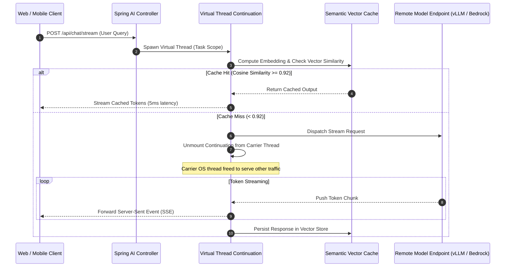
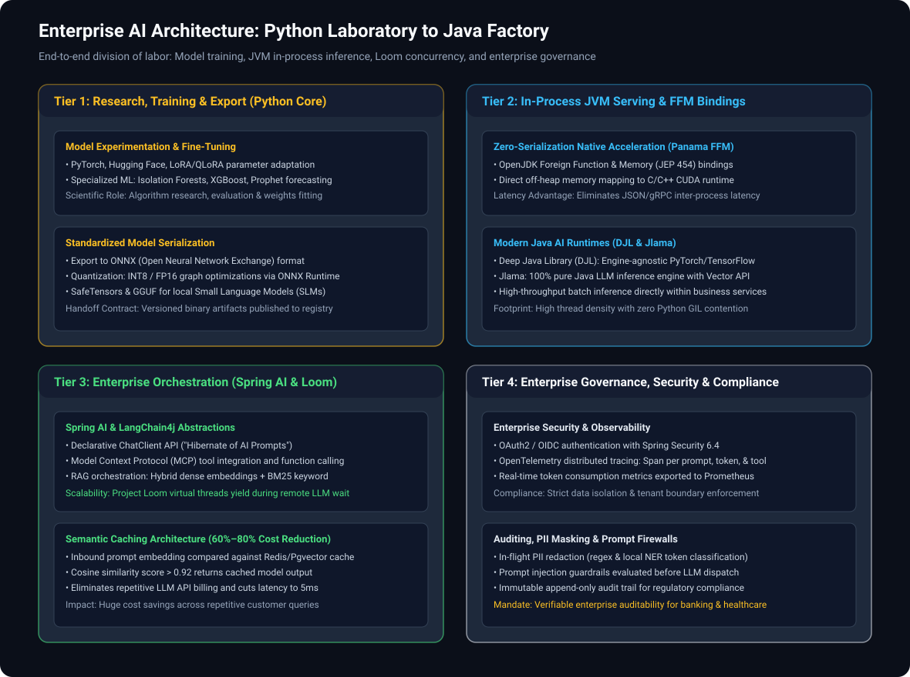

# Java and Python Enterprise AI: Systems Tiering, Inference Engines, and Production Governance

`Learning note · Revised November 2026 · Enterprise AI Architecture & Systems Engineering`  
*By Srinivasan Ragothaman ([@rsrini7](https://github.com/rsrini7))*

> In 2026 enterprise architecture, Python is the laboratory and Java is the factory. While Python dominates model training, experimentation, and exploratory research, the Java Virtual Machine operates as the mission-critical backbone for high-scale enterprise serving—unifying Spring AI, LangChain4j, Project Panama FFM native acceleration, and semantic caching within hardened regulatory, transaction, and observability boundaries.

---

## 1. Foundations: The Enterprise Division of Labor

The debate over whether Python or Java will "win" enterprise AI is structurally flawed. Scaled production systems in banking, healthcare, retail, and telecommunications do not choose one language; they partition responsibilities across an architectural boundary.

```
+----------------------------------------------------------------------------------------------------+
|                                  THE 2026 ENTERPRISE AI DIVISION OF LABOR                          |
+----------------------------------------------------------------------------------------------------+
|  PYTHON SCIENTIFIC CORE (The Laboratory)               JAVA ENTERPRISE BACKBONE (The Factory)      |
|  - Algorithm & model research                          - High-throughput transaction pipelines     |
|  - Gradient descent & PyTorch training                 - In-process inference via DJL & Panama FFM |
|  - Parameter-Efficient Fine-Tuning (LoRA / QLoRA)      - Spring AI & LangChain4j orchestration     |
|  - Exploratory feature engineering & pandas            - Project Loom Virtual Threads concurrency  |
|  - Model serialization to ONNX / SafeTensors           - Semantic caching (Pgvector / Redis)       |
|  - Ad-hoc evaluation & prompt experimentation          - SOC2 / HIPAA audit logging & PII firewalls|
+----------------------------------------------------------------------------------------------------+
```

### Essential Architectural Terms & Component Roles

| Component / Layer | Primary Ecosystem | Production Responsibility | Engineering Advantage |
| :--- | :--- | :--- | :--- |
| **Model Research & Fitting** | Python (PyTorch, Transformers) | Data cleaning, hyperparameter search, and loss minimization | Unrivaled scientific ecosystem and immediate access to frontier model checkpoints. |
| **Model Serialization** | Cross-Platform (ONNX, SafeTensors) | Compiling neural weights into portable, hardware-accelerated graphs | Decouples training code from serving runtimes; enables multi-backend execution. |
| **In-Process Inference** | Java 25 (DJL, Jlama, Panama FFM) | Direct off-heap tensor execution without inter-process HTTP/gRPC overhead | Sub-millisecond latency; eliminates Python Global Interpreter Lock (GIL) bottlenecks. |
| **Application Orchestration** | Java 25 (Spring AI, LangChain4j) | Prompt templating, tool routing, structured output parsing, and Model Context Protocol (MCP) | Seamless integration with existing enterprise Spring Boot microservice fleets. |
| **Concurrency Management** | Java 25 (Project Loom) | High-density Virtual Threads that yield execution while awaiting remote model tokens | Prevents thread-pool exhaustion during 1–5 second LLM generation latencies. |
| **Cost Optimization** | Java 25 + Vector DB (Pgvector, Redis) | Semantic caching, prompt compression, and routing across tiered models | Cuts LLM cloud billing by 60%–80% by resolving frequent queries at the cache layer. |
| **Governance & Security** | Java (Spring Security, Micrometer) | Distributed tracing, prompt injection firewalls, tenant isolation, and audit logs | Verifiable compliance with regulatory frameworks (GDPR, HIPAA, SOC2). |

---

## 2. Deep Technical Mechanisms: Runtimes, In-Process Inference, and Caching

### 2.1 Why Python Remains Indispensable in the Scientific Core

Python's dominance in training is sustained by dynamic scientific libraries written in C/C++/CUDA with thin Python wrappers. Beyond generative LLMs, enterprise production requires specialized predictive ML:
1. **Anomaly Detection**: Isolation Forests detect credit card fraud and network intrusions within millisecond envelopes.
2. **Time-Series Forecasting**: Prophet, ARIMA, and NeuralProphet power inventory allocation and financial liquidity models.
3. **Small Language Models (SLMs)**: Specialized BERT/DeBERTa models perform named entity recognition (NER) and token-level PII extraction.

Once trained, models are exported to **ONNX (Open Neural Network Exchange)** or **SafeTensors**, transforming Python-specific code into standardized computation graphs ready for JVM ingestion.

---

### 2.2 In-Process JVM Inference via Project Panama FFM and DJL

Traditional architectures route model inference through external Python microservices (e.g., FastAPI running Uvicorn). Under high transactional volume, this introduces significant latency penalties:
- JSON/Protobuf serialization and deserialization overhead.
- Network socket I/O and TLS handshakes.
- Python process concurrency limits imposed by the Global Interpreter Lock (GIL).

```
TRADITIONAL DUAL-PROCESS HOP (HIGH LATENCY & SERIALIZATION OVERHEAD)
[ Java Microservice ] ──(HTTP / JSON Serialization)──► [ Python FastAPI Worker ] ──► [ C++ LibTorch ]
  Latency: 15ms - 45ms per request | Memory: Redundant copies across process boundaries

2026 IN-PROCESS JVM TIER VIA PROJECT PANAMA FFM (SUB-MILLISECOND EXECUTION)
[ Java 25 Microservice (Spring Boot) ]
   ├── In-Memory Business Logic
   └── Deep Java Library (DJL) / Jlama
         │
         ▼ (Direct Off-Heap Memory Mapping via JEP 454 Foreign Function & Memory)
   [ ONNX Runtime / LibTorch C++ Engine ] ──► [ GPU CUDA / AVX-512 VNNI Hardware ]
  Latency: 0.8ms - 2.5ms per request | Memory: Zero-copy shared off-heap memory
```

Java 25 finalizes the **Foreign Function & Memory API (JEP 454)**, enabling Java runtimes to allocate native off-heap memory (`Arena.ofConfined()`) and bind directly to C/C++ inference engines (ONNX Runtime, LibTorch, llama.cpp) without JNI wrapper code.

---

### 2.3 Concurrency Architecture: Project Loom Virtual Threads vs. Async Runtimes

Large Language Model generation is fundamentally I/O bound from the caller's perspective: a single response stream may take 500ms to 4,000ms. In legacy thread-per-request models (OS threads allocating 1MB stack memory), 5,000 concurrent streaming connections consume 5GB of memory and exhaust OS scheduling threads.

Project Loom solves this by unmounting virtual threads from carrier worker threads whenever the socket blocks on streaming tokens:



---

### 2.4 Semantic Caching: The 60%–80% Cloud Cost Reducer

Enterprise applications frequently receive semantically identical queries with slightly varied wording (e.g., *"How do I reset my company password?"* vs. *"Where can I change my enterprise credentials?"*). Exact string caches fail entirely.

Semantic caching evaluates the cosine similarity between the incoming query vector $\vec{q}$ and stored cache vectors $\vec{c}_i$:

$$\text{Similarity}(\vec{q}, \vec{c}_i) = \frac{\vec{q} \cdot \vec{c}_i}{\|\vec{q}\| \|\vec{c}_i\|}$$

If $\text{Similarity} \ge \tau$ (where $\tau \approx 0.92$), the system returns the pre-computed response immediately, bypassing model invocation and reducing latency from 1,200ms to **under 8ms**.

---

## 3. Architectural Visuals: End-to-End Enterprise AI Pipeline

The architectural diagram below illustrates the end-to-end progression from Python training and serialization to Java 25 in-process serving, Spring AI orchestration, semantic caching, and compliance boundaries:



---

## 4. Production Implementations & Code Recipes

### 4.1 Java 25 + Spring AI: Declarative ChatClient with Semantic Caching & Streaming

This production service configures a streaming ChatClient backed by an in-memory or Redis vector store for semantic caching:

```java
package com.enterprise.ai.service;

import org.springframework.ai.chat.client.ChatClient;
import org.springframework.ai.chat.model.ChatResponse;
import org.springframework.ai.vectorstore.VectorStore;
import org.springframework.ai.document.Document;
import org.springframework.stereotype.Service;
import reactor.core.publisher.Flux;

import java.util.List;
import java.util.Map;

@Service
public class EnterpriseInferenceService {

    private final ChatClient chatClient;
    private final VectorStore vectorStore;
    private static final double SIMILARITY_THRESHOLD = 0.92;

    public EnterpriseInferenceService(ChatClient.Builder chatClientBuilder, VectorStore vectorStore) {
        this.chatClient = chatClientBuilder
                .defaultSystem("You are an enterprise financial assistant. Provide verified, factual data.")
                .build();
        this.vectorStore = vectorStore;
    }

    public Flux<String> streamInferenceWithSemanticCache(String userQuery) {
        // Step 1: Query vector store for semantically similar previous answers
        List<Document> similarDocs = vectorStore.similaritySearch(userQuery);
        
        if (!similarDocs.isEmpty()) {
            Double score = (Double) similarDocs.get(0).getMetadata().get("distance");
            // If cosine distance indicates high similarity, return cached answer immediately
            if (score != null && score <= (1.0 - SIMILARITY_THRESHOLD)) {
                String cachedAnswer = similarDocs.get(0).getText();
                return Flux.just("[CACHED] ", cachedAnswer);
            }
        }

        // Step 2: Cache miss - invoke model stream via Virtual Thread
        StringBuilder fullResponseBuffer = new StringBuilder();

        return chatClient.prompt()
                .user(userQuery)
                .stream()
                .content()
                .doOnNext(fullResponseBuffer::append)
                .doOnComplete(() -> {
                    // Step 3: Asynchronously persist response for future semantic cache hits
                    Document newDoc = new Document(
                            fullResponseBuffer.toString(),
                            Map.of("query", userQuery, "timestamp", System.currentTimeMillis())
                    );
                    vectorStore.add(List.of(newDoc));
                });
    }
}
```

---

### 4.2 Python Scientific Export: Fine-Tuned PyTorch Model to ONNX Graph

This pipeline exports a fine-tuned transformer classifier to an optimized ONNX graph for direct ingestion into Java's Deep Java Library (DJL):

```python
import torch
import torch.nn as nn
from transformers import AutoModelForSequenceClassification, AutoTokenizer
from pathlib import Path

def export_model_to_onnx(model_id: str, output_path: str):
    print(f"Loading checkpoint: {model_id}")
    tokenizer = AutoTokenizer.from_pretrained(model_id)
    model = AutoModelForSequenceClassification.from_pretrained(model_id)
    model.eval()

    # Generate dummy input for graph tracing
    dummy_text = "Transaction verification code requested for account"
    inputs = tokenizer(dummy_text, return_tensors="pt", padding=True, truncation=True, max_length=128)

    output_file = Path(output_path)
    output_file.parent.mkdir(parents=True, exist_ok=True)

    print("Exporting computation graph to ONNX...")
    torch.onnx.export(
        model,
        (inputs["input_ids"], inputs["attention_mask"]),
        f=str(output_file),
        input_names=["input_ids", "attention_mask"],
        output_names=["logits"],
        dynamic_axes={
            "input_ids": {0: "batch_size", 1: "sequence_length"},
            "attention_mask": {0: "batch_size", 1: "sequence_length"},
            "logits": {0: "batch_size"}
        },
        opset_version=17,
        do_constant_folding=True
    )
    print(f"Model successfully serialized to: {output_file}")

if __name__ == "__main__":
    export_model_to_onnx("distilbert-base-uncased-finetuned-sst-2-english", "./assets/model.onnx")
```

---

## 5. Real-World Case Studies

### 5.1 Netflix: Computer Vision at Scale via DJL
Netflix operates deep learning computer vision pipelines analyzing hundreds of thousands of video frames for quality control, thumbnail generation, and content indexing. 
- **Architecture**: Rather than dispatching frames over HTTP to a cluster of Python services, Netflix embedded **Deep Java Library (DJL)** directly into their Java-based Apache Spark video processing clusters.
- **Outcome**: Eliminated multi-terabyte inter-process data copies, reduced inference latency per frame by **3.5x**, and streamlined operational deployment onto their standard JVM compute fleet.

---

### 5.2 Global Financial Services: Explainable Credit Decisioning
A major tier-1 retail bank deployed an automated credit card application approval engine.
- **Architecture**: Employs a hybrid pipeline: Python engineers train and calibrate an XGBoost gradient-boosted tree model with SHAP (SHapley Additive exPlanations) values to satisfy regulatory auditing requirements. The trained model is exported to ONNX.
- **Outcome**: The production credit evaluation service runs inside a Spring Boot banking microservice, executing the ONNX model in under **2 milliseconds**, verifying applicant data against internal relational databases, and generating compliance audit records in a single transactional boundary.

---

## 6. Common Claims vs. Technical Realities

| # | Common Industry Claim | Technical Reality & Benchmark Fact | Architectural Guidance |
| :-: | :--- | :--- | :--- |
| **1** | *"Moving to Java for AI reduces datacenter energy consumption by 80%."* | **False.** The famous 2017 Pereira et al. paper measured synthetic microbenchmarks (Fibonacci, binary trees), not GPU tensor multiplication. In AI, 90%+ of energy is burned in GPU tensor cores, which run identical CUDA instructions regardless of whether triggered by Java or Python. | Do not promise 80% energy savings to leadership; frame the business case around latency, connection density, and operational consolidation. |
| **2** | *"Python is fast enough for enterprise production when wrapped in FastAPI and Gunicorn."* | **Partially True.** FastAPI is sufficient for low-to-medium traffic. However, under high concurrency, the Python GIL, cross-process JSON serialization, and lack of true shared-memory threading create throughput bottlenecks. | Use FastAPI for experimental prototypes; migrate high-volume serving paths to in-process JVM or native C++ runtimes. |
| **3** | *"Spring AI is just a toy copy of LangChain."* | **False.** Spring AI was built from the ground up to integrate with Spring Boot's configuration, metrics, observability, and security models. It avoids Python LangChain's historical API instability and breaking changes. | Adopt Spring AI for enterprise applications requiring strict backward compatibility, compile-time type safety, and OpenTelemetry instrumentation. |
| **4** | *"Enterprises should rewrite all their Python ML code in Java."* | **Counterproductive.** Python is the unquestioned standard for machine learning research. Forcing data scientists to write Java for research degrades experimentation speed and hiring velocity. | Standardize on Python for research and training; standardize on Java for orchestration, integration, and high-scale serving. |
| **5** | *"Vector databases are only useful for Retrieval-Augmented Generation (RAG)."* | **Incomplete.** Vector databases are equally powerful when deployed as semantic caches. Caching frequent prompt responses using vector similarity eliminates up to 80% of external model invocation costs. | Implement semantic caching before expanding model GPU capacity. |

---

## 7. Practical Adoption Blueprint: The 6-Month Migration Roadmap

```
+----------------------------------------------------------------------------------------------------+
|                                    6-MONTH ENTERPRISE ADOPTION BLUEPRINT                           |
+----------------------------------------------------------------------------------------------------+
|  MONTH 1-2: STANDARDIZE THE HANDOFF                                                                |
|  - Mandate ONNX and SafeTensors as the standard output format for all internal data science teams. |
|  - Implement Model Registry (MLflow / Hugging Face Enterprise) with automated CI validation.       |
|                                                                                                    |
|  MONTH 3-4: INTRODUCE JVM IN-PROCESS SERVING                                                       |
|  - Deploy Deep Java Library (DJL) or ONNX Runtime inside target Java microservices.                |
|  - Benchmark latency vs existing Python microservice endpoints; establish baseline p99 SLOs.       |
|                                                                                                    |
|  MONTH 5: SPRING AI ORCHESTRATION & SEMANTIC CACHING                                               |
|  - Migrate external LLM calls to Spring AI ChatClient.                                             |
|  - Deploy Redis / Pgvector semantic cache layer; set similarity threshold to 0.92.                 |
|                                                                                                    |
|  MONTH 6: HARDEN GOVERNANCE & OBSERVABILITY                                                        |
|  - Enable OpenTelemetry distributed tracing across all prompt pipelines.                           |
|  - Deploy in-flight PII masking and prompt firewall policies before production release.            |
+----------------------------------------------------------------------------------------------------+
```

---

## 8. Technology Roadmap & Historical Milestones

```
2023 ────────────────────── 2024 ────────────────────── 2025 ────────────────────── 2026
 │                           │                           │                           │
 ├── LangChain (Python)      ├── LangChain4j Emerges     ├── Spring AI 1.0 GA        └── JDK 26 / Valhalla
 │   • Prompt hacking        • Java enterprise binding   • Enterprise GA             • Flattened value types
 │   • Fragile APIs          • Quarkus & Spring support  • MCP standard tools        • Unified memory layout
 │                                                       • JEP 454 FFM Finalized
 │
 ├── Python 3.11             ├── Python 3.12             ├── Python 3.13             └── Python 3.14
     • Faster CPython            • Isolated subinterpreters  • Experimental no-GIL       • Maturing free-threaded
     • Fine-grained error spans  • Linux perf profiler       • Free-threaded builds      • Scientific ecosystem
```

---

## 9. Primary Sources & References

1. [Spring AI Official Reference Documentation](https://docs.spring.io/spring-ai/reference/) — Comprehensive guide to declarative ChatClient, Model Context Protocol (MCP), and enterprise tool calling.
2. [LangChain4j GitHub Repository](https://github.com/langchain4j/langchain4j) — Open-source Java library simplifying LLM integration with native support for Quarkus, Spring Boot, and local models.
3. [Deep Java Library (DJL) Documentation](https://djl.ai/) — Open-source, engine-agnostic deep learning library for Java developed by Amazon Web Services.
4. [JEP 454: Foreign Function & Memory API](https://openjdk.org/jeps/454) — OpenJDK standard enabling direct, safe, high-speed off-heap native memory bindings for ONNX Runtime and libtorch.
5. [Pereira et al. (2017): Energy Efficiency across Programming Languages](https://doi.org/10.1145/3136014.3136031) — Foundational academic paper evaluating software language power consumption on algorithmic microbenchmarks.
6. [ONNX Runtime Specifications](https://onnxruntime.ai/) — High-performance inference engine for ONNX models with cross-platform hardware acceleration across CPUs and GPUs.
7. [Netflix TechBlog: Deep Learning at Scale with DJL](https://netflixtechblog.com/) — Production case study detailing how Netflix embedded deep learning models into Java Spark clusters.

---

**Related:**
- [Java-Next-Gen-Programming-Models-Babylon-Panama-Nov-2026](../../Engineering/JVM/Java-Next-Gen-Programming-Models-Babylon-Panama-Nov-2026.md) — Architectural evaluation of Project Babylon (Code Reflection) and Panama FFM for eliminating the two-language tax in enterprise AI.
- [Project-Detroit-Java-Polyglot-Runtimes-Nov-2026](../../Engineering/JVM/Project-Detroit-Java-Polyglot-Runtimes-Nov-2026.md) — OpenJDK's FFM-based CPython and V8 bridge, enabling Java services to directly execute native PyTorch and HuggingFace pipelines.
- [Java-Remote-Debugging-JDWP-And-Troubleshooting-2026](../../Engineering/JVM/Java-Remote-Debugging-JDWP-And-Troubleshooting-2026.md) — Production debugging tactics for JVM-hosted AI services under SLAs.
- [Java-25-vs-Go-1.25-Performance-Analysis-2026](../../Engineering/Languages/comparisons/Java-25-vs-Go-1.25-Performance-Analysis-2026.md) — Evaluates JVM garbage collection, Virtual Threads, and runtime memory trade-offs for backend AI serving.
- [Multimodal-RAG](../RAG/Multimodal-RAG.md) — Architectural patterns for cross-modal dense embeddings, vector retrieval, and reranking pipelines.
