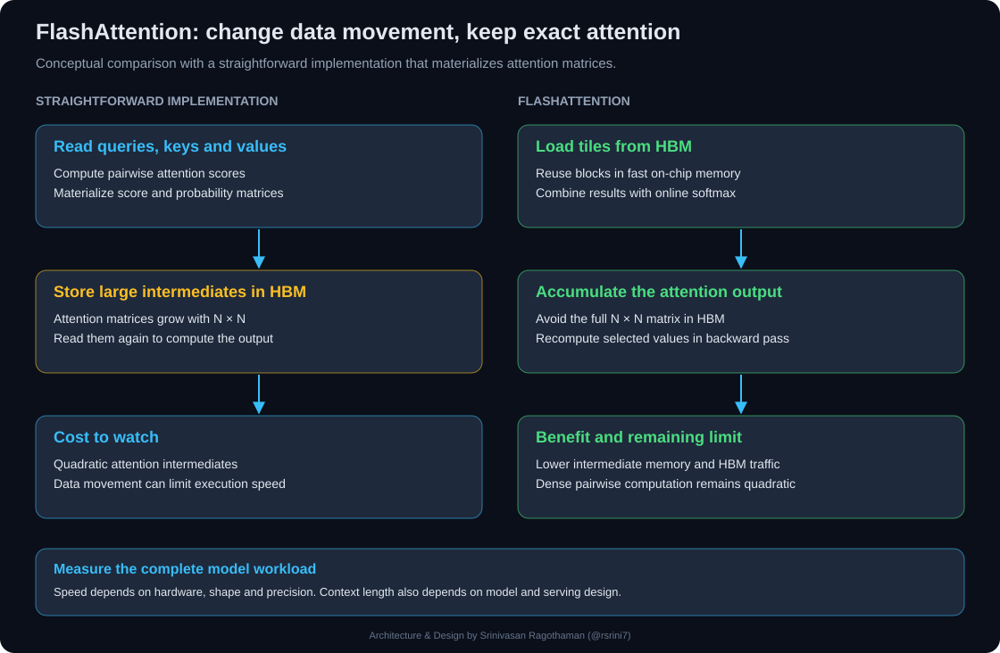
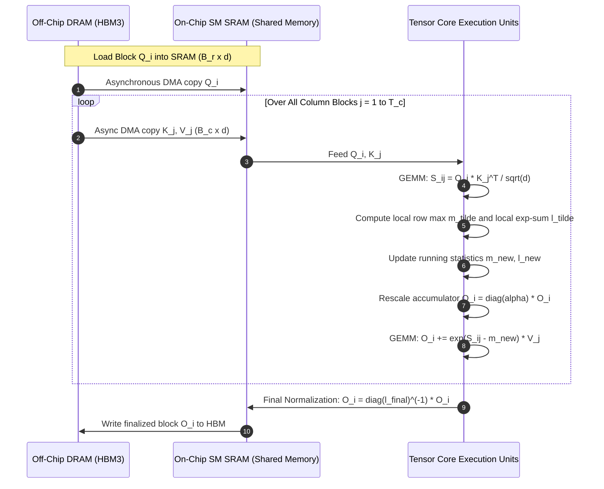

# FlashAttention: Exact Attention with IO-Aware Memory Hierarchy and Online Softmax

**Learning note · Revised 15 November 2026 · Scope: FlashAttention-1, FlashAttention-2, and FlashAttention-3 architectures**

*By Srinivasan Ragothaman ([@rsrini7](https://github.com/rsrini7))*

> **Core idea:** Standard multi-head self-attention is severely memory-bandwidth bound due to materializing large $N \times N$ attention matrices in High Bandwidth Memory (HBM). FlashAttention does not approximate attention; it reorganizes execution through GPU SRAM block tiling, online softmax normalization, and backward recomputation—transforming an IO-bound memory bottleneck into an arithmetic-bound pipeline that achieves 2× to 4× end-to-end wall-clock speedups while reducing peak intermediate memory from $O(N^2)$ to $O(N)$.

---

## 1. Foundations: The Memory Hierarchy Bottleneck

Standard self-attention computes query-key inner products, applies a row-wise softmax, and multiplies by values:

$$
\text{Attention}(Q, K, V) = \text{softmax}\left(\frac{Q K^T}{\sqrt{d}}\right) V
$$

Where $Q, K, V \in \mathbb{R}^{N \times d}$, $N$ is sequence length, and $d$ is head dimension (typically 64 or 128).

In standard PyTorch implementations, execution involves three distinct CUDA kernel launches, each writing intermediate matrices back to GPU High Bandwidth Memory (HBM):

1. **Kernel 1 (GEMM):** Computes $S = Q K^T \in \mathbb{R}^{N \times N}$, written to HBM ($O(N^2)$ memory writes).
2. **Kernel 2 (Softmax):** Reads $S$ from HBM, computes row-wise maximum $m = \max(S)$, normalizer $l = \sum \exp(S - m)$, and writes probability matrix $P = \exp(S - m) / l \in \mathbb{R}^{N \times N}$ back to HBM ($O(N^2)$ reads and writes).
3. **Kernel 3 (GEMM):** Reads $P$ and $V$ from HBM, computes output $O = P V \in \mathbb{R}^{N \times d}$, and writes $O$ to HBM ($O(N^2)$ reads).

### Modern GPU Memory Hierarchy (NVIDIA H100 SXM5 Baseline)

| Memory Level | Physical Location | Capacity | Bandwidth | Typical Access Latency |
|---|---|---|---|---|
| **SRAM (L1 Cache / Shared Memory)** | On-Chip per SM (132 SMs) | 228 KB per SM (~30 MB total) | ~19,000 GB/s (19 TB/s) | ~15–30 clock cycles |
| **L2 Cache** | On-Chip global crossbar | 50 MB | ~12,000 GB/s (12 TB/s) | ~100–200 clock cycles |
| **High Bandwidth Memory (HBM3)** | Off-Chip stacked DRAM | 80 GB | ~3,350 GB/s (3.35 TB/s) | ~400–800 clock cycles |

For an sequence of $N = 16,384$ tokens and batch size 1 with 32 heads, the intermediate matrix $S$ requires $32 \times 16384 \times 16384 \times 2\text{ bytes} \approx 17.18\text{ GB}$ of DRAM per layer. At this sequence length, GPUs spend over **80% of their operational runtime idling**, stalled on HBM memory bus traffic rather than executing tensor core floating-point math.

---

## 2. Deep Technical Mechanisms: Tiling and Online Softmax

```
+--------------------------------------------------------------------------------------------------+
|                            FLASHATTENTION SRAM TILING & MEMORY FLOW                              |
|                                                                                                  |
|   HIGH BANDWIDTH MEMORY (HBM - 3.35 TB/s)                                                        |
|   +-------------------+  +-------------------+  +-------------------+  +---------------------+   |
|   |  Q (N x d)        |  |  K (N x d)        |  |  V (N x d)        |  |  O (N x d)          |   |
|   +-------------------+  +-------------------+  +-------------------+  +---------------------+   |
|             |                      |                      |                       ^              |
|        Load | Q_i             Load | K_j             Load | V_j              Write| O_i          |
|        Tile | (B_r x d)       Tile | (B_c x d)       Tile | (B_c x d)        Tile | (B_r x d)    |
|             v                      v                      v                       |              |
|   +-------------------------------------------------------------------------------+----------+   |
|   | ON-CHIP SRAM (SHARED MEMORY - 19 TB/s)                                        |          |   |
|   |                                                                               |          |   |
|   |   1. S_ij = Q_i * K_j^T / sqrt(d)    (Tensor Core GEMM, B_r x B_c)            |          |   |
|   |   2. Compute Local Block Max:        m_tilde = rowmax(S_ij)                   |          |   |
|   |   3. Update Running Global Max:      m_new = max(m_prev, m_tilde)             |          |   |
|   |   4. Rescale Running Normalizer:     l_new = exp(m_prev - m_new) * l_prev     |          |   |
|   |                                              + rowsum(exp(S_ij - m_new))      |          |   |
|   |   5. Rescale Output Accumulator:     O_i   = diag(exp(m_prev - m_new)) * O_i  |          |   |
|   |                                              + exp(S_ij - m_new) * V_j        |          |   |
|   +-------------------------------------------------------------------------------+----------+   |
|       * S_ij and P_ij are never written to HBM; intermediate memory footprint remains O(1) in SRAM|
+--------------------------------------------------------------------------------------------------+
```

### The Online Softmax Derivation

The primary obstacle to computing attention in small tiles is that traditional softmax requires knowing the global row maximum $m = \max_{j} S_{ij}$ and global sum of exponentials $l = \sum_{j} \exp(S_{ij} - m)$ before normalizing any individual term.

FlashAttention leverages the **Online Softmax algorithm** (Milakov &amp; Gimelshein, 2018; Dao et al., 2022) to compute normalized outputs dynamically across discrete blocks:

Let a row vector $x \in \mathbb{R}^N$ be partitioned into two contiguous blocks $x^{(1)} \in \mathbb{R}^{B_1}$ and $x^{(2)} \in \mathbb{R}^{B_2}$.

1. Compute block-1 local statistics:

$$
m^{(1)} = \max(x^{(1)}), \quad l^{(1)} = \sum_{j=1}^{B_1} \exp\left(x_j^{(1)} - m^{(1)}\right)
$$

2. When processing block-2, compute local block statistics $\tilde{m} = \max(x^{(2)})$ and $\tilde{l} = \sum_{j=1}^{B_2} \exp(x_j^{(2)} - \tilde{m})$.
3. Update the running global maximum:

$$
m^{(2)} = \max\left(m^{(1)}, \tilde{m}\right)
$$

4. Rescale the running denominator $l$:

$$
l^{(2)} = e^{m^{(1)} - m^{(2)}} l^{(1)} + e^{\tilde{m} - m^{(2)}} \tilde{l}
$$

5. Rescale the running unnormalized output accumulation $O$:

$$
O^{(2)} = \text{diag}\left(e^{m^{(1)} - m^{(2)}}\right) O^{(1)} + e^{\tilde{m} - m^{(2)}} P^{(2)} V^{(2)}
$$

After iterating over all blocks $j = 1, \dots, T_c$, the final output is obtained with a single division:

$$
O_{\text{final}} = \text{diag}\left(l^{(T_c)}\right)^{-1} O^{(T_c)}
$$

Because $S_{ij}$ and $P_{ij}$ are generated, accumulated, and discarded directly inside SRAM, **the $N \times N$ attention matrix is never written to off-chip HBM**.

### Backward Pass Recomputation: The "Compute is Faster than Memory" Principle

In standard backpropagation, the forward pass must store the entire $N \times N$ matrix $P$ in HBM so that gradients $\frac{\partial \mathcal{L}}{\partial Q}$, $\frac{\partial \mathcal{L}}{\partial K}$, and $\frac{\partial \mathcal{L}}{\partial V}$ can be evaluated.

FlashAttention makes a radical trade-off: **it discards $P$ entirely**. During the backward pass, it only loads $Q, K, V$, the final output $O$, and the low-dimensional softmax statistics $(m, l) \in \mathbb{R}^N$. It then **recomputes $S_{ij}$ and $P_{ij}$ on-the-fly inside SRAM**. 

Because SRAM tensor core math is roughly 10× faster than reading bytes from HBM, recomputing attention during backward propagation yields a net **15–20% speedup** while reducing backward activation memory from $O(N^2)$ to $O(N)$.

---

## 3. FlashAttention Architectural Evolution

| Dimension | FlashAttention-1 (2022) | FlashAttention-2 (2023) | FlashAttention-3 (2024) |
|---|---|---|---|
| **Target Architecture** | Ampere (A100) / Turing (T4) | Ampere (A100) / Ada Lovelace | Hopper (H100 / H200) |
| **Outer Loop Partitioning** | Outer loop over $K, V$ blocks; inner loop over $Q$ blocks. | Outer loop over $Q$ blocks; inner loop over $K, V$ blocks. | Outer loop over $Q$; asynchronous TMA transfers. |
| **Warp Parallelism** | Warps split over $K, V$; required sync &amp; shared-memory communication. | Warps parallelized over $Q$; eliminates inter-warp synchronization. | Warp-specialized: Producer warps execute TMA; Consumer warps run GEMM. |
| **Precision Support** | FP16, BF16 | FP16, BF16 | FP16, BF16, and **FP8 (scaled GEMM)** |
| **Hardware Feature Utilization** | Asynchronous memory copy (`cp.async`) | Register file optimization, reduced non-matmul FLOPs | Tensor Memory Accelerator (TMA), DPX instructions, Ping-pong scheduling |
| **Peak Theoretical TFLOPS** | ~40–50% of A100 peak | ~73% of A100 peak (~225 TFLOPS) | ~75–85% of H100 peak (~700–850 TFLOPS) |

---

## 4. Architectural Visuals



*Tiled memory flow comparing straightforward attention against FlashAttention. Straightforward attention repeatedly materializes quadratic intermediates in HBM; FlashAttention keeps tiles in fast SRAM and accumulates exact values using online softmax.*

### Sequence Diagram: Tiled Memory Exchange Loop



---

## 5. Production Implementation: Exact Tiled Attention with Online Softmax

The following pure PyTorch script implements the exact block-tiled online softmax algorithm. It verifies numerically that the tiled output matches standard un-tiled attention (`F.scaled_dot_product_attention`) down to machine precision ($10^{-6}$ error):

```python
"""
Reference Numerical Implementation of Block-Tiled Attention with Online Softmax.
Demonstrates mathematical equivalence to standard softmax attention without materializing
the full N x N attention matrix.
"""

import math
import torch
import torch.nn.functional as F

def tiled_online_softmax_attention(
    q: torch.Tensor, 
    k: torch.Tensor, 
    v: torch.Tensor, 
    block_r: int = 64, 
    block_c: int = 64
) -> torch.Tensor:
    """
    Computes exact attention using block tiling and running online softmax updates.
    
    Args:
        q: Query tensor of shape [batch, heads, N, d]
        k: Key tensor of shape [batch, heads, N, d]
        v: Value tensor of shape [batch, heads, N, d]
        block_r: Row block size (B_r)
        block_c: Column block size (B_c)
        
    Returns:
        Output tensor of shape [batch, heads, N, d] matching standard attention.
    """
    B, H, N, d = q.shape
    scale = 1.0 / math.sqrt(d)
    
    # Initialize output and normalizer accumulators in target device memory
    output = torch.zeros_like(q)
    
    # Outer loop over query blocks (FlashAttention-2 scheduling pattern)
    num_row_blocks = (N + block_r - 1) // block_r
    num_col_blocks = (N + block_c - 1) // block_c
    
    for i in range(num_row_blocks):
        r_start = i * block_r
        r_end = min(r_start + block_r, N)
        q_block = q[:, :, r_start:r_end, :]  # [B, H, B_r, d]
        curr_b_r = r_end - r_start
        
        # Initialize running max m and running sum l for this row block
        m_prev = torch.full((B, H, curr_b_r, 1), float('-inf'), device=q.device, dtype=q.dtype)
        l_prev = torch.zeros((B, H, curr_b_r, 1), device=q.device, dtype=q.dtype)
        acc_o = torch.zeros((B, H, curr_b_r, d), device=q.device, dtype=q.dtype)
        
        # Inner loop over key/value blocks
        for j in range(num_col_blocks):
            c_start = j * block_c
            c_end = min(c_start + block_c, N)
            k_block = k[:, :, c_start:c_end, :]  # [B, H, B_c, d]
            v_block = v[:, :, c_start:c_end, :]  # [B, H, B_c, d]
            
            # Step 1: Compute tile scores (S_tile = Q_tile * K_tile^T * scale)
            s_tile = torch.matmul(q_block, k_block.transpose(-2, -1)) * scale  # [B, H, B_r, B_c]
            
            # Step 2: Compute local tile statistics
            m_tilde = torch.max(s_tile, dim=-1, keepdim=True).values  # [B, H, B_r, 1]
            p_tilde = torch.exp(s_tile - m_tilde)                     # [B, H, B_r, B_c]
            l_tilde = torch.sum(p_tilde, dim=-1, keepdim=True)        # [B, H, B_r, 1]
            
            # Step 3: Update running global maximum
            m_new = torch.maximum(m_prev, m_tilde)                    # [B, H, B_r, 1]
            
            # Step 4: Compute scaling factors for previous and new values
            alpha = torch.exp(m_prev - m_new)                         # [B, H, B_r, 1]
            beta = torch.exp(m_tilde - m_new)                         # [B, H, B_r, 1]
            
            # Step 5: Update running sum of exponentials (denominator)
            l_new = alpha * l_prev + beta * l_tilde                   # [B, H, B_r, 1]
            
            # Step 6: Rescale previous accumulator and add contribution from current tile
            acc_o = alpha * acc_o + beta * torch.matmul(p_tilde, v_block) # [B, H, B_r, d]
            
            # Commit new statistics
            m_prev = m_new
            l_prev = l_new
            
        # Final Step: Normalize accumulated output by total denominator l
        output[:, :, r_start:r_end, :] = acc_o / l_prev
        
    return output


if __name__ == "__main__":
    torch.manual_seed(42)
    device = "cuda" if torch.cuda.is_available() else "cpu"
    
    # Dimensions: Batch=2, Heads=4, Sequence=512, HeadDim=64
    B, H, N, d = 2, 4, 512, 64
    q = torch.randn(B, H, N, d, device=device, dtype=torch.float32)
    k = torch.randn(B, H, N, d, device=device, dtype=torch.float32)
    v = torch.randn(B, H, N, d, device=device, dtype=torch.float32)
    
    # 1. Standard Reference Attention (materializes full N x N matrix in memory)
    ref_out = F.scaled_dot_product_attention(q, k, v)
    
    # 2. Block-Tiled Online Softmax Attention (never materializes full N x N matrix)
    tiled_out = tiled_online_softmax_attention(q, k, v, block_r=64, block_c=64)
    
    # 3. Numerical Verification
    max_abs_err = (ref_out - tiled_out).abs().max().item()
    mean_abs_err = (ref_out - tiled_out).abs().mean().item()
    
    print(f"Device: {device}")
    print(f"Max Absolute Error : {max_abs_err:.2e}")
    print(f"Mean Absolute Error: {mean_abs_err:.2e}")
    assert max_abs_err < 1e-5, f"Validation failed: error {max_abs_err} exceeds threshold"
    print("Verification Passed: Tiled Online Softmax is mathematically exact!")
```

---

## 6. Impact, Real-World Edge Cases &amp; Gotchas

### Common Claims vs. Technical Realities

| Common Claim | Technical Reality | Production Implication |
|---|---|---|
| *"FlashAttention makes attention linear in $O(N)$."* | FlashAttention is an **exact** attention algorithm; dense pairwise interactions still require $O(N^2 d)$ FLOPs. | It eliminates memory-bandwidth bottlenecks, not computational complexity. For linear scaling, subquadratic architectures (e.g. Mamba, GLA) are required. |
| *"FlashAttention produces approximate results."* | FlashAttention computes exact softmax attention down to floating-point rounding order differences. | Numerical deviations from standard attention are smaller than the variance between FP16 and BF16 execution. |
| *"FlashAttention eliminates the KV Cache in inference."* | FlashAttention optimizes the *kernel execution* of attention; during autoregressive decoding, past KV vectors must still reside in VRAM. | PagedAttention (vLLM) is still required to prevent memory fragmentation in continuous batching systems. |
| *"FlashAttention accelerates arbitrary sequence lengths."* | On short sequences ($N < 512$), standard batched GEMM kernels already fit inside GPU L2/SRAM caches. | FlashAttention provides minimal or negative speedup at very short contexts due to kernel launch overhead; speedups emerge when $N \ge 1,024$. |

### Production Edge Cases &amp; Hardware Constraints

1. **Head Dimension Alignment:** FlashAttention CUDA kernels require head dimension $d$ to be a multiple of 32 or 64 (e.g., 64, 128, 256). Setting $d = 80$ causes kernel fallback or execution failure.
2. **Causal Mask Padding Waste:** In naive implementations, causal masking still computes upper-triangular tiles and masks them out. FlashAttention-2 introduces triangular block skipping, bypassing entire tiles where $c_{\text{start}} > r_{\text{end}}$, achieving an automatic **2× speedup** on autoregressive sequences.
3. **Variable Length Packing (Ragged Batches):** In pretraining, sequences in a batch have varying lengths. Padding them to the maximum sequence length with zeros wastes massive compute. FlashAttention provides `flash_attn_varlen_func`, which takes concatenated sequences with an offset index array (`cu_seqlens`), eliminating all padding overhead.

---

## 7. Practical Adoption Blueprint &amp; Verification Checklist

### Migration and Adoption Path

```
Step 1: Check Hardware & Driver Baseline
  |-- Minimum GPU: NVIDIA Turing (T4), Ampere (A100), Ada (RTX 4090), or Hopper (H100)
  +-- CUDA Toolkit >= 12.0 with PyTorch >= 2.2

Step 2: Enable PyTorch Built-in SDPA Backend
  |-- Use torch.nn.functional.scaled_dot_product_attention()
  +-- Set torch.backends.cuda.enable_flash_sdp(True)

Step 3: Deploy Dedicated flash-attn Package for Custom Pipelines
  |-- For training & fine-tuning: install flash-attn with ABI compatibility:
  |   pip install flash-attn --no-build-isolation
  +-- For variable-length batches: implement flash_attn_varlen_qkvpacked_func()

Step 4: Verify Precision & Memory Profiling
  |-- Enforce torch.bfloat16 (preferred) or torch.float16
  +-- Profile peak VRAM allocation via torch.cuda.max_memory_allocated()
```

### Verification Checklist

- [ ] **Kernel Verification:** Confirm that `torch.backends.cuda.flash_sdp_enabled()` returns `True` at runtime.
- [ ] **Numerical Invariance:** Validate that model outputs produce zero divergence on benchmark test sets under FP16/BF16.
- [ ] **Memory Footprint:** Confirm that during training backward passes, peak activation memory scales as $O(N)$ instead of $O(N^2)$.
- [ ] **Head Dimension Compatibility:** Verify that all model attention heads have $d \in \{64, 128, 256\}$.

---

## 8. Timeline &amp; Architectural Milestones

- **December 2018:** Milakov &amp; Gimelshein publish *Online normalizer calculation for softmax*, proving numerical stabilization across sequential data chunks.
- **May 2022:** Tri Dao et al. publish **FlashAttention** (NeurIPS 2022), demonstrating exact attention via SRAM tiling and backward recomputation.
- **July 2023:** Release of **FlashAttention-2**, redesigning work partitioning across thread warps and outer loops to reach 73% of A100 theoretical FLOPs.
- **July 2024:** Release of **FlashAttention-3**, leveraging NVIDIA Hopper hardware features (TMA, FP8, warp-specialized producer-consumer scheduling) to achieve 850 TFLOPS on H100.
- **November 2026:** Ubiquitous integration across all major pretraining frameworks (Megatron-LM, DeepSpeed, PyTorch FSDP) as the default attention execution engine.

---

## 9. Primary Sources &amp; References

1. [Dao et al. (2022): FlashAttention: Fast and Memory-Efficient Exact Attention with IO-Awareness](https://arxiv.org/abs/2205.14135) — NeurIPS 2022 foundational paper detailing IO complexity, SRAM tiling, and online softmax.
2. [Dao (2023): FlashAttention-2: Faster Attention with Better Parallelism and Work Partitioning](https://arxiv.org/abs/2307.08691) — Comprehensive analysis of warp-level work partitioning, causal masking optimizations, and non-matmul reduction.
3. [Shah et al. (2024): FlashAttention-3: Fast and Accurate Attention with Asynchrony and Low-Precision](https://arxiv.org/abs/2407.08608) — Details Hopper architectural optimizations including TMA, FP8 tensor cores, and ping-pong scheduling.
4. [Dao-AILab/flash-attention GitHub Repository](https://github.com/Dao-AILab/flash-attention) — Official open-source CUDA/C++ implementation, build scripts, and benchmark harnesses.
5. [Milakov &amp; Gimelshein (2018): Online normalizer calculation for softmax](https://arxiv.org/abs/1805.02867) — The mathematical proof underpinning online streaming softmax calculation.
6. [Williams et al. (2009): Roofline: An Insightful Visual Performance Model for Multicore Architectures](https://dl.acm.org/doi/10.1145/1498765.1498785) — Groundwork for classifying operational intensity into memory-bound and compute-bound regimes.

---

**Related:**
- [Beyond-SoftMax-Attention](../LLMs/attention/Beyond-SoftMax-Attention.md) — Examines subquadratic linear attention and neural memory architectures that change the attention math itself.
- [LLM-Inference-Engines](../LLMs/architecture/LLM-Inference-Engines.md) — Analyzes runtime serving systems, PagedAttention, and continuous KV-cache memory management.
- [AI-Hardware-Chips-Explained](../Hardware/AI-Hardware-Chips-Explained.md) — Details GPU and accelerator memory hierarchies, Tensor Cores, and SRAM vs HBM physics.
- [Top-50-Q&A-AI-ML-Math](Top-50-Q&A-AI-ML-Math.md) — Reviews foundational softmax calculus, matrix dimensions, and numerical stability derivations.
