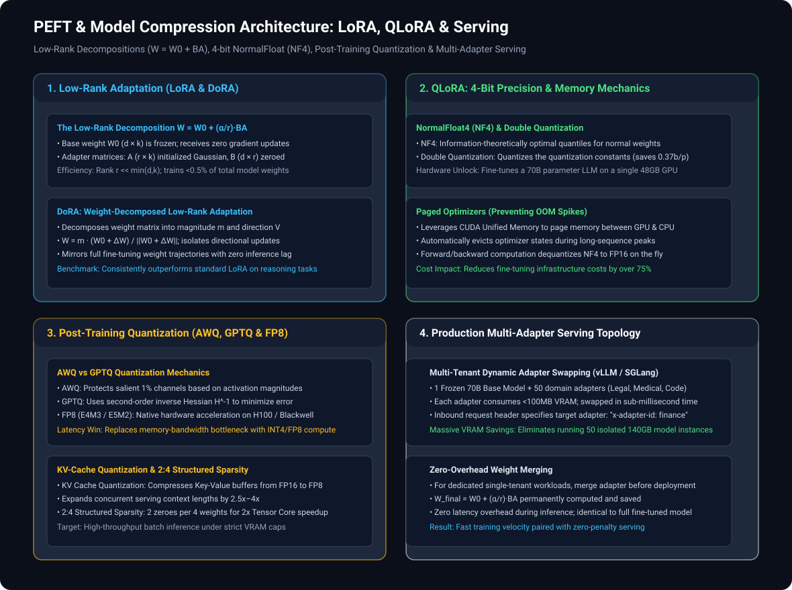
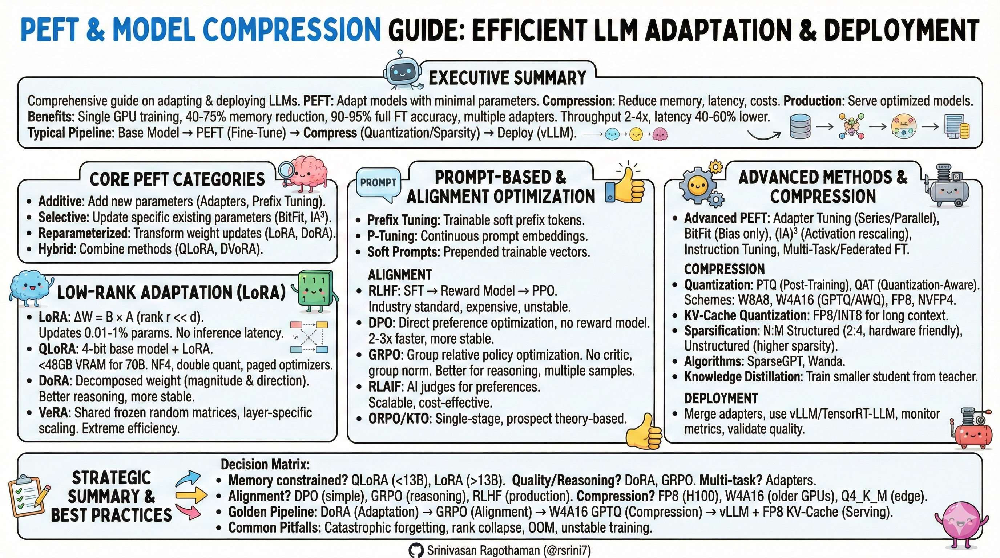

# Parameter-Efficient Fine-Tuning & Model Compression: Low-Rank Adaptation, Quantization, and Serving Topology

`Learning note · Revised November 2026 · AI Engineering & Model Optimization`  
*By Srinivasan Ragothaman ([@rsrini7](https://github.com/rsrini7))*

> Full parameter fine-tuning of large language models is computationally prohibitive and architecturally inefficient for enterprise domain specialization. Parameter-Efficient Fine-Tuning (PEFT)—led by LoRA, QLoRA, and DoRA—freezes foundation base weights while learning low-rank matrix decompositions $W = W_0 + \frac{\alpha}{r}BA$ on less than 1% of parameters. When paired with post-training quantization (AWQ, GPTQ, FP8) and multi-adapter serving runtimes, organizations achieve state-of-the-art domain performance on consumer-grade hardware while serving dozens of specialized personas from a single frozen base model.

---

## 1. Foundations: The Computational Cost of Foundation Model Adaptation

Updating all parameters of an 8B to 70B parameter model via Full Fine-Tuning (FFT) requires storing the base weights, optimizer states (Adam requires 8 bytes per parameter for first and second moments), activations, and gradients in GPU VRAM:

```
+----------------------------------------------------------------------------------------------------+
|                                    FINE-TUNING RESOURCE REQUIREMENTS                               |
+----------------------------------------------------------------------------------------------------+
|  MODEL SCALE       FULL FINE-TUNING (16-BIT ADAM)      PEFT (LORA / 16-BIT)       QLORA (4-BIT NF4) |
|  - 8B Parameters   ~64 GB VRAM (Multi-GPU A100)        ~18 GB VRAM (Single GPU)   ~6 GB (RTX 4090)  |
|  - 70B Parameters  ~560 GB VRAM (8x A100 / H100 Node)  ~160 GB VRAM (4x A100)     ~48 GB (Single GPU|
+----------------------------------------------------------------------------------------------------+
```

### Essential Technical Terms & Architectural Primitives

| Component / Term | Mathematical / Architectural Role | Engineering Significance |
| :--- | :--- | :--- |
| **LoRA (Low-Rank Adaptation)** | Decomposes weight delta $\Delta W$ into two low-rank matrices: $\Delta W = \frac{\alpha}{r} B \cdot A$ | Freezes $W_0$; reduces trainable parameters by $>99\%$, eliminating optimizer state bloat. |
| **Rank ($r$) & Alpha ($\alpha$)** | Rank $r$ limits inner dimension; scaling factor $\frac{\alpha}{r}$ stabilizes gradients | Controls model capacity vs memory; typical production settings use $r \in [8, 64]$ and $\alpha = 2r$. |
| **QLoRA** | Quantizes frozen base model into 4-bit NormalFloat (NF4) with Double Quantization | Unlocks fine-tuning 70B models on a single 48GB GPU by dequantizing to 16-bit only during forward/backward. |
| **DoRA** | Decomposes weights into magnitude vector $m$ and directional matrix $V$ | Decouples magnitude from directional updates; consistently outperforms standard LoRA on math and reasoning. |
| **AWQ (Activation-aware PTQ)** | Post-training quantization protecting the top 1% salient weight channels based on activations | Compresses models to INT4 with near-zero perplexity degradation; avoids expensive second-order Hessian inversion. |
| **GPTQ** | One-shot second-order weight quantization using inverse Hessian matrix $H^{-1}$ | Quantizes billions of weights efficiently row-by-row; ideal for standalone small model deployments. |
| **Multi-Adapter Serving** | Architecture serving multiple LoRA adapters on top of a single shared frozen base model | Eliminates running duplicate 140GB models; serves 50 domain-specific personas from a single GPU pool. |

---

## 2. Deep Technical Mechanisms: Low-Rank Adaptation & Quantization Physics

### 2.1 The Mathematics of Low-Rank Adaptation (LoRA)

A linear layer in a transformer processes input $x \in \mathbb{R}^k$ via weight matrix $W_0 \in \mathbb{R}^{d \times k}$:

$$h = W_0 x$$

During fine-tuning, the parameter update is constrained to a low-rank decomposition:

$$W = W_0 + \Delta W = W_0 + \frac{\alpha}{r} B A$$

Where $B \in \mathbb{R}^{d \times r}$ and $A \in \mathbb{R}^{r \times k}$ with rank $r \ll \min(d, k)$. 

```
                       LORA FORWARD PASS COMPUTATION GRAPH
                                        │
                                   Input x (k)
                                        │
                   ┌────────────────────┴────────────────────┐
                   ▼                                         ▼
         [ Frozen Base W0 ]                      [ Low-Rank Matrix A ]
             (d × k)                                  (r × k)
           Zero Gradients                           Gaussian Init
                   │                                         │
                   │                                         ▼
                   │                             [ Low-Rank Matrix B ]
                   │                                  (d × r)
                   │                                 Zero Init
                   │                                         │
                   │                                         ▼
                   │                                Scaling Factor (α/r)
                   │                                         │
                   └────────────────────┬────────────────────┘
                                        ▼
                             Output h = W0 x + ΔW x
```

1. **Initialization**: Matrix $A$ is initialized from a Gaussian distribution $\mathcal{N}(0, \sigma^2)$, and matrix $B$ is initialized to zero. At step 0, $\Delta W = 0$, ensuring the model's pre-trained behavior is unaltered.
2. **Target Modules**: In modern transformer architectures, applying LoRA across all linear attention projections (`q_proj`, `k_proj`, `v_proj`, `o_proj`) and feed-forward MLP blocks (`gate_proj`, `up_proj`, `down_proj`) yields superior generalization compared to targeting attention alone.

---

### 2.2 QLoRA: NormalFloat4, Double Quantization, and Paged Optimizers

QLoRA (Dettmers et al., 2023) eliminates the VRAM footprint of the frozen base model through three coordinated algorithmic innovations:

```
+----------------------------------------------------------------------------------------------------+
|                                      THE THREE PILLARS OF QLORA                                    |
+----------------------------------------------------------------------------------------------------+
|  1. NORMALFLOAT4 (NF4) QUANTIZATION                                                                |
|     - Pre-trained neural weights follow a zero-mean normal distribution: W ~ N(0, σ^2).            |
|     - NF4 constructs 16 information-theoretically optimal quantile bins.                           |
|     - Distributes equal probability mass to each bin, maximizing entropy and minimizing error.    |
|                                                                                                    |
|  2. DOUBLE QUANTIZATION (DQ)                                                                       |
|     - Quantization constants (c1) themselves consume memory (0.5 bits per parameter).             |
|     - DQ quantizes the 32-bit quantization constants into 8-bit integers (c2).                     |
|     - Compresses memory overhead from 0.5 bits/param to 0.127 bits/param (saves 0.37 bits/param). |
|                                                                                                    |
|  3. PAGED OPTIMIZERS (CUDA Unified Memory)                                                         |
|     - Uses CUDA Unified Memory to automatically page non-active Adam optimizer states between      |
|       GPU VRAM and CPU system RAM during long-sequence activation spikes, preventing OOM crashes.  |
+----------------------------------------------------------------------------------------------------+
```

---

### 2.3 Post-Training Quantization: AWQ vs. GPTQ vs. FP8

Once an adapter is fine-tuned, deploying the model for high-throughput serving requires post-training compression:

```
AWQ (ACTIVATION-AWARE WEIGHT QUANTIZATION)
Input Activations X ──► Measure Absolute Magnitude ──► Top 1% Channels are "Salient"
                                                              │
           ┌──────────────────────────────────────────────────┴───────────────────┐
           ▼                                                                      ▼
  [ Salient Channels (1%) ]                                            [ Non-Salient Channels (99%) ]
   Keep in Full FP16 Precision                                          Quantize Aggressively to INT4
   Protects critical knowledge representations                          Maximizes memory bandwidth speedup
```

1. **AWQ**: Recognizes that not all weights are equally important. By analyzing activation magnitudes across a small calibration set, AWQ protects the salient 1% channels in 16-bit precision, quantizing the remaining 99% to INT4 with virtually zero accuracy loss.
2. **GPTQ**: Uses second-order Taylor series error compensation based on the inverse Hessian matrix $H^{-1}$. It processes weights layer-by-layer, updating unquantized weights to compensate for the error introduced by quantized weights.
3. **Native FP8**: Supported natively on NVIDIA Ada Lovelace, Hopper, and Blackwell GPUs. Provides 2x compute throughput over FP16 without requiring complex offline INT4 weight scaling.

---

## 3. Architectural Visuals: PEFT and Serving Topologies

The architectural infographic below illustrates low-rank decomposition, QLoRA precision handling, post-training quantization, and multi-adapter serving topologies:



---

## 4. Production Implementations & Code Recipes

### 4.1 Production QLoRA Fine-Tuning Pipeline with HuggingFace & PEFT

This standalone Python recipe configures 4-bit NF4 quantization, sets up LoRA targeting all transformer linear projections, and initiates training using the `trl` library:

```python
import torch
from transformers import (
    AutoModelForCausalLM,
    AutoTokenizer,
    BitsAndBytesConfig,
    TrainingArguments
)
from peft import LoraConfig, get_peft_model, prepare_model_for_kbit_training
from trl import SFTTrainer
from datasets import Dataset

MODEL_ID = "meta-llama/Llama-3.1-8B-Instruct"

# Step 1: Configure 4-bit NormalFloat (NF4) & Double Quantization
bnb_config = BitsAndBytesConfig(
    load_in_4bit=True,
    bnb_4bit_quant_type="nf4",
    bnb_4bit_compute_dtype=torch.bfloat16,
    bnb_4bit_use_double_quant=True
)

print("Loading base model in 4-bit precision...")
tokenizer = AutoTokenizer.from_pretrained(MODEL_ID)
tokenizer.pad_token = tokenizer.eos_token

model = AutoModelForCausalLM.from_pretrained(
    MODEL_ID,
    quantization_config=bnb_config,
    device_map="auto"
)

# Step 2: Prepare model for gradient checkpointing and freeze base parameters
model = prepare_model_for_kbit_training(model)

# Step 3: Configure LoRA Adapter
peft_config = LoraConfig(
    r=16,                           # Rank: balance between expressiveness and VRAM
    lora_alpha=32,                  # Scaling factor: α = 2r is standard
    target_modules=[                # Target all linear projections for maximum transfer
        "q_proj", "k_proj", "v_proj", "o_proj",
        "gate_proj", "up_proj", "down_proj"
    ],
    lora_dropout=0.05,
    bias="none",
    task_type="CAUSAL_LM"
)

model = get_peft_model(model, peft_config)
model.print_trainable_parameters()
# Output: trainable params: 41,943,040 || all params: 8,072,204,288 || trainable%: 0.5196%

# Step 4: Configure Training Arguments
training_args = TrainingArguments(
    output_dir="./lora_checkpoints",
    per_device_train_batch_size=4,
    gradient_accumulation_steps=4,
    learning_rate=2e-4,
    logging_steps=10,
    num_train_epochs=3,
    optim="paged_adamw_8bit",       # Paged optimizer prevents OOM spikes
    fp16=False,
    bf16=True,
    save_strategy="epoch"
)

# Dummy dataset for verification
sample_data = {
    "text": [
        "Instruction: Extract entity. Input: Invoice #9012 from Acme Corp. Output: Acme Corp",
        "Instruction: Extract entity. Input: PO #4412 from Globex Inc. Output: Globex Inc"
    ]
}
dataset = Dataset.from_dict(sample_data)

trainer = SFTTrainer(
    model=model,
    train_dataset=dataset,
    peft_config=peft_config,
    dataset_text_field="text",
    max_seq_length=1024,
    tokenizer=tokenizer,
    args=training_args
)

print("Starting QLoRA training run...")
trainer.train()

# Step 5: Save Adapter Weights
model.save_pretrained("./final_financial_adapter")
print("LoRA adapter weights saved successfully.")
```

---

### 4.2 Multi-Adapter Production Serving via vLLM

To serve dozens of domain-specific adapters from a single shared base model without duplicating VRAM:

```bash
# ---------------------------------------------------------
# MULTI-LORA SERVING IN VLLM
# ---------------------------------------------------------
# Launch vLLM server with dynamic LoRA enabled
vllm serve meta-llama/Llama-3.1-8B-Instruct \
    --enable-lora \
    --max-loras 16 \
    --max-lora-rank 32 \
    --lora-modules \
        finance=/models/adapters/finance_v1 \
        legal=/models/adapters/legal_v1 \
        medical=/models/adapters/medical_v1 \
    --gpu-memory-utilization 0.90
```

---

### 4.3 Zero-Overhead Adapter Merging for Single-Tenant Production

For dedicated, low-latency deployments, merge the adapter directly into the base weights to eliminate all runtime adapter indirection:

```python
from peft import AutoPeftModelForCausalLM
import torch

print("Loading fine-tuned adapter on 16-bit base model...")
model = AutoPeftModelForCausalLM.from_pretrained(
    "./final_financial_adapter",
    torch_dtype=torch.bfloat16,
    device_map="auto"
)

print("Merging adapter weights into base model: W_deploy = W0 + (α/r)BA ...")
merged_model = model.merge_and_unload()

print("Saving standalone merged checkpoint ready for vLLM / TensorRT-LLM...")
merged_model.save_pretrained("./merged_standalone_model")
```

---

## 5. Comparative Structural Analysis

| Dimension | Full Fine-Tuning (FFT) | LoRA (Hu et al.) | QLoRA (Dettmers et al.) | DoRA (Liu et al.) |
| :--- | :--- | :--- | :--- | :--- |
| **Trainable Parameters** | 100% | 0.1% – 1.0% | 0.1% – 1.0% | 0.1% – 1.0% |
| **Base Model Precision** | 16-bit (FP16 / BF16) | 16-bit (FP16 / BF16) | **4-bit (NF4 Quantized)** | 16-bit / 4-bit |
| **70B Model VRAM Required** | >560 GB (8x A100) | ~160 GB (4x A100) | **~48 GB (1x A6000/A100)** | ~48 GB – 160 GB |
| **Training Speed** | Fast (clean matrix ops) | Fast | ~20% slower (dequantization) | ~15% slower (norm calc) |
| **Task Accuracy vs FFT** | 100% (Baseline) | 98% – 101% | 98% – 100% | **99% – 103% (Beats LoRA)** |
| **Multi-Tenant Serving** | Impossible | **Native (vLLM / SGLang)** | **Native (vLLM / SGLang)** | Merged deployment |
| **Storage per Adapter** | 16GB – 140GB per model | **20MB – 150MB per adapter** | **20MB – 150MB per adapter**| 20MB – 150MB |

---

## 6. Common Claims vs. Technical Realities

| # | Common Industry Claim | Technical Reality & Benchmark Fact | Architectural Guidance |
| :-: | :--- | :--- | :--- |
| **1** | *"LoRA is strictly inferior in accuracy compared to full fine-tuning."* | **False.** On standard domain adaptation, instruction following, and mathematical reasoning, LoRA frequently matches or exceeds FFT by acting as an implicit regularizer that prevents catastrophic forgetting. | Standardize on LoRA/DoRA by default; full fine-tuning is only necessary when teaching fundamentally new pre-training token distributions. |
| **2** | *"Increasing LoRA rank $r$ to 128 or 256 always improves accuracy."* | **False.** Research demonstrates that the intrinsic rank of adaptation matrices is remarkably low ($r \in [4, 16]$). Increasing $r$ beyond 64 increases VRAM consumption and induces overfitting without measurable benchmark gains. | Start with $r=16$ and $\alpha=32$; scale to $r=32$ only for complex polyglot coding datasets. |
| **3** | *"QLoRA degrades model intelligence due to 4-bit quantization."* | **False.** QLoRA uses 4-bit NormalFloat (NF4), which preserves the information density of normal weight distributions. Gradients and activations are computed in BF16. Multiple empirical studies show zero statistical accuracy difference between LoRA and QLoRA. | Use QLoRA to dramatically reduce training hardware costs. |
| **4** | *"Deploying 20 LoRA adapters requires 20 separate GPU server clusters."* | **False.** Modern serving engines (vLLM, SGLang, HuggingFace TGI) support dynamic multi-LoRA routing. A single 70B base model in VRAM can serve dozens of adapters concurrently with sub-millisecond switching overhead. | Deploy a multi-LoRA cluster to serve enterprise departments (HR, Legal, Finance) cost-effectively. |
| **5** | *"Merging a LoRA adapter into base weights introduces inference latency."* | **False.** The merge operation ($W_{\text{deploy}} = W_0 + \frac{\alpha}{r}BA$) is computed once offline. The resulting model is a standard dense weight tensor with zero architectural overhead. | Merge adapters before deploying dedicated single-tenant enterprise services. |

---

## 7. Practical Adoption Blueprint: The 4-Stage Runbook

```
+----------------------------------------------------------------------------------------------------+
|                                    PEFT ADOPTION RUNBOOK                                           |
+----------------------------------------------------------------------------------------------------+
|  1. EVALUATE HARDWARE BUDGET:                                                                      |
|     - For 8B models: Single RTX 4090 (24GB) is sufficient for QLoRA with batch size 4.              |
|     - For 70B models: Single A100 (80GB) or dual A6000 (48GB) supports QLoRA with sequence len 4096.|
|                                                                                                    |
|  2. DATASET PREPARATION & CALIBRATION:                                                             |
|     - Format data into clean instruction-input-output pairs (Alpaca or ShareGPT format).           |
|     - Filter out truncated sequences; set maximum sequence length to 2048 or 4096.                 |
|                                                                                                    |
|  3. ADAPTER FINE-TUNING:                                                                           |
|     - Apply QLoRA targeting all linear projections with r=16, alpha=32, dropout=0.05.              |
|     - Use paged_adamw_8bit optimizer and gradient checkpointing.                                   |
|                                                                                                    |
|  4. SERVING ARCHITECTURE:                                                                          |
|     - Multi-tenant workloads: Deploy base model in vLLM with --enable-lora.                        |
|     - Single-tenant high-RPS workloads: Merge adapter into base model and quantize with AWQ/FP8.    |
+----------------------------------------------------------------------------------------------------+
```

---

## 8. Technology Roadmap & Historical Milestones

```
2021 ────────────────────── 2023 ────────────────────── 2024 ────────────────────── 2026+
 │                           │                           │                           │
 ├── Hu et al.: LoRA         ├── Dettmers et al.: QLoRA  ├── Liu et al.: DoRA        └── Production Convergence
 │   • Low-rank adaptation   • 4-bit NormalFloat (NF4)   • Magnitude/direction split • Multi-LoRA in vLLM
 │   • ΔW = (α/r) BA         • Double Quantization       • Closes gap to full FFT    • Native FP8 execution
 │                           • Paged Optimizers          • Lin et al.: AWQ PTQ       • Automated adapter routing
```

---

## 9. Primary Sources & References

1. [Hu et al. (2021): LoRA: Low-Rank Adaptation of Large Language Models (arXiv:2106.09685)](https://arxiv.org/abs/2106.09685) — Seminal paper introducing low-rank matrix decomposition for efficient model adaptation.
2. [Dettmers et al. (2023): QLoRA: Efficient Finetuning of Quantized LLMs (arXiv:2305.14314)](https://arxiv.org/abs/2305.14314) — Landmark paper establishing 4-bit NormalFloat (NF4), double quantization, and paged optimizers.
3. [Liu et al. (2024): DoRA: Weight-Decomposed Low-Rank Adaptation (arXiv:2402.09353)](https://arxiv.org/abs/2402.09353) — Technical report on decoupling weight magnitude from directional updates.
4. [Lin et al. (2023): AWQ: Activation-aware Weight Quantization for LLM Compression and Acceleration (arXiv:2306.00978)](https://arxiv.org/abs/2306.00978) — Foundational work on protecting salient activation channels during post-training quantization.
5. [Frantar et al. (2022): GPTQ: Accurate Post-Training Quantization for Generative Pre-trained Transformers (arXiv:2210.17323)](https://arxiv.org/abs/2210.17323) — One-shot second-order weight quantization using inverse Hessian error compensation.

---

## 10. Supplementary visuals

The following legacy technical diagram illustrates the complete lifecycle of adapting and deploying large language models efficiently:


*Figure 1: High-level overview of parameter-efficient adaptation, post-training compression, and production serving.*

---

**Related:**
- [AI-Numerical-Formats-And-Quantization-Oct-2026](../LLMs/optimization/AI-Numerical-Formats-And-Quantization-Oct-2026.md) — Comprehensive hardware analysis of FP32, FP16, BF16, FP8, INT8, and INT4 precision formats across modern GPUs.
- [Weight-Space-Programming-Astra-Qwen-Nov-2026](../LLMs/training/Weight-Space-Programming-Astra-Qwen-Nov-2026.md) — Analyzes weight-space parameter surgery, directional ablation, and model merging compared to gradient-based adaptation.
- [DSPy-Declarative-Self-Improving-Language-Programs-2026](../Agents/Programming/DSPy-Declarative-Self-Improving-Language-Programs-2026.md) — Explores how DSPy compiles execution traces into LoRA fine-tuning datasets for open-weight models.
- [BAML-Structured-LLM-Interaction-Framework-2026](../Agents/Programming/BAML-Structured-LLM-Interaction-Framework-2026.md) — Schema-first DSL providing type-safe extraction from models fine-tuned with PEFT adapters.
- [LLM-Inference-Engines](../LLMs/architecture/LLM-Inference-Engines.md) — Comparative evaluation of vLLM, SGLang, and TensorRT-LLM for serving multi-adapter LoRA deployments.
