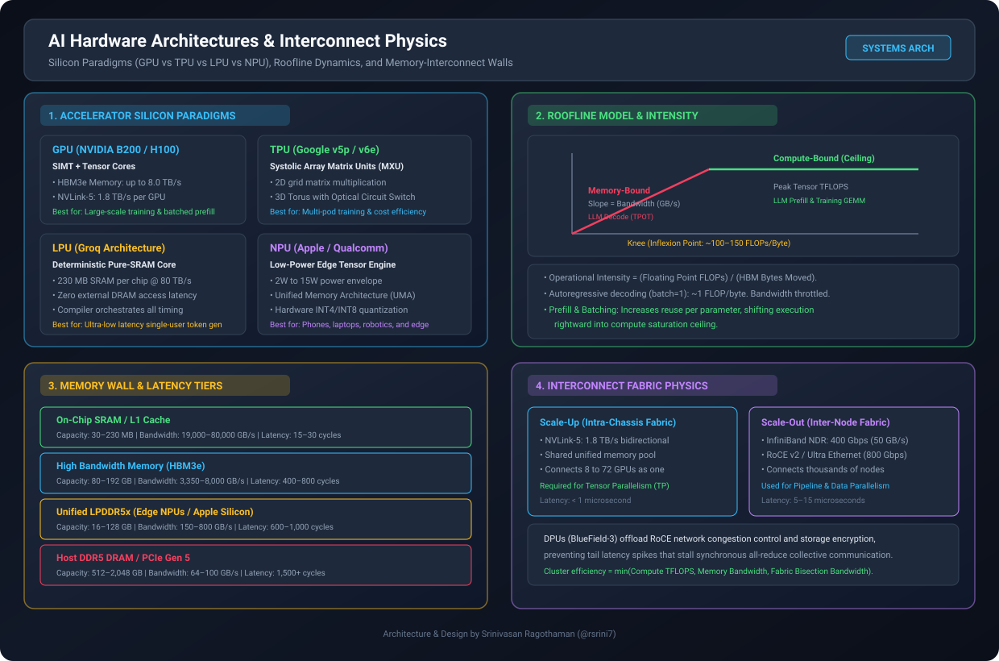
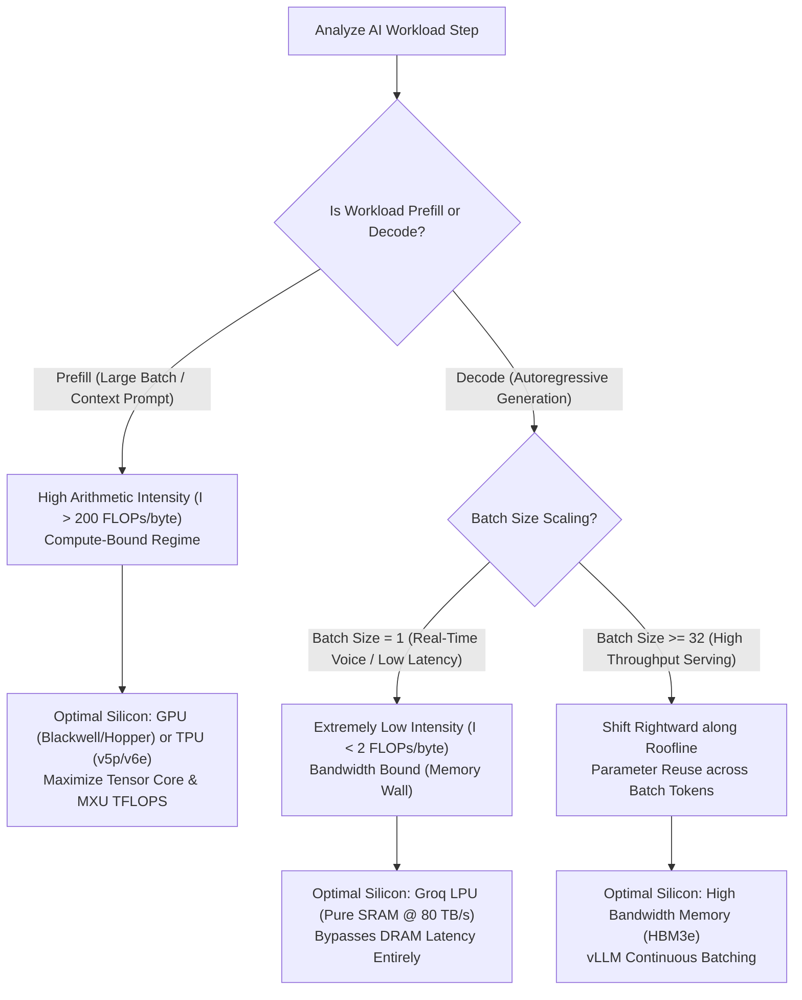

# AI Hardware Architectures: GPUs, TPUs, NPUs, LPUs, and Interconnect Physics

**Learning note · Revised 15 November 2026 · Scope: Accelerator silicon paradigms, memory hierarchies, and interconnect fabrics**

*By Srinivasan Ragothaman ([@rsrini7](https://github.com/rsrini7))*

> **Core idea:** Hardware efficiency in modern artificial intelligence is governed not by peak theoretical FLOPs, but by the balance between operational intensity, memory bandwidth, and interconnect bisection capacity. While GPUs and TPUs dominate high-intensity prefill and training through High Bandwidth Memory (HBM) and systolic tensor units, LPUs achieve microsecond decode latencies via massive on-chip SRAM, and NPUs maximize energy efficiency on edge devices through unified memory architectures.

---

## 1. Foundations: The AI Compute Paradigm Shift

Classical workloads executed on central processing units (CPUs) are dominated by control flow, pointer indirection, and branch prediction. Modern deep learning workloads—specifically transformer attention and feed-forward networks—are fundamentally different: they consist of massive, deterministic linear algebra operations, primarily **General Matrix Multiplications (GEMM)**:

$$
C = \alpha (A \cdot B) + \beta C
$$

Where $A \in \mathbb{R}^{M \times K}$ and $B \in \mathbb{R}^{K \times N}$.

To execute trillions of multiplications per second, hardware designers stripped away dynamic branch predictors, speculative execution pipelines, and complex out-of-order execution logic, dedicating die area to dense arrays of arithmetic multiply-accumulate (MAC) units.

| Processor Class | Primary Workload | Silicon Architecture | Memory Technology | Typical Precision |
|---|---|---|---|---|
| **GPU (NVIDIA B200 / H100)** | Pretraining, fine-tuning, large-scale serving | SIMT + Specialized 4th/5th Gen Tensor Cores | Off-chip HBM3e (3.35–8.0 TB/s) | FP32, TF32, BF16, FP16, FP8, FP4 |
| **TPU (Google v5p / v6e Trillium)** | Large-scale pretraining, multi-pod serving | 2D Systolic Array Matrix Multiply Units (MXUs) | Off-chip HBM (2.4–4.8 TB/s) + 3D Torus OCS | BF16, FP8, INT8 |
| **LPU (Groq Language Processing Unit)** | Real-time agentic inference, low-batch decode | Deterministic single-core, zero cache/branching | On-chip SRAM (~230 MB per chip @ 80 TB/s) | INT8, FP16 |
| **NPU (Apple ANE / Qualcomm Hexagon)** | Edge inference on phones, laptops, and robotics | Fixed-function tensor engines + unified memory (UMA) | Shared LPDDR5x (100–800 GB/s) | INT8, INT4, FP16 |
| **DPU (NVIDIA BlueField-3 / Pensando)** | Data-center infrastructure offload &amp; storage | Multi-core ARM/RISC-V + Line-rate crypto/packet ASICs | On-board DDR5 / PCIe Gen 5 | Network/Security Offload |
| **CPU (Intel Xeon / AMD EPYC)** | Orchestration, preprocessing, vector retrieval | Out-of-order superscalar + AVX-512 / AMX | Multi-channel DDR5 (50–100 GB/s) | FP64, FP32, INT8 |

---

## 2. Deep Technical Mechanisms

```
+--------------------------------------------------------------------------------------------------+
|                            AI HARDWARE INTERCONNECT & MEMORY TAXONOMY                            |
|                                                                                                  |
|   SCALE-UP DOMAIN (INTRA-NODE NVLINK / CHIP-TO-CHIP FABRIC)                                      |
|   +------------------------------------------------------------------------------------------+   |
|   | GPU 0 (HBM3e: 8 TB/s) <==== NVLink-5 (1.8 TB/s) ====> GPU 1 (HBM3e: 8 TB/s)              |   |
|   |         |                                                      |                         |   |
|   |         v NVLink Switch Network (Full Bisection Bandwidth)     v                         |   |
|   | GPU 2 (HBM3e: 8 TB/s) <=============================> GPU 3 (HBM3e: 8 TB/s)              |   |
|   +------------------------------------------------------------------------------------------+   |
|                                            |                                                     |
|                                            v PCIe Gen 5 (64 GB/s) or Direct DPU                  |
|   DATA CENTER INFRASTRUCTURE PLANE                                                               |
|   +------------------------------------------------------------------------------------------+   |
|   | DPU (BlueField-3): Offloads RoCE v2 congestion control, NVMe-oF RDMA, line-rate TLS      |   |
|   +------------------------------------------------------------------------------------------+   |
|                                            |                                                     |
|                                            v SCALE-OUT DOMAIN (INTER-NODE NETWORK)               |
|   +------------------------------------------------------------------------------------------+   |
|   | Multi-Rail InfiniBand NDR (400 Gbps) / Ultra Ethernet UEC (800 Gbps)                     |   |
|   | Connects thousands of server chassis across fat-tree spine-leaf topologies               |   |
|   +------------------------------------------------------------------------------------------+   |
+--------------------------------------------------------------------------------------------------+
```

### 1. The Roofline Model: Arithmetic Intensity and Operational Regimes

The attainable performance of any AI processor is bounded by Williams' **Roofline Model**:

$$
P = \min\left( P_{\text{peak}}, \, I \times B_{\text{mem}} \right)
$$

Where:
- $P$ is the attainable performance in floating point operations per second ($\text{FLOPs/s}$).
- $P_{\text{peak}}$ is the hardware's peak theoretical compute capacity (Tensor Core TFLOPS).
- $B_{\text{mem}}$ is the memory bandwidth in bytes per second ($\text{Bytes/s}$).
- $I$ is the **Operational / Arithmetic Intensity** in $\text{FLOPs per Byte}$:

$$
I = \frac{\text{Total Floating Point Operations (FLOPs)}}{\text{Total Memory Traffic to/from DRAM (Bytes)}}
$$

```
Attainable Performance
  (TFLOPS) ^
           |                     +----------------------------------+
P_peak     |--------------------+  COMPUTE-BOUND REGIME            |
           |                   / |  - Training Forward/Backward GEMM |
           |                  /  |  - Prefill Phase (TTFT)          |
           |                 /   +----------------------------------+
           |                /
           |               /  Slope = Memory Bandwidth (B_mem)
           |              /
           |             / +----------------------------------+
           |            /  | MEMORY-BOUND REGIME              |
           |           /   | - Autoregressive Decode (TPOT)   |
           |          /    | - Batch Size = 1                 |
           |         /     +----------------------------------+
           +--------+------------------------------------------------->
           0        I_knee                                       Intensity
                                                             (FLOPs/Byte)
```

The hardware "knee" occurs at:

$$
I_{\text{knee}} = \frac{P_{\text{peak}}}{B_{\text{mem}}}
$$

For an NVIDIA H100 SXM5 ($P_{\text{peak}} \approx 989\text{ TFLOPS}$ BF16, $B_{\text{mem}} \approx 3,350\text{ GB/s}$ HBM3):

$$
I_{\text{knee}} \approx \frac{989 \times 10^{12}}{3.35 \times 10^{12}} \approx 295\text{ FLOPs/Byte}
$$

- **Prefill Phase (Prompt Ingestion):** Processes $N$ prompt tokens in parallel via dense matrix multiplications ($M = N$, $N \ge 1,024$). Arithmetic intensity exceeds $300\text{ FLOPs/byte}$, fully saturating Tensor Cores (**Compute-Bound**).
- **Decode Phase (Token-by-Token Generation):** Each step generates $M = 1$ token. To compute a single token on a 70B parameter model, the processor must stream all 70 billion parameters from HBM into on-chip registers. Operational intensity collapses to **$< 1\text{ FLOP/byte}$**. The hardware is **Memory-Bandwidth Bound**, utilizing less than 2% of its peak compute capability.

### 2. Accelerator Silicon Microarchitectures

#### NVIDIA GPUs: Streaming Multiprocessors &amp; Tensor Cores
- **Streaming Multiprocessors (SMs):** A chip contains 132–192 SMs. Each SM contains integer ALUs, single-precision FP32 cores, and specialized Tensor Cores.
- **Tensor Cores:** Execute mixed-precision Matrix-Multiply-Accumulate (MMA) operations in hardware: $D = A \cdot B + C$, multiplying FP8/BF16 inputs while accumulating in FP32.
- **Tensor Memory Accelerator (TMA):** Introduced in Hopper and expanded in Blackwell, TMA executes asynchronous multidimensional tensor transfers between global HBM and SM Shared Memory (SRAM) without wasting SM register or ALU cycles.

#### Google TPUs: Systolic Array Matrix Multiply Units (MXUs)
- **Systolic Execution:** Data flows rhythmically through a 2D grid of 128×128 processing elements. Inputs stream from the left, weights stream from the top, and partial sums accumulate across registers. Systolic arrays achieve higher energy efficiency than GPUs by reusing weights locally without reading and writing back to register files.
- **Optical Circuit Switches (OCS):** Google TPU superpods interconnect thousands of chips in a 3D Torus network using reconfigurable fiber-optic switches, enabling dynamic topology reconfiguration around failed nodes without physical re-cabling.

#### Groq LPUs: Deterministic Pure-SRAM Architecture
- **Elimination of Dynamic Execution:** Standard GPUs waste up to 40% of their silicon on instruction dispatch buffers, out-of-order schedulers, and dynamic cache hierarchy controllers. Groq eliminates all caches, dynamic branch predictors, and memory controllers.
- **Massive On-Chip SRAM:** Each LPU contains **230 MB of high-density SRAM** operating at **80 TB/s bandwidth**. The compiler statically schedules every instruction cycle, register movement, and chip-to-chip packet in advance. This delivers ultra-low, deterministic latencies for autoregressive token decoding ($> 500\text{ tokens/sec}$).

#### NPUs: Edge Unified Memory Engines
- **Thermal &amp; Power Envelope:** NPUs operate inside 2W–15W envelopes. They lack HBM due to power and packaging costs, instead sharing unified LPDDR5x memory with the host CPU and GPU.
- **Hardware Quantization:** NPUs specialize in low-bitwidth integer execution (INT4 and INT8), utilizing weight-only quantization and activation scaling units to fit small models (1B–8B) entirely inside mobile RAM.

### 3. Interconnect Physics: Scale-Up vs. Scale-Out

Distributed training and inference require partitioning models across chips. Communication performance is governed by interconnect bandwidth:

1. **Scale-Up Fabric (Intra-Node):**
   - **NVIDIA NVLink-5:** Provides **1.8 TB/s bidirectional bandwidth per GPU** (18× faster than PCIe Gen 5). All GPUs within a chassis (or rack-scale NVL72) share a flat, hardware-managed cache-coherent memory address space. Essential for **Tensor Parallelism (TP)**, where partial layer activations are exchanged via synchronous `All-Reduce` after every transformer layer.
2. **Scale-Out Fabric (Inter-Node):**
   - **InfiniBand NDR (400 Gbps) &amp; RoCE v2 (800 Gbps):** Interconnects thousands of independent servers across leaf-spine fat-tree networks. Employs Remote Direct Memory Access (RDMA) to bypass host operating systems. Suited for **Pipeline Parallelism (PP)** and **Data Parallelism (DP / FSDP)**, which require coarser, less latency-sensitive gradient exchanges.

---

## 3. Architectural Visuals



*Comprehensive systems overview comparing accelerator silicon paradigms, the Roofline Model memory-vs-compute boundaries, latency tiers across memory hierarchies, and scale-up versus scale-out interconnect fabrics.*

### The Roofline Decision Flowchart



---

## 4. Production Implementation: Hardware Roofline &amp; Latency Estimator

The following complete, runnable Python script implements a **Hardware Roofline Model and LLM Serving Latency Estimator**. It models arithmetic intensity, Time to First Token (TTFT), and Time per Output Token (TPOT) across NVIDIA H100, Google TPU v5p, and Groq LPU hardware baselines:

```python
"""
AI Hardware Roofline & LLM Serving Latency Estimator.
Calculates arithmetic intensity, TTFT (compute-bound prefill), and TPOT (memory-bound decode)
for large language models across accelerator platforms.
"""

from dataclasses import dataclass
from typing import Dict, Any

@dataclass
class HardwareProfile:
    name: str
    peak_tflops_fp16: float       # Peak FP16/BF16 Tensor TFLOPS
    memory_bandwidth_gb_s: float   # HBM or SRAM memory bandwidth in GB/s
    on_chip_sram_mb: float         # On-chip SRAM capacity
    interconnect_gb_s: float       # Chip-to-chip interconnect bandwidth (e.g. NVLink)

@dataclass
class ModelProfile:
    name: str
    parameter_count_billions: float  # Total parameters (e.g. 70.0 for Llama-3-70B)
    hidden_dimension: int            # Model hidden size (e.g. 8192)
    bytes_per_param: float           # 2.0 for FP16/BF16, 1.0 for FP8

class HardwareRooflineEstimator:
    def __init__(self, hw: HardwareProfile, model: ModelProfile):
        self.hw = hw
        self.model = model
        self.knee_intensity = (self.hw.peak_tflops_fp16 * 1e12) / (self.hw.memory_bandwidth_gb_s * 1e9)

    def analyze_decode_step(self, batch_size: int = 1) -> Dict[str, Any]:
        """
        Analyzes a single autoregressive token generation step (Decode Phase).
        FLOPs = 2 * params * batch_size
        Bytes = params * bytes_per_param
        """
        flops = 2.0 * (self.model.parameter_count_billions * 1e9) * batch_size
        bytes_transferred = (self.model.parameter_count_billions * 1e9) * self.model.bytes_per_param
        
        operational_intensity = flops / bytes_transferred
        is_compute_bound = operational_intensity >= self.knee_intensity
        
        # Attainable throughput in TFLOPS
        if is_compute_bound:
            attainable_tflops = self.hw.peak_tflops_fp16
        else:
            attainable_tflops = (operational_intensity * (self.hw.memory_bandwidth_gb_s * 1e9)) / 1e12
            
        # Time per Output Token (TPOT) in milliseconds
        transfer_time_sec = bytes_transferred / (self.hw.memory_bandwidth_gb_s * 1e9)
        tpot_ms = transfer_time_sec * 1000.0

        return {
            "phase": "Decode (Single Token)",
            "batch_size": batch_size,
            "operational_intensity_flops_per_byte": round(operational_intensity, 2),
            "hardware_knee_intensity": round(self.knee_intensity, 2),
            "regime": "Compute-Bound" if is_compute_bound else "Memory-Bandwidth-Bound",
            "attainable_tflops": round(attainable_tflops, 2),
            "hardware_utilization_pct": round((attainable_tflops / self.hw.peak_tflops_fp16) * 100.0, 2),
            "tpot_latency_ms": round(tpot_ms, 2),
            "tokens_per_second": round(1000.0 / tpot_ms, 1) if tpot_ms > 0 else 0
        }

    def analyze_prefill_phase(self, prompt_tokens: int = 2048) -> Dict[str, Any]:
        """
        Analyzes the prompt prefill phase (Time to First Token - TTFT).
        FLOPs = 2 * params * prompt_tokens
        Bytes = params * bytes_per_param (parameters loaded once across prompt)
        """
        flops = 2.0 * (self.model.parameter_count_billions * 1e9) * prompt_tokens
        bytes_transferred = (self.model.parameter_count_billions * 1e9) * self.model.bytes_per_param
        
        operational_intensity = flops / bytes_transferred
        is_compute_bound = operational_intensity >= self.knee_intensity
        
        compute_time_sec = flops / (self.hw.peak_tflops_fp16 * 1e12)
        transfer_time_sec = bytes_transferred / (self.hw.memory_bandwidth_gb_s * 1e9)
        total_time_sec = max(compute_time_sec, transfer_time_sec)
        
        return {
            "phase": "Prefill (Prompt Ingestion)",
            "prompt_tokens": prompt_tokens,
            "operational_intensity_flops_per_byte": round(operational_intensity, 2),
            "regime": "Compute-Bound" if is_compute_bound else "Memory-Bandwidth-Bound",
            "ttft_latency_ms": round(total_time_sec * 1000.0, 2)
        }

if __name__ == "__main__":
    # Define Accelerator Hardware Baselines
    h100 = HardwareProfile(name="NVIDIA H100 SXM5", peak_tflops_fp16=989.0, memory_bandwidth_gb_s=3350.0, on_chip_sram_mb=50.0, interconnect_gb_s=900.0)
    groq_lpu = HardwareProfile(name="Groq LPU Node (SRAM Cluster)", peak_tflops_fp16=750.0, memory_bandwidth_gb_s=80000.0, on_chip_sram_mb=230000.0, interconnect_gb_s=3000.0)
    
    # Model: Llama-3-70B in FP16 (140 GB parameter footprint)
    llama_70b = ModelProfile(name="Llama-3-70B", parameter_count_billions=70.0, hidden_dimension=8192, bytes_per_param=2.0)
    
    print("=== HARDWARE ROOFLINE & LATENCY ANALYSIS (70B MODEL) ===\n")
    
    for hw in [h100, groq_lpu]:
        estimator = HardwareRooflineEstimator(hw, llama_70b)
        decode_res = estimator.analyze_decode_step(batch_size=1)
        prefill_res = estimator.analyze_prefill_phase(prompt_tokens=1024)
        
        print(f"--- Hardware: {hw.name} ---")
        print(f"Hardware Roofline Knee : {decode_res['hardware_knee_intensity']} FLOPs/Byte")
        print(f"Decode Intensity       : {decode_res['operational_intensity_flops_per_byte']} FLOPs/Byte ({decode_res['regime']})")
        print(f"Tensor Core Utilization: {decode_res['hardware_utilization_pct']}% of peak compute")
        print(f"Single-User TPOT       : {decode_res['tpot_latency_ms']} ms ({decode_res['tokens_per_second']} tok/s)")
        print(f"Prefill TTFT (1024 tok): {prefill_res['ttft_latency_ms']} ms ({prefill_res['regime']})\n")
```

---

## 5. Impact, Real-World Edge Cases &amp; Gotchas

### Common Claims vs. Technical Realities

| Common Claim | Technical Reality | Production Implication |
|---|---|---|
| *"Higher peak TFLOPS always translates to faster inference."* | Autoregressive generation (batch=1) operates at $< 1\text{ FLOP/byte}$, entirely bounded by memory bandwidth. | A chip with 2,000 TFLOPS but standard DDR5 memory will generate tokens slower than a 200 TFLOPS chip with HBM3e. |
| *"LPUs completely replace GPUs in data centers."* | LPUs have massive bandwidth via on-chip SRAM (~230 MB/chip), but low total capacity. Storing a 70B model requires hundreds of LPUs. | LPUs deliver unbeatable sub-millisecond latencies for real-time agents, but are uneconomical for offline pretraining or batch processing. |
| *"Mobile NPUs can run 70B models if quantized to INT4."* | A 70B INT4 model requires 35 GB of memory; mobile NPUs share 8–16 GB of system RAM with the OS and display pipeline. | Mobile NPUs are optimized for 1B to 8B parameter models; larger models trigger OS out-of-memory (OOM) termination. |
| *"NVLink is only needed for large-scale training."* | Models partitioned via Tensor Parallelism (TP) across multiple GPUs exchange activations on every transformer layer. | Running TP over PCIe Gen 5 introduces a 10× latency penalty, throttling generation throughput by up to 60%. |

### Real-World Failure Modes &amp; Mitigations

1. **NUMA Node Crossing Latency Spikes:** In dual-socket host servers, attaching a GPU to CPU Socket 1 while allocating host pinning buffers on CPU Socket 0 forces traffic across the UPI/Infinity Fabric link, cutting PCIe throughput by 40%.
   - *Mitigation:* Pin worker threads and pinned memory allocations strictly to the local NUMA domain using `numactl --cpunodebind` and `numactl --membind`.
2. **Thermal Throttling on Edge NPUs:** Continuous generative inference on edge devices generates substantial thermal dissipation within thin chassis lacking active fan cooling, causing NPUs to throttle clock frequencies by 30–50% within 90 seconds.
   - *Mitigation:* Employ dynamic speculative decoding and activate sleep states between conversational turns.

---

## 6. Practical Adoption Blueprint: Workload-to-Silicon Sizing Matrix

### Hardware Selection Decision Guide

```
+--------------------------------------------------------------------------------------------------+
|                            AI HARDWARE SELECTION DECISION MATRIX                                 |
|                                                                                                  |
|   1. Pretraining & Large-Scale Fine-Tuning (405B+ Parameters)                                    |
|      --> GPU Clusters (NVIDIA H100 / B200 with NVLink-5 and InfiniBand NDR)                      |
|      --> TPU Superpods (Google TPU v5p with Optical Circuit Switch 3D Torus)                     |
|                                                                                                  |
|   2. High-Throughput Production Serving (Batched API Endpoints, vLLM)                            |
|      --> GPUs with HBM3e (NVIDIA H200 / B200 / AMD MI300X)                                       |
|      --> Maximize HBM capacity to support continuous batch sizes >= 64                           |
|                                                                                                  |
|   3. Real-Time Autonomous Agents & Interactive Voice (Batch Size = 1, Latency < 10ms)            |
|      --> Dedicated SRAM Clusters (Groq LPU Architecture)                                         |
|      --> Minimizes Time Per Output Token (TPOT) via 80 TB/s on-chip SRAM                         |
|                                                                                                  |
|   4. On-Device Edge & Local Privacy (Phones, Laptops, Offline Robotics)                          |
|      --> Unified Memory NPUs (Apple M4 / Qualcomm Snapdragon X Elite / Intel NPU)                |
|      --> Run 4-bit / 8-bit quantized models within 5W–20W power envelopes                        |
+--------------------------------------------------------------------------------------------------+
```

### Verification Checklist

- [ ] **Bandwidth Profiling:** Measure actual sustained memory bandwidth using `nvidia-smi dmon` or `rocprof` to verify HBM utilization.
- [ ] **Interconnect Topology Check:** Run `nvidia-smi topo -m` to ensure all inter-GPU communication displays `NV#` (NVLink) rather than `SYS` or `PIX` (PCIe traversal).
- [ ] **NUMA Affinity:** Confirm that the host serving process is bound to the exact NUMA node governing the PCIe root complex of the target accelerator.
- [ ] **Thermal Headroom:** Verify that edge NPU temperatures remain below $75^\circ\text{C}$ under continuous 10-minute generation loops.

---

## 7. Timeline &amp; Accelerator Silicon Evolution

- **2012:** AlexNet trains on dual NVIDIA GeForce GTX 580 GPUs, sparking the modern GPU-accelerated deep learning era.
- **May 2016:** Google unveils the **TPU v1**, introducing dedicated ASIC systolic arrays for matrix multiplication inference.
- **May 2020:** NVIDIA releases the **A100 (Ampere)**, establishing the TensorFloat-32 (TF32) format and structural sparsity.
- **March 2022:** NVIDIA launches the **H100 (Hopper)**, introducing FP8 precision, DPX instructions, and the Tensor Memory Accelerator (TMA).
- **November 2023:** Groq demonstrates commercial **LPU architecture**, delivering 500+ tokens/second on open LLMs using pure on-chip SRAM.
- **March 2024:** NVIDIA announces the **Blackwell B200 / GB200**, introducing dual-die packaging, FP4 precision, and NVLink-5 with 1.8 TB/s bandwidth per GPU.
- **November 2026:** Convergence on heterogeneous multi-accelerator pipelines: TPU/GPU clusters handle high-intensity prefill, while SRAM-based LPUs handle real-time agentic decode.

---

## 8. Primary Sources &amp; References

1. [Williams, Waterman, &amp; Patterson (2009): Roofline: An Insightful Visual Performance Model for Multicore Architectures](https://dl.acm.org/doi/10.1145/1498765.1498785) — Foundational paper introducing operational intensity and memory-bound vs compute-bound ceilings.
2. [Jouppi et al. (2017): In-Datacenter Performance Analysis of a Tensor Processing Unit (Google TPU v1)](https://arxiv.org/abs/1704.04760) — ISCA 2017 paper detailing the systolic array matrix multiplication architecture.
3. [NVIDIA Corporation (2024): NVIDIA Blackwell Architecture Technical Whitepaper](https://www.nvidia.com/) — Architectural specifications for B200, Tensor Cores, TMA, FP4 precision, and NVLink-5.
4. [Abts et al. (2020): Think Fast: A Tensor Streaming Processor (Groq LPU)](https://dl.acm.org/doi/10.1145/3392717.3392750) — Details the deterministic, cacheless, pure-SRAM architecture for language processing.
5. [Google Cloud (2024): Cloud TPU v5p &amp; Trillium (v6e) Architecture Overview](https://cloud.google.com/tpu/docs/intro-to-tpu) — Official technical documentation on optical circuit switches and 3D Torus interconnects.
6. [Ultra Ethernet Consortium (2024): Ultra Ethernet Specification 1.0](https://ultraethernet.org/) — Industry standard for high-bandwidth, lossless scale-out Ethernet fabrics.

---

**Related:**
- [LLM-Inference-Engines](../LLMs/architecture/LLM-Inference-Engines.md) — Connects GPU memory hierarchy and PagedAttention to continuous batching serving systems.
- [KV-Cache-Prefix-Caching-And-Storage-Tiering-Nov-2026](../LLMs/architecture/KV-Cache-Prefix-Caching-And-Storage-Tiering-Nov-2026.md) — Explains memory pressure, SRAM vs HBM eviction, and flash storage tiering.
- [AI-Numerical-Formats-And-Quantization-Oct-2026](../LLMs/optimization/AI-Numerical-Formats-And-Quantization-Oct-2026.md) — Details the mathematical behavior of FP8, FP4, and INT4 representations on tensor hardware.
- [Self-Attention-vs-Flash-Attention](../Comparisons/Self-Attention-vs-Flash-Attention.md) — Shows how IO-aware SRAM tiling transforms memory-bound attention into compute-bound execution.
