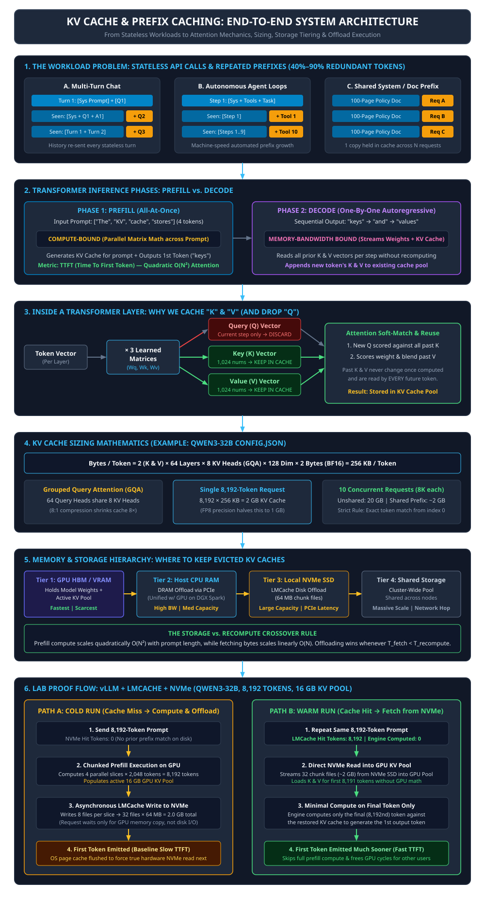
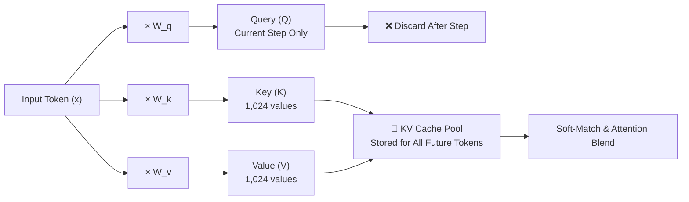
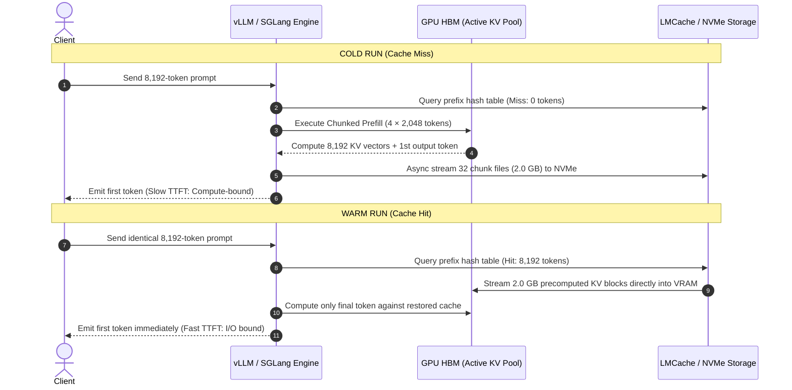

# KV Cache, Prefix Caching, and Storage Tiering: Architecture and Reference Guide

> Daily learning · November 3, 2026 · Systems architecture and reference guide

> Stateless LLM inference forces models to repeatedly reprocess prior context, making prompt prefill redundant across multi-turn chats, agentic loops, and RAG pipelines. By storing Key ($K$) and Value ($V$) activation vectors in structured memory hierarchies (GPU HBM $\to$ Host RAM $\to$ Local NVMe $\to$ Shared Storage), inference engines cut redundant computation, accelerate Time-To-First-Token (TTFT), and drop token costs by up to 90%.

---

## 1. Architecture Overview



---

## 2. Foundations: Why KV Caching Exists

Large Language Model (LLM) APIs are stateless: the model retains zero internal memory between distinct HTTP calls. To continue a multi-turn conversation or execute an autonomous agent step, the client must retransmit the entire conversation history with every new message.

In standard production workloads, **40% to 60%** of tokens repeat a prefix seen within the preceding hour—escalating to **90%+** when repeatedly querying fixed documents or system prompts.

| Component / Term | Meaning | Operational Role |
|---|---|---|
| **Prefill Phase** | Parallel computation over all input prompt tokens. | **Compute-bound ($O(N^2)$ attention).** Generates initial KV states and emits the very first output token. Determines **Time To First Token (TTFT)**. |
| **Decode Phase** | Autoregressive sequential generation (1 token per step). | **Memory-bandwidth bound.** Streams entire model weights and accumulated KV cache from VRAM per token. Determines **Inter-Token Latency (ITL)**. |
| **Query ($Q$) Vector** | Representation of what the current token seeks. | Discarded after the current attention step; never read again. |
| **Key ($K$) Vector** | Index/descriptor of what a previous token represents. | Retained in cache; scored against future $Q$ vectors across all layers. |
| **Value ($V$) Vector** | Information content carried by a previous token. | Retained in cache; weighted and blended by attention scores into output states. |
| **Prefix Caching** | Reusing precomputed $K$ and $V$ tensors across distinct requests. | Replaces quadratic $O(N^2)$ GPU prefill with linear $O(N)$ memory transfer from cache. |

---

## 3. Inside the Transformer Layer: Why Cache $K$ and $V$, Discard $Q$

Inside every transformer attention layer, an input token embedding vector $\mathbf{x}$ is projected by three learned weight matrices:

$$\mathbf{q} = \mathbf{x} \mathbf{W}_q, \quad \mathbf{k} = \mathbf{x} \mathbf{W}_k, \quad \mathbf{v} = \mathbf{x} \mathbf{W}_v$$

During token generation at step $t$:
1. The new token creates a Query vector $\mathbf{q}_t$.
2. $\mathbf{q}_t$ is scored against all past Key vectors $[\mathbf{k}_1, \dots, \mathbf{k}_{t}]$ via scaled dot-product:
   $$\text{Attention}(\mathbf{q}_t, \mathbf{K}, \mathbf{V}) = \text{softmax}\left(\frac{\mathbf{q}_t \mathbf{K}^T}{\sqrt{d_k}}\right) \mathbf{V}$$
3. Once computed, the Key and Value vectors for past tokens **never change**.
4. The Query vector $\mathbf{q}_t$ is strictly temporary—future tokens will arrive with their own query vectors and will never need $\mathbf{q}_t$.

Consequently, discarding $\mathbf{q}_t$ while retaining $\mathbf{k}$ and $\mathbf{v}$ avoids recomputing all past projections at every step, converting an $O(N^2)$ decoding process into an $O(N)$ accumulation process.



---

## 4. KV Cache Sizing Mathematics

KV cache memory can be computed directly from model hyperparameters found in `config.json`:

$$\text{Bytes per Token} = 2 \times L \times H_{KV} \times D \times P$$

Where:
* $2$: Represents separate Key and Value tensors.
* $L$: Number of hidden layers (`num_hidden_layers`).
* $H_{KV}$: Number of KV attention heads (`num_key_value_heads`).
* $D$: Head dimension (`hidden_size / num_attention_heads`).
* $P$: Precision in bytes (2 for FP16/BF16, 1 for FP8, 0.5 for INT4/FP4).

### Worked Calculation: Qwen3-32B (BF16 Precision)

* Layers ($L$): `64`
* Query Heads ($H_Q$): `64`
* KV Heads ($H_{KV}$): `8` (Grouped Query Attention, 8:1 ratio)
* Head Dimension ($D$): `128`
* Precision ($P$): `2` bytes (BF16)

$$\text{Bytes / Token} = 2 \times 64 \times 8 \times 128 \times 2 = 262,144 \text{ Bytes} = \mathbf{256 \text{ KB / token}}$$

* **Single 8,192-Token Context:** $8,192 \times 256 \text{ KB} = \mathbf{2.0 \text{ GB}}$ of KV Cache.
* **10 Concurrent Unshared Requests:** $10 \times 2.0 \text{ GB} = \mathbf{20.0 \text{ GB}}$.
* **10 Requests with Shared System Prefix (8,000 tokens shared, 192 unique):**
  $$\text{Shared Prefix (1 copy)} + 10 \times \text{Unique Tokens} \approx 1.95 \text{ GB} + 0.49 \text{ GB} = \mathbf{2.44 \text{ GB}} \quad (\sim 88\% \text{ VRAM savings})$$

---

## 5. Memory & Storage Hierarchy: Where Evicted Caches Reside

When GPU high-bandwidth memory (HBM) fills up, engines evict inactive or long-lived KV blocks down a four-tier storage hierarchy:

```
┌────────────────────────────────────────────────────────┐
│ Tier 1: GPU HBM / VRAM  (80–192 GB @ 2–8 TB/s)         │  ◄── Active Execution Pool
└───────────────────────────┬────────────────────────────┘
                            │ PCIe 5.0 / NVLink
┌───────────────────────────▼────────────────────────────┐
│ Tier 2: Host CPU DRAM   (512 GB–2 TB @ 300–800 GB/s)   │  ◄── First Offload Hop
└───────────────────────────┬────────────────────────────┘
                            │ PCIe Direct / NVMe-oF
┌───────────────────────────▼────────────────────────────┐
│ Tier 3: Local NVMe SSD  (4–30 TB @ 7–14 GB/s)          │  ◄── Persistent Chunked Disk
└───────────────────────────┬────────────────────────────┘
                            │ RoCE / InfiniBand / TCP
┌───────────────────────────▼────────────────────────────┐
│ Tier 4: Shared Storage  (Cluster Network Pool / S3)    │  ◄── Cross-Node Sharing
└────────────────────────────────────────────────────────┘
```

### The Storage vs. Recompute Crossover Rule

Prefill recomputation scales **quadratically** with prompt length ($O(N^2)$ attention FLOPs), while fetching precomputed KV bytes from storage scales **linearly** with length ($O(N)$ bytes transferred).

Offloading and retrieving cached KV blocks from lower tiers is computationally and economically advantageous whenever:

$$T_{\text{fetch}} < T_{\text{recompute}}$$

For long prompts (4,000 to 128,000+ tokens), reading 2 GB to 32 GB across high-speed PCIe NVMe (7–14 GB/s) or RDMA networks takes fractions of a second, whereas running tens of trillions of attention matrix operations on saturated GPUs can take several seconds and blocks other requests.

---

## 6. End-to-End System Flow: Cold Miss vs. Warm Hit



---

## 7. Authoritative References & Deep Reading Compendium

To build production-grade mastery of KV cache systems, consult these primary sources organized by topic:

### A. Mathematical Foundations & Hardware Roofline Models

* **[Transformer Inference Arithmetic](https://kipp.ly/transformer-inference-arithmetic/) — Kipply (2022–2023)**
  * *Focus:* The definitive derivation of weight memory, KV memory, MBU (Memory Bandwidth Utilization), and MFU (Model FLOPs Utilization). Explains the roofline curves of autoregressive decoding.
* **[LLM Inference Series & Decoding Latency](https://finbarr.ca/how-is-llama-cpp-so-fast/) — Finbarr Timbers (2023)**
  * *Focus:* Hardware reality of memory buses, PCIe lanes, SRAM tiling, and why decode latency is constrained by byte movement rather than arithmetic operations.
* **[Patterns for Building LLM Systems & Inference Optimization](https://eugeneyan.com/writing/llm-inference-optimizations/) — Eugene Yan (2024)**
  * *Focus:* High-level engineering trade-offs covering continuous batching, speculative decoding, and multi-tenant KV caches.

### B. Seminal Research Papers: The Core System Breakthroughs

* **[PagedAttention / vLLM](https://arxiv.org/abs/2309.06180)** (Kwon et al., SOSP 2023)
  * *Paper:* *"Efficient Memory Management for Large Language Model Serving with PagedAttention"*
  * *Contribution:* Solved dynamic memory fragmentation by applying operating system virtual memory paging to GPU KV caches, enabling non-contiguous physical block storage and copy-on-write branching.
* **[RadixAttention / SGLang](https://arxiv.org/abs/2312.07104)** (Zheng et al., ICML 2024)
  * *Paper:* *"Efficiently Programming Large Language Models using SGLang"*
  * *Contribution:* Introduced Radix Tree data structures for automatic prefix matching, LRU cache eviction across requests, and KV cache reuse across complex multi-branch prompting programs.
* **[Sarathi-Serve / Chunked Prefill](https://arxiv.org/abs/2308.16369)** (Agrawal et al., OSDI 2024)
  * *Paper:* *"Taming Throughput-Latency Tradeoff in LLM Inference with Sarathi-Serve"*
  * *Contribution:* Addressed prefill latency spikes by splitting long prompts into uniform chunks and interleaving them with decode iterations.
* **[FlashDecoding](https://arxiv.org/abs/2307.08691)** (Dao et al., 2023–2024)
  * *Paper:* *"FlashDecoding: Faster Transformer Decoding for Long Context"*
  * *Contribution:* Parallelized the attention reduction step across the sequence dimension for decode tokens, breaking memory bandwidth saturation over long context windows.
* **[StreamingLLM / Attention Sinks](https://arxiv.org/abs/2309.17453)** (Xiao et al., ICLR 2024)
  * *Paper:* *"Efficient Streaming Language Models with Attention Sinks"*
  * *Contribution:* Proved that the initial 4 tokens absorb massive attention softmax mass ("sinks"); retaining them alongside a rolling window permits unbounded sequence generation without recomputation.

### C. Multi-Tier Storage Offloading & Disaggregated Serving

* **[LMCache](https://arxiv.org/abs/2410.13870)** (Qin et al., UC Berkeley & UChicago, 2024–2025)
  * *Paper:* *"LMCache: Compute-less LLM Serving by Storing and Sharing KV Caches"*
  * *Contribution:* Open-source multi-tier offload engine connecting vLLM to local DRAM, NVMe, and distributed Redis/network stores.
* **[Mooncake](https://arxiv.org/abs/2407.00079)** (Qin et al., Moonshot AI & Tsinghua University, 2024)
  * *Paper:* *"Mooncake: A KVCache-Centric Disaggregated Architecture for LLM Serving"*
  * *Contribution:* Production-scale architecture separating prefill and decode instances over a shared distributed KV cache pool backed by RDMA and NVMe SSDs.
* **[CacheGen](https://arxiv.org/abs/2310.07240)** (Liu et al., SIGCOMM 2024)
  * *Paper:* *"Fast Context Loading for Language Model Serving with Streaming KV Cache Compression"*
  * *Contribution:* Compresses KV cache tensors using delta encoding and quantization to stream context rapidly over network boundaries.
* **[CacheBlend](https://arxiv.org/abs/2405.16444)** (Yao et al., EuroSys 2025)
  * *Paper:* *"Fast Large Language Model Serving for RAG with Cached Knowledge Fusion"*
  * *Contribution:* Enables non-contiguous KV cache reuse for dynamic RAG passages without recomputing the entire document set.

### D. Architectural Innovations That Compress the KV Cache

* **Grouped-Query Attention (GQA):**
  * *Reference:* [Ainslie et al., 2023](https://arxiv.org/abs/2305.13245) (*"GQA: Training Generalized Multi-Query Transformer Models from Multi-Head Checkpoints"*).
  * *Mechanism:* Maps $N$ query heads to 1 KV head (e.g., 8:1), reducing memory footprint by $8\times$.
* **Multi-Head Latent Attention (MLA):**
  * *Reference:* [DeepSeek-V2 / DeepSeek-V3 Technical Report](https://arxiv.org/abs/2412.19437) (DeepSeek-AI, 2024).
  * *Mechanism:* Compresses Key and Value states into a low-dimensional latent vector ($c_t^{KV} \in \mathbb{R}^{512}$) and a decoupled RoPE vector, reducing KV cache memory by **93.3%** compared to multi-head attention.

### E. Open-Source Codebases to Inspect

1. **vLLM Paged Memory Allocator:**
   * Block Manager: [`vllm/core/block_manager_v2.py`](https://github.com/vllm-project/vllm/blob/main/vllm/core/block_manager_v2.py)
   * CUDA Kernel: [`csrc/attention/attention_kernels.cu`](https://github.com/vllm-project/vllm/blob/main/csrc/attention/attention_kernels.cu)
2. **SGLang Radix Tree:**
   * Prefix Tree: [`sglang/srt/mem_cache/radix_cache.py`](https://github.com/sgl-project/sglang/blob/main/python/sglang/srt/mem_cache/radix_cache.py)
3. **LMCache Hierarchical Backend:**
   * Storage Layer: [`LMCache/lmcache/storage_backend/`](https://github.com/LMCache/LMCache)
4. **NVIDIA TensorRT-LLM:**
   * In-Flight Batch Manager: [`tensorrt_llm/cpp/include/tensorrt_llm/batch_manager/kvCacheManager.h`](https://github.com/NVIDIA/TensorRT-LLM)

### F. Production Cloud Provider Specifications

* **[Anthropic Prompt Caching](https://docs.anthropic.com/en/docs/build-with-claude/prompt-caching):** Explicit breakpoint markers (`cache_control`); minimum prefix of 1,024–2,048 tokens; 5-minute/1-hour TTL; 90% discount on cache hits.
* **[OpenAI Prompt Caching](https://platform.openai.com/docs/guides/prompt-caching):** Fully implicit prefix matching; minimum prefix of 1,024 tokens with 128-token increment bounds; 50% discount on cache hits.

---

## 8. Source Context and Methodology

Based on user-provided architecture diagrams and technical details from [*KV Cache 101: What It Is, How It Works, Where to Keep It*](http://www.youtube.com/watch?v=HUyG5yFG52Y), checked and expanded against primary academic disclosures (SOSP, OSDI, ICML, EuroSys, SIGCOMM), open-source inference runtimes (vLLM, SGLang, LMCache), and hardware performance rooflines.

---

**Related:**
- [Agent-Memory-Architectures-5-Layer-Harness-And-Judgment-Memory-Nov-2026.md](../../Agents/frameworks/Agent-Memory-Architectures-5-Layer-Harness-And-Judgment-Memory-Nov-2026.md) — How agent harnesses structure prompt prefixes, rolling compaction, and disk storage to optimize KV prefix cache hit rates.
- [Weight-Space-Programming-Astra-Qwen-Nov-2026.md](../training/Weight-Space-Programming-Astra-Qwen-Nov-2026.md) — Direct weight surgery and directional ablation compared with runtime inference modifications.
- [LLM-Inference-Engines.md](LLM-Inference-Engines.md) — Comprehensive technical whitepaper covering inference engines, memory bottlenecks, continuous batching, and kernel optimizations.
- [LLM-Inference.md](LLM-Inference.md) — Fundamental explanation of the LLM inference lifecycle and request paths.
- [Context-Windows-Compaction-and-Cache-Breaks-2026.md](../optimization/Context-Windows-Compaction-and-Cache-Breaks-2026.md) — Practical analysis of prompt caching breakpoints, compaction strategies, and harness-level tokenomics.
- [Beyond-SoftMax-Attention.md](../attention/Beyond-SoftMax-Attention.md) — Exploration of attention mechanisms, linear attention, and memory-efficient attention formulations.
