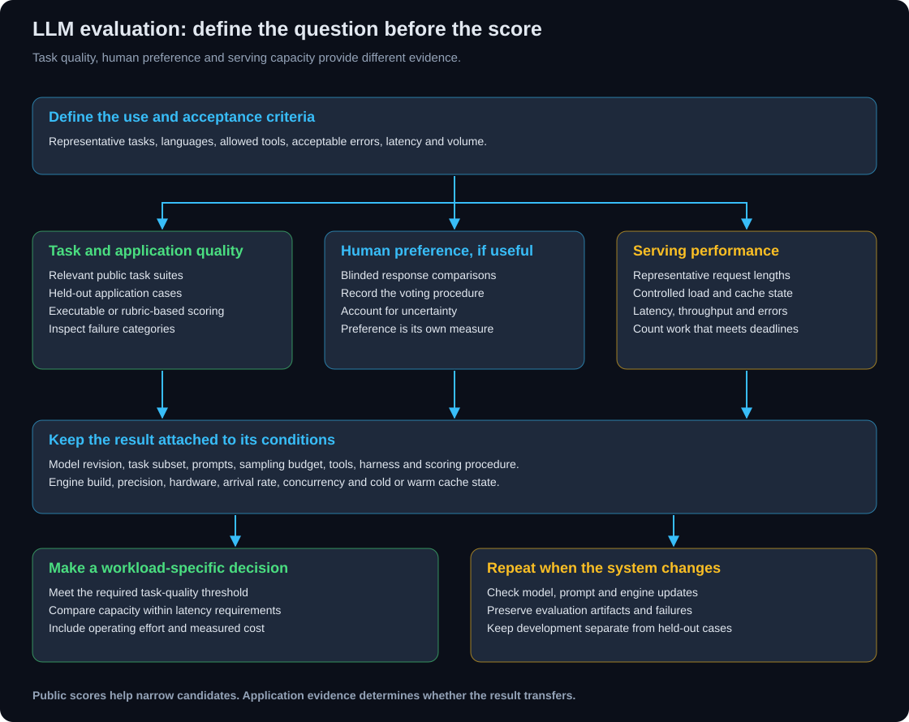

# LLM Benchmarks: Model Quality, Human Preference and Serving Performance

**Learning note · Revised 15 November 2026 · Original benchmark papers and evaluation tools checked**

> **Core idea:** A benchmark measures performance on a defined task under a defined procedure. A useful model choice combines relevant task quality, application-level evaluation and serving measurements. A leaderboard position alone does not establish that a model is suitable for your workload.

## 1. Foundations: what is actually being tested?

A model answering a question, an agent editing a repository and a server handling concurrent requests are different systems. They need different tests. A **benchmark** combines tasks or inputs, a procedure for running them and a scoring rule. Its result belongs to that combination.

For example, a multiple-choice question can be scored by selecting an answer. A coding task may require execution against tests. An agent task also depends on its tools, prompts and execution budget. A serving test measures how quickly requests complete under a particular load. The original [HumanEval paper](https://arxiv.org/abs/2107.03374), [SWE-bench project](https://github.com/SWE-bench/SWE-bench) and [MLPerf Inference rules](https://github.com/mlcommons/inference_policies/blob/master/inference_rules.adoc) illustrate these different evaluation units.

| Evaluation axis | Question it helps answer | Examples of evidence |
|---|---|---|
| Model/task quality | Can the system solve the relevant tasks? | Accuracy, executable test success, retrieval quality or factual support. |
| Human preference | Which response do people prefer in the comparison? | Blinded pairwise votes and an uncertainty-aware ranking. |
| Application behavior | Does the complete product work under its actual constraints? | Tool outcomes, schema validity, permissions and supported answers on representative tasks. |
| Serving performance | Can the deployment meet the required latency and volume? | Latency distributions, throughput, errors and goodput. |

## 2. An evaluation flow for a real decision

*Start with the intended use and compare candidates under recorded conditions. Public benchmarks help narrow the search; a held-out application set tests whether the result transfers.*

First choose the behavior and operating requirements you need. Then select relevant public benchmarks, create representative application cases and measure serving performance for candidates that meet the quality requirement. Preserve the evaluation artifacts so the comparison can be reproduced after model or system updates.

## 3. Major benchmark families and their limits

| Family | What it tests | What the result does not establish |
|---|---|---|
| **MMLU / MMLU-Pro** | Broad academic knowledge and problem solving using multiple-choice tasks. | Free-form factual reliability or suitability for every specialist domain. The suites and scoring setups differ. |
| **GSM8K / GPQA** | GSM8K uses grade-school math problems; GPQA uses difficult science questions written by domain experts. | Reliability on arbitrary numerical or scientific work. Dataset, answer format and prompting matter. |
| **HumanEval** | Producing code for function-level programming tasks, judged with executable tests. | Repository-scale engineering, maintainability or secure behavior beyond the tests. |
| **SWE-bench** | Resolving real repository issues through code changes evaluated in an execution environment. | A raw model capability independent of its agent, tools, task subset and budget. |
| **Berkeley Function Calling Leaderboard, BFCL** | Tool/function-call behavior under the suite's scenarios. | Reliability for every real API or permission boundary. Versions and supported task categories matter. |
| **MTEB** | Embedding performance across tasks such as retrieval, similarity and classification. | Generative answer quality or a universal best embedding model for every language and corpus. |
| **MMMU** | Multimodal understanding and reasoning across college-level subjects. | Reliable interpretation of all document layouts, charts, images or production media. |

Original sources: [MMLU](https://arxiv.org/abs/2009.03300), [MMLU-Pro](https://arxiv.org/abs/2406.01574), [GSM8K](https://arxiv.org/abs/2110.14168), [GPQA](https://arxiv.org/abs/2311.12022), [HumanEval](https://arxiv.org/abs/2107.03374), [SWE-bench](https://github.com/SWE-bench/SWE-bench), [BFCL](https://gorilla.cs.berkeley.edu/leaderboard.html), [MTEB](https://arxiv.org/abs/2210.07316), [MMMU](https://arxiv.org/abs/2311.16502).

A broad average can hide a weakness in the task or language you care about. Inspect relevant component scores and failure examples alongside the overall result.

## 4. Scoring procedures change the meaning of a number

- **Accuracy or exact match:** check which outputs count as correct, how answers are extracted and what normalization is applied.
- **Pass@k:** a programming metric about obtaining a passing solution within `k` samples, as estimated by the benchmark procedure. A pass@10 result is not directly comparable to pass@1; they use different sampling budgets. [HumanEval methodology](https://arxiv.org/abs/2107.03374).
- **Resolved issue rate:** check the issue subset, tests, repository setup, agent configuration and execution limits. “SWE-bench” and a named subset such as “Verified” are not interchangeable labels. [SWE-bench evaluation](https://github.com/SWE-bench/SWE-bench).
- **Judge-model score:** another model grades outputs. Save the judge model, prompt and rubric. The MT-Bench/Chatbot Arena study documents concerns including position and verbosity bias. [LLM-as-a-judge study](https://arxiv.org/abs/2306.05685).
- **Preference ranking:** people compare responses. This measures preference under the platform's sampled conversations and voting process, with uncertainty around the ranking. [Chatbot Arena paper](https://arxiv.org/abs/2403.04132).

Different measures can disagree without either result being a calculation error: they may be evaluating different behavior. A polished response can be preferred while failing a precise factual or executable test.

## 5. Freshness, contamination and uncertainty

**Contamination** occurs when evaluation material, or information closely revealing it, enters model development or training. High benchmark performance then becomes weaker evidence of generalization. Public exposure alone does not prove that a particular model memorized a test.

Refreshing questions can reduce some contamination risks, but “live” or “new” does not automatically mean human voting or complete resistance to leakage. **LiveBench**, for example, proposes regularly updated tasks with objective scoring. A preference arena and a refreshed task suite are different designs. [LiveBench paper](https://arxiv.org/abs/2406.19314).

For an application, maintain a held-out set covering real inputs, edge cases, languages and failures. Keep it separate from prompt tuning and inspect results by category. Record how many examples were tested and how uncertain small score differences are. Repeatedly optimizing against the same held-out set can also turn it into development data.

## 6. Serving benchmarks need controlled workloads

A quality benchmark and a load test answer different questions. Measure the selected deployment with representative input and output lengths, not just a single repeated prompt.

| Record or measure | Why it matters |
|---|---|
| Model and tokenizer revision | Architecture, weights, tokenization and chat formatting affect quality and execution. |
| Precision and engine build | Quantization, kernels and runtime versions can change both speed and outputs. |
| Hardware and distribution | Device count, memory and interconnect determine what work can be executed efficiently. |
| Input/output lengths | Prefill and decode have different costs; early stopping changes the workload. |
| Arrival rate and concurrency | A fixed number of simultaneous clients differs from requests arriving at a specified rate. Client-side queues can alter the observed load. |
| Cold/warm state and prefix reuse | Warm-up and cache hits can change results substantially. Deliberate cache reuse should be reported. |
| TTFT, TPOT/ITL and total latency | These separate first-token delay, ongoing generation and full completion time. Define timing boundaries and report percentiles. |
| Throughput, failures and goodput | Count completed work, timeouts and errors. Report how much work met the stated service requirements. |

The [vLLM benchmark CLI](https://docs.vllm.ai/en/latest/cli/bench/serve/) exposes separate controls for request rate, maximum concurrency, latency percentiles and goodput thresholds. [MLPerf Inference](https://mlcommons.org/benchmarks/inference-datacenter/) provides standardized workloads and quality/performance rules; its results still need to be interpreted within the specified scenario and submission conditions.

A server can increase aggregate throughput while making individual requests slower. Compare the capacity that meets your latency and quality requirements, rather than selecting the largest tokens-per-second number.

## 7. Open-source tools and a practical starting point

| Tool | Use | How to start and its limits |
|---|---|---|
| [lm-evaluation-harness](https://github.com/EleutherAI/lm-evaluation-harness) | Runs a collection of model evaluation tasks. | Follow its quickstart, pin the tool/model revisions and select named tasks. Check each task's prompts, answer extraction and chat-template handling. |
| [SWE-bench](https://github.com/SWE-bench/SWE-bench) | Evaluates repository-issue patches using its harness and environments. | Start with the evaluation setup and a small supported task sample. Environment and agent configuration are part of the result. |
| [MTEB](https://github.com/embeddings-benchmark/mteb) | Evaluates embedding models on selected tasks. | Choose tasks matching your language and retrieval use case. An average over unrelated tasks can obscure the requirement. |
| [vLLM serving benchmark](https://docs.vllm.ai/en/latest/cli/bench/serve/) | Exercises a compatible serving endpoint and records performance. | Begin with `vllm bench serve --help`, then configure the workload and save results. It is not a substitute for model-quality or application-correctness evaluation. |

For a reviewable comparison, retain: **model and system revisions, task/version identifiers, prompts/templates, decoding and tool budgets, hardware/load settings, scoring rules, results and representative failures**. Use the same conditions where comparability requires them, and explicitly document justified differences.

## 8. Source context

Based on collected repository notes, with benchmark definitions checked against the original papers, project evaluation repositories and MLCommons rules. Supported tasks, scoring procedures and benchmark versions change. Record them when an evaluation is run.

---

**Related:**
- [LLM Inference](LLM-Inference.md) — Defines the request lifecycle and serving metrics used in performance evaluation.
- [LLM Inference Engines](LLM-Inference-Engines.md) — Explains execution choices that must be controlled in an engine comparison.
- [AI Agent Evaluation Architectures](../../Agents/frameworks/AI-Agent-Evaluation-Architectures-Multi-Tier-Graders-And-Harnesses-Nov-2026.md) — Extends model tests to complete agents, graders and execution harnesses.
- [Multimodal RAG](../../RAG/Multimodal-RAG.md) — Separates retrieval coverage from answer support when evaluating mixed-media applications.
- [KV Cache, Prefix Caching and Storage Tiering](KV-Cache-Prefix-Caching-And-Storage-Tiering-Nov-2026.md) — Explains why cache state and reuse affect repeatable serving measurements.
