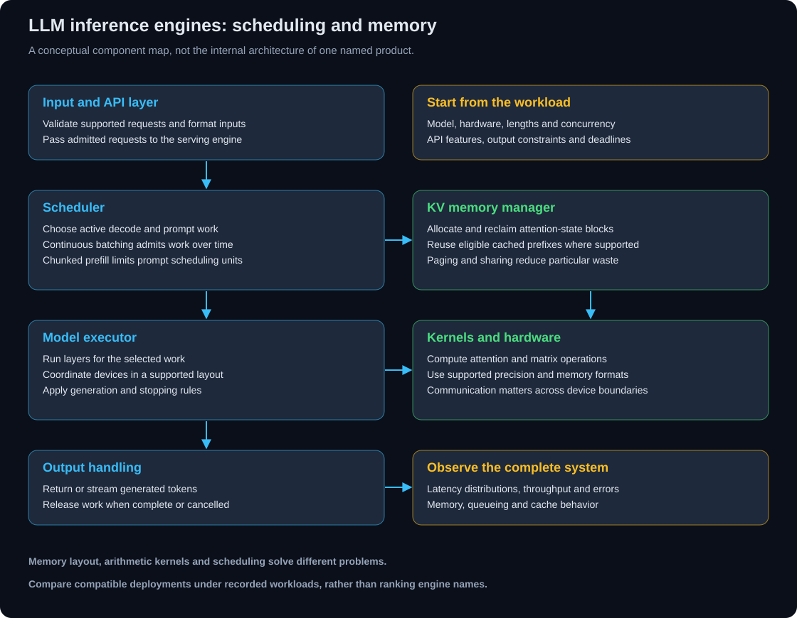

# LLM Inference Engines: Scheduling, KV Memory and Serving Choices

**Learning note · Revised 15 November 2026 · Primary papers and project documentation checked**

> **Core idea:** An inference engine turns model weights into an executable serving system. Its scheduler, memory manager and kernels determine how efficiently requests share hardware. Choose an engine by model compatibility, hardware and workload measurements, then verify the complete application behavior.

## 1. Foundations: model, engine and application

A **model** supplies architecture, weights and tokenizer behavior. An **inference engine** loads a supported model and executes its operations, often with request scheduling, attention-cache management and a serving API. The **application** adds authentication, retrieval, tools and business rules.

For example, two engines may expose OpenAI-compatible endpoints while using different schedulers and kernels. API compatibility helps integration, but it does not guarantee identical chat formatting, tool-call behavior, numeric results or performance. Check the model and endpoint features actually used. [vLLM quickstart](https://docs.vllm.ai/en/latest/getting_started/quickstart/), [LMDeploy documentation](https://lmdeploy.readthedocs.io/en/latest/).

For the underlying generation process, read [LLM Inference](LLM-Inference.md). This article focuses on the server's execution choices.

## 2. Inside a serving engine



*This is a conceptual architecture shared by many serving systems. Implementations organize these components differently and support different hardware and models.*

| Component | Main responsibility |
|---|---|
| Input and API layer | Validates supported requests, formats model inputs and returns responses. |
| Scheduler | Chooses which prompt chunks and active generation requests run next. |
| KV memory manager | Allocates and reclaims attention state and, where supported, reuses cached blocks. |
| Model executor | Runs supported model layers and coordinates any distribution across devices. |
| Kernels | Implement attention, matrix multiplication, quantization and other operations for the target hardware. |
| Output handling | Applies generation rules, observes stopping conditions and streams or returns results. |

A faster kernel helps only the work it accelerates. If requests spend most of their time queued, waiting on a tool or transferring data, kernel speed alone will not resolve the application bottleneck.

## 3. The optimizations, one problem at a time

### 3.1 Paged KV storage: reduce allocation waste

The KV cache grows and shrinks as requests arrive, generate and complete. Reserving large contiguous regions for uncertain output lengths can waste memory. PagedAttention divides KV storage into blocks and maps a request's logical token positions to physical blocks. This can reduce fragmentation and support sharing in relevant workloads. It does not make cached tokens free. [PagedAttention paper](https://arxiv.org/abs/2309.06180).

**Memory layout and arithmetic kernels are different layers.** PagedAttention addresses cache access and allocation; FlashAttention reduces attention-intermediate storage and memory traffic. An engine can combine compatible techniques. [FlashAttention paper](https://arxiv.org/abs/2205.14135), [vLLM feature overview](https://docs.vllm.ai/en/latest/).

### 3.2 Continuous batching: admit work as requests finish

A fixed batch waits for its current workload to complete before admitting a new batch. Continuous batching allows the engine to adjust the active requests between execution iterations. A finished request can release capacity while others continue generating. This can improve utilization under variable output lengths, with scheduling policies deciding fairness and latency. [vLLM](https://docs.vllm.ai/en/latest/), [TensorRT-LLM in-flight batching](https://nvidia.github.io/TensorRT-LLM/overview.html).

Batching is a throughput/latency trade-off. A large active batch shares weight-processing work but also consumes more KV memory and can increase each request's wait between tokens.

### 3.3 Chunked prefill: manage long prompts alongside generation

A long prompt can occupy substantial compute while other requests are waiting for their next output token. Chunked prefill breaks that prompt work into smaller scheduling units, allowing an engine to interleave it with other work. The chunk budget and scheduler policy affect both first-token and ongoing generation latency. [vLLM optimization guidance](https://docs.vllm.ai/en/latest/configuration/optimization/).

This changes scheduling granularity. It does not mean that the model ignores the earlier prompt or that a long input costs the same as a short one.

### 3.4 Prefix caching: reuse compatible prompt computation

When requests share an eligible token prefix, the engine may reuse its cached KV state rather than recomputing that prefix. This is useful for repeated instructions, shared documents or some conversation patterns. It depends on exact compatibility and cache availability; semantically similar text alone is insufficient. Prefix reuse reduces the repeated prefill work, while generating new output still requires execution. [vLLM prefix caching](https://docs.vllm.ai/en/latest/features/automatic_prefix_caching/), [SGLang and RadixAttention](https://arxiv.org/abs/2312.07104).

For multiple tenants or access domains, review the engine's cache-isolation controls before enabling cross-request reuse. Cache behavior is part of the deployment's data boundary.

### 3.5 Quantization: change storage and computation formats

Lower-precision weights, activations or KV state can reduce memory use and sometimes accelerate execution. These are distinct choices. A small checkpoint does not ensure a fast compatible kernel on the selected GPU or CPU. Evaluate model quality and actual serving speed for the chosen format. Supported methods vary across engines, models and devices. [vLLM supported features](https://docs.vllm.ai/en/latest/), [TensorRT-LLM overview](https://nvidia.github.io/TensorRT-LLM/overview.html).

### 3.6 Speculative decoding: propose, then verify

A draft model or another proposal mechanism suggests multiple tokens, and the target model verifies them. The original speculative decoding algorithm preserves the target model's sampling distribution through its verification procedure. Its speed benefit depends on acceptance rates and the overhead of drafting and verification. Implementations and variants need their own compatibility and correctness checks. [Original paper](https://arxiv.org/abs/2211.17192).

## 4. Engine families and practical fit

| Project | Documented focus | Evaluate when | Confirm before choosing |
|---|---|---|---|
| **vLLM** | Serving with managed KV memory, continuous batching and a broad set of execution optimizations. | You need a server for concurrent supported model requests. | The model, hardware backend, precision, API features and scheduler configuration. |
| **SGLang** | Serving infrastructure with cache reuse, scheduling and structured-generation capabilities. | Shared-prefix or structured-output workloads are important. | Supported models, decoding features, hardware and cache policy. |
| **TensorRT-LLM** | Optimized LLM execution and serving on NVIDIA hardware. | Your deployment targets its supported NVIDIA platform and model stack. | Model support, precision, hardware generation and the applicable execution/build workflow. |
| **LMDeploy** | LLM/VLM deployment tools, serving APIs and inference backends including TurboMind and PyTorch. | Its model and deployment support fit your application. | Backend-specific capabilities and model-format requirements. |
| **llama.cpp** | C/C++ inference with GGUF models and multiple hardware backends, including local execution. | Local, CPU or mixed-device deployment is a priority. | Model conversion/format, backend support, available memory and server behavior. |
| **Ollama** | Model packaging and local/API workflows. | Convenient model management and application integration matter. | The model package, selected runtime behavior, context settings and concurrency requirements. |

Primary project sources: [vLLM](https://docs.vllm.ai/en/latest/), [SGLang](https://docs.sglang.ai/), [TensorRT-LLM](https://nvidia.github.io/TensorRT-LLM/overview.html), [LMDeploy](https://lmdeploy.readthedocs.io/en/latest/), [llama.cpp](https://github.com/ggml-org/llama.cpp), [Ollama](https://docs.ollama.com/quickstart).

These projects occupy overlapping layers. A packaging/service tool and a low-level execution runtime are not interchangeable comparison units. There is no universal winner or transferable tokens-per-second ranking in the table.

## 5. Scaling beyond one device

| Deployment choice | What changes | Main cost to investigate |
|---|---|---|
| Replicas | Multiple model copies serve independent requests. | Weight duplication, load balancing and cache locality. |
| Tensor parallelism | Devices cooperate on operations within layers. | Communication overhead and interconnect requirements. |
| Pipeline parallelism | Devices hold different layer stages. | Pipeline scheduling, transfer and idle stages. |
| Separate prefill and decode workers | Different pools specialize in the two phases. | KV transfer, routing and capacity coordination. [DistServe paper](https://arxiv.org/abs/2401.09670). |

Use a supported distributed execution mode for the actual model and cluster. More GPUs can provide capacity but can also increase coordination costs. The [vLLM distributed-serving guide](https://docs.vllm.ai/en/latest/serving/parallelism_scaling/) documents supported deployment choices; consult the selected engine's instructions before extrapolating a single-device result.

## 6. A selection and verification workflow

1. **Define the workload.** Record model revision, prompt/output lengths, concurrency or arrival rate, chat format, tools, output constraints and latency requirements.
2. **Filter for compatibility.** Check hardware, model architecture, quantization and endpoint features. A library loading the weights is only the first requirement.
3. **Establish a correctness baseline.** Use representative prompts and application checks, including structured outputs and tool calls if needed. Distinguish harmless numeric variation from task regressions.
4. **Measure under load.** Compare TTFT, TPOT/ITL, end-to-end latency, throughput, errors and memory. Sweep load to locate the point where latency or errors become unacceptable.
5. **Check cache assumptions.** Measure cold and warm runs separately, with an intentional shared-prefix distribution. Accidental repetition can make an unrepresentative cache hit rate look attractive.
6. **Exercise operational behavior.** Check cancellation, overload, long inputs and worker recovery. Preserve versions and the effective server configuration with the results.

The [benchmark article](LLM-Benchmarks.md) provides a reporting checklist. Performance results apply to their measured configuration; they are not properties of an engine name alone.

## 7. Practical starting points

For vLLM, follow the platform-specific [installation and quickstart](https://docs.vllm.ai/en/latest/getting_started/quickstart/). These commands inspect the installed version's serving and benchmark interfaces:

```bash
vllm serve --help
vllm bench serve --help
```

After starting a supported model endpoint, choose the benchmark's model/tokenizer, request dataset, lengths, request rate and concurrency controls for your experiment. The CLI supports saving results, reporting percentiles and setting goodput thresholds. Consult the [current CLI reference](https://docs.vllm.ai/en/latest/cli/bench/serve/) because available flags can change.

For local execution, start with the [llama.cpp build and server documentation](https://github.com/ggml-org/llama.cpp) or [Ollama quickstart](https://docs.ollama.com/quickstart). A local interactive response verifies a basic execution path; it does not establish sustained concurrency or production capacity.

## 8. Source context

Based on collected repository notes, with mechanisms checked against the original PagedAttention, FlashAttention, SGLang and speculative-decoding papers, and product descriptions checked against project documentation. Verify exact support against the engine release being deployed; supported commands and deployment requirements can change.

---

**Related:**
- [LLM Inference](LLM-Inference.md) — Defines prefill, decode, KV state and user-visible serving metrics.
- [LLM Benchmarks](LLM-Benchmarks.md) — Explains controlled comparisons and the separation of quality from serving performance.
- [KV Cache, Prefix Caching and Storage Tiering](KV-Cache-Prefix-Caching-And-Storage-Tiering-Nov-2026.md) — Goes deeper into cache reuse, ownership and memory hierarchy.
- [FlashAttention](../../Comparisons/Self-Attention-vs-Flash-Attention.md) — Explains IO-aware attention execution separately from paged KV allocation.
- [AI Numerical Formats and Quantization](../optimization/AI-Numerical-Formats-And-Quantization-Oct-2026.md) — Covers precision formats and the hardware/kernel support needed to use them effectively.
