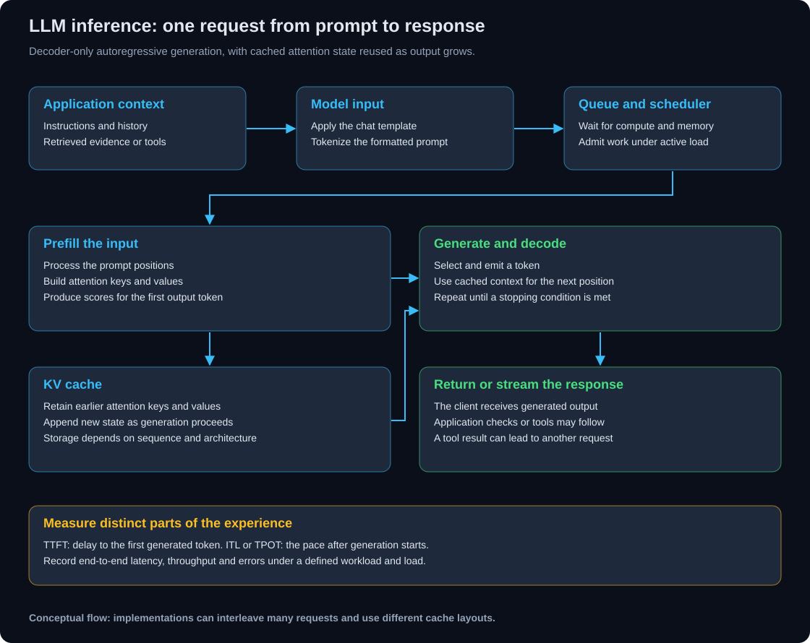

# LLM Inference: From a User Request to Generated Tokens

**Learning note · Revised 15 November 2026 · Primary documentation and papers checked**

> **Core idea:** Inference runs a trained model on new input. For a typical decoder-only language model, the server first processes the prompt, then repeatedly generates a token using the prompt and earlier output. Memory management, scheduling and the surrounding application all affect the user's experience.

## 1. Foundations: training, inference and serving

**Training** updates a model's parameters, or weights, using data and an optimization process. **Inference** uses the resulting weights to calculate outputs. An application can run inference locally or call a hosted service.

**Serving** is the larger system that accepts requests, prepares inputs, schedules model execution and returns results. A chatbot may also retrieve documents, call tools or apply application rules. Those steps affect response time and correctness even though they are not all model inference.

This guide focuses on **autoregressive, decoder-only Transformer text generation**: the model predicts the next token from the tokens already available. Embedding models, diffusion models, speech systems and other architectures have different execution patterns. Hugging Face documents the main [generation strategies](https://huggingface.co/docs/transformers/main/en/generation_strategies).

| Term | Meaning |
|---|---|
| Token | A unit selected by a tokenizer, such as part of a word, punctuation or a byte sequence. A token is not necessarily a word. |
| Logits | Scores produced by the model before the decoding rule selects the next token. |
| Prefill | Processing the input sequence to build attention state and obtain the next-token prediction. |
| Decode | Repeatedly extending the sequence using previously computed state. |
| KV cache | Saved attention keys and values from earlier positions, used to avoid recomputing them at each generation step. |
| Scheduler | The engine component deciding which queued or active requests receive compute next. |

## 2. The request lifecycle

*The diagram follows one generation request. A production engine can interleave work from many requests; tool calls can lead to additional model requests.*

1. **Prepare the request.** The application assembles instructions, conversation history and any retrieved evidence. The tokenizer converts the formatted input into token IDs. Model-specific chat templates determine how roles and messages are represented.
2. **Admit and schedule work.** The server queues the request and decides when enough compute and memory are available. Queue time can dominate latency under load.
3. **Prefill the prompt.** The model processes the input tokens, creates the relevant KV state and produces scores for the first generated token. The prompt positions can be processed in parallel subject to the model's attention rules.
4. **Select and emit a token.** A decoding rule, such as greedy selection or sampling, chooses from the model's scores. The API may stream the resulting text or wait for more output.
5. **Decode repeatedly.** Each subsequent step uses the growing context and cached attention state to predict another token. Generation stops at an end condition or a configured limit.
6. **Finish the application response.** The application may validate the result, execute a requested tool, or format the answer. A tool invocation can start a new cycle with the tool's result added to the input.

The [Transformers cache explanation](https://huggingface.co/docs/transformers/main/en/cache_explanation) describes how keys and values are cached independently in each attention layer. The [PagedAttention paper](https://arxiv.org/abs/2309.06180) explains why managing that state matters when many requests share a server.

## 3. What the KV cache saves, and what still grows

Without caching, a basic implementation can repeatedly recompute earlier keys and values as it generates new tokens. With caching, it reuses them and adds state for the new positions. This saves repeated work, but the generated token still attends to the applicable cached context.

For a conventional full-attention Transformer with equal dimensions across layers, a useful estimate for **one sequence's raw KV tensor storage** is:

$$
\text{KV bytes} \approx 2 \times L \times T \times H_{\text{KV}} \times D \times b
$$

Here, `L` is the number of attention layers, `T` is the cached sequence length, `H_KV` is the number of key/value heads, `D` is the dimension per head, and `b` is bytes per stored element. The factor of two accounts for keys and values. For a batch, add the state required by its sequences.

**Illustrative calculation:** 32 layers, 8 KV heads, a head dimension of 128, 8,192 cached tokens and 2 bytes per element require approximately **1 GiB** of raw KV storage for one sequence. This is arithmetic for that configuration, not a measurement of a named model.

Real allocation also depends on block sizes, sharing, sharding, quantization and the architecture's attention pattern. Sliding-window and compressed-state designs need different accounting. The number of query heads may differ from the number of KV heads. See the [cache documentation](https://huggingface.co/docs/transformers/main/en/cache_explanation) and [PagedAttention memory design](https://arxiv.org/abs/2309.06180).

The server also needs model weights, execution workspaces, activations and runtime overhead. For example, eight billion parameters stored at two bytes each occupy about **16 GB in decimal units for weights alone**. That figure does not establish the GPU memory needed to serve a real workload.

## 4. Prefill and decode stress hardware differently

Prefill can expose substantial parallel work across prompt positions. Decode generates successive tokens with a dependency between steps for each sequence. For small batches, repeatedly reading weights and attention state can make memory bandwidth a major limit. With larger batches or different shapes, compute and communication can become limiting instead. [PagedAttention](https://arxiv.org/abs/2309.06180), [FlashAttention](https://arxiv.org/abs/2205.14135).

| Change | Likely pressure to investigate |
|---|---|
| Longer input | More prefill work and cached context. Attention implementation and architecture matter. |
| Longer output | More generation steps and KV growth; the request occupies serving capacity for longer. |
| More concurrent requests | More total live state and scheduling contention, with opportunities for batching. |
| Larger model | More weight storage and execution work. Active parameters and total stored parameters may differ in mixture-of-experts models. |
| More GPUs | Potentially more capacity, plus communication and partitioning overhead. Scaling is workload-dependent. |

There is no universal number of milliseconds added by every input token, or a fixed throughput benefit from batching. Measure the actual model, input/output distribution and deployment.

## 5. Measure the experience with defined metrics

| Metric | What to measure | What can mislead |
|---|---|---|
| Time to first token, **TTFT** | Time from a defined request start to the first generated token received. | Client, network, queue, tokenization and prefill may be included differently by different tools. |
| Inter-token latency, **ITL** | Gaps between successive generated tokens or streaming observations. | APIs can combine tokens in a chunk; chunk timing and token timing are not always equivalent. |
| Time per output token, **TPOT** | A per-request average commonly calculated from generation time after the first token. | An average can hide pauses; a one-token response has no subsequent-token interval. |
| End-to-end latency | Time until the complete result reaches the chosen measurement point. | A short answer can look faster simply because it contains fewer tokens. |
| Throughput | Completed requests or generated tokens per unit time for a defined workload. | Aggregate throughput does not describe one user's token rate. |
| Goodput | Work completed while meeting stated latency or quality requirements. | A high token count can include requests that missed the user's deadline. |

State the measurement boundary, request lengths, load and error handling alongside the numbers. Report distributions, such as p50 and p95, because a mean hides slow requests. The [vLLM serving benchmark reference](https://docs.vllm.ai/en/latest/cli/bench/serve/) exposes separate latency metrics, percentiles and goodput thresholds.

## 6. Improve the bottleneck you observe

- **High TTFT:** separate queue delay from prompt processing. Investigate admission limits, prompt size, prefill scheduling and valid prefix-cache reuse.
- **Slow generation after the first token:** investigate memory bandwidth, the active batch, growing context, kernels and multi-GPU communication.
- **Memory failures:** account separately for weights, KV state and runtime workspaces. Limit live work or use compatible precision and cache policies.
- **Fast but poor answers:** evaluate the model, prompt, evidence and decoding settings. Faster serving does not establish task correctness.

The [engine guide](LLM-Inference-Engines.md) explains batching, cache management and other execution techniques. The [benchmark guide](LLM-Benchmarks.md) explains how to compare quality and serving results.

## 7. Practical tools and source context

The open-source [vLLM benchmark CLI](https://docs.vllm.ai/en/latest/cli/bench/serve/) can exercise an existing compatible endpoint and report serving measurements. Start with `vllm bench serve --help`, choose representative request lengths and arrival rates, and save the run configuration with the results. A synthetic run characterizes its own workload; include real application traces before using it for capacity planning.

Based on collected repository notes, with the generation and cache mechanisms checked against Transformers documentation, the PagedAttention and FlashAttention papers, and current vLLM documentation. The numerical examples above are explicit storage calculations, not vendor benchmarks.

---

**Related:**
- [LLM Inference Engines](LLM-Inference-Engines.md) — Explains how servers schedule requests and manage model execution and KV memory.
- [LLM Benchmarks](LLM-Benchmarks.md) — Separates task quality, preference evaluation and serving performance.
- [KV Cache, Prefix Caching and Storage Tiering](KV-Cache-Prefix-Caching-And-Storage-Tiering-Nov-2026.md) — Examines cache reuse and memory tiers beyond the basic per-request cache.
- [AI Numerical Formats and Quantization](../optimization/AI-Numerical-Formats-And-Quantization-Oct-2026.md) — Connects representation choices to weight size, cache storage and execution support.
- [AI Hardware Explained](../../Hardware/AI-Hardware-Chips-Explained.md) — Introduces processors, memory and communication bottlenecks behind the serving path.
