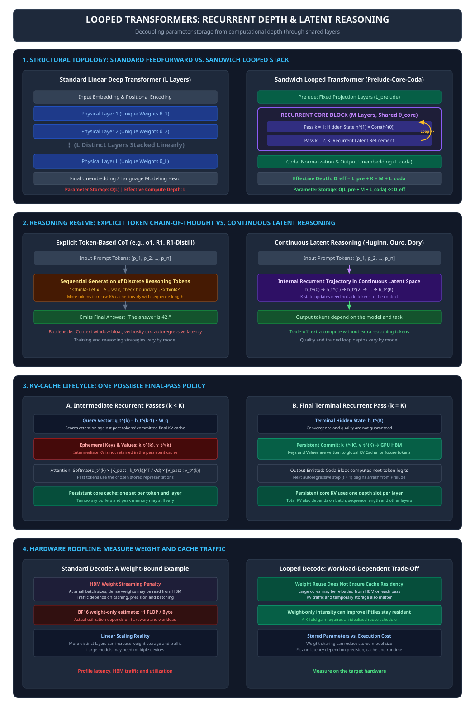
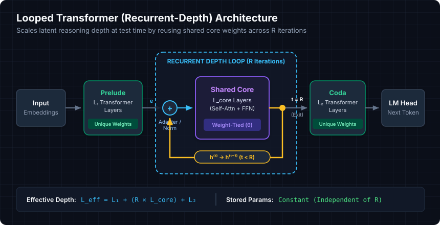
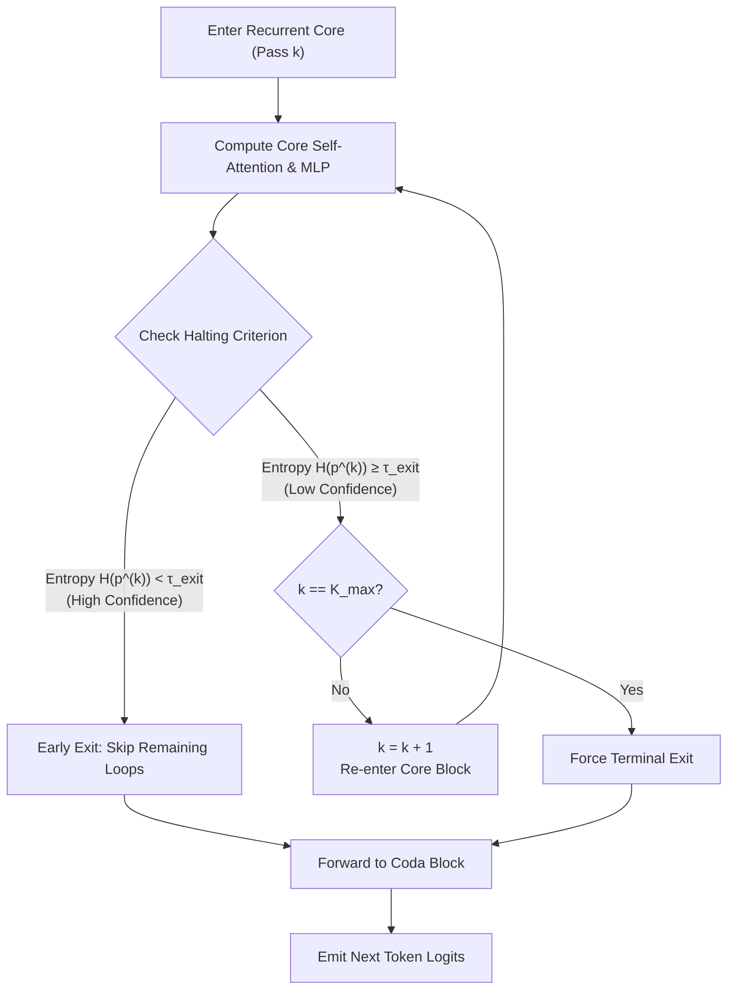

# Looped Transformers: Recurrent Depth, Latent Reasoning, and Test-Time Compute Mechanics

> Daily learning · November 24, 2026 · Systems architecture and deep review  
> *By Srinivasan Ragothaman ([@rsrini7](https://github.com/rsrini7))*

> Standard deep transformers scale reasoning capabilities by physically stacking dozens of distinct decoder layers, linearly compounding parameter storage, memory footprints, and weight-loading bandwidth. Looped transformers (recurrent-depth models and LoopLMs) break this parameter-depth lock by routing hidden states iteratively through a shared core block, multiplying effective computational depth and unlocking continuous latent-space reasoning without expanding stored weights.

---

## 1. Architecture Overview



---

## 2. Foundations: Decoupling Parameters from Depth

Traditional autoregressive Large Language Models (LLMs) usually apply a feedforward sequence of distinct layers, each with learned weights. Reusing weights across depth is another way to increase layer applications without adding a separate set of weights for every pass. The trade-offs include stored parameters, compute, and memory traffic:

1. **Parameter Bloat:** Storage footprint and GPU VRAM capacity requirements scale linearly with layer depth ($O(L)$).
2. **Memory Bandwidth Bottleneck:** At small batch sizes, decoding can be limited by fetching weights from High-Bandwidth Memory (HBM). Actual traffic depends on cache residency, batching, precision, and the implementation.
3. **Discrete Reasoning Overhead:** Some reasoning models emit explicit thinking tokens. These consume context and increase persistent KV-cache storage linearly with sequence length; cumulative dense-attention work can grow quadratically. Latent recurrence adds computation without necessarily adding tokens, although it can also be combined with explicit reasoning.

**Looped Transformers** (also classified as **recurrent-depth transformers**, **recursive transformers**, or **LoopLMs**) decouple physical parameter capacity from computational execution depth. Instead of passing through a sequence of unique layers once, the token's continuous hidden state $\mathbf{h}_t$ is routed through a shared core block of layers multiple times ($K$ recurrent iterations) before emitting logits.

### The "Sandwich" Architectural Topology

One common design uses a three-tier **Sandwich Topology**:

$$\mathbf{x}_t \xrightarrow{\quad} \text{Prelude} \xrightarrow{\quad \mathbf{h}_t^{(0)} \quad} \left[ \text{Recurrent Core} \right]^{K} \xrightarrow{\quad \mathbf{h}_t^{(K)} \quad} \text{Coda} \xrightarrow{\quad} \mathbf{y}_t$$

* **Prelude Block ($L_{\text{pre}}$ layers):** Non-recurrent input projection and early contextual grounding layers. Converts discrete token embeddings into rich latent representations, anchoring grammatical syntax and local sequence patterns.
* **Recurrent Core Block ($M$ layers, executed $K$ times):** A compact stack of shared transformer layers that iteratively refines the latent state. This core acts as an internal, continuous reasoning engine where $K$ loop iterations yield $K \times M$ effective layer applications.
* **Coda Block ($L_{\text{coda}}$ layers):** Non-recurrent output layers and final normalization that unrolls the final latent state into unembedding vocabulary logits.

The mathematical divergence between stored parameters and effective compute depth is defined as:

$$D_{\text{eff}} = L_{\text{pre}} + (K \times M) + L_{\text{coda}}$$

$$P_{\text{stored}} \approx \left(L_{\text{pre}} + M + L_{\text{coda}}\right) \times P_{\text{layer}}$$

For example, a model with $L_{\text{pre}} = 8$, $M = 20$, and $L_{\text{coda}} = 8$ stores only 36 physical layers. When unrolled at $K = 4$ passes at inference time, its effective computational depth reaches $8 + (4 \times 20) + 8 = 96$ layers—giving 96 layer applications with 36 physical layer sets. This count does not establish equivalent quality, latency, or total memory to a separately trained 96-layer model.



### Foundational Terminology

| Term / Component | Architectural Definition | Operational Role |
| :--- | :--- | :--- |
| **Recurrent Depth** | Applying the same physical layer stack iteratively to a single token position. | Multiplies computational depth per token without allocating new weight matrices. |
| **Latent Chain-of-Thought (Latent CoT)** | Iterative computation on continuous hidden representations. | Can add computation without additional reasoning tokens; it does not imply a fixed exchange rate with verbal steps. |
| **Sandwich Architecture** | A topology composed of fixed Prelude, shared Recurrent Core, and fixed Coda. | Isolates input embedding and output projection from recursive instability in the core. |
| **Final-Pass KV Caching** | Retains the terminal iteration’s keys and values for future tokens. | Can bound persistent core-cache size to one slot per layer; transient memory and quality still need measurement. |
| **Adaptive Computation Time (ACT)** | A learned or heuristic rule chooses computation depth. | May allocate different loop counts across tokens, depending on the model and serving implementation. |
| **Deep Equilibrium (DEQ)** | A related fixed-point formulation $h^* = f(h^*)$. | Implicit differentiation can avoid storing all unrolled activations, subject to solver and convergence assumptions. |
| **Unit-Sphere Normalization (`nGPT`)** | Normalized representations and weight vectors with learned scaled updates. | Can improve stability but does not guarantee convergence or accuracy at arbitrary depth. |

---

## 3. Deep Technical Mechanisms

```mermaid
sequenceDiagram
    autonumber
    participant In as Input Token (t)
    participant Pre as Prelude Block
    participant Core as Recurrent Core Block
    participant Reg as Temporary storage
    participant KV as Persistent KV Cache (HBM)
    participant Gate as Entropy Exit Gate
    participant Coda as Coda Block
    
    In->>Pre: Embed token x_t
    Pre->>Core: Emit initial latent state h_t^(0)
    
    rect rgb(30, 41, 59)
        Note over Core,Reg: Recurrent Loop Iteration k = 1 to K-1 (Ephemeral)
        Core->>KV: Fetch past tokens final KV cache (1 to t-1)
        Core->>Reg: Compute ephemeral k_t^(k) and v_t^(k)
        Core->>Core: Self-Attention and SwiGLU MLP update
        Core->>Gate: Evaluate prediction entropy H(p^(k))
        Gate-->>Core: Entropy > Threshold (Continue loop)
        Note over Reg: Intermediate KV is not retained in persistent cache
    end
    
    rect rgb(16, 53, 36)
        Note over Core,KV: Terminal Loop Iteration k = K (Commit)
        Core->>KV: Fetch past tokens final KV cache
        Core->>KV: COMMIT final k_t^(K) and v_t^(K) to HBM
        Core->>Coda: Forward final latent state h_t^(K)
    end
    
    Coda->>In: Emit next-token logits y_t
```



### 3.1 Latent State Recurrence and Continuous Reasoning Dynamics

Inside the recurrent core, state evolution is formulated as a non-linear dynamical system. Let $\mathbf{h}_t^{(0)}$ denote the output of the prelude block for token position $t$. Across recurrent iterations $k \in \{1, 2, \dots, K\}$, the hidden state evolves via residual connections:

$$\mathbf{h}_t^{(k)} = \mathbf{h}_t^{(k-1)} + \mathcal{F}_{\text{core}}\left(\text{RMSNorm}\left(\mathbf{h}_t^{(k-1)}\right), \Theta_{\text{core}}\right)$$

Where $\mathcal{F}_{\text{core}}$ encompasses multi-head self-attention and feedforward MLP sub-layers parameterized by shared weights $\Theta_{\text{core}}$.

#### Continuous Latent Trajectory vs. Discrete Token Chain-of-Thought

Standard reasoning LLMs (e.g., DeepSeek-R1, OpenAI o1) perform reasoning explicitly in discrete token space:

$$\mathbf{x} \to \text{"Let's consider step 1..."} \to \text{"Wait, check corner case..."} \to \mathbf{y}$$

Every reasoning step requires decoding a complete autoregressive token, which forces:
1. **Syntactic Overhead:** The model must allocate representational capacity to grammar, punctuation, and linguistic coherence rather than raw mathematical deduction.
2. **Context and Attention Cost:** A 3,000-token continuation adds 3,000 entries per cached layer. KV storage grows linearly in sequence length; total dense attention work across the sequence can grow quadratically. The actual bytes depend on layer count, KV heads, head size, and precision.
3. **Irreversible Trajectories:** Autoregressive sampling commits to discrete tokens; recovering from early reasoning blunders requires extensive backtracking tokens.

In contrast, looped transformers perform reasoning entirely in **continuous latent space**:

$$\mathbf{h}_t^{(0)} \xrightarrow{\quad \text{Refinement 1} \quad} \mathbf{h}_t^{(1)} \xrightarrow{\quad \text{Refinement 2} \quad} \dots \xrightarrow{\quad \text{Refinement } K \quad} \mathbf{h}_t^{(K)}$$

The hidden vector $\mathbf{h}_t \in \mathbb{R}^d$ navigates continuous attractor manifolds at a fixed sequence position $t$. This allows the model to perform gradient-like error corrections, hypothesis verification, and multi-step deduction internally without emitting a single superficial text token.

---

### 3.2 The KV-Cache Conundrum in Looped Architectures

In standard autoregressive decoding, every past token $j < t$ has a single, immutable Key vector $\mathbf{k}_j$ and Value vector $\mathbf{v}_j$ stored in the KV-cache. When a layer is unrolled $K$ times, how do past keys and values interact with intermediate iterations?

In the literature, three distinct paradigms govern KV-cache behavior in looped transformers:

```mermaid
flowchart TD
    subgraph FinalPass["1. Final-Pass Caching (One Policy)"]
        FP1["Intermediate Loops (k < K)<br/>Compute ephemeral q, k, v"] --> FP2["Score q against past FINAL cache<br/>Discard ephemeral k, v"]
        FP2 --> FP3["Final Loop (k = K)<br/>Commit k^(K), v^(K) to HBM"]
        FP3 --> FP4["One persistent KV slot per core layer"]
    end

    subgraph MultiTier["2. Multi-Tier Per-Loop Caching"]
        MT1["Loop k = 1: Store K_1, V_1"] --> MT2["Loop k = 2: Store K_2, V_2"]
        MT2 --> MT3["Loop k = K: Store K_K, V_K"]
        MT3 --> MT4["Result: K-Fold Memory Explosion (O(K x N))"]
    end

    subgraph MoRCache["3. Dynamic Selective Caching (MoR)"]
        MC1["Router scores token complexity"] --> MC2{"Exit at k?"}
        MC2 -- Yes --> MC3["Commit KV and Halt"]
        MC2 -- No --> MC4["Continue recurrent pass"]
        MC4 --> MC5["Result: Ragged, Density-Aware Cache"]
    end
```



#### Paradigm 1: Final-Pass Caching (Single-Tier Persistent Cache)

Dory evaluates a final-pass policy alongside per-loop caching. Huginn also studies bounded cache sharing, including multiple slots overwritten cyclically; the two policies must not be treated as identical. [Dory paper](https://arxiv.org/html/2611.03998), [Huginn paper](https://arxiv.org/html/2502.05171v2).

1. **Intermediate Passes ($k < K$):** For token-by-token decode under this policy, the query attends to previously committed final-pass keys and values plus the current token’s pass-$k$ keys and values. Intermediate KV need not be retained in the persistent cache; its physical placement and temporary allocation are implementation-dependent.
2. **Terminal Pass ($k = K$):** Once the recurrent core completes loop $K$, the final key $\mathbf{k}_t^{(K)}$ and value $\mathbf{v}_t^{(K)}$ are written to global HBM.
3. **Memory Footprint:** The KV-cache capacity matches that of a standard non-looped model with $M$ core layers:

$$\text{KV Cache Size (Bytes)} = 2 \times B \times (L_{\text{pre}} + M + L_{\text{coda}}) \times H_{\text{KV}} \times D_{\text{head}} \times P_{\text{bytes}} \times S$$

The persistent core KV capacity is independent of $K$ under this policy, but temporary buffers, allocator overhead, weights, and peak HBM use can still change. Multiply the formula by batch size $B$, and sum per layer when head sizes, cache precision, or sliding windows differ.

**Prefill and quality:** A final-pass-only cache changes which depth states early passes see. During chunked prefill, tokens within a chunk may see same-pass KV while later decoding sees previously cached final-pass KV. Test full, chunked, and token-by-token prefill against the intended policy. Dory's authors report that, at four loops, their last-loop policy changed scores by −2.12 to +0.42 points across the tested tasks relative to per-loop caching; this is specific to their checkpoint and evaluation. [Dory, cache evaluation](https://arxiv.org/html/2611.03998).

#### Paradigm 2: Multi-Tier Per-Iteration KV Caching

In this configuration, separate Key and Value vectors are preserved for every loop iteration $k \in \{1, \dots, K\}$:

$$\text{Attention}^{(k)} = \text{Softmax}\left(\frac{\mathbf{q}_t^{(k)} (\mathbf{K}_{1:t}^{(k)})^T}{\sqrt{d_k}}\right) \mathbf{V}_{1:t}^{(k)}$$

Token $t$ at iteration $k$ attends to past tokens at the same iteration. This preserves depth alignment but multiplies the core component of the KV cache by $K$; prelude and coda caches remain unchanged. At long contexts, that cache cost can outweigh weight-storage savings depending on model dimensions and precision.

#### Positional Embeddings Across Loops: RoPE and Iteration Conditioning

Standard Rotary Position Embeddings (RoPE) rotate query and key vectors based on the token sequence index $t$:

$$\mathbf{R}_{\Theta, t} \mathbf{q}_t, \quad \mathbf{R}_{\Theta, t} \mathbf{k}_t$$

In looped transformers, token sequence position $t$ remains **fixed** across all $K$ recurrent iterations. To prevent the core layers from becoming invariant to recursion depth, modern models inject explicit **iteration conditioning**:
* **Learned Loop Embeddings:** Adding a learned iteration vector $\mathbf{e}_{\text{loop}}^{(k)} \in \mathbb{R}^d$ to the hidden state prior to core layer entry.
* **Per-Loop RMSNorm Scales:** Sharing linear weights $\mathbf{W}_Q, \mathbf{W}_K, \mathbf{W}_V$ but allocating loop-specific gain vectors $\gamma^{(k)}$ to the pre-attention RMSNorm blocks.

---

### 3.3 Hardware Roofline Mechanics: Breaking the Memory-Bandwidth Bottleneck

At small batch sizes, autoregressive decoding can be memory-bandwidth bound. The following is a rough weight-only estimate for a dense BF16 model at batch size one, assuming one HBM read per weight and excluding attention, KV traffic, activations, and overhead:

$$\text{Arithmetic Intensity}_{\text{standard}} = \frac{\text{FLOPs per Token}}{\text{Bytes Transferred from HBM}} \approx \frac{2 \times P}{2 \times P} \approx 1 \text{ FLOP / Byte}$$

Modern GPU peak bandwidth and compute vary by configuration and precision. The weight-only estimate does not establish a fixed fraction of idle cycles; measure traffic and utilization on the target workload.

```
Standard Transformer Decode (1 Token):
HBM ──[Stream 70GB Weights]──> SRAM ──[Execute Layer 1..L Once]──> Emit Token
Arithmetic Intensity: ~1 FLOP / Byte (Memory Bandwidth Bound)

Looped Transformer Decode (1 Token, K Loops):
HBM ──[Load core weights as needed]──> Compute core K times ──> Emit Token
       Weight tiles may be reused if scheduling and cache capacity allow
Arithmetic intensity and bottleneck: measure on the target workload
```

A looped model reuses parameter values, but the full core does not necessarily fit in SRAM or L2. Multiple passes can reload weights from HBM. A $K$-fold increase in weight-only arithmetic intensity is an idealized case in which the necessary tiles are fetched once and reused; KV and activation traffic still matter.

$$\text{Arithmetic Intensity}_{\text{looped}} \approx K \times \text{Arithmetic Intensity}_{\text{standard}} \approx K \text{ FLOPs / Byte}$$

Extra passes add core computation. HBM traffic, latency, and utilization depend on tile reuse, cache capacity, batch size, context, and the serving implementation.

---

### 3.4 Training Dynamics, Stability, and Normalization

Training a recurrent architecture across depth is equivalent to Backpropagation Through Time (BPTT). Naive recurrent unrolling suffers from two primary pathologies:

1. **Exploding / Vanishing Gradients:** As the state $\mathbf{h}_t^{(k)}$ is repeatedly transformed by non-linear layers, gradients backpropagated through $K$ steps compound exponentially:

$$\frac{\partial \mathcal{L}}{\partial \mathbf{h}_t^{(0)}} = \prod_{k=1}^K \left( \mathbf{I} + \frac{\partial \mathcal{F}_{\text{core}}}{\partial \mathbf{h}_t^{(k-1)}} \right) \frac{\partial \mathcal{L}}{\partial \mathbf{h}_t^{(K)}}$$
2. **Attractor Collapse & Representation Drift:** Repeated transformations can yield unstable states or unhelpful fixed points. Whether either occurs depends on the model, training, and depth; convergence alone is not necessarily a failure.

#### Architectural Solutions: Unit-Sphere Normalization (`nGPT`)

To stabilize deep recurrence, state-of-the-art models such as **Dory 1.0** adopt normalized transformer backbones (`nGPT`). In `nGPT`, all hidden states and weight vectors are explicitly normalized to reside on the unit hypersphere:

$$\mathbf{h}_t^{(k)} = \frac{\mathbf{h}_t^{(k)}}{\|\mathbf{h}_t^{(k)}\|_2}, \quad \mathbf{W} = \frac{\mathbf{W}}{\|\mathbf{W}\|_2}$$

nGPT uses normalized representations and learned scaled updates. Normalization can constrain magnitudes, but it does not guarantee stable gradients, convergence, or good predictions at arbitrary loop depths. [nGPT paper](https://arxiv.org/abs/2410.01131).

#### Deep Equilibrium (DEQ) Formulations

For ultra-deep recurrent execution, storing intermediate activations for all $K$ passes during training consumes prohibitive VRAM ($O(K \times M)$). Deep Equilibrium Models solve this by formulating the recurrent limit as a fixed point:

$$\mathbf{h}^* = \mathcal{F}_{\text{core}}(\mathbf{h}^*, \Theta_{\text{core}})$$

Rather than unrolling backpropagation through every pass, gradients are computed directly at the equilibrium point $\mathbf{h}^*$ via the **Implicit Function Theorem**:

$$\frac{\partial \mathcal{L}}{\partial \Theta_{\text{core}}} = \frac{\partial \mathcal{L}}{\partial \mathbf{h}^*} \left( \mathbf{I} - \mathbf{J}_{\mathcal{F}}(\mathbf{h}^*) \right)^{-1} \frac{\partial \mathcal{F}(\mathbf{h}^*, \Theta_{\text{core}})}{\partial \Theta_{\text{core}}}$$

Where $\mathbf{J}_{\mathcal{F}}(\mathbf{h}^*)$ is the Jacobian matrix at equilibrium. This reduces training activation memory to $O(1)$ with respect to recurrent depth.

---

### 3.5 Dynamic Test-Time Compute & Adaptive Halting

Not all tokens require the same computational budget. Determining the punctuation mark after `"the"` requires minimal reasoning, whereas computing an intermediate mathematical step requires deep latent evaluation.



#### Entropy-Based Dynamic Early Exiting (The Ouro Mechanism)

Developed in ByteDance's **Ouro**, the model evaluates the Shannon entropy $\mathcal{H}$ of its intermediate next-token distribution at each loop iteration $k$:

$$\mathcal{H}\left(P^{(k)}(y \mid \mathbf{h}_t^{(k)})\right) = -\sum_{w \in \mathcal{V}} P^{(k)}(w) \log P^{(k)}(w)$$

If $\mathcal{H} < \tau_{\text{exit}}$, an entropy-based policy may exit early. Confidence is not correctness; calibrate the threshold and validate the cost of probing intermediate logits. Harder tokens continue iterating up to $K_{\text{max}}$.

#### Mixture-of-Recursions (MoR)

In **Mixture-of-Recursions** (Bae et al., 2025), routers allocate different recursive computation to tokens. The paper evaluates quality, FLOPs and cache-sharing trade-offs under its own training and routing configurations; savings do not automatically translate to equal wall-clock improvements. [Paper](https://arxiv.org/abs/2507.10524).

---

## 4. Notable Looped & Recurrent-Depth Models

The table below catalogs production and research looped transformers, detailing their topology, looping parameters, and deployment characteristics:

**Reading this table:** The architecture and benchmark figures are working notes, not a verified comparison. Entries without linked primary documentation should be checked against their model cards before use; cache policy, active parameters, and effective layer applications can vary by checkpoint and runtime. Verified corrections and sources follow the table.

| Model / System | Creator / Organization | Physical Params (Active) | Physical Layers ($L_{\text{pre}} + M + L_{\text{coda}}$) | Core Loops ($K$) | Effective Depth ($D_{\text{eff}}$) | KV-Cache Strategy | Key Architectural Innovation |
| :--- | :--- | :--- | :--- | :--- | :--- | :--- | :--- |
| **GLM-5.4** | Z.ai / Zhipu AI | ~750B (MoE) | 78 ($26 + 28 + 24$) | 2 | 106 Layers | Final-Pass Caching | Looped middle 28 layers twice; targeted at multi-trillion class reasoning in code and 3D modeling. |
| **Inkling 2 Mini** | Thinking Machines Lab | 26.4B total, 5.4B activated | See model card | Model-specific | Model-specific | Check implementation | Multimodal looped transformer. [Model card](https://huggingface.co/thinkingmachines/Inkling-2-Mini). |
| **SenseNova-Loop-9B** | SenseTime | 9B (Dense) | 32 ($4 + 24 + 4$) | 2 | 56 Layers | Final-Pass Caching | Expands 32 physical layers into 56 computations; 4-bit AWQ fits in &lt;5GB storage for edge deployment. |
| **Ouro (1.4B &amp; 2.6B)** | ByteDance Seed / UCSC / Princeton | 1.4B &amp; 2.6B | 24 ($0 + 24 + 0$) | 4 (Default) | Up to 96 Layers | Multi-Pass with Exit | Pre-trained on 7.7T tokens with entropy-regularized objective and learned early-exit gating. |
| **Huginn-3.5B (huginn-0125)** | Geiping et al. | 3.5B | 2 prelude + 4 core + 2 coda | Variable | Depends on loop count | Per-depth or bounded sharing | Recurrent-depth proof of concept trained on 800B tokens. [Paper](https://arxiv.org/abs/2502.05171). |
| **Nanbeige 4.2** | Nanbeige LLM Lab | 3B (Dense) | 22 ($0 + 22 + 0$) | 2 | 44 Layers | Final-Pass Caching | Pre-trained on 28T tokens; 2-pass uniform loop outperforming dense models twice its parameter size. |
| **Dory 1.0** | NVIDIA | 4B | See paper and checkpoint | Elastic | Depends on loop count | Per-loop or last-loop | Normalized GPT backbone with input reinjection. [Paper](https://arxiv.org/abs/2611.03998). |
| **Universal Transformer** | Dehghani et al. (2018) | ~100M | 1 Recurrent Block | Dynamic | ACT-Bounded | Recurrent State | Pioneered depth recurrence with Adaptive Computation Time (ACT) and coordinate step embeddings. |
| **ALBERT** | Lan et al. (2019) | 12M | 12 (All Shared) | 12 | 12 Layers | N/A (Encoder) | Cross-layer parameter sharing applied to BERT; demonstrated weight reuse without capacity loss. |
| **Mixture-of-Recursions (MoR)** | Bae et al. (2025) | Variable | Modular Stack | Dynamic | Token-Adaptive | Selective Token Cache | Token-level routing mechanism allocating distinct recursion depths to heterogeneous tokens. |
| **Hyperloop Transformer** | Research (2025) | Variable | 3 Blocks ($B + M + E$) | Variable | Multiplied Depth | Final-Pass Caching | Matrix-valued hyper-connections across residual streams to prevent loop representation collapse. |

---

## 5. Production Implementations & Code Recipes

The following illustrative PyTorch implementation demonstrates a complete **Sandwich Looped Transformer** with:
1. Fixed Prelude and Coda layers with a shared Recurrent Core.
2. **Final-Pass KV Caching** that preserves a $1\times$ memory footprint across recurrent iterations.
3. Rotary Position Embeddings (RoPE) that remain stable across loop iterations.
4. **Entropy-Based Early Exit Gating** for adaptive test-time compute.

**Implementation boundaries:** This example is educational, not production-ready. It uses `torch.cat` to rebuild caches, a batch-wide entropy decision and a synchronization via `.item()`. Its shared-cache policy can make chunked prefill differ from token-by-token prefill; validate against the serving policy before using outputs. Random weights have no useful accuracy, and a trained intermediate head is required for meaningful entropy gating.

```python
"""
Educational implementation: Sandwich Looped Transformer with Final-Pass KV-Cache
Ecosystem: PyTorch 2.5+ / Triton compatible
"""

import math
import torch
import torch.nn as nn
import torch.nn.functional as F
from dataclasses import dataclass
from typing import Optional, Tuple, List


@dataclass
class LoopedTransformerConfig:
    vocab_size: int = 32000
    hidden_size: int = 2048
    intermediate_size: int = 5632
    num_prelude_layers: int = 4
    num_core_layers: int = 12       # Shared recurrent stack
    num_coda_layers: int = 4
    num_attention_heads: int = 16
    num_kv_heads: int = 4           # Grouped-Query Attention (GQA)
    head_dim: int = 128
    max_position_embeddings: int = 8192
    rope_theta: float = 10000.0
    rms_norm_eps: float = 1e-6
    max_recurrent_loops: int = 3    # Default K = 3 passes
    early_exit_entropy_threshold: float = 0.35  # Threshold in nats


class RMSNorm(nn.Module):
    def __init__(self, dim: int, eps: float = 1e-6):
        super().__init__()
        self.eps = eps
        self.weight = nn.Parameter(torch.ones(dim))

    def forward(self, x: torch.Tensor) -> torch.Tensor:
        variance = x.pow(2).mean(-1, keepdim=True)
        return x * torch.rsqrt(variance + self.eps) * self.weight


class RotaryEmbedding(nn.Module):
    def __init__(self, dim: int, max_seq_len: int = 8192, theta: float = 10000.0):
        super().__init__()
        self.dim = dim
        inv_freq = 1.0 / (theta ** (torch.arange(0, dim, 2).float() / dim))
        self.register_buffer("inv_freq", inv_freq, persistent=False)

    def forward(self, seq_len: int, device: torch.device) -> Tuple[torch.Tensor, torch.Tensor]:
        t = torch.arange(seq_len, device=device, dtype=self.inv_freq.dtype)
        freqs = torch.outer(t, self.inv_freq)
        emb = torch.cat((freqs, freqs), dim=-1)
        return emb.cos(), emb.sin()


def apply_rotary_pos_emb(x: torch.Tensor, cos: torch.Tensor, sin: torch.Tensor) -> torch.Tensor:
    # x shape: [batch, heads, seq_len, head_dim]
    d = x.shape[-1] // 2
    x1, x2 = x[..., :d], x[..., d:]
    rotated = torch.cat((-x2, x1), dim=-1)
    return (x * cos) + (rotated * sin)


class LoopedAttention(nn.Module):
    def __init__(self, config: LoopedTransformerConfig):
        super().__init__()
        self.config = config
        self.num_heads = config.num_attention_heads
        self.num_kv_heads = config.num_kv_heads
        self.head_dim = config.head_dim
        self.hidden_size = config.hidden_size

        self.q_proj = nn.Linear(config.hidden_size, self.num_heads * self.head_dim, bias=False)
        self.k_proj = nn.Linear(config.hidden_size, self.num_kv_heads * self.head_dim, bias=False)
        self.v_proj = nn.Linear(config.hidden_size, self.num_kv_heads * self.head_dim, bias=False)
        self.o_proj = nn.Linear(self.num_heads * self.head_dim, config.hidden_size, bias=False)

    def forward(
        self,
        hidden_states: torch.Tensor,
        cos: torch.Tensor,
        sin: torch.Tensor,
        kv_cache: Optional[Tuple[torch.Tensor, torch.Tensor]] = None,
        is_final_loop: bool = True,
    ) -> Tuple[torch.Tensor, Optional[Tuple[torch.Tensor, torch.Tensor]]]:
        batch_size, seq_len, _ = hidden_states.shape

        q = self.q_proj(hidden_states).view(batch_size, seq_len, self.num_heads, self.head_dim).transpose(1, 2)
        k = self.k_proj(hidden_states).view(batch_size, seq_len, self.num_kv_heads, self.head_dim).transpose(1, 2)
        v = self.v_proj(hidden_states).view(batch_size, seq_len, self.num_kv_heads, self.head_dim).transpose(1, 2)

        # Apply RoPE using fixed token positions (independent of loop index)
        q = apply_rotary_pos_emb(q, cos, sin)
        k = apply_rotary_pos_emb(k, cos, sin)

        # Final-pass KV cache handling
        if kv_cache is not None:
            past_k, past_v = kv_cache
            k_complete = torch.cat([past_k, k], dim=2)
            v_complete = torch.cat([past_v, v], dim=2)
        else:
            k_complete, v_complete = k, v

        # Repeat KV heads for Grouped-Query Attention (GQA)
        num_kv_groups = self.num_heads // self.num_kv_heads
        k_rep = k_complete.repeat_interleave(num_kv_groups, dim=1)
        v_rep = v_complete.repeat_interleave(num_kv_groups, dim=1)

        # Scaled Dot-Product Attention with causal masking
        past_len = 0 if kv_cache is None else kv_cache[0].shape[2]
        q_pos = past_len + torch.arange(seq_len, device=q.device)
        k_pos = torch.arange(past_len + seq_len, device=q.device)
        causal_mask = k_pos.unsqueeze(0) <= q_pos.unsqueeze(1)
        attn_output = F.scaled_dot_product_attention(
            q, k_rep, v_rep, attn_mask=causal_mask, is_causal=False
        )
        attn_output = attn_output.transpose(1, 2).contiguous().view(batch_size, seq_len, -1)
        output = self.o_proj(attn_output)

        # Only commit to persistent cache during the final loop pass
        new_kv_cache = (k_complete, v_complete) if is_final_loop else kv_cache
        return output, new_kv_cache


class SwiGLUMLP(nn.Module):
    def __init__(self, config: LoopedTransformerConfig):
        super().__init__()
        self.gate_proj = nn.Linear(config.hidden_size, config.intermediate_size, bias=False)
        self.up_proj = nn.Linear(config.hidden_size, config.intermediate_size, bias=False)
        self.down_proj = nn.Linear(config.intermediate_size, config.hidden_size, bias=False)

    def forward(self, x: torch.Tensor) -> torch.Tensor:
        return self.down_proj(F.silu(self.gate_proj(x)) * self.up_proj(x))


class TransformerBlock(nn.Module):
    def __init__(self, config: LoopedTransformerConfig):
        super().__init__()
        self.input_layernorm = RMSNorm(config.hidden_size, eps=config.rms_norm_eps)
        self.self_attn = LoopedAttention(config)
        self.post_attention_layernorm = RMSNorm(config.hidden_size, eps=config.rms_norm_eps)
        self.mlp = SwiGLUMLP(config)

    def forward(
        self,
        hidden_states: torch.Tensor,
        cos: torch.Tensor,
        sin: torch.Tensor,
        kv_cache: Optional[Tuple[torch.Tensor, torch.Tensor]] = None,
        is_final_loop: bool = True,
    ) -> Tuple[torch.Tensor, Optional[Tuple[torch.Tensor, torch.Tensor]]]:
        # Pre-LN Self-Attention
        normed_states = self.input_layernorm(hidden_states)
        attn_out, new_kv = self.self_attn(
            normed_states, cos, sin, kv_cache=kv_cache, is_final_loop=is_final_loop
        )
        hidden_states = hidden_states + attn_out

        # Pre-LN MLP
        hidden_states = hidden_states + self.mlp(self.post_attention_layernorm(hidden_states))
        return hidden_states, new_kv


class SandwichLoopedTransformer(nn.Module):
    def __init__(self, config: LoopedTransformerConfig):
        super().__init__()
        self.config = config
        self.embed_tokens = nn.Embedding(config.vocab_size, config.hidden_size)
        self.rotary_emb = RotaryEmbedding(config.head_dim, config.max_position_embeddings, config.rope_theta)

        # 1. Prelude Stack (Unique Parameters)
        self.prelude_layers = nn.ModuleList([
            TransformerBlock(config) for _ in range(config.num_prelude_layers)
        ])

        # 2. Recurrent Core Stack (Shared Parameters across K loops)
        self.core_layers = nn.ModuleList([
            TransformerBlock(config) for _ in range(config.num_core_layers)
        ])

        # Optional loop-specific scale multipliers to break recursion symmetry
        self.loop_scales = nn.Parameter(torch.ones(config.max_recurrent_loops, config.hidden_size))

        # 3. Coda Stack (Unique Parameters)
        self.coda_layers = nn.ModuleList([
            TransformerBlock(config) for _ in range(config.num_coda_layers)
        ])

        self.final_norm = RMSNorm(config.hidden_size, eps=config.rms_norm_eps)
        self.lm_head = nn.Linear(config.hidden_size, config.vocab_size, bias=False)

    def _compute_entropy(self, logits: torch.Tensor) -> torch.Tensor:
        """Computes average prediction entropy over the vocabulary in nats."""
        probs = F.softmax(logits, dim=-1)
        log_probs = F.log_softmax(logits, dim=-1)
        entropy = -torch.sum(probs * log_probs, dim=-1)
        return entropy.mean()

    def forward(
        self,
        input_ids: torch.Tensor,
        kv_caches: Optional[List[Tuple[torch.Tensor, torch.Tensor]]] = None,
        num_loops: Optional[int] = None,
        use_early_exit: bool = True,
    ) -> Tuple[torch.Tensor, List[Tuple[torch.Tensor, torch.Tensor]]]:
        batch_size, seq_len = input_ids.shape
        device = input_ids.device
        target_loops = self.config.max_recurrent_loops if num_loops is None else num_loops
        if not 1 <= target_loops <= self.config.max_recurrent_loops:
            raise ValueError("num_loops must be between 1 and max_recurrent_loops")

        # Generate RoPE position frequencies
        past_len = kv_caches[0][0].shape[2] if kv_caches is not None else 0
        total_len = past_len + seq_len
        cos, sin = self.rotary_emb(total_len, device)
        cos, sin = cos[past_len:total_len].unsqueeze(0).unsqueeze(0), sin[past_len:total_len].unsqueeze(0).unsqueeze(0)

        # Initial Embedding
        h = self.embed_tokens(input_ids)
        new_caches = []
        cache_idx = 0

        # --- 1. Prelude Forward Pass ---
        for layer in self.prelude_layers:
            layer_cache = kv_caches[cache_idx] if kv_caches is not None else None
            h, updated_cache = layer(h, cos, sin, kv_cache=layer_cache, is_final_loop=True)
            new_caches.append(updated_cache)
            cache_idx += 1

        # --- 2. Recurrent Core Forward Passes (K Loops) ---
        core_cache_start = cache_idx
        active_loops = target_loops

        for loop_idx in range(target_loops):
            is_final = (loop_idx == target_loops - 1)
            candidate_caches = []
            # Inject loop conditioning vector
            h_in = h * self.loop_scales[loop_idx].unsqueeze(0).unsqueeze(0)

            for c_i, layer in enumerate(self.core_layers):
                c_idx = core_cache_start + c_i
                layer_cache = kv_caches[c_idx] if kv_caches is not None else None
                # Keep this pass's candidate KV in case it becomes the exit pass.
                h_in, updated_cache = layer(h_in, cos, sin, kv_cache=layer_cache, is_final_loop=True)
                candidate_caches.append(updated_cache)

            h = h + h_in  # Residual loop refinement

            # Optional Dynamic Early Exit via Entropy Monitoring
            if use_early_exit and not is_final:
                probe_logits = self.lm_head(self.final_norm(h[:, -1:, :]))
                entropy = self._compute_entropy(probe_logits)
                if entropy.item() < self.config.early_exit_entropy_threshold:
                    active_loops = loop_idx + 1
                    new_caches.extend(candidate_caches)
                    break
            if is_final:
                new_caches.extend(candidate_caches)

        # --- 3. Coda Forward Pass ---
        coda_cache_start = core_cache_start + self.config.num_core_layers
        cache_idx = coda_cache_start
        for layer in self.coda_layers:
            layer_cache = kv_caches[cache_idx] if kv_caches is not None else None
            h, updated_cache = layer(h, cos, sin, kv_cache=layer_cache, is_final_loop=True)
            new_caches.append(updated_cache)
            cache_idx += 1

        # Emit Logits
        logits = self.lm_head(self.final_norm(h))
        return logits, new_caches
```

---

## 6. Impact, Real-World Edge Cases & Gotchas

### Common Claims vs. Technical Realities

| Common Industry Claim | Technical Reality | Production Implication |
| :--- | :--- | :--- |
| *"Looped models double factual knowledge stored per parameter."* | Weight reuse adds computation without adding independent stored parameters. Task quality depends on training and evaluation. | Measure factual recall and reasoning separately at stated compute budgets. |
| *"Looping always doubles or triples KV-cache memory consumption."* | Per-loop caches scale with recurrent depth; bounded and last-loop caches can reduce persistent KV at the cost of changed computation. | Measure quality, persistent cache, and peak VRAM separately. |
| *"Looped models provide free compute."* | Core computation rises with the number of passes, while weight and KV traffic depend on the runtime. Prelude and coda costs do not necessarily scale with $K$. | Measure latency and throughput alongside quality. |
| *"A looped model can be unrolled infinitely at test time."* | Extra passes may help, plateau, or degrade quality outside the trained depth distribution. | Set a maximum depth using measured quality and latency, not a universal multiplier. |

### Real-World Failure Modes & Mitigations

#### 1. Representation Drift and Attractor Collapse
* **The Failure Mode:** Repeated transformations can produce unstable magnitudes or states that change too little to improve predictions. These are possible failure modes, not inevitable outcomes.
* **Mitigation:** Enforce unit-sphere normalization (`nGPT` backbone) or incorporate inter-loop L2 normalization between passes:

$$\mathbf{h}_t^{(k)} = \frac{\mathbf{h}_t^{(k)}}{\|\mathbf{h}_t^{(k)}\|_2} \times \sqrt{d}$$

#### 2. Loop Overthinking ("Marathon Thinking")
* **The Failure Mode:** Observed in large-scale looped models (such as GLM-5.4 during open-ended generation), unconstrained recurrent models can enter recursive verification loops, altering correct early answers into over-analyzed hallucinations or redundant corrections.
* **Mitigation:** Calibrate any entropy threshold on representative tasks, check error rates as well as confidence, and enforce a measured loop budget. A low entropy value does not establish correctness.

#### 3. Serving Engine Desynchronization (Warp Divergence in PagedAttention)
* **The Failure Mode:** Standard inference serving engines (e.g., vLLM, TensorRT-LLM, SGLang) execute batched decoding under the assumption that all sequences in a batch progress through identical physical layers simultaneously. In an elastic looped model with dynamic early exiting, token $A$ may exit at $K=1$ while token $B$ loops until $K=4$. This causes GPU warp divergence and idle thread execution.
* **Mitigation:** Group incoming requests into homogeneous loop-budget bins (e.g., Batch-K1, Batch-K2, Batch-K4) or enforce uniform unroll depths across synchronous generation batches, delegating dynamic depth solely to prefill.

---

## 7. Practical Adoption Blueprint & Verification Checklist

### Production Deployment Blueprint

When deploying looped transformers into production systems, follow this three-phase engineering sequence:

```
Phase 1: Architecture Profiling
  ├── Verify KV Cache Mode: Compare per-loop and shared-cache quality and capacity
  ├── Measure Arithmetic Intensity: Confirm Tensor Core Saturation via Nsight
  └── Establish Baseline: Profile Memory Bandwidth vs. Compute Saturation

Phase 2: Serving Engine Configuration
  ├── Select Runtime: Deploy custom vLLM / TensorRT-LLM fork supporting recurrent loops
  ├── Configure Batch Scheduling: Pin uniform loop depths (K=2 or K=4) to prevent warp divergence
  └── Enable Entropy Exit: Calibrate early exit threshold (τ_exit) on validation set

Phase 3: Production Validation
  ├── Benchmark TTFT & ITL: Measure latency trade-offs against baseline dense models
  └── Monitor Drift: Validate output entropy and perplexity stability under high concurrency
```

### Diagnostic Profiling Commands

Use these exact terminal commands to profile arithmetic intensity, memory bus traffic, and kernel execution:

```bash
# 1. Profile GPU Arithmetic Intensity and Tensor Core Utilization via Nsight Compute
ncu --metrics sm__sass_thread_inst_executed_op_fadd_pred_on.sum,\
sm__sass_thread_inst_executed_op_fmul_pred_on.sum,\
dram__bytes_read.sum,dram__bytes_write.sum \
python3 serve_looped_model.py --model dory-4b --loops 3

# 2. Inspect Live VRAM Allocation to Verify Final-Pass KV Cache Invariance
python3 -c "
import torch
from looped_model import SandwichLoopedTransformer, LoopedTransformerConfig
config = LoopedTransformerConfig(max_recurrent_loops=4)
model = SandwichLoopedTransformer(config).cuda().bfloat16()
print(f'Model Weights: {torch.cuda.memory_allocated() / 1e9:.2f} GB')
# Measure memory across K=1 vs K=4 loops
for k in [1, 4]:
    torch.cuda.reset_peak_memory_stats()
    _ = model(torch.randint(0, 32000, (1, 2048), device='cuda'), num_loops=k)
    print(f'Peak VRAM (K={k}): {torch.cuda.max_memory_allocated() / 1e9:.2f} GB')
"

# 3. Track GPU Memory Bus Activity and Power Saturation
nvidia-smi --query-gpu=timestamp,utilization.gpu,utilization.memory,memory.used --format=csv -l 1
```

### Verification Checklist

- [ ] **Topology Verified:** Record the actual prelude, core, coda, and input-injection design; no minimum number of prelude or coda layers is universal.
- [ ] **KV Cache Policy Verified:** Check per-loop versus shared states, early-exit writes, chunked prefill, persistent capacity and peak allocations.
- [ ] **RoPE Indices Verified:** Check that sequence positions and any loop-specific conditioning match the checkpoint implementation.
- [ ] **Dynamic Halting Bound:** An absolute ceiling $K_{\text{max}}$ is hardcoded into the decoding loop to prevent infinite recursion on degenerate inputs.
- [ ] **Normalization and Stability:** Measure activation and gradient behavior at trained and selected inference depths; normalization alone does not eliminate instability.
- [ ] **Quantization Validated:** Core weights retain numerical stability under FP8 or INT4/AWQ quantization without loop-induced degradation.

---

## 8. Timeline and Evolutionary Milestones

```
2018 ── Universal Transformer (Dehghani et al.)
        Introduced depth recurrence with Adaptive Computation Time (ACT)
2019 ── ALBERT (Lan et al.)
        Cross-layer parameter sharing across 12 BERT layers
2019 ── Deep Equilibrium Models (DEQ - Bai et al.)
        Constant-memory implicit differentiation for recurrent layers
2024 ── AlgoFormer
        Sandwich architecture for algorithmic learning (Prelude-Loop-Coda)
Feb 2025 ── Huginn-3.5B (Geiping et al. - NeurIPS 2025)
            Proved test-time compute scaling via continuous latent reasoning
Jul 2025 ── Mixture-of-Recursions (MoR - Bae et al.)
            Token-adaptive dynamic routing for recursive depth allocation
Late 2025 ── ByteDance Ouro Family (1.4B / 2.6B)
            LoopLM pre-trained on 7.7T tokens with entropy-regularized exit gating
Mid 2026 ── Nanbeige 4.2 (3B)
            Pretrained on 28T tokens; 2-pass uniform loop rivaling 7B-14B models
Late 2026 ── Modern Flagship Frontier
            • GLM-5.4 (Z.ai - 750B scale, middle 28 layers looped twice)
            • Inkling 2 Mini (Thinking Machines Lab - 26.4B MoE, 3x middle loop)
            • SenseNova-Loop-9B (SenseTime - 56-layer execution on 9B footprint)
            • Dory 1.0 (4B - Normalized nGPT backbone with elastic unrolling)
```

---

## 9. Primary Sources & References

1. **Jonas Geiping, Sean McLeish, Neel Jain, John Kirchenbauer, Siddharth Singh, Brian Bartoldson, Bhavya Kailkhura, Abhinav Bhatele, Tom Goldstein (2025):**  
   *Scaling up Test-Time Compute with Latent Reasoning: A Recurrent Depth Approach.*  
   Advances in Neural Information Processing Systems (NeurIPS 2025). [arXiv:2502.05171](https://arxiv.org/abs/2502.05171).  
   *Introduced Huginn-3.5B, demonstrating that recurrent-depth unrolling enables continuous latent reasoning without requiring explicit token-based Chain-of-Thought data.*

2. **ByteDance Seed, UC Santa Cruz, Princeton University (2025):**  
   *Scaling Latent Reasoning via Looped Language Models.*  
   [arXiv:2510.25741](https://arxiv.org/abs/2510.25741).  
   *Presented the Ouro family (Ouro-1.4B and Ouro-2.6B), detailing pre-training methodologies on 7.7T tokens with entropy-regularized objectives and dynamic early exit gating.*

3. **Sangmin Bae, Sungnyun Kim, Chaewon Kim, Hyoungwook Nam, Jihoon Tack, Jinwoo Shin (2025):**  
   *Mixture-of-Recursions: Learning Dynamic Recursive Depths for Adaptive Token-Level Computation.*  
   [arXiv:2507.10524](https://arxiv.org/abs/2507.10524).  
   *Studies token-level routing and cache-sharing trade-offs under the paper’s experimental configurations.*

4. **Mostafa Dehghani, Stephan Gouws, Oriol Vinyals, Jakob Uszkoreit, Łukasz Kaiser (2018):**  
   *Universal Transformers.*  
   International Conference on Learning Representations (ICLR 2019). [arXiv:1807.03819](https://arxiv.org/abs/1807.03819).  
   *Foundational paper introducing recurrent depth to transformer architectures paired with per-token Adaptive Computation Time (ACT).*

5. **Zhenzhong Lan, Mingda Chen, Sebastian Goodman, Kevin Gimpel, Piyush Sharma, Radu Soricut (2019):**  
   *ALBERT: A Lite BERT for Self-supervised Learning of Language Representations.*  
   International Conference on Learning Representations (ICLR 2020). [arXiv:1909.11942](https://arxiv.org/abs/1909.11942).  
   *Established cross-layer parameter sharing, demonstrating that repeating layer weights across depth reduces parameter footprints with minimal performance penalty.*

6. **Shaojie Bai, J. Zico Kolter, Vladlen Koltun (2019):**  
   *Deep Equilibrium Models.*  
   Advances in Neural Information Processing Systems (NeurIPS 2019). [arXiv:1909.01377](https://arxiv.org/abs/1909.01377).  
   *Introduced mathematical equilibrium modeling and constant-memory training via root-finding and implicit differentiation for recurrent networks.*

7. **Z.ai / Zhipu AI Technical Report (November 2026):**  
   *GLM-5.4 Architecture: Scaling Reasoning Through Recurrent Layer Reuse.*  
   [z.ai/blog/glm-5.4](https://z.ai/blog/glm-5.4).  
   *Original announcement; the page was inaccessible during this review, so its exact architecture has not been independently checked.*

8. **Thinking Machines Lab Technical Disclosure (Late 2026):**  
   *Inkling 2 Mini: Frontier Reasoning in a Local Footprint.*  
   [thinkingmachines.ai/models/inkling-2-mini](https://thinkingmachines.ai).  
   *Disclosed the 26.4B MoE architecture looping 12 middle layers 3× to fit 48-layer reasoning depth into a 20GB memory footprint.*

9. [Ouro project: Looped Language Models](https://ouro-llm.github.io/) — First-party model, training, and result details, including the reported 7.7T-token training run.
10. [NVIDIA: Dory 1.0 model card](https://huggingface.co/nvidia/NVIDIA-Nemotron-Labs-Dory1.0-4B-BF16) — Official checkpoint and architecture documentation.
11. [Fishman et al.: Dory1.0-4B](https://arxiv.org/abs/2611.03998) — Architecture, normalization, and per-loop versus last-loop cache experiments.
12. [Thinking Machines Lab: Inkling 2 Mini model card](https://huggingface.co/thinkingmachines/Inkling-2-Mini) — Official model and activated-parameter information.
13. [Loshchilov et al.: nGPT](https://arxiv.org/abs/2410.01131) — Normalized transformer formulation.

### Source Context & Empirical Evidence

Figures without a directly linked source below are retained as leads for further verification, not established benchmark results. The GLM-5.4 announcement was inaccessible during this review.

| Citation / Model | Evidence Category | Empirical Claims & Verified Observations | Verification Source |
| :--- | :--- | :--- | :--- |
| **Huginn-3.5B** | Research paper | 3.5B-parameter proof of concept trained on 800B tokens; the paper reports benchmark results for specific compute budgets. | [Huginn paper](https://arxiv.org/abs/2502.05171) |
| **Ouro-2.6B-Thinking** | Preprint | Looped language model and latent reasoning experiments. Check the paper for the exact training and benchmark configuration. | [Ouro paper](https://arxiv.org/abs/2510.25741) |
| **Dory 1.0 (4B)** | Research preprint | At four loops, last-loop caching changed scores by −2.12 to +0.42 points across tested tasks relative to per-loop caching. | [Dory paper](https://arxiv.org/html/2611.03998) |
| **Inkling 2 Mini** | First-party model card | 26.4B total and 5.4B activated parameters in the published comparison. | [Model card](https://huggingface.co/thinkingmachines/Inkling-2-Mini) |
| **Nanbeige 4.2 (3B)** | Benchmark release | The original benchmark claim requires direct verification against the model release and evaluation protocol. | Primary source not independently checked |

---

## 10. Supplementary Visuals

```
+---------------------------------------------------------------------------------------------------+
|               LOOPED TRANSFORMERS: RECURRENT DEPTH & LATENT REASONING SYSTEM                      |
+---------------------------------------------------------------------------------------------------+
| 1. Structural Topology                                                                            |
|    Standard Linear Stack:  [Pre] -> [L1] -> [L2] -> ... -> [Ln] -> [Head] (Param O(L))            |
|    Sandwich Looped Stack:  [Pre] -> [[Core Layer 1..M] looped Kx] -> [Coda] (Param << D_eff)     |
+---------------------------------------------------------------------------------------------------+
| 2. Reasoning Modalities                                                                           |
|    Explicit CoT (o1/R1):   Input -> "<think> token 1... token 3000 </think>" -> Answer           |
|    Continuous Latent CoT:  Input -> [h^(0) -> h^(1) -> ... -> h^(K) in R^d] -> Direct Answer      |
+---------------------------------------------------------------------------------------------------+
| 3. KV-Cache Lifecycle (Final-Pass Scratchpad)                                                     |
|    Pass k < K:             Query q^(k) scores against past cache. Intermediate KV is not retained|
|    Pass k = K:             Final KV retained; peak memory depends on runtime  |
+---------------------------------------------------------------------------------------------------+
| 4. Hardware Arithmetic Intensity                                                                  |
|    Standard Autoregressive: Weights streamed every token -> ~1 FLOP / Byte (Memory-Bound Wall)    |
|    Looped Autoregressive:   Weight traffic depends on hardware, caching and scheduling|
+---------------------------------------------------------------------------------------------------+
```

The accompanying system architecture diagram (`Looped-Transformers-Recurrent-Depth-Architecture-2026.svg`) visualizes the four critical mechanics:
1. **Structural Topology:** Contrasting the memory-prohibitive linear stacking of physical layers against the compact Sandwich topology.
2. **Reasoning Regimes:** Highlighting the contrast between context-exhausting token generation and internal vector-space latent deduction.
3. **KV-Cache Lifecycle:** Illustrating one possible final-pass policy; per-loop and bounded caches have different behavior.
4. **Hardware Arithmetic Intensity:** Contrasting a weight-only estimate with workload-dependent reuse. Measure actual memory traffic and utilization.


*Figure 2: The canonical Prelude → Shared Recurrent Core ($\times R$) → Coda execution pipeline. Highlights initial projection $e$, state injection and normalization ($e + h^{(t)}$), shared weight-tied transformer execution ($\theta$), and the $t=R$ terminal exit transition into the Coda and language modeling head.*

---

**Related:**
- [KV-Cache-Prefix-Caching-And-Storage-Tiering-Nov-2026.md](KV-Cache-Prefix-Caching-And-Storage-Tiering-Nov-2026.md) — Explains KV cache sizing, prefix caching, and HBM memory bandwidth mechanics during autoregressive generation.
- [Beyond-SoftMax-Attention.md](../attention/Beyond-SoftMax-Attention.md) — Analyzes linear attention, gated recurrence, and neural memory alternatives to quadratic Softmax attention.
- [microGPT-Technical-Deep-Dive.md](microGPT-Technical-Deep-Dive.md) — Details the internal layer forward pass, RoPE mathematics, and SwiGLU MLP tensor dimensions.
- [LLM-Inference-Engines.md](LLM-Inference-Engines.md) — Profiles serving engines, PagedAttention memory management, and batch scheduling bottlenecks.
