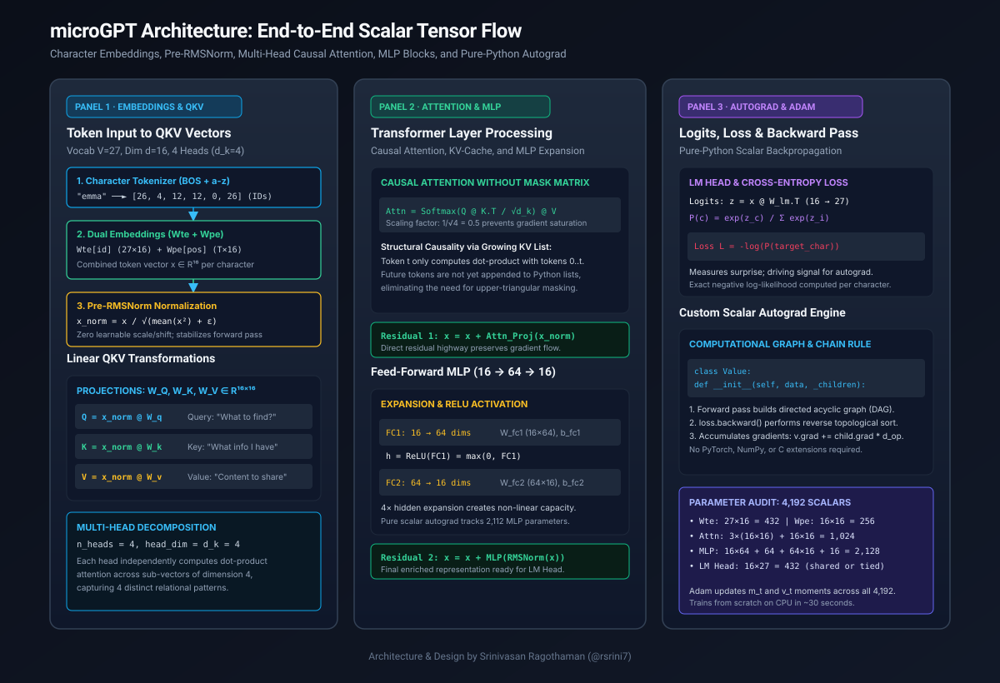
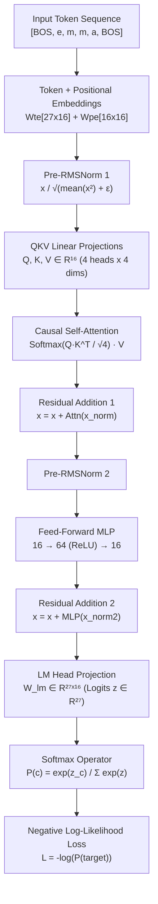
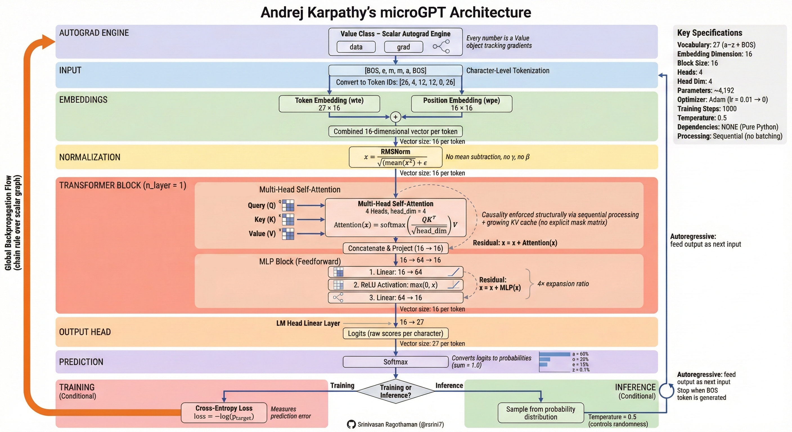

# microGPT Architecture: Step-by-Step Flow, Scalar Tensor Mechanics, and Autograd

Daily learning · March 2026

*By Srinivasan Ragothaman ([@rsrini7](https://github.com/rsrini7))*

> Traces the complete forward pass, backward autograd flow, and autoregressive generation loop of Andrej Karpathy's `microGPT`—an atomic Transformer implemented in pure Python scalars with zero external libraries, detailing token projections, pre-RMSNorm, causal attention, MLP expansions, and Adam optimization across exactly 4,192 parameters.

---

## 1. Foundations: The Atomic Pure-Python Transformer

Modern Large Language Models (LLMs) such as LLaMA, GPT-4, and Claude run across tens of thousands of GPUs using distributed tensor parallel libraries (Megatron-LM, DeepSpeed, CUDA, Triton). While these distributed frameworks optimize for hardware throughput, they obscure the fundamental mathematical elegance of the underlying Transformer architecture.

Andrej Karpathy's **microGPT** strips away all engineering abstractions—eliminating PyTorch, NumPy, CUDA, and external dependencies. Every operation, from matrix-vector dot products to automatic differentiation, is executed using pure Python scalar objects (`Value`).

```
┌────────────────────────────────────────────────────────┐
│             Character Sequence: "emma"                 │
└───────────────────────────┬────────────────────────────┘
                            │ Tokenizer: [26, 4, 12, 12, 0, 26]
┌───────────────────────────▼────────────────────────────┐
│         Embedding Layer (Wte: 27x16 + Wpe: 16x16)      │
│             Input Vectors x ∈ R¹⁶ per token            │
└───────────────────────────┬────────────────────────────┘
                            │ Pre-RMSNorm: x / √(mean(x²) + ε)
┌───────────────────────────▼────────────────────────────┐
│      Causal Multi-Head Self-Attention (4 heads x 4)    │
│            + Residual Connection (x = x + Attn)        │
└───────────────────────────┬────────────────────────────┘
                            │ Pre-RMSNorm
┌───────────────────────────▼────────────────────────────┐
│            Feed-Forward MLP (16 → 64 → 16)             │
│            + Residual Connection (x = x + MLP)         │
└───────────────────────────┬────────────────────────────┘
                            │ LM Head: W_lm ∈ R²⁷ˣ¹⁶
┌───────────────────────────▼────────────────────────────┐
│            Logits (R²⁷) ──► Softmax ──► Loss           │
│         Autograd Engine: Reverse Topological Sort      │
└────────────────────────────────────────────────────────┘
```

### Architectural Hyperparameters

| Hyperparameter | Symbol | Value | Architectural Purpose |
| :--- | :--- | :--- | :--- |
| **Vocabulary Size** | $V$ | $27$ | 26 English lowercase characters (`a`–`z`) + 1 BOS/EOS delimiter token (index 26). |
| **Context Length** | $T$ | $16$ | Maximum sequence length supported by positional embeddings. |
| **Embedding Dimension** | $d$ | $16$ | Dimensionality of the latent representation vector for each token. |
| **Attention Heads** | $n_h$ | $4$ | Number of parallel attention heads running in the self-attention layer. |
| **Head Dimension** | $d_k$ | $4$ | Dimensionality per head ($d_k = d / n_h = 16 / 4 = 4$). |
| **MLP Hidden Dimension** | $d_{\text{mlp}}$ | $64$ | Fourfold expansion dimension inside the feed-forward network ($4 \times 16$). |
| **Total Parameters** | $\Theta$ | $4{,}192$ | Total count of learnable scalar parameters optimized by Adam. |

---

## 2. Deep Technical Mechanisms: The 11-Step Lifecycle

### Step 1: Character-Level Tokenization
microGPT processes character streams rather than subword byte-pair encodings (BPE). The input string (e.g. `"emma"`) is framed with a Begin/End of Sequence (`BOS`) delimiter token (index 26):

```
Text:     [BOS]   'e'   'm'   'm'   'a'   [BOS]
Token ID:   26     4     12    12     0     26
```

### Step 2: Dual Embeddings (Token + Position)
Each token ID $t$ at sequence position $p$ is mapped to a continuous 16-dimensional vector by combining two learnable lookup tables:
1. **Token Embedding ($W_{te} \in \mathbb{R}^{27 \times 16}$)**: Represents character semantic identity.
2. **Positional Embedding ($W_{pe} \in \mathbb{R}^{16 \times 16}$)**: Represents sequence order.

The combined vector $x_p$ is computed via element-wise addition:

$$
x_p = W_{te}[t] + W_{pe}[p] \in \mathbb{R}^{16}
$$

### Step 3: Pre-RMSNorm Normalization
Before passing into attention or MLP blocks, the vector is normalized using Root Mean Square Layer Normalization (RMSNorm). Unlike standard LayerNorm, RMSNorm omits mean-centering:

$$
\text{RMSNorm}(x) = \frac{x}{\sqrt{\frac{1}{d}\sum_{i=1}^d x_i^2 + \epsilon}}
$$

Where $\epsilon = 10^{-5}$ prevents division by zero. In microGPT, learnable affine gain parameters ($\gamma$) are deliberately omitted, reducing parameter count while ensuring numerical stability during backpropagation.

### Step 4: Multi-Head Causal Self-Attention
The normalized vector $x_{\text{norm}} \in \mathbb{R}^{16}$ is projected into Query ($Q$), Key ($K$), and Value ($V$) representations:

$$
Q = x_{\text{norm}} W_Q, \quad K = x_{\text{norm}} W_K, \quad V = x_{\text{norm}} W_V \quad (W_Q, W_K, W_V \in \mathbb{R}^{16 \times 16})
$$

The 16-dimensional vectors are split into $n_h = 4$ independent attention heads, each of dimension $d_k = 4$.

#### Structural Causality Without a Mask Matrix
In standard batch implementations, causality is enforced by creating an upper-triangular mask matrix filled with $-\infty$. microGPT enforces causality **structurally via sequential processing**:
- When token $t$ is evaluated, previously computed Keys and Values ($K_{<t}, V_{<t}$) are stored in dynamic Python lists.
- Token $t$ appends its own $K_t$ and $V_t$ to the list.
- Future tokens ($>t$) do not yet exist in memory.
- Therefore, token $t$ cannot attend to future tokens, eliminating the need for mask tensors.

Attention weights are scaled by $1/\sqrt{d_k} = 1/\sqrt{4} = 0.5$ to prevent softmax gradient saturation:

$$
\text{Attention}(Q_h, K_h, V_h) = \text{Softmax}\left(\frac{Q_h K_h^T}{\sqrt{d_k}}\right) V_h
$$

The four head outputs are concatenated and projected through an output projection matrix $W_O \in \mathbb{R}^{16 \times 16}$, followed by a **residual connection**:

$$
x \leftarrow x + \text{Attention}(x_{\text{norm}})
$$

### Step 5: Feed-Forward MLP Block
The attention-enriched representation passes through a second RMSNorm, followed by a two-layer multi-layer perceptron (MLP) with a fourfold hidden dimension expansion ($16 \to 64 \to 16$):

$$
h = \text{ReLU}(x_{\text{norm2}} W_{\text{fc1}} + b_{\text{fc1}}) \quad (W_{\text{fc1}} \in \mathbb{R}^{16 \times 64}, \ b_{\text{fc1}} \in \mathbb{R}^{64})
$$

$$
\text{MLP}_{\text{out}} = h W_{\text{fc2}} + b_{\text{fc2}} \quad (W_{\text{fc2}} \in \mathbb{R}^{64 \times 16}, \ b_{\text{fc2}} \in \mathbb{R}^{16})
$$

Followed by the second residual connection:

$$
x \leftarrow x + \text{MLP}_{\text{out}}
$$

### Step 6: LM Head Projection to Vocabulary Logits
The final output vector $x \in \mathbb{R}^{16}$ is projected to the vocabulary dimension $V = 27$ through a linear Language Model Head ($W_{\text{lm}} \in \mathbb{R}^{27 \times 16}$):

$$
z = x W_{\text{lm}}^T \in \mathbb{R}^{27}
$$

The resulting vector $z$ contains the unnormalized log-probabilities ("logits") for each candidate next character.

### Step 7: Softmax and Cross-Entropy Loss
Logits are normalized into a discrete probability distribution over all 27 characters using the Softmax operator:

$$
P(c) = \frac{e^{z_c}}{\sum_{j=1}^{27} e^{z_j}}
$$

Given the ground-truth target character $y$, the loss is computed as the Negative Log-Likelihood (NLL):

$$
\mathcal{L} = -\log P(y)
$$

### Step 8: Scalar Automatic Differentiation (`Value` Engine)
Every scalar calculation in microGPT is wrapped in a custom `Value` object that records:
- `self.data`: The floating-point value.
- `self.grad`: The accumulated partial derivative $\frac{\partial \mathcal{L}}{\partial \text{self}}$.
- `self._backward`: A lambda executing the local chain rule derivative.
- `self._prev`: Pointers to parent nodes in the directed acyclic graph (DAG).

Calling `loss.backward()` executes a **reverse topological sort** across all visited `Value` nodes, propagating gradients backward through every addition, multiplication, ReLU, and exp operation.

### Step 9: Parameter Updates with Adam Optimizer
Gradients are updated using the Adam optimizer with bias-corrected first ($m$) and second ($v$) moment vectors:

$$
m_t = \beta_1 m_{t-1} + (1 - \beta_1) g_t, \quad v_t = \beta_2 v_{t-1} + (1 - \beta_2) g_t^2
$$

$$
\hat{m}_t = \frac{m_t}{1 - \beta_1^t}, \quad \hat{v}_t = \frac{v_t}{1 - \beta_2^t}
$$

$$
\theta \leftarrow \theta - \frac{\eta}{\sqrt{\hat{v}_t} + \epsilon} \hat{m}_t
$$

Where $\beta_1 = 0.9, \beta_2 = 0.999$, and learning rate $\eta = 0.01$ with cosine decay.

### Step 10 & 11: Autoregressive Sampling Loop
During inference, generation proceeds iteratively:
1. Start with initial context containing only `[BOS]` (token 26).
2. Execute the forward pass to obtain logits for the next token.
3. Divide logits by temperature $\tau$ (e.g. $\tau = 0.8$) to control randomness.
4. Sample from the resulting probability distribution.
5. Append the sampled character to the sequence.
6. Repeat until the model emits the `[BOS]` token again, signaling completion.

---

## 3. Parameter Audit: Exact Count of 4,192 Scalars

Every parameter in microGPT is an independent scalar float. Below is the exact structural accounting:

| Subsystem / Layer | Matrix / Tensor | Dimensions | Parameter Count |
| :--- | :--- | :--- | :--- |
| **Token Embeddings** | $W_{te}$ | $27 \times 16$ | $432$ |
| **Position Embeddings** | $W_{pe}$ | $16 \times 16$ | $256$ |
| **Attention Query Projection** | $W_Q$ | $16 \times 16$ | $256$ |
| **Attention Key Projection** | $W_K$ | $16 \times 16$ | $256$ |
| **Attention Value Projection** | $W_V$ | $16 \times 16$ | $256$ |
| **Attention Output Projection** | $W_O$ | $16 \times 16$ | $256$ |
| **MLP First Layer Weights** | $W_{\text{fc1}}$ | $16 \times 64$ | $1{,}024$ |
| **MLP First Layer Biases** | $b_{\text{fc1}}$ | $64$ | $64$ |
| **MLP Second Layer Weights** | $W_{\text{fc2}}$ | $64 \times 16$ | $1{,}024$ |
| **MLP Second Layer Biases** | $b_{\text{fc2}}$ | $16$ | $16$ |
| **LM Head Output Projection** | $W_{\text{lm}}$ | $27 \times 16$ | $432$ |
| **Grand Total** | | | **$4{,}192$** |

---

## 4. Architectural Visuals: End-to-End Scalar Tensor Flow

The diagram below maps the complete lifecycle: Panel 1 illustrates token embedding lookups, pre-RMSNorm, and QKV projections; Panel 2 details causal attention without mask matrices and MLP expansion; Panel 3 breaks down the LM head, negative log-likelihood loss, and scalar autograd DAG.



### End-to-End Forward Pass Flowchart



---

## 5. Executable Python Recipe: Minimal Autograd & Forward Pass

Below is a self-contained, runnable Python script implementing microGPT's core engine: the scalar `Value` autograd backpropagation class, RMSNorm, linear projections, cross-entropy loss, and gradient verification.

```python
"""
microGPT Scalar Autograd Engine and Minimal Forward/Backward Pass
Demonstrates pure Python scalar automatic differentiation, RMSNorm,
linear projections, and cross-entropy loss without external libraries.

Author: Srinivasan Ragothaman (@rsrini7)
"""

import math
import random


class Value:
    """Wraps a scalar floating-point value with an autograd gradient node."""

    def __init__(self, data, _children=(), _op=""):
        self.data = float(data)
        self.grad = 0.0
        self._backward = lambda: None
        self._prev = set(_children)
        self._op = _op

    def __repr__(self):
        return f"Value({self.data:.4f}, grad={self.grad:.4f})"

    def __add__(self, other):
        other = other if isinstance(other, Value) else Value(other)
        out = Value(self.data + other.data, (self, other), "+")

        def _backward():
            self.grad += 1.0 * out.grad
            other.grad += 1.0 * out.grad

        out._backward = _backward
        return out

    def __mul__(self, other):
        other = other if isinstance(other, Value) else Value(other)
        out = Value(self.data * other.data, (self, other), "*")

        def _backward():
            self.grad += other.data * out.grad
            other.grad += self.data * out.grad

        out._backward = _backward
        return out

    def __sub__(self, other):
        return self + (-other)

    def __neg__(self):
        return self * -1.0

    def __truediv__(self, other):
        return self * (other**-1)

    def __pow__(self, other):
        assert isinstance(other, (int, float)), "Supporting int/float powers"
        out = Value(self.data**other, (self,), f"**{other}")

        def _backward():
            self.grad += (other * (self.data ** (other - 1))) * out.grad

        out._backward = _backward
        return out

    def relu(self):
        out = Value(max(0.0, self.data), (self,), "ReLU")

        def _backward():
            self.grad += (1.0 if self.data > 0 else 0.0) * out.grad

        out._backward = _backward
        return out

    def exp(self):
        out = Value(math.exp(self.data), (self,), "exp")

        def _backward():
            self.grad += out.data * out.grad

        out._backward = _backward
        return out

    def log(self):
        out = Value(math.log(self.data), (self,), "log")

        def _backward():
            self.grad += (1.0 / self.data) * out.grad

        out._backward = _backward
        return out

    def backward(self):
        """Topological sort backpropagation."""
        topo = []
        visited = set()

        def build_topo(v):
            if v not in visited:
                visited.add(v)
                for child in v._prev:
                    build_topo(child)
                topo.append(v)

        build_topo(self)
        self.grad = 1.0
        for node in reversed(topo):
            node._backward()


def rms_norm(vec, eps=1e-5):
    """Pure-Python scalar Root Mean Square Normalization."""
    d = len(vec)
    sum_sq = Value(0.0)
    for v in vec:
        sum_sq = sum_sq + (v * v)
    mean_sq = sum_sq * (1.0 / d)
    denom = (mean_sq + eps) ** 0.5
    return [v / denom for v in vec]


def linear_projection(vec, weight_matrix, biases=None):
    """Matrix-vector multiplication with optional bias."""
    out_dim = len(weight_matrix[0])
    in_dim = len(vec)
    out = []
    for j in range(out_dim):
        dot = Value(0.0) if biases is None else biases[j]
        for i in range(in_dim):
            dot = dot + (vec[i] * weight_matrix[i][j])
        out.append(dot)
    return out


# --- Verification & Forward/Backward Execution ---
if __name__ == "__main__":
    random.seed(42)
    dim = 4
    vocab_size = 5

    print("=== 1. Initializing Scalar Input and Weight Matrices ===")
    x = [Value(random.uniform(-1, 1)) for _ in range(dim)]
    W = [[Value(random.uniform(-0.1, 0.1)) for _ in range(vocab_size)] for _ in range(dim)]
    target_idx = 2

    print(f"Input vector: {[round(v.data, 3) for v in x]}")

    print("\n=== 2. Applying RMSNorm ===")
    x_norm = rms_norm(x)
    print(f"Normalized vector: {[round(v.data, 3) for v in x_norm]}")

    print("\n=== 3. Linear Projection to Logits ===")
    logits = linear_projection(x_norm, W)
    print(f"Logits: {[round(v.data, 3) for v in logits]}")

    print("\n=== 4. Softmax and Negative Log-Likelihood Loss ===")
    exp_logits = [v.exp() for v in logits]
    sum_exp = Value(0.0)
    for ev in exp_logits:
        sum_exp = sum_exp + ev

    probs = [ev / sum_exp for ev in exp_logits]
    loss = -probs[target_idx].log()
    print(f"Probabilities: {[round(p.data, 4) for p in probs]}")
    print(f"Target Token: {target_idx} | Cross-Entropy Loss: {loss.data:.4f}")

    print("\n=== 5. Backward Pass via Scalar Autograd ===")
    loss.backward()
    print(f"Gradient on target logit: {logits[target_idx].grad:.4f}")
    print(f"Gradient on first input scalar: {x[0].grad:.4f}")
    assert loss.data > 0, "Loss must be positive"
    print("\nScalar autograd backward pass successfully verified.")
```

---

## 6. Impact, Real-World Edge Cases & Gotchas

### Common Claims vs. Technical Realities

| Common Claim | Technical Reality | Empirical Mechanism |
| :--- | :--- | :--- |
| **"A 4,192 parameter model is too tiny to learn anything meaningful."** | **False.** microGPT memorizes and generates plausible English names (e.g. `"oliver"`, `"emma"`). | For character-level modeling on a vocabulary of 27, $4{,}192$ parameters provide sufficient capacity to capture bigram, trigram, and short-range phonetic syllable patterns in 30 seconds of CPU training. |
| **"You need PyTorch, TensorFlow, or C extensions to calculate backpropagation."** | **False.** Automatic differentiation is purely a directed acyclic graph traversal using the chain rule. | Any object model implementing `__add__`, `__mul__`, and recursive reverse-topological `backward()` can compute mathematically exact gradients for arbitrarily deep neural networks. |
| **"Causal self-attention always requires an explicit upper-triangular mask matrix."** | **False.** Masking is an artifact of parallel batch training on GPUs. | In sequential scalar processing, future tokens have not yet been evaluated and do not exist in the KV cache list. When causality is enforced by execution order, masking tensors are redundant. |
| **"RMSNorm requires learnable scale parameters ($\gamma$) to function."** | **False.** Normalization stabilization occurs primarily through vector scaling. | While learnable $\gamma$ grants slight expressive flexibility, omitting $\gamma$ preserves 100% of the gradient explosion mitigation benefits while trimming $d$ parameters per layer. |

---

## 7. Timeline of Minimal Transformer Implementations

```
2015 ── Andrej Karpathy publishes min-char-rnn (minimal character RNN in pure NumPy)
2017 ── Vaswani et al. publish "Attention Is All You Need", introducing the Transformer
2019 ── Zhang & Sennrich publish Root Mean Square Layer Normalization (RMSNorm)
2020 ── Andrej Karpathy publishes micrograd (minimal scalar autograd engine in ~100 lines)
2022 ── Andrej Karpathy releases nanoGPT (minimal production-ready PyTorch Transformer)
2026 ── Andrej Karpathy releases microGPT (fusing micrograd autograd with Transformer mechanics in pure Python)
```

---

## 8. Primary Sources & References

1. [Andrej Karpathy: microGPT Official Implementation](https://gist.github.com/karpathy/8627fe009c40f57531cb18360106ce95) — The canonical 243-line pure-Python scalar Transformer implementation.
2. [Andrej Karpathy: microGPT Web Mirror](https://karpathy.ai/microgpt.html) — Single-page educational mirror explaining scalar autograd graph construction.
3. [Vaswani, A., et al. (2017): Attention Is All You Need](https://arxiv.org/abs/1706.03762) — The foundational research paper introducing the multi-head self-attention Transformer architecture.
4. [Zhang, B., & Sennrich, R. (2019): Root Mean Square Layer Normalization](https://arxiv.org/abs/1910.07467) — Introduces RMSNorm, proving that mean-centering is non-essential for layer normalization.
5. [Andrej Karpathy: micrograd](https://github.com/karpathy/micrograd) — The foundational scalar automatic differentiation engine powering microGPT's backpropagation.

---

## 9. Supplementary visuals

The diagram below provides a structural overview of the microGPT forward calculation and scalar parameter updates.


*Figure 1: High-level architectural flowchart of microGPT forward prediction, autograd loss backpropagation, and autoregressive generation.*

---

**Related:**
- [microGPT-Architecture-Complete](microGPT-Architecture-Complete.md) — Comprehensive technical walkthrough of microGPT's pre-norm architecture and autograd graph.
- [microGPT-Technical-Deep-Dive](microGPT-Technical-Deep-Dive.md) — Consolidated deep dive examining scalar performance boundaries, memory overhead, and nanoGPT migration.
- [Inside-A-Neuron-Architecture-And-Mechanics-2026](../attention/Inside-A-Neuron-Architecture-And-Mechanics-2026.md) — Analyzes the fundamental single-neuron affine projections assembling into microGPT's MLP layers.
- [Auto-Regression](../training/Auto-Regression.md) — Deconstructs the autoregressive sampling loop, KV-cache dynamics, and sequential decode bottlenecks.
