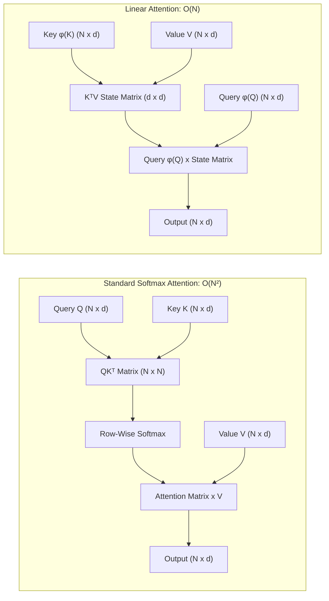
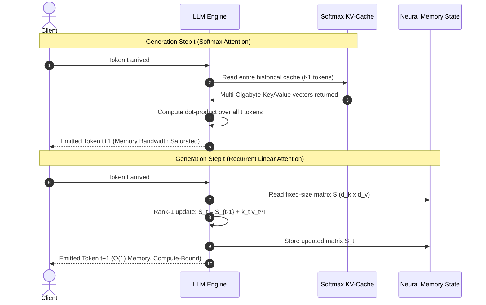
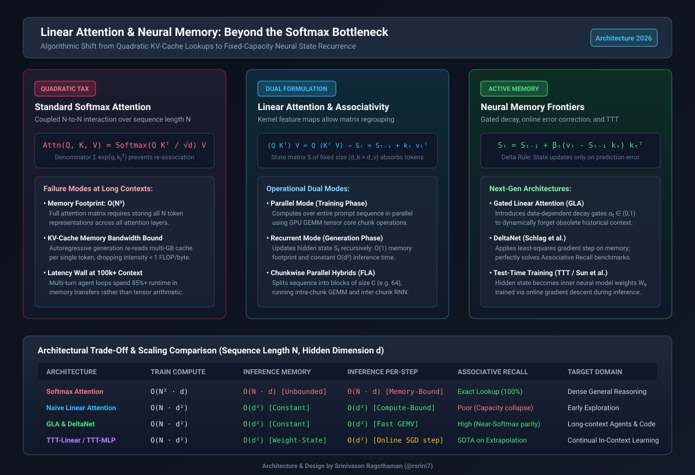
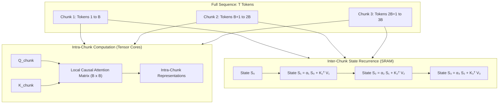
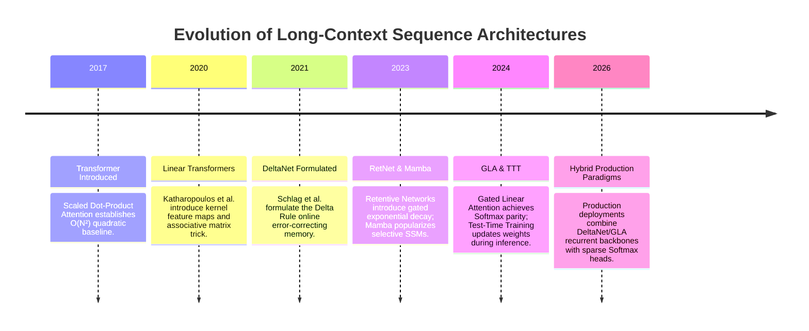
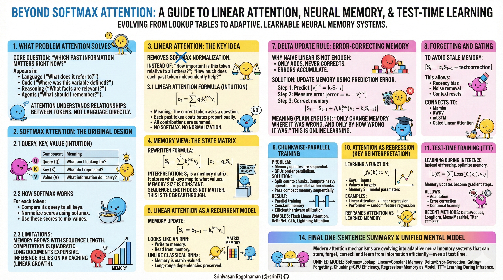

# Beyond Softmax: Linear Attention, Gated State Recurrence, and Neural Memory Architectures

Learning note · Revised November 2026 · Post-Transformer Sequence Modeling  
*By Srinivasan Ragothaman ([@rsrini7](https://github.com/rsrini7))*

> Standard Softmax attention couples all tokens pairwise through an exponential normalizer, forcing quadratic $O(N^2)$ compute and memory growth that saturates GPU high-bandwidth memory (HBM) during long-context generation. Linear attention and recurrent neural memory architectures eliminate this bottleneck by removing the normalizer, enabling associative matrix reordering $(Q K^T) V = Q (K^T V)$ that compresses sequences into a fixed-capacity state matrix with $O(1)$ inference memory and $O(N)$ linear training complexity.

---

## 1. Foundations: The Softmax Attention Bottleneck

Transformer models rely on scaled dot-product attention to dynamically route information across sequence positions. For an input sequence of length $N$ projected into queries $Q \in \mathbb{R}^{N \times d_k}$, keys $K \in \mathbb{R}^{N \times d_k}$, and values $V \in \mathbb{R}^{N \times d_v}$, the standard attention formulation evaluates as:

$$\text{Attention}(Q, K, V) = \text{Softmax}\left(\frac{Q K^T}{\sqrt{d_k}}\right) V$$

The Softmax function operates row-wise over the unnormalized Gram matrix $S = Q K^T / \sqrt{d_k} \in \mathbb{R}^{N \times N}$. For token position $i$, the attention weight assigned to token $j$ is:

$$A_{i, j} = \frac{\exp\left(\frac{q_i k_j^T}{\sqrt{d_k}}\right)}{\sum_{m=1}^N \exp\left(\frac{q_i k_m^T}{\sqrt{d_k}}\right)}$$

While this non-linear normalizer grants transformers exceptional expressivity—enabling precise point-to-point retrieval across massive context windows—it imposes two fundamental computational and memory barriers:

| Dimension | Training Phase ($N$ Tokens) | Autoregressive Generation ($t$-th Token) | Bottleneck Class |
| :--- | :--- | :--- | :--- |
| **Compute Complexity** | $O(N^2 \cdot d)$ floating-point operations | $O(t \cdot d)$ operations per single token | Compute-bound during prefill; FLOPs scale quadratically with length |
| **Memory Footprint** | $O(N^2)$ activation memory (or $O(N)$ with FlashAttention) | $O(B \cdot L \cdot H \cdot t \cdot d)$ KV-cache retained in HBM | Memory bandwidth-bound; cache re-read on every forward step |
| **Arithmetic Intensity** | High (~100–150 FLOPs/byte via SRAM tiling) | Extremely low (< 1 FLOP/byte in single-batch decode) | GPU tensor cores stall waiting for HBM memory bus transfers |

During autoregressive inference, generating the $(t+1)$-th token requires reloading all historical key-value pairs $\{k_1, \dots, k_t\}$ and $\{v_1, \dots, v_t\}$ across all layers $L$ and attention heads $H$. For a 70B parameter model operating at a 128k context window, the KV-cache alone demands over 160 GB of GPU VRAM per concurrent stream. As context lengths push toward millions of tokens, the cost of storing and streaming the KV-cache through the GPU memory bus completely outstrips the compute capacity of tensor cores.

---

## 2. Deep Technical Mechanism: Linear Attention & Dual Formulations

Linear attention addresses the quadratic bottleneck by replacing the exponential Softmax kernel with decomposed feature maps. 

### 2.1 The Associative Law of Matrix Multiplication

If the similarity between a query $q_i$ and a key $k_j$ can be expressed as an inner product of positive feature representations $\phi(q_i)^T \phi(k_j)$ (where $\phi: \mathbb{R}^d \to \mathbb{R}^{d'}$), the attention equation can be written without the global denominator coupling:

$$\text{Sim}(q_i, k_j) = \phi(q_i)^T \phi(k_j)$$

Substituting this kernel into the causal attention equation (where token $i$ only attends to positions $j \le i$):

$$o_i = \frac{\sum_{j=1}^i \phi(q_i)^T \phi(k_j) v_j}{\sum_{j=1}^i \phi(q_i)^T \phi(k_j)} = \frac{\phi(q_i)^T \left( \sum_{j=1}^i \phi(k_j) v_j^T \right)}{\phi(q_i)^T \left( \sum_{j=1}^i \phi(k_j) \right)}$$

Because matrix multiplication is associative—$(A B) C = A (B C)$—the summation order can be inverted. Rather than computing the $N \times N$ pairwise similarity matrix first, the keys and values are accumulated directly into a hidden state matrix $S_i$:

$$S_i = \sum_{j=1}^i \phi(k_j) v_j^T \in \mathbb{R}^{d' \times d_v}, \qquad z_i = \sum_{j=1}^i \phi(k_j) \in \mathbb{R}^{d'}$$

The final output is evaluated via a single vector-matrix multiplication:

$$o_i = \frac{\phi(q_i)^T S_i}{\phi(q_i)^T z_i}$$



### 2.2 Dual Formulation: Parallel Training vs. Recurrent Inference

This associative property unlocks two mathematically equivalent execution modes:

1. **Parallel Training Mode (Hardware-Efficient GEMM):** Across the entire sequence during pretraining, cumulative sums $\sum_{j=1}^i \phi(k_j) v_j^T$ can be executed via parallel prefix scans and block-matrix multiplications on tensor cores. The total computational complexity drops from $O(N^2 \cdot d)$ to $O(N \cdot d^2)$. When $d \ll N$, this yields substantial speedups.
2. **Recurrent Inference Mode (Constant-Memory RNN):** During autoregressive token generation, the model maintains only the cumulative state matrix $S_t \in \mathbb{R}^{d_k \times d_v}$ and normalizer vector $z_t \in \mathbb{R}^{d_k}$. For each new token arriving at step $t$:

$$S_t = S_{t-1} + \phi(k_t) v_t^T$$

$$z_t = z_{t-1} + \phi(k_t)$$

$$o_t = \frac{\phi(q_t)^T S_t}{\phi(q_t)^T z_t}$$

The memory footprint is strictly $O(1)$ with respect to sequence length $t$. The model generates million-token sequences without growing VRAM by a single byte.

---

## 3. The Collapse of Naive Linear Attention and Modern Breakthroughs

Early linear transformers (e.g., Katharopoulos et al., 2020) demonstrated significant theoretical appeal but suffered severe practical limitations on language modeling benchmarks.

### 3.1 Failure Modes of Naive Linear Attention

- **Finite State Capacity Bottleneck:** A fixed matrix $S \in \mathbb{R}^{d_k \times d_v}$ possesses only $d_k \cdot d_v$ degrees of freedom. As sequence length $N \to \infty$, accumulating vectors via unconstrained addition saturates the state capacity, causing older context to blur into high-dimensional noise.
- **Unbounded Norm Growth:** Without decay, $\|S_t\|_F$ grows linearly with sequence length $t$, leading to numerical overflow in low-precision floating-point formats (FP16/BF16).
- **Catastrophic Forgetting & Retrieval Collapse:** On Multi-Query Associative Recall (MQAR) and "Needle In A Haystack" benchmarks, standard linear attention degrades drastically compared to Softmax attention. In Softmax attention, an exact match $q_i \approx k_j$ produces an exponentiated spike $\exp(q_i k_j^T / \sqrt{d})$ that dominates the sum regardless of sequence length. In linear attention, the inner product $\phi(q_i)^T \phi(k_j)$ cannot overpower the accumulated sum of thousands of interfering background tokens.



### 3.2 Breakthrough 1: Gated Linear Attention (GLA) & RetNet

To prevent unbounded state saturation, **RetNet** (Sun et al., 2023) and **Gated Linear Attention** (Yang et al., 2024) introduce continuous decay factors and data-dependent gating into the recurrent update:

$$S_t = \text{diag}(\alpha_t) S_{t-1} + k_t v_t^T$$

where $\alpha_t = \sigma(W_\alpha x_t + b_\alpha) \in (0, 1)^{d_k}$ is a data-dependent forgetting gate. Tokens containing non-essential syntactic filler trigger small decay factors $\alpha_t \ll 1$, clearing obsolete state dimensions to free up capacity for crucial entity names, numerical values, and architectural instructions.

### 3.3 Breakthrough 2: DeltaNet & Online Error Correction

While gated decay prevents state overflow, it remains passive: information is overwritten indiscriminately. **DeltaNet** (Schlag et al., 2021) replaces passive accumulation with the **Delta Rule**—an online least-squares gradient step derived from classical associative neural memories:

$$S_t = S_{t-1} + \beta_t (v_t - S_{t-1} k_t) k_t^T$$

In this formulation:
1. $S_{t-1} k_t$ represents the memory's existing retrieval prediction for key $k_t$.
2. $e_t = (v_t - S_{t-1} k_t)$ represents the **prediction error**.
3. $\beta_t \in [0, 1]$ represents the learning rate for token $t$.

If the neural memory already correctly associates key $k_t$ with value $v_t$, the error term $e_t \approx 0$, and the state matrix remains unchanged. The model expends memory capacity only when encountering novel, unpredicted information. This error-correcting dynamic allows DeltaNet to match Softmax attention on associative recall benchmarks while maintaining $O(1)$ recurrent decoding.

### 3.4 Breakthrough 3: Test-Time Training (TTT)

**Test-Time Training** (Sun et al., 2024) advances the neural memory perspective to its logical conclusion: the hidden state is not merely an accumulated matrix, but the actual weights $W_t$ of an inner neural network. 

During inference, as each token $x_t$ is observed, an auxiliary self-supervised task (such as token reconstruction or masked feature prediction) computes an instantaneous loss $\mathcal{L}_{\text{inner}}(W_{t-1}; x_t)$. The hidden state is updated via stochastic gradient descent:

$$W_t = W_{t-1} - \eta \nabla_{W} \mathcal{L}_{\text{inner}}(W_{t-1}; x_t)$$

By treating the context sequence as a dataset and inference as continuous gradient-based learning, TTT models achieve state-of-the-art extrapolation capabilities across multi-million token contexts without suffering from capacity collapse.

---

## 4. Architectural Visuals: Neural Memory & Linear Mechanisms

The following custom dark-theme architecture visual contrasts the standard quadratic Softmax pipeline with linear attention dual modes and modern error-correcting neural memory systems:



### Chunkwise Parallel Execution (Flash Linear Attention)

To bridge the gap between GPU hardware architectures (which favor large dense matrix multiplications) and recurrent formulations (which execute sequential memory passes), modern linear attention frameworks use **chunkwise parallelism**:



1. The input sequence $T$ is divided into non-overlapping chunks of size $B$ (typically 64 or 128 tokens).
2. Within each chunk, attention is evaluated using standard GPU GEMM operations in local SRAM, exploiting tensor core FLOP throughput.
3. Across chunks, the state matrix $S$ is updated recurrently ($S_k = \alpha_k S_{k-1} + K_k^T V_k$) and passed forward via low-overhead register transfers.

---

## 5. Production Implementations & Code Recipes

The following Python/PyTorch implementations demonstrate the mathematical equivalence between parallel training and recurrent inference, followed by concrete implementations of Gated Linear Attention and DeltaNet.

### 5.1 Dual-Mode Causal Linear Attention (PyTorch)

```python
"""
Dual-Mode Causal Linear Attention Implementation
Verifies exact numerical parity between parallel training mode (GEMM)
and recurrent autoregressive inference mode (RNN).
"""
import torch
import torch.nn as nn
import torch.nn.functional as F

class CausalLinearAttention(nn.Module):
    def __init__(self, d_model: int, d_k: int = 64, d_v: int = 64):
        super().__init__()
        self.d_model = d_model
        self.d_k = d_k
        self.d_v = d_v
        
        self.w_q = nn.Linear(d_model, d_k, bias=False)
        self.w_k = nn.Linear(d_model, d_k, bias=False)
        self.w_v = nn.Linear(d_model, d_v, bias=False)
        self.out_proj = nn.Linear(d_v, d_model, bias=False)
        
    def feature_map(self, x: torch.Tensor) -> torch.Tensor:
        """Positive feature map: ELU(x) + 1 satisfies non-negativity."""
        return F.elu(x) + 1.0

    def forward_parallel(self, x: torch.Tensor) -> torch.Tensor:
        """
        Parallel Training Mode: O(N * d_k * d_v) compute.
        Computes the prefix sums over the sequence in parallel.
        """
        B, N, _ = x.shape
        q = self.feature_map(self.w_q(x))  # [B, N, d_k]
        k = self.feature_map(self.w_k(x))  # [B, N, d_k]
        v = self.w_v(x)                   # [B, N, d_v]
        
        # Outer product per position: [B, N, d_k, d_v]
        kv = torch.einsum('bni,bnj->bnij', k, v)
        # Causal cumulative sum along sequence dimension N
        s = torch.cumsum(kv, dim=1)        # [B, N, d_k, d_v]
        z = torch.cumsum(k, dim=1)         # [B, N, d_k]
        
        # Output evaluation: q * S / (q * z)
        num = torch.einsum('bni,bnij->bnj', q, s)
        den = torch.einsum('bni,bni->bn', q, z).unsqueeze(-1) + 1e-6
        output = num / den                 # [B, N, d_v]
        return self.out_proj(output)

    def forward_recurrent_step(
        self, 
        x_t: torch.Tensor, 
        state: torch.Tensor, 
        normalizer: torch.Tensor
    ) -> tuple[torch.Tensor, torch.Tensor, torch.Tensor]:
        """
        Recurrent Inference Mode: O(1) memory, O(d_k * d_v) per-token compute.
        x_t: [B, 1, d_model]
        state: [B, d_k, d_v]
        normalizer: [B, d_k]
        """
        q_t = self.feature_map(self.w_q(x_t)).squeeze(1)  # [B, d_k]
        k_t = self.feature_map(self.w_k(x_t)).squeeze(1)  # [B, d_k]
        v_t = self.w_v(x_t).squeeze(1)                   # [B, d_v]
        
        # Rank-1 state update
        new_state = state + torch.einsum('bi,bj->bij', k_t, v_t)
        new_normalizer = normalizer + k_t
        
        # Output generation
        num = torch.einsum('bi,bij->bj', q_t, new_state)
        den = torch.einsum('bi,bi->b', q_t, new_normalizer).unsqueeze(-1) + 1e-6
        out_t = self.out_proj((num / den).unsqueeze(1))
        
        return out_t, new_state, new_normalizer
```

### 5.2 DeltaNet Error-Correcting Recurrent Cell

```python
class DeltaNetCell(nn.Module):
    """
    DeltaNet Recurrent Memory Cell with Online Error Correction.
    Updates memory state based on prediction residuals:
    S_t = S_{t-1} + beta_t * (v_t - S_{t-1} k_t) k_t^T
    """
    def __init__(self, d_model: int, d_k: int = 64, d_v: int = 64):
        super().__init__()
        self.d_k = d_k
        self.d_v = d_v
        
        self.w_q = nn.Linear(d_model, d_k, bias=False)
        self.w_k = nn.Linear(d_model, d_k, bias=False)
        self.w_v = nn.Linear(d_model, d_v, bias=False)
        self.w_beta = nn.Linear(d_model, 1, bias=True)
        self.out_proj = nn.Linear(d_v, d_model, bias=False)

    def forward_step(
        self, 
        x_t: torch.Tensor, 
        s_prev: torch.Tensor
    ) -> tuple[torch.Tensor, torch.Tensor]:
        """
        x_t: [B, d_model]
        s_prev: [B, d_k, d_v] (Memory state matrix)
        """
        q = F.normalize(self.w_q(x_t), p=2, dim=-1)   # [B, d_k]
        k = F.normalize(self.w_k(x_t), p=2, dim=-1)   # [B, d_k]
        v = self.w_v(x_t)                             # [B, d_v]
        beta = torch.sigmoid(self.w_beta(x_t))        # [B, 1] Learning rate

        # 1. Retrieve current memory prediction for key k
        v_pred = torch.einsum('bij,bi->bj', s_prev, k) # [B, d_v]
        
        # 2. Compute prediction error / innovation vector
        error = v - v_pred                             # [B, d_v]
        
        # 3. Least-squares associative memory update (Delta Rule)
        # S_t = S_{t-1} + beta * (error (x) k)
        delta_update = beta.unsqueeze(-1) * torch.einsum('bj,bi->bij', error, k)
        s_next = s_prev + delta_update                 # [B, d_k, d_v]

        # 4. Readout with Query
        y = torch.einsum('bij,bi->bj', s_next, q)      # [B, d_v]
        out = self.out_proj(y)
        
        return out, s_next
```

---

## 6. Common Claims vs. Technical Realities

The rapid emergence of non-transformer and linear attention architectures has generated several common industry misconceptions. The following table contrasts claims with architectural realities:

| Common Claim | Technical Reality | Engineering Implications |
| :--- | :--- | :--- |
| **"Linear attention completely eliminates the KV-cache, making memory zero."** | Linear attention replaces the sequence-proportional cache with a **fixed-size state matrix** $S \in \mathbb{R}^{d_k \times d_v}$ per head per layer. Memory is $O(1)$ with respect to sequence length, not zero. | State memory footprint is deterministic (~200–500 MB per batch stream), completely eliminating Out-Of-Memory (OOM) crashes on million-token contexts. |
| **"Linear attention trains faster than FlashAttention-3 on all sequences."** | For short sequences ($N < 2{,}048$), FlashAttention-3 running on Hopper/Blackwell tensor cores easily outperforms naive linear attention due to hardware GEMM optimization and low arithmetic intensity of prefix scans. | Linear models only exhibit superior wall-clock training speedups at context lengths $N \ge 8{,}192$, where $O(N)$ asymptotic scaling overtakes quadratic overhead. |
| **"Pure linear attention can replace Softmax attention 1:1 on all tasks."** | Pure linear attention struggles on dense associative retrieval tasks (e.g. multi-hop phone book lookups or multi-query code navigation) due to finite state capacity. | Modern production architectures (e.g. Jamba, Samba, Zamba) deploy **hybrid topologies**, interleaving 3 to 7 linear/SSM layers with 1 full Softmax attention layer to retain exact retrieval. |
| **"State space models (Mamba) and Linear Attention are totally unrelated."** | Mathematically, 1D selective state space models (SSMs) and gated linear attention represent identical operations under continuous-to-discrete bilinear transforms. | Both classes map to structured state-space representations. DeltaNet and GLA bridge SSMs and Transformers into a unified neural memory framework. |

---

## 7. Practical Adoption Blueprint & Verification Checklist

To adopt and benchmark linear attention and neural memory modules in production systems, engineers should follow this verification process:

### 7.1 Diagnostic Commands & Profiling

```bash
# 1. Profile CUDA kernel memory throughput and tensor core utilization
ncu --set full --target-processes all -o linear_attn_profile python3 benchmark_attention.py

# 2. Inspect memory bandwidth saturation during decode phase
nsys profile -t cuda,nvtx,osrt --force-overwrite true -o nsys_decode_trace python3 run_inference.py

# 3. Check GPU HBM memory allocation during long-context generation
nvidia-smi --query-gpu=memory.used,memory.free,utilization.gpu,utilization.memory --format=csv -l 1
```

### 7.2 Adoption Checklist

- [ ] **Establish Context-Length Crossover Point:** Benchmark your exact batch size $B$ and hidden dimension $d$ across context lengths $[1\text{k}, 4\text{k}, 16\text{k}, 64\text{k}, 256\text{k}]$. Linear attention typically exhibits latency crossover at $N \approx 4{,}096$ to $8{,}192$.
- [ ] **Kernel Implementation:** Never use raw PyTorch `cumsum` loops in production. Use highly optimized Triton kernels (e.g., from the official `flash-linear-attention` repository) that fuse intra-chunk matrix multiplications and inter-chunk state passing into GPU SRAM.
- [ ] **State Precision:** Maintain the recurrent state matrix $S$ in full **FP32** precision even during BF16 or FP8 model inference. Accumulating thousands of rank-1 updates in BF16 leads to catastrophic rounding cancellation.
- [ ] **Hybrid Layer Ratio:** If the workload requires needle-in-a-haystack retrieval or multi-hop reasoning, configure an interleaving ratio of 3:1 (three Gated Linear Attention layers followed by one full Softmax attention layer with a small local window).

---

## 8. Timeline and Evolution of Sequence Architectures



---

## 9. Primary Sources & References

### Foundational Papers & Research Disclosures
1. [Transformers are RNNs: Fast Autoregressive Transformers with Linear Attention](https://arxiv.org/abs/2006.16236) — Katharopoulos et al. (ICML 2020). Formulated kernel-based linear attention and the dual parallel/recurrent representation.
2. [Linear Transformers Are Secretly Fast Weight Programmers](https://arxiv.org/abs/2102.11174) — Schlag, Irie, & Schmidhuber (ICML 2021). Formulated the Delta Rule in neural memory, establishing error-correcting associative updates.
3. [Retentive Network: A Successor to Transformer for Large Language Models](https://arxiv.org/abs/2307.08621) — Sun et al. (Microsoft Research 2023). Introduced explicit retention mechanisms and recurrent multi-scale decay.
4. [Mamba: Linear-Time Sequence Modeling with Selective State Spaces](https://arxiv.org/abs/2312.00752) — Gu & Dao (2023). Demonstrates selective time-varying state transitions bridging SSMs and linear recurrence.
5. [Gated Linear Attention Transformers with Hardware-Efficient Training](https://arxiv.org/abs/2312.06635) — Yang et al. (ICLR 2024). Proved data-dependent decay gates achieve Softmax parity with hardware-efficient Triton kernels.
6. [Learning to (Learn at Test Time): RNNs with Expressive Hidden States](https://arxiv.org/abs/2407.04620) — Sun et al. (UC Berkeley, UCSD, Meta 2024). Introduced Test-Time Training (TTT), framing hidden state updates as inner-loop gradient descent.

### Official Implementations & Repositories
7. [GitHub: sustcsonglin/flash-linear-attention](https://github.com/sustcsonglin/flash-linear-attention) — Official, highly optimized Triton library implementing GLA, DeltaNet, RetNet, and linear attention kernels.
8. [GitHub: state-spaces/mamba](https://github.com/state-spaces/mamba) — Reference CUDA implementation of selective state-space models and hardware-aware scan algorithms.

### Presentations & Technical Explainers
9. [Beyond Softmax: The Rise of Linear Attention and Neural Memory](https://www.youtube.com/watch?v=pUCWwGR5WmQ) — Primary presentation and technical explainer illustrating the transition from passive KV-cache token retrieval to active, error-correcting neural state recurrence.

---

## 10. Supplementary visuals

The following visual documentation preserves the conceptual overview of the linear attention shift from passive token storage to dynamic, learnable neural memory:



*Figure 1: High-level architectural landscape illustrating the transition from standard $O(N^2)$ Softmax token-to-token lookups to subquadratic linear attention, state-space recurrent formulations, and test-time adaptive neural memory.*

---

**Related:**
- [LLM-Inference](../architecture/LLM-Inference.md) — Explains the memory bandwidth wall and KV-cache bottleneck that linear attention is designed to eliminate.
- [microGPT-Architecture-Complete](../architecture/microGPT-Architecture-Complete.md) — Walks through standard causal self-attention mechanics and tensor projections replaced by linear state matrices.
- [Auto-Regression](../training/Auto-Regression.md) — Details the sequential token-by-token generation pattern whose arithmetic intensity crisis motivates recurrent architectures.
- [Latent-Thinkers-And-Hierarchical-Reasoning-Models-2026](../training/Latent-Thinkers-And-Hierarchical-Reasoning-Models-2026.md) — Explores recurrence in latent reasoning and hidden-state computation beyond standard token autoregression.
- [Persistent-Memory-Layers-AI-Agents](../architecture/Persistent-Memory-Layers-AI-Agents.md) — Examines multi-tier agent memory systems that complement architectural neural memory state.
