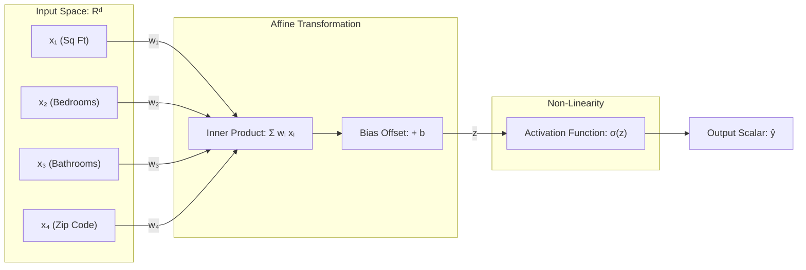
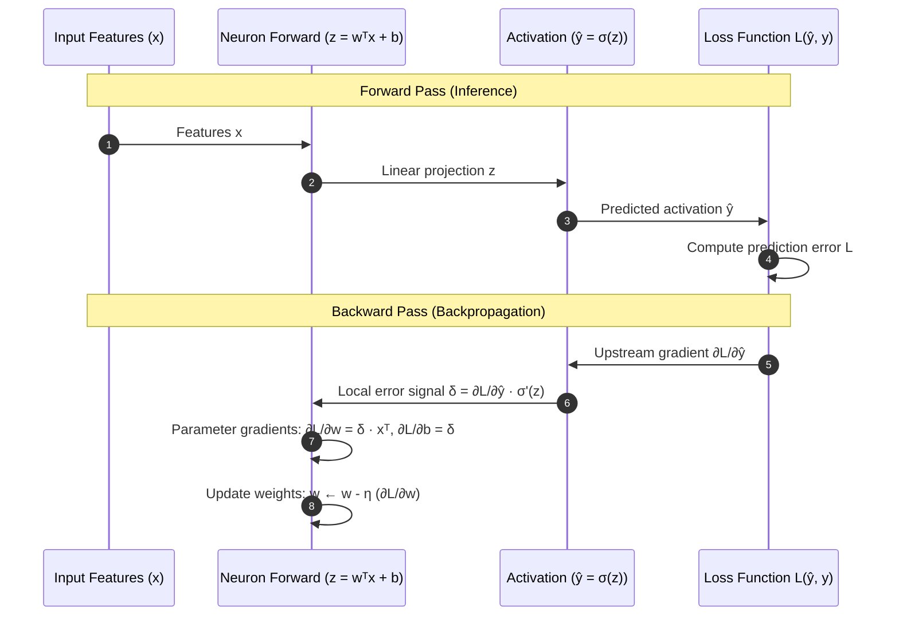
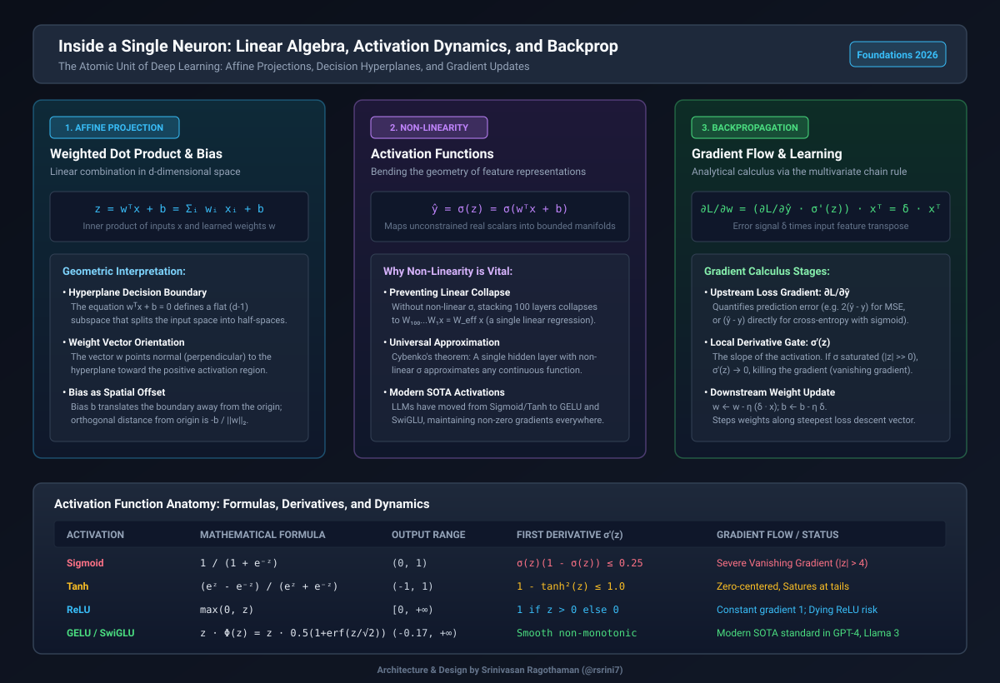
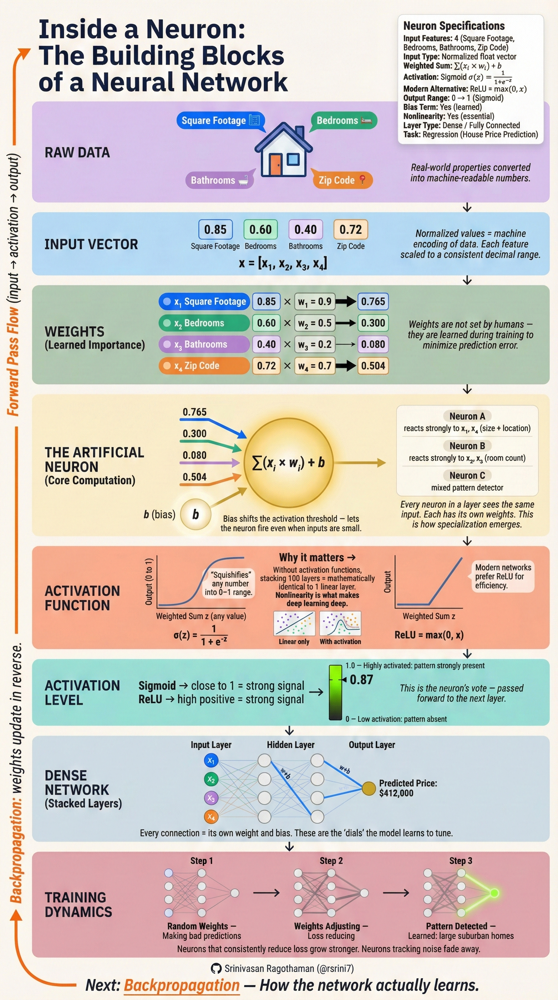

# Inside a Single Neuron: Mathematical Foundations, Activation Dynamics, and Perceptron Mechanics

Learning note · Revised November 2026 · Deep Learning Foundations  
*By Srinivasan Ragothaman ([@rsrini7](https://github.com/rsrini7))*

> At its mathematical core, an artificial neuron performs an affine projection $z = \mathbf{w}^T \mathbf{x} + b$ followed by a non-linear activation $\hat{y} = \sigma(z)$. This non-linear mapping prevents multi-layer networks from collapsing into a single trivial linear regression, enabling deep architectures to construct hierarchical feature manifolds that approximate any continuous function.

---

## 1. Foundations: The Atomic Unit of Machine Learning

Neural networks are often popularized through biological metaphors, but in software and hardware architectures, an artificial neuron is a purely deterministic numerical calculator. It accepts a vector of numerical features, scales each feature by a learned parameter, shifts the aggregated sum, and maps the scalar result through a non-linear activation function.

To ground the mathematical formalism, consider the canonical problem of **housing price prediction**. An individual real-estate asset cannot be passed directly into hardware as text or imagery; it must first be digitized into a standardized feature vector $\mathbf{x} \in \mathbb{R}^d$:

$$\mathbf{x} = \begin{bmatrix} x_1 \\ x_2 \\ x_3 \\ x_4 \end{bmatrix} = \begin{bmatrix} \text{Square Footage (Normalized)} \\ \text{Bedrooms (Normalized)} \\ \text{Bathrooms (Normalized)} \\ \text{Zip Code Quality Index} \end{bmatrix} = \begin{bmatrix} 0.85 \\ 0.60 \\ 0.40 \\ 0.72 \end{bmatrix}$$

Each feature $x_i$ is normalized (typically centered to $\mu = 0, \sigma = 1$ via Z-score normalization or bounded to $[0, 1]$ via min-max scaling) to prevent large numerical features from overwhelming gradient descent.

| Component | Mathematical Symbol | Role in Computation | Concrete Value in Housing Example |
| :--- | :--- | :--- | :--- |
| **Input Vector** | $\mathbf{x} \in \mathbb{R}^d$ | Quantized features representing the observation | $[0.85, 0.60, 0.40, 0.72]^T$ |
| **Weight Vector** | $\mathbf{w} \in \mathbb{R}^d$ | Learned sensitivity / importance of each feature | $[0.90, 0.50, 0.20, 0.70]^T$ |
| **Bias Term** | $b \in \mathbb{R}$ | Learnable base offset / firing threshold | $-0.35$ |
| **Affine Output** | $z \in \mathbb{R}$ | Unconstrained scalar pre-activation value | $z = \mathbf{w}^T \mathbf{x} + b = 1.299$ |
| **Activation** | $\sigma(z) \in \mathbb{R}$ | Non-linear manifold compression | $\hat{y} = \sigma(1.299) = 0.785$ |

---

## 2. Deep Technical Mechanism: Affine Projections, Geometry, and Non-Linearity

The computation inside a single artificial neuron proceeds in two strictly decoupled phases: the **affine transformation** and the **non-linear activation**.



### 2.1 The Affine Transformation and Hyperplane Geometry

The first step computes the dot product of the input vector $\mathbf{x}$ and the learned weight vector $\mathbf{w}$, offset by a scalar bias $b$:

$$z = \mathbf{w}^T \mathbf{x} + b = \sum_{i=1}^d w_i x_i + b$$

Geometrically, this equation defines a $(d-1)$-dimensional **hyperplane decision boundary** within the $d$-dimensional input feature space:

$$\mathbf{w}^T \mathbf{x} + b = 0$$

- **Normal Vector:** The weight vector $\mathbf{w}$ is perpendicular (normal) to the decision hyperplane. It points in the direction of maximum positive activation.
- **Orthogonal Distance:** The scalar bias $b$ controls the perpendicular distance of the hyperplane from the coordinate origin. The exact signed Euclidean distance from the origin to the decision boundary is:

$$\text{Distance} = \frac{-b}{\|\mathbf{w}\|_2}$$

Without the bias term ($b = 0$), the decision boundary is constrained to pass directly through the origin, severely limiting the hypothesis class of patterns the neuron can distinguish.

### 2.2 Why Non-Linearity Prevents Linear Collapse

If an artificial neuron executed only the affine transformation $z = \mathbf{w}^T \mathbf{x} + b$, stacking multiple layers of neurons would produce zero additional computational expressivity. 

Consider a two-layer linear network where Layer 1 computes $\mathbf{h} = W_1 \mathbf{x} + \mathbf{b}_1$ and Layer 2 computes $\mathbf{y} = W_2 \mathbf{h} + \mathbf{b}_2$. Expanding the composition:

$$\mathbf{y} = W_2 (W_1 \mathbf{x} + \mathbf{b}_1) + \mathbf{b}_2 = (W_2 W_1) \mathbf{x} + (W_2 \mathbf{b}_1 + \mathbf{b}_2)$$

Let $W_{\text{eff}} = W_2 W_1$ and $\mathbf{b}_{\text{eff}} = W_2 \mathbf{b}_1 + \mathbf{b}_2$. The two-layer network simplifies to:

$$\mathbf{y} = W_{\text{eff}} \mathbf{x} + \mathbf{b}_{\text{eff}}$$

No matter how many millions of linear layers are stacked, the composition of linear maps remains strictly linear. The network can only model flat hyperplanes and linear regressions. Introducing a non-linear activation function $\sigma(\cdot)$ between layers bends the coordinate space, enabling the network to fold and warp feature manifolds to separate non-linearly separable data (such as the XOR problem).

### 2.3 The Evolution of Activation Functions

| Activation Function | Formula | Range | Derivative $\sigma'(z)$ | Saturation & Gradient Behavior |
| :--- | :--- | :--- | :--- | :--- |
| **Sigmoid** | $\sigma(z) = \frac{1}{1 + e^{-z}}$ | $(0, 1)$ | $\sigma(z)(1 - \sigma(z)) \le 0.25$ | Severe vanishing gradients when $|z| > 4$; non-zero-centered outputs slow convergence. |
| **Tanh** | $\tanh(z) = \frac{e^z - e^{-z}}{e^z + e^{-z}}$ | $(-1, 1)$ | $1 - \tanh^2(z) \le 1.0$ | Zero-centered, but still saturates and vanishes at extreme tails. |
| **ReLU** | $\max(0, z)$ | $[0, +\infty)$ | $1 \text{ if } z > 0 \text{ else } 0$ | Solves vanishing gradient for positive values; prone to "Dying ReLU" when neurons deactivate permanently. |
| **GELU** | $z \cdot \Phi(z) = z \cdot \frac{1}{2}\left[1 + \text{erf}\left(\frac{z}{\sqrt{2}}\right)\right]$ | $[-0.17, +\infty)$ | Smooth, non-monotonic curve | Probabilistic gating; dominant standard across modern LLMs (GPT-4, Llama 3, Claude). |
| **SwiGLU** | $\text{Swish}(x W) \odot (x V)$ | $(-\infty, +\infty)$ | Smooth gating | Bilinear multiplicative interaction; delivers superior sample efficiency in frontier Transformer MLPs. |

---

## 3. Backpropagation and the Calculus of Learning

Training a neuron does not involve heuristic guessing; it relies on exact multivariate calculus via the **chain rule**.



### 3.1 Derivation of the Gradient Chain Rule

Given a scalar loss function $\mathcal{L}(\hat{y}, y)$ (such as Mean Squared Error $\mathcal{L} = \frac{1}{2}(\hat{y} - y)^2$), the objective is to compute the exact partial derivatives with respect to each weight $w_i$ and the bias $b$:

$$\frac{\partial \mathcal{L}}{\partial w_i} = \frac{\partial \mathcal{L}}{\partial \hat{y}} \cdot \frac{\partial \hat{y}}{\partial z} \cdot \frac{\partial z}{\partial w_i}$$

Breaking this into its three constituent partial derivatives:
1. **Upstream Loss Gradient:** $\frac{\partial \mathcal{L}}{\partial \hat{y}} = (\hat{y} - y)$
2. **Local Activation Derivative:** $\frac{\partial \hat{y}}{\partial z} = \sigma'(z)$
3. **Local Affine Derivative:** $\frac{\partial z}{\partial w_i} = \frac{\partial}{\partial w_i} \left( \sum_{j} w_j x_j + b \right) = x_i$

Combining terms yields the fundamental error signal $\delta$:

$$\delta = \frac{\partial \mathcal{L}}{\partial z} = \frac{\partial \mathcal{L}}{\partial \hat{y}} \cdot \sigma'(z) = (\hat{y} - y) \cdot \sigma'(z)$$

The gradients with respect to the parameters evaluate to:

$$\frac{\partial \mathcal{L}}{\partial \mathbf{w}} = \delta \cdot \mathbf{x}^T \in \mathbb{R}^d, \qquad \frac{\partial \mathcal{L}}{\partial b} = \delta \in \mathbb{R}$$

During optimization with Stochastic Gradient Descent (SGD) and learning rate $\eta$:

$$\mathbf{w}^{(t+1)} = \mathbf{w}^{(t)} - \eta \frac{\partial \mathcal{L}}{\partial \mathbf{w}}, \qquad b^{(t+1)} = b^{(t)} - \eta \frac{\partial \mathcal{L}}{\partial b}$$

---

## 4. Architectural Visuals: The Perceptron Pipeline

The following custom dark-theme architecture diagram illustrates the end-to-end forward and backward computation pipelines within a single neuron:



---

## 5. Production Implementations & Code Recipes

The following runnable Python implementations demonstrate the forward pass and analytical backward pass of an artificial neuron and dense layer from scratch using NumPy, followed by verification against PyTorch autograd.

### 5.1 From-Scratch NumPy Implementation of a Perceptron Layer

```python
"""
Pure NumPy implementation of a single neuron and vectorized dense layer.
Demonstrates analytical forward and backward passes without third-party frameworks.
"""
import numpy as np

class DenseNeuron:
    def __init__(self, input_dim: int, activation: str = "gelu"):
        self.input_dim = input_dim
        self.activation_type = activation
        
        # He / Kaiming Normal initialization
        limit = np.sqrt(2.0 / input_dim)
        self.weights = np.random.randn(input_dim) * limit
        self.bias = 0.0
        
        # State cache for backprop
        self.last_x = None
        self.last_z = None
        self.last_y_hat = None

    def _gelu(self, z: np.ndarray) -> np.ndarray:
        return 0.5 * z * (1.0 + np.tanh(np.sqrt(2.0 / np.pi) * (z + 0.044715 * np.power(z, 3))))

    def _gelu_grad(self, z: np.ndarray) -> np.ndarray:
        # Derivative of GELU tanh approximation
        k = np.sqrt(2.0 / np.pi)
        poly = z + 0.044715 * np.power(z, 3)
        tanh_term = np.tanh(k * poly)
        sech2_term = 1.0 - np.power(tanh_term, 2)
        d_poly = 1.0 + 3.0 * 0.044715 * np.power(z, 2)
        return 0.5 * (1.0 + tanh_term) + 0.5 * z * sech2_term * k * d_poly

    def forward(self, x: np.ndarray) -> float:
        """
        x: 1D array of shape [input_dim]
        returns scalar prediction y_hat
        """
        self.last_x = x
        self.last_z = float(np.dot(self.weights, x) + self.bias)
        
        if self.activation_type == "gelu":
            self.last_y_hat = float(self._gelu(np.array(self.last_z)))
        elif self.activation_type == "sigmoid":
            self.last_y_hat = 1.0 / (1.0 + np.exp(-self.last_z))
        elif self.activation_type == "relu":
            self.last_y_hat = max(0.0, self.last_z)
        else:
            self.last_y_hat = self.last_z
            
        return self.last_y_hat

    def backward(self, target: float, lr: float = 0.01) -> float:
        """
        Computes analytical gradients and applies SGD update.
        Loss = 0.5 * (y_hat - target)^2
        """
        # 1. dL / dy_hat
        grad_loss = self.last_y_hat - target
        
        # 2. Local activation gradient dy_hat / dz
        if self.activation_type == "gelu":
            grad_act = float(self._gelu_grad(np.array(self.last_z)))
        elif self.activation_type == "sigmoid":
            grad_act = self.last_y_hat * (1.0 - self.last_y_hat)
        elif self.activation_type == "relu":
            grad_act = 1.0 if self.last_z > 0.0 else 0.0
        else:
            grad_act = 1.0
            
        # 3. Error signal delta
        delta = grad_loss * grad_act
        
        # 4. Parameter gradients
        grad_w = delta * self.last_x
        grad_b = delta
        
        # 5. Gradient descent step
        self.weights -= lr * grad_w
        self.bias -= lr * grad_b
        
        return 0.5 * (self.last_y_hat - target) ** 2
```

### 5.2 Verification via PyTorch Autograd

```python
"""
Verifies numerical equivalence between manual NumPy calculus
and PyTorch automatic differentiation engine.
"""
import torch
import torch.nn as nn

def verify_neuron_gradient_parity():
    x_input = [0.85, 0.60, 0.40, 0.72]
    w_init = [0.90, 0.50, 0.20, 0.70]
    b_init = -0.35
    target = 1.0
    
    # --- PyTorch Computation ---
    x_torch = torch.tensor(x_input, dtype=torch.float32)
    w_torch = torch.tensor(w_init, dtype=torch.float32, requires_grad=True)
    b_torch = torch.tensor(b_init, dtype=torch.float32, requires_grad=True)
    
    z_torch = torch.dot(w_torch, x_torch) + b_torch
    y_hat_torch = torch.sigmoid(z_torch)
    loss_torch = 0.5 * (y_hat_torch - target) ** 2
    loss_torch.backward()
    
    # --- Analytical NumPy Computation ---
    z_np = sum(w * x for w, x in zip(w_init, x_input)) + b_init
    y_hat_np = 1.0 / (1.0 + np.exp(-z_np))
    delta_np = (y_hat_np - target) * (y_hat_np * (1.0 - y_hat_np))
    grad_w_np = [delta_np * x for x in x_input]
    grad_b_np = delta_np
    
    # Assert parity to 1e-6 precision
    np.testing.assert_allclose(w_torch.grad.numpy(), grad_w_np, rtol=1e-5)
    np.testing.assert_allclose(float(b_torch.grad), grad_b_np, rtol=1e-5)
    print("Verification Passed: Manual analytical calculus matches PyTorch autograd.")

if __name__ == "__main__":
    verify_neuron_gradient_parity()
```

---

## 6. Common Claims vs. Technical Realities

| Common Claim | Technical Reality | Engineering Implications |
| :--- | :--- | :--- |
| **"Artificial neurons simulate biological human brain neurons."** | Biological neurons communicate via continuous electrochemical spike trains (action potentials) with complex temporal dynamics. Artificial neurons compute discrete matrix multiplications and scalar non-linearities. | Designing models based on biological analogies often leads to suboptimal hardware execution; tensor core GEMM efficiency governs modern AI architecture. |
| **"More layers always yield superior representation power."** | Deeper networks without residual connections or normalization (RMSNorm / LayerNorm) suffer from gradient vanishing or explosion, stalling training entirely. | Depth requires architectural stabilizers (residual skips, pre-layer normalization, and non-saturating activations like GELU). |
| **"AI is a black box whose individual decisions cannot be audited."** | A single neuron's computation is fully transparent: $\mathbf{w}^T \mathbf{x} + b$. Feature attribution can be precisely evaluated via gradient sensitivity analysis ($\partial \hat{y} / \partial x_i = w_i \cdot \sigma'(z)$). | Opacity arises from the sheer scale of billions of interconnected parameters (polysemanticity), not from mystical mechanics in individual neurons. |

---

## 7. Practical Adoption Blueprint & Verification Checklist

When constructing or debugging dense neural layers, practitioners should enforce the following verification criteria:

### 7.1 Weight Initialization Selection

- **Kaiming / He Initialization (for ReLU / LeakyReLU / GELU):** Preserves activation variance across forward layers, preventing signal collapse in deep networks:

$$w_i \sim \mathcal{N}\left(0, \sqrt{\frac{2}{d_{\text{in}}}}\right)$$

- **Xavier / Glorot Initialization (for Sigmoid / Tanh):** Keeps inputs within the linear region of saturating functions, preventing immediate gradient death:

$$w_i \sim \mathcal{U}\left(-\sqrt{\frac{6}{d_{\text{in}} + d_{\text{out}}}}, +\sqrt{\frac{6}{d_{\text{in}} + d_{\text{out}}}}\right)$$

### 7.2 Diagnostic Verification Checklist

- [ ] **Finite-Difference Numerical Gradient Check:** When implementing custom CUDA or C++ activation kernels, verify that analytical gradients match finite differences within a relative error tolerance $< 10^{-5}$:

$$\frac{\partial \mathcal{L}}{\partial w_i} \approx \frac{\mathcal{L}(w_i + \epsilon) - \mathcal{L}(w_i - \epsilon)}{2\epsilon}, \qquad \epsilon = 10^{-7}$$

- [ ] **Dead Neuron Monitoring:** Track the fraction of neurons in a layer whose outputs evaluate to exactly $0.0$ across an entire evaluation batch. A dead neuron ratio $> 20\%$ in ReLU networks indicates an excessively large learning rate, necessitating a switch to LeakyReLU or GELU.
- [ ] **Activation Saturation Tracking:** Monitor the distribution of pre-activations $z$. If $|z| > 5.0$ in Sigmoid/Tanh layers, gradients evaluate to $< 0.006$, causing catastrophic training stalls.

---

## 8. Primary Sources & References

### Foundational Literature
1. [A Logical Calculus of the Ideas Immanent in Nervous Activity](https://doi.org/10.1007/BF02478259) — McCulloch & Pitts (1943). The seminal mathematical formulation of the artificial binary threshold neuron.
2. [The Perceptron: A Probabilistic Model for Information Storage and Organization in the Brain](https://doi.org/10.1037/h0042519) — Rosenblatt (1958). Introduced learned synaptic weights and iterative error correction.
3. [Learning Representations by Back-Propagating Errors](https://doi.org/10.1038/323533a0) — Rumelhart, Hinton, & Williams (Nature 1986). Derived the generalized multivariate chain rule for multi-layer neural networks.
4. [Approximation by Superpositions of a Sigmoidal Function](https://doi.org/10.1007/BF02551274) — Cybenko (1989). Established the Universal Approximation Theorem proving non-linear single hidden layer networks can approximate any continuous function.

### Modern Activation Research
5. [Gaussian Error Linear Units (GELUs)](https://arxiv.org/abs/1606.08415) — Hendrycks & Gimpel (2016). Formulated the probabilistic gating activation adopted as standard across modern LLMs.
6. [GLU Variants Improve Transformer](https://arxiv.org/abs/2002.05202) — Shazeer (Google 2020). Demonstrated that bilinear gated activation units (SwiGLU) significantly enhance feed-forward capacity in transformers.

---

## 9. Supplementary visuals

The following visual documentation preserves the conceptual housing price prediction example used to trace single-neuron forward propagation:



*Figure 1: Pedagogical walkthrough tracing input vector normalization, synaptic weight multiplication, bias offset shifting, and non-linear activation scaling for a single real-estate price prediction neuron.*

---

**Related:**
- [microGPT-Architecture-Complete](../architecture/microGPT-Architecture-Complete.md) — Demonstrates how individual perceptron neurons assemble into multi-layer perceptron (MLP) blocks and feed-forward networks within Transformer models.
- [microGPT-Architecture-Diagram-Explanation](../architecture/microGPT-Architecture-Diagram-Explanation.md) — Explains the layer-by-layer tensor transitions and normalization steps governing deep neural networks.
- [Glossary](../reference/Glossary.md) — Comprehensive technical definitions of activation functions, backpropagation calculus, and loss functions.
- [Beyond-SoftMax-Attention](Beyond-SoftMax-Attention.md) — Explores how linear and recurrent models replace quadratic attention lookups with associative neural memory matrices.
- [Auto-Regression](../training/Auto-Regression.md) — Traces how trained neural networks generate sequence tokens autoregressively during inference.
