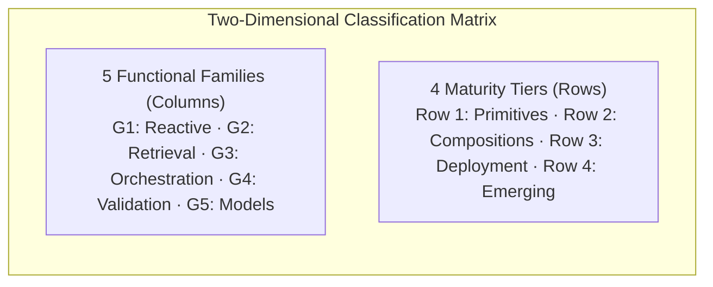
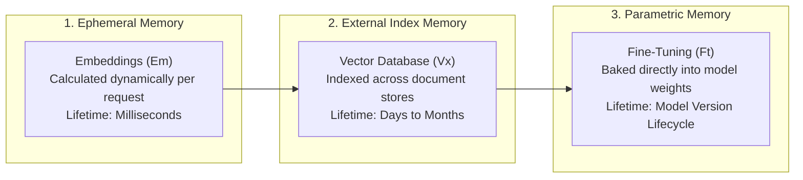
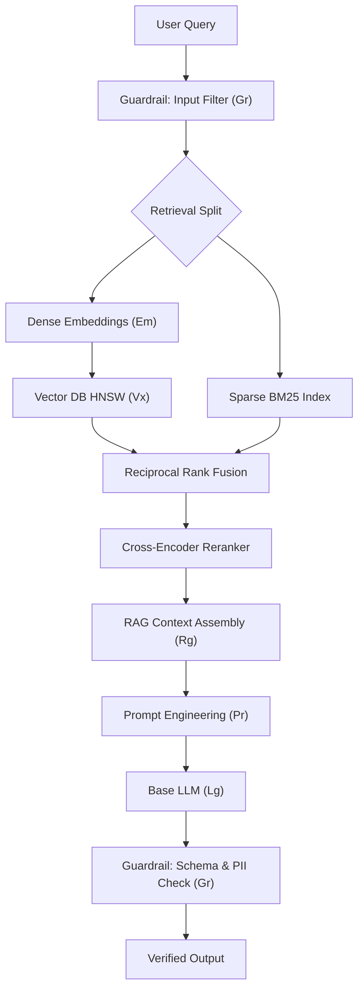
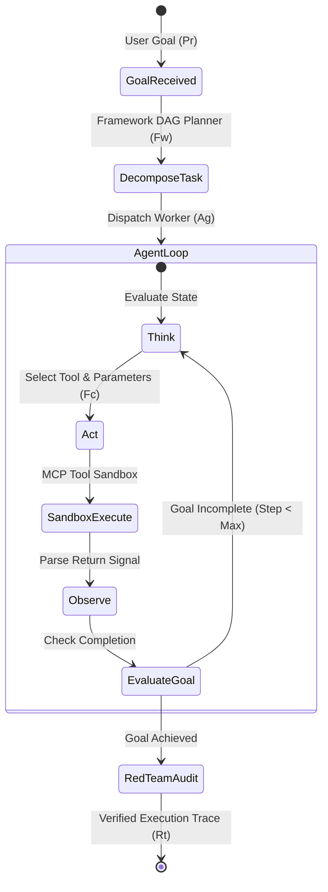
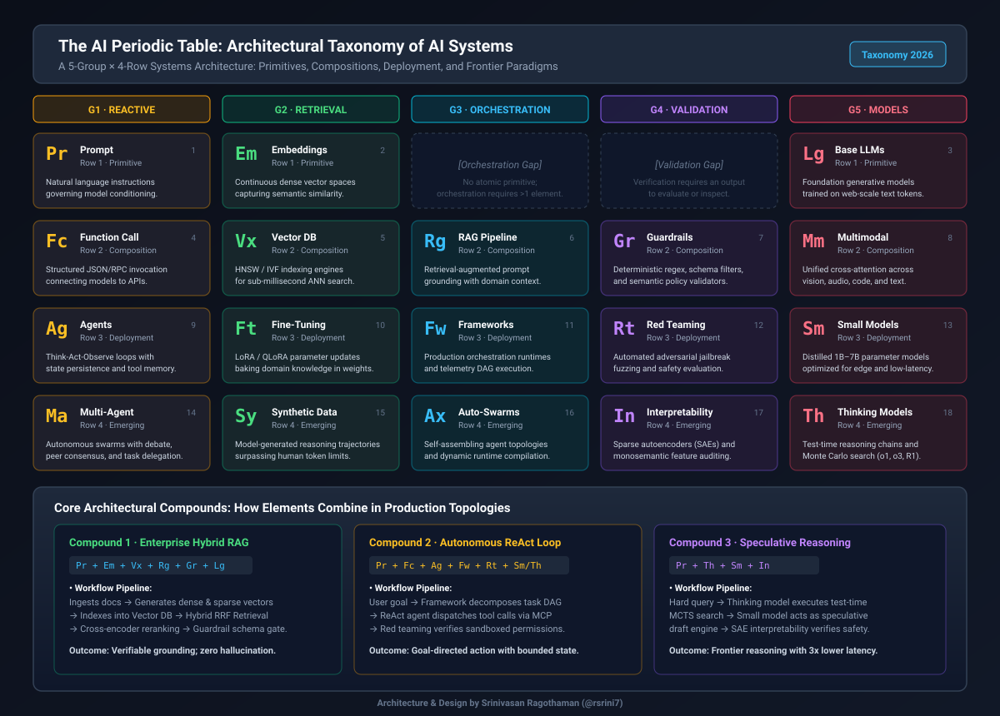
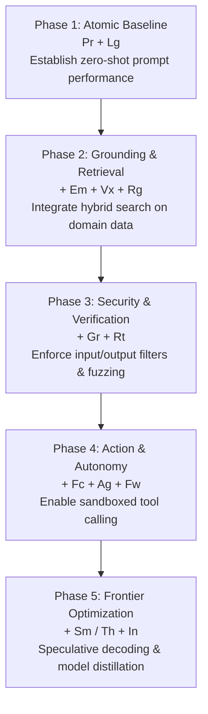
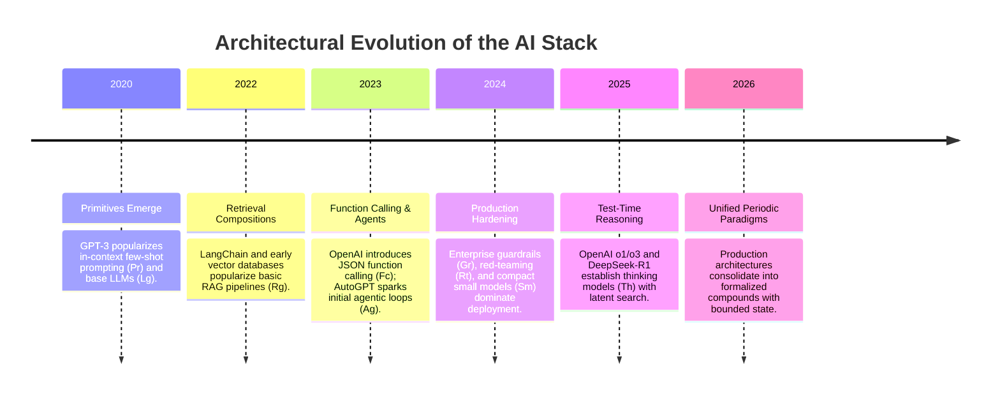
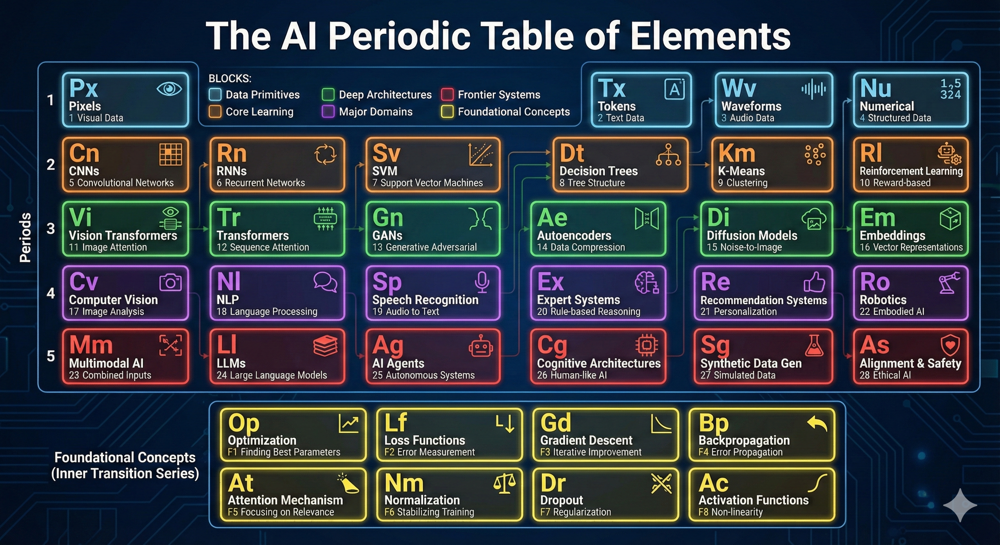
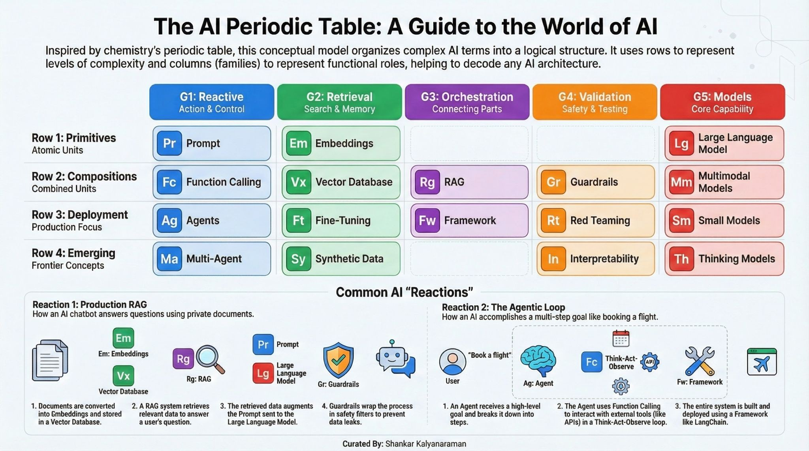

# The AI Periodic Table: Architectural Taxonomy of Primitives, Compositions, and Production Topologies

Learning note · Revised November 2026 · Systems Architecture & Taxonomy  
*By Srinivasan Ragothaman ([@rsrini7](https://github.com/rsrini7))*

> The AI Periodic Table organizes generative AI engineering components into a structured matrix of five functional families (Reactive, Retrieval, Orchestration, Validation, Models) across four operational maturity tiers (Primitives, Compositions, Deployment, Emerging). This classification transforms fragmented AI tooling into predictable architectural compounds—such as hybrid RAG pipelines, autonomous ReAct loops, and speculative reasoning chains—with clear operational boundaries and failure modes.

---

## 1. Foundations: The Two-Dimensional AI Taxonomy

Modern AI application development often appears fragmented across disparate tools: prompts, embeddings, vector databases, guardrails, multi-agent frameworks, fine-tuning, and reasoning models. Inspired by the chemical periodic table, the **AI Periodic Table** organizes these components along two orthogonal axes: **Functional Families** (what an element does) and **Maturity / Lifecycle Tiers** (how atomic or composed an element is).



### 1.1 The Five Functional Families (Columns)

- **G1 · Reactive (Action & Autonomy):** Components that execute instructions or drive behavior. Progression follows a strict gradient of increasing autonomy: direct control (Prompt) $\to$ deterministic tool binding (Function Calling) $\to$ closed-loop autonomy (Agent) $\to$ collective decentralized consensus (Multi-Agent).
- **G2 · Retrieval (Memory & State):** Components that encode, index, store, and adapt organizational knowledge across three distinct temporal scales: ephemeral session embeddings, persistent external indices (Vector DBs), and permanent parametric weights (Fine-Tuning).
- **G3 · Orchestration (Workflow & Glue):** Structural components that coordinate interactions across elements. Crucially, **Orchestration has no atomic primitive in Row 1**; coordination only exists once two or more distinct components are combined.
- **G4 · Validation (Safety & Trust):** Deterministic and semantic verification layers ensuring robustness, regulatory alignment, and policy adherence. Like orchestration, validation requires an existing artifact or output to inspect, making it inherently composite.
- **G5 · Models (Compute & Intelligence):** Core machine learning backbones, spanning dense general-purpose LLMs, cross-modal encoders, compact edge models, and test-time reasoning engines.

---

## 2. Deep Technical Taxonomy of Elements

| Element | Symbol | Group | Maturity Tier | Core Mechanism | Operational Boundary / Failure Mode |
| :--- | :--- | :--- | :--- | :--- | :--- |
| **Prompt** | **Pr** | G1 | Row 1 (Primitive) | Natural language text conditioning the attention KV-cache of base models. | Non-deterministic; minor phrasing shifts cause severe semantic variance. |
| **Embeddings** | **Em** | G2 | Row 1 (Primitive) | Dense vector projections $\vec{v} \in \mathbb{R}^d$ mapping semantic similarity to cosine distance. | Anisotropic collapse; cannot capture complex multi-hop logical relationships. |
| **Base LLMs** | **Lg** | G5 | Row 1 (Primitive) | Auto-regressive next-token predictors trained on web-scale text tokens. | Static knowledge cutoff; high hallucination risk on private domain facts. |
| **Function Call** | **Fc** | G2 | Row 2 (Composition) | Constrained decoding enforcing JSON Schema / OpenAPI specs for external tools. | Schema hallucination; tool argument type mismatches during schema drift. |
| **Vector DB** | **Vx** | G2 | Row 2 (Composition) | High-dimensional Approximate Nearest Neighbor (ANN) index (HNSW, IVF-PQ). | Precision-recall trade-off; stale indices during high-throughput updates. |
| **RAG Pipeline** | **Rg** | G3 | Row 2 (Composition) | External context retrieval injected into system prompts before generation. | Context stuffing; retrieval noise causing attention distraction in LLMs. |
| **Guardrails** | **Gr** | G4 | Row 2 (Composition) | Pre- and post-generation regex filters, Pydantic schemas, and toxicity gates. | Latency overhead (50–200 ms); false positives blocking benign edge queries. |
| **Multimodal** | **Mm** | G5 | Row 2 (Composition) | Cross-attention projection of image/audio tokens into shared latent space. | High token counts; spatial hallucination on fine-grained visual details. |
| **Agents** | **Ag** | G1 | Row 3 (Deployment) | Autonomous ReAct loops (Think $\to$ Act $\to$ Observe) with tool sandboxes. | Infinite execution loops; compounding error drift in multi-step trajectories. |
| **Fine-Tuning** | **Ft** | G2 | Row 3 (Deployment) | Parameter updates (LoRA, QLoRA, full weights) baking style or domain facts. | Catastrophic forgetting; high compute and data curation costs. |
| **Frameworks** | **Fw** | G3 | Row 3 (Deployment) | Production execution engines managing state persistence, retries, and traces. | Framework lock-in; abstraction bloat hiding network and memory latency. |
| **Red Teaming** | **Rt** | G4 | Row 3 (Deployment) | Automated adversarial fuzzing to discover prompt injections and jailbreaks. | Static test sets failing to predict novel zero-day prompt injection vectors. |
| **Small Models** | **Sm** | G5 | Row 3 (Deployment) | Distilled 1B–7B parameter models optimized for low latency and edge inference. | Reduced reasoning depth; struggles on multi-step reasoning without prompting. |
| **Multi-Agent** | **Ma** | G1 | Row 4 (Emerging) | Autonomous swarms with role specialization, peer debate, and voting consensus. | Message storm cascades; quadratic token consumption across agent turns. |
| **Synthetic Data**| **Sy** | G2 | Row 4 (Emerging) | Model-generated reasoning traces and data used to train downstream models. | Model collapse if training on uncurated, repetitive synthetic distributions. |
| **Auto-Swarms** | **Ax** | G3 | Row 4 (Emerging) | Self-assembling agent DAGs dynamically compiling execution graphs at runtime. | Non-deterministic topology generation; extremely difficult to formally verify. |
| **Interpretability**| **In**| G4 | Row 4 (Emerging) | Sparse Autoencoders (SAEs) identifying monosemantic feature circuits. | High dimensional overhead; feature attribution incomplete in 100B+ models. |
| **Thinking Models**| **Th**| G5 | Row 4 (Emerging) | Test-time reasoning architectures using hidden chain-of-thought or MCTS (o1/R1). | High time-to-first-token (TTFT); token bloat on simple, deterministic queries. |

### 2.1 The Three Memory Time Scales (G2 Column)

A key architectural insight revealed by the Retrieval (G2) column is that memory in AI systems exists across three fundamentally different temporal boundaries:



1. **Short-Term Semantic Encoding ($Em$):** Fast, vector representations generated per-query to compute semantic distance.
2. **Searchable External Memory ($Vx$):** Dedicated indexes that scale to billions of documents, decoupled from model weights and updated via continuous ETL.
3. **Baked-In Parametric Memory ($Ft$):** Permanent modifications to weight matrices ($W + \Delta W$) that internalize specific syntax, vocabulary, or reasoning formats.

---

## 3. Architectural Topologies: Core AI Compounds

Just as chemical elements combine into molecules with novel macroscopic properties, AI elements combine into repeatable **architectural compounds**.

### 3.1 Compound 1: Enterprise Hybrid RAG

$$\text{Compound}_{\text{RAG}} = \text{Pr} + \text{Em} + \text{Vx} + \text{Rg} + \text{Gr} + \text{Lg}$$



Enterprise RAG combines dense semantic vectors ($Em$) with an Approximate Nearest Neighbor database ($Vx$), unified through an orchestration pipeline ($Rg$). Input and output guardrails ($Gr$) enforce strict safety and schema compliance, while the base LLM ($Lg$) performs synthesis conditioned on retrieved facts.

### 3.2 Compound 2: Autonomous ReAct Execution Loop

$$\text{Compound}_{\text{Agent}} = \text{Pr} + \text{Fc} + \text{Ag} + \text{Fw} + \text{Rt} + (\text{Sm} \lor \text{Th})$$



In the autonomous agent topology, the goal is initialized via prompt instructions ($Pr$), orchestrated by a framework ($Fw$), and executed through a cyclic Think-Act-Observe loop ($Ag$). Actions are dispatched via structured function calls ($Fc$) against sandboxed APIs, while automated red-teaming checks ($Rt$) monitor trajectory logs for unauthorized privilege escalation.

---

## 4. Architectural Visuals: The Full Taxonomy & Compounds

The following custom dark-theme architecture visual illustrates the full 5-group $\times$ 4-row taxonomy and details the three core production topologies:



---

## 5. Production Implementations & Code Recipes

The following Python recipes provide production-grade implementations of the two primary architectural compounds: an Enterprise Hybrid RAG Compound and an Autonomous Bounded Agent Loop.

### 5.1 Enterprise Hybrid RAG Compound (Python)

```python
"""
Enterprise Hybrid RAG Compound: Pr + Em + Vx + Rg + Gr + Lg
Implements dense-sparse reciprocal rank fusion (RRF) with Pydantic guardrails.
"""
from dataclasses import dataclass
from typing import List, Dict, Any
import numpy as np
import re

@dataclass
class RetrievedChunk:
    chunk_id: str
    text: str
    dense_score: float
    sparse_score: float
    combined_score: float = 0.0

class HybridRAGCompound:
    def __init__(self, rrf_k: int = 60):
        self.rrf_k = rrf_k
        self.banned_patterns = [r"\bpassword\b", r"\bsecret_key\b", r"\bapi[_-]?key\b"]

    def input_guardrail(self, query: str) -> str:
        """Gr: Validates query against prompt injection and malicious keywords."""
        sanitized = query.strip()
        for pattern in self.banned_patterns:
            if re.search(pattern, sanitized, re.IGNORECASE):
                raise ValueError(f"Security Alert: Query triggered guardrail pattern: {pattern}")
        return sanitized

    def reciprocal_rank_fusion(
        self, 
        dense_results: List[RetrievedChunk], 
        sparse_results: List[RetrievedChunk]
    ) -> List[RetrievedChunk]:
        """Rg: Combines dense vector (Em + Vx) and sparse BM25 results via RRF."""
        fused_scores: Dict[str, RetrievedChunk] = {}

        # Process dense ranking
        for rank, item in enumerate(dense_results):
            if item.chunk_id not in fused_scores:
                fused_scores[item.chunk_id] = item
            fused_scores[item.chunk_id].combined_score += 1.0 / (self.rrf_k + rank + 1)

        # Process sparse ranking
        for rank, item in enumerate(sparse_results):
            if item.chunk_id not in fused_scores:
                fused_scores[item.chunk_id] = item
            fused_scores[item.chunk_id].combined_score += 1.0 / (self.rrf_k + rank + 1)

        # Sort descending by combined RRF score
        sorted_results = sorted(
            fused_scores.values(), 
            key=lambda x: x.combined_score, 
            reverse=True
        )
        return sorted_results

    def assemble_prompt(self, query: str, context_chunks: List[RetrievedChunk]) -> str:
        """Pr + Rg: Assembles grounded context into hardened system prompt."""
        context_body = "\n---\n".join([c.text for c in context_chunks[:3]])
        prompt = (
            "You are an enterprise AI assistant. Answer the user query strictly using the "
            "provided verified context. If the context is insufficient, respond 'INSUFFICIENT_DATA'.\n\n"
            f"VERIFIED CONTEXT:\n{context_body}\n\n"
            f"USER QUERY: {query}\n"
            "ANSWER:"
        )
        return prompt
```

### 5.2 Autonomous Bounded Agent Loop (Python)

```python
"""
Autonomous Bounded Agent Loop: Pr + Fc + Ag + Fw + Rt + Sm/Th
Implements a state-bounded ReAct execution loop with timeout and tool fencing.
"""
from dataclasses import dataclass, field
from enum import Enum
from typing import Callable, Dict, Any, List

class AgentState(Enum):
    INIT = "INIT"
    THINKING = "THINKING"
    CALLING_TOOL = "CALLING_TOOL"
    OBSERVING = "OBSERVING"
    SUCCESS = "SUCCESS"
    FAILED = "FAILED"

@dataclass
class ToolDefinition:
    name: str
    description: str
    handler: Callable[[Dict[str, Any]], str]

@dataclass
class AgentExecutionContext:
    goal: str
    max_steps: int = 5
    current_step: int = 0
    state: AgentState = AgentState.INIT
    trajectory: List[Dict[str, Any]] = field(default_factory=list)

class BoundedAgentLoop:
    def __init__(self, tools: Dict[str, ToolDefinition]):
        self.tools = tools

    def execute_turn(self, ctx: AgentExecutionContext) -> str:
        """Runs the ReAct loop until goal completion or max_steps fence."""
        ctx.state = AgentState.THINKING
        
        while ctx.current_step < ctx.max_steps and ctx.state not in (AgentState.SUCCESS, AgentState.FAILED):
            ctx.current_step += 1
            
            # Step 1: Think (Simulated model output)
            thought = f"Step {ctx.current_step}: Evaluating goal '{ctx.goal}'"
            tool_to_call = "query_database" if ctx.current_step == 1 else None
            
            ctx.trajectory.append({"step": ctx.current_step, "thought": thought})
            
            if not tool_to_call:
                ctx.state = AgentState.SUCCESS
                return f"Task completed successfully in {ctx.current_step} steps."

            # Step 2: Act via Function Calling (Fc)
            ctx.state = AgentState.CALLING_TOOL
            if tool_to_call not in self.tools:
                ctx.state = AgentState.FAILED
                return f"Error: Tool '{tool_to_call}' not registered in sandbox."
                
            tool = self.tools[tool_to_call]
            result = tool.handler({"query": ctx.goal})
            
            # Step 3: Observe
            ctx.state = AgentState.OBSERVING
            ctx.trajectory.append({"tool": tool_to_call, "result": result})

        if ctx.current_step >= ctx.max_steps:
            ctx.state = AgentState.FAILED
            return "Failure: Max steps exceeded without achieving goal."
            
        return "Complete"
```

---

## 6. Common Claims vs. Technical Realities

| Common Claim | Technical Reality | Systems Engineering Implication |
| :--- | :--- | :--- |
| **"RAG replaces the need for Fine-Tuning completely."** | RAG provides dynamic external factual retrieval ($Vx$), but cannot teach a model new syntax, specialized output formats, or complex latent reasoning paths ($Ft$). | Use RAG for volatile, frequently changing facts; use Fine-Tuning for formatting, domain style, and reducing prompt token overhead. |
| **"Multi-Agent systems are inherently smarter than single agents."** | Adding agents introduces message cascades, consensus voting overhead, and quadratic token costs. Without strict routing, multi-agent swarms amplify hallucination drift. | Deploy single agents with specialized function calling for 90% of tasks; restrict multi-agent architectures to independent parallel work (e.g. peer code reviews). |
| **"Vector databases alone solve enterprise search."** | Pure dense vector search fails on exact keyword lookups (e.g. part numbers, SKU codes, employee IDs) due to embedding compression. | Production enterprise search requires **Hybrid Retrieval** (dense vector search + sparse BM25/keyword indices fused via Reciprocal Rank Fusion). |
| **"Guardrails eliminate all security vulnerabilities."** | Guardrails operate as heuristic filters or auxiliary classifier checks; sophisticated adversarial attacks (multilingual evasion, token smuggling) can bypass them. | Guardrails must be layered with deterministic identity management, RBAC, and containerized execution boundaries. |

---

## 7. Practical Adoption Blueprint & Verification Checklist

To structure an AI initiative using the AI Periodic Table, engineering teams should follow this sequential deployment pipeline:



### 7.1 Verification Checklist

- [ ] **Primitive Sizing:** Have you established whether a prompt change ($Pr$) can solve the problem before engineering complex retrieval or agent loops?
- [ ] **Retrieval Latency Budget:** Does your Vector DB ($Vx$) index query latency remain $< 15\text{ ms}$ at $p99$ across $1\text{M}+$ vectors?
- [ ] **Guardrail Overhead:** Are input and output guardrails ($Gr$) executing in $< 80\text{ ms}$ to avoid degrading streaming Time-To-First-Token (TTFT)?
- [ ] **Agent Step Fencing:** Does your agentic framework ($Fw$) enforce hard boundaries on maximum steps ($N \le 10$), execution wall-clock time, and tool invocation budgets?
- [ ] **RAG Triad Metrics:** Are you continuously evaluating Context Relevance, Groundedness (Faithfulness), and Answer Relevance using automated evaluation harnesses?

---

## 8. Timeline and Evolution of the Modern AI Stack



---

## 9. Primary Sources & References

### Foundational Frameworks & Architectural Disclosures
1. [Shankar Kalyanraman: The AI Periodic Table Framework](https://www.linkedin.com/posts/shankar-kalyanraman-416a50b_aiperiodictable-ai-rag-activity-7415050184369295360-6SYH) — Foundational framework post mapping generative AI primitives, compositions, and production patterns into a periodic classification.
2. [IBM Technology: Inside the AI Tech Stack & Periodic Architecture](https://www.youtube.com/watch?v=ESBMgZHzfG0) — Video architectural deep dive examining how reactive tools, vector retrieval, and orchestration layers assemble into production enterprise compounds.
3. [StartupHub AI: The AI Periodic Table — Mapping LLMs to Core Elements](https://www.startuphub.ai/ai-news/ai-video/2026/the-ai-periodic-table-mapping-llms-to-core-elements/) — Comparative analysis categorizing LLM primitives, guardrails, and agentic deployment topologies.
4. [IBM Redbooks: Enterprise Generative AI Architecture Patterns](https://www.redbooks.ibm.com/redpapers/pdfs/redp5556.pdf) — Reference architecture defining vector search pipelines, inference caching, and model governance frameworks.

### Foundational Papers & Specifications
5. [Retrieval-Augmented Generation for Knowledge-Intensive NLP Tasks](https://arxiv.org/abs/2005.11401) — Lewis et al. (NeurIPS 2020). Introduced the formal RAG architecture combining non-parametric vector retrieval with parametric generators.
6. [Language Models are Few-Shot Learners](https://arxiv.org/abs/2005.14165) — Brown et al. (NeurIPS 2020). Formalized the Prompt ($Pr$) primitive and in-context conditioning in web-scale foundation models.
7. [ReAct: Synergizing Reasoning and Acting in Language Models](https://arxiv.org/abs/2210.03629) — Yao et al. (ICLR 2023). Established the Think-Act-Observe loop powering the Agent ($Ag$) deployment tier.
8. [Efficient and Robust Approximate Nearest Neighbor Search Using HNSW Graphs](https://arxiv.org/abs/1603.09320) — Malkov & Yashunin (IEEE TPAMI 2018). Established the core indexing algorithm powering the Vector DB ($Vx$) element.
9. [DeepSeek-R1: Incentivizing Reasoning Capability in LLMs via Reinforcement Learning](https://arxiv.org/abs/2501.12948) — DeepSeek-AI (2025). Formulated open-weights test-time reasoning and latent search for Thinking Models ($Th$).

---

## 10. Supplementary visuals

The following visual documentation preserves the foundational taxonomy diagrams illustrating the progression of AI primitives into composable architectural stacks:



*Figure 1: Conceptual mapping arranging AI elements by functional families (Reactive, Retrieval, Orchestration, Validation, Models) and maturity lifecycle rows.*



*Figure 2: Architectural framework diagram illustrating the interaction between retrieval indices, agentic frameworks, and guardrail validation layers.*

---

**Related:**
- [Autonomous-AI-Agents](../../Agents/analysis/Autonomous-AI-Agents.md) — Analyzes the operational governance, energy consumption, and cybersecurity trade-offs of the Agent ($Ag$) and Multi-Agent ($Ma$) elements.
- [RAG-Guide-Jan-2026](../../RAG/RAG-Guide-Jan-2026.md) — Comprehensive implementation guide for the enterprise RAG compound ($Pr + Em + Vx + Rg + Gr + Lg$).
- [Persistent-Memory-Layers-AI-Agents](../architecture/Persistent-Memory-Layers-AI-Agents.md) — Details the architectural implementation of long-term and external agent memory layers.
- [Latent-Thinkers](../training/Latent-Thinkers.md) — Deep technical review of the Thinking Models ($Th$) element and test-time reasoning trajectories.
- [Beyond-SoftMax-Attention](../attention/Beyond-SoftMax-Attention.md) — Explores how linear attention and recurrent neural memories optimize the base model ($Lg$) compute layer.
