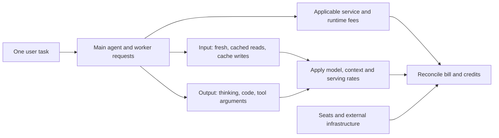

# The AI Coding Invoice: Beyond Input and Output

**Validated October 17, 2026.** Open a presentation with: **“You typed one prompt. What else did the agent send, generate, repeat, store, or execute?”**

An agent’s bill reflects a workflow, not just the question and visible answer. Many “hidden costs” are ordinary input/output tokens generated by the harness; only some are additional fees. The table below is an explanatory ledger, not a claim that every invoice exposes these rows separately.

## 1. What actually gets metered?

| Component | How it reaches the bill | Easy misconception |
|---|---|---|
| Your prompt and attached code | Input tokens | Only the words you typed count |
| System/developer instructions, repo rules, tool schemas, skill content | Input when included; repeated eligible prefixes may be cached | Everything is loaded fully, every time—modern harnesses defer some content |
| Conversation history, file reads, logs, search results | Input on later requests; cached or uncached depending on reuse | A tool result is paid for only when first fetched |
| Cache reads | Discounted input category, still billed | Cached means free or removed from context |
| Cache writes / rebuilds | A distinct rate where the model/provider charges for writing | Add both full uncached input and the entire write rate to the same tokens |
| Reasoning / thinking | Billed output, even when not shown | Add thinking again to output totals that already include it |
| Visible answer, generated code, tool-call arguments | Output tokens | Only the final prose/code reply is output |
| Subagents, reviewers, retries, compaction, suggestions, heartbeats | Additional model requests using those same token categories | Each is a universal separate per-action fee |
| Provider-hosted search, execution, retrieval/storage | May add call, runtime, container, or storage charges alongside tokens | Every local shell/MCP call has an API execution fee |
| Screenshots, PDFs, images, audio | Modality-specific tokenization/rates or service pricing | A small-looking attachment is necessarily cheap |
| Long-context tiers, Fast/priority, regional routes | Change applicable rates; Batch/Flex may discount eligible work | The headline model rate applies to every route and prompt size |
| Seats/credits, Actions, external tools and infrastructure | Product bill or another supplier’s bill | API-equivalent session dollars equal the subscription invoice |

Sources: [reasoning accounting](https://developers.openai.com/api/docs/guides/reasoning), [Anthropic caching](https://platform.claude.com/docs/en/build-with-claude/prompt-caching), [Claude session/background costs](https://code.claude.com/docs/en/costs), [OpenAI services/rates](https://developers.openai.com/api/docs/pricing), [Anthropic tool/runtime pricing](https://platform.claude.com/docs/en/about-claude/pricing).

**Tool calls have three possible costs:** generated call arguments, returned content processed by the model, and an actual service/execution fee if applicable. Local `rg` does not automatically incur a hosted-tool fee; a paid search API can. Declaring a tool also contributes schema/instruction context. Measure usage rather than assigning one generic “tool-call token” surcharge.

## 2. Video: key points and corrections

[Your AI Bill Is a Design Bug — Himanshu Joshi](https://www.youtube.com/watch?v=PJRbHPVPwI0), 11:41. **Coverage:** published description and chapters; transcript unavailable. Exact closing principles and on-screen calculations are not verified. The creator labels demo prices/data fictional and charts illustrative.

| Chapter | Verified theme |
|---|---|
| [0:00](https://www.youtube.com/watch?v=PJRbHPVPwI0&t=0s) / [0:48](https://www.youtube.com/watch?v=PJRbHPVPwI0&t=48s) | Launch/invoice scenario; requests have cost and latency |
| [1:07](https://www.youtube.com/watch?v=PJRbHPVPwI0&t=67s) | Meter tokens, feature/outcome cost, and slow-tail latency |
| [2:19](https://www.youtube.com/watch?v=PJRbHPVPwI0&t=139s) | Trim input, cap output, route to the smallest good model |
| [3:56](https://www.youtube.com/watch?v=PJRbHPVPwI0&t=236s) | Exact, prompt, and semantic caching; scope and version reuse |
| [5:45](https://www.youtube.com/watch?v=PJRbHPVPwI0&t=345s) | Streaming, parallel steps, and deadlines |
| [7:21](https://www.youtube.com/watch?v=PJRbHPVPwI0&t=441s) | Batch, precompute, queues, and background work |
| [8:47](https://www.youtube.com/watch?v=PJRbHPVPwI0&t=527s) | Budgets, alerts, cost per outcome, and degraded modes |
| [10:11](https://www.youtube.com/watch?v=PJRbHPVPwI0&t=611s) / [11:00](https://www.youtube.com/watch?v=PJRbHPVPwI0&t=660s) / [11:23](https://www.youtube.com/watch?v=PJRbHPVPwI0&t=683s) | Efficient-request synthesis, closing principles, observability follow-up |

**Assessment:** the described approach is sound; the title is a useful provocation, not proof every high bill is a design defect. The controls below are independently supported or identified as engineering recommendations, not a reconstruction of inaccessible narration.

| Design choice | Qualification for your presentation |
|---|---|
| Trim/cap/route | Preserve required evidence and test the cheaper model; an output cap can truncate a needed result |
| Measure latency | Track first useful output and end-to-end p95/p99, not only average response time |
| Stream/parallelize | Streaming improves perceived waiting; it does not automatically reduce inference spend. Parallelize independent steps; bound fan-out and speculative waste |
| Batch/background | Provider Batch discounts require supported endpoints/models; a local queue alone does not earn them. Precompute only useful reusable work |
| Budgets/degraded modes | Alerts report; they do not necessarily stop requests. Enforce retry/tool/token/concurrency limits and label reduced or deferred results |

Sources: [latency guidance](https://developers.openai.com/api/docs/guides/latency-optimization), [Batch API](https://developers.openai.com/api/docs/guides/batch), [Claude cost controls](https://code.claude.com/docs/en/costs). The percentile, backpressure, and degradation choices are operational recommendations to evaluate for the application.

### Three caches that should not be conflated

| Cache | What is reused | Invoice consequence |
|---|---|---|
| Exact response cache | Previously computed answer under a matching application key | A hit can avoid generation entirely; lookup/storage still cost |
| Provider prompt cache | Eligible processed prompt prefix | Model still generates an answer; cached input is discounted, not free |
| Semantic response cache | An answer selected by meaning similarity | Can avoid generation, but a similar question may require a different answer |

Scope response keys by permitted user/tenant context and relevant data, prompt, and model versions. Invalidate stale results; avoid semantic reuse where equivalence or privacy cannot be assured. Prompt caching is not an authorization boundary. [Cache-aside and semantic-cache cautions](https://learn.microsoft.com/en-us/azure/architecture/patterns/cache-aside) · [Provider prompt caching](https://developers.openai.com/api/docs/guides/prompt-caching)

## 3. A small invoice example

**Illustrative invented rates—not a provider quote:** $1/M fresh input, $0.10/M cached reads, $1.25/M cache writes, and $5/M output.

| Disjoint billed bucket | Tokens | Cost |
|---|---:|---:|
| Fresh input | 10,000 | $0.0100 |
| Cached reads | 80,000 | $0.0080 |
| Cache writes | 10,000 | $0.0125 |
| Total output, including 8K thinking + 2K visible output | 10,000 | $0.0500 |
| **Token subtotal** | **110,000** | **$0.0805** |

Add applicable tool/runtime/storage fees, then reconcile contractual rates, credits, and invoice adjustments. **Do not add another 8K thinking charge.** The 100K total input above is partitioned, not billed three times. Usage-field semantics differ: normalize the provider’s fields into non-overlapping buckets before calculating. In Anthropic responses, ordinary input, cache creation, and cache reads are separate fields; other APIs may expose cached tokens as a subset of total input. [Anthropic usage fields](https://platform.claude.com/docs/en/build-with-claude/prompt-caching#tracking-cache-performance) · [OpenAI cache usage](https://developers.openai.com/api/docs/guides/prompt-caching)

**Why one prompt can cost more than expected:** a tool loop may generate several requests, each carrying retained context. Cache discounts help, but workers, retries, compaction, and unattended refreshes still add work. A failed fix can have genuine usage despite delivering no accepted change. Distinguish billed inference from requests rejected before inference; do not assume every failed request is charged identically.

### Product bills can have more than one meter

| Product/surface | What to check beyond tokens |
|---|---|
| Copilot seats and usage | Included AI credits versus paid overage; billed account; current rate card. Legacy request-based annual plans may differ. |
| Copilot cloud agent / code review | GitHub Actions minutes and applicable allowances, in addition to inference credits |
| Copilot cloud sandboxes | Separate compute, allocated memory, and stopped snapshot-storage meters; not covered by the bundled AI-credit budget |
| Direct hosted model tools | Applicable search-call, container/runtime, and storage fees; local tools do not automatically inherit these tariffs |

Sources: [Copilot billing](https://docs.github.com/en/copilot/concepts/billing-and-usage/organizations-and-enterprises/billing), [cloud agent](https://docs.github.com/en/copilot/concepts/agents/cloud-agent/about-cloud-agent), [code review](https://docs.github.com/en/copilot/concepts/agent-capabilities/agent-powered-workflows-and-operations/code-review), [sandbox billing](https://docs.github.com/en/billing/concepts/product-billing/cloud-and-local-sandboxes), [legacy billing](https://docs.github.com/en/copilot/reference/copilot-billing/request-based-billing-legacy), [hosted services](https://developers.openai.com/api/docs/pricing).

### Retention changes the write price, not just the timer

As checked October 26: Anthropic API writes use 1.25× for 5m or 2× for 1h; supported GPT-5.6+ Responses requests use 1.25× for 30m or 2.5× for 12h. Older OpenAI models can have no separate write premium, which means normal fresh-input billing—not free processing. Read rates vary by model. These API tariffs do not automatically determine subscription or Copilot invoices. [Anthropic rates](https://platform.claude.com/docs/en/build-with-claude/prompt-caching) · [OpenAI retention/rates](https://developers.openai.com/api/docs/guides/prompt-caching)

Choose retention from actual break length and reuse. Cache-hit percentages, WebSocket speedups, and saved tokens measure different things; none alone establishes invoice savings. See the [billing-path and override comparison](Context-Windows-Compaction-and-Cache-Breaks-2026.md#cache-policy-depends-on-the-harness-model-and-billing-path).

## 4. Important additions to the invoice discussion

- **Measure cost-weighted cache reuse.** A high token hit rate is not proof of a cheap run; compare rates, total traffic, cache writes, and accepted outcomes.
- **Count supporting systems.** Hosted containers, retrieval storage, embedding/indexing services, browser/search vendors, CI runners, and local/cloud compute may sit outside the model invoice. Include only services actually used.
- **Separate usage valuation from payment.** A subscription may include usage; adding its fee to an API-equivalent estimate double-counts valuation. Count actual overages separately. Copilot’s rate card differs from a direct provider’s.
- **Preserve billing attribution.** Record request/run ID, model, provider route, service tier, token buckets, worker/compaction purpose, service usage, and effective rate. Reconcile aggregates to the provider ledger; keep developer rework time as a separate total-cost measure.

## 5. Questions to ask while presenting

1. “If the reply is 20 lines, could thinking and tool arguments be most of the output bill?”
2. “When a tool returns 30K tokens, how many later requests carry them—and at which rate?”
3. “Is this number a cache-read discount, a cache-write charge, or a cache-hit percentage?”
4. “Did a failed test trigger one retry, several workers, or a whole new cold session?”
5. “Are search, containers, storage, Actions, or third-party fees outside this dashboard?”
6. “Are we comparing actual invoices, credits consumed, API-equivalent estimates, or cost per accepted change?”
7. “Which cache avoids a generation call, and which only discounts its input?”
8. “Are we optimizing the average, first useful output, or the slowest user experiences—and does the budget actually stop work?”

---

**Related:**
- [Empirical Tokenomics and Model Routing](Empirical-Tokenomics-and-Model-Routing-2026.md) — Chooses model/effort using completed-task cost.
- [Context Windows, Compaction, and Cache Breaks](Context-Windows-Compaction-and-Cache-Breaks-2026.md) — Explains why breaks and summaries change replay costs.
- [Tokenomics Source Validation](Tokenomics-Source-Validation-Oct-2026.md) — Claim-level qualifications behind the guidance.
- [Headroom & RTK: Real-World Feedback](Headroom-RTK-Real-World-Feedback-2026.md) — Why tokens removed do not automatically mean invoice savings.
