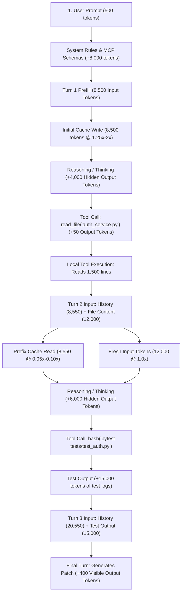

# The AI Coding Invoice: Beyond Input and Output

Daily learning · November 5, 2026 · Agentic Billing & Metering Breakdown

> **Core idea:** An AI agent's invoice reflects an entire execution loop—retained history, cached reads, cache-write premiums, hidden reasoning tokens, subagent calls, and external sandbox runtimes—far exceeding the raw words in a prompt and visible response.

---

## 1. Foundations: The Agentic Metering Ledger

In classical API architectures, an HTTP call has an isolated cost. In agentic coding (e.g., Claude Code, GitHub Copilot Agent mode, AGY), a single initial prompt kicks off an autonomous state machine that may invoke dozens of tool calls, run tests, and query subagents.

### The Metered Components in Agent Workflows

| Metered Component | How It Reaches the Invoice | Easy Misconception |
|---|---|---|
| **User Prompt & Attached Diffs** | Standard input tokens | *"Only the words I typed in the chat input are billed."* |
| **System Rules, Schemas, & Skills** | Input tokens on every turn (discounted if cached) | *"Rules and MCP definitions are loaded once for free."* |
| **Conversation History & Tool Logs** | Input tokens re-sent on every subsequent iteration | *"A file read or test output is paid for only once when fetched."* |
| **Prompt Cache Reads** | Discounted input token rate (typically 50%–95% off) | *"Cached tokens are completely free."* |
| **Prompt Cache Writes / Rebuilds** | Surcharge rate (e.g., 1.25× to 2.5× base input rate) | *"Cache writes cost the same as normal input tokens."* |
| **Reasoning / Extended Thinking** | Billed as standard output tokens, even when hidden | *"Hidden thinking is an internal provider feature that is free."* |
| **Visible Code & Explanations** | Standard output tokens | *"Only visible lines of code count as output tokens."* |
| **Tool-Call Arguments** | Billed as generated output tokens | *"Generated tool parameters are part of the input prompt."* |
| **Subagents & Reviewer Loops** | Multiplies all above categories across parallel sessions | *"Subagents share the parent agent's context for free."* |
| **Cloud Sandboxes & Compute Runners** | Auxiliary infrastructure charges (Actions minutes, vCPU/GB RAM) | *"Agent execution is fully covered by the AI token credit balance."* |

### Familiar Analogy: The Restaurant Invoice

Evaluating an AI agent bill solely by visible code is like evaluating a catered dinner solely by the weight of the food on your plate. You are also billed for the prep kitchen (context and system prompts), food refrigeration and storage (cache writes and TTL maintenance), sous chefs consulting in the back (hidden reasoning tokens), extra dishwashers (subagents), and venue rental fees (cloud sandboxes and GitHub Actions runners).

---

## 2. Mechanism: How One Prompt Multiplies Across the Wire

When a user submits a single instruction—e.g., `"Fix the race condition in auth_service.py and verify with tests"`—the agent executes an iterative feedback loop:

### The Three Separate Costs of a Tool Call

A common error is assuming tool calls have a single flat fee. In reality, every tool call incurs up to three separate meters:
1. **Generated Tool Arguments:** The JSON payload specifying function name and arguments (e.g., `{"path": "src/auth.ts", "line_start": 100}`) is generated by the LLM and billed as **output tokens**.
2. **Returned Content Re-injection:** The raw text returned by the tool (e.g., a 2,000-line stack trace or 500 lines of source code) is injected into the conversation transcript and billed as **input tokens on all subsequent turns**.
3. **External Service Runtime:** If the tool invokes a hosted service (e.g., Google Search API, Docker sandbox, GitHub Actions runner), it incurs an **external infrastructure charge** completely independent of the model's token meter.

---

## 3. Impact and Limits: The Caching Paradox & Three Caches

### The Caching Paradox: 30% Fewer Tokens, 40% Higher Bill

It is entirely possible to reduce an agent's total token count by 30% while increasing the final invoice by 40%. This occurs when an aggressive compression proxy or dynamic prompt re-writer mutates an established prefix:

- **Baseline Run (Stable Prefix):** The agent sends 50,000 tokens. 45,000 tokens match the warm cache prefix (billed at $0.10/M on Claude Sonnet 5.5 = $0.0045). 5,000 tokens are fresh input ($2.00/M = $0.0100). Total input cost = **$0.0145**.
- **Mutated Run (Aggressive Rewriting):** A compression tool rewrites the prompt, shrinking it from 50,000 to 35,000 tokens (a 30% reduction). However, because the prefix was modified, the provider cache misses. The entire 35,000 tokens are billed as fresh input ($2.00/M) plus a cache-write surcharge ($2.50/M). Total input cost = **$0.0875**.
- **Net Result:** Token count fell by 30%, but input cost increased by **503%**.

### Three Caches That Must Not Be Conflated

| Cache Type | What Is Stored | Where It Lives | Billing Consequence |
|---|---|---|---|
| **Exact Response Cache** | The exact final completion matching a SHA-256 hash of the input prompt | Application Gateway / Redis | Completely eliminates the LLM call; $0.00 inference spend |
| **Provider Prompt Cache** | Pre-computed KV attention states of eligible prompt prefixes | Model Provider GPU / Host RAM | LLM still generates the answer; prefix input is discounted (50%–95% off) |
| **Semantic Response Cache** | Previous completions mapped to vector embeddings of queries | Vector DB / Middleware | Bypasses LLM call if cosine similarity $\ge \text{threshold}$; risk of serving stale or slightly incorrect logic |

### Claim vs Correction

| Common Claim | Reality / Correction |
|---|---|
| *"Cached tokens are free tokens."* | **Correction:** Cached tokens are discounted (e.g., 90% discount on Sonnet 5.5, 95% on Opus 5.5), but they are still billed on every request. |
| *"Reasoning tokens are included in the subscription and don't cost extra."* | **Correction:** Reasoning tokens are metered as standard output tokens. A model that outputs 10 lines of code but "thinks" for 12,000 tokens bills for 12,000 output tokens. |
| *"Local CLI agents are inherently cheaper than IDE extensions."* | **Correction:** Agent CLIs run autonomous multi-turn edit–test–debug loops that often execute 10 to 30 API calls per prompt, whereas an IDE extension often executes 1 to 3 calls. |

---

## 4. Timeline and Current State

- **Mid 2026:** GitHub introduces credit-based billing across Copilot: 1 AI Credit = $0.01 USD. Paid completions and inline edits consume zero credits, while Agent mode, PR review, and cloud sandboxes consume credits and Actions minutes.
- **October 2026:** Anthropic documents standard 5-minute cache TTL (1.25× write premium) for direct API usage, with 1-hour retention (2.0× write premium) available for enterprise and Claude Code subscriptions. Sonnet 5.5 cache read rate drops to $0.10/MTok.
- **November 2026:** OpenAI expands Responses API caching: 30-minute default retention (1.25× write rate) and 12-hour extended retention (2.5× write rate).

---

## 5. Practical Response and Lessons

### Worked Numerical Reconciliation Example

Consider a realistic agentic coding turn with 110,000 total tokens processed across disjoint billing buckets (illustrative normalized rates: $1.00/M fresh input, $0.10/M cache read, $1.25/M cache write, $5.00/M output):

| Disjoint Billing Category | Token Volume | Effective Rate ($/MTok) | Net Billed Cost |
|---|---:|---:|---:|
| **Fresh Uncached Input** | 10,000 | $1.00 | $0.0100 |
| **Cached Read Input** | 80,000 | $0.10 | $0.0080 |
| **Cache Write / Creation** | 10,000 | $1.25 | $0.0125 |
| **Billed Output: Hidden Thinking** | 8,000 | $5.00 | $0.0400 |
| **Billed Output: Visible Code** | 2,000 | $5.00 | $0.0100 |
| **Total Turn Invoice** | **110,000** | — | **$0.0805** |

*Accounting Safeguard:* Notice that total output is 10,000 tokens ($0.0500). Do not bill thinking tokens a second time if the provider's `output_tokens` field already aggregates both thinking and visible tokens.

### When Does a 1-Hour Cache TTL Pay for Itself?

Let a stable prompt prefix be normalized to 1.0 cost unit of uncached base input. Let $r$ be the cache-read multiplier ($r = 0.10$ for standard 90% discount; $r = 0.05$ for 95% discount).

For an initial write plus $N$ reads during an uninterrupted session:

$$C_{5\text{m}} = 1.25 + r \cdot N \quad \text{vs} \quad C_{1\text{h}} = 2.00 + r \cdot N$$

In an uninterrupted continuous session, the 1-hour TTL costs $0.75$ units more due to the initial write premium ($2.00 - 1.25$).

However, consider an interruption: the developer steps away for 20 minutes (exceeding the 5-minute TTL, but well within the 1-hour TTL) and executes one resumed request upon returning:

$$C_{5\text{m, resumed}} = 1.25 \; (\text{initial write}) + 1.25 \; (\text{cold re-write}) = 2.50$$

$$C_{1\text{h, resumed}} = 2.00 \; (\text{initial write}) + r \; (\text{warm cache read}) = 2.00 + r$$

$$\text{Net Saving with 1h} = 2.50 - (2.00 + r) = 0.50 - r$$

- At $r = 0.10$: Net saving = **0.40 base-input units** (a 16% net savings).
- At $r = 0.05$: Net saving = **0.45 base-input units** (an 18% net savings).

*Conclusion:* Exactly **one avoided cache re-write** after a short pause completely pays for the higher 1-hour write premium.

### Presentation Diagnostic: 8 Questions to Audit an Agent Invoice

1. *"If the visible answer is 20 lines of code, how many hidden thinking tokens were billed to produce it?"*
2. *"When a tool returns 30,000 tokens of test logs, across how many subsequent agent turns are those tokens re-sent?"*
3. *"Is the reported cache figure an input discount, a cache-write premium, or an active-session hit ratio?"*
4. *"Did a test failure trigger a targeted one-turn repair or spawn multiple background subagents?"*
5. *"Are sandbox compute runtimes, container memory, and GitHub Actions minutes tracked alongside token fees?"*
6. *"Are we looking at actual billed invoices, consumed credits, or uncalibrated API-equivalent estimates?"*
7. *"Which cache layer in our architecture eliminates inference calls versus merely discounting prefill tokens?"*
8. *"Does our budget alert merely log a warning to Slack, or does it enforce a hard runtime cutoff on rogue agent loops?"*

---

## 6. Source Context and Cross-References

**Source Context:**
Based on user-provided details and video analysis of Himanshu Joshi's *Your AI Bill Is a Design Bug* ([YouTube Reference](https://www.youtube.com/watch?v=PJRbHPVPwI0)), verified against primary vendor billing documentation:
- [Anthropic Prompt Caching Architecture & Pricing](https://platform.claude.com/docs/en/build-with-claude/prompt-caching)
- [OpenAI Reasoning Models & Token Accounting](https://developers.openai.com/api/docs/guides/reasoning)
- [GitHub Copilot Models, Pricing, and Credit Allotments](https://docs.github.com/en/copilot/reference/copilot-billing/models-and-pricing)
- [GitHub Copilot Cloud Sandboxes & Actions Billing](https://docs.github.com/en/billing/concepts/product-billing/cloud-and-local-sandboxes)

---

**Related:**
- [VS Code Copilot Prompt Caching & Token Economics](VS-Code-Copilot-Prompt-Caching-And-Token-Economics-Nov-2026.md) — Multi-anchor prefix architecture, graceful fallback, credit accounting ($1 AI Credit = $0.01), and Cache Explorer diagnostics.
- [Claude Code Prompt Cache Economics](Claude-Code-Prompt-Cache-Math-And-Model-Switch-Penalties-Nov-2026.md) — 40× hit vs write cost cliff ($0.04 vs $1.60), prefix invalidation triggers, and mid-session model-switch break-even math.
- [GenAI Cost Optimization](GenAI-cost-Optimization.md) — Three-tier engineering framework for inference, caching, and infrastructure FinOps.
- [Empirical Tokenomics and Model Routing](Empirical-Tokenomics-and-Model-Routing-2026.md) — Stage-based routing, compact handoffs, and cost-per-accepted-change.
- [Context Windows, Compaction, and Cache Breaks](Context-Windows-Compaction-and-Cache-Breaks-2026.md) — Working budgets, cache eviction timers, and OMP configuration.
