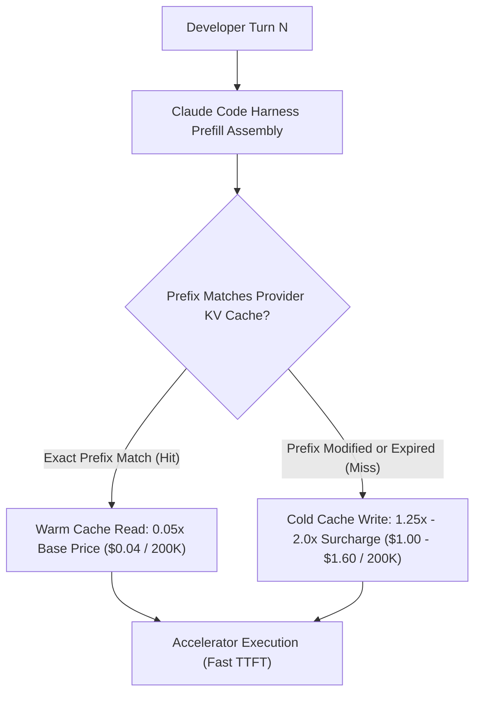
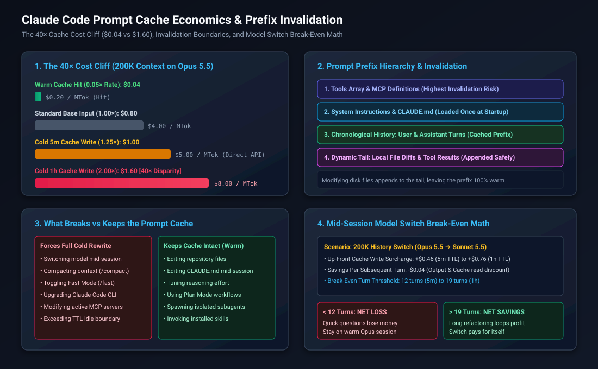
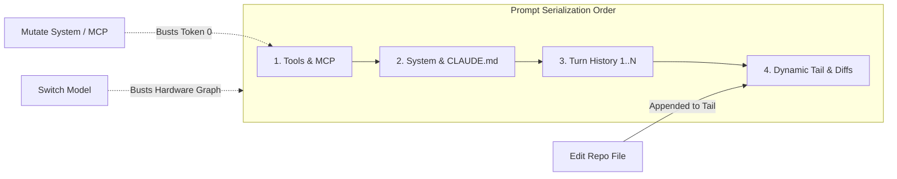
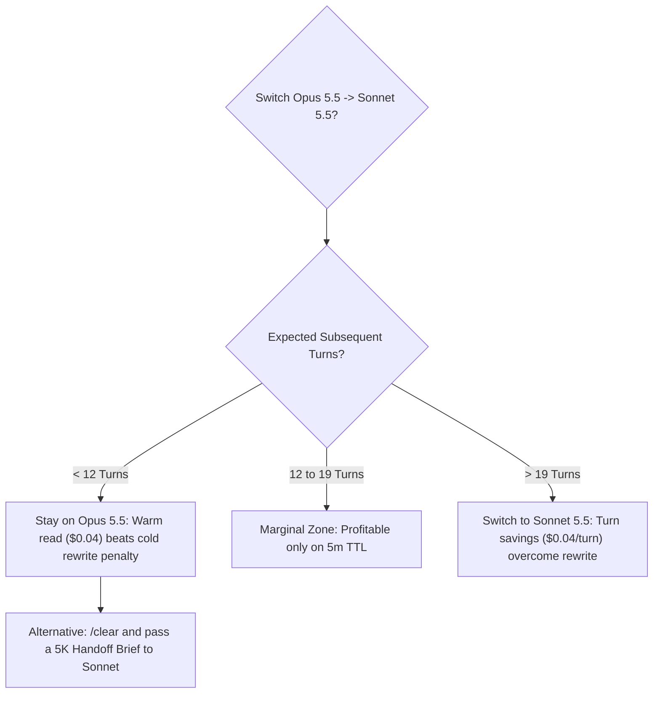

# Claude Code Prompt Cache Economics: Hit vs Write Math, Invalidation Triggers, and Model-Switch Penalties

Daily learning · November 9, 2026 · Prompt Caching & Model Economics

> **Core idea:** Under API-metered token pricing, the prompt cache is effectively the entire invoice; on Claude Opus 5.5, a 200,000-token context costs $0.04 on a warm cache hit versus $1.60 on a cold cache write (a 40× disparity), while mid-session model switches destroy the KV-cache prefix and incur a cold rewrite surcharge requiring 12 to 19 subsequent turns just to break even. Direct API users pay this in dollars, while subscription users burn their session rate quotas proportionally faster.

---

## 1. Foundations: The Anatomy of Agentic Cache Billing

In classic REST API interactions, each request is evaluated in isolation. In agentic command-line interfaces such as Claude Code, however, every interaction re-transmits the cumulative session state: the tool schema registry, system instructions, project-level guidance (`CLAUDE.md`), and the entire chronological turn history.

When context reaches hundreds of thousands of tokens, re-tokenizing and running attention prefill from scratch on every turn becomes economically prohibitive and introduces significant latency. To make multi-turn agent loops feasible, model providers employ **prompt caching** (Key-Value prefix caching).



### Prompt Cache Billing Terms

| Term | Technical Meaning | Economic Implication |
|---|---|---|
| **Base Input Rate** | Direct charge for processing uncached prompt tokens | Standard reference baseline ($1.00\times$) |
| **Cache Read (Hit) Rate** | Processing prompt tokens that match an active KV-cache entry | Deep discount ($0.05\times$, or 95% off base input) |
| **5-Minute Cache Creation (Write)** | Allocating and persisting attention matrices for a 5-minute TTL | Mild premium ($1.25\times$ base input rate) |
| **1-Hour Cache Creation (Write)** | Allocating and pinning attention matrices for an extended 1-hour TTL | Heavy premium ($2.00\times$ base input rate) |
| **Prefix Invalidation** | Any mutation to the start of the prompt stream breaking sequential hashing | Forces a 100% cold re-write of all subsequent tokens |

### Real-World Analogy: The Hotel Conference Room

Operating an agent with prompt caching is like leasing a hotel conference room:
- **Warm Cache Hit:** You keep the room reserved continuously between meetings. You leave your whiteboards, projector, and handouts set up. Walking in for the next 15-minute sync takes zero setup time and costs only a trivial maintenance fee.
- **Cold Cache Write (Re-write):** You check out of the room during lunch. When you return an hour later, the hotel has stripped the room bare. You must pay premium setup fees and wait for the staff to re-arrange every table, whiteboard, and handout from scratch before you can speak a single word.

---

## 2. Mechanism: The 40× Cost Disparity & Prefix Architecture



### The 40× Cost Disparity: $0.04 vs. $1.60 on 200K History

On frontier models such as Claude Opus 5.5 and Claude Sonnet 5.5, cache reads receive a 95% discount ($0.05\times$ of base input), whereas cache writes carry a surcharge ($1.25\times$ for 5-minute TTL, $2.00\times$ for 1-hour TTL).

When a session accumulates 200,000 tokens of conversational and file history, the cost difference between a warm hit and a cold 1-hour re-write is exactly **40-fold**:

| Billing Category | Opus 5.5 Rate ($/\text{MTok}$) | Cost for 200K Context (Opus 5.5) | Sonnet 5.5 Rate ($/\text{MTok}$) | Cost for 200K Context (Sonnet 5.5) | Pricing Multiplier |
|---|---:|---:|---:|---:|---:|
| **Base Input** | $4.00 | $0.80 | $2.00 | $0.40 | $1.00\times$ |
| **Cache Read (Hit)** | **$0.20** | **$0.04** | **$0.10** | **$0.02** | **$0.05\times$** |
| **5-Minute Cache Write** | $5.00 | $1.00 | $2.50 | $0.50 | $1.25\times$ |
| **1-Hour Cache Write** | **$8.00** | **$1.60** | **$4.00** | **$0.80** | **$2.00\times$** |

For an identical 200K request on Opus 5.5:
- A warm cache hit costs **$0.04**.
- An expired or invalidated 1-hour cache write costs **$1.60**.

A developer stepping away past the TTL boundary or triggering an accidental cache invalidation turns a 4-cent turn into a $1.60 turn under API list pricing. For subscription users (Pro, Team, Enterprise), while dollar charges do not appear per turn on a credit card, a cold rewrite consumes an enormous block of underlying provider compute, rapidly exhausting active message budgets and triggering hourly rate limit throttling.

### Cache Lifetimes (TTL) by Plan & Access Method

How long attention matrices stay pinned on provider GPU memory depends on how Claude Code is authenticated. Crucially, Anthropic defines the cache TTL as a **guaranteed minimum lifetime measured from the start of the request** that writes or reads the cache entry. Time spent generating or streaming long responses elapses against this window:

| Environment / Plan | Main Conversation Guaranteed TTL | Subagents & Auxiliary Tools | Compaction Runs |
|---|---|---|---|
| **Subscription (Pro / Team / Enterprise)** | **1 Hour** minimum | 5 Minutes | 5 Minutes |
| **Direct API Key / Cloud (Bedrock / Vertex)** | **5 Minutes** (default minimum) | 5 Minutes | 5 Minutes |

*TTL Invalidation Nuance:* Expiration past the TTL boundary allows the provider to evict the attention matrices from accelerator memory, but does not strictly guarantee an instant miss if the GPU node has not yet reassigned the physical memory block. However, once evicted or invalidated, a cold rebuild is required.

*Note on Direct API:* API users can configure a 1-hour retention window in `~/.claude/settings.json` via `"promptCacheTtl": "1h"`, but every cache write will bill at the $2.00\times$ multiplier rather than the standard $1.25\times$ multiplier.

---

## 3. Mechanism: What Breaks vs. Keeps Your Cache

Prompt caching requires **byte-for-byte prefix matching** from token 0 downward. Anthropic constructs the prompt stream in strict sequential order:

```text
[Tools & MCP Definitions] -> [System Prompt & CLAUDE.md] -> [Chronological Turns 1..N] -> [Dynamic Tail]
```

Modifying any element invalidates everything behind it.



### Invalidation Triggers Matrix

| Action | Cache Status | Technical Reason |
|---|---|---|
| **Switching Models (`/model`)** | **BREAKS (Cold Write)** | Each model family has isolated KV cache clusters; Sonnet cannot read Opus KV caches. |
| **Compacting Context (`/compact`)** | **BREAKS (Cold Write)** | Compaction summarizes history and replaces early message blocks, altering the prefix hash from the start. |
| **Toggling Fast Mode (`/fast`)** | **BREAKS (Cold Write)** | Fast Mode changes inference-level parameters serialized ahead of the user messages. |
| **Upgrading Claude Code CLI** | **BREAKS (Cold Write)** | CLI upgrades update internal prompt scaffolding, tool schemas, and harness templates. |
| **Modifying MCP Servers** | **BREAKS (Cold Write)** | Adding or removing an MCP server mutates the `tools` definition array at the top of the prompt. |
| **Idle Duration Exceeding TTL** | **BREAKS (Cold Write)** | Accelerator memory evicts the cache entry after 5 minutes (API) or 1 hour (Subscription). |
| **Editing Repository Files** | **KEEPS INTACT (Warm)** | File modifications are read by tools and appended to the *tail* of the transcript. The prefix remains untouched. |
| **Editing `CLAUDE.md` Mid-Session** | **KEEPS INTACT (Warm)** | Claude Code caches `CLAUDE.md` into the system prompt at startup; disk edits are not re-read until `/clear`, `/compact`, or restart. |
| **Tuning Reasoning Effort** | **KEEPS INTACT (Warm)** | On 5.5 models, reasoning effort controls are handled at inference time without re-serializing the prefix. |
| **Using Plan Mode & Skills** | **KEEPS INTACT (Warm)** | Plan mode steps and skill instructions append sequentially to history rather than mutating preceding context. |
| **Spawning Subagents** | **KEEPS INTACT (Warm)** | Subagents run in isolated subordinate contexts with their own 5-minute cache; parent context is untouched. |

---

## 4. Impact and Limits: The Model Switch Break-Even Math

A widespread developer practice is starting a session on a frontier model (**Opus 5.5**) to explore architectural options, and then switching to a cheaper model (**Sonnet 5.5**) to implement the code.

While intuitive, this strategy frequently **loses money** due to the cold cache write surcharge.

### The Upfront Switching Surcharge

Assume an agent has accumulated 200,000 tokens of project history on Opus 5.5:
- Remaining on Opus 5.5, Turn $N+1$ executes a warm cache read:

$$C_{\text{Opus, warm}} = 200\text{K} \times \$0.20/\text{MTok} = \$0.04$$

- Switching to Sonnet 5.5 forces an immediate cold cache write of the entire 200K history into Sonnet's hardware partition:

$$C_{\text{Sonnet, 5m write}} = 200\text{K} \times \$2.50/\text{MTok} = \$0.50$$

$$C_{\text{Sonnet, 1h write}} = 200\text{K} \times \$4.00/\text{MTok} = \$0.80$$

The upfront switching penalty $\Delta_{\text{switch}}$ is:

$$\Delta_{\text{switch, 5m}} = \$0.50 - \$0.04 = +\$0.46$$

$$\Delta_{\text{switch, 1h}} = \$0.80 - \$0.04 = +\$0.76$$

### Turn-by-Turn Savings on Sonnet 5.5

On all subsequent turns, Sonnet 5.5 is cheaper across both generation and warm cache reads. Assuming an average turn generates $T_{\text{out}} = 2,000$ output tokens:

1. **Output Generation Savings:**
   - Opus 5.5 output: $2\text{K} \times \$20.00/\text{MTok} = \$0.040$
   - Sonnet 5.5 output: $2\text{K} \times \$10.00/\text{MTok} = \$0.020$
   - Output savings $\Delta_{\text{out}} = -\$0.020 / \text{turn}$

2. **Warm Cache Read Savings:**
   - Opus 5.5 read: $200\text{K} \times \$0.20/\text{MTok} = \$0.040$
   - Sonnet 5.5 read: $200\text{K} \times \$0.10/\text{MTok} = \$0.020$
   - Cache read savings $\Delta_{\text{read}} = -\$0.020 / \text{turn}$

Total turn-by-turn savings $S_{\text{turn}}$:

$$S_{\text{turn}} = |\Delta_{\text{out}}| + |\Delta_{\text{read}}| = \$0.020 + \$0.020 = \$0.040 / \text{turn}$$

### Break-Even Turn Calculation

The number of subsequent turns $N^*$ required to amortize the cold cache write surcharge is:

$$N^* = \frac{\Delta_{\text{switch}}}{S_{\text{turn}}}$$

For a 5-minute cache TTL:

$$N^*_{5\text{m}} = \frac{\$0.46}{\$0.040} = 11.5 \approx \mathbf{12 \text{ turns}}$$

For a 1-hour cache TTL:

$$N^*_{1\text{h}} = \frac{\$0.76}{\$0.040} = 19.0 = \mathbf{19 \text{ turns}}$$



### Strategic Takeaways:
1. **Quick follow-ups lose money:** Switching to Sonnet for 3 quick questions costs $+\$0.76 - (3 \times \$0.04) = \mathbf{+\$0.64 \text{ net loss}}$.
2. **Long refactoring loops profit:** Switching to Sonnet for a 40-turn refactoring run yields $(40 - 19) \times \$0.04 = \mathbf{\$0.84 \text{ net savings}}$.
3. **The Clean Handoff alternative:** If switching models, do not carry forward 200K tokens. Run `/clear` and provide a concise 5,000-token handoff specification. Writing 5K tokens to Sonnet costs only $\$0.02$, eliminating the penalty entirely.

---

## 5. Timeline and Current State

- **Mid 2024:** Anthropic introduces Prompt Caching with a 5-minute minimum TTL, offering a 90% discount on cache hits with a 1.25× cache write premium.
- **Mid 2026:** Anthropic updates rate structures for the 5.5 model family (Opus 5.5, Sonnet 5.5, Haiku 5.5). Cache hit discounts deepen to 95% ($0.05\times$), and enterprise 1-hour TTL support is formalized at a 2.0× write multiplier.
- **October 2026:** Claude Code documents enhanced cache reporting in `/usage`, surfacing hit ratios and root causes for prompt cache misses.
- **November 2026:** Claude Code cost reporting aligns with unified Anthropic billing headers, separating creation tokens, cache read tokens, and standard input prefill.

---

## 6. Practical Response and Lessons

### Inspecting Cache Telemetry with `/usage`

To audit prompt cache performance in Claude Code, execute:

```bash
/usage
```

The output surfaces critical prefix health metrics:

```text
Token Usage Summary:
---------------------------------------------------------
Input Tokens (Total):          1,448,500
  - Cache Read (Hit):          1,180,000 (81.5% of total input)
  - Cache Creation (Write):      205,000
  - Uncached Input:               63,500
Output Tokens:                    42,100
Reasoning / Thinking:             18,200

Last Cache Status:             MISS
Root Cause of Last Miss:       MODEL_SWITCH (Opus 5.5 -> Sonnet 5.5)
Current Active Model:          claude-sonnet-5-5
Cache Retention Policy:        1h (Subscription Plan)
```

### The 5 Golden Rules of Claude Code Cache Hygiene

1. **Pick your model at session start:** Decide whether a task requires architectural reasoning (Opus) or implementation speed (Sonnet) before opening the session. Avoid toggling `/model` mid-flight.
2. **Use `/clear` before switching tasks or models:** When transitioning between major tickets, run `/clear` to flush the 200K context. Never pay to write old, irrelevant debugging logs into a new model's cache.
3. **Respect the 1-hour TTL boundary:** If stepping away for lunch or a meeting, be aware that returning to a 200K-token session will incur a $1.60 cold rewrite on the first prompt. Save your state to a task brief before leaving.
4. **Do not fear disk file edits:** Modifying files with your local editor or letting the agent write files to disk does not break the cache. File updates append to the dynamic tail.
5. **Remember `CLAUDE.md` caching dynamics:** Edits made to `CLAUDE.md` during an active session do not take effect immediately because the system prompt is already cached. To apply new guidelines, save your work and run `/clear` or restart the session.

---

## 7. Source Context and Cross-References

**Source Context:**
Based on user-provided details and technical analysis of DIY Smart Code's *Claude Code Cache Math: $0.04 vs $1.60 for the Same Request* ([YouTube Reference](http://www.youtube.com/watch?v=MCXSCZiSg9c)), verified and cross-referenced against primary vendor documentation and architectural rate cards:
- [Anthropic Prompt Caching Documentation](https://platform.claude.com/docs/en/build-with-claude/prompt-caching)
- [Claude Code Model Configuration & Autocompaction](https://code.claude.com/docs/en/model-config#context-window-and-auto-compaction)
- [Anthropic Pricing & Rate Cards](https://platform.claude.com/docs/en/build-with-claude/prompt-caching#pricing)
- [Claude Code Common Workflows & Context Management](https://code.claude.com/docs/en/common-workflows)

---

**Related:**
- [VS Code Copilot Prompt Caching & Token Economics](VS-Code-Copilot-Prompt-Caching-And-Token-Economics-Nov-2026.md) — Multi-anchor prefix architecture, graceful fallback, credit accounting ($1 AI Credit = $0.01), and Cache Explorer diagnostics.
- [Context Windows, Compaction, and Cache Breaks](Context-Windows-Compaction-and-Cache-Breaks-2026.md) — Analysis of context limits, percentage compaction myths, and idle cache warming.
- [Empirical Tokenomics and Model Routing](Empirical-Tokenomics-and-Model-Routing-2026.md) — Stage-based routing matrix, cognitive risk assessment, and escalation boundaries.
- [The AI Coding Invoice: Beyond Input and Output](AI-Coding-Invoice-Beyond-Input-and-Output-2026.md) — Analysis of the 10 metered components in agent loops and tool-call cost dynamics.
- [KV Cache, Prefix Caching, and Storage Tiering](../architecture/KV-Cache-Prefix-Caching-And-Storage-Tiering-Nov-2026.md) — GPU hardware memory architecture and physical KV cache tiering.
