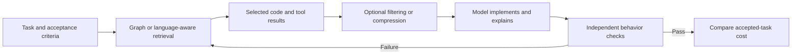

# Code Graphs Can Save Tokens—and Still Cost More

**Daily learning · 28 October 2026 · Video observations cross-checked against project documentation and research**

> **Core idea:** Context tools change what an agent sees, how much it writes, and how often it retries. A smaller payload is useful only if the agent still finishes the right task at a lower total cost.

## 1. First separate the layers

| Term | Plain meaning |
|---|---|
| Code graph | An index of symbols and relationships, such as which functions call each other |
| Semantic navigation | Find definitions/references through language-aware tooling rather than reading whole files |
| Payload compression | Shorten content that has already been selected for the model |
| Resident context | The information currently retained in the model’s working window |
| Token throughput | Tokens processed across requests, including repeated cached history |
| Accepted outcome | A change that passes the actual requirements, not only its generated tests |

[CodeGraph](https://github.com/colbymchenry/codegraph) indexes code relationships and updates its index as source changes. It can reduce exploratory reads; it cannot establish that a visual feature behaves correctly. Its own [residual-context discussion](https://github.com/colbymchenry/codegraph/blob/main/docs/benchmarks/residual-context-occupancy.md) distinguishes lower cumulative processing from a smaller retained context. Those are different measurements.

Conceptual workflow: tools may cover several boxes, and not every task needs every layer.

## 2. What the supplied experiment actually shows

The Gray Cat’s [OpenCode Go + CodeGraph comparison](https://www.youtube.com/watch?v=blS3l32vBR0), published **27 October 2026**, reports one graph-on/off pair per completed model on a video-editing feature:

| Model | Without graph → with graph | Interpretation |
|---|---:|---|
| Muse Spark 1.3 Contributor | ~35.5M → ~69M tokens | ~95% more; most extra work occurred during implementation |
| DeepSeek V4.1 Flash | ~27M → ~24M tokens | ~10% fewer, yet estimated cost rose ~$0.47 → ~$0.51 as uncached input increased |
| MiniMax M3.1 Flash Free | ~105M → ~64M tokens | ~39% fewer, but independent checks still found rendering defects |

These totals count repeated cached reads. Cost estimates are not extra subscription charges; the $10 Go budget excluded supervising Claude usage. Quota-interrupted runs cannot rank model quality, and concurrent runs cannot establish comparative speed.

All six finished versions passed their suites, yet separate checks found problems: orientation/placement, clipping/border behavior, or stale face-crop state. The preferred candidate also needed more work. This is **single-run evidence**, not proof that the graph caused the differences. The supplied Muse response counts contradict their surrounding explanation; exact counts are omitted.

**Architecture also changed the cost surface:** the reported DeepSeek candidate used local face detection, while both MiniMax variants requested AI-provider framing; the latter path was not tested against a live provider. A graph cannot compensate for choosing an unnecessary remote inference step or missing its integration test. The creator eventually dropped rounded corners to reduce Premiere workflow friction—simplifying the requirement can outperform optimizing the same unwanted complexity.

## 3. Evidence beyond the video

| Primary source | What it adds | Limit |
|---|---|---|
| [tokbench](https://github.com/Entelligentsia/tokbench) | Separates middleware counters from provider-billed traffic and complete-run behavior | Pilot runs are N=1 per arm; longer trajectories do not prove the middleware caused them |
| [Cache-Aware Prompt Compression](https://arxiv.org/abs/2607.15516) | Examines how compression interacts with prefix reuse; cache-aware compression can outperform query-dependent rewriting | Model/workload-specific preprint, not a universal coding-agent saving |
| [Codebase-Memory research](https://arxiv.org/abs/2603.27277) | Reports ~10× fewer tokens for repository questions | Reported answer quality was 83% versus 92% for the file explorer; retrieval economy has a quality trade-off |

Together these support a testable hypothesis: **better selection and smaller payloads can help, but recovery work and cache behavior can reverse the saving.** They do not establish a single best tool or model.

## 4. Headroom’s current capabilities versus our setup

Latest published release checked: **Headroom v0.42.0, 26 October, commit `17d38e5`**. Our repository’s [wrapper configuration](../../../Scripts/headroom/headroom-env.sh) still pins **0.37.0**. This is a comparison, not an upgrade. The release adds per-request counterfactual savings/accounting and cache-usage fixes; a counterfactual estimate still needs validation against accepted tasks. [Release notes](https://github.com/headroomlabs-ai/headroom/releases/tag/v0.42.0)

| Capability in current docs | Practical significance |
|---|---|
| Content routing and eligible AST code outlining | Compress selected payloads; does not replace dependency navigation. Review/recent-code protection can bypass compression |
| Stable prior representations in default cache mode | New eligible content compresses without continuously rewriting warm history |
| Optional cold-prefix recompaction | Rewrites a prefix judged cold; opt-in, not proof every rewrite is safe |
| CCR original-content retrieval | Recover omitted material while retained and reachable; not lossless reasoning or permanent storage |
| Navigation/memory integrations | Serena and optional graph/memory capabilities broaden the wrapper, but are separate from compression itself |

Sources: [code compression](https://docs.headroomlabs.ai/docs/code-compression), [cache behavior](https://docs.headroomlabs.ai/docs/cache-optimization), [CCR](https://docs.headroomlabs.ai/docs/ccr), [integrations](https://github.com/headroomlabs-ai/headroom).

Two corrections to older notes matter: **CacheAligner detects risks; it does not reorder prompts**, and CCR originals can expire or be evicted (documented default retention: 30 minutes). A model must also successfully retrieve the missing detail. Current-doc features are not evidence that our pinned runtime enables them. [Architecture](https://docs.headroomlabs.ai/docs/architecture) · [CCR retention](https://docs.headroomlabs.ai/docs/ccr)

## 5. How Ponytail, Caveman, and the other tools compare

| Tool/module | Main intervention | Main trade-off |
|---|---|---|
| CodeGraph / Codebase-Memory | Select code relationships before reading | Index coverage/freshness and missing implementation detail |
| Serena | Symbol/reference navigation and targeted edits | Backend/language support; source still needed |
| Headroom | Compress eligible input and preserve reuse | Retrieval, proxy compatibility, cache accounting |
| RTK filters | Reduce command output | Diagnostic detail may require raw output |
| Ponytail | Avoid unnecessary generated code/abstractions | Must preserve required behavior; depends on model compliance |
| Caveman skill | Shorten explanations | Brevity can hide useful reasoning/evidence |
| Caveman v4 proxy | Input compression and optional routing | Overlaps Headroom; cloud routing has separate privacy/account requirements |
| LeanCTX / MCP-Compressor | Structural context controls / smaller tool-definition surface | Overlap with native harness features; measure added indirection |

Sources: [Serena](https://github.com/oraios/serena), [RTK](https://github.com/rtk-ai/rtk), [Ponytail](https://github.com/DietrichGebert/ponytail), [Caveman v4](https://github.com/JuliusBrussee/caveman/releases/tag/v4.0.0), [LeanCTX](https://github.com/yvgude/lean-ctx), [MCP-Compressor](https://github.com/atlassian-labs/mcp-compressor). See the [updated tool inventory](ai-token-optimization-tools.md) for evidence scope. Product names no longer map neatly to one layer; compare the configured module.

## 6. What I would test in our workflow

1. **Start with the existing harness.** Record graph/index setup, input/cache-read/cache-write/output, review calls, retries, elapsed time, and acceptance failures.
2. **Test one intervention at a time:** baseline, navigation only, compression only, then both. Keep repository snapshot, model/effort, prompt, tools, repair allowance, and checks comparable; repeat and report variation.
3. **Prevent baseline contamination.** Removing an MCP graph entry is insufficient if the agent can still invoke the graph CLI. Keep permitted tools equivalent and indexes current.
4. **Use independent checks.** For this feature, include visual orientation/placement, clipping, timeline synchronization, and replacing a source recording—not just tests authored by the same agent.
5. **Add Ponytail or a brevity skill only for a measured problem.** Do not stack multiple proxies and assume their percentages multiply. Include omitted-detail recovery and code-review time.

Success means **lower cost per accepted change**, with no unacceptable correctness loss. A free model route can have zero incremental invoice cost while still consuming quota, supervision, and developer time.

## 7. Source context and reading order

Based on the user-shared full video transcript, with mechanisms cross-checked against the linked original repositories, release notes, and studies. The video is an attributed experiment; maintainer evaluations and paper results remain separate evidence. Read the video for the practical failure, the research for methodology, and the tool docs for supported behavior.

---

**Related:**
- [AI Token Optimization Tools](ai-token-optimization-tools.md) — Current tool-layer comparison and benchmark qualifications.
- [Headroom & RTK: Real-World Feedback](Headroom-RTK-Real-World-Feedback-2026.md) — Earlier field reports and release-sensitive risks.
- [The AI Coding Invoice](AI-Coding-Invoice-Beyond-Input-and-Output-2026.md) — Explains why fewer tokens can cost more.
- [Context Windows, Compaction, and Cache Breaks](Context-Windows-Compaction-and-Cache-Breaks-2026.md) — Working context, retention, and reconstruction costs.
- [Empirical Tokenomics and Model Routing](Empirical-Tokenomics-and-Model-Routing-2026.md) — Routes models by verified task outcomes.
