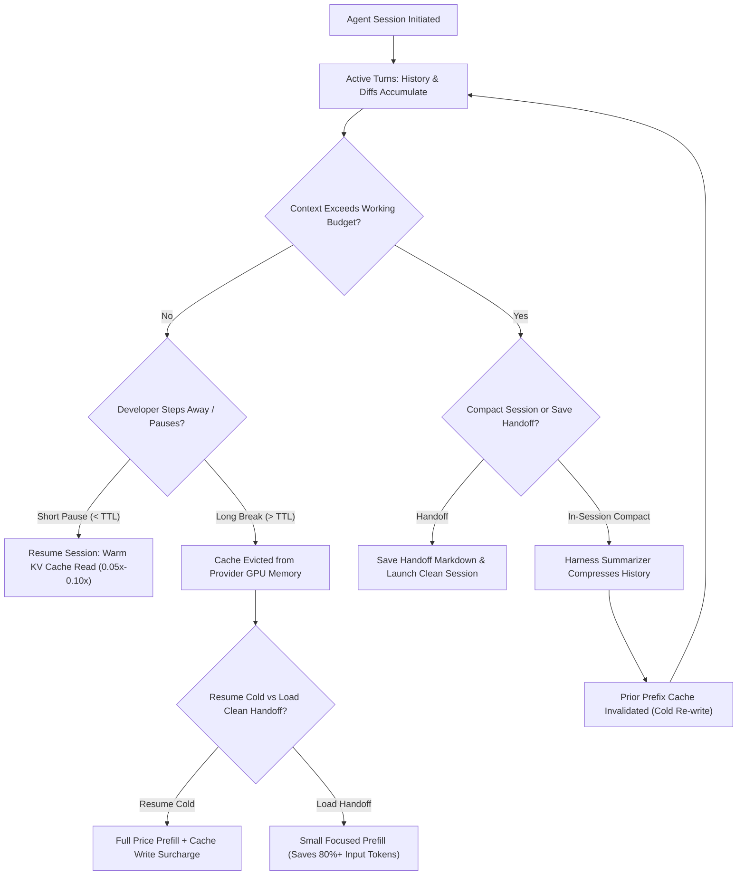
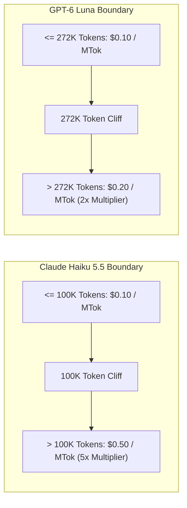

# Context Windows, Compaction, and Cache Breaks

Daily learning · November 5, 2026 · Context Management & Cache Lifecycle Architecture

> **Core idea:** Large context windows represent ceiling capacity rather than optimal working sets; unmanaged context growth breaks cache reuse and inflates latency, while aggressive or premature compaction destroys prompt cache prefixes and task history.

---

## 1. Foundations: Three Orthogonal Context Controls

Managing agent memory requires understanding three orthogonal controls that are frequently conflated:

### Three Independent Context Controls

| Control | What It Dictates | What It Cannot Do | Typical Default |
|---|---|---|---|
| **Model Context Capacity** | The maximum input + output sequence length supported by the model architecture | Does not mean every request bills or fills that maximum | 1,000,000 tokens (Claude 3.5/5, Gemini 1.5/2.0, GPT-6) |
| **Compaction Threshold** | The point at which the agent harness summarizes or truncates conversation history | Does not extend the model provider's KV cache lifetime | ~967,000 tokens (Claude Code) or ~85% reserve (OMP) |
| **Cache Time-To-Live (TTL)** | How long a provider retains pre-computed KV attention states on accelerator memory | Does not preserve conversational continuity or task decisions on its own | 5 minutes (Direct API) or 1 hour (Enterprise / Subscription) |

### Memory Systems Analogy: RAM vs Swap vs Network Keep-Alive

- **Context Capacity** is like total addressable virtual memory.
- **Compaction** is like page swapping and garbage collection: it reclaims memory, but running garbage collection too frequently consumes significant CPU cycles and introduces latency.
- **Cache TTL** is like an open TCP connection or stateful session: when the session times out, reconnecting requires a full SSL/TLS handshake (a cold cache write at full price).

---

## 2. Mechanism: Context Lifecycle, Compaction, and Cache Breaks

The lifecycle of an agent session moves between active turns, context growth, compaction events, and developer pauses:



### Video Analysis: Exit Node on OMP vs Claude Code

In the technical review [Why You Should DROP CLAUDE CODE for OMP](https://www.youtube.com/watch?v=PtS2EdUsMeo) (11:31, October 14, 2026), several key context-management practices were surfaced:
1. **Harness Customization vs Black Box Defaults:** Harnesses control prompt assembly, tool schema injection, and message lifecycle. OMP exposes low-level context knobs, whereas Claude Code encapsulates them.
2. **Handoffs vs In-Session Compaction:** Compacting within an active session risks loss of subtle constraints and requires LLM summarization calls. Saving an explicit, portable Markdown handoff and starting a clean session cleanly isolates context.
3. **The 40% Compaction Experiment:** The author reduced OMP's compaction threshold from 80% to 40% for long-running autonomous runs, observing degraded reasoning when transcripts exceeded several hundred thousand tokens.
4. **Cache Expiry Penalties:** Pausing work allows provider KV caches to expire, transforming subsequent turns into expensive full-context prefill operations.

### Cross-Harness Cache Policies & Overrides

| Surface | Boundaries and Retention | What to Verify |
|---|---|---|
| **Claude Code CLI** | Harness automatically places Anthropic prompt caching markers. Subscriptions default to **1-hour TTL**; API/cloud usage credits default to **5-minute TTL**. Subagents default to 5m but are configurable. | Check `/usage` for effective TTL warmth and cache creation/read counts. |
| **GitHub Copilot in VS Code** | Multi-anchor caching: maintains two static anchors (system instructions, repo index) plus two recent-message dynamic anchors. | Generic guidance cites 24h for OpenAI and 1h for others; inspect `Cache Explorer` for actual request hit rates. |
| **OpenAI Responses API** | Supports implicit caching (30m retention at 1.25× write) and extended retention (12h at 2.5× write) via Responses endpoints. Encrypted compaction available via `/responses/compact`. | Check `usage.prompt_tokens_details.cached_tokens` in API responses. |

#### Claude Code TTL Configuration (v2.1.242+)

To configure prompt cache retention explicitly in `~/.claude/settings.json`:

```json
{
  "promptCacheTtl": "1h",
  "subagentPromptCacheTtl": "5m"
}
```

*Environment variable equivalents:* `CLAUDE_CODE_PROMPT_CACHE_TTL="1h"` and `CLAUDE_CODE_SUBAGENT_PROMPT_CACHE_TTL="5m"`. Note that `FORCE_PROMPT_CACHING_5M=1` takes precedence over general settings.

---

## 3. Impact and Limits: The Myth of 40% Compaction & Pricing Cliffs

### The Myth of Universal Percentage Compaction (40% vs 80%)

Adopting a fixed percentage threshold (such as 40%) across all models fails because 40% of a 1M model is fundamentally different from 40% of a 200K model:

| Window Capacity | 40% Threshold | 80% Threshold | Engineering Consequence |
|---|---:|---:|---|
| **1,000,000 tokens** | 400,000 tokens | 800,000 tokens | A 400K threshold is still massive—far larger than most entire codebases! |
| **200,000 tokens** | 80,000 tokens | 160,000 tokens | Compaction triggers early, leaving minimal room for large test logs or ASTs |

*Practical Guideline:* Instead of blind percentage tuning, establish an **absolute working budget** (e.g., 100K–200K tokens) for small-to-medium tasks.

### The Pricing Boundary Cliffs: Haiku 5.5 and GPT-6 Luna

Compaction thresholds must account for provider long-context pricing cliffs:



- **Claude Haiku 5.5:** While Haiku supports 1M context, direct API rates jump **fivefold** (from $0.10/M to $0.50/M input) the moment prompt length exceeds 100,000 tokens. Cached tokens count toward this boundary. Therefore, for Haiku workers, auto-compaction or task handoffs should trigger safely below 100K tokens.
- **GPT-6 Luna:** Luna's direct API long-prompt premium triggers above 272,000 tokens (doubling input and cache rates). A 150K working budget is economical on Luna but incurs a severe penalty on Haiku.

---

## 4. Timeline and Current State

- **Mid 2026:** Anthropic and OpenAI formalize prompt cache pricing tiers (1.25× base rate for standard 5m/30m TTL; 2.0×–2.5× base rate for 1h/12h TTL).
- **October 2026:** Release of Claude Code v2.1.288 introducing per-model autocompaction overrides (`/autocompact 200k`, `/autocompact 400k`, `/autocompact auto`). Oh My Pi (OMP) refines reserve-based compaction (~85% on 1M windows) and introduces idle cache warming.
- **November 2026:** OpenAI Responses API introduces encrypted server-side compaction (`/responses/compact`), allowing agents to carry forward cryptographic summaries of conversation state without re-transmitting raw transcripts.

---

## 5. Practical Response and Lessons

### Pre-Break and Post-Break Protocol

When a developer steps away from their workstation or context grows unwieldy:

1. **If the pause is short (< 5 minutes on API, < 1 hour on subscription):** Leave the session open. The warm KV cache will be reused on resumption at a 90%–95% discount.
2. **If the pause is long (lunch, overnight, multi-hour meetings):** 
   - Do **not** rely on in-session auto-compaction upon return. After cache expiry, compacting requires the model to re-read the entire cold history at full price.
   - **Save a compact handoff document** before leaving. On return, initialize a fresh session (`/clear` or new agent instance) with the handoff.

### Compact Handoff Template

```markdown
## Session Handoff: [Component / Ticket]
- Goal: Fix memory leak in WebSocket connection pool.
- Decisions Made: Replaced raw dict with WeakKeyDictionary; bound max pool to 500.
- Affected Files: `src/network/ws_pool.py`, `tests/test_ws_pool.py`.
- Remaining Work: Verify concurrent reconnection under load.
- Reproducible Test Command: `pytest -k test_ws_reconnect tests/`
```

### The Cache Warming (Heartbeat) Decision Rule

Some tools (e.g., OMP's `providers.cacheWarming`) offer automated keep-alive heartbeats to ping the model every few minutes to prevent cache expiration.

Warming is economically rational **only if** the expected avoided cold resume cost exceeds the cumulative cost of keep-alive pings:

$$\text{Expected Avoided Cold Resume Cost} > \sum_{i=1}^{K} \text{Warm Refresh Costs}_i$$

*Caveats of Cache Warming:*
- Heartbeats send prefill tokens on every ping. While cached reads are discounted, 10 consecutive pings of a 100K prefix still bill for $10 \times 10\text{K} = 100\text{K}$ equivalent base tokens.
- If the developer does not return, all heartbeat pings represent completely wasted capital.
- OMP automatically terminates idle cache warming after 30 minutes without active interaction.

### Oh My Pi (OMP) Configuration Example

To test an absolute 100K token compaction threshold in `.omp/config.yml`:

```yaml
compaction:
  enabled: true
  thresholdTokens: 100000
  thresholdPercent: -1
  modelThresholdsEnabled: false
```

*Note:* Setting `modelThresholdsEnabled: false` ensures that per-model default scaling does not override your explicit token budget.

---

## 6. Source Context and Cross-References

**Source Context:**
Based on user-provided details and video transcript analysis of exit node's *Why You Should DROP CLAUDE CODE for OMP* ([YouTube Reference](https://www.youtube.com/watch?v=PtS2EdUsMeo)), verified against official primary documentation:
- [Oh My Pi (OMP) Compaction & Settings Source](https://github.com/can1357/oh-my-pi/blob/main/docs/compaction.md)
- [Claude Code Model Configuration & Autocompaction](https://code.claude.com/docs/en/model-config#context-window-and-auto-compaction)
- [Anthropic Prompt Caching Pricing & Lifetimes](https://platform.claude.com/docs/en/build-with-claude/prompt-caching#pricing)
- [OpenAI Prompt Caching & Responses Compaction](https://developers.openai.com/api/docs/guides/prompt-caching)
- [Chroma Research: Context Rot in LLMs](https://www.trychroma.com/research/context-rot)

---

**Related:**
- [GenAI Cost Optimization](GenAI-cost-Optimization.md) — Three-tier engineering framework for inference, caching, and infrastructure FinOps.
- [Empirical Tokenomics and Model Routing](Empirical-Tokenomics-and-Model-Routing-2026.md) — Routing matrix, stage checkpoints, and handoff boundaries.
- [The AI Coding Invoice: Beyond Input and Output](AI-Coding-Invoice-Beyond-Input-and-Output-2026.md) — Explains cache write surcharges, TTL break-even math, and invoice reconciliations.
- [Tokenomics Source Validation](Tokenomics-Source-Validation-Oct-2026.md) — Comprehensive claim-level verification of viral context management tips.
- [KV Cache, Prefix Caching, and Storage Tiering](../architecture/KV-Cache-Prefix-Caching-And-Storage-Tiering-Nov-2026.md) — GPU SRAM memory math and storage tiering underlying prefix caching.
- [Agent Memory Architectures: 5-Layer Harness and Judgment Memory](../../Agents/frameworks/Agent-Memory-Architectures-5-Layer-Harness-And-Judgment-Memory-Nov-2026.md) — Concentric memory layers, middle compaction, and judgment calibration.
