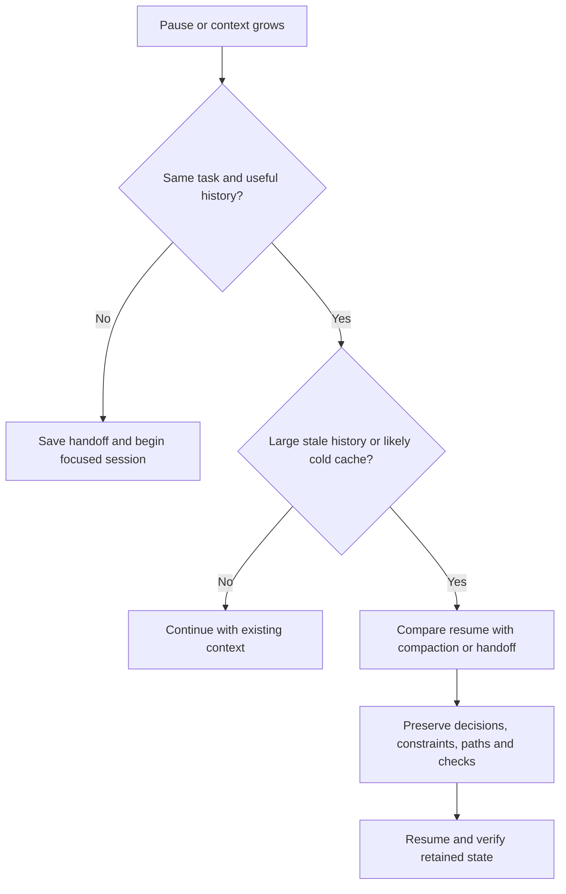

# Context Windows, Compaction, and Cache Breaks

**Updated October 26, 2026:** cache-policy comparison rechecked; OMP examples retain their October 15 source scope. For small and medium coding tasks, keep a focused working budget and save a handoff before long interruptions. Keep 1M capacity available when useful; neither filling it nor compacting at a universal percentage is necessary.

## 1. What the video teaches—and what to qualify

[Why You Should DROP CLAUDE CODE for OMP — exit node](https://www.youtube.com/watch?v=PtS2EdUsMeo), October 14, 2026. Reviewed the full auto-caption transcript (11:31).

| Segment | Key points |
|---|---|
| [0:00–2:27](https://www.youtube.com/watch?v=PtS2EdUsMeo&t=0s) | Harnesses manage context, tools, skills, messages, and orchestration; defaults versus customization affect model behavior. Pi criticisms reflect his workload. |
| [2:28–4:20](https://www.youtube.com/watch?v=PtS2EdUsMeo&t=148s) | He prefers portable handoffs over compaction; algorithms evolve and exposed controls permit experiments. |
| [4:21–6:31](https://www.youtube.com/watch?v=PtS2EdUsMeo&t=261s) | He changed 80% to 40% for unattended runs, citing degradation and tool bloat despite delegation. |
| [6:32–8:02](https://www.youtube.com/watch?v=PtS2EdUsMeo&t=392s) | Idle expiry increases resume costs; cache heartbeats also cost money. |
| [8:03–9:16](https://www.youtube.com/watch?v=PtS2EdUsMeo&t=483s) | Model-role aliases, fallbacks, effort, instructions, and tools tailor agents. Benchmark hypotheses. |
| [9:17–11:31](https://www.youtube.com/watch?v=PtS2EdUsMeo&t=557s) | Parallelism consumes local/API resources; customization matters as models evolve. Competitor comparisons are personal experience. |

**Qualifications:** 80% was his setting; 30–40% failure cutoffs and handoff superiority are anecdotal. Other harnesses expose controls too. [Chroma’s study](https://www.trychroma.com/research/context-rot) supports task-dependent length effects, not a 40% coding threshold. OMP illustrates principles; migration is optional.

## 2. Three controls that solve different problems

| Control | Meaning | What it cannot do |
|---|---|---|
| Model context capacity | Maximum supported input/output budget | Does not mean every call sends or bills that maximum |
| Compaction threshold | When the harness reduces retained history | Does not extend provider cache lifetime |
| Cache TTL | How long a reusable provider prefix remains available | Does not preserve the agent’s decisions or task state by itself |

A 1M model handling 30K tokens does not process 1M tokens merely because the capacity exists. A smaller local window changes budgeting; it does not turn the provider into a faster, smaller model. Earlier compaction often gives the summarizer less history, but latency also depends on the method, model, output length, cache, and provider load.

Your concern is valid when **accumulated history is large and the next request arrives after cache expiry**. A small task with a small history has less to rebuild. Idle time alone does not incur inference charges, except when background features make requests. [Claude session costs](https://code.claude.com/docs/en/costs)

### Cache policy depends on the harness, model, and billing path

| Surface | Boundaries and retention | What to verify |
|---|---|---|
| Claude Code | Harness places Anthropic markers. Main conversation: included subscription usage defaults to 1h; API/cloud/usage credits to 5m. Subagents default to 5m but are configurable. | Main and other-request TTL buckets; actual cache creation/read fields |
| Copilot in VS Code | Provider-specific harness; the June 17 report describes Anthropic anchors and OpenAI prefix reuse. | GitHub’s generic 24h/OpenAI and 1h/most-others guidance does not prove the TTL sent for every model generation; inspect current telemetry |
| Codex / direct OpenAI requests | API caching varies by model generation; implicit caching is not the only option on newer models. | Product sign-in, API key, model, and endpoint; do not assume one API TTL describes every Codex surface |

Sources: [Claude Code caching](https://code.claude.com/docs/en/prompt-caching), [Copilot engineering report](https://code.visualstudio.com/blogs/2026/06/17/improving-token-efficiency-in-github-copilot), [GitHub usage guidance](https://docs.github.com/en/copilot/tutorials/optimize-ai-usage), [OpenAI caching](https://developers.openai.com/api/docs/guides/prompt-caching).

**OpenAI generations matter:** GPT-5.6+ supports implicit or explicit-only caching and user-selected breakpoints. Default API retention is 30m (1.25× writes); supported Responses requests offer 12h (2.5× writes). Older models use separate retention rules; 128-token reporting is not a universal newer-model boundary rule. A key influences older-model routing, not a guaranteed GPU pin. [Caching reference](https://developers.openai.com/api/docs/guides/prompt-caching)

**Claude Code override example** (documentation only; v2.1.242+):

```json
{
  "promptCacheTtl": "1h",
  "subagentPromptCacheTtl": "5m"
}
```

Equivalent bucket environment variables are `CLAUDE_CODE_PROMPT_CACHE_TTL` and `CLAUDE_CODE_SUBAGENT_PROMPT_CACHE_TTL`. The supplied `ENABLE_PROMPT_CACHING_1H=1` exists but is lower-priority; `FORCE_PROMPT_CACHING_5M=1` takes precedence. Check provider support and effective settings. A refresh has no extra refresh fee, but the read still costs tokens. [TTL controls](https://code.claude.com/docs/en/prompt-caching#choose-the-ttl-yourself)

**Retention economics:** Anthropic’s 2× one-hour write rate versus 1.25× five-minute rate is **60% more** (`2 / 1.25 - 1`), a difference of 0.75× the base rate. These are total write rates, not additional full-input charges. Longer retention can help across breaks, but compare reuse probability, read traffic, and actual billing. [Anthropic rates](https://platform.claude.com/docs/en/build-with-claude/prompt-caching)

For a fixed-prefix example of when one avoided rewrite offsets the one-hour premium, see the [TTL break-even illustration](AI-Coding-Invoice-Beyond-Input-and-Output-2026.md#when-does-a-longer-ttl-pay-for-itself). It depends on an actual return before expiry, not merely having a meeting scheduled.

## 3. Is 40% better than 80%?

It is feasible, but it is an experiment rather than a proven optimum. Compare absolute sizes first:

| Local budget | 40% | 80% | Implication |
|---|---:|---:|---|
| 1,000,000 | 400,000 | 800,000 | Both can be far above small-task usage |
| 200,000 | 80,000 | 160,000 | Earlier reduction, but less space for evidence |

These are arithmetic illustrations, not each product’s effective trigger. Reserves, per-model overrides, and safe-boundary checks can alter behavior. A task finishing at 60K never reaches a 400K trigger; percentage tuning alone would not address a break during that task.

**Practical trial:** compare the default with an absolute 100K–200K working threshold on representative small/medium tasks. This is a proposed starting range, not a benchmark finding. Keep enough headroom for large tool results, recent history, and output. Record summary delay/count, total spend, cache misses, rereads, and missed constraints. Repeatedly re-summarizing almost the same recent history is a reason to raise the threshold or reduce incoming noise.

**Haiku 5.5 exception:** it supports 1M context, but direct API rates increase fivefold above a 100K-token prompt; cached tokens count toward that length. A generic 100K–200K trial range can therefore cross a real pricing boundary. For Haiku’s checklist/summary workers, test a trigger sufficiently below 100K to leave room for tool results, instructions, and other prompt overhead. A trigger checked at safe boundaries is not a strict per-request token cap. [Haiku pricing](https://platform.claude.com/docs/en/models/haiku-5-5/overview#pricing) · [Prompt-length accounting](https://platform.claude.com/docs/en/build-with-claude/prompt-caching#pricing)

**GPT 6 Luna comparison:** its direct API long-prompt premium begins above 272K input tokens (2× input/cache rates and 1.5× output), rather than Haiku’s >100K boundary. Thus a 150K working budget can have different economics even though both models advertise roughly 1M capacity. Compare actual token usage and quality; a compaction threshold is not an enforced billing cap. [Luna model details](https://developers.openai.com/api/docs/models/gpt-6-luna) · [Side-by-side comparison](Empirical-Tokenomics-and-Model-Routing-2026.md#1c-haiku-55-vs-gpt-6-luna)

## 4. OMP configuration and behavior

Examples target current **Oh My Pi main**, not upstream Pi or a verified installed release. Inspect `omp config list` and `/models` before applying them. No configuration was changed for this note.

```yaml
# Example .omp/config.yml: 40% experiment
compaction:
  enabled: true
  thresholdTokens: -1
  thresholdPercent: 40
  modelThresholdsEnabled: false
```

OMP’s reserve-based default is roughly **85% on a large window**, not universally 80%. A positive global `thresholdTokens` overrides the percentage. For an absolute experiment, replace `thresholdTokens: -1` above with `thresholdTokens: 100000`. Disabling model thresholds is deliberate: otherwise a matching model rule can override this global experiment. Agent-specific overrides can still win. [Settings](https://github.com/can1357/oh-my-pi/blob/main/docs/settings.md)

Current per-model numeric limits are **bases scaled by the policy**, not necessarily exact triggers; `"f100000"` specifies a fixed 100K trigger and `"40%"` a real-window percentage. Keep the endpoint’s real capacity accurate rather than falsifying it just to force compaction. [Context settings source](https://github.com/can1357/oh-my-pi/blob/main/packages/coding-agent/src/session/context-settings.ts)

| OMP mechanism | Benefit and trade-off |
|---|---|
| Remote / soft / handoff summaries | Reduce history through model work; can lose detail and prefix reuse |
| Async speculation | Prepares a summary before the threshold; hides delay, not cost, and may discard work |
| Shake | Replaces eligible bulky content with recoverable artifact references |
| Experimental notes-backed windows | Retain notes/recent units without a summary call; depend on good notes and retrieval |

**OMP `/handoff` currently compacts the same session**, retaining recent history and the session cache key. It does not itself create a fresh session; retaining a key does not guarantee unchanged prefix hits. Idle maintenance is separate and off by default. [Compaction reference](https://github.com/can1357/oh-my-pi/blob/main/docs/compaction.md)

**Claude Code equivalent:** current versions support `/autocompact 200k` or `/autocompact 400k`; `/autocompact auto` restores the tuned default. Native 1M models normally compact near 967K, not 80%. The command’s saved scope became per-model in v2.1.288; managed settings/environment overrides may take precedence. These controls are not generic VS Code commands. [Model configuration](https://code.claude.com/docs/en/model-config#context-window-and-auto-compaction)

**Codex/API compaction is not prompt caching:** Responses supports encrypted compaction items via explicit `/responses/compact` or server-side compaction. The returned window may retain other items too; it is not a guaranteed lossless blob. Changing the active prefix may require rebuilding cache coverage. WebSocket connection-local response state is a separate latency mechanism, not a durable cache-TTL promise. [Compaction](https://developers.openai.com/api/docs/guides/compaction) · [WebSocket state](https://developers.openai.com/api/docs/guides/websocket-mode)

## 5. Before and after a break



Before a planned long pause, save **goal/non-goals, decisions and rationale, current diff/files, test results, unresolved errors, and next action**. Compact while the cache is warm only if continuity and future savings justify the summary work. After expiry, compaction may itself have to read the cold history; an already saved handoff avoids that rediscovery cost but may omit details.

A cost illustration: 120K history versus a 20K handoff saves 100K input tokens on a cold request **before** accounting for handoff generation, cache-write rates, output, and rereads. With a warm cache at 0.05×, that 120K costs only 6K base-input equivalents; a fresh 20K prompt may initially cost more. Compare complete sessions, not just prompt lengths. Anthropic TTL and cache rates are model/route-specific; do not send keep-alives solely to maintain cache. [Provider caching](https://platform.claude.com/docs/en/build-with-claude/prompt-caching)

**Heartbeat is a third option, not free insurance.** OMP calls this `providers.cacheWarming`: current main defaults to `idle`, replays the last request with a one-token output budget, and applies an economics check. One output token does not mean one input token; keeping a large prefix warm repeatedly still incurs reads. Idle warming stops after 30 minutes without real activity, so it does not cover every long break. Check your release and route rather than adding a separate keep-alive loop. [Provider warming settings](https://github.com/can1357/oh-my-pi/blob/main/docs/settings.md#providers-and-services)

As a decision rule, warm only when **expected avoided cold-resume cost exceeds all refresh costs**. Include the chance you will not return, the break length, cached-prefix size, and whether the refresh actually hits. A saved handoff remains useful when warming stops or fails.

For the wider cost picture, see [The AI Coding Invoice](AI-Coding-Invoice-Beyond-Input-and-Output-2026.md): compaction and heartbeats add inference, while storage/runtime may have separate meters.

**Further finding:** automatic compaction is a capacity guard; a handoff is a task boundary; persistent notes are an external memory aid. Use each for its purpose. Re-read authoritative code and rerun the relevant checks after any summary rather than treating it as a lossless transcript.

---

**Related:**
- [Empirical Tokenomics and Model Routing](Empirical-Tokenomics-and-Model-Routing-2026.md) — Places context maintenance within the coding lifecycle.
- [Tokenomics Source Validation](Tokenomics-Source-Validation-Oct-2026.md) — Evidence and corrections behind earlier context-management claims.
- [Headroom & RTK: Real-World Feedback](Headroom-RTK-Real-World-Feedback-2026.md) — Separates local token reduction from billed savings.
- [Headroom + Pi Setup](../../../DevSetup/headroom/headroom-pi-cost-saver.md) — Output filtering and proxy compression complement agent maintenance.
