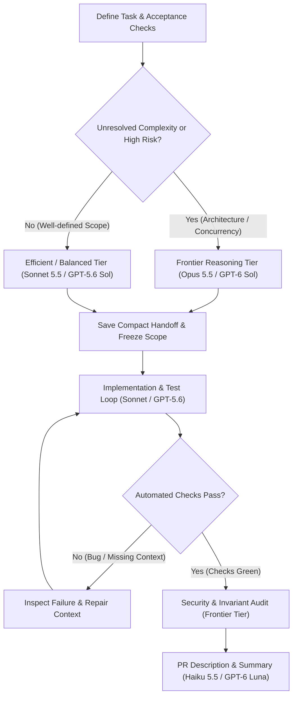

# Empirical Tokenomics and Model Routing for Coding Workflows

Daily learning · November 5, 2026 · Empirical Cost & Routing Analysis

> **Core idea:** Route software engineering agent tasks to the cheapest model that reliably satisfies acceptance checks; reserve expensive frontier models and extended reasoning effort strictly for high-risk architectural decisions, security boundaries, and complex concurrency where defects cause catastrophic rework.

---

## 1. Foundations: The Economics of Cognitive Risk

In modern agent-assisted software engineering, **tokenomics** refers to the economic and operational study of how tokens are metered, consumed, cached, and billed across the software delivery lifecycle.

### Systems and Roles in Agentic Routing

| Participant / System | Primary Role | Economic Behavior | Primary Optimization Lever |
|---|---|---|---|
| **Developer / Engineer** | Defines task intent, acceptance tests, and definition of done | Drives turn count and session duration | Explicit task briefs, handoff boundaries |
| **Interactive IDE (e.g., VS Code)** | Houses the 95% routine workflow (editing, linting, single-file diffs) | Lower turn multiplier, low tool latency | Scoped file selection, Cache Explorer |
| **Agent CLI (e.g., Claude Code)** | Executes the 5% automated edit–test–debug loops | High turn multiplier, subagent fanout | Turn budgets (`--max-budget-usd`), `/compact` |
| **Inference Gateway / Provider** | Evaluates prompt tokens and generates completions | Differentiates input, output, and cache rates | Stage-based model routing, prefix caching |
| **Inference KV Cache** | Stores pre-computed attention keys/values across turns | Discounts repeated prompts (up to 90–95%) | Preserving unchanged prefix structure |

### Traditional Microservice Routing vs LLM Model Routing

In classic microservices, request routing is based on latency, geographic proximity, or compute load. In Generative AI coding workflows, routing is based on **cognitive risk**:
- **Low-Risk / Mechanical Work:** Syntax transformations, lint fixes, PR summaries, and checklist tracking do not require high semantic intuition. Running them on frontier reasoning models wastes capital.
- **High-Risk / Architectural Work:** Public API changes, cross-module concurrency, authentication boundaries, and state migrations create severe blast radiuses. Downgrading to lightweight models creates subtle bugs whose debugging costs dwarf any token savings.

---

## 2. Mechanism: The Stage-Based Routing Matrix

Rather than picking a single model for an entire development day, agents and developers should route tasks based on the specific development checkpoint.



### GPT Stage Routing

| Stage | Starting Model | Environment | Effort Level* | Planning Tier | Downside Risk When Downgraded |
|---|---|---|---|---|---|
| **1. Intake & clarification** | GPT 5.6 Sol | VS Code | Medium | Balanced | Overlooks ambiguous requirements |
| **2. Architecture & dependencies** | GPT 5.6 Sol (GPT 6 Sol if complex) | VS Code | Medium → High | Balanced → High-Cost | Misses callers, side effects, or contracts |
| **3. Scope freeze** | Planning model; Luna at boundary | VS Code | Current effort; Low on Luna | Current tier / Low-Cost | Marks incomplete checklist as complete |
| **4. Targeted implementation** | GPT 5.6 Sol | VS Code / CLI | Medium | Balanced | Produces plausible code that breaks integration |
| **5. Spec alignment** | GPT 5.6 Sol | VS Code | Medium | Balanced | Checks surface wording, misses behavioral gaps |
| **6. Execution flow & tests** | GPT 5.6 Sol | VS Code / CLI | Medium | Balanced | Omits failure paths or weakens assertions |
| **7. Security & performance audit** | GPT 6 Sol | VS Code | High | High-Cost | Misses auth, concurrency, or resource leaks |
| **8. PR description & feedback** | GPT 6 Luna | VS Code | Low | Low-Cost | Drops an important finding from summary |

*\*Effort reflects intended reasoning depth. Use Off/None only where supported and appropriate for simple formatting.*

### Claude Stage Routing (Org-Supported Models)

Standard Direct API list prices per million tokens ($/MTok):

| Model | Input Rate | Output Rate | Cache Read Rate |
|---|---:|---:|---:|
| **Claude Haiku 5.5** (prompt $\le$ 100K) | $0.10 | $0.50 | $0.01 |
| **Claude Haiku 5.5** (prompt $>$ 100K) | $0.50 | $2.50 | $0.05 |
| **Claude Sonnet 5** | $2.00 | $10.00 | $0.20 |
| **Claude Sonnet 5.5** | $2.00 | $10.00 | $0.10 |
| **Claude Opus 4.8 / 5** | $5.00 | $25.00 | $0.50 |
| **Claude Opus 5.5** | $4.00 | $20.00 | $0.20 |

*Pricing observations:* Sonnet 5.5 matches Sonnet 5 input/output rates but halves cache read costs. Opus 5.5 is cheaper across both base and cache reads than Opus 5 or 4.8.

| Stage | Starting Model | Escalation / Alternate | Environment | Effort | Tier | Downside Risk When Downgraded |
|---|---|---|---|---|---|---|
| **1. Intake & clarification** | Sonnet 5.5 | Opus 5.5 | VS Code | Medium | Balanced | Misses subtle design constraints |
| **2. Architecture & contracts** | Sonnet 5.5 | Opus 5.5 (if cross-cutting) | VS Code | Medium → High | Balanced → High | Breaks callers, contracts, or concurrency |
| **3. Scope freeze** | Sonnet 5.5; Haiku at boundary | Sonnet 5.5 | VS Code | Low (on Haiku) | Low-Cost | Truncates necessary test criteria |
| **4. Implementation** | Sonnet 5.5 | Opus 5.5 | VS Code / CLI | Medium | Balanced | Introduces subtle regressions |
| **5. Spec alignment** | Sonnet 5.5 | Opus 5.5 | VS Code | Medium | Balanced | Fails to detect omitted edge conditions |
| **6. Execution & tests** | Sonnet 5.5 | Opus 5.5 | VS Code / CLI | Medium | Balanced | Generates weak or tautological tests |
| **7. Security audit** | Opus 5.5 | Opus 5 / 4.8 | VS Code | High | High-Cost | Misses subtle race conditions or auth bypass |
| **8. PR summary** | Haiku 5.5 | Sonnet 5.5 | VS Code | Low | Low-Cost | Omits breaking changes from PR notes |

### Head-to-Head: Claude Haiku 5.5 vs GPT-6 Luna

Direct API rate comparison per million tokens (checked late 2026):

| Dimension | Claude Haiku 5.5 | GPT-6 Luna |
|---|---|---|
| **API Model Identifier** | `claude-haiku-5-5` | `gpt-6-luna` |
| **Short-Prompt Rates** | $\le 100\text{K}$: **$0.10 / $0.50 / $0.01** | $\le 272\text{K}$: **$0.10 / $0.50 / $0.01** |
| **Long-Prompt Rates** | $> 100\text{K}$: **$0.50 / $2.50 / $0.05** | $> 272\text{K}$: **$0.20 / $0.75 / $0.02** |
| **Advertised Context / Max Output** | 1,000,000 / 128,000 | 1,050,000 / 128,000 |
| **Reasoning Controls** | Adaptive thinking; cannot be disabled in Claude Code; `/effort low` | Supports `effort: none`, `low`, `medium`, `high`, `xhigh` |
| **Best-Fit Tasks** | Scoped discovery, checklist verification, summaries | Extended context summarization (100K–272K window) |

**Economic Threshold Analysis:**
Below 100,000 prompt tokens, Haiku 5.5 and GPT-6 Luna have identical base rates ($0.10/M input, $0.50/M output, $0.01/M cache read). However, between 100,000 and 272,000 tokens, Luna's rates are one-fifth of Haiku's, because Haiku's 5× long-context multiplier triggers at 100K tokens, while Luna's 2× multiplier does not trigger until 272K tokens.

---

## 3. Impact and Limits: Escalation Triggers & Misconceptions

### Escalation Triggers: When Frontier Models are Mandatory

Never downgrade architecture or security audits to cheap models when encountering:
1. **Public Contract Modifications:** Alterations to exported API signatures, gRPC protobufs, or public interfaces.
2. **Multi-Module Concurrency:** Code involving mutexes, distributed locks, database transaction isolation, or asynchronous message channels.
3. **Data Persistence & Migrations:** Schema migrations, backward compatibility layers, and state serialization.
4. **Security Boundaries:** Authentication filters, token verification, role-based access control (RBAC), and sanitization.

### Claim vs Correction: Routing Misconceptions

| Common Myth | Reality / Verified Fact |
|---|---|
| *"Switching models on every turn maximizes efficiency."* | **Correction:** Every model switch completely discards the provider's prompt cache (KV cache), requiring a cold cache write at full price on the next turn. Consolidate work into stable stages. |
| *"Reasoning effort has zero effect on billing if the final reply is short."* | **Correction:** OpenAI reasoning tokens and Claude thinking tokens are billed as output tokens at standard generation rates, even though they are hidden from the user. |
| *"A 1M context window makes smaller models obsolete."* | **Correction:** Capacity is not cost. An agent carrying 300K tokens of uncompacted history into a 1M model pays for 300K tokens on every turn. |

---

## 4. Timeline and Current State

- **June 2026:** GitHub Copilot shifts to credit-based token accounting and introduces Auto Model Selection (10% credit discount for dynamic routing).
- **October 2026:** Anthropic releases Claude Haiku 5.5 with 1M context and adaptive thinking, establishing sub-dollar pricing for checkable coding workloads.
- **November 2026:** OpenAI rolls out GPT-6 Luna and Sol with granular effort controls. Anthropic documents $0.10/MTok cache reads on Sonnet 5.5, aligning high-performance coding with aggressive cache economics.

---

## 5. Practical Response and Lessons

### Practical Execution Groups

To reduce switching overhead and prevent cache invalidation, group the eight stages into three practical working sessions:

| Working Session | Stages Included | Default Model & Setting | Action at Boundary |
|---|---|---|---|
| **1. Discover & Lock Scope** | 1, 2, 3 | Balanced (Sonnet 5.5 / GPT-5.6); escalate 2 to Opus/Sol if complex | Save compact handoff markdown; freeze scope |
| **2. Build & Validate** | 4, 5, 6 | Maintain Sonnet 5.5 or GPT-5.6 Sol on Medium effort | Run executable checks; repair context on failure |
| **3. Audit & PR Summary** | 7, 8 | Stage 7 on Opus 5.5 High; Stage 8 on Haiku 5.5 Low | Execute security checklist; generate concise PR text |

### The Compact Handoff Schema

Before transitioning between major sessions or models, save a clean handoff document to eliminate conversational bloat:

```markdown
## Handoff: [Component / Ticket ID]
- Objective & Acceptance Criteria:
- Modified Files & Public Contracts:
- Settled Design Decisions & Non-Goals:
- Edge Cases & Concurrency Risks:
- Executable Test Commands & Current Results:
```

### Measuring Completed Task Unit Economics

Calculate developer and agent efficiency using the Cost Per Accepted Change formula:

$$\text{Cost Per Accepted Change} = \frac{\sum \text{Model Spend} + \sum \text{Tool / Infrastructure Spend}}{\text{Count of Accepted Changes}}$$

Track developer review time separately. A model that achieves a $0.05 lower token cost but requires 45 minutes of manual developer debugging produces a severe net loss.

### Harness Controls Reference

- **Claude Code CLI:**
  - Control reasoning intensity: `/effort low`, `/effort medium`, `/effort high`.
  - Cap spend on non-interactive headless runs: `claude --max-budget-usd 5.00`.
  - Isolate concurrent git tasks: `claude --worktree <name>`.
  - Inspect prompt caching and TTL warmth: `/usage`.
- **VS Code GitHub Copilot:**
  - Auto Model Selection: Select `Auto` from model picker for dynamic task routing and 10% credit discount.
  - Inspect prefix cache hits: Developer Command Palette $\to$ `Developer: Open Log File...` $\to$ `Agent Debug Logs` $\to$ `Cache Explorer`.

---

## 6. Source Context and Cross-References

**Source Context:**
Based on user-provided workflow directives and empirical validations checked against official vendor documentation:
- [Anthropic Model Catalog & Haiku 5.5 Overview](https://platform.claude.com/docs/en/models/haiku-5-5/overview)
- [Anthropic Prompt Caching Pricing](https://platform.claude.com/docs/en/build-with-claude/prompt-caching#pricing)
- [OpenAI Reasoning Models & Billing Card](https://developers.openai.com/api/docs/guides/reasoning)
- [GitHub Copilot Auto Model Selection](https://docs.github.com/en/copilot/concepts/models/auto-model-selection)
- [Claude Code Cost Management](https://code.claude.com/docs/en/costs)

---

**Related:**
- [GenAI Cost Optimization](GenAI-cost-Optimization.md) — Three-tier engineering framework for inference, caching, and infrastructure FinOps.
- [The AI Coding Invoice: Beyond Input and Output](AI-Coding-Invoice-Beyond-Input-and-Output-2026.md) — Token buckets, cache write premiums, and presentation questions.
- [Context Windows, Compaction, and Cache Breaks](Context-Windows-Compaction-and-Cache-Breaks-2026.md) — Working budgets, handoff boundaries, and cache TTL break-even economics.
- [Tokenomics Source Validation](Tokenomics-Source-Validation-Oct-2026.md) — Point-by-point verification of viral tokenomics claims and rate cards.
- [AI Token Optimization Tools](ai-token-optimization-tools.md) — Comparative review of AST navigation, shell filtering, and proxy compressors.
