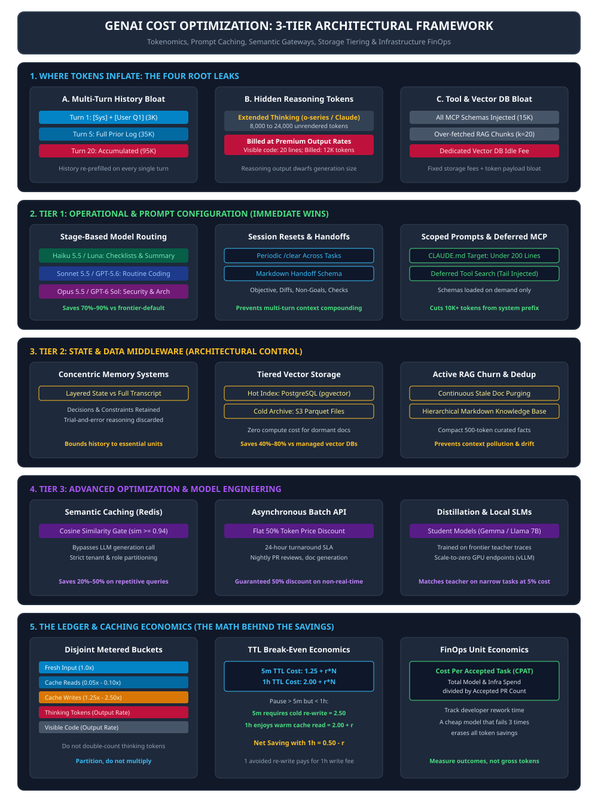
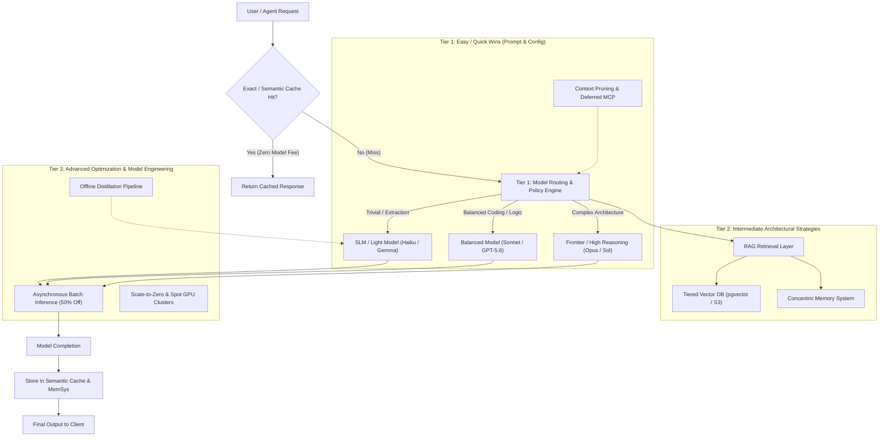

# GenAI Cost Optimization: Engineering Tiers, FinOps, and Architectural Controls

Daily learning · November 5, 2026 · Production Cost Architecture & FinOps

> **Core idea:** Sustainable GenAI economics requires a tiered optimization strategy—progressing from immediate configuration quick wins (model right-sizing, session resets, prompt caching) to architectural middleware (semantic caching, vector store tiering, knowledge bases) and advanced model distillation and SLM deployment.

---



---

## 1. Foundations: The Anatomy of Generative AI Costs

Generative AI applications incur costs fundamentally distinct from classical web services. While traditional microservices scale primarily on CPU cycles, memory footprint, and network bandwidth, GenAI applications scale on **token volume**, **context retention**, **model parameter tiers**, and **specialized accelerator hardware (GPUs/TPUs)**. 

### Core Cost Drivers in Modern LLM Systems

1. **Quadratic & Linear Attention Overhead:** Standard transformer self-attention scales quadratically with sequence length during prefill, and KV cache memory scales linearly with prompt history for every concurrent user.
2. **Context Accumulation:** Multi-turn chat sessions and multi-step agentic execution loops re-send historical transcripts on every call, multiplying input token consumption.
3. **Reasoning & Tool Inflation:** Extended thinking tokens (e.g., OpenAI o-series/reasoning tokens, Anthropic Claude adaptive thinking) and verbose tool definitions are billed at premium output and input rates respectively.
4. **Unmanaged RAG Storage:** Storing high-dimensional vector embeddings in dedicated proprietary vector databases without lifecycle tiering creates ongoing compute and memory expenses.

### Systems and Roles in GenAI Cost Management

| System / Component | Primary Function | Primary Cost Driver | Optimization Lever |
|---|---|---|---|
| **Client / Agent Harness** | Orchestrates user prompts, system context, and tools | History accumulation, MCP schema overhead | History compaction, session resets, deferred tool loading |
| **Inference Gateway / Proxy** | Routes requests, enforces policies, handles caching | Proxy latency, cold network hops | Prompt prefix caching, semantic response caching |
| **Model Provider API** | Generates completions and reasoning traces | Input tokens, output tokens, reasoning tokens | Model downshifting (Haiku/Gemma vs Opus/GPT-4o), Batch API |
| **Vector Database (RAG)** | Stores and indexes knowledge embeddings | Memory-resident indexes (HNSW), read/write IOPS | Tiered storage (pgvector, S3 Parquet), metadata pre-filtering |
| **Cloud Infrastructure** | Hosts self-managed models, fine-tuning, and workers | GPU hours (A100/H100), idle instance runtime | Spot instances, scale-to-zero (KEDA/vLLM), quantization |

---

## 2. Mechanism: The Three-Tier Optimization Framework

GenAI cost optimization is structured into three progressive operational tiers based on implementation complexity, required architectural changes, and return on investment.



### Tier 1: Easy / Quick Wins (Operational & Prompt Configuration)

Tier 1 optimizations require minimal code modifications and can be enabled immediately in existing pipelines:

1. **Right-Size the Model for the Task:** Avoid defaulting to frontier models (e.g., Claude Opus 5.5, GPT-6 Sol) for simple formatting, extraction, routing, or classification. Use efficient models (Claude Haiku 5.5, Gemini 1.5/2.0 Flash, GPT-6 Luna, or Gemma 2/4) for high-volume, low-complexity tasks, saving up to 80–95% per call.
2. **Start Fresh Conversations (`/clear`):** Multi-turn conversations resend previous context on every turn. In an agentic loop or coding workflow, a conversation that grows from 2,000 to 50,000 tokens charges for 50,000 tokens on turn 20 even if the user only asks a one-sentence clarification. Clear unrelated contexts or summarize state across task boundaries.
3. **Disconnect Unnecessary MCP Servers & Tool Schemas:** In standard Model Context Protocol (MCP) integrations, every attached server injects its entire JSON schema into the system prompt on every turn. Disconnect unused servers or utilize progressive tool discovery (deferred tool search) so schemas are fetched on demand.
4. **Maintain a Markdown Configuration File (`CLAUDE.md`, `agent.md`):** Establish centralized, concise project conventions (under 200 lines). Providing clear architectural constraints upfront eliminates repetitive multi-turn correction loops where models write non-compliant code and need several expensive remediation turns.
5. **Batch Related Instructions:** Consolidate related instructions into structured single prompts rather than conversational back-and-forth prompts. Each round-trip incurs a full prefill charge over the entire conversation history.
6. **Active Cost & Usage Monitoring:** Instrument daily spend alerts, token budgets, and cost attribution per user/feature. Set hard limits in AWS CloudWatch, OpenAI billing controls, or LiteLLM proxy dashboards to catch rogue infinite loops before receiving five-figure invoices.

### Tier 2: Intermediate Architectural Strategies (State & Data Middleware)

Tier 2 optimizations alter the data pipeline and context delivery mechanisms:

7. **Structured Memory vs Full Transcript Replay:** Replace raw transcript replay with persistent, structured memory stores (e.g., 5-layer concentric harness memory or key-value decision journals). Retain only accepted decisions, entity graphs, and constraints, discarding thousands of tokens of intermediate trial-and-error reasoning.
8. **Bound Multi-Agent Sprawl:** Multi-agent architectures (supervisor-worker, peer debate) multiply token consumption by $N$ agents. Each subagent creates its own context window. Limit subagents strictly to tasks requiring genuine context isolation (e.g., untrusted code execution or massive parallel web search). For routine development, single-agent loops with focused tools are significantly cheaper.
9. **Optimize Vector Database Selection & Tiering:** Dedicated managed vector databases (e.g., enterprise OpenSearch, Pinecone) carry high fixed baseline costs. For small-to-medium enterprise workloads (<10M vectors), serverless or embedded options such as PostgreSQL with `pgvector` or DuckDB provide comparable recall at a fraction of the infrastructure cost. Cold embeddings can be archived to Amazon S3 as Parquet files with zero compute overhead when idle.
10. **Active RAG Document Hygiene:** Continually clean and deduplicate chunked documents. Dead documentation, obsolete code branches, and duplicate tickets inflate chunk retrieval count ($k$). Pruning stale chunks prevents context window bloat and reduces false-positive model hallucinations.

### Tier 3: Advanced Optimization & Model Engineering

Tier 3 optimizations involve machine learning engineering and custom deployment infrastructure:

11. **Semantic Caching Layer:** Traditional exact-match caches (HTTP hash keys) miss queries that share semantic intent but differ in phrasing. A semantic cache (e.g., using Redis or GPTCache) embeds incoming queries, calculates cosine similarity against previous queries, and serves the cached response if similarity exceeds a calibrated threshold (e.g., $\ge 0.94$). This completely bypasses LLM inference.
12. **The LLM Wiki Method (Curated Living Knowledge Bases):** Instead of executing broad semantic RAG searches over thousands of unvetted raw documents on every turn, maintain an updated, hierarchical Markdown knowledge base ("LLM Wiki" or Karpathy-style knowledge graph). Feeding a compact 500-token summary of vetted facts avoids fetching 20,000 tokens of noisy source documents.
13. **Model Distillation:** Train smaller, task-specific student models (e.g., 7B–14B parameters or fine-tuned Haiku) using high-quality output generated by frontier teacher models (Opus 5.5, GPT-4o). For structured tasks like triage, SQL generation, or code linting, distilled models match teacher accuracy at 5–10% of the inference cost.
14. **Small Language Models (SLMs) on the Edge / Local Devices:** Deploy specialized open-weight SLMs (Gemma, Llama 3, Qwen) on local workstations or private endpoints for routine tasks like code completion, unit test generation, and docstring writing.
15. **Traditional Cloud FinOps for AI Clusters:** For self-hosted open-weight models (vLLM, TGI), treat GPU clusters with standard cloud rigor: run inference on Spot GPU instances, right-size GPU VRAM using activation-aware quantization (AWQ, FP8, INT4), and utilize auto-scalers (e.g., KEDA) to scale inference endpoints down to zero during off-peak hours.

### Cloud Provider-Specific Cost Savers

- **Batch Processing Endpoints:** Both OpenAI Batch API and AWS Bedrock Batch Inference offer a **50% discount** on standard token pricing for asynchronous workloads with a 24-hour SLA. Use Batch for nightly code reviews, bulk data classification, documentation generation, and test generation.
- **Provider Prompt Prefix Caching:** Ensure system instructions, tool definitions, and long repository documents are structured as stable prefixes. OpenAI, Anthropic, and AWS Bedrock offer up to **80–90% discounts** on prompt tokens that hit existing KV cache prefixes.
- **Guardrails Before Inference:** Deploy lightweight rule engines or Bedrock Guardrails to inspect and filter queries for prompt injections, out-of-scope queries, or sensitive PII before forwarding them to foundation models. Rejecting an invalid query at the gateway costs micro-cents compared to full frontier LLM generation.

---

## 3. Impact and Limits: Trade-offs & Common Misconceptions

### Realized Benefits vs Engineering Trade-offs

| Optimization Technique | Typical Cost Reduction | Primary Operational Risk / Trade-Off | Mitigation Strategy |
|---|---|---|---|
| **Model Downshifting** | 70% – 90% | Degradation on edge cases, loss of nuanced instruction following | Automated fallback to frontier model on validation failure |
| **Semantic Caching** | 20% – 50% | False positives serving obsolete or slightly incorrect answers | Calibrate strict similarity threshold ($\ge 0.94$), enforce TTL, partition by tenant/role |
| **Vector DB Migration (pgvector)** | 40% – 80% | Slower index build times at massive scale (>50M vectors) | Use HNSW indexes in PostgreSQL, partition tables by date/domain |
| **Batch Inference** | 50% flat | High latency (up to 24-hour turnaround) | Restrict strictly to asynchronous non-interactive pipelines |
| **Context Compaction / Reset** | 30% – 60% | Lost conversational context, loss of early edge-case instructions | Structured handoff documents containing goals, diffs, and constraints |

### Common Misconceptions (Claim vs Correction)

| Common Claim | Reality / Correction |
|---|---|
| *"Prompt caching makes inference virtually free."* | **Correction:** Cached tokens receive a discount (typically 50–90% off base input), but cache reads are still billed. Furthermore, writing or refreshing the cache incurs standard or premium write rates (e.g., Anthropic charges 1.25×–2× for cache writes). |
| *"Multi-agent systems always produce superior output."* | **Correction:** Multi-agent architectures frequently result in runaway context inflation, redundant consensus debates, and high latency with diminishing accuracy gains. For most tasks, a single agent with well-defined verification tools outperforms multi-agent swarms at one-fifth the cost. |
| *"Semantic caching works safely across all user sessions."* | **Correction:** Caching must be strictly scoped by user permissions, tenant boundaries, and temporal validity. Serving a cached answer containing proprietary code or private data across tenant boundaries is a major security violation. |
| *"SLMs cannot perform professional coding tasks."* | **Correction:** Fine-tuned or distilled 7B–14B models consistently match or outperform frontier models on narrow, well-defined coding tasks (syntax transforms, test scaffolding, boilerplates) when provided with explicit symbol context. |

---

## 4. Timeline and Current State

- **Early 2024:** Foundation model pricing is dominated by uniform pay-per-token pricing with high frontier rates ($15–$30/M input, $60–$75/M output). Multi-turn chat applications face severe context economics.
- **Mid 2024:** Major providers introduce prompt caching (Anthropic, DeepSeek, Google Gemini). Structured prefix caching discounts input tokens by 75–90% for matching prefixes.
- **Late 2024 – Early 2025:** OpenAI introduces o-series reasoning models; Anthropic introduces extended thinking. Token pricing shifts: reasoning tokens are billed as output tokens, often multiplying generation fees despite short visible answers.
- **2026 Landscape:**
  - **Tiered Model Paradigms:** High availability of ultra-cheap, capable sub-dollar models (Claude Haiku 5.5 at $0.10/M input, GPT-6 Luna at $0.10/M input, Gemini 2.0 Flash) alongside frontier reasoning powerhouses.
  - **Widespread Batch APIs:** 50% discounts across all major providers for asynchronous operations become an enterprise FinOps standard.
  - **Tool & Schema Deferral:** Modern harnesses (Copilot, Claude Code, AGY) transition from injecting all MCP schemas upfront to progressive on-demand tool loading, preventing upfront token bloat.

---

## 5. Practical Response and Lessons

### FinOps Metric Formulas

Track unit economics rather than gross monthly token consumption:

1. **Cost Per Accepted Change (CPAC):**
   Flush-left calculation for software engineering agentic workflows:

$$\text{CPAC} = \frac{\sum \text{Model Spend} + \sum \text{Tool / Infrastructure Spend}}{\text{Total Verified Merged PRs / Tasks}}$$

2. **Cache Hit Ratio (CHR):**
   Evaluating prompt prefix cache and semantic cache efficiency:

$$\text{CHR} = \frac{\text{Tokens}_{\text{cached}}}{\text{Tokens}_{\text{fresh}} + \text{Tokens}_{\text{cached}}} \times 100\%$$

3. **Token Inflation Factor (TIF):**
   Measures context bloat over a multi-turn session ($T$ turns):

$$\text{TIF} = \frac{\text{Input Tokens in Turn } T}{\text{Input Tokens in Turn } 1}$$

### Practical Tier 1 Implementation: Structured Project Rules

Keep base instruction files (`CLAUDE.md`, `agent.md`) under 200 lines to avoid burning prompt tokens on every request:

```markdown
# Agent Directives & Tech Stack
- Stack: Python 3.12, FastAPI, PostgreSQL 16 (pgvector), Redis.
- Testing: pytest with 100% coverage on core business logic.
- Conventions: Use type annotations, Pydantic v2 models, no wildcard imports.
- Non-goals: Do not introduce new third-party dependencies without explicit approval.
- Verification: Always run `pytest tests/` before reporting completion.
```

### Practical Tier 2 Implementation: Semantic Caching with Redis

A lightweight Python snippet demonstrating semantic query caching using cosine similarity over local embeddings:

```python
import numpy as np
import redis
from sentence_transformers import SentenceTransformer

class SemanticCache:
    def __init__(self, host="localhost", port=6379, threshold=0.94):
        self.r = redis.Redis(host=host, port=port)
        self.model = SentenceTransformer("all-MiniLM-L6-v2")
        self.threshold = threshold

    def get(self, query: str) -> str | None:
        q_emb = self.model.encode(query)
        # Search existing cached queries in Redis
        for key in self.r.scan_iter("cache:*"):
            cached_data = self.r.hgetall(key)
            c_emb = np.frombuffer(cached_data[b"embedding"], dtype=np.float32)
            similarity = np.dot(q_emb, c_emb) / (np.linalg.norm(q_emb) * np.linalg.norm(c_emb))
            if similarity >= self.threshold:
                return cached_data[b"response"].decode("utf-8")
        return None

    def set(self, query: str, response: str):
        q_emb = self.model.encode(query).astype(np.float32).tobytes()
        key = f"cache:{hash(query)}"
        self.r.hset(key, mapping={"embedding": q_emb, "response": response})
        self.r.expire(key, 86400)  # 24-hour TTL
```

### Practical Tier 3 Implementation: Asynchronous Batch Job Submission

Submitting non-urgent RAG re-indexing or test generation to batch endpoints for immediate 50% cost savings:

```python
import json
from openai import OpenAI

client = OpenAI()

# 1. Prepare batch file (jsonl)
tasks = [
    {
        "custom_id": f"task-{i}",
        "method": "POST",
        "url": "/v1/chat/completions",
        "body": {
            "model": "gpt-4o-mini",
            "messages": [{"role": "user", "content": f"Summarize ticket #{i}"}],
            "max_tokens": 500,
        },
    }
    for i in range(100)
]

with open("batch_tasks.jsonl", "w") as f:
    for t in tasks:
        f.write(json.dumps(t) + "\n")

# 2. Upload and submit batch (50% cheaper than standard API)
batch_file = client.files.create(file=open("batch_tasks.jsonl", "rb"), purpose="batch")
batch_job = client.batches.create(
    input_file_id=batch_file.id,
    endpoint="/v1/chat/completions",
    completion_window="24h",
)
print(f"Batch submitted: {batch_job.id}")
```

---

## 6. Source Context and Cross-References

**Source Context:**
Based on user-provided details (Raj's *15 Gen AI Cost Optimization Tips for Interviews and Real-World Projects*, [YouTube reference](https://www.youtube.com/watch?v=lpj9XqEyHjg)), expanded and verified against primary cloud documentation:
- [AWS Bedrock Cost Optimization Guide](https://docs.aws.amazon.com/bedrock/latest/userguide/cost-optimization.html)
- [Anthropic Prompt Caching & Cost Controls](https://platform.claude.com/docs/en/build-with-claude/prompt-caching)
- [OpenAI Batch API & Prompt Caching](https://developers.openai.com/api/docs/guides/batch)
- [LiteLLM Proxy Architecture](https://docs.litellm.ai/docs/proxy/cost_tracking)

---

**Related:**
- [Empirical Tokenomics and Model Routing](Empirical-Tokenomics-and-Model-Routing-2026.md) — Stage-based model selection, context handoffs, and cost per accepted change.
- [The AI Coding Invoice: Beyond Input and Output](AI-Coding-Invoice-Beyond-Input-and-Output-2026.md) — Ledger analysis of hidden token costs, cache write premiums, and sandbox runtimes.
- [Context Windows, Compaction, and Cache Breaks](Context-Windows-Compaction-and-Cache-Breaks-2026.md) — Managing history thresholds, prefix cache invalidation, and break-even economics.
- [AI Token Optimization Tools](ai-token-optimization-tools.md) — Structural navigation, proxy compression, and schema deferral layers.
- [OpenResponses Open Inference Standard](OpenResponses-Open-Inference-Standard.md) — Server-side agentic execution loops eliminating round-trip token inflation.
