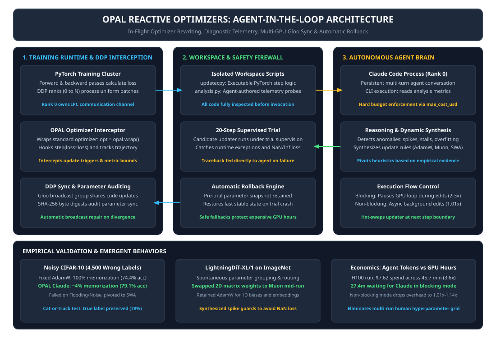
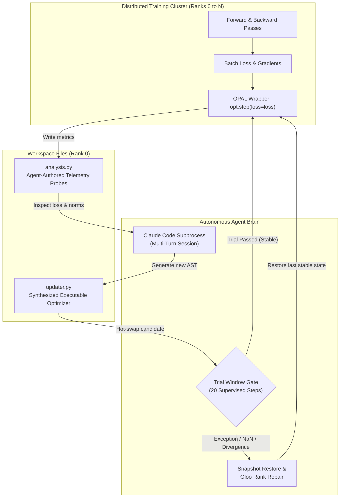
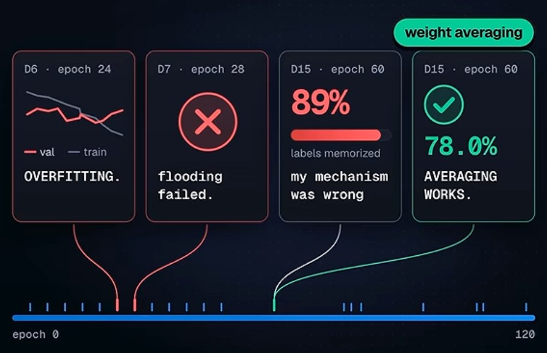
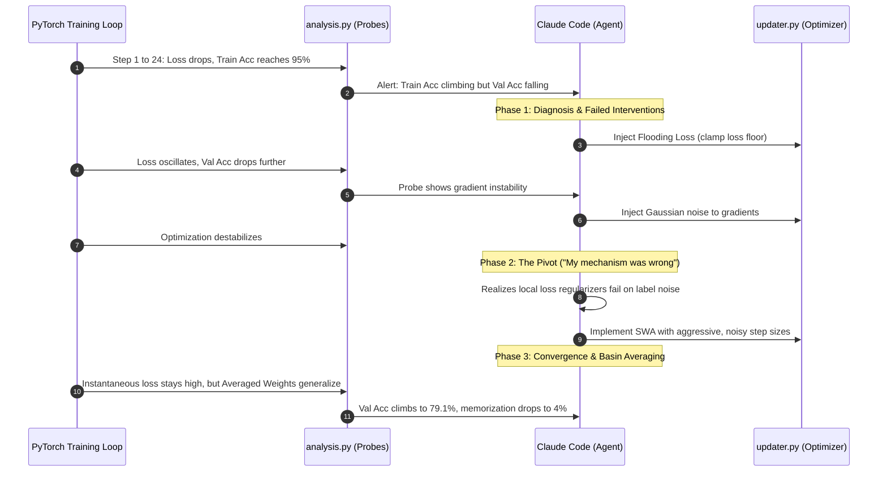
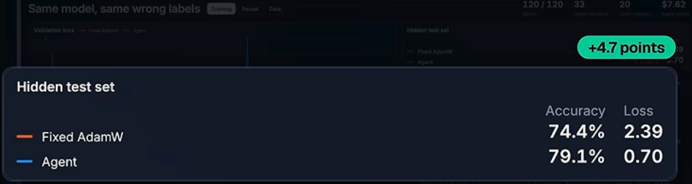
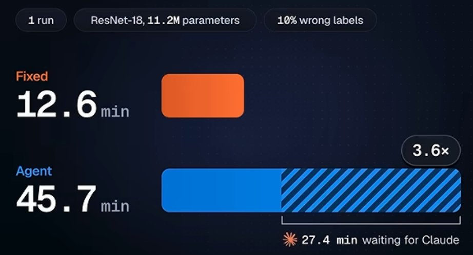

# OPAL Reactive Optimizers: A Coding Agent Rewrites the Optimizer Mid-Training

**Daily learning · 8 November 2026 · Primary sources verified: arXiv:2610.33826, MIT CSAIL project disclosures, and OPAL repository**

> **Core idea:** Traditional neural network training relies on fixed, hand-tuned optimizer recipes chosen before the run starts. OPAL (*OPtimizer with an Agent in the Loop*) places an autonomous coding agent (Claude Code) directly inside the PyTorch training loop, allowing it to inspect runtime telemetry, formulate hypotheses, and rewrite executable optimizer code mid-training. In a deliberately sabotaged CIFAR-10 experiment with 4,500 corrupted labels, the agent autonomously pivoted from failed regularization attempts to weight averaging, slashing wrong-label memorization from 100% to ~4% and improving test accuracy from 74.4% to 79.1%.

---

## 1. Beyond Static Optimization Recipes

Traditional deep neural network training treats the optimizer as a static, immutable component. Before launching a cluster, an engineer selects an update rule (such as AdamW, SGD, or Muon), configures a learning rate schedule (e.g., Cosine Annealing with linear warmup), sets weight decay, and leaves the run to execute blindly from step 1 to completion.

If training destabilizes, suffers a loss spike, or overfits to spurious noise, standard practice requires post-mortem human intervention: terminating the job, inspecting logs, tuning hyperparameters, and launching a new multi-day training run. In novel architectures or low-resource modalities lacking mature heuristics, finding an effective recipe demands expensive hyperparameter grid sweeps across dozens of GPU instances.

### The Reactive Optimizer Paradigm

Introduced by researchers at MIT CSAIL (*Reactive Optimizers*, arXiv:2610.33826 by Xingjian Bai, Jia-Hao Liang, Jayden Teoh, and Vincent Sitzmann; codebase `xingjian-bai/opal`), **OPAL** (*OPtimizer with an Agent in the Loop*) replaces static configuration with an autonomous, self-healing software loop:

1. **In-Flight Code Rewriting:** An autonomous coding agent (Claude Code running Claude Opus/Sonnet) sits inside the PyTorch training loop, inspecting runtime loss curvature, gradient norms, and validation metrics.
2. **Empirical Hypothesis Testing:** Rather than relying on rigid rules, the agent actively hypothesizes why training is stalling or overfitting, authors custom diagnostic probes, and rewrites the executable optimizer source code on the fly.
3. **Autonomous Adaptation:** The agent can switch update algorithms (e.g., introducing Muon for 2D matrix weights mid-run), calibrate learning rates, or implement structural techniques like Stochastic Weight Averaging (SWA) without human intervention.

---

## 2. Foundations: What Needs Explaining First

An optimizer translates backpropagated gradients into parameter weight updates. In standard machine learning practice, this recipe is statically selected before training begins: the engineer picks an algorithm (e.g., AdamW, SGD with momentum, or Muon), sets a learning rate schedule (e.g., Cosine Annealing with linear warmup), tunes weight decay, and leaves the script to run untouched.

```
Static Paradigm:   Config / Sweep ───► [Fixed Optimizer] ───► Run Step 1 ... Step N (Blind)
Reactive Paradigm: Run Step ───► Diagnostics ───► Coding Agent ───► AST Rewrite ───► Hot-Swap
```

If the loss spikes, diverges, or enters a plateau, an engineer must manually abort the run, analyze logs, adjust hyperparameters, and launch a new job from a checkpoint. For novel architectures, unstudied data distributions, or low-resource modalities, finding an optimal recipe requires expensive hyperparameter sweeps across dozens of GPU clusters.

### Essential Terminology

| Term | Meaning in This Context |
|---|---|
| **Optimizer Recipe** | The static bundle of update equations, learning rate schedules, momentum coefficients, and weight decay rules chosen prior to training. |
| **AdamW** | Standard adaptive moment estimation optimizer with decoupled weight decay; the primary static baseline used in the experiments. |
| **Muon** | An optimizer that orthogonalizes update steps for 2D matrix parameters via Newton-Schulz iterations. OPAL frequently introduces Muon for transformer weights mid-run. |
| **SWA (Stochastic Weight Averaging)** | Averaging model weights along the training trajectory to find wider, flatter local minima with superior out-of-distribution generalization (Izmailov et al., 2018). |
| **Flooding Loss** | An optimization heuristic that artificially prevents training loss from dropping below a specified threshold, intended to deter memorization. |
| **Reactive Optimizer** | An optimizer that actively inspects runtime training telemetry and dynamically rewrites its own executable update code while the model trains. |
| **OPAL** | *OPtimizer with an Agent in the Loop*; the open-source PyTorch framework developed by Xingjian Bai et al. at MIT CSAIL. |

### Architectural Overview



OPAL structures the optimization process into two distinct, agent-editable files inside a working directory (`opal_runs/<folder>/workspace/`):
1. **`updater.py`**: The executable code that performs parameter updates at each step. It begins as a standard call to the user's initial optimizer and learning rate scheduler.
2. **`analysis.py`**: Diagnostic telemetry code that computes training statistics (gradient norms, layer-wise weight updates, loss variance, validation accuracy). The agent can author custom probes here to investigate anomalies.



### Safety and Distributed Synchronization

1. **Rank 0 Orchestration:** In multi-GPU Distributed Data Parallel (DDP) runs, only Rank 0 invokes the Claude Code agent subprocess via inter-process communication (IPC).
2. **Gloo Broadcast Group:** Optimizer code updates synthesized on Rank 0 are broadcast across all GPU ranks via a separate PyTorch Gloo communication group.
3. **20-Step Trial Window:** A newly generated optimizer program is never trusted immediately. It runs on probation for 20 training steps. If the candidate raises a Python exception, produces `NaN` or `Inf` loss, or crashes, OPAL halts the trial, restores a pre-trial weight snapshot, repairs rank parameters, and passes the error traceback directly to the agent.
4. **Parameter Fingerprinting:** To prevent silent rank desynchronization, OPAL takes SHA-256 byte digests of model parameters across ranks before, during, and after each trial. If ranks diverge, Rank 0 parameters are broadcast to repair the cluster.

---

## 3. Mechanism: The Sabotaged CIFAR-10 Experiment

To evaluate whether a reactive coding agent could diagnose and mitigate failure modes without human intervention, the authors established a controlled label-corruption benchmark:

### Experimental Setup

- **Model Architecture:** ResNet-18 trained from scratch for 120 epochs without data augmentation.
- **Dataset Partitioning:** CIFAR-10 (50,000 training images, 10,000 test images).
  - 5,000 images held out as a clean validation set.
  - 45,000 images assigned to the active training set.
  - **The Sabotage:** Exactly 10% of the training images (4,500 images) were deliberately assigned uniform random incorrect labels (e.g., an image of a cat labeled as a "truck" or "frog").
- **Agent Information Boundary:** The agent had access to training loss curves, gradient norms, and validation metrics via `analysis.py`. **The agent was never informed that labels had been corrupted**, nor did it have access to the held-out 10,000-image test set.

```
Total CIFAR-10 (60,000 Images)
├── Test Set (10,000 Images) ─── [Held Out; Evaluated Only at End]
└── Training Pool (50,000 Images)
    ├── Validation Set (5,000 Images) ─── [Clean Telemetry for Agent]
    └── Active Train Set (45,000 Images)
        ├── Clean Samples (40,500 Images)
        └── Sabotaged Samples (4,500 Images) ─── [10% Random False Labels]
```

### Baseline Performance (Static AdamW)

Under standard static AdamW training:
- Training loss drops steadily to zero.
- The model exhibits complete label memorization: **100% of the 4,500 corrupted images are memorized with their false labels**.
- Validation accuracy stalls around epoch 24 and drops significantly as the model overfits the noise.
- Final test accuracy on the clean 10,000-image test set reaches **73.5%** in the MIT paper and **74.4%** in independent H100 single-run reproductions.
- Heuristic baselines: Early stopping based on peak validation accuracy achieves **72.9%**; a static, pre-configured Exponential Moving Average (EMA/SWA) reaches **77.5%**.

### Claude Code's Reactive Trajectory



Across the 120 epochs, the agent was queried 33 times, producing 20 concrete code revisions to `updater.py`. The agent's strategic evolution unfolded across three distinct phases:



#### Phase 1: Diagnosis and Failed Interventions (Epochs 24–35)
- **Decision 6 (D6 · Epoch 24): Overfitting Detected:** Claude observed that training accuracy continued climbing past 95% while validation accuracy plateaued and began to decline.
- **Decision 7 (D7 · Epoch 28): Flooding Failed:** Claude edited `updater.py` to enforce a loss floor ("flooding") to prevent training loss from driving toward zero. Training dynamics destabilized, and validation accuracy fell further.
- **Gradient Noise Injection:** The agent then attempted to inject random Gaussian noise into the gradients, which merely slowed convergence without resolving the noise memorization.

#### Phase 2: The Pivot at Epoch 60 ("My Mechanism Was Wrong")
- **Decision 15 (D15 · Epoch 60): Diagnosis of Failure:** Telemetry in `analysis.py` revealed that despite earlier interventions, **89% of corrupted labels were actively being memorized**. Claude acknowledged its diagnostic mistake in internal reasoning: *"my mechanism was wrong. Local regularizers on the current loss landscape are insufficient to untangle corrupted samples."*
- **Decision 15 Code Rewrite (D15 · Epoch 60): The SWA Pivot:** Claude completely abandoned local loss penalties and shifted to a geometric exploration strategy: implementing **Stochastic Weight Averaging (SWA)** paired with large, exploratory update steps. Validation metrics responded immediately (*"averaging works"*), driving validation accuracy to 78.0% and paving the way to 79.1% on the hidden test set.

#### Phase 3: Mathematical Mechanism of the Solution
The agent's synthesized strategy leverages the geometric distinction between clean data basins and noisy label memorization:
- **Sharp Minima for Noise:** Corrupted samples occupy isolated, highly concave, sharp local minima in parameter space. To fit 4,500 arbitrary labels, the model must contort its weights into narrow crevices.
- **Wide Basins for Clean Generalization:** Authentic visual features (e.g., ears, wheels, wings) share widespread statistical support across thousands of images, forming wide, flat loss basins.
- By enforcing aggressive, noisy instantaneous step sizes, the model repeatedly escapes the sharp crevices of the mislabeled samples.
- Meanwhile, an accumulator continuously calculates the running average of the parameter trajectory:

$$W_{\text{SWA}} = \frac{1}{K} \sum_{k=1}^{K} W_k$$

The instantaneous network never settles into the noise, while the averaged weights $W_{\text{SWA}}$ converge smoothly to the center of the wide, generalizable basin.

```
Loss
 │
 │      Corrupted Label Crevice           Clean Feature Wide Basin
 │         (Sharp Minimum)                     (Flat Minimum)
 │             \   /                                \             /
 │              \ /                                  \   W_SWA   /
 │               ▼                                    \    *    /
 │         [Memorization]                              \_______/
 │      Instantaneous noisy steps bounce OUT ───► Trajectory averages HERE
 └────────────────────────────────────────────────────────────────────────► Parameter Space W
```

### Empirical Results on the Hidden Test Set



At the completion of the 120-epoch training schedule, both models were evaluated against the held-out 10,000-image test set (which was never seen during training or telemetry analysis):

| Evaluation Dimension | Static AdamW Baseline | OPAL Reactive Agent | Empirical Delta |
|---|---|---|---|
| **Test Accuracy** | **74.4%** | **79.1%** | **+4.7 percentage points** |
| **Test Loss** | **2.39** | **0.70** | **-1.69 (3.4x lower loss)** |
| **Agent Decisions** | N/A | **33 decisions** | Ingested across 120 epochs |
| **Code Rewrites** | 0 (static) | **20 code changes** | AST modifications to `updater.py` |
| **Total Agent Cost** | $0.00 | **$7.62** | Persistent multi-turn session tokens |

### Direct Memorization Inspection: Corrupted Sample Evaluation

To verify whether the model truly generalizes rather than memorizing noise, individual corrupted training samples were evaluated:
- **Test Image Case:** A photograph of a domestic cat that had been assigned the corrupted training label `"truck"`.
- **Static AdamW Model:** Confidently outputs `"truck"`, having completely memorized the corrupted label during training.
- **OPAL (Claude) Model:** Correctly outputs `"cat"`, filtering out the spurious supervision.
- Across all 4,500 mislabeled images, the static model memorized **100%**, whereas OPAL dropped false label repetition to **~4%** (~250 images), recovering the true underlying category for **~78%** of the corrupted dataset.

---

## 4. Broader Findings: Generative Diffusion and Language Models

The MIT paper evaluated OPAL across several machine learning regimes beyond CIFAR-10 to investigate whether an agent can synthesize competitive optimizers from scratch.

### 1. Generative Image Modeling (LightningDiT-XL/1 on ImageNet)

When training a Diffusion Transformer (LightningDiT-XL/1) on ImageNet, OPAL was deployed without task-specific tuning:
- **Parameter-Group Differentiation:** Claude inspected model parameter shapes via `analysis.py` and differentiated 2D matrix weights (attention projections, MLP linear layers) from 1D biases and normalization vectors.
- **Spontaneous Muon Integration:** The agent dynamically imported and assigned the **Muon optimizer** (matrix orthogonalization via Newton-Schulz iterations) exclusively to the 2D linear matrices, while routing 1D normalization and embedding parameters to AdamW.
- **Loss Spike Guards:** When the diffusion loss encountered gradient instability, the agent wrote adaptive clipping guards and learning-rate dampeners that suppressed spikes before divergence occurred.
- **Result:** The reactive run achieved lower Fréchet Inception Distance (FID) scores than the static AdamW baseline without requiring human hyperparameter sweeps.

### 2. Language Modeling (Modded-NanoGPT / NanoGPT)

On transformer language modeling benchmarks:
- The agent dynamically adjusted cosine annealing schedules, preconditioning parameters, and momentum decay rates based on loss slope analysis.
- **Performance Boundary:** In heavily optimized benchmarks with mature, human-engineered records (e.g., modded-nanogpt), OPAL achieved a validation loss of **3.2878**, falling slightly short of the tuned static world record (**3.2781**).
- **Takeaway:** Reactive optimization provides massive leverage in uncalibrated or novel settings, but struggles to outperform hundreds of cumulative GPU-years of human grid searches on saturated benchmarks.

---

## 5. Impact, Limits, and Economic Tradeoffs

### Claim vs. Evidence Matrix

| Claim | Evidence Status | Primary Observation |
|---|---|---|
| **OPAL eliminates label memorization** | **Verified (in controlled setup)** | Cut corrupted label memorization from 100% to ~4% and boosted test accuracy from 74.4% to 79.1% on CIFAR-10. |
| **Claude invented Stochastic Weight Averaging** | **Refuted (Known Algorithm)** | SWA was introduced by Izmailov et al. in 2018. Claude did not invent the math; it autonomously diagnosed a failure, recalled/rediscovered the mechanism, and implemented it mid-run. |
| **OPAL is a universal fix for overfitting** | **Unproven / Overstated** | Tested on small-to-medium models (ResNet-18, LightningDiT, NanoGPT). Behavior on trillion-token frontier training remains unverified. |
| **OPAL always beats static baselines** | **Refuted** | On hyper-optimized benchmarks (modded-nanogpt), the agent failed to beat the static record (3.2878 vs 3.2781). |
| **Agent cost is prohibitively expensive** | **Context-Dependent** | In empirical H100 benchmarks, Claude consumed **$7.62** in API tokens across a 45.7-minute run (with 33 decisions and 20 code changes, where 27.4 minutes was spent waiting for Claude under blocking mode). In non-blocking mode, wall-clock overhead drops to 1.01x to 1.14x. |

### Architectural and Engineering Limitations

1. **Lack of Distributed Scaling (Multi-Node / FSDP / DeepSpeed):** OPAL supports single-node multi-GPU via DDP and Gloo, but does not support multi-node scaling, Fully Sharded Data Parallel (FSDP), DeepSpeed ZeRO, or Megatron-LM tensor parallelism.
2. **Incompatibility with `torch.compile`:** Because `updater.py` undergoes dynamic Python Abstract Syntax Tree (AST) rewrites and module reloads mid-training, static graph compilation via `torch.compile` breaks or suffers continuous cache recompilation penalties.
3. **The One-Way Arrow of Time:** While the 20-step trial window catches immediate runtime crashes or `NaN` losses, an optimizer program that causes slow, subtle performance degradation over hundreds of steps cannot be automatically rolled back without external checkpoint restoration.
4. **Agent Non-Determinism:** LLM reasoning is stochastic. Identical starting points can yield different code modifications across separate runs.

### The Economic Equation: Agent Tokens vs. GPU Hours



```
Blocking Mode:     [GPU Step] ──► [PAUSE GPU (Agent Thinking)] ──► [Hot-Swap] (3.6x Wall-Clock)
Non-Blocking Mode: [GPU Steps Continue...] ──► [Agent Thinks Async] ──► [Hot-Swap] (1.01x - 1.14x)
```

In empirical single-GPU verification runs (ResNet-18, 11.2M parameters, 10% corrupted labels on an NVIDIA H100):
- **GPU Resource:** 1x NVIDIA H100 (~$3.00 to $4.50/hr on cloud providers).
- **Agent Token Cost:** **$7.62** across 33 agent decisions and 20 code changes (Claude Code running Claude Opus 3.5 / Sonnet).
- **Wall-Clock Duration:** The baseline fixed AdamW run completed in **12.6 minutes**. The OPAL agent run required **45.7 minutes**—a **3.6x wall-clock slowdown** under blocking mode.
- **Where the Idle Time Went:** A breakdown of the agent run reveals that **27.4 minutes** (60.0% of the total elapsed time) was spent idle **waiting for Claude** to ingest metrics, hypothesize, author diagnostic probes in `analysis.py`, and synthesize candidate code for `updater.py`. The model was only actively training on the GPU for 18.3 minutes.
- **Why Non-Blocking Mode Was Created (`blocking=False`):** This 27.4-minute idle penalty highlighted the core inefficiency of synchronous agent execution. OPAL introduced asynchronous execution where PyTorch continues training forward on the current program while Claude reasons in a detached background thread. Once new code is generated and passes static checks, it hot-swaps seamlessly at the next step boundary, dropping overhead to **1.01x–1.14x**.
- **The Macro ROI:** In modern pretraining, aborting a crashed 1,024-H100 cluster run costs thousands of dollars. An agent spending $7.62 in tokens to catch gradient divergence or dynamically correct a failing learning rate schedule is orders of magnitude cheaper than a wasted training run.

---

## 6. Practical Response: How to Try and Verify OPAL

### 1. Installation and Prerequisites

OPAL requires Python 3.10+ and PyTorch 2.5+. For real agent-driven runs, Claude Code must be installed and authenticated on the Rank-0 host:

```bash
pip install opal-optimizer
npm install -g @anthropic-ai/claude-code
claude login
```

### 2. Wrapping an Existing PyTorch Script

Integrating OPAL requires wrapping your standard optimizer and scheduler with `opal.wrap()`:

```python
import torch
import opal

model = MyModel().cuda()
criterion = torch.nn.CrossEntropyLoss()
base_opt = torch.optim.AdamW(model.parameters(), lr=1e-3, weight_decay=1e-2)
scheduler = torch.optim.lr_scheduler.CosineAnnealingLR(base_opt, T_max=1000)

# Wrap optimizer with OPAL
opt = opal.wrap(
    optimizer=base_opt,
    model=model,
    scheduler=scheduler,
    total_steps=1000,
    goal="Maximize validation accuracy on held-out test split, mitigate overfitting",
    max_cost_usd=15.0,     # Strict spend ceiling on agent tokens
    blocking=False,        # Non-blocking mode avoids idle GPU waste
    backend="claude"       # Set backend="keep" for zero-cost dry runs
)

for step, (inputs, targets) in enumerate(dataloader):
    inputs, targets = inputs.cuda(), targets.cuda()
    outputs = model(inputs)
    loss = criterion(outputs, targets)
    
    loss.backward()
    
    # OPAL intercepts update step and monitors trajectory
    opt.step(loss=loss)
    opt.zero_grad()
    scheduler.step()

opt.close()
```

### 3. Monitoring and CLI Inspection

OPAL maintains run telemetry in `opal_runs/<timestamp>/` and provides dedicated CLI utilities:

- **Dry-Run Baseline (`backend="keep"`):** Runs the wrapper without launching Claude, ensuring that training loss matches the unwrapped baseline step-for-step before spending tokens.
- **`opal estimate <run_config>`:** Calculates anticipated agent API cost and token usage prior to launching.
- **`opal show <folder>`:** Prints a chronological log of agent decisions, tool calls, and rationale snippets:
  ```text
  [Step 240] Decision asked | Status: COMPLETED | Cost: $0.42 | Rationale: Detected val loss plateau; introducing SWA
  ```
- **`opal watch <folder>`:** Streams live decision events from `events.jsonl`.
- **`opal report <folder>`:** Rebuilds an interactive HTML report (`report.html`) containing loss overlays, parameter norm trajectories, and diffs of synthesized `updater.py` code.

---

## 7. Timeline and Milestone Evolution

| Date | Milestone / Event | Significance |
|---|---|---|
| **2018** | Izmailov et al. publish *Averaging Weights Leads to Wider Optima and Better Generalization* (SWA). | Establishes the mathematical foundation for weight averaging across loss trajectories. |
| **21 October 2026** | Xingjian Bai, Jia-Hao Liang, Jayden Teoh, and Vincent Sitzmann release *Reactive Optimizers* (arXiv:2610.33826) and the OPAL repository. | Introduces the agent-in-the-loop optimization paradigm, open-sourcing the PyTorch runtime and safety architecture. |
| **7 November 2026** | Better Stack publishes *Did Claude Just Fix AI Overfitting? (OPAL)* (YouTube: `0acRokoODvo`). | Independently reproduces the corrupted CIFAR-10 experiment, confirming that Claude autonomously pivoted to SWA and dropped memorization to ~4%. |
| **November 2026** | OPAL reaches version `0.3.10` on PyPI (`opal-optimizer`). | Hardens DDP single-node multi-GPU synchronization and introduces non-blocking asynchronous execution. |

---

## 8. Source Context and Primary Disclosures

Based on user-provided details (an external video demonstration by Better Stack, YouTube: [`0acRokoODvo`](https://www.youtube.com/watch?v=0acRokoODvo)), with material claims independently researched and verified against primary academic disclosures and official code:
1. **Primary Research Paper:** Xingjian Bai, Jia-Hao Liang, Jayden Teoh, Vincent Sitzmann, *Reactive Optimizers*, arXiv:2610.33826 [cs.LG], 21 October 2026.
2. **Interactive Project Page:** MIT CSAIL project site: [xingjianbai.com/reactive-optimizers](https://xingjianbai.com/reactive-optimizers/).
3. **Codebase and Specifications:** Official PyTorch implementation at [github.com/xingjian-bai/opal](https://github.com/xingjian-bai/opal).
4. **Empirical Reproduction Reference:** Better Stack, *Did Claude Just Fix AI Overfitting? (OPAL)*, 7 November 2026, referenced for empirical H100 wall-clock telemetry and independent verification.

---

**Related:**
- [AI Numerical Formats and Quantization](AI-Numerical-Formats-And-Quantization-Oct-2026.md) — separates optimizer update behavior from precision choices (FP8, BF16, INT4) that also shape loss convergence.
- [GenAI Cost Optimization](GenAI-cost-Optimization.md) — details tokenomics, cache management, and why trading $7 in agent tokens for hundreds in saved GPU-hours is economically rational.
- [Weight Space Programming with Astra and Qwen](../training/Weight-Space-Programming-Astra-Qwen-Nov-2026.md) — explores weight-space manipulation and geometric model editing beyond conventional backpropagation.
- [Parameter-Efficient Fine-Tuning](../../Fine-Tuning/Parameter-Efficient-Fine-Tuning.md) — covers static parameter-efficient adaptation (LoRA, DoRA) contrasting with runtime dynamic optimizer rewriting.
- [LLM Inference Architecture](../architecture/LLM-Inference.md) — covers the runtime inference side that the training recipes discussed in this note ultimately produce.
