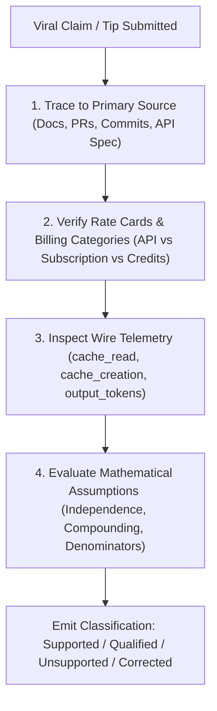

# Tokenomics Source Validation: Claims, Evidence, and Ground Truth

Daily learning · November 5, 2026 · Empirical Verification Ledger

> **Core idea:** Viral tokenomics advice frequently confuses prompt token volume with invoice spend, treats active-session cache hit rates as retention guarantees, and proposes premature optimizations that destroy prefix caching; systematic empirical auditing must separate vendor fact from community folklore.

---

## 1. Foundations: Auditing Developer UI vs Agent Harness vs Provider API

Auditing agentic tokenomics requires establishing precise definitions across three layers: the **Editor / UI Layer**, the **Agent Harness / Orchestrator**, and the **Model Provider API**.

### Vocabulary of Empirical Validation

| Concept / Claim Type | Vendor Documented Reality | Common Folk Misconception |
|---|---|---|
| **Prompt Tokens vs Billed Tokens** | Providers bill prompt tokens across disjoint categories: fresh uncached input, cached reads, and cache writes. | *"All input tokens cost the same flat rate."* |
| **Reasoning / Thinking Tokens** | Thinking tokens are billed as output tokens at full generation rates, even though they are hidden from the final transcript. | *"Hidden reasoning is an internal free feature."* |
| **Cache Hit Rate vs Cache TTL** | A 95% cache hit rate in an active session indicates sequential prefix reuse, not that the cache persists for 24 hours. | *"A high hit rate proves my cache never expires."* |
| **Agent Loops vs Single Prompts** | Agentic workflows execute 10 to 30 API calls per prompt, carrying cumulative history on each step. | *"Typing one sentence in VS Code is one API call."* |
| **Lossless Compression** | Pruning stack traces or ASTs inevitably removes some context; if the model needs it, recovery calls inflate costs. | *"Deterministic AST pruning is 100% lossless."* |

---

## 2. Mechanism: Systematic Verification Methodology

Every viral claim in this ledger was audited against a 4-step verification protocol:

---

## 3. Impact and Limits: The Empirical Claim Ledger

### A. Intent, Autonomy, Compression, and Cost Claims

| Supplied Point | Verdict | Validated Interpretation & Evidence |
|---|---|---|
| **Intent, roadmap, tribal knowledge require steering** | Qualified | While some context lives in docs, developers must state explicit priorities, constraints, and non-goals. |
| **Aggressive automatic pruning causes context rot/hallucination** | Qualified | Lossy pruning can omit critical requirements; however, unpruned long context also causes attention degradation ([Chroma Research](https://www.trychroma.com/research/context-rot), [CAPC](https://arxiv.org/abs/2607.15516)). |
| **Meta-agents drastically increase cost/latency** | Qualified | Subagents spawn independent contexts and multiply inference spend; however, parallel execution can reduce wall-clock time ([Claude Costs](https://code.claude.com/docs/en/costs)). |
| **Developer tools are autonomy Level 2–3** | Unsupported | Autonomous vehicle SAE driving levels are an analogy, not a recognized software-agent standard. |
| **Terminal permissions affect blast radius and secrets** | Supported | Enforce least-privilege permissions and execution sandboxes; prompt instructions alone are not an access-control boundary ([Claude Security](https://code.claude.com/docs/en/security)). |
| **95% step success yields <60% over 10 steps** | Conditional Arithmetic | $0.95^{10} \approx 59.87\%$. Mathematically valid *only* if steps are independent, identically distributed, and require zero-defect execution. Agents frequently self-correct upon seeing compiler errors. |
| **99% over 50 steps ≈ 61%; 95% over 50 steps ≈ 8%** | Conditional Arithmetic | $0.99^{50} \approx 60.5\%$; $0.95^{50} \approx 7.69\%$. Useful mathematical intuition, but not an empirical measurement of real coding agents. |
| **Worktrees, linters, and branch tools beat LLM multitasking** | Qualified | Use explicit git worktrees and deterministic linters; "far faster" depends on local hardware and task complexity ([Worktrees](https://code.claude.com/docs/en/common-workflows)). |
| **Manual /compact or /clear is always cheaper than meta-cognition** | Unsupported | Compaction calls also cost model tokens and invalidate cache prefixes; evaluate net session spend rather than asserting a universal rule. |
| **Developer preferences belong in config/rules** | Supported | Store stable coding standards in `CLAUDE.md` or `.cursorrules` to prevent repetitive prompt corrections ([Settings](https://code.claude.com/docs/en/settings)). |
| **Headroom is simply a Rust compression proxy** | Qualified | Headroom includes Python/TypeScript SDKs, Content-addressable Context Recovery (CCR), and memory features; implementation language does not establish dollar savings. |
| **30% fewer tokens can mean 40% higher invoice** | Supported Principle | Validated in practice when lossy compression rewrites an established prompt prefix, destroying provider KV cache reuse. |
| **Song et al. study proves compression increases cost 40–46%** | Overgeneralized | Yan Song's CAPC preprint ([ArXiv:2607.15516](https://arxiv.org/abs/2607.15516)) showed query-aware compression increased cost by 40.1% on tau-bench retail due to cache misses, whereas cache-aware compression saved cost. |
| **tokbench compressed agents used 237 vs 180 turns** | Pilot Only | The tokbench repository evaluated $N=1$ run per arm. An isolated pilot does not prove compression caused the turn increase ([tokbench](https://github.com/Entelligentsia/tokbench)). |
| **Query-adaptive rewriting breaks every turn's cache** | Supported | Rewriting historical context modifies the prefix hash, triggering full-price cache rebuilds ([Anthropic Caching](https://platform.claude.com/docs/en/build-with-claude/prompt-caching)). |
| **Cached reads always cost 10%; output always 4–5× input** | Incorrect Universals | Rates vary by provider and model. Claude Opus 5.5 and Sonnet 5.5 offer cache reads at 5% ($0.05\times$) of base input rate. |
| **50k cached at 0.1× vs 25k uncached gives 5× cost difference** | Valid Illustration | 5,000 vs 25,000 base-input equivalents. Valid for prefix prefill math, excluding output tokens and cache-write premiums. |
| **Extra 50 reasoning turns erase all savings** | Unsupported Universal | Depends on output length, reasoning effort, retries, and task complexity. |
| **Headroom++ guarantees lower $31k bill** | Unsupported | Marketing claim lacking reproducible baseline data or controlled task conditions. |
| **Never compress static prefix; only new tail** | Supported Policy | Preserving the established prefix guarantees cache reuse; new tail content can be compressed safely. |
| **Strip ANSI/progress bars, deduplicate traces** | Supported | Deterministic shell filtering (e.g., RTK) eliminates noise without corrupting semantic context. |
| **Agent only reads first 30 errors; truncate to 50+20 lines** | Unsupported Rule | Fixed line cutoffs can truncate the root cause; provide compact summaries with access to raw logs. |
| **4–6 hour sessions biggest bill driver; clear every 15 turns** | Unsupported Rule | Idle duration does not incur token billing (unless background workers run). Clear context based on task boundaries, not turn counts. |
| **VS Code is one request; CLI is 8–20 calls** | Incorrect | Both VS Code Agent mode and CLI agents execute multi-turn tool loops. |
| **Ultrathink always allocates a fixed 32k tokens ($0.50–$0.80)** | Incorrect | `ultrathink` instructs the model to reason more deeply on that turn; it does not set a hard 32,000-token allocation. |

---

### B. GitHub Copilot Claims (C01 – C48 Audited)

| ID | Claim | Verdict | Ground Truth / Primary Citation |
|---|---|---|---|
| **C01** | Right-size reasoning; do not default to Opus | Supported | Match reasoning tier to problem complexity ([Optimize AI Usage](https://docs.github.com/en/copilot/tutorials/optimize-ai-usage)). |
| **C02** | Universal 24× cost gap between models | Unsupported | Price ratios depend on specific model pairs and cache read/write rates ([Copilot Rate Card](https://docs.github.com/en/copilot/reference/copilot-billing/models-and-pricing)). |
| **C03** | Avoid reasoning for all implementation; small models more faithful | Qualified | Heavy reasoning can over-complicate routine edits; however, complex logic requires reasoning ([Optimize AI Usage](https://docs.github.com/en/copilot/tutorials/optimize-ai-usage)). |
| **C04** | Auto task routing provides a 10% credit discount | Supported | Paid Copilot plans receive a 10% discount when using Auto Model Selection ([Auto Selection](https://docs.github.com/en/copilot/concepts/models/auto-model-selection)). |
| **C05** | Auto restricts requests to cheap models | Incorrect | Auto routes dynamically to all supported models based on task requirements ([Auto Selection](https://docs.github.com/en/copilot/concepts/models/auto-model-selection)). |
| **C06** | Minimum sufficient context / precise file paths | Supported | Passing specific file selections outperforms injecting entire directory trees ([Optimize AI Usage](https://docs.github.com/en/copilot/tutorials/optimize-ai-usage)). |
| **C07** | Severe forgetting occurs at 50–70% context | Unsupported | Degradation is gradual and task-dependent; there is no universal 50% cliff ([Chroma Research](https://www.trychroma.com/research/context-rot)). |
| **C08** | Research $\to$ plan $\to$ fresh implementation session | Qualified | Excellent engineering pattern for non-trivial tasks; unnecessary process overhead for one-line edits. |
| **C09** | Tests, linters, and scanners reduce compounding mistakes | Supported | Executable verifiers ground agent output and catch regressions ([Optimize AI Usage](https://docs.github.com/en/copilot/tutorials/optimize-ai-usage)). |
| **C10** | Compounding reliability formula $p^N$ | Conditional | Valid for independent steps; real-world agents adapt based on tool feedback. |
| **C11** | Concise instructions based on observed errors | Supported | Refine instructions iteratively rather than adding speculative rules ([Custom Instructions](https://code.visualstudio.com/docs/agent-customization/custom-instructions)). |
| **C12** | Base instructions must strictly be 5–10 lines | Unsupported | Target under 200 lines (`CLAUDE.md`); arbitrary 5–10 line limits drop necessary constraints. |
| **C13** | Prompt files and skills instead of always-on rules | Supported | Skills load on demand, reducing baseline system prompt overhead ([Agent Skills](https://code.visualstudio.com/docs/agent-customization/agent-skills)). |
| **C14** | Delete existing skills because models improve | Qualified | Audit skills periodically; do not delete validated domain workflows based solely on model version bumps. |
| **C15** | Role-scoped custom agents with restricted tools | Supported | Scoping agent tools reduces prompt context and constrains execution blast radius ([Custom Agents](https://docs.github.com/en/copilot/reference/custom-agents-configuration)). |
| **C16** | Stop using custom agents entirely | Unsupported | Direct contradiction of official GitHub guidance; custom agents remain a recommended pattern. |
| **C17** | Every MCP schema is sent on every single turn | Outdated | Modern harnesses implement deferred tool search, keeping full schemas out of initial prefill ([Copilot Engineering Blog](https://code.visualstudio.com/blogs/2026/06/17/improving-token-efficiency-in-github-copilot)). |
| **C18** | Prune unused MCP tools; avoid unnecessary images | Qualified | Reduces unnecessary context payload; retain tools needed for correctness. |
| **C19** | Research subagents isolate context noise | Supported | Subagents execute in isolated context windows, preventing main-session history bloat ([Subagents](https://code.visualstudio.com/docs/agent-customization/agent-skills)). |
| **C20** | Prefer CLI tools over MCP tools | Qualified | CLI tools avoid schema overhead but require bash execution permissions; measure end-to-end task cost. |
| **C21** | `/chronicle cost-tips` identifies token inefficiencies | Supported | Built-in Copilot CLI / app command for session cost optimization ([Chronicle](https://docs.github.com/en/copilot/how-tos/copilot-cli/use-copilot-cli/chronicle)). |
| **C22** | Skip "please", use caveman prompts, return only code | Qualified | Omitting pleasantries saves negligible tokens; overly terse prompts often omit critical requirements. |
| **C23** | `/fix`, `/tests`, `#selection` shortcuts | Supported | Native VS Code slash commands and context variables focus prompt payload ([Cheat Sheet](https://code.visualstudio.com/docs/agents/reference/ai-features-cheat-sheet)). |
| **C24** | Close irrelevant tabs to save tokens | Qualified | Active/open tabs may inform Copilot context; close unrelated files to avoid distracting the retriever. |
| **C25** | Content exclusions protect agent context | Incorrect | Content exclusions do not apply to Edit, Agent mode, or Cloud Agent surfaces ([Content Exclusion](https://docs.github.com/en/copilot/concepts/security-governance-and-network-settings/content-exclusion)). |
| **C26** | `copilot-setup-steps.yml` cleans chat context | Incorrect | That file configures the GitHub Actions environment for Cloud Agent, not chat history ([Cloud Agent](https://docs.github.com/en/copilot/how-tos/copilot-on-github/customize-copilot/customize-cloud-agent/customize-the-agent-environment)). |
| **C27** | Agent workloads caused token-based billing shift | Qualified | Transition occurred June 1, 2026; unverified whether subscriptions were losing money ([Changelog](https://github.blog/changelog/2026-06-01-updates-to-github-copilot-billing-and-plans/)). |
| **C28** | 1 AI Credit = $0.01 USD | Supported | Standard GitHub Copilot individual and enterprise credit conversion rate ([Billing](https://docs.github.com/en/copilot/concepts/billing-and-usage/individuals/billing)). |
| **C29** | Paid inline completions and next edits cost zero credits | Supported | Included as part of the core subscription seat fee ([Billing](https://docs.github.com/en/copilot/concepts/billing-and-usage/individuals/billing)). |
| **C30** | Pro ($10/1,500 credits) and Pro+ ($39/7,000 credits) allotments | Supported | Verified official credit quotas; unused credits expire monthly. |
| **C31** | Business (1,900 credits) and Enterprise (3,900 credits) pooled allotments | Supported | Verified official pooled credit allotments per seat ([Org Billing](https://docs.github.com/en/copilot/concepts/billing-and-usage/organizations-and-enterprises/billing)). |
| **C32** | Additional prepaid credits vs post-paid billing | Qualified | Enterprises configure additional usage budgets and spend caps via Azure/GitHub billing. |
| **C33** | PR review consumes only AI credits | Incomplete | Automated PR code review also consumes GitHub Actions runner minutes ([Rate Card](https://docs.github.com/en/copilot/reference/copilot-billing/models-and-pricing)). |
| **C34** | A two-line prompt always expands to 30–40k tokens | Unsupported | Context size depends on active extensions, repository size, and loaded MCP schemas. |
| **C35** | Entire skills and all open files always injected | Incorrect | Modern harnesses employ progressive skill disclosure and deferred tool loading ([Agent Skills](https://code.visualstudio.com/docs/agent-customization/agent-skills)). |
| **C36** | Retained history repeated at full rate on every turn | Qualified | History is repeated, but matching prefixes receive provider prompt cache discounts (up to 90%). |
| **C37** | Automatic compaction has a separate flat charge | Qualified | Compaction consumes model tokens; there is no separate flat surcharge. |
| **C38** | A 2,000-line file always costs 12–15k tokens | Unsupported | Token count depends on programming language syntax density and tokenizer vocabulary. |
| **C39** | Plan before every agent run | Qualified | Mandatory planning for trivial single-line edits adds unnecessary token overhead. |
| **C40** | Cache Drop Notifier VS Code extension exists | Corrected | Burke Holland's gist is a plugin for Copilot CLI; for VS Code, use the native `Cache Explorer` ([Cache Explorer](https://code.visualstudio.com/docs/agents/agent-troubleshooting/cache-explorer)). |
| **C41** | OpenAI TTL is 30m; Claude TTL is 5m in Copilot | Incorrect | Copilot backend guidance cites 24h for OpenAI and 1h for others ([Optimize AI Usage](https://docs.github.com/en/copilot/tutorials/optimize-ai-usage)). |
| **C42** | Switching models loses cache reuse | Supported | Different models use different KV cache representations; switching forces a cold start. |
| **C43** | Changing reasoning effort always breaks cache | Qualified | Claude Code preserves prefix caching across effort adjustments on direct 5.5 routes. |
| **C44** | Configure MCP/skills upfront | Qualified | Modifying static system instructions breaks prefix caching; keep instructions stable. |
| **C45** | Providers maintain branch/diff cache graphs | Unsupported | Prompt caching is strict sequential prefix matching; branching graphs are not supported. |
| **C46** | Instruction edits never take effect until `/clear` | Qualified | Copilot CLI loads instructions at startup; VS Code supports discovered file updates. |
| **C47** | Sequential prefix caching: early changes invalidate later tokens | Supported | Modifying token $K$ invalidates all cached tokens from $K+1$ onward ([Cache Explorer](https://code.visualstudio.com/docs/agents/agent-troubleshooting/cache-explorer)). |
| **C48** | VS Code is 1 call; CLI is always 8–20 calls | Incorrect | Both surfaces support multi-turn autonomous loops. |

---

### C. Claude Code: 32 Viral Tips Audited

1. **`/init` every project:** *Qualified.* Useful for generating starter conventions; do not repeatedly overwrite curated rules.
2. **`/statusline`:** *Supported.* Native custom status line configuration exists.
3. **`/voice`:** *Supported.* Native voice dictation supported where audio permissions exist.
4. **Small focused context:** *Supported.* Pass minimum sufficient context; retain required error traces.
5. **`/context`:** *Supported.* Displays active context breakdown and optimization recommendations.
6. **Compact at 60%, clear tasks:** *Qualified.* `/compact` and `/clear` exist; the 60% threshold is arbitrary folklore.
7. **Always use Plan Mode:** *Corrected.* Use Plan Mode for unfamiliar or cross-cutting architectures; skip for simple edits.
8. **Treat agent as junior developer:** *Qualified.* Pedagogical metaphor; provide concrete acceptance criteria.
9. **Force clarifying questions:** *Qualified.* Clarify ambiguities upfront; do not block routine tasks with unnecessary questions.
10. **Verification criteria in checklists:** *Supported.* Explicit executable checks improve completion accuracy.
11. **Parallel subagents:** *Supported.* Isolates noisy explorations; be aware that parallel subagents multiply token spend.
12. **`.claude/skills/` directory:** *Supported.* Skills located at `.claude/skills/<name>/SKILL.md`.
13. **Haiku for all workers:** *Qualified.* Evaluate task complexity; complex refactoring workers still require Sonnet or Opus.
14. **Constantly refresh, keep `<200` lines:** *Supported.* Anthropic recommends keeping `CLAUDE.md` under 200 lines.
15. **Route external documentation via skills:** *Supported.* Dynamic skill loading prevents upfront system prompt bloat.
16. **Escape and reprompt immediately on drift:** *Supported.* Interrupt wandering agents early to conserve tokens.
17. **Challenge the model aggressively:** *Qualified.* Specific executable assertion failures outperform vague natural-language skepticism.
18. **`/rewind` and `/re`:** *Supported.* Rewinds conversation and code to earlier checkpoints.
19. **Notification hooks:** *Supported.* Configure shell command hooks on agent events via `/hooks`.
20. **Visual screenshots:** *Supported.* Helpful for UI alignment; remember image tokens consume high input budgets.
21. **Chrome DevTools integration:** *Qualified.* Supported via MCP; requires browser automation permissions.
22. **Replicate inspiring patterns:** *Qualified.* Provide concrete reference implementations to anchor generation.
23. **`claude-worktree` alias:** *Corrected.* Native CLI flag is `claude --worktree <name>` or `claude -w <name>`.
24. **Use REST API instead of heavy MCP:** *Qualified.* Compare schema token overhead against maintenance complexity.
25. **`/loop` recurring prompts:** *Supported.* Native command for executing periodic instructions.
26. **VPS always-on agent:** *Qualified.* Deployment architecture; does not alter underlying inference tokenomics.
27. **Remote control via mobile browser:** *Supported.* `/remote-control` allows continuing local terminal sessions.
28. **Natural language database CLI:** *Qualified.* Agent can invoke DB tools; SQL generation requires careful schema grounding.
29. **`ultrathink` forces 32k tokens:** *Corrected.* `ultrathink` prompts deeper reasoning for one turn; it does not set a hard 32,000-token cap.
30. **Granular tool allow/deny permissions:** *Supported.* Restricting bash/file commands constrains security blast radius.
31. **Agent Teams:** *Supported.* Multi-agent collaboration supported; monitor token multiplication.
32. **Context7 MCP integration:** *Supported.* Official third-party documentation retrieval integration.

---

## 4. Timeline and Current State

- **June 2026:** GitHub Copilot deploys token-based billing and Auto Model Selection.
- **July 2026:** Academic research (Song et al., CAPC) exposes the risk of query-adaptive prompt compression on cached endpoints.
- **October 2026:** Release of Claude Haiku 5.5, GPT-6 Luna, and Claude Code v2.1.288+ (per-model autocompaction and `/context` inspection).
- **November 2026:** Provider prompt caching becomes standardized across the industry, making prefix stability the dominant economic factor in agent design.

---

## 5. Practical Response and Lessons

### Auditing Checklist for New AI Tooling Claims

When evaluating new viral claims or token-optimization utilities, apply these four tests:
1. **The Denominator Test:** Does the claimed 50% savings measure raw character reduction, prefill tokens, or total monthly invoice spend?
2. **The Cache Invariance Test:** Does the tool modify or reorder the prompt prefix? If so, does it destroy provider KV cache read discounts?
3. **The Acceptance Test:** Did the benchmark verify that code generated under compression passed all executable unit and integration tests?
4. **The Rework Test:** Did the cheaper model require additional developer debugging hours, erasing token savings?

---

## 6. Source Context and Cross-References

**Source Context:**
Based on user-provided claim compilation and community guides, verified against primary vendor documentation and academic papers:
- [Anthropic Prompt Caching & Haiku 5.5 Specifications](https://platform.claude.com/docs/en/models/haiku-5-5/overview)
- [OpenAI Reasoning Models & Prompt Caching](https://developers.openai.com/api/docs/guides/prompt-caching)
- [GitHub Copilot Billing & Auto Model Selection](https://docs.github.com/en/copilot/concepts/models/auto-model-selection)
- [VS Code Token Efficiency Report (June 17, 2026)](https://code.visualstudio.com/blogs/2026/06/17/improving-token-efficiency-in-github-copilot)
- [CAPC: Cache-Aware Prompt Compression (ArXiv:2607.15516)](https://arxiv.org/abs/2607.15516)

---

**Related:**
- [GenAI Cost Optimization](GenAI-cost-Optimization.md) — Three-tier engineering framework for inference, caching, and infrastructure FinOps.
- [Empirical Tokenomics and Model Routing](Empirical-Tokenomics-and-Model-Routing-2026.md) — Stage-based routing policy and compact handoff boundaries.
- [The AI Coding Invoice: Beyond Input and Output](AI-Coding-Invoice-Beyond-Input-and-Output-2026.md) — Ledger breakdown of hidden token charges and cache write premiums.
- [Context Windows, Compaction, and Cache Breaks](Context-Windows-Compaction-and-Cache-Breaks-2026.md) — Explains cache expiry timers and compaction trade-offs.
- [AI Token Optimization Tools](ai-token-optimization-tools.md) — Architectural layers, benchmarks, and Headroom/RTK trade-offs.
