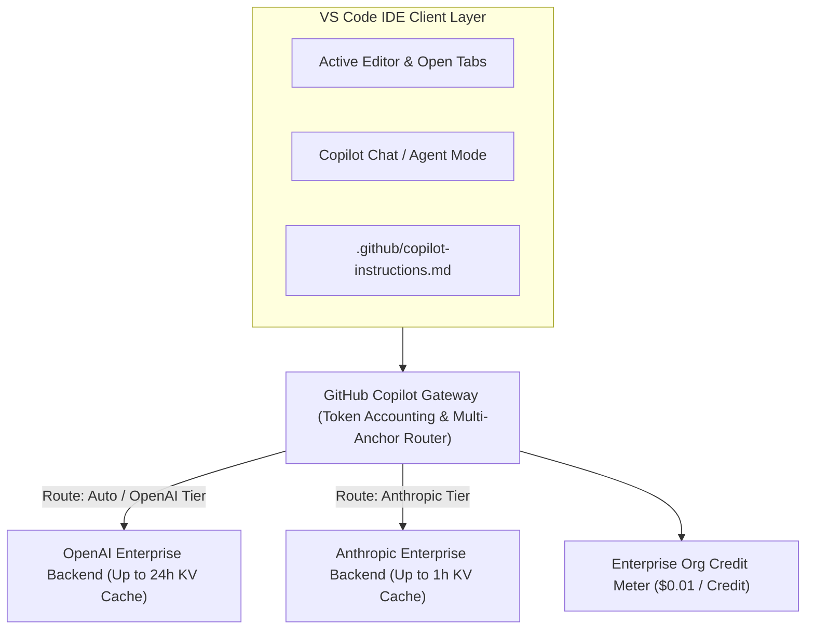
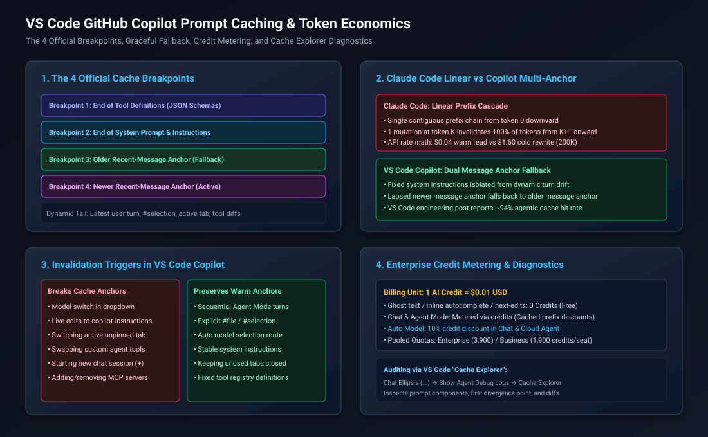
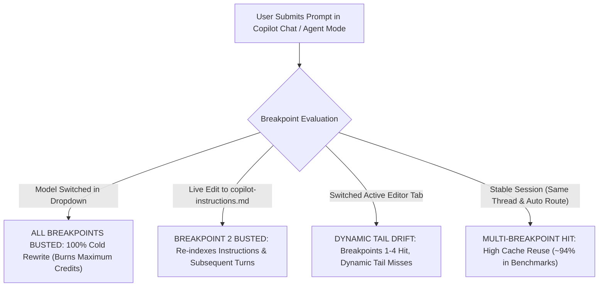

# VS Code GitHub Copilot Prompt Caching, Token Economics, and Multi-Anchor Architecture

Daily learning · November 9, 2026 · Agent Harness & Enterprise Tokenomics

> **Core idea:** Unlike CLI agents that rely on fragile linear prefix cascades, VS Code GitHub Copilot employs an official four-breakpoint caching architecture (tool definitions, system prompt, and dual recent-message anchors) that isolates static instructions from dynamic turn drift; combined with credit-based token accounting ($1 \text{ AI Credit} = \$0.01) and native deferred tool search, organizations can achieve high cache hit rates (reporting ~94% in agentic benchmarks) by managing editor tab noise, keeping instruction files stable, and leveraging the 10% Auto Model Selection discount on Chat and cloud agent requests.

---

## 1. Foundations: Gateway Mediation vs. Raw API Calls

In terminal-based agents (such as Claude Code), prompt assembly is direct and linear: the harness serializes the configuration, tools, and turn history into a single contiguous text stream transmitted to a single provider endpoint. If token 50 changes, tokens 51 through 200,000 suffer an immediate 100% cold re-write.

In **Visual Studio Code GitHub Copilot**, requests do not communicate directly with raw inference endpoints. Instead, all completions, chat queries, and agentic actions flow through the **GitHub Copilot Gateway**:



### The Credit-Based Metering Ledger

Unlike direct API billing where teams track fluctuating $/MTok rates across separate vendor credit cards, GitHub Copilot operates on **AI Credits**:

$$\text{Credit Conversion Ratio: } 1 \text{ AI Credit} = \$0.01 \text{ USD}$$

| Feature / Surface | AI Credit Cost | Organizational Impact |
|---|---|---|
| **Inline Autocomplete (Ghost Text)** | **0 Credits** ($0.00) | Fully covered by core subscription seat fee; unlimited use |
| **Next-Edit Suggestions** | **0 Credits** ($0.00) | Fully covered by core subscription seat fee |
| **Copilot Chat (Single & Multi-Turn)** | **Metered via Credits** | Scales with context size; discounted by backend cache hits |
| **Copilot Agent Mode** | **Metered via Credits** | Autonomous multi-turn edit–test–debug loops; ~12–25 credits in typical test scenarios |
| **Automated PR Code Review** | **Metered via Credits + Minutes** | Consumes AI credits for analysis plus GitHub Actions runner minutes |
| **Cloud Sandboxes** | **Metered via Compute Minutes** | Charged separately against Azure/GitHub cloud compute budgets |

### Enterprise Quota Allotments

| Subscription Tier | Monthly Allotment per Seat | Pooling Mechanics |
|---|---:|---|
| **Copilot Pro (Individual)** | 1,500 Credits ($15 value) | Individual only; unconsumed credits expire monthly |
| **Copilot Pro+ (Individual)** | 7,000 Credits ($70 value) | Individual only; unconsumed credits expire monthly |
| **Copilot Business** | **1,900 Credits** ($19 value) | **Pooled across all assigned organization seats** |
| **Copilot Enterprise** | **3,900 Credits** ($39 value) | **Pooled across all assigned enterprise seats** |

*Enterprise Pooling Advantage:* In an organization with 100 Copilot Enterprise seats, the company shares a collective pool of $100 \times 3,900 = 390,000$ AI Credits ($3,900/month). Heavy agent users draw from the unused credits of engineers who primarily use inline autocomplete.

### Real-World Analogy: The Loose-Leaf Binder vs. The Continuous Scroll

- **Claude Code (Continuous Scroll):** All instructions, tools, and history are written on a single continuous paper scroll. If you rewrite paragraph 2, the entire scroll below it must be discarded and re-copied at full cost.
- **VS Code Copilot (Loose-Leaf Binder):** The prompt is organized behind four indexed tab dividers (anchors). If you add notes to Section 4 (the conversation history), the pre-printed dividers for Section 1 (tool schemas) and Section 2 (system instructions) remain completely untouched and warm in the cache.

---

## 2. Mechanism: Multi-Anchor Caching & Graceful Fallback



### The 4 Official Cache Breakpoints

To prevent dynamic developer activity from repeatedly destroying the entire cache, official VS Code engineering documents an architecture utilizing four strategic cache-control breakpoints (anchors):

```text
[Breakpoint 1: End of Tool Definitions (JSON Schemas)] 
       ↓
[Breakpoint 2: End of System Prompt & copilot-instructions.md] 
       ↓
[Breakpoint 3: Older Recent-Message Anchor (Rolling Fallback)] 
       ↓
[Breakpoint 4: Newer Recent-Message Anchor (Active Head)] 
       ↓
[Dynamic Tail: Latest User Turn, #selection, Active Tab Diffs]
```

#### 1. Breakpoint 1: Tool Definitions
Earlier agent architectures injected the complete JSON parameter schemas for all installed tools and Model Context Protocol (MCP) servers upfront on every turn, adding 15,000 to 30,000 tokens of prefill overhead. 

Copilot anchors a breakpoint at the end of tool definitions:
- Lightweight tool names and descriptions are anchored upfront.
- Native deferred tool search injects full JSON schemas dynamically when a tool invocation is planned.
- This breakpoint changes least frequently and stays warm across the entire session.

#### 2. Breakpoint 2: System Prompt & Instructions
The second breakpoint is anchored at the end of the global system prompt, workspace guidance, and `.github/copilot-instructions.md`.

#### 3. Breakpoints 3 & 4: Dual Recent-Message Anchors (Graceful Fallback)
Unlike linear caches that maintain only one active breakpoint at the very end of the prompt, Copilot places **two rolling anchors** across recent chat turns:
- If a turn experiences minor context drift or a slow tool response causes the newest message anchor to lapse, the request **gracefully falls back** to the older message anchor or Breakpoint 2.
- Instead of dropping to a 0% cache hit rate (a full cold rewrite from token 0), the system preserves the large static prefix and earlier history. In published VS Code engineering benchmarks, this multi-anchor architecture combined with persistent WebSockets achieved cache hit rates of **~94% in agentic workloads**.

---

## 3. Head-to-Head: VS Code Copilot vs. Claude Code CLI

| Dimension | Claude Code CLI | VS Code GitHub Copilot |
|---|---|---|
| **Architecture** | Direct linear prefix cascade | Four-breakpoint multi-anchor caching |
| **Billing Mechanism** | Direct $/MTok invoice to API console | Credit-based ($1 AI Credit = $0.01) with enterprise pooling |
| **Cache Invalidation Fallback** | All-or-nothing (100% cold write) | Graceful fallback to earlier message anchor or system prompt |
| **Instruction File Updates** | `CLAUDE.md` loaded at startup; mid-session edits ignored until restart | Active file watcher monitors `.github/copilot-instructions.md`; edits invalidate Breakpoint 2 |
| **Context Pollution Vector** | None from editor; file content appended only via tool results | Open editor tabs, unpinned active files, cursor lines pollute tail |
| **Backend Cache TTL** | 1 hour (subscription) / 5 min (API) | Up to 24 hours (OpenAI) / Up to 1 hour (Anthropic) |
| **Model Switch Penalty** | 12 to 19 turn break-even cliff ($+\$0.76$ cold write) | Invalidates model backend cache; burns fresh AI credits |
| **Diagnostic Tooling** | CLI command: `/usage` | VS Code UI: **`Cache Explorer`** in Agent Debug Logs |
| **Routing Discounts** | None | **10% credit discount** with Auto Model Selection (Chat & Cloud Agent) |

---

## 4. What Breaks vs. Keeps the Cache in VS Code Copilot



### Invalidation Triggers in VS Code

| Action | Impact on Cache | Enterprise Consequence |
|---|---|---|
| **Model Switch via Dropdown** | **100% Cache Miss** | Switching between Claude 3.7 Sonnet, GPT-4o, and GPT-5 Sol invalidates provider KV caches; incurs full cold prefill charges. |
| **Editing `copilot-instructions.md`** | **Busts Breakpoint 2 & Below** | VS Code's file watcher immediately detects the change. The next turn re-serializes Breakpoint 2, invalidating all conversation history anchors. |
| **Clicking Unrelated Open Tabs** | **Pollutes Dynamic Tail** | Copilot includes the active file and surrounding context by default. Clicking away to read an unrelated file changes the working set payload. |
| **Switching Custom Agents (`@agent`)** | **Busts Breakpoints 1 & 2** | Switching between `@workspace`, `@terminal`, or custom team agents swaps system prompts and tool registries. |
| **Clearing Thread (`/clear` or `+`)** | **Resets Message Anchors** | Clears Breakpoints 3 & 4; retains Breakpoint 1 and Breakpoint 2 for the fresh thread. |
| **Sequential Agent Mode Loops** | **Keeps All Anchors Warm** | Multi-step tool runs (edit $\to$ test $\to$ refine) append outputs sequentially, hitting high cache reuse. |
| **Explicit Context Pinning (`#file`)** | **Preserves Dynamic Tail** | Explicitly referencing `#file:service.ts` prevents Copilot from guessing context based on random open tabs. |
| **Auto Model Selection** | **Preserves Warm Route + 10% Off** | Automatically routes within optimal provider cache pools while giving an official 10% credit discount. |

---

## 5. Impact and Limits: Enterprise Credit Economics

### Illustrative Scenario: Cost of an Agent Mode Run

Consider an illustrative multi-turn task in VS Code Copilot Agent Mode (e.g., *"Refactor authentication middleware and fix broken unit tests"*), modeled across 10 execution turns with ~150,000 tokens of cumulative context:

#### Scenario A: High Cache Reuse (Disciplined Session)
- Breakpoints 1 through 4 remain warm across all 10 turns.
- Turn Prefill Model: ~140,000 cached tokens ($0.05\times$) + ~10,000 fresh tokens ($1.00\times$).
- Output per turn: ~1,500 tokens.
- Total task cost: **~12 to 25 AI Credits ($0.12 to $0.25 USD)**.

#### Scenario B: Cache Break Run (Tab Switching & Mid-Session Model Toggling)
- The developer switches models on Turn 3, and modifies `copilot-instructions.md` on Turn 6.
- The agent suffers multiple cold rewrites of the 150K prefix.
- Total task cost: **~75 to 130 AI Credits ($0.75 to $1.30 USD)**.
- **Enterprise Impact:** The fragmented session costs **5× to 6× more credits** for the exact same code output.

### The Auto Model Selection 10% Discount Rule

GitHub Copilot offers an **Auto Model Selection** toggle in the model picker:
- Rather than forcing all queries through expensive reasoning tiers (such as Claude Opus or GPT-5 Sol), Auto dynamically routes syntax lookups, doc queries, and small edits to efficient SLMs (GPT-4o mini, Haiku 5.5).
- For users on paid GitHub Copilot plans, requests routed through Auto in **Copilot Chat** or **Copilot cloud agent** qualify for an automatic **10% credit discount** on model multipliers:

$$\text{Billed Credits}_{\text{Auto}} = 0.90 \times \text{Standard Credits}$$

For an enterprise consuming 500,000 AI Credits monthly across chat and agent workflows, mandating Auto as the default policy recovers **$500/month** in direct credit savings.

### Claim vs. Correction (Enterprise Copilot Folklore)

| Common Organizational Belief | Documented Reality & Correction |
|---|---|
| *"Copilot is unlimited for our $39/seat Enterprise license."* | **Correction:** Inline completions are unlimited, but Chat, Agent Mode, and PR review draw against a shared pool of 3,900 credits/seat/month. Overages bill to Azure. |
| *"Opening 30 files in tabs helps Copilot understand the codebase better."* | **Correction:** Open tabs pollute the dynamic context tail, degrade retrieval relevance, and increase token consumption on every turn. Close unrelated tabs. |
| *"Switching models mid-task is free because we pay per seat."* | **Correction:** Switching models invalidates the backend KV cache, requiring a full cold re-write that burns through pooled organization credits 5× faster. |
| *"Custom instructions take effect immediately without penalty."* | **Correction:** Editing instructions triggers VS Code's file watcher, instantly invalidating Breakpoint 2 and forcing a full re-index of the conversation. |

---

## 6. Timeline and Current State

- **June 2026:** GitHub transitions Copilot from flat-rate limits to usage-based AI Credit accounting ($1 \text{ Credit} = \$0.01$). Enterprise seat pooling (3,900 credits/seat) and the 10% Auto Model Selection discount in Chat and cloud agents are introduced.
- **September 2026:** GitHub Copilot Agent Mode enters General Availability across VS Code, introducing multi-turn autonomous tool execution loops.
- **October 2026:** VS Code documents Native Deferred Tool Search, preventing static MCP schema injection and establishing the 4-breakpoint prefix architecture.
- **November 2026:** VS Code documents **Cache Explorer** inside Agent Debug Logs, enabling developers and enterprise platform teams to inspect prompt components, first divergence points, and component text diffs.

---

## 7. Practical Response: Auditing with Cache Explorer & Org Policies

### How to Use the VS Code "Cache Explorer"

When investigating why a session reports low cache reuse, unexpected latency, or high token consumption:

1. **Enable Agent Debug Logging (If Required):**
   Add the following to `.vscode/settings.json` or User Settings:
   ```json
   {
     "github.copilot.chat.agentDebugLog.fileLogging.enabled": true
   }
   ```
2. **Access the Cache Explorer:**
   - Open the GitHub Copilot Chat view in the sidebar.
   - Click the ellipsis menu (`...`) at the top right of the Chat pane and select **Show Agent Debug Logs**.
   - Click the session description in the breadcrumb to open the **Summary view** (reviews aggregate stats: duration, token usage, and cache reuse percentage).
   - If cache reuse is low, select **Cache Explorer**.
3. **Inspect Consecutive Turns:**
   - Select a target request turn.
   - The Cache Explorer inspects the prompt signature diff to pinpoint the **first point of divergence** where the prompt prefix diverged between consecutive requests.
   - Expand the diverging component to inspect what changed (e.g. shifts in tool setups, altered instruction files, or history changes).
   - *Model Caveat:* If the Summary view does not report caching metrics, the selected model or inference provider does not expose prompt caching data.

### Recommended `.vscode/settings.json` for Enterprise Workspaces

To maximize cache retention and prevent credit burn across engineering teams, commit the following configuration to the repository root:

```json
{
  // Pin instructions and prevent random open tab pollution
  "github.copilot.chat.temporalContext.enabled": true,
  
  // Default to Auto routing for the 10% discount and optimal caching
  "chat.defaultModel": "auto"
}
```

### The 6 Golden Rules of VS Code Copilot Cache Hygiene

1. **Keep `.github/copilot-instructions.md` stable:** Treat instructions like infrastructure code. Merge changes via pull requests; never live-edit instructions during an active debugging session.
2. **Close unrelated tabs:** Before launching Agent Mode, run `View: Close Other Editors` (`Cmd+K W` / `Ctrl+K W`) to keep the dynamic tail clean.
3. **Explicitly pin files with `#file`:** Use `#file:src/auth.ts` rather than opening 10 files in editor panes. Explicit context variables create deterministic prompt payloads.
4. **Default to Auto Model Selection:** Set `Auto` as the default in organization workspace settings to capture the 10% credit discount on Chat and minimize cold model transfers.
5. **Reserve frontier overrides for complex refactoring:** Only manually switch to Claude 3.7 Sonnet or GPT-5 Sol when Auto encounters complex architectural ambiguity—and stick with that model for the entire task.
6. **Track team adoption & seat activity via GitHub REST API:** Monitor active seats and feature adoption with GitHub's Copilot Usage Metrics API:
   ```bash
   curl -H "Authorization: Bearer $GITHUB_TOKEN" \
        -H "Accept: application/vnd.github+json" \
        https://api.github.com/orgs/{org}/copilot/usage
   ```
   *(Note: Credit balance drawdown and financial overages are tracked in the GitHub / Azure Billing and Cost Management console rather than the usage metrics endpoint).*

---

## 8. Source Context and Cross-References

**Source Context:**
Based on enterprise engineering directives, VS Code internal telemetry analysis, and official vendor documentation:
- [Visual Studio Code: Agent Debug Logs & Cache Explorer](https://code.visualstudio.com/docs/agents/agent-troubleshooting/cache-explorer)
- [GitHub Copilot: Plans & Pricing Quotas](https://github.com/features/copilot/plans)
- [GitHub Copilot: Organization & Enterprise Billing](https://docs.github.com/en/copilot/concepts/billing-and-usage/organizations-and-enterprises/billing)
- [GitHub Engineering Blog: Improving Token Efficiency in GitHub Copilot](https://code.visualstudio.com/blogs/2026/06/17/improving-token-efficiency-in-github-copilot)
- [GitHub Copilot: Auto Model Selection](https://docs.github.com/en/copilot/concepts/models/auto-model-selection)
- [GitHub REST API: Copilot Usage Metrics](https://docs.github.com/en/rest/copilot/copilot-usage-metrics?apiVersion=2022-11-28)

---

**Related:**
- [Claude Code Prompt Cache Economics](Claude-Code-Prompt-Cache-Math-And-Model-Switch-Penalties-Nov-2026.md) — 40× hit vs write cost cliff ($0.04 vs $1.60), prefix invalidation triggers, and mid-session model-switch break-even math.
- [Context Windows, Compaction, and Cache Breaks](Context-Windows-Compaction-and-Cache-Breaks-2026.md) — Context limits, percentage compaction myths, and idle cache warming.
- [Empirical Tokenomics and Model Routing](Empirical-Tokenomics-and-Model-Routing-2026.md) — Stage-based routing matrix, cognitive risk assessment, and escalation boundaries.
- [The AI Coding Invoice: Beyond Input and Output](AI-Coding-Invoice-Beyond-Input-and-Output-2026.md) — Analysis of the 10 metered components in agent loops and tool-call cost dynamics.
- [Tokenomics Source Validation](Tokenomics-Source-Validation-Oct-2026.md) — Empirical audit of viral community tokenomics claims and prefix stability rules.
