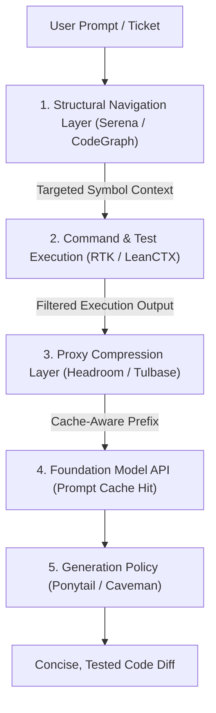

# AI Token Optimization Tools: Architectural Layers, Benchmarks, and Trade-offs

Daily learning · November 5, 2026 · Comparative Systems Review

> **Core idea:** Token reduction tools operate at fundamentally different architectural layers—structural navigation, shell output filtering, proxy compression, generation policy, and schema deferral. Stacking multiple compression layers without accounting for KV cache invalidation frequently inflates rather than reduces total provider invoices.

---

## 1. Foundations: Systems and Optimization Layers

Understanding AI token optimization requires distinguishing between the different layers where tokens enter, circulate, and leave an agentic system.

### The Optimization Hierarchy

| Layer | Optimization Strategy | Primary Tools | What It Operates On | Failure Mode / Caveat |
|---|---|---|---|---|
| **Structural Navigation** | Retrieve symbol definitions, callers, and references instead of whole files | [Serena](https://github.com/oraios/serena), [CodeGraph](https://github.com/colbymchenry/codegraph), [Codebase-Memory](https://github.com/DeusData/codebase-memory-mcp) | Repository source code & ASTs | Misses implementation logic and non-symbol context; stale indexes |
| **I/O & Command Filtering** | Deduplicate and filter noisy CLI, build, and test output | [RTK](https://github.com/rtk-ai/rtk), [LeanCTX](https://github.com/yvgude/lean-ctx) | Shell stdout/stderr, terminal streams | Strips critical error stack frames or non-zero exit indicators |
| **Proxy Compression & Recovery** | Intercept API payloads to compress inputs while retaining original references (CCR) | [Headroom](https://github.com/headroomlabs-ai/headroom), [Tulbase / Compresh](https://github.com/compresh/tulbase-mcp) | Wire-level JSON requests, prior turns | Prefix rewriting breaks KV cache; expired recovery references |
| **Generation Policy & Scoping** | Enforce minimal code generation and concise natural-language answers | [Ponytail](https://github.com/DietrichGebert/ponytail), [Caveman](https://github.com/JuliusBrussee/caveman) | Model output tokens & system rules | Advice is not hard enforcement; terse output can drop caveats |
| **Schema & Tool Deferral** | Wrap or dynamically load MCP schemas only when actively invoked | [MCP-Compressor](https://github.com/atlassian-labs/mcp-compressor), Native Tool Search | System prompts & tool definitions | Discovery round-trips add latency; native search already solves this |
| **Learned Prompt Compression** | Token classification or causal perplexity pruning for prompt pipelines | [LLMLingua](https://github.com/microsoft/LLMLingua) family | Raw text prompts & RAG contexts | High local compute overhead; drops critical syntax or negation |

---

## 2. Mechanism: How Token Optimization Tools Operate

The complete agentic request lifecycle passes through several potential optimization gates:

### Detailed Breakdown of Active Tools

#### 1. LeanCTX — Context Gateway & Structural Extraction
- **How it works:** Integrates via CLI, MCP, or hooks to provide structural file reads, targeted searches, command-output filtering, and local task logs.
- **Strengths:** Multiple modular touchpoints; local reference stores avoid re-sending large repetitive payloads.
- **Limitations:** Reference restoration depends on local cache persistence and agent tool permissions. Historical claims of "13-token rereads" have been officially withdrawn by maintainers.
- **Starting Point:** Evaluate structural file reads against baseline `cat`/`read_file` calls. Ensure the model can reliably fetch omitted implementations before using reference pointers.

#### 2. RTK — Command Output and Shell Noise Filtering
- **How it works:** Intercepts noisy shell output (e.g., `npm test`, `cargo build`, `pytest`), strips redundant progress bars and ANSI sequences, and emits compact summary blocks. Offers structural search.
- **Strengths:** Immediately reduces repetitive test/build chatter in automated loops. Built-in `rtk proxy <cmd>` provides an unfiltered escape hatch.
- **Limitations:** Output reduction metrics apply only to selected command output, not the entire conversation. Approximate token estimators can overestimate dollar savings. Filtered passes cannot replace examining raw failure traces.
- **Starting Point:** Wrap noisy build and test scripts; preserve access to raw logs.

#### 3. Headroom — Cache-Aware Input Compression & Context Recovery
- **How it works:** A local Rust/Python proxy intercepting LLM HTTP calls. Features Content-addressable Context Recovery (CCR) and CacheAligner. Code-aware compression preserves imports, type signatures, and class boundaries while truncating method bodies.
- **Strengths:** Default proxy cache mode compresses only *new* eligible input while preserving previously transmitted prefixes, safeguarding provider KV prompt cache hits.
- **Limitations:** CCR originals are subject to eviction/expiry; models must recognize when context was pruned and explicitly request recovery. CacheAligner detects misalignment but does not dynamically reorder payload keys.
- **Starting Point:** Verify installed version compatibility; test round-trip CCR recovery on complex source files before routing production traffic.

#### 4. Caveman — Terse Output Skill vs v4 Proxy Routing
- **How it works:** Originally a concise prompting rule. Version 4 introduces an input-compression proxy, model/effort routing, and reusable code blocks.
- **Strengths:** Directly curbs verbose conversational explanations; v4 orchestrates model selection to lower costs.
- **Limitations:** Prompt brevity and proxy routing are distinct mechanisms. Savings achieved by routing to cheaper models cannot be attributed to terse prose. Auto routing relies on cloud infrastructure.
- **Starting Point:** Use the lightweight prompt rule when conversational prose is bloated; evaluate the v4 proxy independently with strict data-privacy verification.

#### 5. Serena — Language Server Symbol Navigation & Editing
- **How it works:** Communicates over Language Server Protocol (LSP) or optional JetBrains backend to look up definitions, symbol references, and execute AST-aware edits.
- **Strengths:** Eliminates full-file grep/read loops when navigating unfamiliar repositories.
- **Limitations:** Semantic navigation cannot guarantee atomic cross-file refactoring. JetBrains backend is commercial/optional; LSP capabilities vary across language servers.
- **Starting Point:** Configure LSP for the repository's primary language; compare token consumption of symbol lookup against whole-file reading.

#### 6. Ponytail — Minimalist Generation Policy
- **How it works:** Injects specialized system directives instructing the model to prioritize existing abstractions, avoid defensive boilerplate, and minimize new dependencies.
- **Strengths:** Addresses a major hidden cost: agents over-architecting solutions and creating hundreds of lines of unnecessary code that must subsequently be tested and maintained.
- **Limitations:** Rules represent guidance, not architectural enforcement. Reduced lines of code must still pass comprehensive unit and integration tests.
- **Starting Point:** Apply rules to bounded tickets with explicit acceptance tests; verify that omitted code does not represent missed edge cases.

#### 7. MCP-Compressor — Tool Catalog Wrapper
- **How it works:** Wraps downstream MCP servers, presenting concise one-line tool summaries in the system prompt and fetching full parameter schemas on demand.
- **Strengths:** Valuable in environments with dozens of active MCP tools where schemas consume 10,000+ tokens per turn.
- **Limitations:** Schema discovery adds an extra round-trip per new tool invocation. Native deferred tool search (now standard in modern harnesses like Claude Code and Copilot) largely supersedes external wrappers.
- **Starting Point:** Measure baseline tool schema overhead; deploy only if native tool deferral is unavailable in your harness.

#### 8. Tulbase / Compresh — Local Key-Value State vs Remote Retrieval
- **How it works:** Open-source Tulbase MCP stores transcripts locally and emits compact references with a recent-turn protection zone. Commercial Compresh adds remote query-aware TUL2 retrieval.
- **Strengths:** Fully local storage without external credentials for the core MIT tool.
- **Limitations:** Commercial Compresh routes conversation transcripts through third-party servers and operates under a Business Source License (BSL).
- **Starting Point:** Restrict usage to local Tulbase MCP unless remote data-handling compliance is fully vetted.

#### 9. LLMLingua Family — Learned Prompt Compression
- **How it works:** LLMLingua utilizes causal model perplexity to eliminate redundant tokens; LLMLingua-2 utilizes an encoder token classifier; LongLLMLingua handles long-context RAG.
- **Strengths:** Programmable compression ratio for high-volume custom RAG and summarization pipelines.
- **Limitations:** Requires local GPU/CPU compute to execute the compression model. Pruning can inadvertently drop negation words, numeric constraints, or syntax delimiters.
- **Starting Point:** Benchmark on offline RAG test sets; verify that semantic recall and downstream task accuracy remain uncompromised.

#### 10. Codebase-Memory & CodeGraph — Persistent Repository Indexes
- **How it works:** Pre-indexes repository syntax trees (Tree-sitter) into persistent relational or graph stores, answering caller/dependency questions without live file scanning.
- **Strengths:** Fast multi-hop dependency tracing across enterprise codebases.
- **Limitations:** Graph answers often lack implementation context, requiring subsequent file reads. Graph synchronization drift can provide outdated symbol locations.
- **Starting Point:** Use graph queries for structural orientation; perform actual code edits against fresh filesystem reads.

---

## 3. Impact and Limits: Deconstructing Vendor Benchmark Denominators

Reported benchmark savings often disguise narrow experimental conditions:

1. **Ponytail (Reported 53% LOC / 26% Cost Reduction):**
   Evaluated across 39 tasks with 5 runs per arm on Opus 5.5. Crucially, **bash tool access was disabled**, and hidden executable verification covered only 18 of 39 tasks. It is not an unrestricted autonomous coding benchmark.
2. **Caveman v4 (Reported ~70% Cost Reduction):**
   Combines three independent levers: natural language terseness, proxy payload compression, and cloud model routing. Routing from a frontier to an efficient model accounts for the vast majority of dollar savings, not prompt brevity.
3. **Codebase-Memory (Reported 10× Token Reduction):**
   The accompanying paper notes that while tokens dropped tenfold, **answer accuracy declined from 92% (file explorer) to 83% (graph only)**. Token savings achieved by sacrificing solution correctness generate negative net value due to manual developer rework.
4. **Headroom & RTK (Reported 30–80% Payload Compression):**
   Calculations reflect compressed request payloads, not net monthly invoices. If a proxy modifies an established prompt prefix, the loss of provider KV cache read discounts (e.g., 90% discount on Claude Sonnet 5.5) will result in a net bill *increase*.

### Misconceptions and Ground Truth

| Misconception | Ground Truth |
|---|---|
| *"Stacking three optimization tools yields 3× savings."* | **False:** Tools overlap in scope. Stacking an AST navigator, a compression proxy, and a terse skill leads to tool schema conflicts, redundant processing overhead, and increased latency. |
| *"Compressing every message guarantees lower costs."* | **False:** On cached endpoints (Anthropic, OpenAI, DeepSeek), re-compressing an existing conversation prefix creates a new cache key, triggering an expensive full-price cache write on every turn. |
| *"AST graphs eliminate the need to read source code."* | **False:** Graph indexes provide symbol signatures and caller hierarchies, but models still need full method implementations to understand side effects and write correct patches. |

---

## 4. Timeline and Current State

- **Early 2024:** Prompt compression relies primarily on research libraries (LLMLingua) requiring dedicated compute instances.
- **Mid 2024:** CLI noise becomes the primary driver of agent token burn. RTK and shell filters gain wide adoption in terminal-based coding agents.
- **Late 2024 – Mid 2025:** Provider prompt caching becomes ubiquitous. Proxy compressors (Headroom, early LeanCTX) adapt to support cache-aware forwarding to avoid breaking prefix reuse.
- **2026 Landscape:**
  - **Tool Consolidation:** Tools expand beyond single-purpose scripts into multi-tier suites (e.g., Caveman adding routing and proxies; RTK offering engine/proxy modes).
  - **Headroom Version Boundary:** Latest release is v0.42.0 (incorporating enhanced CCR and CacheAligner). The local repository wrapper (`Scripts/headroom/headroom-env.sh`) remains pinned to v0.37.0.
  - **Native Harness Deferral:** Major agent harnesses (Copilot, Claude Code, AGY) implement native deferred tool loading and multi-anchor prefix caching, reducing the necessity of third-party MCP compressors.

---

## 5. Practical Response and Lessons: Selection Framework & Safe Integration

### Problem-Driven Selection Framework

Select optimization tools based strictly on measured operational bottlenecks:

| Primary Observed Bottleneck | Recommended First Intervention | Secondary Tool (If Needed) |
|---|---|---|
| **Agent executes dozens of grep/file scans** | Serena (LSP) or CodeGraph | Codebase-Memory |
| **Terminal / test output floods context** | RTK CLI with raw log preservation | LeanCTX shell filter |
| **Large JSON / data payloads dominate history** | Headroom (cache-aware mode) | Tulbase MCP (local) |
| **Model writes bloated, redundant code** | Ponytail directives & strict DoD | Caveman terse prompts |
| **MCP tool definitions consume 15k+ tokens** | Native deferred tool search | MCP-Compressor |
| **Custom enterprise RAG pipeline cost** | LLMLingua-2 | LongLLMLingua |

### Safe Integration Rules

1. **Test One Layer at a Time:** Never enable a proxy compressor and a new graph navigator simultaneously. Measure single-variable delta.
2. **Preserve Raw Fallbacks:** Any command filter must offer an instant raw pass-through (e.g., `rtk proxy <cmd>`).
3. **Verify Prefix Invariance:** Ensure the proxy does not rewrite historical turns. Confirm in provider logs that `cache_read_input_tokens` remains high across multi-turn interactions.
4. **Benchmark on Accepted Changes:** Calculate savings strictly using Cost Per Accepted Change:

$$\text{Cost Per Accepted Task} = \frac{\text{Total Dollar Spend Across All Iterations}}{\text{Count of Verified Merged Tasks}}$$

---

## 6. Source Context and Cross-References

**Source Context:**
Based on primary repository analysis, official package releases, and peer-reviewed papers:
- [Headroom Architecture & Documentation](https://docs.headroomlabs.ai/docs/architecture) (v0.42.0)
- [RTK Repository & Documentation](https://github.com/rtk-ai/rtk)
- [Ponytail Benchmark Methodology](https://github.com/DietrichGebert/ponytail/blob/main/benchmarks/results/2026-10-07-agentic.md)
- [Codebase-Memory Paper (ArXiv:2603.27277)](https://arxiv.org/abs/2603.27277)
- [LLMLingua-2 (ArXiv:2403.12968)](https://arxiv.org/abs/2403.12968)
- [CAPC Cache-Aware Prompt Compression (ArXiv:2607.15516)](https://arxiv.org/abs/2607.15516)

---

**Related:**
- [GenAI Cost Optimization](GenAI-cost-Optimization.md) — Three-tier FinOps framework, semantic caching, and model downshifting.
- [Empirical Tokenomics and Model Routing](Empirical-Tokenomics-and-Model-Routing-2026.md) — Stage-based model selection and context handoffs.
- [The AI Coding Invoice: Beyond Input and Output](AI-Coding-Invoice-Beyond-Input-and-Output-2026.md) — Ledger breakdown of hidden token charges, cache writes, and runtime fees.
- [CodeGraph, Headroom, and Context-Management Trade-offs](CodeGraph-Headroom-and-Context-Management-Trade-Offs-Oct-2026.md) — Model-dependent experiments and Headroom proxy integration.
- [Headroom & RTK: Real-World Feedback](Headroom-RTK-Real-World-Feedback-2026.md) — Field reports and cache invalidation risks.
