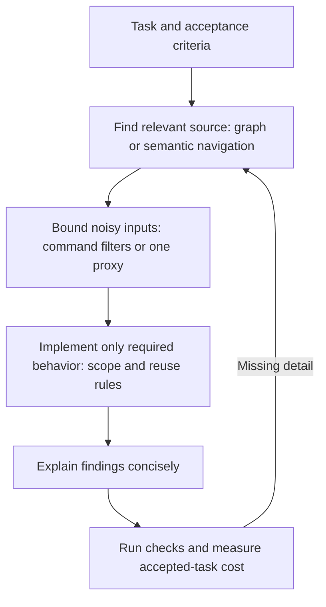

# AI Token Optimization Tools — Compare the Layer, Not the Headline

**Updated · 28 October 2026 · Primary-source refresh**

> **Core idea:** Navigation, compression, less generated code, and shorter explanations solve different problems. Current products increasingly overlap; token-reduction percentages are not comparable without matching workload, quality checks, and billing categories.

## 1. Current tool map

| Tool | What it changes | What to check |
|---|---|---|
| [CodeGraph](https://github.com/colbymchenry/codegraph) | Pre-indexed symbols, callers, dependencies, auto-sync | Graph completeness/freshness; expand source when needed |
| [Serena](https://github.com/oraios/serena) | Language-server/optional JetBrains symbol navigation and edits | Backend capabilities vary; no blanket atomic-refactoring guarantee |
| [Codebase-Memory](https://github.com/DeusData/codebase-memory-mcp) | Persistent Tree-sitter graph retrieval | Structural answers can omit implementation details |
| [Headroom](https://github.com/headroomlabs-ai/headroom) | Proxy/SDK input compression, retrieval, cache-aware forwarding; optional navigation/memory | Enabled mode, provider compatibility, original retention, actual billing |
| [RTK](https://github.com/rtk-ai/rtk) | Command-output filters and structural reads; newer engine/proxy offerings have broader scope | OSS CLI versus separate offerings; raw-output fallback |
| [Ponytail](https://github.com/DietrichGebert/ponytail) | Generation policy: prefer reuse and avoid unnecessary code | Required behavior still implemented; rules are not enforcement |
| [Caveman](https://github.com/JuliusBrussee/caveman) | Classic terse-output skill; v4 adds an input proxy, routing, reusable blocks | Skill versus proxy versus cloud Auto; overlapping transforms and data path |
| [LeanCTX](https://github.com/yvgude/lean-ctx) | Structural reads, search, output filters, references, task records | Current README withdraws older compression tables; quality impact needs evaluation |
| [MCP-Compressor](https://github.com/atlassian-labs/mcp-compressor) | Wrapper reduces exposed tool-definition surface | Existing native tool search may already solve much of the problem |
| [LLMLingua / LLMLingua-2](https://github.com/microsoft/LLMLingua) | Learned prompt compression; LLMLingua-2 uses token classification | Additional model/compute, information loss, cache interaction; benchmark scope |
| [Tulbase / Compresh](https://github.com/compresh/tulbase-mcp) | Local summaries/storage; separate paid remote retrieval | Core versus wrapper licensing, transcript data path, retained originals |

## 2. How the tools work: strengths, limits, and starting points

### LeanCTX — a broader context gateway

**How it works:** combines structural file reads, search, command-output filtering, references to retained content, and local task records through CLI, MCP, hooks, or proxy integrations. Its current scope is broader than the earlier AST-only description.

**Pros:** several ways to retrieve only relevant material; local references can avoid repeatedly returning large payloads.

**Cons:** reference recovery depends on retained originals and permissions. The maintainer withdrew historical compression tables, including fixed “13-token reread” claims; neither those figures nor universal quality preservation should guide adoption.

**Start:** choose one integration and compare ordinary reads with structural reads on your repository. Confirm the agent can recover omitted details before relying on references. [Current capabilities and benchmark status](https://github.com/yvgude/lean-ctx)

### RTK — reduce noisy command output

**How it works:** a CLI filters supported command results and offers structural reads/search. The OSS CLI, broader engine edition, and separate API proxy have different scope and licensing; “shell output only” no longer describes the entire project.

**Pros:** useful for repetitive test/build output and easy to evaluate on existing commands. `rtk proxy <command>` provides an unfiltered fallback.

**Cons:** advertised reductions concern selected command payloads, not the entire bill. Savings counters can use approximate token estimates; a filtered success summary cannot replace inspecting a failure or verifying behavior.

**Start:** use supported filters on noisy commands, retain access to raw output, and compare provider usage as well as `rtk gain`. [RTK documentation](https://github.com/rtk-ai/rtk)

### Headroom — compress inputs while managing recovery and cache stability

**How it works:** proxy/SDK paths select compressors for eligible content. Default proxy cache mode preserves previous representations and compresses new eligible material. Code-aware compression can retain imports, signatures, and structure while shortening implementations; eligibility and passthrough guards matter. Optional graph navigation and memory extend its scope. [Architecture](https://docs.headroomlabs.ai/docs/architecture), [code compression](https://docs.headroomlabs.ai/docs/code-compression)

**Pros:** handles several input types and offers retrieval of retained originals through CCR. Cache-aware forwarding addresses a real risk: rewriting old content can lose a useful cached prefix.

**Cons:** CCR originals can expire or be evicted, retrieval must be reachable, and the model must ask for missing detail. CacheAligner is detector-only, not a mechanism that reorders dynamic fields. Optional cold-prefix recompaction can rewrite history and is separate from default behavior. Local compression does not establish that every feature sends no metadata externally. [CCR](https://docs.headroomlabs.ai/docs/ccr), [cache behavior](https://docs.headroomlabs.ai/docs/cache-optimization), [limitations](https://docs.headroomlabs.ai/docs/limitations)

**Start:** verify your installed version and enabled mode, test recovery, then compare accepted-task cost. SDK audit/optimization and proxy modes are distinct. See the version boundary below before applying current documentation to this repository.

### Caveman — distinguish the terse skill from the v4 product

**How it works:** the classic skill asks for concise natural-language responses. Version 4 also adds an input-compression proxy, model/effort routing, and reusable code blocks.

**Pros:** the skill directly addresses verbose explanations; the broader product can address input volume and routing too.

**Cons:** these are different interventions. Savings from a cheaper routed model cannot be attributed to shorter prose. Auto routing uses Caveman Cloud/account infrastructure; do not describe the whole product as local-only. Terse output must still communicate assumptions, failures, and review findings.

**Start:** try the skill when prose is the problem; evaluate the proxy or Auto separately with a clear data path and quality checks. [v4 release and evaluation context](https://github.com/JuliusBrussee/caveman/releases/tag/v4.0.0)

### Serena — retrieve and edit through code symbols

**How it works:** uses language-server capabilities or an optional paid JetBrains backend to find symbols, references, and perform supported edits. Backend and language support determine available operations.

**Pros:** useful when the agent repeatedly scans files to locate definitions and callers; symbol-level access can return more relevant code.

**Cons:** semantic navigation does not guarantee correct or atomic cross-file refactoring. Backend capabilities vary, and implementation details may still require full reads. JetBrains is optional, not a prerequisite for the LSP path.

**Start:** activate the project through your host's supported integration, test symbol lookup and references in its main languages, then verify edits with the project's checks. [Serena documentation](https://github.com/oraios/serena)

### Ponytail — avoid generating unnecessary code

**How it works:** skill/rule guidance encourages reuse, existing facilities, and minimal solutions before introducing new dependencies or abstractions. This changes implementation decisions, not just response length.

**Pros:** targets a common coding-agent cost: producing and maintaining code the task did not need. Explicit scope and acceptance criteria complement the guidance.

**Cons:** rules are advice, not enforcement. Fewer lines do not prove equivalent behavior, security, or maintainability. Reinjection and available commands depend on the host integration; do not assume identical behavior everywhere.

**Start:** apply its supported rules to a bounded task and review both required behavior and omitted work. Its maintainer benchmark is useful evidence with limits described below. [Project and integrations](https://github.com/DietrichGebert/ponytail)

### MCP-Compressor — expose a smaller tool catalog

**How it works:** wraps MCP servers with compact tool descriptions, fetching full schemas on demand before invoking tools. Compression levels trade upfront detail for discovery calls. Current documentation also offers optional response shrinking with recovery paths; it is no longer exclusively schema compression.

**Pros:** useful for large catalogs; Python, TypeScript, and Rust integrations, with stdio and streamable HTTP support.

**Cons:** schema discovery adds calls, aggressive shortening can obscure tool choice, and native deferred tool search may already provide much of the benefit. Response shrinking introduces its own recovery requirements. The reported 70–97% reduction measures upfront tool-description/schema overhead, not total workflow tokens.

**Start:** measure your host's initial catalog first. If it is substantial, test a moderate wrapper level before stronger compression. [Project](https://github.com/atlassian-labs/mcp-compressor), [mechanism](https://atlassian-labs.github.io/mcp-compressor/concepts/how-it-works/), [benchmark explanation](https://www.atlassian.com/blog/developer/mcp-compression-preventing-tool-bloat-in-ai-agents)

### Tulbase / Compresh — separate local storage from paid remote retrieval

**How it works:** the local Tulbase MCP core stores originals and returns compact summaries/references, preserving a recent-message protection zone. It provides compression, fetch, listing, and statistics tools. The current paid Compresh wrapper adds remote query-aware TUL2 retrieval; its older Q-ranking description is historical.

**Pros:** the MIT local core supports local storage and recovery without model credentials.

**Cons:** recovery depends on retained storage; summaries may omit important detail. The paid path sends conversation history to Compresh infrastructure and has separate fees and a BSL licence requiring a valid subscription for production use. Do not describe the whole offering as MIT or fully local. Maintainer dialog-size examples are not independently established coding-task savings.

**Start:** identify which repository/package you intend to use. Standalone installation guidance conflicts across READMEs, so verify distribution availability rather than assuming a package command works. Hosted service availability was not verified in this refresh. [Local Tulbase](https://github.com/compresh/tulbase-mcp), [current Compresh](https://github.com/compresh/compresh-mcp), [wrapper licence](https://github.com/compresh/compresh-mcp/blob/main/LICENSE)

### LLMLingua family — learned compression for an application you control

**How it works:** original LLMLingua uses a small causal model and perplexity-based token selection. LLMLingua-2 instead uses a distilled bidirectional token classifier. LongLLMLingua is a separate query-aware approach for long-context applications.

**Pros:** offers a programmable compression budget for owned prompt/RAG pipelines, with published research evaluations.

**Cons:** requires compressor compute and model downloads; extraction can remove identifiers, negation, or constraints. Original LLMLingua's “up to 20×” result is workload-specific. LongLLMLingua's reported improvement on NaturalQuestions is not a general coding-agent result or an LLMLingua-2 result.

**Start:** integrate in a controlled pipeline, retain originals, and test answer quality plus end-to-end latency and cost. It is a library, not a transparent IDE optimisation switch. [Microsoft implementation](https://github.com/microsoft/LLMLingua), [original paper](https://arxiv.org/abs/2310.05736), [LLMLingua-2](https://arxiv.org/abs/2403.12968), [LongLLMLingua](https://arxiv.org/abs/2310.06839)

### Codebase-Memory — retrieve repository structure from a persistent graph

**How it works:** indexes code using Tree-sitter and exposes graph-based repository queries rather than repeatedly exploring whole files.

**Pros:** compact structural answers can help with repository orientation and relationships.

**Cons:** structural answers can miss implementation detail. Its paper's token reduction came with lower measured answer quality; that trade-off belongs alongside the savings claim, not in a footnote.

**Start:** evaluate on questions with known answers and expand the underlying source for implementation work. The paper's version and repository-question workload do not establish current end-to-end coding performance. [Implementation](https://github.com/DeusData/codebase-memory-mcp), [paper](https://arxiv.org/abs/2603.27277)

### CodeGraph — indexed navigation with freshness to verify

**How it works:** builds an index of symbols, callers, and dependencies with synchronization support, allowing targeted graph queries before source expansion.

**Pros:** can reduce broad searches when code relationships are the missing information.

**Cons:** indexing coverage/freshness and the model's tool choices affect results. More graph calls can increase cumulative tokens even when resident context shrinks. The shared video's results varied by model; it is not proof that graphs always save money.

**Start:** compare the same task with and without the graph, counting repairs and validating the implementation. [Project](https://github.com/colbymchenry/codegraph), [detailed experiment review](CodeGraph-Headroom-and-Context-Management-Trade-Offs-Oct-2026.md)

## 3. Read the benchmark denominator

- **Ponytail:** a maintainer A/B evaluation reports 53% fewer source lines, 45% fewer **output** tokens, and 26% lower estimated cost across 39 tasks with five runs per arm on Opus 5.5. Bash was disabled; executable hidden checks covered only 18 tasks. This is not a complete edit–execute–debug benchmark or universal safety guarantee. [Method and results](https://github.com/DietrichGebert/ponytail/blob/main/benchmarks/results/2026-10-07-agentic.md)
- **Caveman:** current proxy/routing savings come from maintainer evaluations; routing to another model and compressing inputs are different interventions. Do not attribute their combined savings to terse prose. Auto routing uses a cloud service/account. [v4 release](https://github.com/JuliusBrussee/caveman/releases/tag/v4.0.0)
- **Codebase-Memory:** its paper reports roughly 10× fewer tokens but 83% answer quality versus 92% for a file explorer across 31 repositories. That result concerns repository questions, not a guarantee of better implementations. [Paper](https://arxiv.org/abs/2603.27277)
- **Headroom and RTK:** reduced payload tokens or estimated avoided cost are different from lower provider spend. Count cache reads/writes, generated tokens, recovery, and completed outcomes. [Field-report review](Headroom-RTK-Real-World-Feedback-2026.md)

## 4. Choose by the observed problem

| Observed problem | First experiment |
|---|---|
| Agent repeatedly searches for definitions/callers | One graph or semantic-navigation tool |
| Build/test logs flood context | RTK or targeted output filtering with raw logs retained |
| Selected JSON/log/text payloads remain large | Headroom **or** another proxy, then measure retrieval and cache effects |
| Agent invents abstractions and excess code | Ponytail plus explicit acceptance criteria |
| Explanations are needlessly long | A concise-output instruction or Caveman skill |
| Tool schemas dominate initial context | Native deferred tool search first; evaluate a wrapper only if needed |
| Custom application needs learned compression | LLMLingua family against a quality-preserving control |

Add one layer at a time. Do not route through several compressors merely because each advertises savings. Freeze model/effort, task snapshot, repair allowance, and acceptance checks; repeat trials and report variation. Pair output/input counters with actual provider billing and independent behavioral verification.

### A layer model, with overlap

This is a simplified decision path, not a requirement to install every layer. Several products span multiple boxes.

### Suggested combinations

| Situation | Initial combination | Add another layer only when… |
|---|---|---|
| Noisy build/test workflow | RTK + normal source reads | Relevant inputs still dominate usage |
| Large unfamiliar repository | One of Serena, CodeGraph, or Codebase-Memory | Navigation improves, but selected payloads remain too large |
| Repeated large JSON/log inputs | One proxy such as Headroom | Recovery and cache behavior pass your checks |
| Overbuilt implementations | Ponytail + explicit non-goals | Required behavior remains covered and excess code falls |
| Verbose explanations | Concise-output instruction or Caveman skill | Readers still receive necessary evidence and caveats |
| Large MCP catalog | Native tool search, then MCP-Compressor if needed | Measured upfront schema overhead warrants extra discovery |

Avoid starting with several graph tools or multiple rewriting proxies. Their schemas, indexes, rules, and transformations can overlap; savings percentages cannot be added together.

## 5. Headroom version boundary in this repository

Latest release checked: [v0.42.0, 26 October](https://github.com/headroomlabs-ai/headroom/releases/tag/v0.42.0). The [shared wrapper config](../../../Scripts/headroom/headroom-env.sh) remains pinned to 0.37.0. Published docs, installed capability, and enabled features are separate facts; this note makes no runtime/configuration change.

---

**Related:**
- [CodeGraph, Headroom, and Context-Management Trade-offs](CodeGraph-Headroom-and-Context-Management-Trade-Offs-Oct-2026.md) — Model-dependent experiment, current Headroom features, and a practical evaluation plan.
- [Headroom & RTK: Real-World Feedback](Headroom-RTK-Real-World-Feedback-2026.md) — Earlier reports and version-sensitive integration risks.
- [AI Coding Loops](../../Agents/development/AI-Coding-Loops.md) — Executable verification and harness design.
- [Empirical Tokenomics and Model Routing](Empirical-Tokenomics-and-Model-Routing-2026.md) — Model selection and accepted-task economics.
